# BME1322 人工智能 · 第8章：马尔可夫决策过程（MDP）深度复习笔记（图文增强版）

> **课程信息**：上海科技大学 · 生物医学工程学院 | BME1322 人工智能（王乾 教授）  
> **章节主题**：马尔可夫决策过程（Markov Decision Process, MDP）—— 从被动观察到主动决策  
> **核心主线**：在不确定环境中，把长期后果写进决策目标（好决策不是只看这一步，而是看折扣后的整条未来）  
> **配套高清图解**：本笔记配套生成了 4 张高清原理与算例图解（`图1` 至 `图4`），并在笔记正文中内嵌了结构化流程图、状态转移图与公式逐项拆解标注，全方位辅助直观理解。

---

## 一、 章节逻辑脉络与全景导览

在人工智能的知识体系中，本章完成了从**概率推理（被动观察世界）**向**理性决策与规划（主动干预世界）**的关键跃迁。全章围绕“如何在具有随机性的动态环境中做出长期最优选择”展开，遵循以下四大递进模块：

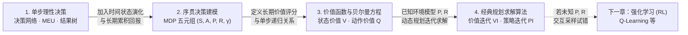

| 模块阶段 | 核心概念与工具 | 解决的核心问题 | 局限性或演进方向 |
| :--- | :--- | :--- | :--- |
| **1. 单步理性决策** | 决策网络（Influence Diagram）、最大期望效用（MEU）、结果树 | 在给定观测证据 $e$ 下，如何权衡单次动作的随机结果与效用？ | 仅做一次性决策，无状态转移与长期未来后果 |
| **2. 序贯决策建模** | MDP 五元组 $(S, A, P, R, \gamma)$、马尔可夫性、多目标标量化 | 如何形式化描述“动作改变状态、状态影响后续选择”的动态环境？ | 给出了问题定义与计分规则，尚未给出求解算法 |
| **3. 价值函数与贝尔曼方程** | 状态价值 $V^\pi(s)$、动作价值 $Q^\pi(s,a)$、贝尔曼期望方程与最优方程 | 如何用递归方程定量刻画“即时奖励 + 折扣未来价值”？ | 最优贝尔曼方程含非线性算子 $\max$，难以直接闭式求解 |
| **4. 经典动态规划求解** | 价值迭代（Value Iteration）、策略迭代（Policy Iteration）、策略提取 | 已知环境转移 $P$ 与奖励 $R$ 时，如何高效迭代求得最优策略 $\pi^*$？ | 要求已知环境模型 $P$ 和 $R$；未知模型时需进入下一章强化学习（RL） |

---

## 二、 模块一：从概率推理到单步理性决策（决策网络与 MEU）

> 💡 **视觉辅助参考**：请结合配套高清图 **`图1_决策网络与MDP模型演进图解.png`**（面板 A & B）对照阅读本节。

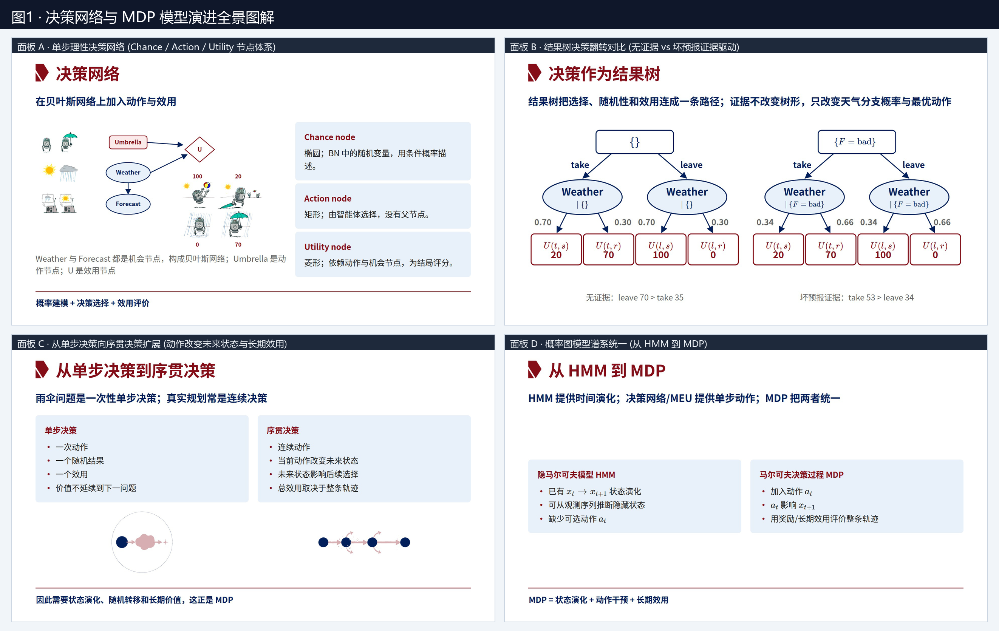

### 2.1 决策网络（Decision Networks / 影响图 Influence Diagrams）

传统的**贝叶斯网络（Bayesian Network, BN）**只包含随机变量节点，用于计算后验概率分布（如根据天气预报推断今天下雨的概率），属于“被动观察”。**决策网络**在贝叶斯网络的基础上引入了智能体的**主动动作**与**价值评判**，由三类几何形状各异的节点构成：

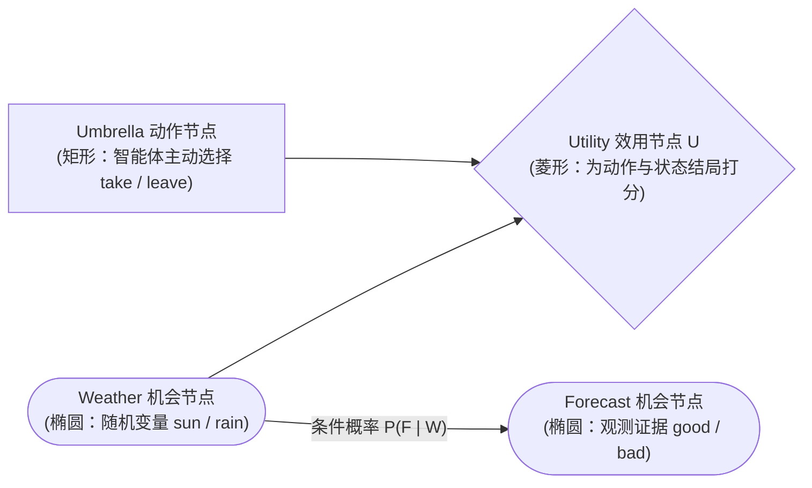

| 节点类型 | 图形表示 | 数学角色与依赖关系 | 课件雨伞示例对应节点 |
| :--- | :--- | :--- | :--- |
| **机会节点（Chance Node）** | 椭圆形 | 贝叶斯网络中的随机变量，受父节点影响，用条件概率表（CPT）描述 | `Weather`（真实天气）、`Forecast`（天气预报，依赖于 `Weather`） |
| **动作节点（Action Node）** | 矩形 | 由智能体主动选择的决策变量，**没有父节点**（或仅以决策时已知的信息为输入） | `Umbrella`（是否带伞：`take` 带伞 / `leave` 不带伞） |
| **效用节点（Utility Node）** | 菱形 | 依赖动作节点与机会节点，将不同的“动作-状态”结局映射为实数评分（效用值 $U$） | `U`（同时依赖 `Umbrella` 和 `Weather` 的效用函数） |

> **核心公式化概括**：**决策网络 = 概率建模（机会节点） + 决策选择（动作节点） + 效用评价（效用节点）**。

---

### 2.2 最大期望效用原理（MEU, Maximum Expected Utility）

在不确定环境中，智能体无法直接控制随机结果（如无法控制是否下雨），但可以通过概率推理计算每个候选动作带来的**期望效用（Expected Utility, EU）**。理性智能体应当选择使期望效用最大化的动作。

#### 1. 核心公式与结构拆解
给定当前观测到的证据 $e$，候选动作 $a$ 的期望效用定义为所有可能结果状态 $o$（Outcome）的效用按后验概率加权之和：

$$EU(a \mid e) = \sum_{o} \underbrace{P(o \mid a, e)}_{\substack{\text{① 贝叶斯推理：} \\ \text{给定证据 } e \text{ 和动作 } a \text{ 后} \\ \text{结局 } o \text{ 发生的后验概率}}} \cdot \underbrace{U(o)}_{\substack{\text{② 效用查表：} \\ \text{结局 } o \text{ 对应的} \\ \text{主观价值评分}}}$$

最优决策动作 $a^*$ 与最大期望效用值 $MEU(e)$ 分别为：
$$a^* = \arg\max_{a} EU(a \mid e), \qquad MEU(e) = \max_{a} EU(a \mid e)$$

#### 2. 决策网络评估的标准五步法（课件 P4）
1. **固定证据（Set Evidence）**：将已观测到的证据变量固定为观测值 $e$（如观测到坏天气预报 $e = \{F = \text{bad}\}$）。
2. **枚举动作（Enumerate Actions）**：遍历动作节点的所有候选动作 $a \in A$。
3. **推断分布（Infer Posterior）**：利用贝叶斯网络推理（如贝叶斯公式、变量消元法），计算在给定证据 $e$ 和动作 $a$ 下结果变量 $o$ 的后验概率分布 $P(o \mid a, e)$。
4. **计算效用（Compute EU）**：按公式 $EU(a \mid e) = \sum_o P(o \mid a, e) U(o)$ 对效用表加权求和。
5. **选择动作（Select Action）**：比较所有动作的 $EU(a \mid e)$，取最大值对应的动作 $\arg\max_a EU(a \mid e)$。

---

### 2.3 经典算例详解：雨伞决策问题与结果树翻转（课件 P3, P5, P6）

#### 1. 效用表与概率参数设定
* **效用函数 $U(\text{Umbrella}, \text{Weather})$**：
  * 晴天不带伞 $U(\text{leave}, \text{sun}) = 100$（轻松出行，体验最佳）
  * 晴天带伞 $U(\text{take}, \text{sun}) = 20$（白拿雨伞，累赘扣分）
  * 雨天不带伞 $U(\text{leave}, \text{rain}) = 0$（淋成落汤鸡，体验最差）
  * 雨天带伞 $U(\text{take}, \text{rain}) = 70$（虽然下雨，但有伞遮雨）
* **天气先验概率**：$P(\text{sun}) = 0.70, \quad P(\text{rain}) = 0.30$
* **坏预报的条件概率（似然度）**：$P(\text{bad} \mid \text{sun}) = 0.17, \quad P(\text{bad} \mid \text{rain}) = 0.77$

#### 2. 情形一：无证据（$e = \{\}$） vs. 情形二：坏预报证据（$e = \{F = \text{bad}\}$）

我们先通过贝叶斯公式推导观测到 $F = \text{bad}$ 后的天气后验概率（注意动作 `Umbrella` 不影响 `Weather`）：
$$\begin{aligned}
P(\text{sun}, \text{bad}) &= P(\text{sun}) P(\text{bad} \mid \text{sun}) = 0.70 \times 0.17 = 0.119 \\
P(\text{rain}, \text{bad}) &= P(\text{rain}) P(\text{bad} \mid \text{rain}) = 0.30 \times 0.77 = 0.231 \\
P(\text{bad}) &= P(\text{sun}, \text{bad}) + P(\text{rain}, \text{bad}) = 0.119 + 0.231 = 0.350 \\
\implies P(\text{sun} \mid \text{bad}) &= \frac{0.119}{0.350} = \mathbf{0.34}, \qquad P(\text{rain} \mid \text{bad}) = \frac{0.231}{0.350} = \mathbf{0.66}
\end{aligned}$$

下面用**结果树（Outcome Tree）**直观对比两种证据状态下的决策路径（课件 P6）：

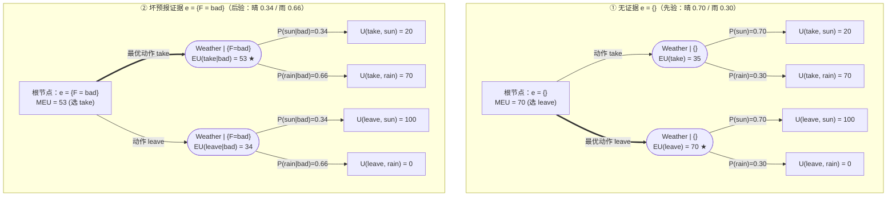

* **无证据（$e = \{\}$）计算汇总**：
  * $EU(\text{leave}) = 0.70 \times 100 + 0.30 \times 0 = \mathbf{70}$（**最优动作**）
  * $EU(\text{take}) = 0.70 \times 20 + 0.30 \times 70 = 14 + 21 = 35$
* **坏预报证据（$e = \{F = \text{bad}\}$）计算汇总**：
  * $EU(\text{leave} \mid \text{bad}) = 0.34 \times 100 + 0.66 \times 0 = 34$
  * $EU(\text{take} \mid \text{bad}) = 0.34 \times 20 + 0.66 \times 70 = 6.8 + 46.2 = \mathbf{53}$（**最优动作翻转！**）
* **核心洞察（课件 P6）**：**引入观测证据不会改变结果树的拓扑形状，也不会改变叶节点的效用值，它只改变机会节点的分支概率，从而改变各动作分支的加权期望并可能翻转最优动作。**
* **【知识点拓展】信息价值（Value of Information, VPI）**：
  在医疗诊断或工程决策中，获取证据往往需要成本（如做一次核磁共振 MRI 或血液化验）。如果提前知道观测变量 $E$ 的结果，带来的期望收益提升称为**信息价值**：
  $$VPI_e(E) = \left( \sum_{e'} P(E = e' \mid e) MEU(e, E = e') \right) - MEU(e) \ge 0$$
  只有当某项检查改变最优治疗方案且带来的 $VPI$ 大于检查本身的成本/风险时，该检查才值得执行。

---

## 三、 模块二：从单步决策到序贯决策 —— MDP 五元组建模

> 💡 **视觉辅助参考**：请结合配套高清图 **`图1_决策网络与MDP模型演进图解.png`**（面板 C & D）及 **`图3_GridWorld价值迭代传播与步惩罚策略演变.png`**（下半部分）对照阅读本节。

### 3.1 为什么需要马尔可夫决策过程（MDP）？（课件 P7, P8）

#### 1. 单步决策 vs. 序贯决策（Sequential Decision Making）
| 对比维度 | 单步决策（如雨伞问题） | 序贯决策（如医疗慢病管理、机器人导航） |
| :--- | :--- | :--- |
| **动作次数** | 一次性动作（One-shot Action） | 连续多步动作序列 $a_0, a_1, a_2, \dots$ |
| **状态演化** | 产生一个随机结果后问题即结束 | **当前动作会改变未来状态**，未来状态又限制和影响后续动作选择 |
| **效用评估** | 单个终局效用 $U(o)$，价值不延续到下一问题 | **总效用取决于整条状态-动作轨迹**，需权衡眼前收益与长远布局 |

#### 2. 模型谱系对比：贝叶斯网络、HMM 与 MDP 的统一
课件第8页精辟地指出了 MDP 在概率图模型家族中的位置：

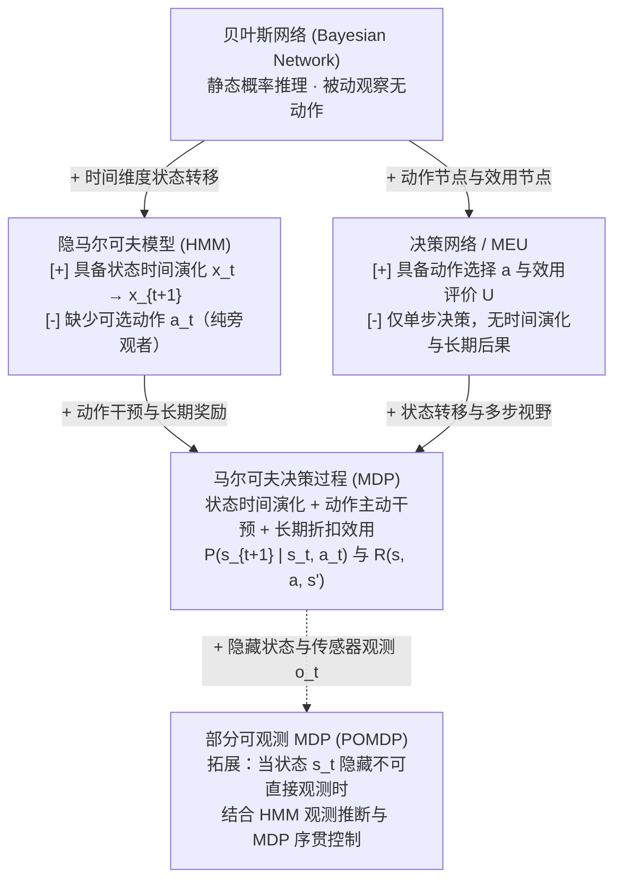

> **核心公式**：$$\text{MDP} = \text{状态演化（如 HMM）} + \text{动作干预（如决策网络）} + \text{长期效用评估}$$

---

### 3.2 MDP 五元组 $(S, A, P, R, \gamma)$ 详解（课件 P9–P14）

马尔可夫决策过程用五元组 $(S, A, P, R, \gamma)$ 严格形式化不确定环境下的序贯决策——前四项定义了“环境如何演化、单步如何计分”，最后一项定义了“长期未来如何折算”。

#### 1. 状态空间 $S$ 与马尔可夫性（课件 P11）
* **定义**：$S$ 是所有可能状态的集合；当前状态 $s_t \in S$ 是对当前处境的**决策摘要（Decision Summary）**。
* **马尔可夫性（Markov Property，无后效性）公式拆解**：
  $$\underbrace{P(s_{t+1} \mid s_t, a_t, \cancel{s_{t-1}, a_{t-1}, \dots, s_0, a_0})}_{\text{给定当前状态 } s_t \text{ 与动作 } a_t \text{ 后，过去历史完全冗余}} = \underbrace{P(s_{t+1} \mid s_t, a_t)}_{\text{未来只取决于现在，独立于过去}}$$
  这意味着**所有影响未来的关键历史信息都必须被压缩编码进当前状态 $s_t$ 中**。
* **状态设计的四大黄金准则（重要考点）**：
  1. **完备性（Completeness）**：状态表示必须包含足够信息，能够区分需要采取不同最优动作的处境（保证马尔可夫性近似成立）。
  2. **可观测性（Observability）**：状态变量必须能够通过传感器、临床检验或合理的滤波估计获得。
  3. **简洁性（Compactness）**：状态维度应可控、便于存储和计算。若把过多无关变量塞入状态，会导致状态空间呈指数级爆炸，即**维度灾难（Curse of Dimensionality）**。
  4. **可行动性（Actionability）**：状态的划分应能真正指导动作选择。
* **【BME 临床案例分析】糖尿病血糖管理中的状态设计（课件 P11）**：
  * *错误/不完整状态*：仅将状态定义为“当前瞬时血糖数值 $g_t$”（例如 $120\text{ mg/dL}$）。为什么不满足马尔可夫性？因为同样是 $120\text{ mg/dL}$，患者可能是“刚注射完大剂量胰岛素且正在剧烈运动，血糖正以 $3\text{ mg/(dL}\cdot\text{min)}$ 暴跌”，也可能是“刚进食高碳水餐且未打胰岛素，血糖正快速飙升”。只看当前单一血糖值无法预测下一时刻血糖，也不能安全决定胰岛素剂量。
  * *正确的扩展状态（State Augmentation）*：将关键短期历史压缩进当前状态——补充**血糖变化率（CGM 趋势箭头）、体内残余活性胰岛素（IOB, Insulin on Board）、近期进食碳水化合物量与运动状态**。扩展后的状态向量满足马尔可夫性，方可支持安全的闭环胰岛素输注决策。

#### 2. 动作空间 $A$ 与转移概率 $P(s' \mid s, a)$（课件 P12）
* **动作空间 $A$（刻画“智能体能做什么”）**：
  * 包含所有候选控制量。对于特定状态 $s$，可用动作子集记为 $A(s) \subseteq A$。
  * **离散动作空间**：如网格世界中的 `{东, 南, 西, 北}`，或临床治疗中的 `{手术, 放疗, 保守监测}`。
  * **连续动作空间**：如人工胰腺泵的胰岛素输注速率（$\text{U/h}$）、呼吸机氧气流量。
* **转移概率 $P(s' \mid s, a)$（刻画“环境会怎样响应”）**：
  * **定义**：
    $$P(s' \mid s, a) = \mathbb{P}(S_{t+1} = s' \mid S_t = s, A_t = a)$$
  * **含义**：在状态 $s$ 执行动作 $a$ 后，环境并不一定确定性地进入唯一状态，而是按概率分布随机转移到多个可能的下一状态 $s'$（反映了环境动力学的不确定性、控制误差或个体差异）。
  * **概率归一化约束**：对于任意状态 $s \in S$ 和可用动作 $a \in A(s)$，所有可能去向的概率之和必须等于 $1$：
    $$\sum_{s' \in S} P(s' \mid s, a) = 1, \qquad P(s' \mid s, a) \ge 0$$

#### 3. 奖励函数 $R(s, a, s')$ 与多目标标量化（课件 P13）
* **标量奖励定义**：$R(s, a, s')$ 给一次状态转移 $(s \xrightarrow{a} s')$ 提供即时的数值反馈（收益或代价）。
* **三种常见简化形式**（考试做题时需注意题目给定的是哪一种）：
  1. $R(s, a, s')$：最一般形式，依赖起点状态 $s$、动作 $a$ 和到达状态 $s'$。
  2. $R(s, a)$：依赖当前状态与动作，可通过对下一状态取期望由一般形式导出：$R(s, a) = \sum_{s'} P(s' \mid s, a) R(s, a, s')$。
  3. $R(s)$ 或 $R(s')$：仅依赖所处状态或进入的状态（例如经典 Grid World 常用离开状态计分 $R(s)$，而课件第31页血糖模型采用进入状态计分 $R(s,a,s') = r(s')$）。
* **即时奖励 $R$ vs. 长期价值 $V/Q$**：$R$ 只给单步转移打分（可能存在“吃甜食即时奖励为正、但长期导致高血糖并发症为负”的短视陷阱）；而价值函数 $V/Q$ 累加当前与未来折扣奖励，反映长期综合后果。
* **多目标标量化（Multi-Objective Scalarization）**：
  * 在医疗和工程问题中，决策往往面临多个相互冲突的子目标（如肿瘤治疗中的**疗效 $r_1$、安全性 $r_2$、毒副作用 $r_3$、经济成本 $r_4$**）。
  * 标准 MDP 要求奖励必须是单一标量，因此需要先通过线性加权将多目标合成为标量奖励：
    $$R(s, a, s') = \sum_{i} \underbrace{w_i}_{\substack{\text{偏好、伦理与} \\ \text{风险约束权重}}} \cdot \underbrace{r_i(s, a, s')}_{\substack{\text{第 } i \text{ 个维度的} \\ \text{子奖励评分}}}$$
  * **重要性质**：**当权重 $w_i$ 改变时，同一环境下的最优策略 $\pi^*$ 可能会发生根本改变**。

#### 4. 折扣因子 $\gamma$ 与累积折扣回报 $G_t$（课件 P14）
* **累积折扣回报（Discounted Return）公式与递归拆解**：
  从时刻 $t$ 开始，智能体获得的未来奖励序列 $R_{t+1}, R_{t+2}, R_{t+3}, \dots$ 的折扣累加和定义为：
  $$G_t = \underbrace{R_{t+1}}_{\text{当前一步即时奖励 (权重 } 1\text{)}} + \underbrace{\gamma R_{t+2}}_{\text{下一步奖励 (权重 } \gamma\text{)}} + \underbrace{\gamma^2 R_{t+3}}_{\text{两步后奖励 (权重 } \gamma^2\text{)}} + \cdots = \sum_{k=0}^{\infty} \gamma^k R_{t+k+1} = R_{t+1} + \gamma G_{t+1}$$
  其中折扣因子 $\gamma \in [0, 1]$，距离现在 $k$ 步之后的奖励要乘以衰减系数 $\gamma^k$。
* **课件数值示例（$\gamma = 0.5$ 时比较两条奖励序列）**：
  * 序列 A（先苦后甜 $[1, 2, 3]$）：$U([1, 2, 3]) = 1 + 0.5 \times 2 + 0.5^2 \times 3 = 1 + 1 + 0.75 = 2.75$
  * 序列 B（先甜后苦 $[3, 2, 1]$）：$U([3, 2, 1]) = 3 + 0.5 \times 2 + 0.5^2 \times 1 = 3 + 1 + 0.25 = 4.25$
  * 尽管两条序列的无折扣总和都是 $1+2+3=6$，但在 $\gamma = 0.5$ 下 $4.25 > 2.75$，清晰表达了“**同等数额的正奖励越早获得越好，负惩罚越晚发生越好**”的时间偏好。
* **为什么要引入折扣因子 $\gamma$？（五大原因总结）**：
  1. **数学可计算性与无穷级数收敛**：在无限视野（Infinite Horizon）且包含循环状态的 MDP 中，若不加折扣（$\gamma = 1$），无穷步奖励相加会导致总回报发散到 $\pm\infty$，无法比较策略优劣。只要单步奖励有界（$|R| \le R_{\max}$）且严格满足 $\gamma < 1$，无穷几何级数必然绝对收敛：
     $$|G_t| \le \sum_{k=0}^{\infty} \gamma^k R_{\max} = \frac{R_{\max}}{1 - \gamma} < \infty$$
  2. **未来的不确定性（生存概率解释）**：现实过程在每一步都有 $1 - \gamma$ 的概率因外部意外而终止（即只有 $\gamma$ 的概率存活到下一步），因此第 $k$ 步奖励的期望自然乘上 $\gamma^k$。
  3. **经济学时间价值与再投资**：早获得的资源/资金可以立即投入使用或产生利息（利率为 $r$ 时，$\gamma = \frac{1}{1+r}$）。
  4. **风险规避与价值衰减**：越遥远的未来预测误差越大，赋予较低权重符合稳健决策。
  5. **视野影响（平稳策略存在性）**：在**有限视野（Finite Horizon）**中，最优动作不仅依赖当前状态 $s$，还依赖“剩余时间步 $T-t$”（策略是非平稳的）；而在**无限视野 + 指数折扣**下，任意时刻向后看的未来结构完全同构，从而保证了**只依赖状态 $s$ 的平稳最优策略（Stationary Policy）$\pi^*(s)$** 的存在。

---

### 3.3 经典算例一：$4 \times 3$ 网格世界（Grid World）与策略敏感度分析（课件 P10, P15, P16）

#### 1. 标准 $4 \times 3$ Grid World 五元组设定（课件 P10）
* **状态空间 $S$**：$4$ 列 $\times 3$ 行的网格，左下角坐标为 $(1,1)$（`START` 起点），右上角为 $(4,3)$。其中 $(2,2)$ 是灰色的**墙壁（不可进入）**，因此共有 $12 - 1 = 11$ 个有效状态格子。
  * 终局状态（Terminal States）：$(4,3)$ 为正向终局（奖励 $+1$），$(4,2)$ 为负向陷阱终局（奖励 $-1$）。
* **动作空间 $A$**：`{北(N/↑), 南(S/↓), 东(E/→), 西(W/←)}`。
* **随机转移概率 $P(s' \mid s, a)$（“湿滑地面”规则）**：
  * **0.8 的概率**沿智能体意图方向前进一步；
  * **0.1 的概率**向左垂直偏转 $90^\circ$；
  * **0.1 的概率**向右垂直偏转 $90^\circ$；
  * **撞墙或越界规则**：若移动方向碰到外边界或内部墙壁 $(2,2)$，智能体**反弹停留在原格子**（对应的概率质量累加到原状态上）。

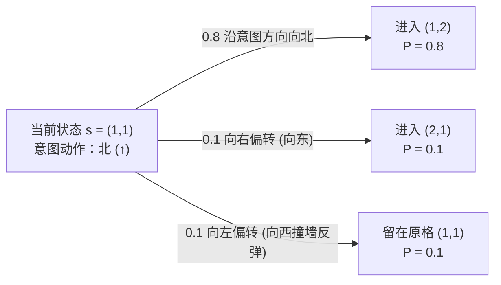

#### 2. 什么是策略（Policy）？（课件 P15）
* **确定性策略（Deterministic Policy）**：映射函数 $\pi: S \to A$，为每个状态指定唯一动作 $\pi(s) = a$（如网格世界中的箭头图）。
* **随机策略（Stochastic Policy）**：条件概率分布 $\pi(a \mid s) = \mathbb{P}(A_t = a \mid S_t = s)$，满足 $\sum_{a \in A} \pi(a \mid s) = 1$。
* **为什么 MDP 的解必须是一个覆盖所有状态的“完整策略（Policy）”，而不是一条固定路径（Plan）？**
  因为环境转移具有随机性（如 $0.1$ 的侧滑概率）！即使智能体计划走某条路线，中途也可能被随机吹偏到其它状态格子。因此，MDP 的解 $\pi^*$ 必须像一张“全局导航地图”一样，告诉智能体在**任何一个可能到达的状态 $s$** 下应当执行什么动作。

#### 3. 步惩罚 $R$ 对最优策略 $\pi^*$ 的塑造作用（课件 P16 深度解析，详见配套`图3`下半部分）
在固定 $\gamma = 0.9$ 的前提下，如果修改非终止格子的单步生存奖励（Step Cost / Living Reward）$R$，最优策略 $\pi^*$ 会展现出极具启发性的行为模式切换：

| 单步奖励设定 | 智能体的生存处境与心理特征 | 关键状态 $(2,1), (3,1), (3,2), (4,1)$ 的动作变化 | 整体策略行为解读 |
| :--- | :--- | :--- | :--- |
| **$R = -0.0001$** （极微步惩罚） | 步数代价几乎忽略不计，**极度厌恶风险** | • $(2,1)$ 选 `←`（向西退回 $(1,1)$） • $(4,1)$ 选 `←`（绝不向北靠近 $-1$） • $(3,2)$ 选 `↑` | 为避免走右侧捷径 $(3,1)\to(3,2)\to(3,3)$ 时在 $(3,2)$ 有 $0.1$ 概率滑入 $(4,2)$ 的 $-1$ 陷阱，$(2,1)$ 宁可向西绕远路走左侧安全通道 $(1,1)\to(1,2)\to(1,3)\to(2,3)\to(3,3)\to(4,3)$ |
| **$R = -0.03$** （适度步惩罚） | 兼顾效率与安全，**理性权衡风险与时间** | • $(2,1)$ 变为 `→`（向东走捷径） • $(4,1)$ 仍选 `←`（避开正上方的 $-1$） • $(3,2)$ 选 `↑` | 绕远路多走几步的累积惩罚 + $\gamma=0.9$ 的折扣损耗，已经超过了在 $(3,2)$ 处 $10\%$ 滑入 $-1$ 的期望损失，因此 $(2,1)$ 改为向右走捷径 |
| **$R = -0.4$** （较大步惩罚） | 每走一步都很痛苦，**急于尽快抵达 $+1$** | • $(2,1)$ 选 `→`，$(3,1)$ 选 `↑` • $(4,1)$ 仍选 `←`（因为直接向北撞进 $-1$ 还是比绕一步去 $+1$ 亏） | 所有状态都选择通往 $+1$ 终点的最短路径，不再做任何保守绕行 |
| **$R = -2.0$** （极端步惩罚） | “生不如死”，每多活一步扣 $2$ 分，比掉进 $-1$ 陷阱还惨 | • $(3,1)$ 与 $(3,2)$ 变为 `→`（冲向 $-1$） • $(4,1)$ 变为 `↑`（直接跳进 $(4,2)$） | 为了立刻终止游戏停止扣分，靠近 $-1$ 陷阱的状态不再去 $+1$，而是**直接扑向最近的 $-1$ 终局自杀止损** |

> **核心结论（课件 P16）**：在折扣因子 $\gamma = 0.9$ 已能自然激励智能体“尽早拿 $+1$”的背景下，$R = -0.03$ 与 $R = -0.4$ 的最优策略完全相同；只有当步惩罚极端微小（$R = -0.0001$，诱发极致避险）或极端巨大（$R = -2.0$，诱发就近自杀）时，才会改变最优策略。

---

## 四、 模块三：价值函数与贝尔曼方程体系（V · Q · Bellman）

> 💡 **视觉辅助参考**：请结合配套高清图 **`图2_贝尔曼方程前瞻树与VQ关系图解.png`** 对照阅读本节。

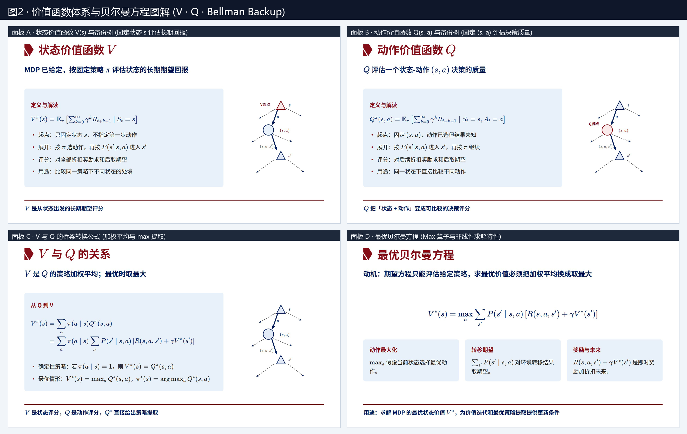

### 4.1 状态价值函数 $V^\pi(s)$ 与动作价值函数 $Q^\pi(s,a)$（课件 P17–P19）

给定一个 MDP 和一个固定策略 $\pi$，我们需要两个核心函数来量化“长期期望折扣回报”。在搜索树（前瞻树 Backup Diagram）中，**状态节点用三角形 $\triangle$ 表示（对应 $V$），状态-动作对（机会节点）用圆形 $\bigcirc$ 表示（对应 $Q$）**：

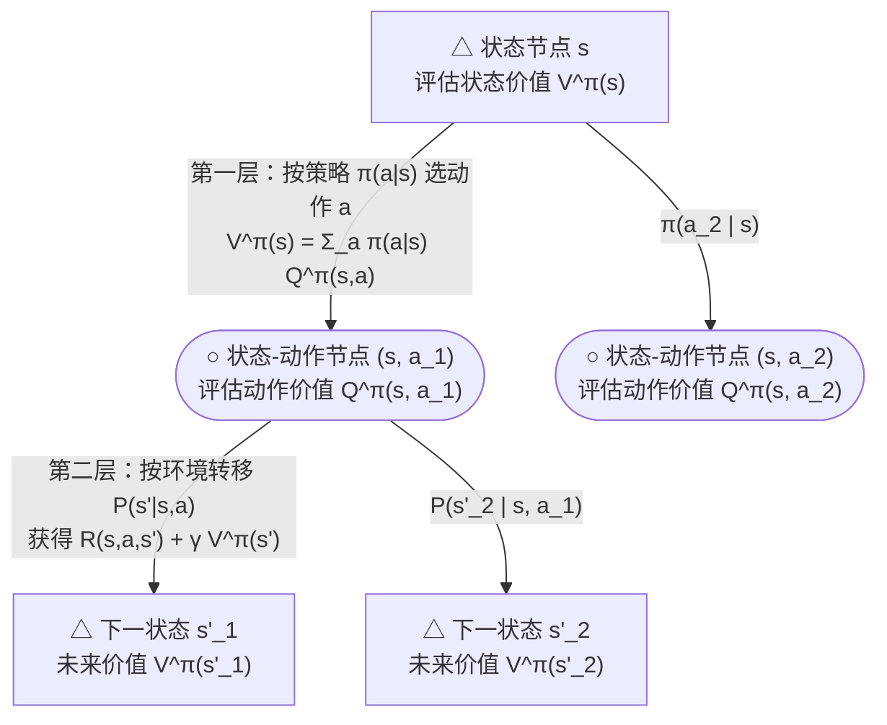

| 对比维度 | 状态价值函数 $V^\pi(s)$（State-Value Function） | 动作价值函数 $Q^\pi(s,a)$（Action-Value / Q-Function） |
| :--- | :--- | :--- |
| **数学定义** | $$V^\pi(s) = \mathbb{E}_\pi \left[ \sum_{k=0}^{\infty} \gamma^k R_{t+k+1} \;\middle|\; S_t = s \right]$$ | $$Q^\pi(s, a) = \mathbb{E}_\pi \left[ \sum_{k=0}^{\infty} \gamma^k R_{t+k+1} \;\middle|\; S_t = s, A_t = a \right]$$ |
| **搜索树起点** | **状态节点（三角形 $\triangle$）**：只固定起点状态 $s$，不指定第一步动作 | **机会节点 / Q节点（圆形 $\bigcirc$）**：同时固定状态 $s$ 和第一步动作 $a$，但转移结果 $s'$ 未知 |
| **轨迹展开方式** | 从第一步起就完全按照策略 $\pi$ 选动作，再按 $P(s'\mid s,a)$ 转移 | **第一步强制执行指定动作 $a$**，按 $P(s'\mid s,a)$ 进入 $s'$ 后，**从第二步起再按策略 $\pi$ 继续行动** |
| **核心用途** | 评价“处于状态 $s$ 的整体处境有多好”（比较不同状态的优劣） | 评价“在状态 $s$ 下选择动作 $a$ 这个决策有多好”（在同一状态下直接比较不同动作） |

#### $V$ 与 $Q$ 之间的桥梁关系（课件 P19）
1. **在固定策略 $\pi$ 下（$V^\pi$ 是 $Q^\pi$ 的策略加权平均）**：
   $$V^\pi(s) = \sum_{a \in A} \pi(a \mid s) Q^\pi(s, a)$$
   *特例*：若 $\pi$ 是确定性策略（即在状态 $s$ 必选动作 $a = \pi(s)$，$\pi(\pi(s)\mid s)=1$），则直接简化为：
   $$V^\pi(s) = Q^\pi(s, \pi(s))$$
2. **从 $V^\pi$ 展开 $Q^\pi$（一步前瞻 One-step Lookahead）**：
   在状态 $s$ 选定动作 $a$ 后，环境以概率 $P(s'\mid s,a)$ 转移到 $s'$，获得即时奖励 $R(s,a,s')$，而从 $s'$ 开始的后续无穷步期望折扣回报正是 $\gamma V^\pi(s')$！因此：
   $$Q^\pi(s, a) = \sum_{s' \in S} P(s' \mid s, a) \left[ R(s, a, s') + \gamma V^\pi(s') \right]$$
3. **在最优策略 $\pi^*$ 下（最优状态价值等于最优动作价值的最大值）**：
   $$V^*(s) = \max_{a \in A} Q^*(s, a), \qquad \pi^*(s) = \arg\max_{a \in A} Q^*(s, a)$$

---

### 4.2 四大贝尔曼方程（Bellman Equations）全景推导与逐项拆解（课件 P20–P22）

理查德·贝尔曼（Richard Bellman）提出的动态规划核心思想是：**把无穷步的长期价值拆解为「当前一步的即时奖励 + 下一状态长期价值的折扣期望」**，从而建立价值函数的自洽递归方程。

将 $V$ 与 $Q$ 的两两关系代入组合，即可得到人工智能与强化学习中最核心的**四大贝尔曼方程**：

#### 1. $V^\pi$ 的贝尔曼期望方程（Bellman Expectation Equation for $V^\pi$，课件 P20）
将 $Q^\pi(s,a)$ 的展开式代入 $V^\pi(s) = \sum_a \pi(a\mid s) Q^\pi(s,a)$，得到：

$$V^\pi(s) = \underbrace{\sum_{a \in A} \pi(a \mid s)}_{\substack{\text{① 动作加权（线性）：} \\ \text{按当前策略 } \pi \text{ 选动作}}} \underbrace{\sum_{s' \in S} P(s' \mid s, a)}_{\substack{\text{② 转移期望：} \\ \text{对环境随机结果取期望}}} \Big[ \underbrace{R(s, a, s')}_{\text{③ 即时奖励}} + \underbrace{\gamma V^\pi(s')}_{\text{④ 折扣未来价值}} \Big]$$

* **数学本质**：对于固定的 $\pi$，上式关于所有状态的 $V^\pi(s)$ 是**纯线性的**！共有 $|S|$ 个未知数和 $|S|$ 个线性方程，用于**策略评估（Policy Evaluation）**。

#### 2. $Q^\pi$ 的贝尔曼期望方程（拓展补充，完善知识闭环）
把下一状态的 $V^\pi(s')$ 替换为 $\sum_{a'} \pi(a'\mid s') Q^\pi(s', a')$，可得 $Q^\pi$ 的自洽递归：
$$Q^\pi(s, a) = \sum_{s' \in S} P(s' \mid s, a) \left[ R(s, a, s') + \gamma \sum_{a' \in A} \pi(a' \mid s') Q^\pi(s', a') \right]$$

#### 3. $V^*$ 的贝尔曼最优方程（Bellman Optimality Equation for $V^*$，课件 P21）
求全局最优价值 $V^*(s)$ 时，智能体在当前状态不再按某个固定分布加权，而是直接挑选**能使长期期望回报最大的动作**（将 $\sum_a \pi(a\mid s)$ 替换为 $\max_a$）：

$$V^*(s) = \underbrace{\max_{a \in A}}_{\substack{\text{① 动作最大化（非线性!）：} \\ \text{当前状态直接选最优动作}}} \underbrace{\sum_{s' \in S} P(s' \mid s, a)}_{\substack{\text{② 转移期望：} \\ \text{对环境转移分布求和}}} \Big[ \underbrace{R(s, a, s') + \gamma V^*(s')}_{\text{③ 即时奖励 + 折扣最优未来}} \Big]$$

* **数学本质**：由于存在 $\max_a$ 算子，该方程组是**非线性方程组（Non-linear System）**，不同状态之间通过 $\max$ 耦合，一般无法通过矩阵求逆直接求闭式解，必须采用迭代算法（如价值迭代）求解。

#### 4. $Q^*$ 的贝尔曼最优方程（Bellman Optimality Equation for $Q^*$，课件 P22）
将 $V^*(s') = \max_{a'} Q^*(s', a')$ 代入 $Q^*(s,a)$ 的展开式，得到 $Q^*$ 的自洽递归方程：

$$Q^*(s, a) = \underbrace{\sum_{s' \in S} P(s' \mid s, a)}_{\substack{\text{① 外层先对环境转移取期望} \\ \text{（可通过单步交互采样近似!）}}} \Big[ R(s, a, s') + \gamma \underbrace{\max_{a' \in A} Q^*(s', a')}_{\substack{\text{② 内层对下一步动作取最大} \\ \text{（等价于 } V^*(s')\text{）}}} \Big]$$

* **为什么有了 $V^*$ 还要专门研究 $Q^*$ 的贝尔曼方程？（重要考点，课件 P22 & P26）**
  1. **免模型策略提取**：如果只知道 $V^*(s)$，要选出最优动作还必须调用环境模型 $P(s'\mid s,a)$ 和 $R(s,a,s')$ 做一步前瞻计算；而如果求出了 $Q^*(s,a)$，智能体无需知道环境转移概率 $P$，直接比较当前状态下各动作的 $Q^*$ 值取最大即可：$\pi^*(s) = \arg\max_a Q^*(s,a)$。
  2. **通往无模型强化学习（Q-Learning）的基石**：在下一章未知 $P$ 和 $R$ 的环境中，智能体无法对 $\sum_{s'} P(s'\mid s,a)$ 求期望，但可以通过与环境交互采样 $(s, a, r, s')$ 来直接用 $r + \gamma \max_{a'} Q(s', a')$ 更新 $Q(s,a)$——因为 $Q^*$ 方程中的 $\max_{a'}$ 在期望号 $\sum_{s'} P(s'\mid s,a)$ 的**内部**，可以通过单次转移样本进行无偏/渐近估计！

#### 四大贝尔曼方程速查对比表
| 方程名称 | 核心公式表达 | 算子特征 | 核心用途 |
| :--- | :--- | :--- | :--- |
| **$V^\pi$ 期望方程** | $V^\pi(s) = \sum_a \pi(a\mid s) \sum_{s'} P(s'\mid s,a) [R + \gamma V^\pi(s')]$ | 线性（$\sum_a \to \sum_{s'}$） | 给定策略 $\pi$，评估状态价值 $V^\pi$ |
| **$Q^\pi$ 期望方程** | $Q^\pi(s,a) = \sum_{s'} P(s'\mid s,a) [R + \gamma \sum_{a'} \pi(a'\mid s') Q^\pi(s',a')]$ | 线性（$\sum_{s'} \to \sum_{a'}$） | 给定策略 $\pi$，评估动作价值 $Q^\pi$（SARSA 基础） |
| **$V^*$ 最优方程** | $V^*(s) = \max_a \sum_{s'} P(s'\mid s,a) [R + \gamma V^*(s')]$ | 非线性（先 $\sum_{s'}$ 后外层 $\max_a$） | 价值迭代（Value Iteration）更新规则 |
| **$Q^*$ 最优方程** | $Q^*(s,a) = \sum_{s'} P(s'\mid s,a) [R + \gamma \max_{a'} Q^*(s',a')]$ | 非线性（内层先 $\max_{a'}$ 后外层 $\sum_{s'}$） | $Q$ 价值迭代、直接策略提取、Q-Learning 基础 |

---

## 五、 模块四：MDP 经典动态规划求解算法（价值迭代 vs. 策略迭代）

> 💡 **视觉辅助参考**：请结合配套高清图 **`图3_GridWorld价值迭代传播与步惩罚策略演变.png`**（上半部分）及 **`图4_策略迭代流程与血糖调控MDP五步推演图解.png`** 对照阅读本节。

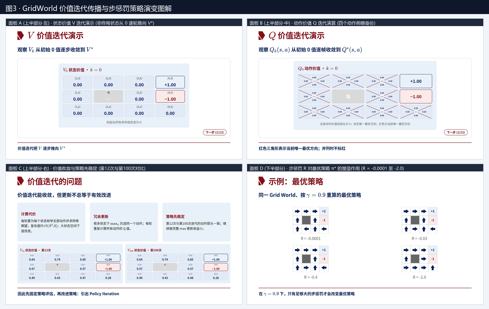

当 MDP 的环境模型 $P(s'\mid s,a)$ 和 $R(s,a,s')$ 完全已知时，求解最优策略 $\pi^*$ 的方法统称为**动态规划（Dynamic Programming, DP）**。本章重点讲授两大核心算法：**价值迭代（Value Iteration）**与**策略迭代（Policy Iteration）**。

---

### 5.1 价值迭代（Value Iteration, VI）（课件 P23–P27）

#### 1. 核心思想与算法流程图
价值迭代直接把**贝尔曼最优方程**改写为**从右向左的迭代赋值更新式**（即反复应用贝尔曼最优算子 $\mathcal{T}^*$），从任意初始价值估计 $V_0$ 出发，逐步把 $V_k$ 推向不动点 $V^*$。

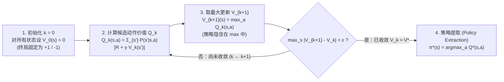

**算法四步标准流程（记 $k = 0, 1, 2, \dots$ 为迭代轮次）**：
1. **初始化（Initialization）**：对所有状态 $s \in S$，任意设定初始价值 $V_0(s)$（通常设所有非终局状态 $V_0(s) = 0$，终局状态保持其固定终局值）。
2. **计算候选动作价值（Compute Candidate $Q_k$）**：利用上一轮的价值场 $V_k$，为每个状态 $s$ 和每个可用动作 $a$ 计算一步前瞻期望回报：
   $$Q_k(s, a) \leftarrow \sum_{s' \in S} P(s' \mid s, a) \left[ R(s, a, s') + \gamma V_k(s') \right]$$
3. **取最大更新状态价值（Max Backup Update）**：对候选动作取最大值，得到新一轮状态价值 $V_{k+1}(s)$：
   $$V_{k+1}(s) \leftarrow \max_{a \in A} Q_k(s, a)$$
   *（注：合并第2、3步即为经典的单行更新式：$V_{k+1}(s) \leftarrow \max_a \sum_{s'} P(s'\mid s,a)[R(s,a,s') + \gamma V_k(s')]$，此时的 $V_k(s)$ 具有明确物理意义——它等于**从状态 $s$ 出发、最多只允许走 $k$ 步时的有限视野最优期望回报**！）*
4. **判断收敛与提取策略（Convergence & Policy Extraction）**：
   重复步骤 2–3，直到相邻两轮的最大价值变化量小于预设阈值 $\epsilon$（即 $\|V_{k+1} - V_k\|_\infty = \max_s |V_{k+1}(s) - V_k(s)| < \epsilon$），判定 $V_k \to V^*$。随后通过一步前瞻提取最优策略：
   $$\pi^*(s) \in \arg\max_{a \in A} \sum_{s' \in S} P(s' \mid s, a) \left[ R(s, a, s') + \gamma V^*(s') \right] = \arg\max_{a \in A} Q^*(s, a)$$

#### 2. 【深度拓展】为什么价值迭代不管 $V_0$ 怎么初始化都一定收敛到唯一的 $V^*$？
这由泛函分析中的**巴拿赫不动点定理（Banach Fixed-Point Theorem / 压缩映射原理 Contraction Mapping Theorem）**严格保证：
* 定义贝尔曼最优算子 $\mathcal{T}^*$：$(\mathcal{T}^* V)(s) = \max_a \sum_{s'} P(s'\mid s,a)[R(s,a,s') + \gamma V(s')]$。
* 在无穷范数 $\|V - U\|_\infty = \max_s |V(s) - U(s)|$ 下，由于概率分布非负且和为 $1$，且 $|\max_a f(a) - \max_a g(a)| \le \max_a |f(a) - g(a)|$，可以证明：
  $$\|\mathcal{T}^* V - \mathcal{T}^* U\|_\infty \le \gamma \|V - U\|_\infty$$
* 当 $0 \le \gamma < 1$ 时，$\mathcal{T}^*$ 是一个**$\gamma$-压缩映射（$\gamma$-Contraction）**！每迭代一轮，当前价值估计 $V_k$ 与真实最优价值 $V^*$ 的最大误差至少缩小为原来的 $\gamma$ 倍：
  $$\|V_k - V^*\|_\infty \le \gamma^k \|V_0 - V^*\|_\infty \xrightarrow{k \to \infty} 0$$
  因此：**$V^*$ 必然存在且唯一，且价值迭代以指数速率（几何级数速率 $\gamma^k$）全局收敛到 $V^*$**（见配套`图3`右上角的指数收敛曲线）。

#### 3. Grid World 价值迭代传播过程手算演示（对应课件 P24, P25, P27 及配套`图3`上半部分）
在课件 P24–P25 的 Grid World（非终局 $R=0, \gamma=0.9, (4,3)=+1.00, (4,2)=-1.00$）中，观察价值信号如何像水波一样从终局状态一步步向外传播：
* **$k = 0$（初始帧）**：所有 9 个非终局状态 $V_0(s) = 0.00$，所有动作 $Q_0(s,a) = 0.00$；终局状态 $(4,3) = +1.00, (4,2) = -1.00$。
* **$k = 1$（第 1 轮迭代）**：只有紧挨着 $(4,3)$ 的状态 $(3,3)$ 能通过一步向东（$\rightarrow$）摸到 $+1.00$ 奖励！
  * 计算 $Q_0((3,3), \text{东})$：$0.8$ 概率进入 $(4,3)$（价值 $+1$），$0.1$ 概率向北撞墙留在 $(3,3)$（价值 $0$），$0.1$ 概率向南进入 $(3,2)$（价值 $0$）：
    $$Q_0((3,3), \text{东}) = 0.8 \times (0 + 0.9 \times 1.00) + 0.1 \times 0 + 0.1 \times 0 = 0.72$$
  * 因此 $V_1(3,3) = 0.72$，其余远离终点的状态仍为 $0$。
* **$k = 2$（第 2 轮迭代）**：
  * 状态 $(3,3)$ 继续选东（因为上一轮 $V_1(3,3)=0.72$，向北撞墙留原地的 $0.1$ 分支也开始贡献价值！）：
    $$V_2(3,3) = Q_1((3,3), \text{东}) = 0.8 \times (0.9 \times 1.00) + 0.1 \times (0.9 \times 0.72) + 0.1 \times (0.9 \times 0) = 0.72 + 0.0648 = 0.7848$$
  * 状态 $(2,3)$ 向东可以进入 $(3,3)$：
    $$V_2(2,3) = Q_1((2,3), \text{东}) = 0.8 \times (0.9 \times 0.72) + 0.1 \times 0 + 0.1 \times 0 = 0.5184$$
  * 状态 $(3,2)$ 若向北（$\uparrow$），有 $0.8$ 进入 $(3,3)$（$V_1=0.72$），$0.1$ 向西撞墙 $(2,2)$ 留在 $(3,2)$（$V_1=0$），但有 **$0.1$ 向东滑入陷阱 $(4,2)$（价值 $-1.00$）**：
    $$Q_1((3,2), \text{北}) = 0.8 \times (0.9 \times 0.72) + 0.1 \times 0 + 0.1 \times (0.9 \times (-1.00)) = 0.5184 - 0.09 = 0.4284$$
* **第 12 轮 vs. 第 100 轮收敛结果对比（课件 P27 实测数据）**：
  课件第27页展示了 $V_{12}$ 与 $V_{100}$ 的完整网格数值：

| 网格行 \ 列 | 第 1 列 ($x=1$) | 第 2 列 ($x=2$) | 第 3 列 ($x=3$) | 第 4 列 ($x=4$) |
| :--- | :---: | :---: | :---: | :---: |
| **第 3 行 ($y=3$)** | $V_{12}=0.64 \mid V_{100}=0.64$ | $V_{12}=0.74 \mid V_{100}=0.74$ | $V_{12}=0.85 \mid V_{100}=0.85$ | **终局 $+1.00$** |
| **第 2 行 ($y=2$)** | $V_{12}=0.57 \mid V_{100}=0.57$ | **墙壁（不可入）** | $V_{12}=0.57 \mid V_{100}=0.57$ | **终局 $-1.00$** |
| **第 1 行 ($y=1$)** | $V_{12}=0.49 \mid V_{100}=0.49$ | $V_{12}=0.43 \mid V_{100}=0.43$ | $V_{12}=0.47 \mid V_{100}=0.48$ | $V_{12}=0.28 \mid V_{100}=0.28$ |

#### 4. 价值迭代的三大局限性（课件 P27）
1. **单轮计算代价昂贵**：每轮迭代必须对 $|S|$ 个状态枚举全部 $|A|$ 个动作，并对 $|S|$ 个可能到达状态求和，单轮时间复杂度高达 $\mathcal{O}(|S|^2 |A|)$。当状态空间很大时计算极其耗时。
2. **大量冗余更新**：在很多状态下，$\max_a$ 早在前几轮就已经锁定了同一个最优动作，后续几十轮迭代仍在反复计算所有次优动作的 $Q$ 值。
3. **策略远比价值本身更早稳定**：如上表所示，从第 12 次迭代到第 100 次迭代，状态价值的微小精度还在缓慢爬升（如 $(3,1)$ 从 $0.47$ 变到 $0.48$），但**每个格子对应的最优动作箭头在第 12 次迭代时早已完全收敛定型**！继续做完整的 $\max$ 更新对改进策略毫无实质收益。

---

### 5.2 策略迭代（Policy Iteration, PI）（课件 P28–P30）

为了克服价值迭代每轮都要枚举所有动作做 $\max$ 的低效问题，霍华德（Ronald Howard, 1960）提出了**策略迭代（Policy Iteration）**——把求最优策略拆解为**策略评估（Policy Evaluation）**与**策略改进（Policy Improvement）**两个交替循环的子问题：

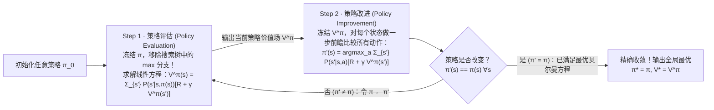

#### 1. Step 1 · 策略评估（Policy Evaluation，课件 P29）
* **操作**：冻结当前确定性策略 $\pi$，计算如果一直按照 $\pi$ 行动，每个状态的长期期望折扣回报 $V^\pi(s)$。
* **核心优势（移除搜索树中的 $\max$ 分支）**：
  因为每个状态 $s$ 只执行唯一指定的动作 $\pi(s)$，贝尔曼方程中不再有非线性的 $\max_a$ 算子：
  $$V^\pi(s) = \sum_{s' \in S} P(s' \mid s, \pi(s)) \left[ R(s, \pi(s), s') + \gamma V^\pi(s') \right]$$
* **两种求解方式**：
  1. **线性方程组直接求解（Exact Matrix Inversion）**：
     定义策略转移矩阵 $\mathbf{P}^\pi \in \mathbb{R}^{|S|\times |S|}$（元素为 $P(s'\mid s, \pi(s))$）和期望即时奖励向量 $\mathbf{R}^\pi \in \mathbb{R}^{|S|}$，则：
     $$\mathbf{V}^\pi = \mathbf{R}^\pi + \gamma \mathbf{P}^\pi \mathbf{V}^\pi \implies (\mathbf{I} - \gamma \mathbf{P}^\pi) \mathbf{V}^\pi = \mathbf{R}^\pi \implies \mathbf{V}^\pi = (\mathbf{I} - \gamma \mathbf{P}^\pi)^{-1} \mathbf{R}^\pi$$
     复杂度为 $\mathcal{O}(|S|^3)$，在中小规模状态空间（如几百个状态以内，或考试手算题）可一步算出精确解析解！
  2. **迭代法策略评估（Iterative Policy Evaluation）**：
     当 $|S|$ 较大、矩阵求逆 $\mathcal{O}(|S|^3)$ 太贵时，使用无 $\max$ 的同步迭代更新：
     $$V_{k+1}^\pi(s) \leftarrow \sum_{s' \in S} P(s' \mid s, \pi(s)) \left[ R(s, \pi(s), s') + \gamma V_k^\pi(s') \right]$$
     注意这里不需要遍历动作空间 $A$，因此**单步评估复杂度仅为 $\mathcal{O}(|S|^2)$**，比价值迭代的 $\mathcal{O}(|S|^2 |A|)$ 快了 $|A|$ 倍！

#### 2. Step 2 · 策略改进（Policy Improvement，课件 P30）
* **操作**：冻结 Step 1 算出的价值场 $V^\pi$，在每个状态 $s$ 下做一步前瞻（One-step lookahead），尝试所有候选动作 $a \in A$：
  $$Q^\pi(s, a) = \sum_{s' \in S} P(s' \mid s, a) \left[ R(s, a, s') + \gamma V^\pi(s') \right]$$
  然后贪心地选择使 $Q^\pi(s,a)$ 最大的动作构造新策略 $\pi'$：
  $$\pi'(s) = \arg\max_{a \in A} Q^\pi(s, a)$$
* **停止条件与收敛性保证**：
  * **若 $\pi' \ne \pi$**：说明找到了更优的策略，令 $\pi \leftarrow \pi'$，回到 Step 1 重新评估。
  * **若 $\pi'(s) = \pi(s)$ 对所有 $s \in S$ 成立（策略不再改变）**：说明对于所有状态都有
    $$V^\pi(s) = Q^\pi(s, \pi(s)) = \max_{a \in A} \sum_{s' \in S} P(s' \mid s, a) \left[ R(s, a, s') + \gamma V^\pi(s') \right]$$
    此时 $V^\pi$ **已经完全满足贝尔曼最优方程**！因此 $V^\pi = V^*$ 且 $\pi^* = \pi$，算法精确收敛并终止。
* **【理论拓展】为什么策略迭代一定在有限步内收敛？（策略改进定理 Policy Improvement Theorem）**：
  1. **单调改进性**：若新策略满足 $\pi'(s) = \arg\max_a Q^\pi(s,a)$，则对任意状态 $s$ 必有 $Q^\pi(s, \pi'(s)) \ge Q^\pi(s, \pi(s)) = V^\pi(s)$。将该不等式沿轨迹递归展开，可严格证明对所有状态 $s$ 都有 $V^{\pi'}(s) \ge V^\pi(s)$；只要有一个状态动作发生实质改进，就至少在一个状态上严格大于（$V^{\pi'}(s) > V^\pi(s)$）。
  2. **有限步必停**：在有限状态空间 $|S|$ 和有限动作空间 $|A|$ 中，确定性平稳策略的总数最多只有 $|A|^{|S|}$ 个。既然每轮迭代策略严格变好、绝不走回头路（不会出现循环震荡），策略迭代**必定在有限次外层循环内精确收敛到全局最优策略 $\pi^*$**（实践中往往只需几次迭代即可收敛！）。

---

### 5.3 经典算例二：血糖调控模型与策略迭代全流程手算详解（课件 P31–P32 及配套`图4`右侧面板）

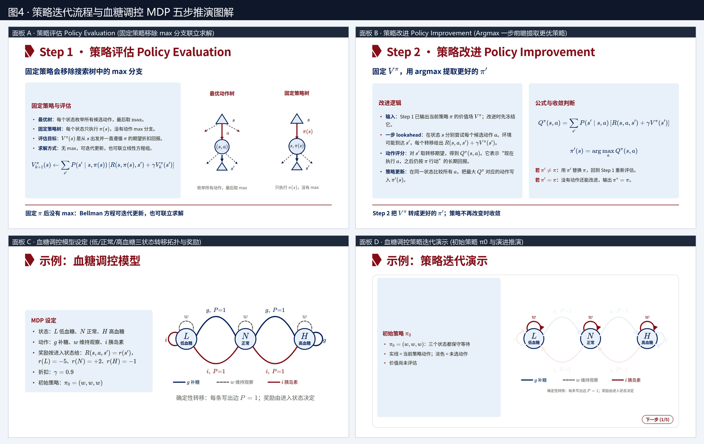

课件第 31–32 页给出了一个极具代表性的生物医学工程（BME）MDP 算例——**糖尿病血糖调控模型**。课件第 32 页仅展示了交互演示的第 `1/5` 步，下面我们将全部 5 步的完整数学推导与迭代过程彻底算清（**期末考试必考题型模板**）：

#### 1. 模型五元组与状态转移图（课件 P31）
* **状态空间 $S = \{L, N, H\}$**：$L$ 低血糖（Low）、$N$ 正常血糖（Normal）、$H$ 高血糖（High）。
* **动作空间 $A = \{g, w, i\}$**：$g$ 补糖（Glucose）、$w$ 维持观察（Watch/Wait）、$i$ 注射胰岛素（Insulin）。
* **确定性状态转移 $P(s' \mid s, a) = 1$** 与 **按进入状态给奖励 $R(s, a, s') = r(s')$**：
  * 进入低血糖：$r(L) = -5$（急性低血糖昏迷风险最高，给予最严厉负惩罚）
  * 进入正常血糖：$r(N) = +2$（健康目标状态，给予正向奖励）
  * 进入高血糖：$r(H) = -1$（高血糖慢性损伤，给予轻度负惩罚）
* **折扣因子**：$\gamma = 0.9$；**初始策略**：$\pi_0 = (\pi_0(L), \pi_0(N), \pi_0(H)) = (w, w, w)$。

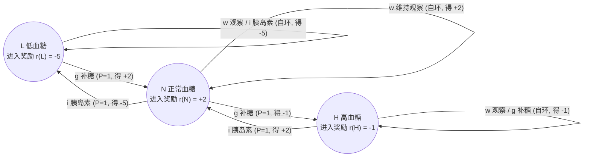

---

#### 2. 策略迭代全过程逐步推演（对应课件 P32 演示的第 1/5 至 5/5 步）

##### 【第 1 步（1/5）：初始化策略 $\pi_0 = (w, w, w)$】
在 $\pi_0$ 下，三个状态全都选择动作 $w$（维持观察），因此每个状态都只沿着自环不断停留在原状态：$L \xrightarrow{w} L, \; N \xrightarrow{w} N, \; H \xrightarrow{w} H$。

##### 【第 2 步（2/5）：第 1 轮策略评估 —— 求解 $V^{\pi_0}$】
由于每个状态都是确定性自环，直接列出贝尔曼期望方程 $V^{\pi_0}(s) = r(s') + \gamma V^{\pi_0}(s')$：
* **状态 $L$（$\pi_0(L) = w \to L$）**：
  $$V^{\pi_0}(L) = r(L) + 0.9 V^{\pi_0}(L) = -5 + 0.9 V^{\pi_0}(L) \implies 0.1 V^{\pi_0}(L) = -5 \implies V^{\pi_0}(L) = -50$$
* **状态 $N$（$\pi_0(N) = w \to N$）**：
  $$V^{\pi_0}(N) = r(N) + 0.9 V^{\pi_0}(N) = +2 + 0.9 V^{\pi_0}(N) \implies 0.1 V^{\pi_0}(N) = +2 \implies V^{\pi_0}(N) = +20$$
* **状态 $H$（$\pi_0(H) = w \to H$）**：
  $$V^{\pi_0}(H) = r(H) + 0.9 V^{\pi_0}(H) = -1 + 0.9 V^{\pi_0}(H) \implies 0.1 V^{\pi_0}(H) = -1 \implies V^{\pi_0}(H) = -10$$
得到初始策略的价值场：**$V^{\pi_0} = (V^{\pi_0}(L), V^{\pi_0}(N), V^{\pi_0}(H)) = (-50, +20, -10)$**。

##### 【第 3 步（3/5）：第 1 轮策略改进 —— 基于 $V^{\pi_0}$ 计算 $Q^{\pi_0}(s,a)$ 并提取 $\pi_1$】
利用公式 $Q^{\pi_0}(s, a) = r(s') + 0.9 V^{\pi_0}(s')$（其中 $s'$ 是状态 $s$ 执行动作 $a$ 到达的唯一状态）：
* **注意到因为转移是确定性的且奖励只取决于进入状态 $s'$**，任何导致进入 $s'$ 的动作都会获得相同的 $Q^{\pi_0}$ 值：
  * 若动作到达 $L$：$Q^{\pi_0} = r(L) + 0.9 V^{\pi_0}(L) = -5 + 0.9 \times (-50) = -50$
  * 若动作到达 $N$：$Q^{\pi_0} = r(N) + 0.9 V^{\pi_0}(N) = +2 + 0.9 \times (+20) = +20$
  * 若动作到达 $H$：$Q^{\pi_0} = r(H) + 0.9 V^{\pi_0}(H) = -1 + 0.9 \times (-10) = -10$
* 列表比较各状态下的三个候选动作：

| 当前状态 $s$ | 动作 $a = g$（补糖） | 动作 $a = w$（观察） | 动作 $a = i$（胰岛素） | 最大值 $\max_a Q^{\pi_0}(s,a)$ | 改进后动作 $\pi_1(s)$ |
| :---: | :---: | :---: | :---: | :---: | :---: |
| **低血糖 $L$** | $\to N$: **$+20$** | $\to L$: $-50$ | $\to L$: $-50$ | $+20$ | **$g$（补糖）** |
| **正常 $N$** | $\to H$: $-10$ | $\to N$: **$+20$** | $\to L$: $-50$ | $+20$ | **$w$（观察）** |
| **高血糖 $H$** | $\to H$: $-10$ | $\to H$: $-10$ | $\to N$: **$+20$** | $+20$ | **$i$（胰岛素）** |

得到改进后的新策略：**$\pi_1 = (g, w, i)$**（低血糖补糖、正常血糖观察、高血糖打胰岛素）。因为 $\pi_1 \ne \pi_0$，继续下一轮循环！

##### 【第 4 步（4/5）：第 2 轮策略评估 —— 求解 $V^{\pi_1}$】
在策略 $\pi_1 = (g, w, i)$ 下：
* **状态 $N$ 执行 $\pi_1(N) = w \to N$**：
  $$V^{\pi_1}(N) = r(N) + 0.9 V^{\pi_1}(N) = 2 + 0.9 V^{\pi_1}(N) \implies V^{\pi_1}(N) = +20$$
* **状态 $L$ 执行 $\pi_1(L) = g \to N$**：
  $$V^{\pi_1}(L) = r(N) + 0.9 V^{\pi_1}(N) = 2 + 0.9 \times 20 = +20$$
* **状态 $H$ 执行 $\pi_1(H) = i \to N$**：
  $$V^{\pi_1}(H) = r(N) + 0.9 V^{\pi_1}(N) = 2 + 0.9 \times 20 = +20$$
得到新策略的价值场：**$V^{\pi_1} = (V^{\pi_1}(L), V^{\pi_1}(N), V^{\pi_1}(H)) = (+20, +20, +20)$**！
> *【直觉理解】*：为什么在 $\pi_1$ 下三个状态的长期价值都是 $+20$？因为本题设定奖励 $R(s,a,s') = r(s')$ 按**进入状态**计分！在 $L$ 立刻执行补糖 $g$，第一步就已经进入了正常状态 $N$ 并拿到 $r(N)=+2$，后续永远留在 $N$，因此其获得的奖励序列 $[+2, +2, +2, \dots]$ 与直接从 $N$ 出发完全相同！

##### 【第 5 步（5/5）：第 2 轮策略改进与收敛验证 —— 求解 $Q^{\pi_1}(s,a)$ 并验证 $\pi_2 = \pi_1$】
基于 $V^{\pi_1} = (20, 20, 20)$ 计算到达各状态的动作价值：
* 若动作到达 $N$：$Q^{\pi_1} = r(N) + 0.9 V^{\pi_1}(N) = +2 + 0.9 \times 20 = +20$
* 若动作到达 $H$：$Q^{\pi_1} = r(H) + 0.9 V^{\pi_1}(H) = -1 + 0.9 \times 20 = +17$
* 若动作到达 $L$：$Q^{\pi_1} = r(L) + 0.9 V^{\pi_1}(L) = -5 + 0.9 \times 20 = +13$

列表验证各状态下的最优动作：

| 当前状态 $s$ | 动作 $a = g$（补糖） | 动作 $a = w$（观察） | 动作 $a = i$（胰岛素） | 最大值 $\max_a Q^{\pi_1}(s,a)$ | 新策略 $\pi_2(s)$ |
| :---: | :---: | :---: | :---: | :---: | :---: |
| **低血糖 $L$** | $\to N$: **$+20$** | $\to L$: $+13$ | $\to L$: $+13$ | $+20$ | **$g$** |
| **正常 $N$** | $\to H$: $+17$ | $\to N$: **$+20$** | $\to L$: $+13$ | $+20$ | **$w$** |
| **高血糖 $H$** | $\to H$: $+17$ | $\to H$: $+17$ | $\to N$: **$+20$** | $+20$ | **$i$** |

由于 **$\pi_2 = (g, w, i) = \pi_1$**，策略不再发生任何改变，算法收敛终止！最终输出全局最优策略 **$\pi^* = (g, w, i)$**，最优状态价值 **$V^* = (20, 20, 20)$**。

---

### 5.4 价值迭代 vs. 策略迭代 深度对比与统一（课件 P33）

#### 1. 核心异同对比表
| 对比维度 | 价值迭代（Value Iteration, VI） | 策略迭代（Policy Iteration, PI） |
| :--- | :--- | :--- |
| **共同前提** | 已知环境转移概率 $P(s'\mid s,a)$ 与奖励函数 $R(s,a,s')$，且折扣因子 $\gamma < 1$ | 已知环境转移概率 $P(s'\mid s,a)$ 与奖励函数 $R(s,a,s')$，且折扣因子 $\gamma < 1$ |
| **共同目标** | 求解贝尔曼最优方程，获得最优价值 $V^*$ 与最优策略 $\pi^*$ | 求解贝尔曼最优方程，获得最优价值 $V^*$ 与最优策略 $\pi^*$ |
| **$\max$ 出现的位置** | **出现在每一轮价值更新中**（每一步更新都遍历所有动作取 $\max_a$） | **仅出现在显式的策略改进（Step 2）中**（策略评估 Step 1 中冻结 $\pi$，无 $\max$） |
| **策略的维护方式** | **隐式改进策略**：迭代过程中不显式存储策略，直到 $V_k$ 收敛到 $V^*$ 后才在最后提取一次 $\pi^*$ | **显式维护并改进策略**：每一轮都有明确的当前策略 $\pi_k$，通过“评估 $\to$ 改进”驱动策略单调提升 |
| **核心更新公式** | $Q_k(s,a) = \sum_{s'} P(s'\mid s,a)[R + \gamma V_k(s')]$ $V_{k+1}(s) = \max_a Q_k(s,a)$ | **Step 1**: $V_{k+1}^\pi(s) = \sum_{s'} P(s'\mid s,\pi(s))[R + \gamma V_k^\pi(s')]$ **Step 2**: $\pi'(s) = \arg\max_a \sum_{s'} P(s'\mid s,a)[R + \gamma V^\pi(s')]$ |
| **单轮计算复杂度** | $\mathcal{O}(|S|^2 |A|)$（每轮较慢） | 评估（线性求解 $\mathcal{O}(|S|^3)$ 或迭代每次 $\mathcal{O}(|S|^2)$）+ 改进 $\mathcal{O}(|S|^2 |A|)$ |
| **收敛轮次特征** | 需要较多轮次才能使数值收敛（渐近收敛），哪怕策略早已稳定仍会重复完整 $\max$ 更新 | 外层策略改进轮次极少（有限步精确收敛），但每轮内部需要完整评估 $V^\pi$ |

#### 2. 【高阶拓展】两者的统一：截断策略迭代与广义策略迭代（GPI）
在实际工程中，我们既嫌价值迭代每步都算 $\max$ 太慢，又嫌策略迭代在 Step 1 把一个很差的中间策略 $\pi$ 评估到小数点后十位纯属浪费算力。如何折中？
* **修正/截断策略迭代（Modified / Truncated Policy Iteration）**：在策略评估 Step 1 中，不要求把 $V^\pi$ 算到完全收敛，而是只执行固定 $m$ 次无 $\max$ 的线性迭代更新（复杂度 $m \cdot \mathcal{O}(|S|^2)$），就立刻进入 Step 2 做一次策略改进！
  * 当 $m \to \infty$ 时，它就是标准的**策略迭代（Policy Iteration）**；
  * 当 $m = 1$ 时（评估 1 步就立刻取 $\max$ 改进策略），它就退化成了标准的**价值迭代（Value Iteration）**！
* **广义策略迭代（Generalized Policy Iteration, GPI）**：无论是价值迭代、策略迭代，还是下一章强化学习中的 Actor-Critic、Q-Learning，本质上都是**策略评估（让价值函数逼近当前策略的真实回报：$V \to V^\pi$）**与**策略改进（让策略相对于当前价值函数变得贪心：$\pi \to \text{greedy}(V)$）**两个过程的相互作用与交替演进。

---

## 六、 承前启后：从动态规划（MDP）走向强化学习（RL）（课件 P34）

本章小结指出了整个第8章的逻辑闭环，并为第9章埋下了关键伏笔：
1. **模型（Model）**：MDP 五元组 $(S, A, P, R, \gamma)$ 搭建了序贯决策的数学舞台。
2. **设计（Design）**：状态是否满足马尔可夫性、动作边界是否合理、多目标奖励权重如何设定，决定了 AI 模型在真实医疗/工程场景中能否安全使用。
3. **价值（Value）**：$V$ 与 $Q$ 将长远未来的折现收益浓缩为当前状态与动作的标量评分。
4. **求解（Planning vs. Learning）**：
   * **本章（已知 $P$ 和 $R$ —— 白盒环境规划 Planning）**：利用贝尔曼方程，通过**价值迭代**（每轮取 $\max$）或**策略迭代**（先固定评估后取 $\arg\max$ 改进）直接计算最优策略 $\pi^*$。
   * **下一章预告（未知 $P$ 和 $R$ —— 黑盒环境强化学习 Reinforcement Learning）**：在真实世界中，我们往往写不出精确的状态转移概率 $P(s'\mid s,a)$（如人体复杂的生理响应或未知地形的摩擦力）。此时智能体必须通过与环境交互**试错（Trial-and-Error）**，用采样轨迹替代期望求和 $\sum_{s'} P(s'\mid s,a)$，直接学习 $Q^*(s,a)$（如 **Q-Learning** 算法）。

---

## 七、 期末复习自测与高频考点清单（Exam Checklist）

### 7.1 核心概念辨析快问快答
1. **问：在决策网络中，引入新的观测证据 $e$ 会改变结果树（Outcome Tree）的什么？不改变什么？**
   * **答**：不改变结果树的拓扑结构（分支形状）和叶节点的效用值 $U(o)$；只改变机会节点的条件概率分布 $P(o \mid a, e)$，进而改变各候选动作的期望效用 $EU(a\mid e)$ 及最优动作选择。
2. **问：为什么说“仅用当前血糖数值作为状态”在胰岛素剂量决策中违反了马尔可夫性？应如何修正？**
   * **答**：马尔可夫性要求 $P(s_{t+1} \mid s_t, a_t, \text{history}) = P(s_{t+1} \mid s_t, a_t)$。相同的瞬时血糖值可能处于截然不同的升降趋势或残余药效阶段，未来走势强烈依赖近期历史。修正方法是**状态扩展（State Augmentation）**，将血糖变化率、近期胰岛素注射量、进食与运动信息一并纳入状态向量 $s_t$。
3. **问：为什么已知最优状态价值 $V^*(s)$ 还不能直接脱离环境模型选出最优动作，而已知 $Q^*(s,a)$ 却可以？**
   * **答**：因为 $V^*(s)$ 只评价了状态本身的好坏，不知道哪个动作能高概率通往高价值状态，必须依赖环境模型 $P(s'\mid s,a)$ 和 $R(s,a,s')$ 做一步贝尔曼前瞻（Bellman lookahead）算出 $\sum_{s'} P(s'\mid s,a)[R + \gamma V^*(s')]$ 才能对 $a$ 取 $\arg\max$；而 $Q^*(s,a)$ 已经把这一步转移期望包含在内，直接通过 $\pi^*(s) = \arg\max_a Q^*(s,a)$ 即可免模型提取最优动作。
4. **问：最优价值函数 $V^*$ 和 $Q^*$ 是唯一的吗？最优策略 $\pi^*$ 是唯一的吗？**
   * **答**：对于给定的折扣 MDP（$\gamma < 1$），**最优价值函数 $V^*$ 和 $Q^*$ 必定是全局唯一的**（由贝尔曼最优算子的压缩映射性质决定）；但**最优策略 $\pi^*$ 可能不唯一**——当某个状态 $s$ 下存在多个动作并列取得最大 $Q^*(s,a)$ 时，选其中任何一个动作（或按任意概率混合这些并列最优动作）都是最优策略。
5. **问：贝尔曼期望方程与贝尔曼最优方程在数学求解难度上有什么本质区别？**
   * **答**：贝尔曼期望方程针对固定策略 $\pi$，没有 $\max$ 算子，是关于 $V^\pi(s)$ 的**线性方程组**，既可迭代求解也可通过矩阵求逆 $(\mathbf{I} - \gamma \mathbf{P}^\pi)^{-1}\mathbf{R}^\pi$ 直接闭式求解；贝尔曼最优方程包含非线性的 $\max_a$ 算子，使不同状态非线性耦合，无法直接用线性代数闭式求解，必须使用价值迭代或策略迭代等迭代算法求解。

### 7.2 必背核心公式汇总表
| 公式名称 | 标准数学表达式 |
| :--- | :--- |
| **最大期望效用（MEU）** | $EU(a \mid e) = \sum_{o} P(o \mid a, e) U(o), \quad a^* = \arg\max_a EU(a \mid e)$ |
| **马尔可夫性质** | $P(S_{t+1} = s' \mid S_t = s_t, A_t = a_t, S_{t-1}, \dots, S_0) = P(s' \mid s_t, a_t)$ |
| **多目标奖励标量化** | $R(s, a, s') = \sum_{i} w_i r_i(s, a, s')$ |
| **累积折扣回报（Return）** | $G_t = R_{t+1} + \gamma R_{t+2} + \gamma^2 R_{t+3} + \cdots = \sum_{k=0}^{\infty} \gamma^k R_{t+k+1}$ |
| **状态价值与动作价值关系** | $V^\pi(s) = \sum_a \pi(a\mid s) Q^\pi(s,a), \quad V^*(s) = \max_a Q^*(s,a)$ |
| **$V^\pi$ 贝尔曼期望方程** | $V^\pi(s) = \sum_a \pi(a\mid s) \sum_{s'} P(s'\mid s,a) \left[ R(s,a,s') + \gamma V^\pi(s') \right]$ |
| **$V^*$ 贝尔曼最优方程** | $V^*(s) = \max_a \sum_{s'} P(s'\mid s,a) \left[ R(s,a,s') + \gamma V^*(s') \right]$ |
| **$Q^*$ 贝尔曼最优方程** | $Q^*(s,a) = \sum_{s'} P(s'\mid s,a) \left[ R(s,a,s') + \gamma \max_{a'} Q^*(s',a') \right]$ |
| **价值迭代更新规则** | $Q_k(s,a) \leftarrow \sum_{s'} P(s'\mid s,a)[R(s,a,s') + \gamma V_k(s')], \quad V_{k+1}(s) \leftarrow \max_a Q_k(s,a)$ |
| **策略迭代（评估 + 改进）** | **评估**：$V_{k+1}^\pi(s) \leftarrow \sum_{s'} P(s'\mid s,\pi(s))[R + \gamma V_k^\pi(s')]$；**改进**：$\pi'(s) = \arg\max_a Q^\pi(s,a)$ |
