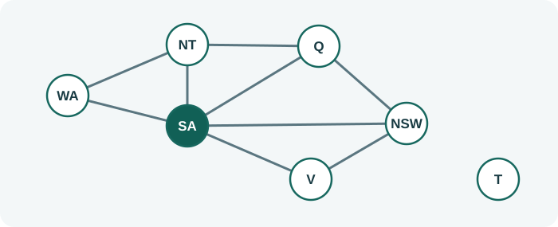

# 06A 变量、域与约束建模

**书页 152–156 · §6.1。** 如果把七个州的配色装进一个黑盒，每换一种配色都要重新判断整张图。打开这个黑盒，观察“南澳与谁相邻”，一次失败就能排除所有包含同一冲突的完整配色。这是从原子表示走向因子化表示（factored representation）的收益。

## 一个解究竟是什么

设变量为 $X_1,\ldots,X_n$，每个变量有自己的域 $D_i$。约束 $C_j=(S_j,R_j)$ 包含有序作用域 $S_j$ 和该顺序下允许的元组关系 $R_j$。例如 $X>Y$ 在域 $\{1,2,3\}$ 上可以显式列为 $(2,1),(3,1),(3,2)$，也可以用一个布尔谓词检查。顺序对大于关系很重要。完整赋值 $a$ 是解当且仅当

$$
a\in\prod_{i=1}^nD_i,\qquad \forall j,\quad a|_{S_j}\in R_j.
$$

部分赋值只确定一部分变量；“目前一致”要求已可检查的约束成立。以后可能找不到任何延拓。反例是用两种颜色给三角形着色，给第一点选任一颜色都合法，整图却无解。[[06B 从局部支持到弧一致性]]

## 地图如何变成九个关系

书页 153，图 6-1。教材省略首都直辖区，留下六个大陆区域和独立的 T。每条边要求两端不同色。重绘图给出完整邻接关系；两点画得近并不会自动产生约束。

固定 SA 为蓝色，五个大陆邻居各自从三个候选变成两个。暂时忽略邻居之间的边，候选从 $3^5=243$ 变为 $2^5=32$，删除比例 $211/243\approx86.8\%$。32 是这一步剩下的组合数。再沿 WA–NT–Q–NSW–V 检查相邻不同色，链上颜色只能交替。固定 SA 后大陆只剩两种着法，T 另有三种。全图三色解共 $3\times2\times3=18$。四种颜色时的推广见 [[06G 习题与研究任务]]。

## 车间调度的变量应当代表什么

书页 154–155。令每个任务的变量 $s_i$ 为开始分钟，工时 $p_i$ 是参数。前轴、后轴各一项，每个车轮有装轮、紧螺母、装盖三项，另有终检，共 $2+4\times3+1=15$ 项。例如前轴与右前轮满足 $s_{\rm axle}+10\le s_{\rm wheel}$。只共用一把装轴工具意味着两个装轴时间区间不交，可以任选一种先后次序：

$$
s_F+10\le s_B\quad\lor\quad s_B+10\le s_F.
$$

> [!example] 自行推演 · 截止时间约束哪一个端点
> 让两根轴分别从第 0、10 分钟开始。第一对车轮在 10、11、13 分钟依次开始装轮、紧螺母、装盖，第二对在 20、21、23 分钟做相同三步。终检从 24 到 27 分钟。每个工序在前驱结束时即可开始。若要求 30 分钟内全部完工，必须检查 $s_{\rm inspect}+3\le30$。单独写 $s_i\in\{0,\ldots,30\}$ 会错误接纳第 30 分钟才开始终检的安排。

## 表示的选择决定传播的力度

| 选择 | 一个实例 | 对求解有什么影响 |
|---|---|---|
| 离散有限域 | 颜色或皇后行号 | 可以枚举；一般有限域 CSP 的判定版本在通常显式、可多项式验证的表示下是 NP 完全的 |
| 离散无限域 | 没有截止时间的整数调度 | 需要隐式约束。一般整系数多项式丢番图方程的可解性不可判定，具体线性子类另论 |
| 连续域 | 连续开始时间 | 线性约束与线性目标构成线性规划；有理数输入可按输入位长多项式求解 |
| 硬约束与偏好 | 教师不能撞课，但偏好上午 | 先满足硬约束，再最小化软约束代价之和，得到约束优化问题 COP |
| 一元、二元、高阶 | 禁一种颜色、相邻异色、三数居中 | 二元约束用图，高阶约束可用超图；作用域与关系须同时保留 |

**密码算术（书页 155–156，图 6-2）。** 在 TWO + TWO = FOUR 中，字母占不同数字，首字母非零。把列间的信息压缩成进位 $c_i\in\{0,1\}$。从低位起，
$$
2O=R+10c_1,\quad 2W+c_1=U+10c_2,\quad 2T+c_2=O+10c_3,\quad c_3=F.
$$
末式与 $F\ne0$ 强迫 $F=1$。每一列是一条局部高阶约束，所有字母另有一条 AllDifferent。引入进位让一列删值可以影响另一列。图中方块各自代表整条关系，进位与字母都是变量。

**对偶图。** 让每条约束变成一个变量，其域为该约束的所有允许元组；在共享原变量的两个元组之间要求共享坐标逐一相等。例如 $X+Y=Z$ 与 $Y=X+1$ 共享两个坐标；域均为 1 至 5 时只剩 $(1,2,3)$ 和 $(2,3,5)$ 两种原赋值。保留孤立原变量时要单独处理其域。元组域可能随作用域大小指数增长；同一解集在不同编码下的传播效果也可能不同。辅助变量构造与双向证明见 [[06G 习题与研究任务]]。
