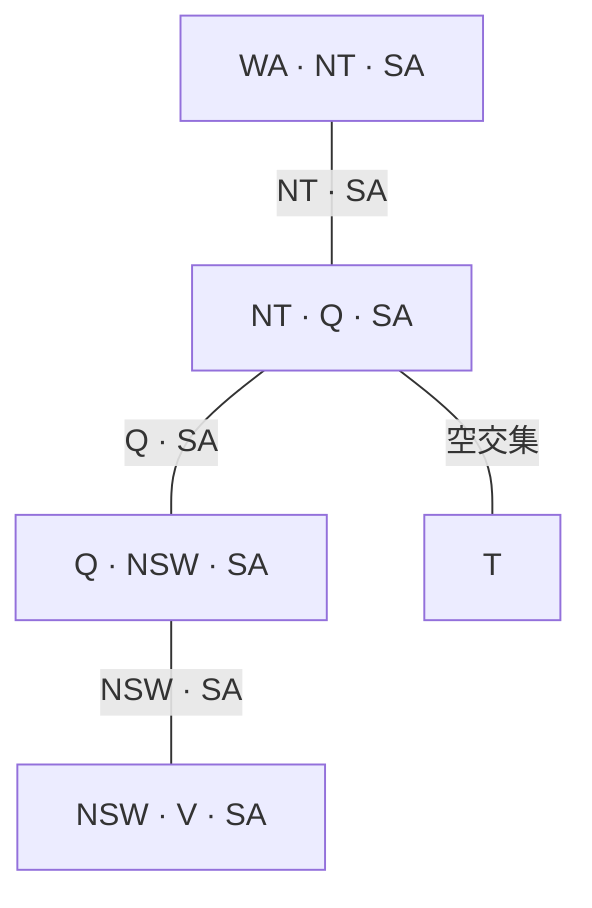

# 06F 图结构、割集与树宽

**书页 168–171 · §6.5。** 相同的变量数和域大小，可以对应完全不同的求解难度。先在纸上画图，再问相邻子问题必须传递多少信息。

## 连通分量与树形算法

若二元图分成 $n/s$ 个独立分量，每个分量有 $s$ 个变量，找一个解的枚举工作约为 $(n/s)d^s$，代替联合枚举 $d^n$。任一分量无解会使全问题无解；否则任选各分量的一个解便可拼合。**计数**时各分量解数相乘，**找解成本**则相加。教材用孤立的 T 说明这一差别。

对一棵有根树，先以“父先子后”排次序。自叶向根修订父域，使父域的每个值在每个孩子处都有支持，这叫定向弧一致性（DAC）。再反向走，从根到叶选择与已定父值兼容的值。

```text
选根并记录父节点，得到父在子之前的序列
逆序访问每个非根节点 v：
    从父节点域中删除在 v 的域里无支持的值
    若有空域，返回无解
顺序访问：根任选一个剩余值，子节点任选兼容父值的剩余值
返回整棵树的赋值
```

**归纳证明。** 叶子任一存活值都可使其单节点子树可解。若每个孩子的存活值都可延拓至其子树，父值通过修订意味着在每个孩子处至少有一个这样的值。不同子树间没有边，可独立拼接。根节点有剩余值就有全树解。总共修订 $n-1$ 条边，每次最多 $d^2$ 次关系检验，向下赋值最多 $(n-1)d$ 次，故为 $O(nd^2)$。所谓线性针对固定 $d$ 下的 $n$。图 6-10、6-11 见书页 168–169。

[两遍树形求解的 Python 实现](../../code/tree_csp.py) 同时处理森林的孤立节点，并以随机森林的穷举解集检查结果。

**顺序的反例。** 设链 $A=B=C$，前两域为 $\{0,1\}$，末域为 $\{1\}$。若先查 $A\to B$ 再查 $B\to C$，根域还保留无法延拓的 0。从叶端先查才会把 0 一路删除。[[06B 从局部支持到弧一致性]]

## 环割集把指数项集中在哪里

选择变量集 $S$，删去其节点后余图为森林。对 $S$ 的每个内部一致赋值，把与之不兼容的邻居候选删除，再解各棵树；失败就换下一组割集取值。**直接删点而没有传递它的赋值会遗漏跨边约束。** 图 6-12 中固定 SA，剩余大陆图为 WA–NT–Q–NSW–V，T 单独成树。

设 $|S|=c$。至多有 $d^c$ 种割集取值，每次森林部分的主开销为 $O((n-c)d^2)$，得到教材的 $O(d^c(n-c)d^2)$ 估计；枚举时还需检查割集内部及跨边，若这些非恒定开销占主导，应单独计入。最小反馈顶点集难求，选一个较小可用的割集也能受益。[[06G 习题与研究任务]]

## 树分解与分隔集

另一条路是把若干原变量装进一个“袋”。袋构成树，必须同时满足：每个变量至少进一袋；每条原边的两端同处某袋；包含同一变量的所有袋连通。最后一条叫运行交集性质，否则两个袋可能给同一原变量作出矛盾选择。相邻袋在交集（分隔集）上必须取相同值。

用教材地图重构一个分解：大陆的四袋依次为 $\{WA,NT,SA\}$、$\{NT,Q,SA\}$、$\{Q,NSW,SA\}$、$\{NSW,V,SA\}$。让这四袋成链；独立袋 $\{T\}$ 可接任意一端，交集为空。第一、二袋共享的是 **NT 和 SA 两项**。固定它们，第一袋内部的 WA 决策就不必传入后半段。若把 SA 从中间一袋遗漏，即使仍有其他袋含 SA，也会破坏连通性。

下图给出同一结构的一种重绘。边标签是相邻袋必须一致的变量，空交集对应独立分量。



**宽度的推导。** 最大袋大小为 $w+1$，一袋最多 $d^{w+1}$ 种元组。自叶向根，对每个本袋可行元组，按分隔集投影登记“存在延拓”；反向取得实际解时读取见证。用索引查这些投影，常规有 $O(n)$ 个袋的有界宽分解可按教材记为 $O(nd^{w+1})$（省略图表示及宽度相关因子）。若直接枚举相邻两袋的所有元组对，会付出更大代价。消息表需要随宽度指数增长的内存。图的树宽是对一切分解取最小宽度；给定分解时可以直接使用，寻找最优分解则是另一项计算。

地图三角形迫使某袋容纳三个顶点，上述分解最大袋恰好是三元，所以此图树宽为 2。割集 $c=1$ 也可以解此图。一般而言，若删去 $c$ 个点后是森林，可把这 $c$ 个点加入森林分解的每个袋，最大袋至多 $c+2$，推出 $w\le c+1$。这是独立构造得到的非严格上界，地图正好取等；书页 171 所印的严格小于号与此例不符。

## 值对称何时可以破缺

书页 171 中，三角形的三个位置必须各用一种颜色。在完全对称的三种颜色间交换名称，可得到 $3!=6$ 个等价解。给三点颜色编号强加一个顺序，就能每类只保留一个代表。若颜色有特殊成本或某点已指定红色，交换未必保持约束或目标。即便颜色均等价，使用不到所有颜色的解也可能在交换未使用颜色时保持不变，不能一律把解数除以 $d!$。

> [!tip] 跨章阅读
> 第 13 章的变量消元也受“中间表涉及几个变量”影响。此处的消息问是否存在符合条件的赋值，概率推理的消息对赋值权重做乘积与求和。两种算法都利用分隔集缩小子问题之间必须交换的信息。[[章节依赖与阅读目标]]
