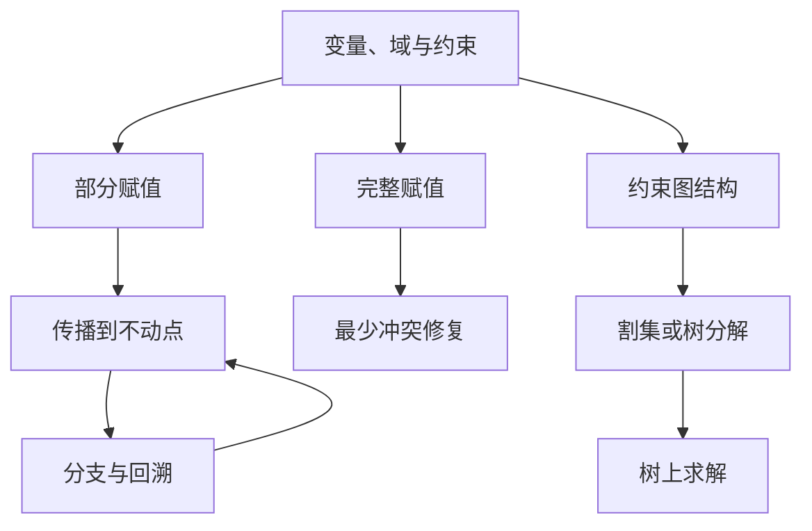

# MOC-06 约束满足问题

**阅读目标**　给出一个新问题时，能选择变量、域与约束，判断只需传播还是必须搜索，并说明所用算法的失败能否证明无解。原书第 6 章，书页 152–174，分卷 PDF 第 1–23 页。

| 原书入口 | 核心问题 | 学习笔记 |
|---|---|---|
| §6.1 · 152–156 | 怎样决定模型中的变量，哪些限制可放进域？ | [[06A 变量、域与约束建模]] |
| §6.2 · 156–161 | 怎样用支持关系安全地删值，何时仍需全局信息？ | [[06B 从局部支持到弧一致性]] · [[06C 全局约束与数独]] |
| §6.3 · 161–166 | 怎样选择分支、还原推断、解释失败？ | [[06D 回溯、启发式与约束学习]] |
| §6.4 · 166–167 | 已有一个完整但冲突的排班，怎样改动？ | [[06E 完整赋值与最少冲突]] |
| §6.5 · 168–171 | 图上有何结构可消去回溯，指数项究竟依赖什么？ | [[06F 图结构、割集与树宽]] |
| 小结、历史 · 171–174 | 如何用原图复述方法，以及联系后续研究？ | [[06H 原图导读与历史线索]] |

**第一次学。** 先在纸上画地图并算出三色解数，再用两色三角形检验弧一致性的极限，最后重做书页 164 的前向检验。第二次学时，可直接从树上无回溯的证明出发，追问“为什么换成环就失效”。

**检验掌握程度。** [[06G 习题与研究任务]] 收录配套章页的 20 个题号及解题、实验记录。回忆英文时用 [[术语索引]]，核对推导用 [[公式索引]]，选择实现用 [[算法与复杂度索引]]。

**前后联系。** 原书第 3、4 章提供 DFS 和局部搜索背景；第 7 章的 SAT、第 11 章的规划编码、第 13 章的消元可分别从冲突学习、有限域建模和树宽衔接。[[全书知识地图]] · [[第06章覆盖与审核]]
