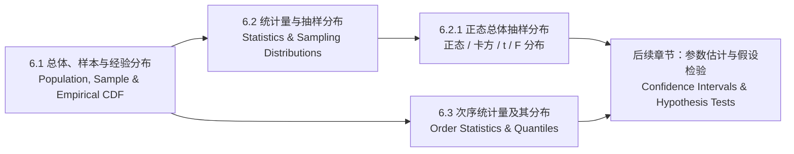
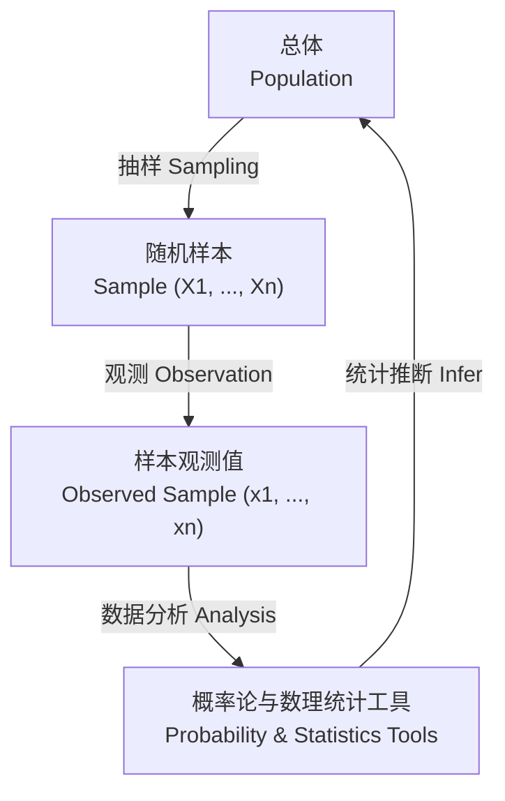

# Chapter 6 统计学基本概念（Basic Concepts of Statistics）

> [!abstract] 本章核心脉络与参考书目
> 本章是从**概率论**迈向**数理统计**的桥梁。概率论研究“已知总体分布，样本会呈现什么规律”；数理统计则反其道而行之，研究“如何利用观测到的样本数据，反推未知的总体特征”。
>
> - **核心关键词**：总体（Population）、随机样本（Random Sample）、经验分布函数（Empirical CDF）、统计量（Statistic）、抽样分布（Sampling Distribution）、正态总体四大抽样分布（$N, \chi^2, t, F$）、次序统计量（Order Statistics）、分位数（Quantile）。
> - **参考教材**：
>   1. Robert V. Hogg, Elliot A. Tanis, & Dale Zimmerman, *Probability and Statistical Inference* (9th / 10th ed.), Sections 6.1, 6.2, 6.3.
>   2. 魏宗舒（Wei Zongshu）, *A Course in Probability Theory and Mathematical Statistics* (3rd ed.), Sections 5.1, 5.2, 5.3.

---

## 6.1 总体、样本与经验分布

### 6.1.1 总体与个体

> [!info] 定义 6.1（总体与个体 / Population & Individual）
> - **总体（Population）**：研究对象的全体集合。
> - **个体（Individual）**：总体中的每一个基本元素。
>
> 当我们称所研究的总体具有分布函数 $F(x)$，或具有概率密度函数 / 概率质量函数（pdf / pmf）$f(x)$ 时，其严格含义为：
> 1. 我们关心的是总体中各个个体的某一项数量指标（特征）$X$；
> 2. 这一指标 $X$ 被建模为一个随机变量，其分布函数为 $F(x)$（或 pdf / pmf 为 $f(x)$）。

> [!tip] 教科书视角：为何把“总体”等同于“随机变量 $X$”？
> 在数理统计中，我们并不关心个体本身的所有物理属性（例如一台电视机的颜色或外观），而只关心我们测量的数量指标（例如屏幕寿命）。因此，**总体在数学上直接对应一个概率分布 $F(x)$**。

> [!example] 例 6.1：辨析总体、个体与数量指标
> 指出以下三个实际研究场景中的总体、个体以及所研究的数量指标（假设我们均研究其平均值）：
> 1. 某工厂生产的一批电视机 LCD 屏幕的寿命；
> 2. 上海市居民的收入；
> 3. 襄阳河中黑鱼的体长。
>
> > [!success]- 点击展开解答
> > | 研究场景 | 总体（Population） | 个体（Individual） | 数量指标（Characteristic $X$） |
> > | :--- | :--- | :--- | :--- |
> > | 1. 屏幕寿命 | 该工厂生产的这批电视机 LCD 屏幕 | 这批产品中的每一块 LCD 屏幕 | 寿命（Lifetime） |
> > | 2. 居民收入 | 上海市全体居民 | 上海市的每一位居民 | 收入（Income） |
> > | 3. 黑鱼体长 | 襄阳河中的所有黑鱼 | 襄阳河中的每一条黑鱼 | 体长（Body length） |

---

### 6.1.2 随机样本、样本空间与联合分布

> [!info] 定义 6.2（随机样本与样本空间 / Random Sample & Sample Space）
> 设 $X_1, \dots, X_n$ 是从总体 $F(x)$ 中抽取的随机变量。若满足以下两个条件：
> 1. **相互独立性**：$X_1, \dots, X_n$ 相互独立；
> 2. **同分布性**：每个 $X_i$ 都与总体具有相同的分布函数 $F(x)$；
>
> 则称 $X_1, \dots, X_n$ 为来自总体 $F(x)$ 的一个**容量为 $n$ 的随机样本（Random Sample of size $n$）**，亦称**独立同分布（i.i.d.）**随机变量序列。
>
> - **样本空间（Sample Space）**：随机向量 $(X_1, \dots, X_n)$ 的支集（Support）。特别地，若每个 $X_i$ 的支集为 $\mathbb{X}$，则样本空间为 $n$ 重笛卡尔积：
> $$
> \underbrace{\mathbb{X} \times \cdots \times \mathbb{X}}_{n \text{ factors}} = \mathbb{X}^n.
> $$

> [!warning] 核心区分：样本（随机向量）vs. 样本观测值（具体数据）
> - **样本** $(X_1, \dots, X_n)$ 在抽样完成之前是一个**随机向量**（用大写字母表示）；
> - **观测数据** $(x_1, \dots, x_n)$ 是该随机向量的一次具体**实现（Realization）**（用小写字母表示）。

> [!info] 定义 6.3（随机样本的联合分布 / Joint pdf/pmf）
> 设总体具有 pdf / pmf $f(x)$，则来自该总体的随机样本 $X_1, \dots, X_n$ 的联合 pdf / pmf 为：
> $$
> f(x_1, \dots, x_n) = \prod_{i=1}^{n} f(x_i).
> $$

> [!tip] 逻辑推导
> - 由**独立性**得：$f_{X_1,\dots,X_n}(x_1,\dots,x_n) = f_{X_1}(x_1) \cdots f_{X_n}(x_n)$；
> - 由**同分布性**得：对所有 $i=1,\dots,n$，均有 $f_{X_i} = f$；
> - **结论**：总体模型 $f$ 完全决定了整个样本的联合分布，这也是后续极大似然估计（MLE）的出发点。

---

### 6.1.3 经验分布函数（Empirical CDF）

当我们不知道总体分布 $F(x)$ 时，最直接的非参数估计方法就是用样本的“累积频率”来逼近总体的“累积概率”。

> [!info] 定义 6.4（经验分布函数 / Empirical CDF）
> 设 $x_1, \dots, x_n$ 为来自总体 $F(x)$ 的一组样本观测值。**经验累积分布函数** $F_n(x)$ 定义为观测值中小于或等于 $x$ 的比例：
> $$
> F_n(x) = \frac{1}{n} \sum_{i=1}^{n} \mathbf{1}_{\{x_i \le x\}}.
> $$
> 将观测值按从小到大排序为 $x_{(1)} \le x_{(2)} \le \cdots \le x_{(n)}$，则 $F_n(x)$ 可写成分段形式：
> $$
> F_n(x) = \begin{cases}
> 0, & x < x_{(1)}, \\
> \dfrac{k}{n}, & x_{(k)} \le x < x_{(k+1)},\quad 1 \le k < n, \\
> 1, & x \ge x_{(n)}.
> \end{cases}
> $$

> [!important] 经验分布函数 $F_n(x)$ 的三大图像性质
> 1. **单调不减且右连续**（Non-decreasing and right-continuous）；
> 2. **阶梯函数（Step function）**：每一个观测值贡献一个高度为 $1/n$ 的向上跳跃；**当存在重复观测值（Ties）时，跳跃高度叠加**（如某值出现 $m$ 次，则该点跳跃 $m/n$）；
> 3. **边界极限**：$F_n(-\infty) = 0$，$F_n(+\infty) = 1$。
>
> *（注：这意味着对任意固定样本，$F_n(x)$ 本身就是一个合法的离散分布函数。）*

> [!example] 例 6.2：构造含重复值的经验分布函数
> 给定样本观测值 $4, 1, 2, 5, 2$，求其经验分布函数 $F_5(x)$，并说明在重复值处的跳跃特征。
>
> > [!success]- 点击展开解答
> > 第一步：将观测值从小到大排序：
> > $$
> > x_{(1)}, \dots, x_{(5)} = 1,\ 2,\ 2,\ 4,\ 5.
> > $$
> > 第二步：按区间统计小于等于 $x$ 的观测值个数并除以 $n=5$：
> > $$
> > F_5(x) = \begin{cases}
> > 0, & x < 1, \\
> > 1/5, & 1 \le x < 2, \\
> > 3/5, & 2 \le x < 4, \\
> > 4/5, & 4 \le x < 5, \\
> > 1, & x \ge 5.
> > \end{cases}
> > $$
> > **关键观察**：由于数值 $2$ 重复出现了两次，它贡献了两个观测点，因此 $F_5(x)$ 在 $x=2$ 处直接跳跃了 $2/5$（从 $1/5$ 跳至 $3/5$）。

#### 经验分布函数的收敛性（为什么 $F_n$ 能代表 $F$？）

> [!important] 性质（Remark 3：经验分布函数的依概率收敛性）
> 对任意固定的实数 $x$，将样本视为随机变量 $X_1,\dots,X_n$，则 $F_n(x)$ 是一个随机变量，且当 $n \to \infty$ 时满足：
> $$
> F_n(x) \xrightarrow{\mathbb{P}} F(x).
> $$
>
> > [!note]- 点击展开证明过程
> > 对固定的 $x$，令示性随机变量 $Y_i = \mathbf{1}_{\{X_i \le x\}}$（$i=1,\dots,n$）。
> > 由于 $X_1,\dots,X_n$ i.i.d.，故 $Y_1,\dots,Y_n$ 也 i.i.d.，且服从两点分布：
> > $$
> > Y_i \sim \mathrm{Bernoulli}(p), \quad p = \mathbb{P}(X_1 \le x) = F(x).
> > $$
> > 于是 $F_n(x) = \frac{1}{n}\sum_{i=1}^n Y_i$ 正是 $Y_i$ 的样本均值，且：
> > $$
> > \mathbb{E}(Y_1) = F(x), \qquad \mathrm{Var}(Y_1) = F(x)[1 - F(x)] < \infty.
> > $$
> > 由**弱大数定律（Weak Law of Large Numbers, WLLN）**立即得到：
> > $$
> > F_n(x) \xrightarrow{\mathbb{P}} F(x).
> > $$

> [!tip] 样本量 $n$ 对逼近效果的影响与实用价值
> 以 $X \sim N(0,1)$ 为例：
> - 当 $n = 10$ 时，$F_n$ 仅有少数几次大幅跳跃（每次 $0.1$），与光滑的理论曲线 $F$ 偏差明显；
> - 当 $n = 100$ 时，每次跳跃缩小至 $0.01$，阶梯曲线已能较好贴合 $F$；
> - 当 $n = 1000$ 或 $10000$ 时，跳跃微乎其微，$F_n$ 在视觉上几乎与总体 CDF $F$ 重合。
>
> **实际意义**：即使总体分布 $F$ 完全未知，当样本量较大时，$F_n$ 仍能提供基于数据的概率与分位数估计。

---

### 6.1.4 总体与样本的统计推断闭环

- **概率论视角**：描述总体如何生成样本（自上而下，由因推果）。
- **数理统计视角**：利用观测到的样本去反推总体信息（自下而上，由果溯因）。
- **核心过渡**：为了高效地从高维数据 $(X_1,\dots,X_n)$ 中提取信息，我们需要将样本压缩为若干有用的摘要函数——即下一节要学习的**统计量（Statistics）**。

---

## 6.2 统计量与抽样分布

### 6.2.1 统计量与抽样分布的定义

> [!info] 定义 6.5（统计量与抽样分布 / Statistic & Sampling Distribution）
> 设 $X_1, \dots, X_n$ 为来自某总体的容量为 $n$ 的随机样本，$T(X_1, \dots, X_n)$ 为定义域包含样本空间的实值或向量值函数。则称随机变量（或随机向量）
> $$
> Y = T(X_1, \dots, X_n)
> $$
> 为一个**统计量（Statistic）**，而 $Y$ 的概率分布称为 $Y$ 的**抽样分布（Sampling Distribution）**。

> [!warning] 统计量的隐含铁律：不含未知参数！
> 统计量必须完全由样本计算得出，**不能依赖任何未知的总体参数**（如未知的 $\mu$ 或 $\sigma^2$）。例如，当 $\mu$ 未知时，$\bar{X}_n$ 是统计量，而 $\bar{X}_n - \mu$ **不是**统计量（但在构造区间估计或检验统计量时可作为枢轴量使用）。

---

### 6.2.2 常用统计量速查

设 $X_1, \dots, X_n$ 为容量为 $n$ 的随机样本，最常用的 8 类统计量汇总如下：

| 序号 | 统计量名称 | 英文名称 | 数学表达式 | 统计含义与备注 |
| :---: | :--- | :--- | :--- | :--- |
| 1 | **样本均值** | Sample mean | $\displaystyle \bar{X}_n = \frac{1}{n}\sum_{i=1}^n X_i$ | 刻画数据中心位置 |
| 2 | **无偏样本方差** | Unbiased sample variance | $\displaystyle S_n^2 = \frac{1}{n-1}\sum_{i=1}^n (X_i - \bar{X}_n)^2$ | 分母为 $n-1$，是 $\sigma^2$ 的无偏估计 |
| 3 | **样本标准差** | Sample standard deviation | $\displaystyle S_n = \sqrt{\frac{1}{n-1}\sum_{i=1}^n (X_i - \bar{X}_n)^2}$ | 与原数据同量纲的离散度指标 |
| 4 | 均值与方差的函数 | Functions of $\bar{X}_n, S_n^2, S_n$ | 如 $g(\bar{X}_n, S_n^2)$ | 构造复杂检验统计量的基础 |
| 5 | **有偏样本方差** | Biased sample variance | $\displaystyle \frac{1}{n}\sum_{i=1}^n (X_i - \bar{X}_n)^2$ | 即样本二阶中心矩（MLE 形式） |
| 6 | **有偏样本标准差** | Biased sample standard deviation | $\displaystyle \sqrt{\frac{1}{n}\sum_{i=1}^n (X_i - \bar{X}_n)^2}$ | 有偏样本方差的算术平方根 |
| 7 | **样本 $k$ 阶原点矩** | Sample $k$th origin moment | $\displaystyle \frac{1}{n}\sum_{i=1}^n X_i^k$ | $k=1$ 时即为样本均值 $\bar{X}_n$ |
| 8 | **样本 $k$ 阶中心矩** | Sample $k$th central moment | $\displaystyle \frac{1}{n}\sum_{i=1}^n (X_i - \bar{X}_n)^k$ | $k=2$ 时即为有偏样本方差 |

---

### 6.2.3 样本方差的两个核心恒等式

> [!important] 定理 6.6（样本方差的极小化性质与计算恒等式）
> 设 $x_1, \dots, x_n$ 为任意实数，记 $\bar{x}_n = \frac{1}{n}\sum_{i=1}^n x_i$，$s_n^2 = \frac{1}{n-1}\sum_{i=1}^n (x_i - \bar{x}_n)^2$，则：
> 1. **平方和极小化性质（最佳中心）**：
> $$
> \min_{a \in \mathbb{R}} \sum_{i=1}^{n} (x_i - a)^2 = \sum_{i=1}^{n} (x_i - \bar{x}_n)^2.
> $$
> 2. **方差快捷计算公式**：
> $$
> (n - 1)s_n^2 = \sum_{i=1}^{n} x_i^2 - n\bar{x}_n^2.
> $$
>
> > [!note]- 点击展开证明过程
> > **证明（1）**：对任意 $a \in \mathbb{R}$，在括号内加减 $\bar{x}_n$ 并展开：
> > $$
> > \begin{aligned}
> > \sum_{i=1}^{n} (x_i - a)^2 &= \sum_{i=1}^{n} \big[(x_i - \bar{x}_n) + (\bar{x}_n - a)\big]^2 \\
> > &= \sum_{i=1}^{n} (x_i - \bar{x}_n)^2 + n(\bar{x}_n - a)^2 + 2(\bar{x}_n - a)\sum_{i=1}^{n}(x_i - \bar{x}_n).
> > \end{aligned}
> > $$
> > 因为样本离差之和恒为零，即 $\sum_{i=1}^n (x_i - \bar{x}_n) = n\bar{x}_n - n\bar{x}_n = 0$，交叉项消失：
> > $$
> > \sum_{i=1}^{n} (x_i - a)^2 = \sum_{i=1}^{n} (x_i - \bar{x}_n)^2 + n(\bar{x}_n - a)^2 \ge \sum_{i=1}^{n} (x_i - \bar{x}_n)^2,
> > $$
> > 当且仅当 $a = \bar{x}_n$ 时等号成立。
> >
> > **证明（2）**：在（1）的展开恒等式中取 $a = 0$，立即得到：
> > $$
> > \sum_{i=1}^{n} x_i^2 = \sum_{i=1}^{n} (x_i - \bar{x}_n)^2 + n\bar{x}_n^2 \implies (n-1)s_n^2 = \sum_{i=1}^{n} x_i^2 - n\bar{x}_n^2.
> > $$

> [!example] 例 6.3：应用方差恒等式
> 已知数据 $1, 2, 3$，样本均值 $\bar{x}_n = 2$。
> 1. 求使 $\sum_{i=1}^3 (x_i - a)^2$ 最小的 $a$ 值及该平方和关于 $a$ 的表达式；
> 2. 利用恒等式快速计算样本方差 $s_n^2$。
>
> > [!success]- 点击展开解答
> > 1. **最佳中心**：由定理 6.6（1）的证明过程，
> > $$
> > \sum_{i=1}^{3} (x_i - a)^2 = \sum_{i=1}^3 (x_i - 2)^2 + 3(a - 2)^2 = 2 + 3(a - 2)^2,
> > $$
> > 因此当 $a = 2$ 时，平方距离之和取得最小值 $2$。
> > 2. **快速计算方差**：由定理 6.6（2），
> > $$
> > (n-1)s_n^2 = 1^2 + 2^2 + 3^2 - 3(2^2) = 14 - 12 = 2 \implies s_n^2 = \frac{2}{3-1} = 1.
> > $$
> > *启示：第二个恒等式避免了逐一计算每个离差 $(x_i - \bar{x}_n)$，在手工计算和理论推导（如证明 $\mathbb{E}(S_n^2)=\sigma^2$）中极其高效。*

---

### 6.2.4 样本均值与样本方差的数字特征（无偏性）

> [!info] 引理 6.7（独立同分布样本函数和的期望与方差）
> 设 $X_1, \dots, X_n$ 为随机样本，$g(\cdot)$ 为实函数且 $\mathbb{E}[g(X_1)]$ 与 $\mathrm{Var}[g(X_1)]$ 存在，则：
> 1. $\displaystyle \mathbb{E}\left[\sum_{i=1}^n g(X_i)\right] = n\mathbb{E}[g(X_1)]$；
> 2. $\displaystyle \mathrm{Var}\left[\sum_{i=1}^n g(X_i)\right] = n\,\mathrm{Var}[g(X_1)]$。

> [!important] 定理 6.8（样本均值与样本方差的期望与方差——对任意分布均成立！）
> 设 $X_1, \dots, X_n$ 为来自具有有限均值 $\mu$ 和有限方差 $\sigma^2$ 的总体的随机样本，则：
> $$
> \mathbb{E}(\bar{X}_n) = \mu, \qquad \mathrm{Var}(\bar{X}_n) = \frac{\sigma^2}{n}, \qquad \mathbb{E}(S_n^2) = \sigma^2 \quad (n \ge 2).
> $$
>
> > [!note]- 点击展开证明过程
> > **1. 样本均值的期望与方差**：
> > 由同分布性 $\mathbb{E}(X_i) = \mu$ 及期望线性性：
> > $$
> > \mathbb{E}(\bar{X}_n) = \mathbb{E}\left(\frac{1}{n}\sum_{i=1}^n X_i\right) = \frac{1}{n}\sum_{i=1}^n \mathbb{E}(X_i) = \mu.
> > $$
> > 由独立性，当 $i \ne j$ 时 $\mathrm{Cov}(X_i, X_j) = 0$，故：
> > $$
> > \mathrm{Var}(\bar{X}_n) = \mathrm{Var}\left(\frac{1}{n}\sum_{i=1}^n X_i\right) = \frac{1}{n^2}\sum_{i=1}^n \mathrm{Var}(X_i) = \frac{1}{n^2} \cdot n\sigma^2 = \frac{\sigma^2}{n}.
> > $$
> >
> > **2. 样本方差的期望**：
> > 利用定理 6.6 的恒等式 $(n-1)S_n^2 = \sum_{i=1}^n X_i^2 - n\bar{X}_n^2$。注意到：
> > $$
> > \mathbb{E}(X_i^2) = \mathrm{Var}(X_i) + [\mathbb{E}(X_i)]^2 = \sigma^2 + \mu^2,
> > $$
> > $$
> > \mathbb{E}(\bar{X}_n^2) = \mathrm{Var}(\bar{X}_n) + [\mathbb{E}(\bar{X}_n)]^2 = \frac{\sigma^2}{n} + \mu^2.
> > $$
> > 对恒等式两边取期望：
> > $$
> > (n-1)\mathbb{E}(S_n^2) = n(\sigma^2 + \mu^2) - n\left(\frac{\sigma^2}{n} + \mu^2\right) = (n-1)\sigma^2.
> > $$
> > 当 $n \ge 2$ 时两边同除以 $(n-1)$，即得 $\mathbb{E}(S_n^2) = \sigma^2$。

> [!tip] 深度解析：无偏性（Unbiasedness）与“为什么要除以 $n-1$？”
> - **无偏估计量定义**：若参数 $\theta$ 的估计量 $T(X_1,\dots,X_n)$ 满足 $\mathbb{E}[T(X_1,\dots,X_n)] = \theta$，则称 $T$ 是 $\theta$ 的**无偏估计量**。由定理 6.8，$\bar{X}_n$ 和 $S_n^2$ 分别是 $\mu$ 和 $\sigma^2$ 的无偏估计量。
> - **为何除以 $n-1$**：若用有偏方差 $\frac{1}{n}\sum(X_i - \bar{X}_n)^2$，其期望为 $\frac{n-1}{n}\sigma^2 < \sigma^2$，系统性地低估了总体方差（因为用样本均值 $\bar{X}_n$ 代替了未知的 $\mu$，消耗了 1 个自由度，由定理 6.6(1) 可知 $\sum(X_i - \bar{X}_n)^2 \le \sum(X_i - \mu)^2$）。
> - **稳定性**：$\mathrm{Var}(\bar{X}_n) = \sigma^2/n$ 表明样本量越大，样本均值越稳定（标准差按 $1/\sqrt{n}$ 缩小）。
> - **特别提醒**：定理 6.8 **不需要**总体正态假设；但“$\bar{X}_n$ 与 $S_n^2$ 相互独立”则是**正态总体特有的性质**（见 6.2.6 节）。

> [!example] 例 6.4：估计总体比例（Estimating a Population Proportion）
> 设 $X_i = 1$ 表示第 $i$ 个人支持某项提案，$X_i = 0$ 表示不支持，即 $X_i \stackrel{\text{i.i.d.}}{\sim} \mathrm{Bernoulli}(p)$，样本均值 $\bar{X}_n$ 即为样本比例。求 $\bar{X}_n$ 的期望与方差，并分析样本量 $n$ 增大对精度的影响。
>
> > [!success]- 点击展开解答
> > 对 $\mathrm{Bernoulli}(p)$，总体均值 $\mu = p$，总体方差 $\sigma^2 = p(1-p)$。由定理 6.8 直接得：
> > $$
> > \mathbb{E}(\bar{X}_n) = p, \qquad \mathrm{Var}(\bar{X}_n) = \frac{p(1-p)}{n}.
> > $$
> > **结论分析**：
> > - 样本比例 $\bar{X}_n$ 是总体比例 $p$ 的无偏估计量；
> > - 增大 $n$ 会以 $1/n$ 的速率降低方差；
> > - 例如，要将标准差减半，需要将样本量 $n$ 扩大为原来的 **4 倍**。

---

### 6.2.5 矩母函数（MGF）工具与独立性判定

定理 6.8 只给出了期望和方差，若要求统计量的**精确抽样分布**，矩母函数（Moment-Generating Function, MGF）是最强有力的解析工具。

> [!important] 定理 6.9（样本均值的矩母函数）
> 设 $X_1, \dots, X_n$ 为来自矩母函数为 $M(t)$ 的总体的随机样本，则样本均值 $\bar{X}_n$ 的矩母函数为：
> $$
> M_{\bar{X}_n}(t) = \left[ M\!\left(\frac{t}{n}\right) \right]^n.
> $$

> [!example] 例 6.5：泊松总体的样本均值分布
> 设 $X_1, \dots, X_n \stackrel{\text{i.i.d.}}{\sim} \mathrm{Poisson}(\lambda)$，已知 $M_X(t) = \exp\{\lambda(e^t - 1)\}$。利用定理 6.9 确定 $\bar{X}_n$ 的抽样分布。
>
> > [!success]- 点击展开解答
> > 由定理 6.9：
> > $$
> > M_{\bar{X}_n}(t) = \left[M_X\!\left(\frac{t}{n}\right)\right]^n = \left[\exp\left\{\lambda(e^{t/n} - 1)\right\}\right]^n = \exp\left\{n\lambda(e^{t/n} - 1)\right\}.
> > $$
> > 注意到 $M_{n\bar{X}_n}(t) = M_{\bar{X}_n}(nt) = \exp\{n\lambda(e^t - 1)\}$，由 MGF 唯一性可知：
> > $$
> > n\bar{X}_n = \sum_{i=1}^n X_i \sim \mathrm{Poisson}(n\lambda).
> > $$
> > 因此 $\bar{X}_n$ 的取值为 $0, 1/n, 2/n, \dots$，其分布列直接由 $\mathrm{Poisson}(n\lambda)$ 确定，无需计算复杂的卷积。

为了同时研究多个统计量（例如证明 $\bar{X}_n$ 与 $S_n^2$ 独立），需要将 MGF 推广到多维情形：

> [!info] 定义（多维矩母函数 / Multivariate MGF）
> 设 $\boldsymbol{X} = (X_1, \dots, X_d)^\top$ 为 $d$ 维随机向量，其矩母函数定义为：
> $$
> \phi_{\boldsymbol{X}}(\boldsymbol{t}) = \mathbb{E}\!\left(e^{\boldsymbol{t}^\top \boldsymbol{X}}\right),
> $$
> 其中 $\boldsymbol{t} = (t_1, \dots, t_d)^\top$ 为 $d$ 维实列向量。

> [!important] 定理 6.10（独立性与 MGF 的因子分解）
> 假设矩母函数在原点的某个邻域内存在。则随机变量 $X_1, \dots, X_n$ **相互独立**的充分必要条件是，在原点的某个邻域内有：
> $$
> M_{(X_1,\dots,X_n)}(t_1, \dots, t_n) = \prod_{i=1}^{n} M_{X_i}(t_i).
> $$

> [!example] 例 6.6：用 MGF 检验独立性
> 设 $X \sim N(0, 1)$ 与 $Y \sim N(1, 4)$ 相互独立，其边缘 MGF 分别为 $M_X(s) = e^{s^2/2}$ 和 $M_Y(t) = e^{t + 2t^2}$。写出联合 MGF 并说明如何从形式上判断独立性。
>
> > [!success]- 点击展开解答
> > 由独立性及定理 6.10：
> > $$
> > M_{(X,Y)}(s, t) = M_X(s) M_Y(t) = e^{s^2/2 + t + 2t^2}.
> > $$
> > **判断要点**：
> > - 指数上可以完全拆分为“只含 $s$ 的项”与“只含 $t$ 的项”之和，从而整体分解为 $s$ 的函数与 $t$ 的函数之积，证实二者独立；
> > - 如果指数中出现诸如 $st$ 的**交叉项**，则无法因子分解，说明二者不独立。

---

### 6.2.6 正态总体的抽样分布（6.2.1 重点专题）

对于一般总体，通常难以得到统计量的精确抽样分布；而**正态总体**的特殊之处在于，其样本均值与样本方差拥有完备、精确的抽样分布理论，这直接构成了后续**置信区间**与**假设检验**的基石。

> [!abstract] 本专题统一假设
> 设 $X_1, \dots, X_n \stackrel{\text{i.i.d.}}{\sim} N(\mu, \sigma^2)$，且满足 $n \ge 2$，$\mu \in \mathbb{R}$，$0 < \sigma^2 < \infty$。

> [!important] 定理 6.11（单正态总体的四大核心抽样分布定理）
> 设 $X_1, \dots, X_n$ 为来自正态总体 $N(\mu, \sigma^2)$ 的随机样本，$\bar{X}_n$ 和 $S_n^2$ 分别为样本均值和样本方差，则：
> - **(a) 样本均值的分布**：
> $$
> \bar{X}_n \sim N\!\left(\mu,\ \frac{\sigma^2}{n}\right).
> $$
> - **(b) 均值与方差的独立性**：$\bar{X}_n$ 与 $S_n^2$ **相互独立**。
> - **(c) 样本方差的卡方分布**：
> $$
> \frac{(n - 1)S_n^2}{\sigma^2} \sim \chi^2(n - 1).
> $$
> - **(d) 枢轴量的学生 $t$ 分布**（$\sigma$ 未知时用 $S_n$ 替代 $\sigma$）：
> $$
> \frac{\sqrt{n}(\bar{X}_n - \mu)}{S_n} \sim t(n - 1).
> $$

> [!note]- 点击展开定理 6.11 完整证明（(a)–(d) 逐项推导）
> #### Part (a) 的证明（MGF 法）
> $N(\mu, \sigma^2)$ 的 MGF 为 $M_X(t) = e^{\mu t + \frac{\sigma^2}{2}t^2}$。由定理 6.9：
> $$
> M_{\bar{X}_n}(t) = \left[M_{X_1}\!\left(\frac{t}{n}\right)\right]^n = \left[e^{\mu t/n + \frac{\sigma^2}{2}(t/n)^2}\right]^n = e^{\mu t + \frac{\sigma^2/n}{2}t^2}.
> $$
> 由 MGF 唯一性，立即得 $\bar{X}_n \sim N(\mu, \sigma^2/n)$。
>
> ---
>
> #### Part (b) 的证明（多维 MGF + 联合正态性）
> **第一步（单个残差与均值独立）**：记 $\boldsymbol{X} = (X_1,\dots,X_n)^\top$，$U = \bar{X}_n$，$V = X_j - \bar{X}_n$。写成线性组合 $U = \boldsymbol{a}^\top \boldsymbol{X}$，$V = \boldsymbol{b}^\top \boldsymbol{X}$，其中：
> $$
> a_k = \frac{1}{n}, \qquad b_k = \begin{cases} 1 - \frac{1}{n}, & k = j, \\ -\frac{1}{n}, & k \ne j. \end{cases}
> $$
> 易验证三个关键求和性质：$\sum_{k=1}^n a_k = 1$，$\sum_{k=1}^n b_k = 0$，$\sum_{k=1}^n a_k b_k = 0$（向量正交！）。
> 令 $s_k = a_k t_1 + b_k t_2$，利用 $X_k$ 相互独立计算联合 MGF：
> $$
> \begin{aligned}
> M_{(U,V)}(t_1, t_2) &= \mathbb{E}\!\left[\exp\left\{\sum_{k=1}^n s_k X_k\right\}\right] = \prod_{k=1}^n M_X(s_k) = \exp\left\{\mu \sum_{k=1}^n s_k + \frac{\sigma^2}{2}\sum_{k=1}^n s_k^2\right\} \\
> &= \exp\left\{\mu t_1 + \frac{\sigma^2}{2n} t_1^2\right\} \exp\left\{\frac{\sigma^2(n-1)}{2n} t_2^2\right\} = M_U(t_1) M_V(t_2).
> \end{aligned}
> $$
> 故 $U$ 与单个残差 $V = X_j - \bar{X}_n$ 独立。
>
> **第二步（整个残差向量与均值独立）**：记残差向量 $\boldsymbol{R} = (R_1, \dots, R_n)$，其中 $R_j = X_j - \bar{X}_n$。因为 $(U, \boldsymbol{R})$ 是正态样本的线性变换，所以 $(U, \boldsymbol{R})$ **联合正态**。又对每个 $j = 1,\dots,n$：
> $$
> \mathrm{Cov}(U, R_j) = \mathrm{Cov}(\bar{X}_n, X_j) - \mathrm{Var}(\bar{X}_n) = \frac{\sigma^2}{n} - \frac{\sigma^2}{n} = 0.
> $$
> 在联合正态分布中，不相关等价于独立，故 $U = \bar{X}_n$ 独立于**整个残差向量 $\boldsymbol{R}$**。又 $S_n^2 = \frac{1}{n-1}\sum_{j=1}^n R_j^2$ 是 $\boldsymbol{R}$ 的确定性函数，从而 $\bar{X}_n$ 与 $S_n^2$ 相互独立。
>
> ---
>
> #### Part (c) 的证明（Gamma / $\chi^2$ 分布的 MGF 分解）
> **前置复习**：若 $X \sim \mathrm{Gamma}(\alpha, \lambda)$（率参数 $\lambda$），其密度为 $f_X(x) = \frac{\lambda^\alpha}{\Gamma(\alpha)}x^{\alpha-1}e^{-\lambda x}\ (x>0)$，MGF 为 $M_X(t) = (1 - t/\lambda)^{-\alpha}\ (t < \lambda)$。
> - 当 $\alpha = 1$ 时，$X \sim \mathrm{Exp}(\lambda)$；
> - 当 $\alpha = n/2, \lambda = 1/2$ 时，$X \sim \chi^2(n)$，MGF 为 $(1-2t)^{-n/2}$；
> - **可加性**：独立卡方变量之和仍服从卡方分布，自由度相加：$\sum X_j \sim \chi^2(\sum n_j)$。
>
> **代数分解**：将总体标准化平方和拆分为两项：
> $$
> \underbrace{\frac{(n-1)S_n^2}{\sigma^2}}_{U} + \underbrace{\left(\frac{\sqrt{n}(\bar{X}_n - \mu)}{\sigma}\right)^2}_{V} = \sum_{j=1}^{n} \left(\frac{X_j - \mu}{\sigma}\right)^2.
> $$
> 由 Part (b)，$U$ 与 $V$ 相互独立，因此 $M_{U+V}(t) = M_U(t) M_V(t)$。
> - $U + V$ 是 $n$ 个独立标准正态变量的平方和，故 $U + V \sim \chi^2(n)$，$M_{U+V}(t) = (1 - 2t)^{-n/2}$；
> - 由 Part (a)，$\frac{\sqrt{n}(\bar{X}_n - \mu)}{\sigma} \sim N(0,1)$，故 $V \sim \chi^2(1)$，$M_V(t) = (1 - 2t)^{-1/2}$。
>
> 两式相除得：
> $$
> M_U(t) = \frac{M_{U+V}(t)}{M_V(t)} = (1 - 2t)^{-(n-1)/2}.
> $$
> 由 MGF 唯一性，得 $\frac{(n-1)S_n^2}{\sigma^2} \sim \chi^2(n-1)$。
>
> ---
>
> #### Part (d) 的证明（$t$ 分布定义构造）
> **前置复习**：若 $X \sim N(0,1)$，$Y \sim \chi^2(\nu)$，且 $X, Y$ 独立，则 $\dfrac{X}{\sqrt{Y/\nu}} \sim t(\nu)$。
>
> 令 $U = \dfrac{\sqrt{n}(\bar{X}_n - \mu)}{\sigma} \sim N(0,1)$，$V = \dfrac{(n-1)S_n^2}{\sigma^2} \sim \chi^2(n-1)$。
> 由 Part (b)，$\bar{X}_n$ 与 $S_n^2$ 独立，故 $U$ 与 $V$ 独立。代入 $t$ 分布定义：
> $$
> \frac{U}{\sqrt{V/(n-1)}} = \frac{\sqrt{n}(\bar{X}_n - \mu)/\sigma}{\sqrt{S_n^2/\sigma^2}} = \frac{\sqrt{n}(\bar{X}_n - \mu)}{S_n} \sim t(n-1).
> $$

> [!example] 例 6.7：单正态样本的抽样分布应用
> 设 $X_1, \dots, X_{25} \stackrel{\text{i.i.d.}}{\sim} N(10, 4^2)$。写出样本均值 $\bar{X}_n$、缩放样本方差以及（当 $\sigma$ 未知时）学生 $t$ 统计量的精确分布。
>
> > [!success]- 点击展开解答
> > 此处 $n = 25$，$\mu = 10$，$\sigma^2 = 16$，自由度 $n - 1 = 24$。由定理 6.11：
> > 1. 样本均值：$\displaystyle \bar{X}_n \sim N\!\left(10,\ \frac{16}{25}\right)$；
> > 2. 缩放样本方差：$\displaystyle \frac{24 S_n^2}{16} \sim \chi^2(24)$；
> > 3. 当 $\sigma$ 未知时的 $t$ 统计量：$\displaystyle \frac{5(\bar{X}_n - 10)}{S_n} \sim t(24)$。
> >
> > *注：同一组正态样本可以衍生出正态、卡方、$t$ 三类统计量，分别服务于不同的统计推断任务。*

#### 双正态总体的方差比分布（$F$ 分布）

> [!important] 定理 6.12（两独立正态样本方差比的 $F$ 分布）
> **假设条件**：
> - $X_1, \dots, X_n \stackrel{\text{i.i.d.}}{\sim} N(\mu_X, \sigma_X^2)$，样本方差为 $S_X^2$；
> - $Y_1, \dots, Y_m \stackrel{\text{i.i.d.}}{\sim} N(\mu_Y, \sigma_Y^2)$，样本方差为 $S_Y^2$；
> - 两个样本**相互独立**。
>
> **结论**：将两个样本方差各自除以对应的总体方差后作比，其比值服从 $F$ 分布：
> $$
> T = \frac{S_X^2 / \sigma_X^2}{S_Y^2 / \sigma_Y^2} \sim F(\underbrace{n - 1}_{\text{分子自由度}},\ \underbrace{m - 1}_{\text{分母自由度}}).
> $$
>
> > [!note]- 点击展开证明过程
> > **前置复习**：若 $X \sim \chi^2(n)$，$Y \sim \chi^2(m)$ 且 $X, Y$ 独立，则 $\dfrac{X/n}{Y/m} \sim F(n, m)$。
> >
> > 令 $U = \dfrac{(n-1)S_X^2}{\sigma_X^2}$，$V = \dfrac{(m-1)S_Y^2}{\sigma_Y^2}$。由定理 6.11(c)，$U \sim \chi^2(n-1)$，$V \sim \chi^2(m-1)$。
> > 因为两样本相互独立，故 $U$ 与 $V$ 独立。由 $F$ 分布定义：
> > $$
> > \frac{U/(n-1)}{V/(m-1)} = \frac{S_X^2/\sigma_X^2}{S_Y^2/\sigma_Y^2} \sim F(n-1, m-1).
> > $$

> [!warning] 使用定理 6.12 的两大注意点
> 1. **自由度顺序不可颠倒**：分子样本对应的自由度 $n-1$ 排在第一位，分母样本对应的自由度 $m-1$ 排在第二位（$F(n-1, m-1)$ 与 $F(m-1, n-1)$ 互为倒数分布）；
> 2. **与总体均值无关**：公式中不出现 $\mu_X$ 和 $\mu_Y$。

> [!example] 例 6.8：比较两个正态总体的方差
> 设两个独立正态样本的容量分别为 $n = 11$ 和 $m = 16$。为检验两总体方差是否相等，考虑样本方差比 $T = S_X^2 / S_Y^2$。在 $\sigma_X^2 = \sigma_Y^2$ 的假设下，$T$ 服从什么分布？如何直观解释 $T$ 的取值？
>
> > [!success]- 点击展开解答
> > 在 $\sigma_X^2 = \sigma_Y^2$ 时，$\sigma_X^2$ 与 $\sigma_Y^2$ 约去，由定理 6.12 得：
> > $$
> > T = \frac{S_X^2}{S_Y^2} \sim F(10,\ 15).
> > $$
> > **统计直觉**：
> > - 若 $T$ 接近 $1$，则与“两总体方差相等”的假设相吻合；
> > - 若 $T$ 非常小或非常大，则提供了“两总体方差存在差异”的证据。
> > - 这正是经典双样本方差齐性 $F$ 检验（$F$-test）的理论基础。

---

### 6.2.7 本节综合习题（Exercise 1–2）

> [!question] 习题 1（Exercise 1：正态样本量的最小确定）
> 设 $X_1, \dots, X_n$ 为来自正态总体 $N(\mu, \sigma^2)$ 的随机样本，样本均值和样本方差记为 $\bar{X}_n, S_n^2$。分别求满足下列条件的最小样本容量 $n$：
> - **(a)** $\displaystyle \mathbb{P}\!\left(\frac{S_n^2}{\sigma^2} \le 1.5\right) \ge 0.95$；
> - **(b)** $\displaystyle \mathbb{P}\!\left(\left|\frac{\bar{X}_n - \mu}{\sigma}\right| \le \frac{1}{2}\right) \ge 0.99$。
>
> > [!success]- 点击展开解答
> > **Part (a)**：
> > 由定理 6.11(c)，$U = \dfrac{(n-1)S_n^2}{\sigma^2} \sim \chi^2(n-1)$。将不等式等价变形为卡方分布的 CDF：
> > $$
> > \mathbb{P}\!\left(\frac{S_n^2}{\sigma^2} \le 1.5\right) = \mathbb{P}\!\big(U \le 1.5(n-1)\big) = F_{\chi^2(n-1)}\big(1.5(n-1)\big).
> > $$
> > 查卡方分布表或计算 CDF 逐一检验整数 $n$：
> > - 当 $n = 26$（自由度 $25$）时：$F_{\chi^2(25)}(37.5) \approx 0.9483 < 0.95$；
> > - 当 $n = 27$（自由度 $26$）时：$F_{\chi^2(26)}(39.0) \approx 0.9512 \ge 0.95$。
> >
> > 故最小样本容量为 **$n = 27$**。
> >
> > ---
> >
> > **Part (b)**：
> > 标准化得 $Z = \dfrac{\sqrt{n}(\bar{X}_n - \mu)}{\sigma} \sim N(0, 1)$，于是：
> > $$
> > \mathbb{P}\!\left(\left|\frac{\bar{X}_n - \mu}{\sigma}\right| \le \frac{1}{2}\right) = \mathbb{P}\!\left(|Z| \le \frac{\sqrt{n}}{2}\right) \ge 0.99.
> > $$
> > 由标准正态双侧分位数，需满足：
> > $$
> > \frac{\sqrt{n}}{2} \ge z_{0.995} \approx 2.576 \implies n \ge (2 \times 2.576)^2 \approx 26.54.
> > $$
> > 向上取整，最小整数样本容量为 **$n = 27$**。

> [!question] 习题 2（Exercise 2：泊松总体的联合分布、均值分布与数字特征）
> 设 $X_1, \dots, X_n$ 为来自 $\mathrm{Poisson}(\lambda)$ 总体的容量为 $n$ 的随机样本，样本均值与样本方差记为 $\bar{X}_n, S_n^2$。
> - **(a)** 求 $X_1, \dots, X_n$ 的联合概率质量函数（joint pmf）；
> - **(b)** 求 $\bar{X}_n$ 的概率质量函数（pmf）；
> - **(c)** 求 $\mathbb{E}(\bar{X}_n)$、$\mathrm{Var}(\bar{X}_n)$ 与 $\mathbb{E}(S_n^2)$。
>
> > [!success]- 点击展开解答
> > **Part (a)**：
> > 对 $x_1, \dots, x_n \in \{0, 1, 2, \dots\}$，由独立同分布性：
> > $$
> > p(x_1, \dots, x_n) = \prod_{i=1}^{n} \frac{e^{-\lambda}\lambda^{x_i}}{x_i!} = \frac{e^{-n\lambda} \lambda^{\sum_{i=1}^n x_i}}{\prod_{i=1}^n x_i!}.
> > $$
> >
> > **Part (b)**：
> > 由泊松分布的可加性（或例 6.5 的 MGF 结果），$n\bar{X}_n = \sum_{i=1}^n X_i \sim \mathrm{Poisson}(n\lambda)$。
> > 因此 $\bar{X}_n$ 的可能取值为 $0, 1/n, 2/n, \dots$，其 pmf 为：
> > $$
> > \mathbb{P}\!\left(\bar{X}_n = \frac{k}{n}\right) = \mathbb{P}(n\bar{X}_n = k) = \frac{e^{-n\lambda}(n\lambda)^k}{k!}, \qquad k = 0, 1, 2, \dots
> > $$
> >
> > **Part (c)**：
> > 由 $n\bar{X}_n \sim \mathrm{Poisson}(n\lambda)$（或直接应用定理 6.8，其中泊松总体 $\mu = \lambda, \sigma^2 = \lambda$）：
> > $$
> > \mathbb{E}(\bar{X}_n) = \frac{1}{n}\mathbb{E}(n\bar{X}_n) = \lambda, \qquad \mathrm{Var}(\bar{X}_n) = \frac{1}{n^2}\mathrm{Var}(n\bar{X}_n) = \frac{\lambda}{n}.
> > $$
> > 又因为样本方差 $S_n^2$ 是总体方差的无偏估计量，而 $\mathrm{Poisson}(\lambda)$ 的方差为 $\lambda$，故：
> > $$
> > \mathbb{E}(S_n^2) = \lambda.
> > $$

---

## 6.3 次序统计量及其分布

### 6.3.1 次序统计量的定义与意义

样本均值与样本方差在对数据求平均/求和后会抹去单个观测值的相对位置信息。对样本进行排序，则能直接揭示极值（最小值、最大值）、中位数与分位数等稳健特征。

> [!info] 定义（次序统计量 / Order Statistics）
> 设 $X_1, \dots, X_n$ 为来自某分布的容量为 $n$ 的随机样本。将其按从小到大重新排列得到的随机变量序列
> $$
> X_{(1)} \le X_{(2)} \le \cdots \le X_{(n)}
> $$
> 称为该样本的**次序统计量（Order Statistics）**。其中 $X_{(i)}$ 表示 $X_1, \dots, X_n$ 中**第 $i$ 小**的随机变量（$i = 1, \dots, n$）。

> [!warning] 关键陷阱：次序统计量不再相互独立！
> 尽管原始样本 $X_1, \dots, X_n$ 相互独立，但排序引入了约束 $X_{(1)} \le X_{(2)} \le \cdots \le X_{(n)}$，因此**次序统计量 $X_{(1)}, \dots, X_{(n)}$ 一般是不独立的**。

---

### 6.3.2 次序统计量的分布函数与密度函数

求解次序统计量分布的核心思想非常优雅：**将“排序事件”转化为二项分布的“计数事件”**。

> [!important] 定理 6.13（次序统计量的分布函数 / CDF）
> 设总体分布函数为 $F(x)$（支集为 $\mathbb{X}$），$X_{(1)}, \dots, X_{(n)}$ 为其随机样本的次序统计量。对任意 $k = 1, \dots, n$，$X_{(k)}$ 的 CDF 为：
> $$
> F_{X_{(k)}}(x) = \sum_{j=k}^{n} \binom{n}{j} [F(x)]^j [1 - F(x)]^{n-j}, \qquad x \in \mathbb{R}.
> $$
>
> > [!note]- 点击展开证明过程
> > 对固定 $x \in \mathbb{R}$，定义计数随机变量：
> > $$
> > N_x = \sum_{i=1}^{n} \mathbf{1}_{\{X_i \le x\}},
> > $$
> > 表示落入区间 $(-\infty, x]$ 内的样本个数。由于各示性变量独立且取 $1$ 的概率均为 $F(x)$，故：
> > $$
> > N_x \sim \mathrm{Binom}\big(n,\ F(x)\big).
> > $$
> > **核心等价转化**：第 $k$ 小的数不超过 $x$，当且仅当至少有 $k$ 个样本不超过 $x$，即：
> > $$
> > \{X_{(k)} \le x\} \iff \{N_x \ge k\}.
> > $$
> > 因此：
> > $$
> > F_{X_{(k)}}(x) = \mathbb{P}(X_{(k)} \le x) = \mathbb{P}(N_x \ge k) = \sum_{j=k}^{n} \mathbb{P}(N_x = j) = \sum_{j=k}^{n} \binom{n}{j} [F(x)]^j [1 - F(x)]^{n-j}.
> > $$

> [!example] 例 6.9：三个均匀分布观测值的中位数分布函数
> 设 $X_1, X_2, X_3 \stackrel{\text{i.i.d.}}{\sim} \mathrm{Uniform}(0, 1)$，求中间次序统计量（中位数）$X_{(2)}$ 在 $0 \le x \le 1$ 上的 CDF。
>
> > [!success]- 点击展开解答
> > 此处 $n = 3, k = 2$，且在 $0 \le x \le 1$ 上 $F(x) = x$。代入定理 6.13：
> > $$
> > F_{X_{(2)}}(x) = \binom{3}{2} x^2(1-x) + \binom{3}{3} x^3 = 3x^2(1-x) + x^3 = 3x^2 - 2x^3.
> > $$
> > **直觉校验**：
> > - 事件 $\{X_{(2)} \le x\}$ 表示三个观测值中至少有两个不超过 $x$；
> > - 代入 $x = 1/2$ 得 $F_{X_{(2)}}(1/2) = 3/4 - 2/8 = 1/2$，完全符合对称性。

对于连续型总体，对定理 6.13 的 CDF 求导即可得到极其简洁的密度函数公式：

> [!important] 定理 6.14（连续总体次序统计量的密度函数 / PDF）
> 设绝对连续型总体的 pdf 为 $f(x)$、CDF 为 $F(x)$，支集为 $\mathbb{X} = [a, b]$（$a, b \in \mathbb{R}$）。对任意 $k = 1, \dots, n$，第 $k$ 个次序统计量 $X_{(k)}$ 的 pdf 为：
> $$
> f_{X_{(k)}}(x) = \begin{cases}
> \dfrac{n!}{(k-1)!(n-k)!} [F(x)]^{k-1} [1 - F(x)]^{n-k} f(x), & x \in [a, b], \\[8pt]
> 0, & \text{其他}.
> \end{cases}
> $$
>
> > [!note]- 点击展开证明过程（裂项相消法）
> > 由 $F'(x) = f(x)$，对定理 6.13 中的每一项求导：
> > $$
> > \frac{d}{dx}\Big\{F(x)^j [1-F(x)]^{n-j}\Big\} = j F(x)^{j-1}[1-F(x)]^{n-j}f(x) - (n-j)F(x)^j [1-F(x)]^{n-j-1}f(x).
> > $$
> > 利用组合恒等式 $j\binom{n}{j} = n\binom{n-1}{j-1}$ 与 $(n-j)\binom{n}{j} = n\binom{n-1}{j}$，简记 $F = F(x)$，代入求和号得：
> > $$
> > f_{X_{(k)}}(x) = n f(x) \left[ \sum_{j=k}^{n} \binom{n-1}{j-1} F^{j-1}(1-F)^{n-j} - \sum_{j=k}^{n-1} \binom{n-1}{j} F^j (1-F)^{n-1-j} \right].
> > $$
> > 在第一个求和中令 $m = j - 1$（范围从 $k-1$ 到 $n-1$），可见两个求和除第一项 $j = k$（即 $m = k-1$）外**全部裂项相消**！因此仅剩：
> > $$
> > f_{X_{(k)}}(x) = n f(x) \binom{n-1}{k-1} [F(x)]^{k-1} [1-F(x)]^{n-k} = \frac{n!}{(k-1)!(n-k)!} [F(x)]^{k-1} [1-F(x)]^{n-k} f(x).
> > $$

> [!tip] 记忆秘诀：多项分布直观法
> 定理 6.14 的密度公式有极其清晰的物理/概率直觉：要使 $X_{(k)}$ 恰好落在微元 $[x, x+dx]$ 内，需将 $n$ 个样本分成三组：
> - $k-1$ 个样本落在 $x$ 左侧 $\longrightarrow [F(x)]^{k-1}$；
> - $1$ 个样本落在 $[x, x+dx]$ 内 $\longrightarrow f(x)\,dx$；
> - $n-k$ 个样本落在 $x$ 右侧 $\longrightarrow [1 - F(x)]^{n-k}$；
> - 分组方案数（多项系数）$\longrightarrow \dfrac{n!}{(k-1)!\,1!\,(n-k)!}$。

> [!example] 例 6.10：均匀分布中位数的密度函数
> 承接例 6.9，设 $X_1, X_2, X_3 \stackrel{\text{i.i.d.}}{\sim} \mathrm{Uniform}(0, 1)$，利用定理 6.14 求 $X_{(2)}$ 的 pdf。
>
> > [!success]- 点击展开解答
> > 在 $(0, 1)$ 上 $F(x) = x, f(x) = 1$。代入 $n = 3, k = 2$：
> > $$
> > f_{X_{(2)}}(x) = \frac{3!}{1!\,1!} x(1-x) = 6x(1-x), \qquad 0 < x < 1.
> > $$
> > **性质洞察**：
> > - 该密度在 $x = 1/2$ 处达到最大，符合“中位数不太可能靠近两端点”的直觉；
> > - 对 $6x(1-x)$ 从 $0$ 积到 $x$，恰好还原例 6.9 中的 CDF：$3x^2 - 2x^3$。

---

### 6.3.3 最小值与最大值的分布（重要推论）

在定理 6.13 和 6.14 中分别取 $k = 1$ 和 $k = n$，即得极值统计量的常用公式：

> [!important] 推论 6.15（最小值 $X_{(1)}$ 与最大值 $X_{(n)}$ 的分布）
> - **分布函数（CDF）**（对任意 $x \in \mathbb{R}$）：
> $$
> F_{X_{(1)}}(x) = 1 - [1 - F(x)]^n, \qquad F_{X_{(n)}}(x) = [F(x)]^n.
> $$
> - **概率密度函数（PDF）**（当总体有密度 $f(x)$ 时）：
> $$
> f_{X_{(1)}}(x) = n[1 - F(x)]^{n-1} f(x), \qquad f_{X_{(n)}}(x) = n[F(x)]^{n-1} f(x).
> $$

> [!tip] 极值 CDF 的直接推导（串联 vs. 并联系统直觉）
> - **最大值**：$\{X_{(n)} \le x\} \iff \{\text{所有 } X_i \le x\} \implies F_{X_{(n)}}(x) = [F(x)]^n$（对应并联系统寿命）；
> - **最小值**：$\{X_{(1)} > x\} \iff \{\text{所有 } X_i > x\} \implies \mathbb{P}(X_{(1)} > x) = [1 - F(x)]^n$，取补即得 $F_{X_{(1)}}(x) = 1 - [1-F(x)]^n$（对应串联系统寿命）。

> [!example] 例 6.11：指数寿命的最小值（串联系统可靠性）
> 设 $X_1, \dots, X_n$ 为相互独立的元件寿命，均服从 $\mathrm{Exp}(\lambda)$（其中 $1 - F(x) = e^{-\lambda x},\ x > 0$）。求系统首次失效时间 $X_{(1)}$ 的分布与期望。
>
> > [!success]- 点击展开解答
> > 由推论 6.15，对 $x > 0$：
> > $$
> > \mathbb{P}(X_{(1)} > x) = [1 - F(x)]^n = (e^{-\lambda x})^n = e^{-n\lambda x}.
> > $$
> > 因此：
> > $$
> > X_{(1)} \sim \mathrm{Exp}(n\lambda).
> > $$
> > **结论与意义**：
> > - 元件越多，首次失效往往发生得越早（失效率扩大为 $n\lambda$）；
> > - 期望首次失效时间为 $\mathbb{E}(X_{(1)}) = \dfrac{1}{n\lambda}$；
> > - 该结论广泛应用于可靠性工程与竞争风险模型（Competing-risk models）。

---

### 6.3.4 分位数、样本极差与样本中位数

> [!info] 核心位置与离散度指标定义
> 1. **总体 $100q\%$ 分位数（Population Quantile）**：对分布函数为 $F$ 的总体与 $0 < q < 1$，
> $$
> x_q = \inf\{x \in \mathbb{R} : F(x) \ge q\}.
> $$
> 2. **样本极差（Sample Range）**：刻画样本从最小到最大的跨度，
> $$
> R_n = X_{(n)} - X_{(1)}.
> $$
> 3. **样本中位数（Sample Median）**：
> $$
> M_n = \begin{cases}
> X_{\left(\frac{n+1}{2}\right)}, & n \text{ 为奇数}, \\[6pt]
> \dfrac{X_{\left(\frac{n}{2}\right)} + X_{\left(\frac{n}{2}+1\right)}}{2}, & n \text{ 为偶数}.
> \end{cases}
> $$
> 4. **线性插值样本分位数（Interpolated Sample Quantile）**：记 $k = \lfloor (n + 1)q \rfloor$。当 $1 \le k \le n - 1$ 时定义为：
> $$
> Q_n(q) = X_{(k)} + \big[(n + 1)q - k\big]\big[X_{(k+1)} - X_{(k)}\big].
> $$
> *（注：当 $k$ 落在上述指标范围之外时，需额外指定端点约定；不同统计软件如 R、Python/NumPy、Excel 可能采用不同的插值与端点约定，报告结果时应明确说明。）*

> [!example] 例 6.12：计算样本中位数、极差与四分位数
> 已知已排序数据 $1, 2, 4, 7, 11$，求样本中位数 $M_5$、样本极差 $R_5$ 以及下四分位数 $Q_5(0.25)$。
>
> > [!success]- 点击展开解答
> > 这里 $n = 5$，$X_{(1)}=1, X_{(2)}=2, X_{(3)}=4, X_{(4)}=7, X_{(5)}=11$：
> > - **样本中位数**：$n=5$ 为奇数，$M_5 = X_{(3)} = 4$；
> > - **样本极差**：$R_5 = X_{(5)} - X_{(1)} = 11 - 1 = 10$；
> > - **插值下四分位数**（$q = 0.25$）：计算 $(n+1)q = 6 \times 0.25 = 1.5$，故 $k = \lfloor 1.5 \rfloor = 1$，小数部分为 $0.5$：
> > $$
> > Q_5(0.25) = X_{(1)} + 0.5\big[X_{(2)} - X_{(1)}\big] = 1 + 0.5(2 - 1) = 1.5.
> > $$

---

### 6.3.5 本节综合习题（Exercise 3–5）

> [!question] 习题 3（Exercise 3：经验分布函数、分位数与次序统计量综合）
> 设 $X$ 表示一名上科大（ShanghaiTech）学生修完的数学课程门数。随机抽取 10 名学生得到数据：
> $$
> \boldsymbol{x} = (3,\ 1,\ 2,\ 0,\ 2,\ 4,\ 3,\ 2,\ 1,\ 2).
> $$
> 1. 给出该样本的经验分布函数（Empirical CDF）；
> 2. 求该经验分布函数的 $50\%$ 分位数（本数据中与样本中位数相等）；
> 3. 写出该样本的次序统计量观测值。
>
> > [!success]- 点击展开解答
> > **3. 次序统计量**（先排序便于后续计算）：
> > $$
> > (x_{(1)}, \dots, x_{(10)}) = (0,\ 1,\ 1,\ 2,\ 2,\ 2,\ 2,\ 3,\ 3,\ 4).
> > $$
> >
> > **1. 经验分布函数 $F_{10}(x)$**：
> > $$
> > F_{10}(x) = \begin{cases}
> > 0, & x < 0, \\
> > 1/10, & 0 \le x < 1, \\
> > 3/10, & 1 \le x < 2, \\
> > 7/10, & 2 \le x < 3, \\
> > 9/10, & 3 \le x < 4, \\
> > 1, & x \ge 4.
> > \end{cases}
> > $$
> >
> > **2. $50\%$ 经验分位数与样本中位数**：
> > 满足 $F_{10}(x) \ge 0.5$ 的最小 $x$ 为 $2$（因 $x < 2$ 时 $F_{10}(x) \le 0.3$，$x=2$ 时跳至 $0.7$）。
> > 按常规样本中位数公式计算同样得到：
> > $$
> > M_{10} = \frac{x_{(5)} + x_{(6)}}{2} = \frac{2 + 2}{2} = 2.
> > $$

> [!question] 习题 4（Exercise 4：离散均匀总体次序统计量的边缘分布）
> 设 $X_1, X_2, X_3$ 为来自 $\{0, 1, 2\}$ 上离散均匀分布的容量为 $3$ 的随机样本。求次序统计量 $X_{(1)}, X_{(2)}, X_{(3)}$（分别记为 $Y_1, Y_2, Y_3$）各自的边缘分布。
>
> > [!success]- 点击展开解答
> > 样本空间 $\{0, 1, 2\}^3$ 共有 $27$ 个等可能有序三元组，每个概率为 $1/27$。无需穷举，直接利用事件概率与对称性求解：
> >
> > **1. 最小值 $Y_1 = X_{(1)}$**：
> > $$
> > \mathbb{P}(Y_1 \ge 1) = \left(\frac{2}{3}\right)^3 = \frac{8}{27}, \qquad \mathbb{P}(Y_1 \ge 2) = \left(\frac{1}{3}\right)^3 = \frac{1}{27}.
> > $$
> > 差分得边缘分布：
> > $$
> > \mathbb{P}(Y_1 = 0) = 1 - \frac{8}{27} = \frac{19}{27}, \qquad \mathbb{P}(Y_1 = 1) = \frac{8}{27} - \frac{1}{27} = \frac{7}{27}, \qquad \mathbb{P}(Y_1 = 2) = \frac{1}{27}.
> > $$
> >
> > **2. 最大值 $Y_3 = X_{(3)}$**：
> > 由 $\{0,1,2\}$ 的对称性（$2 - X_i$ 与 $X_i$ 同分布），$Y_3$ 的分布与 $Y_1$ 镜像对称：
> > $$
> > \mathbb{P}(Y_3 = 0) = \frac{1}{27}, \qquad \mathbb{P}(Y_3 = 1) = \frac{7}{27}, \qquad \mathbb{P}(Y_3 = 2) = \frac{19}{27}.
> > $$
> >
> > **3. 中位数 $Y_2 = X_{(2)}$**：
> > 事件 $\{Y_2 = 0\}$ 等价于至少有两个观测值为 $0$（恰有 $2$ 个或恰有 $3$ 个为 $0$）：
> > $$
> > \mathbb{P}(Y_2 = 0) = \binom{3}{2}\left(\frac{1}{3}\right)^2\left(\frac{2}{3}\right) + \left(\frac{1}{3}\right)^3 = \frac{6 + 1}{27} = \frac{7}{27}.
> > $$
> > 由对称性得 $\mathbb{P}(Y_2 = 2) = \dfrac{7}{27}$，从而：
> > $$
> > \mathbb{P}(Y_2 = 1) = 1 - \frac{7}{27} - \frac{7}{27} = \frac{13}{27}.
> > $$
> >
> > **边缘分布汇总表**：
> >
> > | $y$ | $0$ | $1$ | $2$ |
> > | :---: | :---: | :---: | :---: |
> > | $\mathbb{P}(Y_1 = y)$ | $19/27$ | $7/27$ | $1/27$ |
> > | $\mathbb{P}(Y_2 = y)$ | $7/27$ | $13/27$ | $7/27$ |
> > | $\mathbb{P}(Y_3 = y)$ | $1/27$ | $7/27$ | $19/27$ |

> [!question] 习题 5（Exercise 5：指数寿命元件的极值概率计算）
> 假设某批电子元件的寿命服从率参数为 $\lambda = 0.0015\ \mathrm{hour}^{-1}$ 的指数分布，其 CDF 为：
> $$
> F(x) = \begin{cases} 0, & x \le 0, \\ 1 - e^{-\lambda x}, & x > 0. \end{cases}
> $$
> 从中随机抽取 $6$ 个元件，求：
> - **(a)** 所有 $6$ 个元件寿命均至少为 $800$ 小时的概率；
> - **(b)** 所有 $6$ 个元件寿命均至多为 $3000$ 小时的概率；
> - **(c)** 这 $6$ 个元件中最短寿命至少为 $300$ 小时的概率。
>
> > [!success]- 点击展开解答
> > 对单个元件 $X \sim \mathrm{Exp}(\lambda)$，有 $\mathbb{P}(X \ge x) = e^{-\lambda x}$ 与 $\mathbb{P}(X \le x) = 1 - e^{-\lambda x}$。利用 6 个元件的独立性：
> > - **(a)** 等价于 $\{X_{(1)} \ge 800\}$：
> > $$
> > \mathbb{P}(X_1, \dots, X_6 \ge 800) = \left[e^{-0.0015 \times 800}\right]^6 = e^{-7.2} \approx 0.000747.
> > $$
> > - **(b)** 等价于 $\{X_{(6)} \le 3000\}$：
> > $$
> > \mathbb{P}(X_1, \dots, X_6 \le 3000) = \left[1 - e^{-0.0015 \times 3000}\right]^6 = \left[1 - e^{-4.5}\right]^6 \approx 0.9352.
> > $$
> > - **(c)** $\{X_{(1)} \ge 300\}$ 等价于 6 个元件寿命均至少为 $300$ 小时：
> > $$
> > \mathbb{P}(X_{(1)} \ge 300) = \left[e^{-0.0015 \times 300}\right]^6 = e^{-2.7} \approx 0.0672.
> > $$

---

## 全章核心公式与定理速查表

| 模块 | 核心定理 / 概念 | 关键公式 | 适用前提 |
| :--- | :--- | :--- | :--- |
| **样本与经验分布** | 随机样本联合分布（定义 6.3） | $f(x_1,\dots,x_n) = \prod_{i=1}^n f(x_i)$ | i.i.d. 抽样 |
| **样本与经验分布** | 经验分布函数（定义 6.4 & Remark 3） | $F_n(x) = \frac{1}{n}\sum_{i=1}^n \mathbf{1}_{\{x_i \le x\}} \xrightarrow{\mathbb{P}} F(x)$ | 任意总体（固定 $x$） |
| **一般总体统计量** | 方差恒等式（定理 6.6） | $(n-1)s_n^2 = \sum x_i^2 - n\bar{x}_n^2$ | 任意实数序列 |
| **一般总体统计量** | 均值方差无偏性（定理 6.8） | $\mathbb{E}(\bar{X}_n)=\mu,\ \mathrm{Var}(\bar{X}_n)=\frac{\sigma^2}{n},\ \mathbb{E}(S_n^2)=\sigma^2$ | 总体存在有限 $\mu, \sigma^2$（$n\ge 2$） |
| **MGF 工具** | 样本均值 MGF（定理 6.9） | $M_{\bar{X}_n}(t) = [M(t/n)]^n$ | 总体 MGF 存在 |
| **MGF 工具** | 独立性判定（定理 6.10） | $M_{(X_1,\dots,X_n)}(t_1,\dots,t_n) = \prod M_{X_i}(t_i)$ | 原点邻域内 MGF 存在 |
| **正态抽样分布** | 单正态样本（定理 6.11） | $\bar{X}_n \sim N(\mu, \sigma^2/n)$，$\bar{X}_n \perp S_n^2$ $\frac{(n-1)S_n^2}{\sigma^2} \sim \chi^2(n-1)$，$\frac{\sqrt{n}(\bar{X}_n-\mu)}{S_n} \sim t(n-1)$ | $X_i \stackrel{\text{i.i.d.}}{\sim} N(\mu,\sigma^2),\ n\ge 2$ |
| **正态抽样分布** | 双正态方差比（定理 6.12） | $\frac{S_X^2/\sigma_X^2}{S_Y^2/\sigma_Y^2} \sim F(n-1, m-1)$ | 两独立正态样本 |
| **次序统计量** | 第 $k$ 次序统计量 CDF（定理 6.13） | $F_{X_{(k)}}(x) = \sum_{j=k}^n \binom{n}{j}[F(x)]^j[1-F(x)]^{n-j}$ | 任意总体 |
| **次序统计量** | 第 $k$ 次序统计量 PDF（定理 6.14） | $f_{X_{(k)}}(x) = \frac{n!}{(k-1)!(n-k)!}[F(x)]^{k-1}[1-F(x)]^{n-k}f(x)$ | 绝对连续型总体 |
| **次序统计量** | 极值 CDF（推论 6.15） | $F_{X_{(1)}}(x) = 1-[1-F(x)]^n,\ F_{X_{(n)}}(x) = [F(x)]^n$ | 任意总体 |
