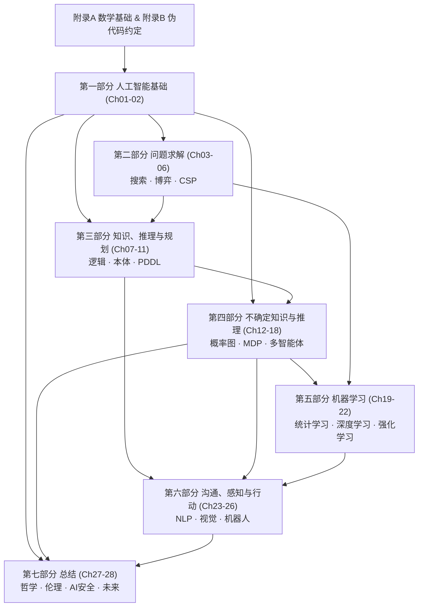

# 《人工智能：现代方法（第4版）》全书知识地图 (MOC)

> [!info] 知识库导航
> 本文件是整套知识库的**总控地图**。全书以**“理性智能体（Rational Agent）”**为主线，横跨问题求解、逻辑规划、不确定概率决策、机器学习、感知通信与伦理安全七大板块（共 28 章 + 2 个附录）。
>
> - 项目总规划：[[MASTER_PLAN]] ｜ 笔记规范：[[NOTE_STANDARD]] ｜ 进度跟踪：[[PROGRESS]]
> - Gemini 网页版逐章分析专用指令：[[GEMINI_WEB_PROMPT]]
> - 全局索引：[[术语索引_中英文对照]] ｜ [[数学公式索引]] ｜ [[算法与复杂度索引]]
> - 专题知识网络：[[00_专题知识网络_MOC]] ｜ 审核标准：[[AUDIT_CHECKLIST]]

## 一、 全书七大板块依赖关系图

## 二、 全书 28 章核心知识点总览

> 点击每部分的 `MOC` 可查看该部分所有**节与子节的完整目录树**和精确页码映射。

- **导读与前言**：[[00_全书导读与第4版变化]]

### [[MOC_第一部分_人工智能基础|第一部分 人工智能基础]]

> 奠定人工智能的方法论基石：以“理性智能体（Rational Agent）”为核心统一框架，梳理学科历史、任务环境分类（PEAS与环境维度）及智能体四大程序结构。

| 章节 | 笔记链接 | 核心知识点与算法 | 前置依赖 | 拆分PDF页码 / 印刷页码 |
| :--- | :--- | :--- | :--- | :--- |
| 第1章 | [[Ch01_绪论]] | 理性智能体、图灵测试、AI学科基础与历史演进 | 无（全书起点） | 拆分 `p.1-31` / 印刷 `p.封面/序言/目录(罗马数字页)` |
| 第2章 | [[Ch02_智能体]] | PEAS描述、任务环境性质、反射/模型/目标/效用/学习型智能体 | [[Ch01_绪论]] | 拆分 `p.1-21` / 印刷 `p.32-52` |

### [[MOC_第二部分_问题求解|第二部分 问题求解]]

> 研究单智能体与多对手环境中的搜索求解方法：从经典无信息/启发式图搜索（BFS、DFS、UCS、A*），拓展到局部搜索、不确定/部分可观测搜索、对抗博弈搜索（Minimax、Alpha-Beta、MCTS）与约束满足问题（CSP）。

| 章节 | 笔记链接 | 核心知识点与算法 | 前置依赖 | 拆分PDF页码 / 印刷页码 |
| :--- | :--- | :--- | :--- | :--- |
| 第3章 | [[Ch03_通过搜索进行问题求解]] | 状态空间搜索、BFS/DFS/UCS/IDS、启发式搜索、A*最优性与可采纳/一致性 | [[Ch02_智能体]]、[[AppendixA_数学背景知识]]、[[AppendixB_关于语言与算法的说明]] | 拆分 `p.1-42` / 印刷 `p.53-94` |
| 第4章 | [[Ch04_复杂环境中的搜索]] | 爬山法、模拟退火、局部束搜索、遗传算法、连续优化、与或搜索、部分可观测与在线搜索 | [[Ch03_通过搜索进行问题求解]] | 拆分 `p.1-29` / 印刷 `p.95-123` |
| 第5章 | [[Ch05_对抗搜索和博弈]] | 零和博弈、Minimax算法、Alpha-Beta剪枝、启发式评估、蒙特卡洛树搜索(MCTS)、随机博弈 | [[Ch03_通过搜索进行问题求解]] | 拆分 `p.1-28` / 印刷 `p.124-151` |
| 第6章 | [[Ch06_约束满足问题]] | 变量/域/约束、弧相容(AC-3)、回溯搜索、MRV/LCV启发式、树结构CSP、局部搜索求解CSP | [[Ch03_通过搜索进行问题求解]] | 拆分 `p.1-23` / 印刷 `p.152-174` |

### [[MOC_第三部分_知识推理与规划|第三部分 知识、推理和规划]]

> 研究如何以形式化语言表示世界知识并进行逻辑演绎与行动规划：涵盖命题逻辑与 SAT 求解、一阶逻辑语法与语义、合一与归结推断、本体与事件演算等知识工程，以及经典/分层/非确定性自动规划。

| 章节 | 笔记链接 | 核心知识点与算法 | 前置依赖 | 拆分PDF页码 / 印刷页码 |
| :--- | :--- | :--- | :--- | :--- |
| 第7章 | [[Ch07_逻辑智能体]] | 知识库(KB)、蕴涵与推理、命题逻辑语法语义、归结反演、DPLL、WalkSAT、逻辑智能体电路 | [[Ch02_智能体]]、[[Ch06_约束满足问题]] | 拆分 `p.1-36` / 印刷 `p.175-210` |
| 第8章 | [[Ch08_一阶逻辑]] | 一阶逻辑(FOL)语法与模型、量词、等词、知识工程七步法、电子电路领域建模 | [[Ch07_逻辑智能体]] | 拆分 `p.1-25` / 印刷 `p.211-235` |
| 第9章 | [[Ch09_一阶逻辑中的推断]] | 全称/存在实例化、合一(Unification)、前向/后向链接、Prolog、一阶归结定理证明 | [[Ch08_一阶逻辑]] | 拆分 `p.1-29` / 印刷 `p.236-264` |
| 第10章 | [[Ch10_知识表示]] | 本体工程、类别与部分关系、情景演算与事件演算、心智对象与模态逻辑、默认推理与TMS | [[Ch08_一阶逻辑]]、[[Ch09_一阶逻辑中的推断]] | 拆分 `p.1-25` / 印刷 `p.265-289` |
| 第11章 | [[Ch11_自动规划]] | PDDL经典规划、前向/后向状态空间搜索、规划启发式、分层任务网络(HTN)、非确定性与多智能体规划 | [[Ch04_复杂环境中的搜索]]、[[Ch07_逻辑智能体]]、[[Ch10_知识表示]] | 拆分 `p.1-35` / 印刷 `p.290-324` |

### [[MOC_第四部分_不确定知识与推理|第四部分 不确定知识和不确定推理]]

> 全书篇幅最宏大的核心部分之一：用概率论量化不确定性，构建贝叶斯网络（BN）、动态贝叶斯网络（DBN/HMM/卡尔曼滤波）与概率编程模型，并进一步结合效用理论形成期望效用最大化（MEU）、马尔可夫决策过程（MDP/POMDP）及多智能体博弈与机制设计。

| 章节 | 笔记链接 | 核心知识点与算法 | 前置依赖 | 拆分PDF页码 / 印刷页码 |
| :--- | :--- | :--- | :--- | :--- |
| 第12章 | [[Ch12_不确定性的量化]] | 不确定性决策、概率公理、联合分布、独立性与条件独立、贝叶斯法则、朴素贝叶斯 | [[Ch02_智能体]]、[[AppendixA_数学背景知识]] | 拆分 `p.1-23` / 印刷 `p.325-347` |
| 第13章 | [[Ch13_概率推理]] | 贝叶斯网络(BN)、d-分离、变量消元精确推断、拒绝采样/似然加权/吉布斯采样近似推断、因果网络 | [[Ch12_不确定性的量化]] | 拆分 `p.1-40` / 印刷 `p.348-387` |
| 第14章 | [[Ch14_时间上的概率推理]] | 时间模型与马尔可夫假设、滤波/预测/平滑、隐马尔可夫模型(HMM)、卡尔曼滤波、动态贝叶斯网络(DBN) | [[Ch13_概率推理]] | 拆分 `p.1-33` / 印刷 `p.388-420` |
| 第15章 | [[Ch15_概率编程]] | 关系概率模型(RPM)、开放域概率模型(BLOG)、概率程序设计语言(PPL)与生成式推理 | [[Ch09_一阶逻辑中的推断]]、[[Ch13_概率推理]] | 拆分 `p.1-23` / 印刷 `p.421-443` |
| 第16章 | [[Ch16_做简单决策]] | 效用理论与公理、风险态度、多属性效用、影响图(决策网络)、信息价值(VPI) | [[Ch12_不确定性的量化]]、[[Ch13_概率推理]] | 拆分 `p.1-29` / 印刷 `p.444-472` |
| 第17章 | [[Ch17_做复杂决策]] | 马尔可夫决策过程(MDP)、贝尔曼方程、值迭代与策略迭代、部分可观测MDP(POMDP)、强盗问题与UCT | [[Ch14_时间上的概率推理]]、[[Ch16_做简单决策]] | 拆分 `p.1-32` / 印刷 `p.473-504` |
| 第18章 | [[Ch18_多智能体决策]] | 非合作博弈、纳什均衡、序贯博弈、合作博弈、社会选择与投票、拍卖与机制设计 | [[Ch05_对抗搜索和博弈]]、[[Ch16_做简单决策]]、[[Ch17_做复杂决策]] | 拆分 `p.1-44` / 印刷 `p.505-548` |

### [[MOC_第五部分_机器学习|第五部分 机器学习]]

> 系统阐述智能体如何从经验数据与交互奖励中学习：包含监督学习与学习理论（第19章）、概率模型参数与结构学习及 EM 算法（第20章）、现代深度学习架构（CNN/RNN/Transformer/生成模型，第21章）以及强化学习（第22章）。

| 章节 | 笔记链接 | 核心知识点与算法 | 前置依赖 | 拆分PDF页码 / 印刷页码 |
| :--- | :--- | :--- | :--- | :--- |
| 第19章 | [[Ch19_样例学习]] | 监督学习、决策树与信息增益、交叉验证、正则化、线性回归/逻辑回归、SVM核方法、集成学习(Boosting/随机森林) | [[Ch12_不确定性的量化]]、[[AppendixA_数学背景知识]] | 拆分 `p.1-61` / 印刷 `p.549-609` |
| 第20章 | [[Ch20_概率模型学习]] | 贝叶斯学习、最大似然(MLE)与MAP、隐变量与EM算法、高斯混合模型、非参数模型 | [[Ch13_概率推理]]、[[Ch19_样例学习]] | 拆分 `p.1-25` / 印刷 `p.610-634` |
| 第21章 | [[Ch21_深度学习]] | 前馈神经网络、反向传播与自动微分、卷积神经网络(CNN)、循环神经网络(RNN/LSTM)、残差网络、正则化与生成模型 | [[Ch19_样例学习]]、[[Ch20_概率模型学习]] | 拆分 `p.1-33` / 印刷 `p.635-667` |
| 第22章 | [[Ch22_强化学习]] | 被动/主动强化学习、TD学习、Q-learning与SARSA、策略搜索与REINFORCE、深度强化学习(DQN)、逆强化学习 | [[Ch17_做复杂决策]]、[[Ch19_样例学习]]、[[Ch21_深度学习]] | 拆分 `p.1-29` / 印刷 `p.668-696` |

### [[MOC_第六部分_沟通感知与行动|第六部分 沟通、感知和行动]]

> 将前述推理、学习与决策能力落地到真实物理与语言交互世界：涵盖经典自然语言处理与形式语法、NLP 深度学习方法、计算机视觉几何与识别，以及机器人感知定位（SLAM）、运动规划与人机交互。

| 章节 | 笔记链接 | 核心知识点与算法 | 前置依赖 | 拆分PDF页码 / 印刷页码 |
| :--- | :--- | :--- | :--- | :--- |
| 第23章 | [[Ch23_自然语言处理]] | n-gram语言模型、文本分类、上下文无关文法(CFG)、PCFG句法分析、语义分析与机器翻译基础 | [[Ch08_一阶逻辑]]、[[Ch14_时间上的概率推理]]、[[Ch19_样例学习]] | 拆分 `p.1-30` / 印刷 `p.697-726` |
| 第24章 | [[Ch24_自然语言处理中的深度学习]] | 词嵌入(Word2Vec/GloVe)、Seq2Seq与注意力机制、Transformer与自注意力、预训练语言模型(BERT等) | [[Ch21_深度学习]]、[[Ch23_自然语言处理]] | 拆分 `p.1-21` / 印刷 `p.727-747` |
| 第25章 | [[Ch25_计算机视觉]] | 图像形成与针孔相机、边缘与特征提取、立体视觉与光流、目标检测与语义分割、三维重建 | [[Ch14_时间上的概率推理]]、[[Ch21_深度学习]] | 拆分 `p.1-37` / 印刷 `p.748-784` |
| 第26章 | [[Ch26_机器人学]] | 机器人硬件与感知、定位与SLAM、构型空间与运动规划(PRM/RRT)、动力学控制、人机交互 | [[Ch11_自动规划]]、[[Ch14_时间上的概率推理]]、[[Ch22_强化学习]]、[[Ch25_计算机视觉]] | 拆分 `p.1-46` / 印刷 `p.785-830` |

### [[MOC_第七部分_总结与附录|第七部分 总结与附录]]

> 探讨人工智能的哲学基础、伦理、公平性、可解释性与 AI 安全性（第27章），对 AI 体系结构与未来进行展望（第28章），并提供数学背景（附录A）与伪代码语言约定（附录B）。

| 章节 | 笔记链接 | 核心知识点与算法 | 前置依赖 | 拆分PDF页码 / 印刷页码 |
| :--- | :--- | :--- | :--- | :--- |
| 第27章 | [[Ch27_人工智能的哲学、伦理和安全性]] | 弱AI与强AI、中文屋论证、AI伦理/公平性/可解释性、武器化与就业影响、价值对齐与AI安全 | [[Ch01_绪论]]、[[Ch18_多智能体决策]] | 拆分 `p.1-26` / 印刷 `p.831-856` |
| 第28章 | [[Ch28_人工智能的未来]] | AI各组件整合、智能体架构演进、通用人工智能(AGI)挑战与长远展望 | [[Ch01_绪论]]、[[Ch27_人工智能的哲学、伦理和安全性]] | 拆分 `p.1-8` / 印刷 `p.857-864` |

### 附录与参考资料

| 单元 | 笔记链接 | 主要内容 | 拆分PDF页码 / 印刷页码 |
| :--- | :--- | :--- | :--- |
| 附录 A | [[AppendixA_数学背景知识]] | 渐近复杂度 $O()$、向量矩阵与线性代数、概率分布 | 拆分 `p.1-6` / 印刷 `p.865-870` |
| 附录 B | [[AppendixB_关于语言与算法的说明]] | BNF 形式语法定义、全书伪代码语法规范 | 拆分 `p.1-2` / 印刷 `p.871-872` |
| 参考文献 | `31_参考文献.pdf` | 缩写说明与全书参考文献列表 | 拆分 `p.1-41` / 印刷 `p.873-913` |
| 索引与封底 | `32_索引与封底.pdf` | 全书术语页码索引 | 拆分 `p.1-16` / 印刷 `p.914-929` |
