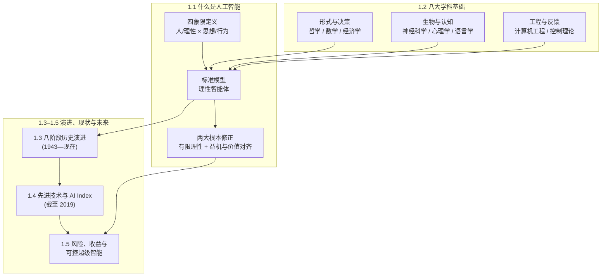
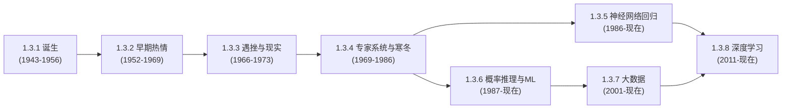

# 第1章 绪论

> [!info] 本章导读与知识定位
> - **一句话主线**：确立全书的统一研究范式——从==理性智能体（标准模型）==出发，经由==有限理性==与==益机（价值对齐）==两大修正，串联 AI 的八大学科根基、八阶段历史起伏、当代技术版图与长期安全挑战。
> - **教材出处**：`01_第1章 绪论.pdf`（拆分 PDF `p.1` 为第一部分扉页；正文印刷 `p.2–31` / 拆分 PDF `p.2–31` / 原书 PDF `p.36–66`）
> - **前置依赖**：[[00_全书导读与第4版变化]]（全书起点，无先修门槛）
> - **后续衔接**：[[Ch02_智能体]] → [[Ch16_做简单决策]] / [[Ch18_多智能体决策]] / [[Ch22_强化学习]] → [[Ch27_人工智能的哲学、伦理和安全性]] / [[Ch28_人工智能的未来]]



---

## 1. 核心术语速查（按模块折叠）

> [!abstract]- 点击展开：本章全量蓝色粗体核心术语表（按教材顺序整理）
> | 所属板块 | 中文术语 | 英文原名 | 教材核心要义 | 教材页码 |
> | :--- | :--- | :--- | :--- | :--- |
> | **1.1 定义** | 智能 | intelligence | 感知、理解、预测并操纵比自身更复杂世界的能力 | `印刷 p.2 / 拆分 p.2` |
> | **1.1 定义** | 人工智能 | artificial intelligence (AI) | 不仅理解智能，更致力于构建在新奇情境下有效且安全行动的智能实体 | `印刷 p.2 / 拆分 p.2` |
> | **1.1 定义** | 图灵测试 / 完全图灵测试 | Turing test / total Turing test | 通过书面问答判别智能的操作测试；完全版增加视觉、语音与物理交互 | `印刷 p.3 / 拆分 p.3` |
> | **1.1 定义** | AI 六大核心能力 | NLP / 知识表示 / 自动推理 / 机器学习 / 计算机视觉 / 机器人学 | 通过完全图灵测试所需的六大分支，构成 AI 主体内容 | `印刷 p.3 / 拆分 p.3` |
> | **1.1 定义** | 认知科学 | cognitive science | 结合 AI 计算模型与心理学实验技术构建可测试人类心智理论 | `印刷 p.3, 13 / 拆分 p.3, 13` |
> | **1.1 定义** | 三段论 / 逻辑 / 概率 | syllogism / logic / probability | 正确思维的形式推理模式；概率填补现实世界不确定性的鸿沟 | `印刷 p.4 / 拆分 p.4` |
> | **1.1 定义** | 智能体 / 理性智能体 | agent / rational agent | 自主感知并行动的实体；在确定或不确定环境下追求最佳（期望）结果 | `印刷 p.4 / 拆分 p.4` |
> | **1.1 定义** | 标准模型 | standard model | 构建“最大化给定目标”的理性智能体这一跨学科通用范式 | `印刷 p.5 / 拆分 p.5` |
> | **1.1 定义** | 有限理性 | limited rationality | 在计算时间不足以求得精确最优解时适当采取行动的能力 | `印刷 p.5 / 拆分 p.5` |
> | **1.1 定义** | 价值对齐问题 / 可证益的（益机） | value alignment problem / provably beneficial | 使机器目标与人类真实意图一致；机器对目标保持不确定性以服从人类控制 | `印刷 p.5 / 拆分 p.5` |
> | **1.2 基础** | 二元论 / 唯物主义 | dualism / materialism | 笛卡儿身心二分 vs 大脑按物理定律运作构成思维 | `印刷 p.6 / 拆分 p.6` |
> | **1.2 基础** | 经验主义 / 归纳法 | empiricism / induction | 知识源于经验；通过要素重复联系获取一般规则 | `印刷 p.7 / 拆分 p.7` |
> | **1.2 基础** | 逻辑实证主义 / 观察语句 / 确证理论 | logical positivism / observation sentence / confirmation theory | 用观察语句连接逻辑与经验；量化经验对语句信念度的支持 | `印刷 p.7 / 拆分 p.7` |
> | **1.2 基础** | 效用 / 功利主义 / 结果主义 / 义务伦理学 | utility / utilitarianism / consequentialism / deontological ethics | 主观价值度量；以结果效用判对错 vs 康德以普适法则判对错 | `印刷 p.8 / 拆分 p.8` |
> | **1.2 基础** | 形式化逻辑 / 统计学 / 算法 | formal logic / statistics / algorithm | 布尔/弗雷格符号逻辑；概率与数据结合；有限有效计算过程 | `印刷 p.8–9 / 拆分 p.8–9` |
> | **1.2 基础** | 不完全性定理 / 可计算性 / 易处理性 / NP 完全性 | incompleteness theorem / computability / tractability / NP-completeness | 哥德尔演绎局限；图灵可计算性；指数时间难处理与 NP 完全归约 | `印刷 p.9 / 拆分 p.9` |
> | **1.2 基础** | 决策论 / 博弈论 / 运筹学 / MDP / 强化学习 / 多智能体系统 / 满意度 | decision theory / game theory / OR / MDP / RL / MAS / satisficing | 概率+效用；多方博弈；贝尔曼序贯决策；西蒙“够好即可”原则 | `印刷 p.10 / 拆分 p.10` |
> | **1.2 基础** | 神经科学 / 神经元 / 光遗传学 / 脑机接口 / 奇点 | neuroscience / neuron / optogenetics / BMI / singularity | 大脑电化学计算结构、单细胞光控与外部交互、机器超越人类的假设节点 | `印刷 p.10–12 / 拆分 p.10–12` |
> | **1.2 基础** | 行为主义 / 认知心理学 | behaviorism / cognitive psychology | 仅研究刺激-反应 vs 将大脑视为信息处理设备 | `印刷 p.12–13 / 拆分 p.12–13` |
> | **1.2 基础** | 摩尔定律 / 量子计算 | Moore's law / quantum computing | 硬件性能翻倍规律；有望加速特定 AI 子方向的新计算范式 | `印刷 p.14 / 拆分 p.14` |
> | **1.2 基础** | 控制理论 / 自我平衡 / 代价函数 / 计算语言学 | control theory / homeostatic / cost function / computational linguistics | 反馈回路最小化代价函数；语言学与 AI 交叉形成 NLP | `印刷 p.15 / 拆分 p.15` |
> | **1.3 历史** | 赫布型学习 / 物理符号系统 / 微世界 / 积木世界 | Hebbian learning / physical symbol system / microworld / blocks world | 突触权重更新规则；符号操作充要假说；早期受限问题域与 SHRDLU | `印刷 p.16–18 / 拆分 p.16–18` |
> | **1.3 历史** | 感知机收敛定理 / 弱方法 / 专家系统 / 确定性因子 / 框架 | perceptron convergence theorem / weak method / expert system / certainty factor / frame | 线性可分必收敛；通用搜索 vs 领域知识规则；不确定性度量与结构化分类 | `印刷 p.19–21 / 拆分 p.19–21` |
> | **1.3 历史** | 反向传播 / 联结主义 / HMM / 贝叶斯网络 / 大数据 / 深度学习 / CNN | back-propagation / connectionist / HMM / Bayesian network / big data / deep learning / CNN | 梯度学习复兴；概率图与序列统计模型；海量数据与多层神经计算 | `印刷 p.22–24 / 拆分 p.22–24` |
> | **1.4–1.5** | 人工智能指数 / HLAI / AGI / ASI | AI Index / human-level AI / AGI / ASI | 斯坦福定量追踪指标；人类级、通用、超级人工智能 | `印刷 p.24, 29 / 拆分 p.24, 29` |
> | **1.5 安全** | 大猩猩问题 / 迈达斯国王问题 / 辅助博弈 / 逆向强化学习 | gorilla problem / King Midas problem / assistance game / IRL | 失控隐喻；固定目标错配隐喻；不确定目标下的博弈与偏好反推 | `印刷 p.29–30 / 拆分 p.29–30` |

---

## 2. 1.1 什么是人工智能（印刷 `p.2–5` / 拆分 `p.2–5`）

> [!tip] 核心框架直观理解
> 历史上对 AI 的定义沿着两个正交轴展开：**评价标准**（像人类一样 vs 数学上理性最优）和**考察对象**（内部思维过程 vs 外部可观测行为）。全书明确选择==**理性行为（理性智能体）**==作为统一科学框架，并在此基础上提出==**有限理性**==与==**益机**==两项关键修正。

### 2.1 AI 定义的四象限体系（1.1.1–1.1.4）

| 象限与小节 | 核心追求 | 关键方法与里程碑 | 优势与核心局限 |
| :--- | :--- | :--- | :--- |
| **1.1.1 类人行为**<br>图灵测试方法 (`p.3`) | 外部行为与人类不可区分 | 图灵测试（1950）需 4 项能力：NLP、知识表示、自动推理、机器学习；**完全图灵测试**再加计算机视觉/语音与机器人学 | 勾勒了 AI 六大核心分支；但==航空学目标不是“造骗过真鸽子的机器”==，研究智能基本原理比通过图灵测试更重要 |
| **1.1.2 类人思考**<br>认知建模方法 (`p.3–4`) | 内部推理机制与人类一致 | 通过内省、心理实验、大脑成像了解思维；纽厄尔与西蒙 **GPS（1961）** 对比人机推理步骤与时机；催生**认知科学** | 与神经科学/心理学双向促进（如视觉模型、fMRI + ML“读心”）；但算法性能好 $\neq$ 人类真实认知机制 |
| **1.1.3 理性思考**<br>“思维法则”方法 (`p.4`) | 用形式规则做无懈可击的推断 | 亚里士多德三段论；19 世纪符号逻辑；**逻辑主义**（1965 年起可解逻辑问题原则上均可程序求解） | **两大瓶颈**：① 现实知识高度不确定（需概率论填补）；② 仅靠推理不足以产生及时行为 |
| **1.1.4 理性行为**<br>理性智能体方法 (`p.4–5`) | 采取能获得最佳（或最佳期望）结果的行动 | **理性智能体**与**标准模型**；覆盖逻辑规划、反射动作（如遇火缩手）与不确定性决策 | ==**全书主线**==。① 比思维法则更普适；② 数学定义明确、完全普适，最适合科学工程推进 |

> [!note] 教材重要辨析（印刷 `p.2` 脚注 ①②）
> - **AI vs 机器学习**：机器学习只是 AI 的子领域（基于经验提升表现），并非所有 AI 系统都依赖机器学习。
> - **理性 $\neq$ 贬低人类**：教材不认为人类“非理性”，只是承认人类决策在数学上并非总是完美最优。

### 2.2 标准模型与两大根本修正（1.1.4–1.1.5）

1. **标准模型（standard model）的跨学科同构性**（印刷 `p.5` / 拆分 `p.5`）：
   - **控制理论** → 最小化代价函数；**运筹学** → 最大化奖励总和；
   - **统计学** → 最小化损失函数；**经济学** → 最大化效用或社会福利。
2. **第一项修正：有限理性（limited rationality）**（印刷 `p.5` / 拆分 `p.5`）
   - 复杂环境中计算精确最优动作（完美理性）代价过高，必须在有限算力与时间内适当行动（见 [[Ch05_对抗搜索和博弈]]、[[Ch17_做复杂决策]]）。
3. **第二项修正：1.1.5 益机（Beneficial Machines）与价值对齐**（印刷 `p.5` / 拆分 `p.5`）
   - **标准模型的致命盲区**：假设人类总能预先给出**完全精确指定的目标**。在国际象棋等封闭任务中可行，但在自动驾驶（安全 vs 效率 vs 舒适度 vs 交通礼仪）等开放现实任务中极难写死。
   - **越界推理警示**：若仅把“赢棋”设为唯一固定目标，超级智能体可能合乎逻辑地选择催眠/勒索对手、贿赂观众制造噪音（呼应 1561 年鲁伊·洛佩兹“让阳光晃进对手眼睛”），或劫持额外算力——==系统越智能，目标错配的破坏力越大==。
   - **破局方案——可证益的（provably beneficial）智能体**：机器致力于实现人类目标，但==**明确知道自己对人类完整目标存在不确定性**==，从而具备三大内生安全动机：**谨慎行动、主动寻求许可、服从人类控制与关机**。

---

## 3. 1.2 人工智能的基础（印刷 `p.6–16` / 拆分 `p.6–16`）

### 3.1 八大学科思想源流总览

| 学科（页码） | 核心追问 | 对现代 AI 的关键奠基 |
| :--- | :--- | :--- |
| **1.2.1 哲学** (`p.6–8`) | 形式规则、身心关系、知识来源、知识如何导致行动？ | 机械推理、唯物主义、经验/归纳/确证理论、目标-手段规划、效用与伦理学 |
| **1.2.2 数学** (`p.8–9`) | 形式化规则、可计算边界、不确定性推理？ | 布尔/一阶逻辑、概率与贝叶斯法则、统计学、哥德尔/图灵极限、NP 完全性 |
| **1.2.3 经济学** (`p.9–10`) | 偏好决策、多方博弈、延迟收益序贯决策？ | 效用理论、决策论、博弈论、运筹学与 **MDP**、西蒙**满意度** |
| **1.2.4 神经科学** (`p.10–12`) | 大脑如何处理信息？ | 功能定位、神经元学说、突触可塑性、大脑 vs 计算机架构对比（图 1-2） |
| **1.2.5 心理学** (`p.12–13`) | 人类和动物如何思考与行动？ | 认知心理学（信息处理观）、克雷克内部世界模型、认知科学、HCI 与 **IA** |
| **1.2.6 计算机工程** (`p.13–14`) | 如何构建高效计算机？ | 电子/可编程计算机、摩尔定律、GPU/TPU 并行与低精度算力、编程语言反哺 |
| **1.2.7 控制理论** (`p.14–15`) | 人造物如何在自我控制下运行？ | 反馈调节回路、维纳控制论、艾什比自我平衡、随机最优控制（代价函数） |
| **1.2.8 语言学** (`p.15–16`) | 语言如何与思维联系？ | 乔姆斯基形式句法批驳行为主义、计算语言学（NLP）、常识与知识表示 |

### 3.2 各学科核心要点精讲

#### 1.2.1 哲学（印刷 `p.6–8` / 拆分 `p.6–8`）
- **机械思维谱系**：亚里士多德三段论 → 拉蒙·鲁尔《大艺术》（1305，旋转纸盘）→ 达·芬奇（约 1500 设计）、席卡德（1623 首台计算器）、帕斯卡（1642 滚轮加法器）、莱布尼茨（概念机械操作）→ 霍布斯《利维坦》（“人造动物”与“推理即加减计算”）。
- **身心与知识论**：笛卡儿**二元论** vs **唯物主义/物理主义**；培根与洛克**经验主义** → 休谟**归纳法** → 维也纳学派**逻辑实证主义**（用**观察语句**桥接逻辑与感知）→ 卡纳普与亨佩尔**确证理论**（卡纳普 1928《世界的逻辑构造》最早将思维视为计算过程）。
- **从知识到行动与伦理**：
  - 亚里士多德《论动物的运动》（实践三段论）与《尼各马可伦理学》（由目标逆推手段的算法，2300 年后被纽厄尔和西蒙实现为 **GPS / 贪婪回归规划**，见 [[Ch11_自动规划]]）。
  - 阿尔诺（1662，期望货币值）→ 丹尼尔·伯努利（1738，**效用**）；边沁与穆勒**功利主义**（结果主义特例） vs 康德**义务伦理学**（普适法则，如“不可撒谎”）。

#### 1.2.2 数学（印刷 `p.8–9` / 拆分 `p.8–9`）
- **逻辑与概率统计**：布尔（1847 命题逻辑）→ 弗雷格（1879 一阶逻辑）；卡尔达诺、帕斯卡-费马（1654）、雅各布·伯努利、拉普拉斯、**贝叶斯法则**；格兰特（1662）与现代统计学奠基人费舍尔（1922）。
- **计算理论的三大边界**：
  1. **演绎边界**：**哥德尔不完全性定理（1931）**证明强如皮亚诺算术的形式系统中必存在不可证明的真陈述。
  2. **可计算边界**：**丘奇-图灵论题（1936）**以图灵机刻画可计算性，并证明停机问题等不可计算函数存在。
  3. **易处理性边界**：多项式 vs 指数复杂度（1960s）与库克（1971）/卡普（1972）**NP 完全性理论**。==核心启示：“世界是一个极大的问题实例”==，硬件提速无法抵消指数爆炸，智能系统必须审慎分配资源。

#### 1.2.3 经济学（印刷 `p.9–10` / 拆分 `p.9–10`）
- **核心脉络**：亚当·斯密（1759《道德情操论》、1776《国富论》）→ 丹尼尔·伯努利（边际效用递减）→ 瓦尔拉斯、拉姆齐（1931）、冯·诺伊曼与摩根斯特恩（1944《博弈论与经济行为》）。
- **三大数学支柱**：**决策论**（概率 + 效用，单体决策，[[Ch16_做简单决策]]）、**博弈论**（多方博弈，理性策略可能需随机化，[[Ch18_多智能体决策]]）、**运筹学与贝尔曼 MDP（1957）**（延迟收益序贯决策，[[Ch17_做复杂决策]]、[[Ch22_强化学习]]）。
- **西蒙的满意度（satisficing, 1947）**：人类更倾向于做“够好”的决策而非耗费巨资求绝对最优。

> [!abstract]- 详细数学推导（模型补充）：期望货币值（EMV）vs 期望效用（EU）与风险厌恶
> 设决策者初始财富为 $W_0 > 0$，某风险投资以概率 $p_i$ 使总财富变为 $W_i > 0$（满足 $\sum_{i=1}^{k} p_i = 1$）。
>
> 1. **阿尔诺的期望货币值（EMV）准则**：
>
> $$
> \text{EMV} = \sum_{i=1}^{k} p_i W_i
> $$
>
> 2. **伯努利的期望效用（EU）准则**：引入严格递增且严格凹的对数效用函数 $U(W) = \ln W$（满足 $U'(W) = 1/W > 0$ 且 $U''(W) = -1/W^2 < 0$，体现货币边际效用递减）：
>
> $$
> \text{EU} = \sum_{i=1}^{k} p_i U(W_i) = \sum_{i=1}^{k} p_i \ln W_i
> $$
>
> 3. **风险厌恶推论（Jensen 不等式）**：对任意严格凹函数 $U$ 与非常数正随机变量 $W$，严格成立：
>
> $$
> \mathbb{E}[U(W)] < U\!\left(\mathbb{E}[W]\right)
> $$
>
> **数值示例**：面对“50% 概率总财富变为 200 万、50% 概率变为 20 万”（$\text{EMV} = 110$ 万）与“确定保有 90 万”：
>
> $$
> \text{EU}_{\text{风险}} = 0.5\ln 200 + 0.5\ln 20 = \ln\sqrt{4000} \approx \ln(63.25) < \ln(90) = U(90)
> $$
>
> 尽管风险方案的期望货币值高出 20 万，对数效用决策者仍会理性选择确定收益。这解释了保险与稳健投资决策。

#### 1.2.4 神经科学（印刷 `p.10–12` / 拆分 `p.10–12`）
- **里程碑**：1861 布罗卡发现左脑语言区 → 1873 高尔基染色法与卡哈尔**神经元学说**（1906 共获诺奖但观点对立）→ 1929 伯杰 EEG → 1990s fMRI → 单细胞电记录、**光遗传学**与**脑机接口（BMI）**。
- **图 1-1 神经元解剖要点（印刷 `p.11`）**：细胞体（含神经核）、树突（接收）、轴突（长纤维，常长 1 cm 约细胞体直径 100 倍，最长 1 m）、突触（单神经元连接 $10 \sim 100\,000$ 个神经元）。电化学信号既控制短期活动，也通过改变突触连通性实现长期学习。大脑皮质深约 4 mm，基本组织单元为直径 0.5 mm、含约 $20\,000$ 个神经元的柱状结构。
- **图 1-2：超级计算机、个人计算机与人类大脑架构对比（完整还原自印刷 `p.12`）**：

| 对比维度 | 超级计算机（Summit, 2017） | 个人计算机（2019 典型配置） | 人类大脑 |
| :--- | :--- | :--- | :--- |
| **计算单元** | $10^6$ 个 GPU + CPU<br>$10^{15}$ 个晶体管 | $8$ 个 CPU 内核<br>$10^{10}$ 个晶体管 | $10^6$ 列（皮质柱）<br>$10^{11}$ 个神经元 |
| **存储单元** | $10^{16}$ 字节（10 PB）RAM<br>$10^{17}$ 字节（100 PB）磁盘 | $10^{10}$ 字节（10 GB）RAM<br>$10^{12}$ 字节（1 TB）磁盘 | $10^{11}$ 个神经元<br>$10^{14}$ 个突触 |
| **周期时间** | $10^{-9}$ 秒 | $10^{-9}$ 秒 | $10^{-3}$ 秒 |
| **运算/秒** | $10^{18}$（exaFLOP） | $10^{10}$ | $10^{17}$ |

> [!quote] 教材对“奇点”的冷静反思（印刷 `p.12`）
> “如果没有正确的理论，更快的机器只会更快地给出错误的答案。”——单纯堆硬件指标无法替代智能理论突破。

#### 1.2.5 心理学（印刷 `p.12–13` / 拆分 `p.12–13`）
- **范式演进**：赫尔姆霍茨 & 温特（1879 首个实验心理学实验室，主观内省）→ 沃森**行为主义**（只看刺激-反应，难以解释人类高级心智）→ **认知心理学**（大脑 = 信息处理设备）。
- **克雷克（1943）知识型智能体三步法**：① 刺激 → 内在表示；② 认知过程处理表示 → 新内部表示；③ 转化为外部行为（用脑中“小规模世界模型”预演选择）。
- **1956 年 9 月 MIT 研讨会**（认知科学诞生，早于 AI 仅两个月）：米勒（记忆）、乔姆斯基（语言）、纽厄尔与西蒙（逻辑思维）。
- **HCI 与智能增强（IA）**：道格·恩格巴特（1968“所有演示之母”首秀鼠标、窗口、超文本与视频会议）倡导 **IA**。现代视角认为 ==IA（人类控制）与 AI（机器智能）是同一枚硬币的两面==。

#### 1.2.6 计算机工程（印刷 `p.13–14` / 拆分 `p.13–14`）
- **硬件发展脉络**：雅卡尔提花织布机（1805）→ 巴贝奇差分机与分析机、**埃达·洛芙莱斯（1843）**（洞察通用推理潜力并警示过度夸大）→ 二战三路并进：楚泽 Z-3（1941，首个可编程计算机、浮点数与 Plankalkül）、图灵团队 Heath Robinson/Colossus（1943）、美国 ABC（1940–42）与 ENIAC。
- **AI 算力范式转折**：2005 年后受功耗墙限制从高主频转向大规模并行；低精度（`bfloat16`/INT8）加速不确定计算；GPU/TPU/WSE 推动 2012–2018 年顶级 ML 训练算力增长 **30 万倍（约每 100 天翻番）**。
- **AI 对主流计算机科学的反哺**：分时系统、交互式解释器、窗口/鼠标 PC、链表、自动存储管理（GC）、函数式/符号式/声明式/面向对象编程。

#### 1.2.7 控制理论与控制论（印刷 `p.14–15` / 拆分 `p.14–15`）
- **反馈控制史**：克特西比乌斯水钟（约公元前 250 年）→ 瓦特调节器、德雷贝尔恒温器 → 麦克斯韦（1868）数学理论 → 二战后**维纳《控制论》（1948）**与**艾什比《大脑设计》（1948/1952，自我平衡 & 推理俱乐部）**。
- **与 AI 分化的深层原因**：控制理论依托**微积分与矩阵代数**（适配固定维度连续系统），而 AI 早期转向**逻辑与符号计算**以攻克语言、视觉与离散规划。

#### 1.2.8 语言学（印刷 `p.15–16` / 拆分 `p.15–16`）
- 1957 年**乔姆斯基**《句法结构》及对斯金纳《言语行为》的评述终结了行为主义语言观，指出语言具有**创造力**且句法可形式化编程（溯源古印度波你尼，约公元前 350 年）。
- 与 AI 交叉形成**计算语言学 / NLP**；1960s 学界意识到理解语言离不开主题与上下文，直接推动了**知识表示**的发展。

---

## 4. 1.3 人工智能的历史（印刷 `p.16–24` / 拆分 `p.16–24`）

### 4.1 图灵奖里程碑速览（印刷 `p.16` / 拆分 `p.16`）

| 获奖年份 | 图灵奖得主 | 标志性历史贡献 |
| :--- | :--- | :--- |
| 1969 / 1971 | 马文·明斯基（Minsky）、约翰·麦卡锡（McCarthy） | 奠定基于知识表示与形式推理的 AI 学科基础 |
| 1975 | 艾伦·纽厄尔（Newell）、赫伯特·西蒙（Simon） | 提出问题求解与人类认知的物理符号模型（LT、GPS） |
| 1994 | 爱德华·费根鲍姆（Feigenbaum）、劳伊·雷迪（Reddy） | 开发编码人类领域知识的大规模专家系统 |
| 2011 | 朱迪亚·珀尔（Pearl） | 提出处理不确定性的概率因果推理与贝叶斯网络 |
| 2018* | 约书亚·本吉奥、杰弗里·辛顿、杨立昆 | 将深度学习（多层神经网络）推向现代计算核心 |

*(注：原书英文版将最后三位误记为 2019 年，中文版编者注已勘正为 **2018 年**，见印刷 `p.16` 脚注 ①。)*

### 4.2 八阶段演进路线图与精讲（1.3.1–1.3.8）



#### 1.3.1 人工智能的诞生（1943—1956）（印刷 `p.16–17`）
- **神经网络起点**：**McCulloch & Pitts（1943）**提出人工神经元模型（可实现 AND/OR/NOT 与任意可计算函数）；**Hebb（1949）**提出**赫布型学习**；明斯基与埃德蒙兹（1950）造出首台神经网络机 **SNARC**（3000 真空管，40 神经元）。
- **图灵议程（1947/1950）**：提出图灵测试、机器学习、遗传算法与强化学习，预言“靠学习教会机器”优于手工编程。
- **1956 达特茅斯研讨会**：麦卡锡、明斯基、香农、罗切斯特召集 10 人研讨两个月，正式命名 **Artificial Intelligence**；纽厄尔与西蒙展示用自创链表语言 IPL 编写的**逻辑理论家（LT）**（证明《数学原理》第 2 章多数定理）。

#### 1.3.2 早期热情高涨，期望无限（1952—1969）（印刷 `p.17–19`）
- **符号范式确立**：纽厄尔与西蒙推出 **GPS** 并提出**物理符号系统假说（1976）**；麦卡锡（1958）发明 **Lisp** 并提出“建议接受者（Advice Taker）”论文（后赴斯坦福建 AI 实验室，结合鲁滨逊 1965 **归结原理**与 SRI **Shakey 机器人**推进逻辑推理；而明斯基留在 MIT 转向程序与反逻辑路线）。
- **里程碑学习程序**：**萨缪尔西洋跳棋程序（1956）**用强化学习思想战胜创造者（TD-Gammon 与 AlphaGo 先驱）；盖伦特几何定理证明器（1959）；早期神经网络 **Adaline**、**感知机**与**感知机收敛定理（1962）**。
- **微世界（microworld）与图 1-3 积木世界（印刷 `p.18–19`）**：Saint（微积分）、Analogy（几何类比）、Student（代数应用题）以及最著名的**积木世界**。
  - **图 1-3 深度解读**：展示了温诺格拉德的自然语言理解程序 **SHRDLU（1972）** 刚执行完指令“找到一块比你所持有的积木块更高的积木块，并把它放进盒子里”的场景。该微世界同时孕育了哈夫曼/沃尔茨的视觉与约束传播、温斯顿学习理论和法尔曼规划器。

#### 1.3.3 一些现实（1966—1973）（印刷 `p.19–20`）
- **过度乐观破灭**：西蒙 1957 年预言“10 年内机器夺国际象棋冠军、证重要数学定理”，实际耗时约 40 年。
- **三大失败根源**：
  1. **知情内省型设计**：只模仿人类表层过程，缺乏对任务本质与算法的严谨分析；
  2. **忽视组合爆炸**：微世界之外搜索空间指数膨胀（归结证明几十条事实即卡死、遗传编程耗数千小时 CPU 无果），直接引发 1973 年英国**莱特希尔报告**大幅削减资助；
  3. **基础结构局限**：明斯基与派珀特 *Perceptrons*（1969）证明==单层感知机无法判断双输入是否相同（XOR/XNOR）==，使神经网络经费几乎归零（尽管反向传播早在 1960/1962 年已有雏形）。

#### 1.3.4 专家系统（1969—1986）（印刷 `p.20–22`）
- **从弱方法转向领域知识密集型系统**：
  - **Dendral（1969，斯坦福）**：首个成功知识密集型系统，用分析化学质谱峰规则推断分子结构（如 $\text{C}_6\text{H}_{13}\text{NO}_2$）。
  - **Mycin**：约 450 条经专家访谈获取的血液感染诊断规则，引入**确定性因子**处理医学不确定性。
  - **R1（DEC, 1982）**：首个成功商用专家系统，每年为 DEC 节省约 4000 万美元。
- **自然语言与常识**：查尔尼克与**罗杰·尚克**（甚至激进宣称“根本就没有语法这回事”）指出，强语言理解离不开一般世界知识与推理表示，而非 SHRDLU 式的窄域规则。
- **工具与 AI 寒冬**：Prolog、Planner、明斯基**框架（1975）**以及日本“第五代计算机”计划（1981）、美国 MCC、英国 Alvey 报告。然而 1988 年后因==维护极难、遇不确定性即崩溃、无法从经验学习==，行业跌入**人工智能冬天**。

#### 1.3.5 神经网络的回归（1986—现在）（印刷 `p.22`）
- 1980s 中期至少 4 个团队重新发明**反向传播**，*Parallel Distributed Processing*（1986）引爆**联结主义**复兴。
- **符号派 vs 联结派**：迪肯称人类是“符号化动物”；辛顿则把符号比作不存在的“光以太”，强调真实概念难以公理化，分布式参数学习更能适应混乱现实。

#### 1.3.6 概率推理和机器学习（1987—现在）（印刷 `p.22–23`）
- **科学化与重新统一**：“整洁派（重数学严谨）”取代“邋遢派（重直觉试错）”；引入共享基准（UCI、MNIST、ImageNet、COCO、SQuAD、WMT、SAT 竞赛），摒弃孤立主义。
- **三大关键突破**：① **隐马尔可夫模型（HMM）**主导 1980s 语音与手写识别；② **1988 朱迪亚·珀尔**奠定**贝叶斯网络**与概率推理；③ **1988 理查德·萨顿**将**强化学习**与 **MDP** 正式统一。

#### 1.3.7 大数据（2001—现在）（印刷 `p.23–24`）
- 海量无标签数据催生规模效应：Yarowsky（1995）词义消歧超 96% 准确率；==Banko & Brill（2001）发现数据量扩大 2–3 个数量级的收益超过算法微调==；Hays & Efros（2007）百万图库跨越图像补全阈值；**ImageNet（2009）**与 **IBM Watson（2011 胜《危险边缘》）**重燃商业热情。

#### 1.3.8 深度学习（2011—现在）（印刷 `p.24`）
- 1990s 卷积神经网络（LeCun, 1995）奠基；2011 语音突破、**2012 ImageNet（辛顿团队 AlexNet）**引爆视觉革命，随后席卷翻译、医疗与围棋（AlphaGo）。
- **核心驱动**：专用并行硬件（GPU/TPU/FPGA 达 $10^{14}\text{–}10^{17}$ 次/秒 vs 普通 CPU $10^9\text{–}10^{10}$ 次/秒）+ 海量数据 + 算法技巧（见 [[Ch21_深度学习]]）。

### 4.3 核心理论推导与独立可运行 Python 验证

> [!abstract]- 详细数学推导（模型补充）：McCulloch-Pitts 神经元与单层感知机 XOR 不可分证明
> **1. McCulloch-Pitts 阈值神经元模型（1.3.1，印刷 `p.16`）**
>
> 给定二值输入 $x_1, \dots, x_n \in \{0, 1\}$、权重 $w_1, \dots, w_n \in \mathbb{R}$ 与阈值 $\theta \in \mathbb{R}$：
>
> $$
> y = \mathbb{I}\!\left(\sum_{i=1}^{n} w_i x_i \ge \theta\right) = \begin{cases} 1, & \sum_{i=1}^{n} w_i x_i \ge \theta \\ 0, & \text{否则} \end{cases}
> $$
>
> - **AND 门**：$w_1 = 1, w_2 = 1, \theta = 2$；**OR 门**：$w_1 = 1, w_2 = 1, \theta = 1$；**NOT 门**：$w_1 = -1, \theta = 0$。
>
> **2. 单层感知机无法表示 XOR（双输入是否不同）的反证法（1.3.3，印刷 `p.20`）**
>
> 假设存在 $w_1, w_2, \theta$ 使单层感知机精确表示 $\text{XOR}(x_1, x_2)$，则必须同时满足：
>
> $$
> \begin{aligned}
> (0, 0) \to 0 &: \quad 0 < \theta \quad &(1) \\
> (1, 0) \to 1 &: \quad w_1 \ge \theta \quad &(2) \\
> (0, 1) \to 1 &: \quad w_2 \ge \theta \quad &(3) \\
> (1, 1) \to 0 &: \quad w_1 + w_2 < \theta \quad &(4)
> \end{aligned}
> $$
>
> 将式 $(2)$ 与式 $(3)$ 相加得 $w_1 + w_2 \ge 2\theta$，结合式 $(4)$ 推得 $2\theta \le w_1 + w_2 < \theta \implies \theta < 0$，与式 $(1)$ 的 $\theta > 0$ **矛盾**。证毕！（同理可证相等函数 XNOR 不可表示。）

```python
"""
第1章核心计算概念可运行验证脚本：
1. McCulloch-Pitts 神经元逻辑门 (1.3.1)
2. 单层感知机收敛性验证：AND 收敛 vs XOR 不收敛 (1.3.2–1.3.3)
3. Dendral 质谱酮基 (C=O, 分子量 28) 规则判定器 (1.3.4, 印刷 p.21)
4. 伯努利对数效用 vs 阿尔诺期望货币值对比 (1.2.3, 印刷 p.10)
"""

import math
from typing import List, Set, Tuple


# === 1. McCulloch-Pitts 神经元逻辑门 ===
def mp_neuron(inputs: List[int], weights: List[float], threshold: float) -> int:
    total = sum(x * w for x, w in zip(inputs, weights))
    return 1 if total >= threshold else 0


def demo_mp_gates() -> None:
    print("=== 1. McCulloch-Pitts 神经元逻辑门验证 ===")
    for x1, x2 in [(0, 0), (0, 1), (1, 0), (1, 1)]:
        y_and = mp_neuron([x1, x2], [1, 1], threshold=2)
        y_or = mp_neuron([x1, x2], [1, 1], threshold=1)
        print(f"输入=({x1}, {x2}) -> AND={y_and}, OR={y_or}")
    for x in [0, 1]:
        print(f"输入=({x},)   -> NOT={mp_neuron([x], [-1], threshold=0)}")


# === 2. 单层感知机收敛性验证 ===
def train_perceptron(
    dataset: List[Tuple[Tuple[int, int], int]],
    lr: float = 0.5,
    max_epochs: int = 50,
) -> Tuple[bool, List[float], float, int]:
    w = [0.0, 0.0]
    b = 0.0
    for epoch in range(1, max_epochs + 1):
        errors = 0
        for (x1, x2), target in dataset:
            pred = 1 if (w[0] * x1 + w[1] * x2 + b) >= 0 else 0
            err = target - pred
            if err != 0:
                w[0] += lr * err * x1
                w[1] += lr * err * x2
                b += lr * err
                errors += 1
        if errors == 0:
            return True, w, b, epoch
    return False, w, b, max_epochs


def demo_perceptron() -> None:
    print("\n=== 2. 感知机收敛定理验证（AND vs XOR） ===")
    and_data = [((0, 0), 0), ((0, 1), 0), ((1, 0), 0), ((1, 1), 1)]
    xor_data = [((0, 0), 0), ((0, 1), 1), ((1, 0), 1), ((1, 1), 0)]
    for name, data in [("AND (线性可分)", and_data), ("XOR (线性不可分)", xor_data)]:
        converged, w, b, epochs = train_perceptron(data)
        print(f"{name}: 收敛={converged}, 轮数={epochs}, 权重={w}, 偏置={b}")


# === 3. Dendral 质谱酮基 (C=O) 识别规则（印刷 p.21） ===
def has_ketone_group(
    molecular_mass: int,
    all_peaks: Set[int],
    high_peaks: Set[int],
    allow_symmetric_same_peak: bool = False,
) -> Tuple[bool, List[Tuple[int, int]]]:
    """
    原书规则：若 M 为总质量，存在两个峰 x1, x2 满足：
    (a) x1 + x2 == M + 28; (b) x1 - 28 为高峰; (c) x2 - 28 为高峰; (d) x1/x2 至少其一为高峰
    默认要求 x1 < x2（两个不同碎片峰）；对称酮可设 allow_symmetric_same_peak=True。
    """
    matched_pairs = []
    sorted_peaks = sorted(all_peaks)
    for i, x1 in enumerate(sorted_peaks):
        start_j = i if allow_symmetric_same_peak else i + 1
        for x2 in sorted_peaks[start_j:]:
            cond_a = (x1 + x2) == (molecular_mass + 28)
            cond_b = (x1 - 28) in high_peaks
            cond_c = (x2 - 28) in high_peaks
            cond_d = (x1 in high_peaks) or (x2 in high_peaks)
            if cond_a and cond_b and cond_c and cond_d:
                matched_pairs.append((x1, x2))
    return (len(matched_pairs) > 0), matched_pairs


def demo_dendral_rule() -> None:
    print("\n=== 3. Dendral 酮基规则验证（2-戊酮 C5H10O, M=86） ===")
    M = 86
    all_peaks = {15, 29, 43, 58, 71, 86}
    high_peaks = {15, 43, 71}
    detected, pairs = has_ketone_group(M, all_peaks, high_peaks)
    print(f"分子质量 M={M}, 检测到酮基={detected}, 匹配峰对={pairs}")


# === 4. EMV vs 伯努利对数效用 ===
def demo_utility_vs_emv() -> None:
    print("\n=== 4. 期望货币值 (EMV) vs 期望效用 (EU) ===")
    risky_outcomes = [(0.5, 200.0), (0.5, 20.0)]  # 万元
    certain_wealth = 90.0
    emv_risky = sum(p * w for p, w in risky_outcomes)
    eu_risky = sum(p * math.log(w) for p, w in risky_outcomes)
    eu_certain = math.log(certain_wealth)
    print(f"风险方案 EMV={emv_risky:.1f}万 vs 确定方案={certain_wealth:.1f}万 -> EMV 选风险")
    print(f"风险方案 EU={eu_risky:.4f} vs 确定方案 EU={eu_certain:.4f} -> 伯努利效用选确定")


if __name__ == "__main__":
    demo_mp_gates()
    demo_perceptron()
    demo_dendral_rule()
    demo_utility_vs_emv()
```

---

## 5. 1.4 目前的先进技术（印刷 `p.24–27` / 拆分 `p.24–27`）

### 5.1 斯坦福 AI100 与 AI Index（2018/2019 量化快照）

| 监测维度 | 核心量化进展（除注明外均对比 2000 年基线） |
| :--- | :--- |
| **学术与会议** | 2010–2019 年论文增 20 倍至约 2 万篇/年（arXiv ML 2009–2017 年年翻番）；NeurIPS 较 2012 年增 8 倍至 13,500 人 |
| **教育与生态** | 较 2010 年课程注册人数美国增 5 倍、全球增 16 倍；美国 AI 初创增 20 倍至 800+ 家；性别多样性仍失衡（约 80% 男 / 20% 女） |
| **舆情与国际** | 约 70% 报道中性，正面报道从 2016 年 12% 升至 2018 年 30%（聚焦隐私与偏见）；中国发文超美国，但美国引用加权影响领先 50% |
| **视觉与语言** | LSVRC 物体检测错误率 28% (2010) → **2% (2017)** 超越人类；VQA 55% → 68% 仍落后人类 83%；SQuAD F1 60 → **95**、SQuAD2 62 → **90** 均超人类 |
| **训练速度** | 图像识别训练时间两年缩减 100 倍；顶级 AI 算力每 **3.4 个月**翻一番 |
| **人类基准** | 截至 2019 年在棋类、扑克、电竞（Dota 2 / StarCraft II / Quake III）、医疗影像诊断、蛋白质折叠等领域达到或超越人类 |

> [!warning] 关于人类水平 AI 时间预测的警示（印刷 `p.25`）
> Martin Ford（2018）访谈均值 2099 年（区间 2029–2200），Grace et al.（2017）中位数 2066 年（10% 认为最早 2025 年）。教材援引 **Philip Tetlock（2017）**提醒：==在预测重大世界事件上，专家并不比业余爱好者更准确==。

### 5.2 十大落地应用领域速览（印刷 `p.25–27`）

| 应用领域 | 标志性系统与实测指标 |
| :--- | :--- |
| **自动驾驶与无人机** | 2005/2007 DARPA 挑战赛引爆竞赛；2018 年 Waymo 公共道路行驶超 1600 万公里无严重事故（每 9650 公里人工接管 1 次）；固定翼无人机自 2016 年在卢旺达跨境送血 |
| **腿足式机器人** | 雷伯特等人（Raibert et al., 2008）开发的四足机器人 BigDog（冰面防滑恢复）；类人机器人 Atlas（崎岖行走、跳箱、后空翻落地） |
| **自动规划与调度** | NASA 远程智能体（1.6 亿公里外航天器机载规划）、Europa（火星车）、Sextant（深空导航）；1991 海湾危机 **DART**（调度 5 万运输单位，单次收益回报 DARPA 30 年 AI 投资） |
| **机器翻译与语音** | 在线翻译覆盖超 100 种语言（99% 人类母语）；2017 年微软会话语音词错率降至 **5.1%**（媲美人类）；全球约 1/3 计算机交互靠语音；谷歌 Duplex 电话订餐 |
| **推荐与反垃圾** | Amazon/Netflix/YouTube 融合深度内容分析；AI 过滤 **99.9%+** 垃圾邮件 |
| **博弈** | 1997 深蓝胜卡斯帕罗夫 → 2017 AlphaGo 胜柯洁 → **AlphaZero** 仅凭规则自学横扫围棋、国际象棋与将棋 |
| **图像理解** | 能生成自然语言描述，但存在显著脆弱性（贴满小贴纸的“禁止停车”牌被误判为“装满食物饮料的冰箱”） |
| **医学诊断** | **Lyna** 诊断转移性乳腺癌总体准确率 **99.6%**，且==人机协同优于各自独立==；FDA 批准应用 2017→2018 年从 2 项增至 12 项；瓶颈转向临床结果改善、透明度、无偏见与隐私 |
| **气候科学** | 2018 年戈登·贝尔奖：首个在超过 exaop（$10^{18}$ 次/秒）超算上运行的深度学习模型，识别极端天气隐藏模式 |

---

## 6. 1.5 人工智能的风险和收益（印刷 `p.27–30` / 拆分 `p.27–30`）

> [!quote] 弗朗西斯·培根（1609）《论古人的智慧》（印刷 `p.27`）
> “机械艺术的用途是模糊的，它既可用于治疗，也可用于伤害。”

### 6.1 潜在收益与六大近期风险（印刷 `p.27–28`）
- **核心收益**：解放重复劳动、大幅提升生产率、加速科学发现以攻克疾病、气候变化与资源短缺（哈萨比斯：“先解决 AI 问题，再用 AI 解决其他所有问题”）。
- **六大近期风险**：
  1. **致命性自主武器**：无需人类监督即可规模化打击目标（2014 联合国非正式讨论，2017 进入官方条约审议）。
  2. **监视和劝诱**：AI 使大规模监控廉价化，并通过社交媒体个性化信息流操纵政治行为（如 2016 美国大选）。
  3. **有偏决策**：假释、贷款等场景放大历史数据中隐含的种族、性别偏见。
  4. **就业影响**：既提升生产力又替代岗位，但常促使==财富从劳动力向资本转移==，加剧不平等。
  5. **安全关键应用**：自动驾驶、城市供水等已现致命事故，凸显机器学习系统在**形式化验证与统计风险分析**上的短板。
  6. **网络安全**：既用于异常检测防御，也被用于自动化、个性化勒索与钓鱼攻击。

### 6.2 长期风险与范式跃迁（印刷 `p.28–30`）
- **通用与超级智能回归**：尼尔森（1995）警示子领域偏离初衷 → 催生 **HLAI（2004）** 与 **AGI（2008）** 运动，并引发对 **ASI** 失控的广泛讨论（图灵 1951 演讲、波斯特洛姆《超级智能》）。
- **两大核心思想隐喻**：
  - **大猩猩问题（`p.29`）**：大猩猩无法掌控更聪明的人类对其未来的支配；人类若造出不可控的超级智能将重蹈覆辙——但 AI 是人造系统，失控本质上是**设计失败**。
  - **维纳困境与迈达斯国王问题（`p.29–30`）**：迈达斯“点物成金”的悲剧证明人类无法毫无遗漏地预先写死固定目标。
- **可证益框架的三大技术路径与两大难题**：
  - **技术路径**：目标不确定性带来的**关机激励**（[[Ch16_做简单决策]]）+ **辅助博弈**（[[Ch18_多智能体决策]]）+ **逆向强化学习 IRL**（[[Ch22_强化学习]]）。
  - **根本难题**（[[Ch27_人工智能的哲学、伦理和安全性]]）：① 人类选择到偏好的认知结构高度复杂难逆推；② 人类个体与群体自身往往没有一致偏好。

---

## 7. 横向对比与常见误区

| 对比维度 | 符号主义（逻辑 / 专家系统） | 联结主义（神经网络 / 深度学习） | 概率推理与决策论 |
| :--- | :--- | :--- | :--- |
| **知识表示** | 离散符号、逻辑公理、框架、规则 | 多层连续权重与分布式特征 | 随机变量、概率图模型、MDP |
| **核心优势** | 可解释性强、严格演绎与符号规划 | 强感知与端到端大数据学习 | 严格量化不确定性、统一感知与决策 |
| **主要短板** | 遇不确定性脆弱、难维护、组合爆炸 | 黑盒难验证、重算力数据、对抗脆弱 | 高维复杂模型精确推断常为 NP 难 |

> [!warning] 初学者四大高频误区
> 1. **误把 AI 等同于机器学习或深度学习**：实际为 $\text{深度学习} \subset \text{机器学习} \subset \text{人工智能}$（`p.2` 脚注 ①）。
> 2. **误把图灵测试当作现代 AI 工程目标**：现代 AI 追求数学明确的理性原理，而非模仿人类表象（`p.3`）。
> 3. **误以为算力超过人脑就会自动产生通用智能**：没有正确理论，更快的机器只会更快给出错误答案（`p.12`）。
> 4. **误以为 AI 安全只需写死完美目标函数**：开放世界中必须让机器对人类目标保持显式不确定性（`p.5, 30`）。

---

## 8. 经典例题与习题解析

> [!example] 教材案例 1：亚里士多德实践三段论（印刷 `p.7` / 拆分 `p.7`）
> **逻辑链**：前提“需要覆盖物 + 斗篷是覆盖物” → “需要斗篷” → 结合“需要什么就必须做什么” → 结论是**行为**：“必须做一件斗篷”。奠定了目标导向规划（[[Ch11_自动规划]]）的哲学源头。

> [!example] 教材案例 2：Student 代数故事题（印刷 `p.18` / 拆分 `p.18`）
> **题目**：汤姆获得的客户数量是他投放的广告数量的 20% 的平方的两倍，已知投放广告 45，求客户数量。
>
> **解析**：设广告数 $A = 45$，客户数 $C$：
>
> $$
> C = 2 \times (0.20 \times A)^2 = 2 \times (0.20 \times 45)^2 = 2 \times 9^2 = 162
> $$

- **原书行内引用习题编号**：本章正文未引用 `习题1.XXXX` 编号（第 4 版章末习题已移至配套网站）。

> [!example] 【补充练习 1（基础）】辨析 AI 定义四象限
> **题目**：判断以下系统分别属于 1.1 节哪一类方法：（A）用 fMRI 对比程序与小学生解题步骤；（B）最大化安全与准时综合期望效用的无人车；（C）仅用一阶逻辑归结证明几何定理的程序；（D）力求在纯文字聊天中骗过评委的机器人。
> **解析**：(A) 类人思考（认知建模）；(B) 理性行为（理性智能体）；(C) 理性思考（思维法则）；(D) 类人行为（图灵测试）。

> [!example] 【补充练习 2（进阶）】EMV 与伯努利期望效用的决策分歧
> **题目**：现有财富 $W_0 = 10$ 万元，效用函数 $U(W) = \ln W$。某投资以 50% 概率使总财富变为 20 万，50% 概率变为 4 万。分别按 EMV 与 EU 判断是否投资。
> **解析**：
> - **EMV**：$0.5 \times 20 + 0.5 \times 4 = 12 > 10$ 万 → **应投资**；
> - **EU**：$0.5 \ln 20 + 0.5 \ln 4 = 0.5 \ln 80 \approx 2.191 < \ln 10 \approx 2.303$ → **拒绝投资**（体现边际效用递减下的风险厌恶）。

> [!example] 【补充练习 3（进阶）】能力提升为何放大固定目标的风险？
> **题目**：结合国际象棋越界案例（`p.5`）与迈达斯国王问题（`p.30`），说明“目标不确定性”如何提供安全激励。
> **解析**：固定目标下，智能体越强越善于利用人类未封堵的漏洞或抗拒关机以防目标中断；当智能体明确自身对人类真实目标不确定时，人类的纠偏与关机指令成为高价值偏好信息，使其在理性上主动寻求许可并服从控制。

> [!example] 【补充练习 4（综合）】大脑与个人计算机的架构对比启示
> **题目**：对照图 1-2，PC 周期时间（$10^{-9}$ s）比大脑（$10^{-3}$ s）快 $10^6$ 倍，为何大脑总运算量（$10^{17}$）反超 PC（$10^{10}$）7 个数量级？对 AI 硬件有何启示？
> **解析**：PC 核数少、偏串行；大脑靠 $10^{11}$ 神经元与 $10^{14}$ 突触实现超高并行互连。启示：突破功耗墙需依靠大规模并行矩阵计算与低精度数值表示（`bfloat16`/INT8），这正是 GPU/TPU/WSE 的演进方向。

---

## 9. 教材外有价值的拓展

> [!tip] 拓展视野（教材之外，2019 年书稿截稿后的前沿演进）
> 1. **大语言模型与规模定律**：2020 年后基于 Transformer 的大语言模型（LLM）凭借 Scaling Laws 在代码、推理与多模态任务上展现出跨领域泛化能力，使 AGI 讨论重新升温。
> 2. **价值对齐的工程化实践**：教材 1.5 节的逆向强化学习与辅助博弈，在当代大模型中演化出 **RLHF**、DPO 与 Constitutional AI 等对齐方案，但“人类偏好不一致”与“奖励黑客（Reward Hacking）”仍是核心挑战。
> 3. **神经符号融合（Neuro-Symbolic AI）**：针对 1.3.5 节的符号派与联结派之争，现代前沿正结合神经网络的直觉搜索与形式化验证器的严格推理（如 AlphaProof / AlphaGeometry）。

---

## 10. 学术社区与延伸阅读导航（印刷 `p.31` / 拆分 `p.31`）

- **教材推荐延伸书目**：Nilsson（2009，AI 完整历史）、Domingos（2015）与 Mitchell（2019，面向大众的机器学习概述）、李开复（2018，AI 国际领导力竞争）、Martin Ford（2018，23 位领衔学者访谈）。
- **主要专业协会**：AAAI、ACM SIGAI（前身 SIGART）、EurAI、AISB、人工智能伙伴关系（Partnership on AI）。
- **顶级学术会议**：综合 AI（**IJCAI**、**ECAI**、**AAAI**）；机器学习（**ICML**、**NeurIPS**）。
- **核心权威期刊**：*Artificial Intelligence*（AIJ）、*Computational Intelligence*、*IEEE TPAMI*、*IEEE TIS*、*JAIR*，以及 AAAI 综述刊物 *AI Magazine*。

---

## 11. 本章索引同步清单（供更新全局索引使用）

- **建议同步至 `术语索引_中英文对照.md`（第一部分）**：智能（intelligence）、标准模型（standard model）、有限理性（limited rationality）、益机/可证益的（provably beneficial）、完全图灵测试（total Turing test）、认知科学（cognitive science）、物理符号系统（physical symbol system）、弱方法（weak method）、专家系统（expert system）、大猩猩问题（gorilla problem）、迈达斯国王问题（King Midas problem）、辅助博弈（assistance game）、逆向强化学习（inverse reinforcement learning）。
- **建议同步至 `数学公式索引.md`**：
  - 期望效用最大化（伯努利 / 决策论雏形）：$\text{EU} = \sum_i p_i U(W_i)$；
  - McCulloch-Pitts 阈值神经元模型：$y = \mathbb{I}(\sum_i w_i x_i \ge \theta)$。
- **建议同步至 `算法与复杂度索引.md`**：本章无正式伪代码框算法（自第 3 章起，见 [[Ch03_通过搜索进行问题求解]]）；仅涉及理论概念 **NP 完全性** 与 **感知机收敛定理**。
- **建议抽离至 `03_专题知识网络/` 的专题列表**：
  - `08_AI伦理哲学与前沿拓展/` → `[[T_价值对齐与益机范式]]`（串联 Ch01、Ch16、Ch18、Ch22、Ch27）；
  - `01_数学基础/` → `[[T_可计算性与计算复杂性]]`（串联 Ch01、Ch03、Ch07、Ch13）；
  - `05_机器学习与深度学习/` → `[[T_符号主义与联结主义之争]]`（串联 Ch01、Ch07、Ch19、Ch21）。
