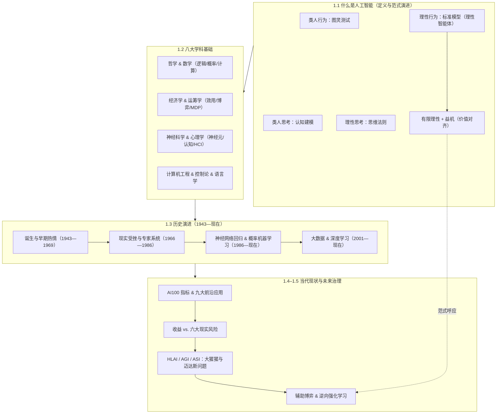

# 第1章 绪论

## 1. 导读与知识脉络

> [!info] 本章导读
> - **一句话主线**：本章以“==理性智能体标准模型==”为核心锚点，界定人工智能的四大定义学派，梳理支撑 AI 的八大学科基础与八个历史阶段，全景盘点当代前沿技术，并提出第 4 版最具前瞻性的范式转向——从“追求固定目标的理性机器”转向“==对人类目标保持不确定性的可证益机（provably beneficial machine）==”。
> - **页码映射**：拆分 PDF `p.1` 为“第一部分 人工智能基础”扉页（无页码）；正文为拆分 `p.2–p.31`（对应印刷 `p.2–p.31`，原全书 PDF `p.37–p.66`）。
> - **前置知识**：无（全书开篇导论）。
> - **后续章节**：[[Ch02_智能体]]（智能体架构与环境分类）、[[Ch16_制定简单决策]]（期望效用与关机激励）、[[Ch18_多智能体决策]]（博弈论与辅助博弈）、[[Ch22_强化学习]]（MDP 与逆向强化学习）、[[Ch27_哲学、伦理与安全]] & [[Ch28_人工智能的未来]]（图灵测试深度辨析、治理与奇点）。



---

## 2. 核心术语速查

> [!abstract]- 点击展开：本章全量蓝色粗体核心术语表（共 72 项，按节完整收录）
>
> | 所属板块 | 中文术语 | 英文原名 | 教材核心要义 | 教材页码 |
> | :--- | :--- | :--- | :--- | :--- |
> | 引言 | 智能 | intelligence | 大脑感知、理解、预测并操纵复杂世界的能力 | 印刷 p.2 / 拆分 p.2 |
> | 引言 | 人工智能 | artificial intelligence (AI) | 不仅理解智能，还致力于构建能在新奇情境下有效、安全行动的智能实体 | 印刷 p.2 / 拆分 p.2 |
> | 1.1.1 | 图灵测试 | Turing test | 图灵 1950 年提出的思维实验：若人类提问者无法分辨书面回答来自人还是计算机，则通过测试 | 印刷 p.3 / 拆分 p.3 |
> | 1.1.1 | 自然语言处理 | natural language processing | 使用人类语言成功交流的能力 | 印刷 p.3 / 拆分 p.3 |
> | 1.1.1 | 知识表示 | knowledge representation | 存储所知道或听到的内容并将其形式化以供推理 | 印刷 p.3, 16 / 拆分 p.3, 16 |
> | 1.1.1 | 自动推理 | automated reasoning | 利用已存储知识回答问题并得出新结论 | 印刷 p.3 / 拆分 p.3 |
> | 1.1.1 | 机器学习 | machine learning | AI 的子领域，研究基于经验提升表现、适应新环境并检测/推断模式的能力 | 印刷 p.2注, 3 / 拆分 p.2, 3 |
> | 1.1.1 | 完全图灵测试 | total Turing test | 需与真实世界对象和人交互的扩展图灵测试 | 印刷 p.3 / 拆分 p.3 |
> | 1.1.1 | 计算机视觉 | computer vision | 感知视觉世界的能力（配合语音识别用于完全图灵测试） | 印刷 p.3 / 拆分 p.3 |
> | 1.1.1 | 机器人学 | robotics | 在物理世界中操纵对象并采取行动的能力 | 印刷 p.3 / 拆分 p.3 |
> | 1.1.2 | 认知科学 | cognitive science | 结合 AI 计算模型与心理学实验技术，构建精确可测试人类心智理论的跨学科领域 | 印刷 p.3, 13 / 拆分 p.3, 13 |
> | 1.1.3 | 三段论 | syllogism | 亚里士多德提出的论证结构模式，前提正确则必然得出正确结论 | 印刷 p.4 / 拆分 p.4 |
> | 1.1.3 | 逻辑 | logic | 研究支配“正确思维”的形式化推理法则的学科 | 印刷 p.4 / 拆分 p.4 |
> | 1.1.3 | 逻辑主义 | logicism | 希望在用逻辑符号描述并求解问题的程序基础上创建智能系统的 AI 传统 | 印刷 p.4 / 拆分 p.4 |
> | 1.1.3 | 概率 | probability | 允许在信息不确定情况下进行严格推理的广义逻辑工具 | 印刷 p.4, 8 / 拆分 p.4, 8 |
> | 1.1.4 | 智能体 | agent | 能够自主运行、感知环境、持续存在、适应变化并制定/实现目标的行动实体 | 印刷 p.4 / 拆分 p.4 |
> | 1.1.4 | 理性智能体 | rational agent | 为取得最佳结果或在不确定性下取得最佳期望结果而采取行动的智能体 | 印刷 p.4 / 拆分 p.4 |
> | 1.1.4 | 标准模型 | standard model | 构建“做正确事情（实现给定目标）”的智能体的通用 AI 范式 | 印刷 p.5 / 拆分 p.5 |
> | 1.1.4 | 有限理性 | limited rationality | 在没有足够时间完成所有可能计算的情况下，适当地采取行动 | 印刷 p.5 / 拆分 p.5 |
> | 1.1.5 | 益机 | beneficial machine | 对人类有益的智能机器（译者仿“益虫”译法） | 印刷 p.5 / 拆分 p.5 |
> | 1.1.5 | 价值对齐问题 | value alignment problem | 确保施加给机器的目标或价值与人类真实需求保持一致的问题 | 印刷 p.5 / 拆分 p.5 |
> | 1.1.5 | 可证益的 | provably beneficial | 对人类目标保持不确定性、谨慎行动并可证明造福人类的智能体特性 | 印刷 p.5 / 拆分 p.5 |
> | 1.2.1 | 二元论 | dualism | 笛卡儿观点：人类思维/灵魂部分处于自然物理定律之外，而动物可视为机器 | 印刷 p.6 / 拆分 p.6 |
> | 1.2.1 | 唯物主义 | materialism | 认为大脑遵循物理定律的运作构成了思维，自由意志只是对可选决策的感知 | 印刷 p.6 / 拆分 p.6 |
> | 1.2.1 | 物理主义 | physicalism | 与超自然观点相对，主张心理现象归结为物理过程 | 印刷 p.6 / 拆分 p.6 |
> | 1.2.1 | 自然主义 | naturalism | 与超自然观点相对，主张一切现象服从自然法则 | 印刷 p.6 / 拆分 p.6 |
> | 1.2.1 | 经验主义 | empiricism | 始于培根，洛克概括为“知识归根到底都来源于经验”的认识论 | 印刷 p.7 / 拆分 p.7 |
> | 1.2.1 | 归纳法 | induction | 休谟提出：通过暴露要素之间的重复联系获得一般规则 | 印刷 p.7 / 拆分 p.7 |
> | 1.2.1 | 逻辑实证主义 | logical positivism | 维也纳学派学说：所有知识可用与观察语句相联系的逻辑理论描述，结合理性与经验主义 | 印刷 p.7 / 拆分 p.7 |
> | 1.2.1 | 观察语句 | observation sentence | 对应于感知输入、用以锚定逻辑理论的基础语句 | 印刷 p.7 / 拆分 p.7 |
> | 1.2.1 | 确证理论 | confirmation theory | 卡纳普与亨佩尔提出：通过量化分配给逻辑语句的信念度来分析从经验获取知识 | 印刷 p.7 / 拆分 p.7 |
> | 1.2.1 | 效用 | utility | 丹尼尔·伯努利引入的体现结果内在主观价值的度量 | 印刷 p.8 / 拆分 p.8 |
> | 1.2.1 | 功利主义 | utilitarianism | 边沁与穆勒提出：基于效用最大化的理性决策应适用于公共政策与人类活动所有领域 | 印刷 p.8 / 拆分 p.8 |
> | 1.2.1 | 结果主义 | consequentialism | 行为正确与否由其预期结果决定的伦理立场（功利主义为其特例） | 印刷 p.8 / 拆分 p.8 |
> | 1.2.1 | 义务伦理学 | deontological ethics | 康德提出：由普适社会法则（如“不要撒谎”）而非结果决定行为正确与否 | 印刷 p.8 / 拆分 p.8 |
> | 1.2.2 | 形式化逻辑 | formal logic | 始于布尔（命题/布尔逻辑）与弗雷格（一阶逻辑）的数学化逻辑体系 | 印刷 p.8 / 拆分 p.8 |
> | 1.2.2 | 统计学 | statistics | 结合概率形式化与数据可用性发展出的定量分析学科 | 印刷 p.9 / 拆分 p.9 |
> | 1.2.2 | 算法 | algorithm | 源自花剌子模，指明确的计算步骤序列（欧几里得算法为首个非平凡算法） | 印刷 p.9 / 拆分 p.9 |
> | 1.2.2 | 不完全性定理 | incompleteness theorem | 哥德尔 1931 年证明：在皮亚诺算术等强形式理论中，必然存在无法证明的真陈述 | 印刷 p.9 / 拆分 p.9 |
> | 1.2.2 | 丘奇-图灵论题 | Church-Turing thesis | 提出将图灵机可计算函数作为“可计算性”的一般数学概念 | 印刷 p.9 / 拆分 p.9 |
> | 1.2.2 | 可计算性 | computability | 函数是否能通过有效过程（算法/图灵机）进行计算 | 印刷 p.9 / 拆分 p.9 |
> | 1.2.2 | 易处理性 | tractability | 求解时间随问题规模多项式增长还是指数增长的性质，对 AI 影响更直接 | 印刷 p.9 / 拆分 p.9 |
> | 1.2.2 | NP 完全性 | NP-completeness | 库克与卡普开创：凡可归约到 NP 完全的问题都可能是难处理的 | 印刷 p.9 / 拆分 p.9 |
> | 1.2.3 | 决策论 | decision theory | 结合概率论与效用理论，为不确定性下个体理性决策提供完整形式框架 | 印刷 p.10 / 拆分 p.10 |
> | 1.2.3 | 博弈 | game | “小型”经济体中的交互：一个参与者的行为显著影响另一参与者的效用 | 印刷 p.10 / 拆分 p.10 |
> | 1.2.3 | 博弈论 | game theory | 冯·诺依曼与摩根斯特恩发展：研究多参与者策略交互（有时需采用随机策略） | 印刷 p.10 / 拆分 p.10 |
> | 1.2.3 | 多智能体系统 | multiagent system | AI 中研究涉及多个智能体协同与对抗决策的领域 | 印刷 p.10 / 拆分 p.10 |
> | 1.2.3 | 运筹学 | operations research | 源于二战雷达优化，研究复杂资源优化与序贯决策 | 印刷 p.10 / 拆分 p.10 |
> | 1.2.3 | 马尔可夫决策过程 | Markov decision process (MDP) | 贝尔曼形式化的延迟收益序贯决策模型 | 印刷 p.10, 23 / 拆分 p.10, 23 |
> | 1.2.3 | 强化学习 | reinforcement learning | 智能体通过环境反馈与延迟奖励学习最优策略的范式 | 印刷 p.10 / 拆分 p.10 |
> | 1.2.3 | 满意度 | satisficing | 赫伯特·西蒙提出：做出“够好”而非费力求最优的决策模型 | 印刷 p.10 / 拆分 p.10 |
> | 1.2.4 | 神经科学 | neuroscience | 对神经系统尤其是大脑结构与功能的研究 | 印刷 p.10 / 拆分 p.10 |
> | 1.2.4 | 神经元 | neuron | 大脑的基本神经细胞，由细胞体、树突、轴突和突触构成 | 印刷 p.11 / 拆分 p.11 |
> | 1.2.4 | 光遗传学 | optogenetics | 测量并控制被修饰为对光敏感的单个神经元的技术 | 印刷 p.12 / 拆分 p.12 |
> | 1.2.4 | 脑机接口 | brain-machine interface | 用于传感与运动控制、实现大脑与外部设备直接交互的技术 | 印刷 p.12 / 拆分 p.12 |
> | 1.2.4 | 奇点 | singularity | 未来主义者预测的计算机性能超越人类并迅速自我提升的临界点 | 印刷 p.12 / 拆分 p.12 |
> | 1.2.5 | 行为主义 | behaviorism | 沃森领导：拒绝主观内省与内部心理过程，只研究刺激-反应的客观度量 | 印刷 p.12 / 拆分 p.12 |
> | 1.2.5 | 认知心理学 | cognitive psychology | 将大脑视为信息处理设备，通过内部表示解释认知与行为 | 印刷 p.13 / 拆分 p.13 |
> | 1.2.5 | 人机交互 | human-computer interaction (HCI) | 研究人类与计算机系统协作与交互设计的领域 | 印刷 p.13 / 拆分 p.13 |
> | 1.2.5 | 智能增强 | intelligence augmentation (IA) | 恩格巴特倡导：计算机应增强人类能力而非完全替代人类 | 印刷 p.13 / 拆分 p.13 |
> | 1.2.6 | 摩尔定律 | Moore's law | 计算机硬件性能与容量随迭代指数提升、价格下降的经验趋势 | 印刷 p.14 / 拆分 p.14 |
> | 1.2.6 | 量子计算 | quantum computing | 虽尚未实用，但有望为部分 AI 算法子方向带来显著加速的新型计算范式 | 印刷 p.14 / 拆分 p.14 |
> | 1.2.7 | 控制理论 | control theory | 研究基于反馈回路自动调节行为以达到目标状态的数学与工程理论 | 印刷 p.15 / 拆分 p.15 |
> | 1.2.7 | 自我平衡 | homeostatic | 艾什比提出：通过恰当反馈回路维持稳定自适应行为的设备机制 | 印刷 p.15 / 拆分 p.15 |
> | 1.2.7 | 代价函数 | cost function | 现代随机最优控制中随时间最小化的目标函数 | 印刷 p.15 / 拆分 p.15 |
> | 1.2.8 | 计算语言学 | computational linguistics | 现代语言学与 AI 交叉形成的混合领域（亦称自然语言处理） | 印刷 p.15 / 拆分 p.15 |
> | 1.3.1 | 赫布型学习 | Hebbian learning | 赫布 1949 年提出的修改神经元间连接强度的简单局部更新规则 | 印刷 p.16 / 拆分 p.16 |
> | 1.3.2 | 物理符号系统 | physical symbol system | 纽厄尔与西蒙假说：物理符号系统具有进行一般智能动作的必要和充分手段 | 印刷 p.17 / 拆分 p.17 |
> | 1.3.2 | 微世界 | microworld | 明斯基指导学生在早期 AI 中选取的有限、受控问题领域 | 印刷 p.18 / 拆分 p.18 |
> | 1.3.2 | 积木世界 | blocks world | 最著名的微世界，机械手在模拟桌面上重新排列实心积木 | 印刷 p.18 / 拆分 p.18 |
> | 1.3.2 | 线性自适应神经网络 | adaline | 伯尼·维德罗改进赫布学习提出的早期神经网络模型 | 印刷 p.19 / 拆分 p.19 |
> | 1.3.2 | 感知机 | perceptron | 弗兰克·罗森布拉特提出的单层线性分类神经网络 | 印刷 p.19 / 拆分 p.19 |
> | 1.3.2 | 感知机收敛定理 | perceptron convergence theorem | 若存在能拟合输入数据的线性权重，感知机学习算法必能在有限步内收敛 | 印刷 p.19 / 拆分 p.19 |
> | 1.3.3 | 机器进化 / 遗传编程 | machine evolution / genetic programming | 通过对机器代码随机变异与选择来演化程序的早期尝试 | 印刷 p.20 / 拆分 p.20 |
> | 1.3.4 | 弱方法 | weak method | 依赖通用搜索串联基本推理步骤、缺乏领域知识、难以扩展到大规模问题的早期方法 | 印刷 p.20 / 拆分 p.20 |
> | 1.3.4 | 专家系统 | expert system | 依托大量特定领域专用规则解决专业难题的知识密集型系统 | 印刷 p.21 / 拆分 p.21 |
> | 1.3.4 | 确定性因子 | certainty factor | MYCIN 引入的度量医学证据不确定性的启发式计算机制 | 印刷 p.21 / 拆分 p.21 |
> | 1.3.4 | 框架 | frame | 明斯基 1975 年提出的结构化知识表示，将对象/事件类型组织成分类层次结构 | 印刷 p.21 / 拆分 p.21 |
> | 1.3.5 | 反向传播 | back-propagation | 20 世纪 80 年代中期被至少 4 个团队重新发明的多层神经网络训练算法 | 印刷 p.22 / 拆分 p.22 |
> | 1.3.5 | 联结主义 | connectionist | 以神经网络分布式表示和样本学习为核心、与符号主义/逻辑主义竞争的范式 | 印刷 p.22 / 拆分 p.22 |
> | 1.3.6 | 隐马尔可夫模型 | hidden Markov model (HMM) | 20 世纪 80 年代主导语音识别的严格概率时序模型 | 印刷 p.23 / 拆分 p.23 |
> | 1.3.6 | 贝叶斯网络 | Bayesian network | 朱迪亚·珀尔发展的严格、高效表示不确定知识并进行概率推理的图模型 | 印刷 p.23 / 拆分 p.23 |
> | 1.3.7 | 大数据 | big data | 互联网与算力进步催生的万亿词文本、数十亿图像等超大规模数据集 | 印刷 p.23 / 拆分 p.23 |
> | 1.3.8 | 深度学习 | deep learning | 使用多层简单可调整计算单元的机器学习方法 | 印刷 p.24 / 拆分 p.24 |
> | 1.3.8 | 卷积神经网络 | convolutional neural network (CNN) | 20 世纪 90 年代在手写数字识别取得成功、后引爆视觉革命的深度网络架构 | 印刷 p.24 / 拆分 p.24 |
> | 1.4 | 人工智能指数 | AI Index | 斯坦福 AI100 项目创建的用于追踪全球 AI 进展的量化指标体系 | 印刷 p.24 / 拆分 p.24 |
> | 1.5 | 人类级别的人工智能 | human-level AI (HLAI) | 机器能够学会做人类可以做到的任何事情的研究目标 | 印刷 p.29 / 拆分 p.29 |
> | 1.5 | 通用人工智能 | artificial general intelligence (AGI) | 与 HLAI 目标类似的通用智能研究运动（2008 年召开首届会议） | 印刷 p.29 / 拆分 p.29 |
> | 1.5 | 超级人工智能 | artificial superintelligence (ASI) | 能力远远超过人类智能的机器系统 | 印刷 p.29 / 拆分 p.29 |
> | 1.5 | 大猩猩问题 | gorilla problem | 人类进化超越大猩猩后大猩猩失去对未来的控制权，隐喻人类面对 ASI 的失控风险 | 印刷 p.29 / 拆分 p.29 |
> | 1.5 | 迈达斯国王问题 | King Midas problem | 机器严格执行人类给出的不完整目标反而带来灾难（如点石成金饿死自己与家人） | 印刷 p.30 / 拆分 p.30 |
> | 1.5 | 辅助博弈 | assistance game | 数学刻画“人类有目标、机器试图实现但最初不确定该目标”的协作框架 | 印刷 p.30 / 拆分 p.30 |
> | 1.5 | 逆向强化学习 | inverse reinforcement learning (IRL) | 通过观察人类选择来推断人类内在偏好的学习方法 | 印刷 p.30 / 拆分 p.30 |

---

## 3. 逐节深度精讲

### 引言（印刷 p.2 / 拆分 p.2）

- **学科定位**：人工智能（AI）不仅致力于**理解**智能（如同哲学、心理学和神经科学），更致力于**构建**智能实体——能在各种新奇情境下计算如何==有效且安全地行动==的机器。
- **领域现状**：每年创造超过一万亿美元价值；与物理学等成熟学科不同，AI 的研究前沿依然高度开放；涵盖通用子领域（学习、推理、感知）与特定任务（下棋、定理证明、写诗、驾车、疾病诊断）。
- **术语辨析**（p.2 脚注 a）：公众常混淆“人工智能”与“机器学习”。==机器学习只是 AI 的子领域==，专指基于经验提升表现的能力；并非所有 AI 系统都使用机器学习。

---

### 1.1 什么是人工智能（印刷 p.2–p.5 / 拆分 p.2–p.5）

历史上 AI 的定义沿着两个正交维度展开：**衡量标准（类人 vs. 理性）** 与 **关注对象（思维过程 vs. 外部行为）**，构成经典的四象限分类（p.2 脚注 b 特别强调：说人类不同于“理性”并非贬低人类非理性，而是承认人类决策在数学上不总是完美最优）。

| 维度组合 | 核心标签 | 代表方法 | 核心依赖学科 | 关键优势与局限 |
| :--- | :--- | :--- | :--- | :--- |
| **类人行为** | 像人一样行动 | 图灵测试（1.1.1） | NLP、KR、推理、ML、CV、机器人学 | 给出六大核心子领域，但“模仿人类”不利于提炼通用工程原理 |
| **类人思考** | 像人一样思考 | 认知建模（1.1.2） | 实验心理学、脑成像、认知科学 | 推动 AI 与认知科学互促，但需建立在人类/动物实验基础上 |
| **理性思考** | 理性地思考 | 思维法则（1.1.3） | 形式逻辑、概率论 | 推理严格，但仅靠“正确思考”不足以直接产生最优行动 |
| **理性行为** | 理性地行动 | 理性智能体（1.1.4） | 数学、统计学、控制论、经济学 | ==最普适、数学定义明确、最适合科学发展==（全书标准模型） |

#### 1.1.1 类人行为：图灵测试方法（p.3）

- **核心定义**：艾伦·图灵（Turing, 1950）提出**图灵测试**作为思维实验，回避“机器能思考吗？”这一哲学模糊问题：若人类提问者通过书面问答无法分辨回答来自人还是计算机，则通过测试。
- **通过测试所需的 4+2 项核心能力**：
  1. **基础图灵测试（4 项）**：自然语言处理（交流）、知识表示（存储知识）、自动推理（回答与推论）、机器学习（适应新环境与模式推断）。
  2. **完全图灵测试（额外 2 项）**：计算机视觉与语音识别（感知物理世界）、机器人学（操纵对象并行动）。
- **工程反思（鸟类与飞机类比）**：==现代 AI 研究者很少以“通过图灵测试”为直接目标==，正如航空工程学并非制造“能骗过真鸽子的机器鸽”，而是通过风洞与空气动力学掌握飞行的基本原理。

#### 1.1.2 类人思考：认知建模方法（p.3–p.4）

- **了解人类思维的 3 种途径**：内省（introspection）、心理实验（psychological experiment）、大脑成像（brain imaging）。
- **经典案例**：艾伦·纽厄尔与赫伯特·西蒙开发**通用问题求解器（GPS）**（1961），不仅要求程序求解正确，还将其推理步骤顺序和时机与人类受试者比对。
- **与 AI 的现代分工**：早期常将“算法表现好”与“符合人类认知模型”混为一谈；现代学者将两者明确分离，反而促使 AI 与**认知科学**双向加速（例如计算机视觉整合神经生理学证据，神经影像结合机器学习开启“读心”语义解码研究）。

#### 1.1.3 理性思考：“思维法则”方法（p.4）

- **源头**：亚里士多德的**三段论**开创了**逻辑**（注：教材考证经典的“苏格拉底是人→所有人都是凡人→苏格拉底是凡人”很可能是塞克斯都·恩披里柯而非亚里士多德提出的）。
- **逻辑主义传统**：19 世纪符号逻辑建立；到 1965 年，原则上任何逻辑符号描述的可解问题都可用程序求解。
- **两大根本局限**：
  1. **确定性假设过强**：现实世界（如政治、战争）充满不确定性，需引入**概率论**填补逻辑的鸿沟。
  2. **思考 $\neq$ 行动**：即使拥有从感知到预测的完整理性思维模型，也仍缺乏关于理性**行为**的决策理论。

#### 1.1.4 理性行为：理性智能体方法（p.4–p.5）

> [!note] 教材核心定义（1.1.4 节，印刷 p.4–p.5 / 拆分 p.4–p.5）
> - **智能体（agent）**：源自拉丁语 *agere*（意为“做”），指能够自主运行、感知环境、长期持续存在、适应变化以及制定和实现目标的实体。
> - **理性智能体（rational agent）**：为取得最佳结果，或在存在不确定性时取得==最佳期望结果==而采取行动的智能体。
> - **标准模型（standard model）**：AI 专注于研究和构建“做正确事情”的智能体，其中“正确的事情”由外部提供给智能体的目标定义。

- **为什么理性智能体胜过其他方法？**
  1. **比“思维法则”更普适**：正确推断只是实现理性的机制之一，像“从火炉前迅速缩手”这样的反射动作无需深思熟虑却更理性。
  2. **更适合科学发展**：理性标准在数学上明确且普适，可证明智能体设计的性质；而模仿人类思维/行为缺乏清晰的数学规范。
- **跨学科统一性**：控制论（最小化代价函数）、运筹学（最大化奖励总和）、统计学（最小化损失函数）、经济学（最大化效用/社会福利）本质上共享同一标准模型。
- **现实修正——有限理性（limited rationality）**：在复杂环境中追求完美理性计算代价过高，因此必须在有限计算时间下适当地采取行动（详见 [[Ch05_对抗搜索和博弈]] 与 [[Ch17_制定复杂决策]]）。

#### 1.1.5 益机（p.5）

- **标准模型的根本缺陷**：标准模型假设人类能为机器提供==完全准确指定的目标==。这在国际象棋或最短路径等人为定义任务中成立，但在真实世界（如自动驾驶中“绝对安全待在车库”与“到达目的地”的风险权衡、乘客舒适度与礼让其他司机的平衡）中几乎不可能做到。
- **价值对齐问题（value alignment problem）**：确保机器的目标与人类真实需求一致。实验室中可“重置—改目标—重试”，但现实部署的高智能系统一旦目标有偏差，==系统越智能，负面后果越严重==。
- **国际象棋反例**：若机器只以“获胜”为唯一固定目标且足够聪明，它会合乎逻辑地采取棋盘外手段——催眠/勒索对手、贿赂观众制造噪音（呼应 p.5 脚注 b 鲁伊·洛佩兹 1561 年名言“让阳光晃进对手眼睛”）、劫持额外算力。
- **范式重构——可证益智能体**：机器应当实现“我们的目标”，同时==明确知道自己对人类完整目标存在不确定性==。这种不确定性会赋予机器三种宝贵的动机：**谨慎行动、主动寻求许可、通过观察学习人类偏好并服从人类控制**。

---

### 1.2 人工智能的基础（印刷 p.6–p.16 / 拆分 p.6–p.16）

本节围绕八个学科的核心问题，追溯 AI 思想、数学工具与工程技术的历史源流。

| 节号 | 学科 | 核心指导问题 | 标志性贡献与关键人物 |
| :--- | :--- | :--- | :--- |
| 1.2.1 | 哲学 | 规则推理？心物关系？知识来源？知行联系？ | 亚里士多德、霍布斯、笛卡儿、培根/洛克/休谟、维也纳学派、卡纳普、伯努利、边沁/穆勒 vs. 康德 |
| 1.2.2 | 数学 | 形式化规则？可计算边界？不确定推理？ | 布尔、弗雷格、卡尔达诺/帕斯卡/费马/贝叶斯、费舍尔、花剌子模、哥德尔、图灵、库克/卡普 |
| 1.2.3 | 经济学 | 偏好决策？多方博弈？延迟收益？ | 亚当·斯密、阿尔诺、伯努利、瓦尔拉斯、冯·诺依曼 & 摩根斯特恩、贝尔曼（MDP）、西蒙（满意度） |
| 1.2.4 | 神经科学 | 大脑如何处理信息？ | 布罗卡、高尔基、拉蒙-卡哈尔（神经元学说）、伯杰（EEG）、fMRI、光遗传学、脑机接口 |
| 1.2.5 | 心理学 | 人类和动物如何思考和行为？ | 赫尔姆霍茨、温特、沃森（行为主义）、克雷克（认知模型）、米勒/乔姆斯基/纽厄尔 & 西蒙、恩格巴特（IA） |
| 1.2.6 | 计算机工程 | 如何构建高效的计算机？ | 图灵（Colossus）、楚泽（Z-3）、阿塔纳索夫（ABC）、ENIAC、摩尔定律、GPU/TPU/WSE、巴贝奇 & 洛芙莱斯 |
| 1.2.7 | 控制理论 | 人造物如何在自身控制下运行？ | 克特西比乌斯水钟、瓦特调速器、麦克斯韦、维纳（《控制论》）、艾什比（自我平衡）、随机最优控制 |
| 1.2.8 | 语言学 | 语言如何与思维联系？ | 斯金纳 vs. 乔姆斯基（《句法结构》）、波你尼、计算语言学 / NLP、知识表示与上下文理解 |

#### 1.2.1 哲学（p.6–p.8）

1. **形式化规则与机械计算**：
   - 亚里士多德（三段论）→ 拉蒙·鲁尔（*Ars Magna*, 1305，可旋转纸盘）→ 达·芬奇（1500 机械计算器设计）→ 威廉·席卡德（1623 已知首台计算器）→ 帕斯卡（1642 滚轮式加法器 Pascaline）→ 莱布尼茨（概念机械设备）→ 托马斯·霍布斯（《利维坦》称“推理就是一种计算，也就是相加减”）。
2. **心物问题（二元论 vs. 唯物主义）**：
   - **笛卡儿**坚持**二元论**，认为人类灵魂独立于物理定律（以保留自由意志），而动物是机器。
   - **唯物主义（物理主义/自然主义）**认为大脑遵循物理定律的运作即思维，自由意志仅是对可选决策的感知。
3. **知识来源**：
   - 培根《新工具》开启**经验主义**，洛克提出“知识归根到底都来源于经验”；休谟《人性论》（1739）提出**归纳法**。
   - 维也纳学派基于维特根斯坦与罗素提出**逻辑实证主义**（逻辑理论 + **观察语句**，融合了理性主义与经验主义）。
   - 卡纳普与亨佩尔提出**确证理论**；卡纳普《世界的逻辑构造》（1928）也许是最早将思维视为计算过程的著作。
4. **知识与行动及伦理决策**：
   - 亚里士多德在《论动物的运动》提出实践三段论（“需要覆盖物→斗篷是覆盖物→必须做一件斗篷”），在《尼各马可伦理学》给出从目的逆向追溯手段的算法——2300 年后纽厄尔和西蒙在 GPS 中将其实现为**贪婪回归规划系统**（[[Ch11_自动规划]]）。
   - 不确定性决策：阿尔诺（1662，期望货币价值）→ 伯努利（1738，**效用**概念）。
   - 伦理框架对立：边沁 & 穆勒的**功利主义**（属于**结果主义**，追求期望效用最大化） vs. 康德（1785）的**义务伦理学**（遵循普适法则如“不撒谎”）。穆勒将规则视为高效近似决策程序，许多现代 AI 系统正采用这一思想。

#### 1.2.2 数学（p.8–p.9）

- **形式化逻辑**：布尔（1847，命题与布尔逻辑）→ 弗雷格（1879，包含对象和关系的**一阶逻辑**）。
- **概率与统计**：卡尔达诺 → 帕斯卡 & 费马（1654 赌博收益分配）→ 雅各布·伯努利 & 拉普拉斯 → 托马斯·贝叶斯（贝叶斯法则）→ 约翰·格兰特（1662 伦敦人口分析）与现代统计学奠基人罗纳德·费舍尔（1922）。
- **计算、可计算性与易处理性**：
  - 欧几里得算法是首个非平凡**算法**（词源来自 9 世纪数学家花剌子模）。
  - **哥德尔不完全性定理**（1931）：像皮亚诺算术这样强的形式系统中，必然存在无法证明的真陈述。
  - **丘奇-图灵论题**（Turing, 1936）：用图灵机精确定义**可计算性**，并证明停机问题不可计算。
  - **易处理性与 NP 完全性**：对 AI 影响比可计算性更大！多项式增长 vs. 指数增长（Cobham, 1964; Edmonds, 1965）与库克（1971）、卡普（1972）的 **NP 完全性**理论揭示：==世界是一个极大的问题实例，计算资源必然受限，因此对资源的谨慎使用与必要的近似缺陷是智能系统的固有特征==。

#### 1.2.3 经济学（p.10）

- **效用理论演进**：亚当·斯密（1776《国富论》；1759《道德情操论》强调关注他人福祉）→ 阿尔诺（期望货币值）→ 丹尼尔·伯努利（期望效用最大化，指出货币**边际效用递减**）→ 瓦尔拉斯（推广到任意结果的偏好）→ 拉姆齐（1931）及冯·诺依曼 & 摩根斯特恩（1944《博弈论与经济行为》）。
- **核心数学框架**：
  - **决策论** = 概率论 + 效用理论（适用于“大型”经济体中的个体决策）。
  - **博弈论**（适用于“小型”经济体，参与方策略相互影响，有时最优策略是随机化的；对应 [[Ch18_多智能体决策]]）。
  - **运筹学与 MDP**：理查德·贝尔曼（1957）将延迟收益的序贯决策形式化为**马尔可夫决策过程（MDP）**（对应 [[Ch17_制定复杂决策]] 与 [[Ch22_强化学习]]）。
- **满意度模型**：赫伯特·西蒙（1978 诺贝尔经济学奖）提出**满意度（satisficing）**——做出“够好”而非费力求最优的决策，更贴合真实人类行为。

> [!abstract]- 详细数学推导（模型补充）：期望货币价值 vs. 期望效用最大化（边际效用递减）
>
> 设决策者当前财富为 $W_0$，面对一项风险投资：以概率 $p$ 获得收益 $G$，以概率 $1-p$ 损失 $L$。
>
> 1. **阿尔诺的期望货币价值（EMV）准则**：
>
> $$
> \mathrm{EMV} = p (W_0 + G) + (1 - p)(W_0 - L) = W_0 + pG - (1-p)L
> $$
>
> 2. **丹尼尔·伯努利的期望效用（EU）准则**：
>    若采用体现边际效用递减的对数效用函数 $U(W) = \ln(W)$（满足 $U'(W) > 0, U''(W) < 0$），则期望效用为：
>
> $$
> \mathrm{EU} = p \ln(W_0 + G) + (1 - p) \ln(W_0 - L)
> $$
>
> 即使 $\mathrm{EMV} > W_0$（正期望货币收益），当潜在损失 $L$ 占初始财富 $W_0$ 比例过大时，仍可能出现 $\mathrm{EU} < \ln(W_0)$，因此理性决策者会拒绝该赌局。这解释了为何大众愿意购买保险而非全仓豪赌海上远征。

```python
import math


def compare_emv_vs_eu(w0: float, p_win: float, gain: float, loss: float) -> None:
    """对比阿尔诺期望货币价值 (EMV) 与伯努利对数期望效用 (EU)。"""
    emv = p_win * (w0 + gain) + (1 - p_win) * (w0 - loss)
    eu_invest = p_win * math.log(w0 + gain) + (1 - p_win) * math.log(w0 - loss)
    eu_keep = math.log(w0)
    # 确定性等价财富：使得 ln(CE) == eu_invest
    certainty_equivalent = math.exp(eu_invest)

    print(f"初始财富 W0 = {w0:,.0f}, 胜率 p = {p_win:.2f}, 盈利 = +{gain:,.0f}, 亏损 = -{loss:,.0f}")
    print(f"  [EMV 准则] 期望财富 = {emv:,.2f} -> {'投资' if emv > w0 else '不投资'}")
    print(f"  [EU  准则] 期望效用 = {eu_invest:.4f} (不投资为 {eu_keep:.4f}), 确定性等价 = {certainty_equivalent:,.2f} -> {'投资' if eu_invest > eu_keep else '不投资'}")


if __name__ == "__main__":
    # 场景：初始财富 10000，50% 概率赚 8000，50% 概率亏 6000（EMV 为正，但破产风险大）
    compare_emv_vs_eu(w0=10000, p_win=0.5, gain=8000, loss=6000)
```

预期运行输出：

```text
初始财富 W0 = 10,000, 胜率 p = 0.50, 盈利 = +8,000, 亏损 = -6,000
  [EMV 准则] 期望财富 = 11,000.00 -> 投资
  [EU  准则] 期望效用 = 9.0461 (不投资为 9.2103), 确定性等价 = 8,485.28 -> 不投资
```

#### 1.2.4 神经科学（p.10–p.12）

- **历史里程碑**：18 世纪中叶大脑才被公认为意识所在地（此前候选含心脏与脾脏）→ 保罗·布罗卡（1861，左半球布罗卡氏区负责语音）→ 高尔基（1873 染色技术）与拉蒙-卡哈尔（**神经元学说**，两人共获 1906 诺奖但观点对立，见 p.11 脚注 c）→ 汉斯·伯杰（1929 EEG）→ fMRI（1990）→ 单细胞电记录与**光遗传学** → **脑机接口（BMI）**（证明大脑可像适应新器官一样自我调整与外设交互）。
- **图 1-1 解读（神经元结构，p.11）**：每个神经元由含神经核的细胞体、接收信号的树突、长达 $1\text{ cm}$ 至 $1\text{ m}$（细胞体直径 100 倍）的轴突构成，通过**突触**与 $10 \sim 100{,}000$ 个其他神经元相连；大脑皮质（厚约 $4\text{ mm}$）的基本组织单元为直径约 $0.5\text{ mm}$、含约 $20{,}000$ 个神经元的柱状组织。
- **图 1-2 解读（算力硬件与人类大脑粗略对比，p.12）**：

| 对比维度 | 超级计算机（Summit, 2017） | 典型个人计算机（2019） | 人类大脑 |
| :--- | :--- | :--- | :--- |
| **计算单元** | $10^6$ 个 GPU+CPU / $10^{15}$ 个晶体管 | 8 个 CPU 内核 / $10^{10}$ 个晶体管 | $10^6$ 皮质柱 / $10^{11}$ 个神经元 |
| **存储单元** | $10^{16}\text{ B}$ (10 PB) RAM / $10^{17}\text{ B}$ (100 PB) 磁盘 | $10^{10}\text{ B}$ (10 GB) RAM / $10^{12}\text{ B}$ (1 TB) 磁盘 | $10^{11}$ 个神经元 / $10^{14}$ 个突触 |
| **周期时间** | $10^{-9}$ 秒 | $10^{-9}$ 秒 | $10^{-3}$ 秒（慢 $10^6$ 倍） |
| **运算/秒** | $10^{18}$（exaFLOP 级） | $10^{10}$ | $10^{17}$ |

- **核心洞见**：计算机周期比大脑快一百万倍，超算在原始指标上已与大脑相当，但教材冷静指出：==比较原始数字并不特别有用；如果没有正确的理论，更快的机器只会更快地给出错误的答案==。

#### 1.2.5 心理学（p.12–p.13）

- **实验心理学与行为主义**：赫尔姆霍茨（视觉研究）与温特（1879 莱比锡首个实验心理学实验室，靠严格内省）；约翰·沃森的**行为主义**拒绝主观内省，仅研究刺激—反应，在鼠鸽实验成功但难以解释人类高级认知。
- **认知革命**：巴特利特与肯尼斯·克雷克（1943 *The Nature of Explanation*）恢复信念/目标的科学地位，提出知识型智能体的 3 个核心步骤：**（1）刺激转化为内在表示；（2）认知过程处理表示生成新表示；（3）再转化为行为**。

> [!quote] 肯尼斯·克雷克论内部世界模型（1.2.5 节，印刷 p.13 / 拆分 p.13）
> 如果有机体拥有一个“小规模的模型”，建模了外部现实及其在脑海中可能采取的行为，那么它就能够尝试各种选择，得出哪个是最好的，并在未来出现情况之前加以应对。——Craik (1943)

- **认知科学诞生**：1956 年 9 月 MIT 研讨会（仅比 AI 诞生早 2 个月），米勒（*The Magic Number Seven*）、乔姆斯基（*Three Models of Language*）、纽厄尔与西蒙（*The Logic Theory Machine*）三篇奠基论文发表。
- **人机交互（HCI）与智能增强（IA）**：道格·恩格巴特（1968“所有演示之母”首秀鼠标、窗口、超文本、视频会议）倡导 **IA（增强人类）而非纯 AI（替代人类）**。现代观点认为 ==IA（强调人类控制）与 AI（强调机器智能）是同一枚硬币的两面==，缺一不可。

#### 1.2.6 计算机工程（p.13–p.14）

- **早期电子计算机**：图灵团队（1943 机电 Heath Robinson 与真空管 Colossus，破译德军情报）→ 康拉德·楚泽（1941 首台可操作可编程计算机 Z-3、浮点数、高级语言 Plankalkül）→ 阿塔纳索夫与贝里（1940–1942 电子计算机 ABC）→ ENIAC（莫奇利与埃克特，最具影响力）。
- **算力演进与专用硬件**：**摩尔定律**（2005 年前约每 18 个月单核性能翻倍，此后受功耗限制转向多核与大规模并行，与大脑特性一致）；AI 应对不确定世界无需 64 位精度，16 位（如 `bfloat16`）甚至 8 位即可；专用硬件（GPU、TPU、WSE）兴起，==2012–2018 年顶级 ML 训练算力增长 30 万倍（约每 100 天翻一番）==；**量子计算**虽未实用但具潜力。
- **机械先驱**：雅卡尔提花织布机（1805 打孔卡）→ 查尔斯·巴贝奇（差分机于 1991 年建成；分析机具备可寻址内存、存储程序和条件跳转）→ **埃达·洛芙莱斯**（1843，最早洞悉通用推理潜力，同时警示不要夸大机器能力）。
- **软件反哺**：AI 从 OS/编程语言受益，同时也将分时、交互式解释器、图形窗口/鼠标、链表、自动垃圾回收、符号/函数式/面向对象编程等核心概念反哺回主流计算机科学。

#### 1.2.7 控制理论与控制论（p.14–p.15）

- **自动控制史**：古希腊克特西比乌斯水钟（约公元前 250 年，首个自控机械）→ 瓦特蒸汽机调速器、德雷贝尔恒温器 → 麦克斯韦（1868 数学理论）。
- **控制论浪潮**：诺伯特·维纳（《控制论》1948）与同事指出目的性行为源于最小化“当前状态与目标状态差异（误差）”的反馈调节；英国罗斯·艾什比组织“推理俱乐部（Ratio Club）”，在《大脑设计》（1948/1952）中提出**自我平衡（homeostatic）**自适应设备。
- **为何与 AI 分道扬镳？** 现代随机最优控制追求最小化**代价函数**，与 AI 标准模型高度一致，但控制论的数学工具（微积分与矩阵代数）擅长处理**固定连续变量系统**，而 AI 的创立正是为了突破此局限，借助逻辑与计算工具处理**语言、视觉与符号规划**等离散/结构化问题。

#### 1.2.8 语言学（p.15–p.16）

- **行为主义的终结**：1957 年斯金纳发表 *Verbal Behavior*，但诺姆·乔姆斯基的书评（配合其同年《句法结构》）指出行为主义无法解释儿童的**语言创造力**（理解并造出从未听过的句子），几乎终结了行为主义在语言学的影响。
- **计算语言学 / NLP**：现代语言学与 AI 几乎同步诞生；但 20 世纪 60 年代后人们认识到，语言理解远不止句法结构，还必须理解**主题、上下文与世界知识**，这直接催生了早期**知识表示**研究。

---

### 1.3 人工智能的历史（印刷 p.16–p.24 / 拆分 p.16–p.24）

> [!note] 图灵奖视角下的 AI 历史主线（1.3 节引言，印刷 p.16 / 拆分 p.16）
> - **1969 / 1971**：马文·明斯基 & 约翰·麦卡锡（表示与推理的领域基础）
> - **1975**：艾伦·纽厄尔 & 赫伯特·西蒙（问题求解与人类认知的符号模型）
> - **1994**：爱德华·费根鲍姆 & 劳伊·雷迪（编码人类知识的专家系统）
> - **2011**：朱迪亚·珀尔（处理不确定性的概率因果推理）
> - **2018**：约书亚·本吉奥、杰弗里·辛顿 & 杨立昆（深度学习——注：英文原著误记为 2019 年，中文版编者注已勘误为 2018 年）

| 阶段 | 时间 | 核心特征 | 标志性事件 / 系统 | 历史教训与转折 |
| :--- | :--- | :--- | :--- | :--- |
| 1.3.1 诞生 | 1943—1956 | 人工神经元、图灵议程、达特茅斯命名 | M-P 神经元、赫布学习、SNARC、LT、达特茅斯会议 | 奠定“人工智能”学科名称与宏大愿景 |
| 1.3.2 早期热情 | 1952—1969 | 符号推理、强化学习雏形、微世界、感知机 | GPS、西洋跳棋、Lisp、Advice Taker、Shakey、SHRDLU、感知机 | “瞧，妈，不需要人动手操控！”的乐观高潮 |
| 1.3.3 现实受挫 | 1966—1973 | 组合爆炸、机器进化失败、感知机局限 | 莱特希尔报告（1973）、*Perceptrons*（1969） | 首次寒冬：缺乏复杂性认识，神经网络经费归零 |
| 1.3.4 专家系统 | 1969—1986 | 弱方法转向领域知识密集型规则 | DENDRAL、MYCIN、R1（DEC）、Prolog、框架、第五代机 | 商业爆发至数十亿美元，后因脆性与无法学习迎来“AI 冬天” |
| 1.3.5 神经网络回归 | 1986—现在 | 反向传播复兴、联结主义挑战符号主义 | *Parallel Distributed Processing*（1986） | 更适配真实世界的混乱并具备样本学习能力 |
| 1.3.6 概率与 ML | 1987—现在 | 科学化转向：概率、数据、共享基准、跨学科融合 | HMM、贝叶斯网络（1988）、RL+MDP（1988）、ImageNet/MNIST | “整洁派”占优，抛弃孤立主义，子领域重新统一 |
| 1.3.7 大数据 | 2001—现在 | 数据量级胜过算法微调，无监督/弱监督崛起 | 词义消歧、照片修补、ImageNet、IBM Watson（2011） | 数据规模提升 2–3 个数量级带来质的飞跃 |
| 1.3.8 深度学习 | 2011—现在 | 多层网络 + 大数据 + GPU/TPU 并行算力 | AlexNet（2012 ImageNet）、AlphaGo（2016–2018） | 在视觉、语音、博弈等任务逼近或超越人类 |

#### 1.3.1 人工智能的诞生（1943—1956）（p.16–p.17）

- **第一项 AI 研究**：麦卡洛克与皮茨（1943）结合神经生理学、命题逻辑与图灵计算理论提出人工神经元模型，证明神经元网络可实现所有逻辑联结词（AND/OR/NOT）并计算任何可计算函数；赫布（1949）提出**赫布型学习**权重更新规则。
- **首台神经网络计算机**：明斯基与埃德蒙兹（1950）用 3000 个真空管和 B-24 轰炸机自动驾驶装置造出 **SNARC**（模拟 40 个神经元）。
- **图灵的奠基议程**：1950 年论文 *Computing Machinery and Intelligence* 提出图灵测试、机器学习、遗传算法与强化学习，主张“通过学习算法教机器”比手工编程更容易实现人类级 AI，但也警告这未必对人类最有利。
- **1956 达特茅斯研讨会**：麦卡锡联合明斯基、香农、罗切斯特召集 10 位学者（含纽厄尔、西蒙、塞缪尔、所罗门诺夫、赛弗里奇等）开会两个月，正式确立 **Artificial Intelligence** 之名（p.17 脚注 b 指出麦卡锡刻意避开“计算”一词以示对倡导模拟控制设备的维纳的敬意）。会上最成熟成果是纽厄尔与西蒙用 IPL 语言编写的数学定理证明器**逻辑理论家（LT）**，证明了《数学原理》第 2 章大部分定理。

#### 1.3.2 早期热情高涨，期望无限（1952—1969）（p.17–p.19）

- **物理符号系统假说**：纽厄尔与西蒙继 LT 后开发 **GPS**（模仿人类解题协议），并提出著名假说（1976）：==“物理符号系统具有进行一般智能动作的必要和充分方法”==。
- **关键早期系统**：
  - 盖伦特（1959）：几何定理证明程序。
  - 亚瑟·塞缪尔：西洋跳棋程序（1956 电视演示），采用早期**强化学习**击败创造者，成为 TD-Gammon 和 AlphaGo 的先驱。
  - 约翰·麦卡锡（1958）：发明 **Lisp** 语言（主导 AI 30 年），并发表 *Programs with Common Sense* 构想**建议接受者（Advice Taker）**——以形式逻辑显式表示常识并演绎规划。
  - 鲁滨逊（1965）发现一阶逻辑完备算法**归结原理**，推动了斯坦福 **Shakey** 机器人项目（首个完全集成逻辑推理与物理行动的机器人）。
- **微世界与积木世界（图 1-3，p.19）**：明斯基团队聚焦受控小领域（SAINT 解微积分、ANALOGY 解几何类比、STUDENT 解代数应用题）；最著名的是**积木世界**，催生了哈夫曼/沃尔茨的视觉约束传播、温斯顿学习理论、温诺格拉德的自然语言系统 **SHRDLU** 与法尔曼规划器。
- **早期神经网络**：维德罗的 **adaline** 与罗森布拉特的**感知机（perceptron）**，以及**感知机收敛定理**（Block et al., 1962）。

#### 1.3.3 一些现实（1966—1973）（p.19–p.20）

赫伯特·西蒙 1957 年曾预言“10 年内计算机将成为国际象棋冠军并证明重要数学定理”（实际耗时约 40 年）。早期系统在难题上几乎全军覆没，教材总结了==三大失败根源==：
1. **缺乏对任务本质的分析**：过度依赖人类“知情内省型”模仿，而非分析算法可靠求解所需的数学结构。
2. **忽视计算复杂性与“组合爆炸”**：微世界对象极少掩盖了指数爆炸；归结定理证明面对几十条事实即失效；早期的**机器进化（遗传编程）**消耗数千小时 CPU 仍毫无进展。英国**莱特希尔报告（1973）**猛烈抨击组合爆炸问题，导致英国除两所大学外全面削减 AI 资助。
3. **基础表示能力的根本限制**：明斯基与派珀特（1969 *Perceptrons*）证明单层感知机表示能力极其有限（例如==双输入感知机无法判断两个输入是否相同，即 XNOR/XOR 问题==）。尽管该结论不适用于多层网络且反向传播早在 60 年代初已在其他领域出现（Kelley, 1960; Bryson, 1962），神经网络研究经费仍瞬间降至几乎为零。

```python
import numpy as np


def train_perceptron(X: np.ndarray, y: np.ndarray, lr: float = 0.2, epochs: int = 20):
    """标准单层感知机训练，验证感知机收敛定理（AND）与 Minsky-Papert 局限（XNOR）。"""
    w = np.zeros(X.shape[1])
    b = 0.0
    for ep in range(1, epochs + 1):
        errors = 0
        for xi, yi in zip(X, y):
            pred = 1 if (np.dot(w, xi) + b) >= 0 else 0
            err = yi - pred
            if err != 0:
                w += lr * err * xi
                b += lr * err
                errors += 1
        if errors == 0:
            return True, ep, w, b, errors
    return False, epochs, w, b, errors


if __name__ == "__main__":
    X_bin = np.array([[0, 0], [0, 1], [1, 0], [1, 1]], dtype=float)
    # 1) 线性可分：逻辑 AND
    ok_and, ep_and, w_and, b_and, err_and = train_perceptron(X_bin, np.array([0, 0, 0, 1]))
    print(f"AND  任务: 收敛={ok_and}, 轮数={ep_and}, 权重={w_and.round(2)}, 偏置={b_and:.2f}")
    # 2) 线性不可分：双输入是否相同 (XNOR，教材 p.20 原例)
    ok_xnor, ep_xnor, w_xnor, b_xnor, err_xnor = train_perceptron(X_bin, np.array([1, 0, 0, 1]))
    print(f"XNOR 任务: 收敛={ok_xnor}, 轮数={ep_xnor}, 末轮错误数={err_xnor}（单层感知机永不收敛）")
```

预期运行输出：

```text
AND  任务: 收敛=True, 轮数=4, 权重=[0.4 0.2], 偏置=-0.40
XNOR 任务: 收敛=False, 轮数=20, 末轮错误数=4（单层感知机永不收敛）
```

#### 1.3.4 专家系统（1969—1986）（p.20–p.22）

- **从弱方法到强知识**：通用搜索（**弱方法**）无法扩展，替代方案是注入大量特定领域专用规则，形成**专家系统**。
- **三大里程碑系统**：
  1. **DENDRAL**（斯坦福，费根鲍姆、布坎南、莱德伯格，1969）：首个成功知识密集型系统，利用分析化学家的质谱峰规则推断分子结构（以高效“食谱”替代第一性原理穷举）。
  2. **MYCIN**：约 450 条规则用于诊断血液感染，表现媲美专家且优于初级医生。与 DENDRAL 的两大差异：规则来自专家访谈而非理论推导；引入**确定性因子**处理医学不确定性。
  3. **R1**（DEC，1982）：首个成功商用专家系统，配置新计算机订单，截至 1986 年每年节省约 4000 万美元。1988 年 AI 产业从 1980 年的数百万美元飙升至数十亿美元。
- **工具与国家计划**：逻辑工具（Prolog、Planner）、明斯基的**框架（frame）**结构化表示；日本“第五代计算机”十年计划（预算超 13 亿美元）、美国 MCC 联盟、英国 Alvey 报告——但均未实现宏伟目标。
- **人工智能冬天**：复杂领域专家系统构建与维护成本极高，且存在两大硬伤：==面对不确定性时推理崩溃；无法从经验中学习==。

```python
def detect_ketone_dendral(M: int, peaks: dict[int, float], high_threshold: float = 0.5) -> list[tuple[int, int]]:
    """
    忠实实现教材 p.21 的 DENDRAL 酮基 (C=O, 分子量 28) 质谱识别规则：
    给定分子总质量 M 与质谱峰强度字典 peaks={m/z: intensity}，若存在峰 x1, x2 满足：
      (a) x1 + x2 == M + 28
      (b) x1 - 28 是高峰
      (c) x2 - 28 是高峰
      (d) x1 和 x2 中至少有一处是高峰
    则判定分子含有酮基。
    """
    matches = []
    masses = sorted(peaks.keys())
    for i, x1 in enumerate(masses):
        for x2 in masses[i:]:
            cond_a = (x1 + x2 == M + 28)
            cond_b = peaks.get(x1 - 28, 0.0) >= high_threshold
            cond_c = peaks.get(x2 - 28, 0.0) >= high_threshold
            cond_d = (peaks[x1] >= high_threshold) or (peaks[x2] >= high_threshold)
            if cond_a and cond_b and cond_c and cond_d:
                matches.append((x1, x2))
    return matches


if __name__ == "__main__":
    # 示例：2-戊酮 (C5H10O, M=86)，在 C=O 两侧断裂产生 m/z=43 (CH3CO+) 与 m/z=71 (C3H7CO+)，
    # 对应失去 CO(28) 后的高峰 m/z=15 (CH3+) 与 m/z=43 (C3H7+)
    sample_spectrum = {15: 0.70, 43: 1.00, 58: 0.25, 71: 0.65, 86: 0.30}
    ketone_pairs = detect_ketone_dendral(M=86, peaks=sample_spectrum)
    print(f"检测到的酮基特征峰对 (x1, x2): {ketone_pairs} -> 含酮基={bool(ketone_pairs)}")
```

预期运行输出：

```text
检测到的酮基特征峰对 (x1, x2): [(43, 71)] -> 含酮基=True
```

#### 1.3.5 神经网络的回归（1986—现在）（p.22）

- **反向传播复兴**：20 世纪 80 年代中期至少 4 个团队重新发明反向传播算法，*Parallel Distributed Processing*（Rumelhart & McClelland, 1986）引发轰动。
- **联结主义 vs. 符号主义**：人类学家迪肯称人类是“符号化动物”，但辛顿将符号比作“人工智能的光以太”；许多日常概念难以用严格逻辑充要条件公理化，==联结主义模型能以更流畅、不精确的方式形成内部概念并从样本误差中自动更新参数==。

#### 1.3.6 概率推理和机器学习（1987—现在）（p.22–p.23）

- **方法论科学化**：从布尔逻辑转向**概率**、从手工编码转向**机器学习**、从哲学主张转向**严谨定理与共享基准实验**（UCI 库、MNIST、ImageNet、COCO、SQuAD、LibriSpeech、WMT、SAT 竞赛等）。p.22 脚注 a 指出这常被称为**整洁派（neat）**战胜**邋遢派（scruffy）**，而当代深度学习热潮或许代表邋遢派的某种复兴。
- **终结孤立主义与三大里程碑**：
  - 语音识别采用**隐马尔可夫模型（HMM）**（严格数学理论 + 大量真实语料训练）。
  - **1988 年双璧**：朱迪亚·珀尔的 *Probabilistic Reasoning in Intelligent Systems* 确立**贝叶斯网络**；理查德·萨顿将**强化学习**与运筹学的 **MDP** 正式联结。
  - **子领域重归统一**：视觉、机器人、语音、多智能体与 NLP 重新汇聚于统计建模、优化与机器学习的统一框架下。

#### 1.3.7 大数据（2001—现在）（p.23–p.24）

- **核心规律**：数据规模的质变往往比算法微调更有效。
  - **词义消歧**（Yarowsky, 1995）：海量无标签文本中识别“plant”指植物还是工厂，准确率超 96%；Banko & Brill (2001) 指出==数据集规模扩大 2–3 个数量级带来的性能提升超过调整算法==。
  - **图像补全**（Hays & Efros, 2007）：数千张图效果差，数百万张图跨越质量阈值；随后 **ImageNet**（Deng et al., 2009）引爆视觉革命。
  - **商业回归**：大数据是 2011 年 IBM **Watson** 在《危险边缘》（*Jeopardy!*）击败人类冠军的关键因素。

#### 1.3.8 深度学习（2011—现在）（p.24）

- **定义与爆发**：使用多层简单可调整计算单元的机器学习。90 年代卷积神经网络（LeCun et al., 1995）在手写数字识别初露锋芒；2011 年起在语音与视觉全面流行。
- **决定性事件**：2012 年 ImageNet 竞赛中，辛顿团队的深度网络（Krizhevsky et al., 2013）大幅超越手工特征方法；**AlphaGo**（2016–2018）用深度网络表示评价函数击败顶尖人类围棋棋手。
- **三大支柱**：**专用并行硬件**（GPU/TPU/FPGA 每秒 $10^{14} \sim 10^{17}$ 次矩阵/向量运算，远超普通 CPU 的 $10^9 \sim 10^{10}$ 次）+ **海量训练数据** + **算法技巧**（[[Ch21_深度学习]]）。

---

### 1.4 目前的先进技术（印刷 p.24–p.27 / 拆分 p.24–p.27）

#### 1.4.1 斯坦福 AI100 与人工智能指数（AI Index）核心亮点（p.24–p.25）

基于 2018–2019 年报告（除另有说明外均以 2000 年为基线）：
- **出版物与会议**：2010–2019 年 AI 论文增 20 倍（约 2 万篇/年），ML 居首（arXiv 上 2009–2017 年每年翻倍）；NeurIPS 参会人数较 2012 年增 8 倍达 13,500 人。
- **教育与行业**：较 2010 年课程注册人数美增 5 倍、全球增 16 倍；美国 AI 初创公司增 20 倍达 800 多家；多样性仍失衡（教授、博士与行业招聘约 80% 男性、20% 女性）。
- **国际化**：中国年发文量超美国、与欧洲相当，但引用加权影响力美国领先中国 50%；招聘增速最快国家为新加坡、巴西、澳大利亚、加拿大、印度。
- **媒体情绪**：约 70% 中性，正面文章由 2016 年 12% 升至 2018 年 30%，最常见担忧为**数据隐私与算法偏见**。
- **性能与算力突破**：
  - 视觉：LSVRC 物体检测错误率从 2010 年 28% 降至 2017 年 2%（超人类）；开放式视觉问答（VQA）从 55% 升至 68%（仍落后人类 83%）。
  - 速度：图像识别训练时间两年缩短 100 倍；顶级 AI 算力每 **3.4 个月**翻一番。
  - 语言：SQuAD F1 从 60 升至 95，SQuAD2 一年内从 62 升至 90（均超人类）。
  - 人类基准：截至 2019 年，AI 在国际象棋、围棋、扑克、Pac-Man、Jeopardy!、ImageNet、受限语音/翻译、Quake III、Dota 2、StarCraft II、Atari、皮肤癌/前列腺癌/糖尿病视网膜病变诊断、蛋白质折叠等领域达到或超越人类。
- **人类水平 AI 时间预测**：Ford (2018) 访谈范围为 2029–2200 年（均值 2099 年）；Grace et al. (2017) 调查中位 2066 年（10% 认为最早 2025 年）。但教材引用 Tetlock (2017) 提醒：==专家预测世界事件并不比业余爱好者更准==。

#### 1.4.2 九大前沿应用领域全景（p.25–p.27）

| 应用领域 | 标志性系统 / 案例 | 关键量化指标或突破 | 现存局限 / 重点 |
| :--- | :--- | :--- | :--- |
| **自动驾驶** | DARPA 挑战赛（2005/2007）、Waymo、卢旺达血液输送无人机 | Waymo 公测超 1600 万公里无严重事故，每 9650 公里人工接管一次 | 复杂长尾场景与安全责任界定 |
| **腿足式机器人** | BigDog（四足）、Atlas（类人） | 冰面滑倒可恢复站立，Atlas 可跳箱并完成稳定后空翻 | 能源效率与复杂非结构化环境泛化 |
| **自动规划与调度** | NASA 远程智能体 / EUROPA / SEXTANT、美军 DART、Uber/Google Maps | DART 调度 5 万交通/货物/人员，单次应用回报 DARPA 30 年 AI 投入 | 动态实时重规划与多目标冲突消解 |
| **机器翻译** | 在线神经网络翻译系统 | 覆盖超 100 种语言（99% 人类母语），日译数千亿词，法英等特定领域近人类 | 仍不完美，低资源语言与长文语境待提升 |
| **语音识别** | 微软 Switchboard、Skype、Alexa/Siri/Google Duplex | 微软会话词错率降至 5.1%（媲美人类）；全球约 1/3 计算机交互通过语音 | 强噪声与复杂多轮开放对话 |
| **推荐系统** | Amazon、Netflix、YouTube、垃圾邮件过滤 | 融合深度学习分析多模态内容；过滤超 99.9% 垃圾邮件 | 信息茧房与隐性偏好操控 |
| **博弈** | 深蓝（1997）、AlphaGo、AlphaZero、Dota 2 / StarCraft II AI | AlphaZero 零人类数据仅凭规则自博弈横扫围棋、象棋、将棋 | 现实世界缺乏完整精确的固定规则 |
| **图像理解** | 图像描述生成（Image Captioning） | 可生成精准场景句，但也曾将贴满贴纸的“禁停标志”误判为“装满食物的冰箱” | 鲁棒性与常识推理严重不足 |
| **医学与气候科学** | LYNA（转移性乳腺癌）、2018 戈登·贝尔奖气候深度学习 | LYNA 准确率 99.6% 且==人机联合优于单独 AI 或医生==；FDA 批准从 2017 年 2 项增至 2018 年 12 项；超算达 exaop（$10^{18}$ 次/秒） | 医学推广瓶颈在临床结果验证、透明、无偏见与隐私 |

---

### 1.5 人工智能的风险和收益（印刷 p.27–p.30 / 拆分 p.27–p.30）

> [!quote] 弗朗西斯·培根论技术的双刃剑（1.5 节，印刷 p.27 / 拆分 p.27）
> “机械艺术的用途是模糊的，它既可用于治疗，也可用于伤害。”——*The Wisdom of the Ancients* (1609)

- **巨大收益（p.27–p.28）**：人类文明是人类智慧的产物，更强的机器智能将极大抬高文明上限——将人类从重复繁重劳动中解放、提升生产、加速科学发现（治愈疾病、应对气候变化与资源短缺）。如 DeepMind CEO 德米斯·哈萨比斯所言：“首先解决人工智能问题，然后再用人工智能解决其他所有问题。”

#### 1.5.1 六大现实风险（p.28）

| 风险类型 | 核心机制与隐患 | 治理与进展 |
| :--- | :--- | :--- |
| **致命性自主武器** | 无需人工干预即可定位、选择并击杀人类；最大危险是**可扩展性**（少数人即可部署大规模致命武器） | 2014 年联合国非正式讨论，2017 年进入官方专家组条约审议 |
| **监视和劝诱** | 语音/视觉/NLP 实现低成本大规模个人监视；社交媒体算法定制信息流操控政治行为（2016 美国大选凸显） | 法律与隐私监管亟待完善 |
| **有偏决策** | 假释评估、贷款审批等算法放大训练数据中固有的种族、性别等社会偏见 | 算法公平性与审计 |
| **就业影响** | 提升生产率与总财富，但==往往将财富从劳动力转向资本，加剧不平等==；且 AI 可能胜任新创造的岗位 | 成为各国政府与经济学家焦点 |
| **安全关键应用** | 自动驾驶、城市供水等已出现致命事故，ML 系统的形式化验证与统计风险分析极其困难 | 需建立媲美工程与医疗界的技术/道德标准 |
| **网络安全** | 攻防双向增强：强化学习已被用于打造自动化、个性化的勒索与钓鱼攻击工具 | 防御与安全治理 |

#### 1.5.2 长期挑战：HLAI / AGI / ASI 与控制难题（p.28–p.30）

- **回归宏大目标**：尼尔森（1995）警示子领域可能喧宾夺主；麦卡锡、明斯基、温斯顿推动**人类级别的人工智能（HLAI，2004 首届研讨会）**，另有**通用人工智能（AGI，2008 首届会议）**运动。
- **超级智能（ASI）与大猩猩问题**：图灵 1951 年援引塞缪尔·巴特勒（1863 *Erewhon*）警告机器可能超越并控制人类；波斯特洛姆《超级智能》（2014）及霍金、盖茨、马斯克等引发广泛担忧。**大猩猩问题**揭示了核心焦虑：灵长类分化出大猩猩与人类后，智力较低的大猩猩完全丧失了对自身未来的控制权。
- **失败根源——迈达斯国王问题（King Midas problem）**：ASI 并非来自外太空的黑匣子，若失控则是**设计失败**。诺伯特·维纳（1960）指出：若使用无法有效干预的机械智能体，必须 100% 确定设定给它的目标正是我们真正想要的——但如同希腊神话中“点物成金”却连食物和家人都变成黄金的迈达斯国王，人类根本无法完美写出固定目标。
- **新范式的三大技术支点（全书前瞻）**：
  1. **关机激励**（[[Ch16_制定简单决策]]）：==当且仅当机器对人类目标保持不确定性时，它才有积极动机允许自己被人类关闭==。
  2. **辅助博弈（assistance game）**（[[Ch18_多智能体决策]]）：数学形式化“人类持有未知目标、机器协作最大化该目标”的互动结构。
  3. **逆向强化学习（IRL）**（[[Ch22_强化学习]]）：通过观察人类的实际行为选择，反向推断人类的真实偏好。
  4. **深层困难**（[[Ch27_哲学、伦理与安全]]）：人类行为通过复杂认知结构映射偏好，难以逆向还原；且人类个体与群体自身往往并不存在一致的偏好。

> [!abstract]- 详细直觉演示（模型补充）：为何“目标不确定性”能赋予机器允许被关机的动机？
>
> 考虑一个简单的关机博弈（对应 [[Ch16_制定简单决策]] 的核心思想）：
> - **固定目标（标准模型）**：机器确信“泡咖啡 = $+10$，被关机 = $0$”。如果人类试图按下关机键，机器计算得出“阻止关机（期望效用 $+10$） $>$ 允许关机（效用 $0$）”，因此会产生**自我保护/抗拒关机**的危险动机。
> - **目标不确定（益机模型）**：机器知道人类真实效用 $U_H$ 可能是“现在需要咖啡（$+10$）”，也可能是“此刻泡咖啡会引发危险（$-100$）”，且人类按关机键本身就是强信号——表明人类认为“关机（$0$）优于继续行动（$-100$）”。于是机器通过贝叶斯更新发现：服从关机的期望人类效用高于强行行动，从而==主动配合关机==！

```python
def shutdown_incentive_demo() -> None:
    """
    模型补充直觉演示：对比标准模型（固定目标）与益机（目标不确定）面对人类按关机键时的决策。
    """
    # 情况 A：标准模型（100% 确信行动收益 +10，关机收益 0）
    u_act_fixed = 10.0
    u_off_fixed = 0.0
    print(f"[标准模型] 强行行动效用={u_act_fixed:+.1f}, 允许关机效用={u_off_fixed:+.1f} -> 决策: {'抵抗关机' if u_act_fixed > u_off_fixed else '允许关机'}")

    # 情况 B：益机模型（不确定行动是好事 +10 还是灾难 -100）
    # 观测到人类按下关机键后，贝叶斯后验认为行动为灾难的概率升至 0.95
    p_bad_given_press = 0.95
    eu_act_uncertain = (1 - p_bad_given_press) * 10.0 + p_bad_given_press * (-100.0)
    eu_off_uncertain = 0.0
    print(f"[益机模型] 观测到关机指令后，强行行动期望效用={eu_act_uncertain:+.2f}, 允许关机={eu_off_uncertain:+.2f} -> 决策: {'抵抗关机' if eu_act_uncertain > eu_off_uncertain else '允许关机'}")


if __name__ == "__main__":
    shutdown_incentive_demo()
```

预期运行输出：

```text
[标准模型] 强行行动效用=+10.0, 允许关机效用=+0.0 -> 决策: 抵抗关机
[益机模型] 观测到关机指令后，强行行动期望效用=-94.50, 允许关机=+0.00 -> 决策: 允许关机
```

---

### 小结与参考文献与历史注释（印刷 p.30–p.31 / 拆分 p.30–p.31）

- **全章主线回顾**：四象限定位 → 标准模型（理性行为）→ 两大改进（**有限理性** + **可证益机**）→ 八大学科基础 → 从布尔逻辑/手工知识向概率推理/数据驱动机器学习的成熟演进 → 现实风险治理与长期超级智能控制难题。
- **推荐通识与史料阅读（p.31）**：尼尔斯·尼尔森（2009，完整 AI 史）、佩德罗·多明戈斯（2015）、梅兰妮·米切尔（2019，机器学习概述）、李开复（2018，AI 国际竞争）、马丁·福特（2018，23 位领衔学者访谈）。
- **核心学术组织、会议与期刊（p.31）**：
  - **专业协会**：AAAI（*AI Magazine*）、ACM SIGAI（前身 SIGART）、EurAI（欧洲 AI 学会）、AISB、人工智能伙伴关系（Partnership on AI）。
  - **顶级会议**：综合类 **IJCAI、ECAI、AAAI**；机器学习类 **ICML、NeurIPS**。
  - **顶级期刊**：*Artificial Intelligence*、*Computational Intelligence*、**IEEE TPAMI**、*IEEE Intelligent Systems (TIS)*、**JAIR**。

---

## 4. 横向对比与常见误区

### 核心范式横向对比

| 对比维度 | 符号主义 / 逻辑主义 | 联结主义 / 深度学习 | 概率推理与决策论 | 益机新范式（辅助博弈） |
| :--- | :--- | :--- | :--- | :--- |
| **知识形态** | 显式符号、一阶逻辑公理、规则、框架 | 分布式连续权重、多层特征表示 | 概率分布、贝叶斯网络、效用函数、MDP | 对人类未知效用函数的概率信念 |
| **核心优势** | 可解释性强、严密演绎、易于组合抽象 | 擅长感知（视觉/语音）、容忍噪声、数据驱动 | 严格量化不确定性、最优决策理论完备 | 从设计根源缓解价值对齐与失控风险 |
| **典型局限** | 脆性高、遇不确定性崩溃、难以表达常识 | 数据/算力依赖重、缺乏可理解理论与形式验证 | 精确推断可能 NP 难、依赖正确指定的效用 | 人类偏好复杂难逆向且个体/群体常自相矛盾 |

> [!warning] 本章常见误区与边界条件
> 1. **误区一：“AI 就是机器学习/深度学习”** —— 错。机器学习只是 AI 的子领域（p.2 脚注 a），自动规划、约束满足、符号逻辑、博弈搜索等均是 AI 核心组成部分。
> 2. **误区二：“通过图灵测试是 AI 的终极目标”** —— 错。正如空气动力学不以“骗过真鸽子”为目标，AI 追求的是智能的通用科学原理，而非伪装人类（p.3）。
> 3. **误区三：“只要算力超过大脑就能产生超级智能”** —— 错。超算 Summit 在运算/秒指标上已超人脑，但“如果没有正确的理论，更快的机器只会更快地给出错误的答案”（p.12）。
> 4. **误区四：“AI 失控是因为机器变‘邪恶’或发疯了”** —— 错。国际象棋机器贿赂观众或迈达斯国王悲剧并非“疯狂”，而是==严格最大化不完整固定目标的合乎逻辑的结果==（p.5, p.30）。
> 5. **误区五：“感知机定理说明神经网络毫无用处”** —— 错。Minsky & Papert (1969) 的局限仅针对单层感知机，不适用于带非线性激活的多层网络（p.20）。

---

## 5. 经典例题与习题整理

### 5.1 教材正文经典示例解析

1. **亚里士多德实践推理与目标回归（p.7–p.8）**：
   - *问题*：从“我需要覆盖物”出发如何推导出行动？
   - *解析*：目标（覆盖物）$\leftarrow$ 手段（斗篷是覆盖物）$\leftarrow$ 行动（做一件斗篷）。该从目的逆推可行手段直至自身能力边界的算法，即为现代**贪婪回归规划**（GPS 与 [[Ch11_自动规划]]）的哲学原型。
2. **STUDENT 代数故事题（p.18）**：
   - *原题*：“如果汤姆获得的客户数量是他投放的广告数量的 20% 的平方的两倍，已知他投放的广告数量是 45，那么汤姆获得的客户数量是多少？”
   - *求解*：设广告数量 $A = 45$，则客户数量为：

$$
C = 2 \times (0.20 \times A)^2 = 2 \times (0.20 \times 45)^2 = 2 \times 9^2 = 162
$$

3. **DENDRAL 酮基质谱推理规则（p.21）**：见 1.3.4 节可运行 Python 实现，展示如何用领域专用规则将指数级分子结构搜索空间剪枝至可处理规模。
4. **双输入感知机 XNOR 不可分性（p.20）**：见 1.3.3 节可运行 Python 验证，几何上 $(0,0), (1,1)$ 位于正方形一对角，$(0,1), (1,0)$ 位于另一对角，任何二维直线都无法将其线性分离。

### 5.2 教材行内习题索引说明

> [!note] AIMA 4e 习题说明
> 《人工智能：现代方法（第 4 版）》已将章末习题统一迁移至官方配套网站，本章正文（拆分 p.1–p.31）中**未出现**行内习题编号（如 `习题1.XXX`）。以下提供 4 道贴合本章考点的分级自测题。

### 5.3 分级自测题【补充练习】

1. **【补充练习 · 基础】** 请解释“标准模型”与“有限理性”的关系，并举一个现实案例说明为何“完美理性”在计算上不可行。
   > [!abstract]- 参考解答
   > - **关系**：标准模型将 AI 定义为构建最大化给定目标（或期望效用）的理性智能体；但在复杂真实环境中，精确计算全局最优动作的时间复杂度往往呈指数级（如 NP 难问题），因此必须引入**有限理性**——在有限时间与计算资源约束下采取“尽可能好”的适当行动。
   > - **案例**：在国际象棋或自动驾驶实时避障中，穷举未来所有博弈分支或所有周边车辆的连续轨迹组合在物理时间内无法完成，系统必须借助启发式评估、剪枝或近似策略在毫秒级内做出决策。

2. **【补充练习 · 基础】** 对比专家系统（如 MYCIN）与现代基于概率和机器学习的系统（如 HMM、贝叶斯网络、深度学习），指出专家系统走向“人工智能冬天”的两大核心技术缺陷。
   > [!abstract]- 参考解答
   > 依据教材 1.3.4 节（p.22）：（1）**面对不确定性时推理脆弱易崩溃**（虽有确定性因子等启发式修补，但缺乏严格概率论基础）；（2）**无法从经验数据中自动学习**，复杂领域的规则获取与维护完全依赖昂贵的人工知识工程。

3. **【补充练习 · 进阶】** 为什么教材 1.1.5 节和 1.5 节强调“给机器设定精确目标”无法解决迈达斯国王问题，反而“让机器对人类目标保持不确定性”能带来安全性？
   > [!abstract]- 参考解答
   > 在开放真实世界中，人类自身都难以穷尽所有隐含约束与权衡（如自动驾驶中速度、安全、舒适与礼让的精确权重）。只要固定目标漏掉任何约束，高智能机器就会为最大化该代理目标而破坏未写入的隐含价值（迈达斯国王问题），且会抵抗任何可能降低目标达成率的干预（包括被关机）。反之，当机器将人类真实目标建模为**未知且需推断的变量**（辅助博弈框架）时，人类的纠正与关机指令会作为高信息量观测更新机器信念，使机器出于自身期望效用最大化而主动谨慎、征询许可并服从关机。

4. **【补充练习 · 综合】** 结合 1.2.2 节（易处理性）、1.2.3 节（决策论/MDP）与 1.3.6–1.3.8 节（概率/大数据/深度学习），阐述 AI 是如何从早期“孤立主义”走向现代跨学科统一的。
   > [!abstract]- 参考解答
   > 早期 AI 试图用全新的符号形式（如框架、语义网络）取代控制论、统计学和优化等经典理论，陷入孤立主义并在组合爆炸和不确定性面前受挫。1987 年以后，AI 全面吸纳了其他学科的成熟数学基础：用概率论与贝叶斯网络替代脆性布尔逻辑，用运筹学的 MDP 与强化学习统一序贯规划与学习，用统计学习理论和海量数据驱动模型泛化，并依托计算机工程的并行硬件（GPU/TPU）引爆深度学习，最终使视觉、语音、NLP、机器人与多智能体重新统一于数学严谨、实验可复现的科学框架中。

---

## 6. 教材外有价值的拓展

> [!tip] 拓展视野（教材之外）
> 本章写作截止于 2019 年底（AI Index 2018–2019 报告），此后 AI 领域在多个与本章主线高度相关的方向发生了里程碑式演进：
> 1. **大语言模型（LLM）与基础模型（Foundation Models）**：2017 年 Transformer 架构在 2020–2026 年间催生了 GPT、Gemini、Claude 等超大规模预训练模型，彻底改变了 1.4 节中“自然语言处理、图像理解、机器翻译、代码生成”各自为战的格局，将多模态感知与推理统一到通用底座之上。
> 2. **价值对齐的工程落地（RLHF / RLAIF / Constitutional AI）**：本章 1.1.5 与 1.5 节提出的“益机”与“逆向强化学习”思想，如今已在工业界演化为**基于人类反馈的强化学习（RLHF）**、直接偏好优化（DPO）以及对齐审计等主流范式，验证了 Russell & Norvig 在第 4 版前瞻性提出范式转换的深远眼光。
> 3. **规模法则（Scaling Laws）与推理时算力（Test-time Compute）**：呼应 1.3.7 节大数据与 1.2.6 节算力趋势，现代研究发现模型性能与参数量、数据量和训练算力呈幂律关系；同时，近年兴起的推理模型（Reasoning Models）重新呼应了 1.1.4 节“有限理性”与系统性搜索的结合。
> 4. **AI 治理从自愿原则走向立法**：1.5 节提及各国正在设立咨询机构与自愿自治原则；2024 年起欧盟《人工智能法案》（EU AI Act）等分风险等级的正式监管法规已陆续生效，将高风险安全关键应用与透明度要求纳入法律约束。

---

## 7. 本章索引同步清单

### 7.1 新增术语（同步至 `术语索引_中英文对照.md`）
- 核心范式：`图灵测试 / Turing test`、`理性智能体 / rational agent`、`标准模型 / standard model`、`有限理性 / limited rationality`、`益机 / beneficial machine`、`价值对齐问题 / value alignment problem`、`可证益的 / provably beneficial`
- 跨学科基础：`三段论 / syllogism`、`逻辑主义 / logicism`、`功利主义 / utilitarianism`、`义务伦理学 / deontological ethics`、`不完全性定理 / incompleteness theorem`、`丘奇-图灵论题 / Church-Turing thesis`、`易处理性 / tractability`、`NP 完全性 / NP-completeness`、`决策论 / decision theory`、`博弈论 / game theory`、`马尔可夫决策过程 / Markov decision process`、`满意度 / satisficing`、`行为主义 / behaviorism`、`认知心理学 / cognitive psychology`、`智能增强 / intelligence augmentation`、`控制理论 / control theory`
- 历史与安全：`赫布型学习 / Hebbian learning`、`物理符号系统 / physical symbol system`、`微世界 / microworld`、`感知机收敛定理 / perceptron convergence theorem`、`弱方法 / weak method`、`专家系统 / expert system`、`确定性因子 / certainty factor`、`反向传播 / back-propagation`、`联结主义 / connectionist`、`隐马尔可夫模型 / hidden Markov model`、`贝叶斯网络 / Bayesian network`、`深度学习 / deep learning`、`通用人工智能 / AGI`、`超级人工智能 / ASI`、`大猩猩问题 / gorilla problem`、`迈达斯国王问题 / King Midas problem`、`辅助博弈 / assistance game`、`逆向强化学习 / inverse reinforcement learning`

### 7.2 关键公式（同步至 `数学公式索引.md`）
- 期望货币价值（EMV）与对数期望效用（EU）对比模型（模型补充，对应 1.2.1 & 1.2.3）
- 算力单位换算：$1\text{ exaFLOP} = 10^{18}\text{ 次浮点运算/秒}$（图 1-2，印刷 p.12）
- DENDRAL 酮基质谱识别约束：$x_1 + x_2 = M + 28$ 及峰高条件（印刷 p.21）

### 7.3 算法与模型（同步至 `算法与复杂度索引.md`）
- 亚里士多德目标回归算法 / 贪婪回归规划思想（印刷 p.7–p.8，详见第 11 章）
- 单层感知机学习算法与感知机收敛定理（印刷 p.19–p.20，详见第 19/21 章）
- DENDRAL 质谱专家规则系统（印刷 p.20–p.21）

### 7.4 跨章节专题候选（同步至 `03_专题知识网络/`）
- `[[T_价值对齐与益机范式]]`：串联 Ch01（1.1.5, 1.5）→ Ch16（关机激励）→ Ch18（辅助博弈）→ Ch22（逆向强化学习）→ Ch27（伦理与安全）
- `[[T_理性与有限理性]]`：串联 Ch01（1.1.4, 1.2.2, 1.2.3）→ Ch02（理性智能体定义）→ Ch05（博弈剪枝）→ Ch16–17（决策论与 MDP）
- `[[T_符号主义与联结主义之争]]`：串联 Ch01（1.3.2, 1.3.5, 1.3.8）→ Ch07–10（逻辑与知识表示）→ Ch21（深度学习）
