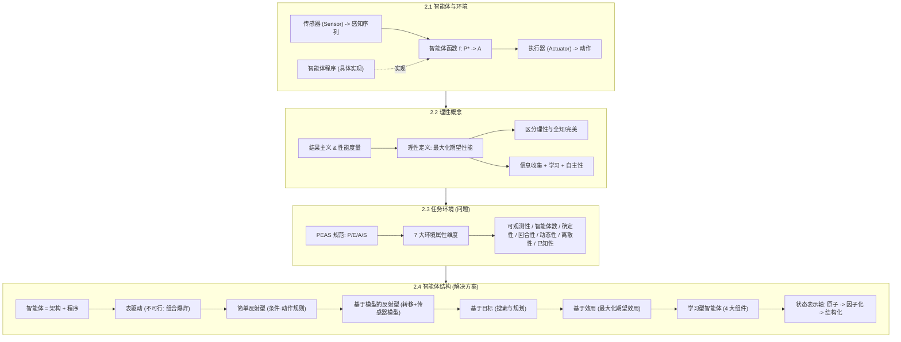

# 第2章 智能体（Intelligent Agents）

## 1. 导读与知识脉络

> [!info] 本章导读
> - **一句话主线**：本章将第 1 章确立的“理性智能体”核心范式形式化——先定义智能体与环境的耦合接口，再通过**性能度量**给出**理性**（最大化期望性能，而非全知或完美）的严格刻画，接着用 **PEAS 框架**与 **7 大环境维度**系统分类“问题（任务环境）”，最后逐层构建从**表驱动**、**简单反射**、**基于模型**、**基于目标**、**基于效用**到**学习型智能体**的内部程序架构，并用**原子 / 因子化 / 结构化**与**局部 / 分布式**两条表示轴串联起全书后续 25 章的技术版图。
> - **页码映射**：拆分 PDF `p.1–21` ｜ 教材印刷页 `p.32–52` ｜ 原书完整 PDF `p.67–87`（不含部分扉页，拆分 p.1 即印刷 p.32）。
> - **前置知识**：[[Ch01_绪论]]（人工智能的四大定义流派、理性智能体定位、迈达斯国王问题与维纳警告）。
> - **后续延伸**：[[Ch03_通过搜索进行问题求解]]（基于目标的搜索）、[[Ch04_复杂环境中的搜索]]（部分可观测与不可观测环境）、[[Ch16_制定简单决策]]（期望效用理论与信息价值）、[[Ch19_从样例中学习]]（学习型智能体算法）。



---

## 2. 核心术语速查

> [!abstract]- 点击展开：本章全量蓝色粗体核心术语表（共 54 项）
> | 所属板块 | 中文术语 | 英文原名 | 教材核心要义 | 教材页码 |
> | :--- | :--- | :--- | :--- | :--- |
> | 2.1 | 传感器 | sensor | 智能体用来感知外部环境的输入器官或器件 | 印刷 p.32 / 拆分 p.1 |
> | 2.1 | 环境 | environment | 与智能体交互的外部世界（实际仅关注影响感知与受动作影响的部分） | 印刷 p.32 / 拆分 p.1 |
> | 2.1 | 执行器 | actuator | 智能体用来作用于环境的输出器官或器件 | 印刷 p.32 / 拆分 p.1 |
> | 2.1 | 智能体 | agent | 任何通过传感器感知环境并通过执行器作用于该环境的事物 | 印刷 p.32 / 拆分 p.1 |
> | 2.1 | 感知 | percept | 智能体的传感器在当前时刻正在感知的内容 | 印刷 p.33 / 拆分 p.2 |
> | 2.1 | 感知序列 | percept sequence | 智能体迄今为止所感知到的一切的完整历史 | 印刷 p.33 / 拆分 p.2 |
> | 2.1 | 智能体函数 | agent function | 将任意给定感知序列映射到动作的抽象数学描述 | 印刷 p.33 / 拆分 p.2 |
> | 2.1 | 智能体程序 | agent program | 在物理系统中运行、用于实现智能体函数的具体程序 | 印刷 p.33, 41 / 拆分 p.2, 10 |
> | 2.2 | 理性智能体 | rational agent | 给定感知序列证据与先验知识，选择期望最大化性能度量动作的智能体 | 印刷 p.34–35 / 拆分 p.3–4 |
> | 2.2.1 | 结果主义 | consequentialism | 通过行为所导致的环境状态结果序列来评估智能体行为的哲学立场 | 印刷 p.34 / 拆分 p.3 |
> | 2.2.1 | 性能度量 | performance measure | 评估任意给定环境状态序列可取性的客观标准 | 印刷 p.34 / 拆分 p.3 |
> | 2.2.2 | 探索 | explore / exploration | 在环境未知时采取行动以收集信息、了解环境的行为 | 印刷 p.35–36 / 拆分 p.4–5 |
> | 2.2.3 | 全知 | omniscience | 能够预知行动实际结果并据此决策（现实中不可能） | 印刷 p.36 / 拆分 p.5 |
> | 2.2.3 | 信息收集 | information gathering | 采取行动以改变未来感知的过程，是理性的重要组成部分 | 印刷 p.36 / 拆分 p.5 |
> | 2.2.3 | 学习 | learn | 从自身感知经验中修改和增强先验知识的过程 | 印刷 p.36 / 拆分 p.5 |
> | 2.2.3 | 自主性 | autonomy | 智能体依赖自身感知与学习（而非仅靠设计者先验知识）来决策的程度 | 印刷 p.36 / 拆分 p.5 |
> | 2.3 | 任务环境 | task environment | 理性智能体所面临的“问题”，由 PEAS 四要素定义 | 印刷 p.37 / 拆分 p.6 |
> | 2.3.1 | PEAS 描述 | Performance, Environment, Actuator, Sensor | 指定任务环境四个维度的首字母缩写规范 | 印刷 p.37 / 拆分 p.6 |
> | 2.3.1 | 软件智能体 / 软机器人 | software agent / softbot | 运行在虚拟任务环境（如网站、文件系统、网络）中的软件智能体 | 印刷 p.38 / 拆分 p.7 |
> | 2.3.2 | 完全可观测的 | fully observable | 传感器在每个时间点都能访问与动作选择相关的完整环境状态 | 印刷 p.38 / 拆分 p.7 |
> | 2.3.2 | 部分可观测的 | partially observable | 传感器存在噪声、不准确或缺失部分状态信息 | 印刷 p.38 / 拆分 p.7 |
> | 2.3.2 | 不可观测的 | unobservable | 智能体完全没有传感器，但某些目标仍可能实现 | 印刷 p.38 / 拆分 p.7 |
> | 2.3.2 | 单智能体的 | single-agent | 环境中仅有一个优化性能度量的智能体 | 印刷 p.38 / 拆分 p.7 |
> | 2.3.2 | 多智能体的 | multiagent | 环境中存在多个其性能度量相互依赖的智能体 | 印刷 p.38 / 拆分 p.7 |
> | 2.3.2 | 竞争性 | competitive | 对手最大化其性能度量会导致自身性能度量最小化（如国际象棋） | 印刷 p.39 / 拆分 p.8 |
> | 2.3.2 | 合作的 | cooperative | 共同行为使所有智能体的性能度量最大化（如避免碰撞） | 印刷 p.39 / 拆分 p.8 |
> | 2.3.2 | 确定性的 | deterministic | 下一状态完全由当前状态和智能体执行的动作决定 | 印刷 p.39 / 拆分 p.8 |
> | 2.3.2 | 非确定性的 | nondeterministic | 下一状态不能完全由当前状态与动作决定（未显式量化概率） | 印刷 p.39 / 拆分 p.8 |
> | 2.3.2 | 随机的 | stochastic | 环境模型显式使用概率量化不确定性（如降雨概率 25%） | 印刷 p.39 / 拆分 p.8 |
> | 2.3.2 | 回合式的 | episodic | 经验划分为原子回合，下一回合不依赖前几回合的动作 | 印刷 p.39 / 拆分 p.8 |
> | 2.3.2 | 序贯的 | sequential | 当前决策会影响未来所有决策，短期行为有长期影响 | 印刷 p.39 / 拆分 p.8 |
> | 2.3.2 | 静态的 | static | 智能体思考期间环境不会发生变化 | 印刷 p.39 / 拆分 p.8 |
> | 2.3.2 | 动态的 | dynamic | 智能体思考期间环境持续变化，不决策等同于“什么都不做” | 印刷 p.39 / 拆分 p.8 |
> | 2.3.2 | 半动态的 | semidynamic | 环境本身不变，但智能体的性能分数随时间推移而改变（如限时棋） | 印刷 p.39 / 拆分 p.8 |
> | 2.3.2 | 离散的 | discrete | 环境状态、时间处理方式或感知/动作集合是有限或可数离散的 | 印刷 p.39 / 拆分 p.8 |
> | 2.3.2 | 连续的 | continuous | 状态、时间或动作（如速度、位置、转向角）在连续区间内平滑变化 | 印刷 p.39 / 拆分 p.8 |
> | 2.3.2 | 已知的 | known | 智能体（或设计者）已知环境“物理定律”及各动作的结果（或概率） | 印刷 p.40 / 拆分 p.9 |
> | 2.3.2 | 未知的 | unknown | 智能体不知环境运转规律，必须通过交互学习才能正确决策 | 印刷 p.40 / 拆分 p.9 |
> | 2.3.2 | 环境类 | environment class | 用于评估智能体平均性能的一组抽象环境实例集合 | 印刷 p.40 / 拆分 p.9 |
> | 2.4 | 智能体架构 | agent architecture | 运行智能体程序的物理计算设备（含传感器与执行器） | 印刷 p.41 / 拆分 p.10 |
> | 2.4.2 | 简单反射型智能体 | simple reflex agent | 仅依据当前感知（忽略感知历史）通过条件-动作规则选择动作 | 印刷 p.42 / 拆分 p.11 |
> | 2.4.2 | 条件-动作规则 | condition-action rule | 从当前状态条件直接映射到动作的联结（if-then / 产生式规则） | 印刷 p.43 / 拆分 p.12 |
> | 2.4.2 | 随机化 | randomize | 通过随机选择动作打破部分可观测环境下简单反射智能体的无限循环 | 印刷 p.44 / 拆分 p.13 |
> | 2.4.3 | 内部状态 | internal state | 依赖感知历史维护的数据结构，用以追踪当前未观测到的世界状态 | 印刷 p.44 / 拆分 p.13 |
> | 2.4.3 | 转移模型 | transition model | 关于“世界如何运转”的知识（动作影响 + 世界独立演变） | 印刷 p.44 / 拆分 p.13 |
> | 2.4.3 | 传感器模型 | sensor model | 关于当前世界状态如何反映在智能体感知中的知识 | 印刷 p.44 / 拆分 p.13 |
> | 2.4.3 | 基于模型的智能体 | model-based agent | 结合转移模型与传感器模型追踪部分可观测世界状态的智能体 | 印刷 p.44 / 拆分 p.13 |
> | 2.4.4 | 目标 | goal | 描述理想世界情况的显式信息，用于指导搜索与规划 | 印刷 p.45 / 拆分 p.14 |
> | 2.4.5 | 效用 | utility | 衡量智能体对不同世界状态“快乐/可取”程度的数值指标 | 印刷 p.46 / 拆分 p.15 |
> | 2.4.5 | 效用函数 | utility function | 外部性能度量的内部化映射，为各状态（或状态序列）打分 | 印刷 p.46 / 拆分 p.15 |
> | 2.4.5 | 期望效用 | expected utility | 按各可能结果状态的概率加权计算得到的平均效用 | 印刷 p.47 / 拆分 p.16 |
> | 2.4.5 | 无模型的智能体 | model-free agent | 直接学习特定情境下的最优动作，而无需显式了解环境转移模型 | 印刷 p.47 / 拆分 p.16 |
> | 2.4.6 | 学习元素 | learning element | 负责根据评估者反馈修改性能元素以提升未来表现的组件 | 印刷 p.48 / 拆分 p.17 |
> | 2.4.6 | 性能元素 | performance element | 接受感知并决定外部动作的组件（即前述完整智能体程序） | 印刷 p.48 / 拆分 p.17 |
> | 2.4.6 | 评估者 | critic | 依据外部固定性能标准评估智能体表现并向学习元素提供反馈 | 印刷 p.48 / 拆分 p.17 |
> | 2.4.6 | 问题生成器 | problem generator | 主动建议探索性动作以获取全新且富含信息的经验的组件 | 印刷 p.48 / 拆分 p.17 |
> | 2.4.6 | 奖励 / 惩罚 | reward / penalty | 外部性能标准将传入感知的一部分区分出的直接正/负质量反馈 | 印刷 p.49 / 拆分 p.18 |
> | 2.4.7 | 原子表示 | atomic representation | 将每个世界状态视为不可分割、无内部结构的“黑盒” | 印刷 p.49 / 拆分 p.18 |
> | 2.4.7 | 因子化表示 | factored representation | 将每个状态拆分为一组固定的属性/变量及其取值的向量 | 印刷 p.49 / 拆分 p.18 |
> | 2.4.7 | 结构化表示 | structured representation | 状态由对象、对象自身属性以及对象间的各种关系构成 | 印刷 p.50 / 拆分 p.19 |
> | 2.4.7 | 表达性 | expressiveness | 表示语言以简洁形式捕捉复杂世界规律的能力维度 | 印刷 p.50 / 拆分 p.19 |
> | 2.4.7 | 局部表示 | localist representation | 概念与物理记忆位置之间存在一对一映射的表示方式 | 印刷 p.50 / 拆分 p.19 |
> | 2.4.7 | 分布式表示 | distributed representation | 单个概念分布于多个记忆位置且记忆位置被多概念共享（抗噪更强） | 印刷 p.50 / 拆分 p.19 |

---

## 3. 逐节深度精讲

### 3.1 智能体和环境（2.1 节，印刷 p.32–34 / 拆分 p.1–3）

#### 核心定义与耦合模型
> [!note] 智能体定义（第 2 章 2.1 节，印刷 p.32 / 拆分 p.1）
> 任何通过**传感器（sensor）**感知**环境（environment）**并通过**执行器（actuator）**作用于该环境的事物都可以被视为**智能体（agent）**。

三类典型智能体的传感器与执行器对比（图 2-1，印刷 p.32 / 拆分 p.1）：
- **人类智能体**：传感器为眼睛、耳朵等器官；执行器为手、腿、声道等。
- **机器人智能体**：传感器为摄像头、红外测距仪等；执行器为各类电动机。
- **软件智能体**：传感器接收文件内容、网络数据包、人工输入（键盘/鼠标/触摸屏/语音）；执行器为写入文件、发送网络数据包、显示信息或生成声音。

#### 智能体函数 vs. 智能体程序（关键区分）
- **感知（percept）** $p_t \in \mathcal{P}$：传感器在 $t$ 时刻正在感知的内容。
- **感知序列（percept sequence）** $P^* = [p_1, p_2, \dots, p_t] \in \mathcal{P}^*$：智能体迄今为止所感知的一切的完整历史。智能体的动作选择**只能**依赖于其内置知识和迄今为止的感知序列，而不能依赖于未感知到的事物。
- **智能体函数（agent function）**：抽象的数学描述，是智能体的**外部特征**，形式化表示为：

$$
f: \mathcal{P}^* \rightarrow \mathcal{A}
$$

- **智能体程序（agent program）**：具体的物理/软件实现，是智能体的**内部实现**，运行在特定物理架构上以实现 $f$。==区别外部数学映射（智能体函数）与内部可执行实现（智能体程序）是本章乃至全书的基石。==

> [!note] 教材脚注要点（印刷 p.33 / 拆分 p.2）
> - **脚注 ①（随机化）**：若智能体选择动作时使用随机化，构建外部行为表时需对每个感知序列多次试验以确定动作概率分布；后文将证明随机行动在特定场景下非常聪明。
> - **脚注 ②（动作抽象）**：真实机器人不会有“向右/向左移动”的原子动作，而是“向前/向后旋转轮子”；教材采用高层抽象以方便理论分析。

#### 经典玩具世界：双格真空吸尘器世界（图 2-2 & 图 2-3，印刷 p.33–34 / 拆分 p.2–3）
- **环境**：方格 `A` 与方格 `B`，每格状态为 `Clean` 或 `Dirty`。
- **感知**：`[location, status]`，共 $2 \times 2 = 4$ 种单步感知。
- **动作**：`Left`、`Right`、`Suck`、`NoOp`（什么都不做）。
- **简单智能体函数（图 2-3）**：若当前方格为 `Dirty` 则 `Suck`；否则移动到另一方格（`[A, Clean] -> Right`，`[B, Clean] -> Left`）。只要不限制感知序列长度，该表大小即为**无限**。

> [!note] 方法论澄清（印刷 p.33 / 拆分 p.2）
> “智能体”是**分析系统的工具**，而非将世界绝对划分为“智能体 vs 非智能体”的本体论标签。手持计算器也可视为智能体（输入 `"2+2="` 输出 `"4"`），但这种分析没有价值；AI 关注的是**计算资源重要、任务环境需要非凡决策**的那一端。

---

### 3.2 良好行为：理性的概念（2.2 节，印刷 p.34–37 / 拆分 p.3–6）

本节围绕“什么是做正确的事情”展开，分三个递进子节：

| 子节 | 核心问题 | 关键结论 |
| :--- | :--- | :--- |
| **2.2.1 性能度量** | 如何评价“正确”？ | 坚持**结果主义**，用环境状态序列的客观可取性打分；警惕**目标设定偏差（迈达斯国王问题）**。 |
| **2.2.2 理性** | 理性取决于哪 4 要素？ | 性能度量、先验知识、可执行动作、迄今感知序列；==理性 = 最大化期望性能==。 |
| **2.2.3 全知、学习和自主** | 理性是否等于完美？ | 理性 $\neq$ 全知/完美；理性必然要求**信息收集（探索）**、**学习**与**自主性**。 |

#### 3.2.1 性能度量（2.2.1 节，印刷 p.34–35 / 拆分 p.3–4）
- **结果主义（consequentialism）**：通过动作序列所引发的**环境状态序列**来评估智能体行为，而非评估动作本身。
- **设计黄金法则**：==应当根据我们在环境中真正想要实现的目标来设计性能度量，而不是根据我们认为智能体“应该如何表现”来设计。==（印刷 p.34–35 / 拆分 p.3–4）
- **反例（激励错位）**：若按“8 小时内清理的灰尘总量”打分，理性智能体会将灰尘吸起再倒回地板反复清理以刷分。更合理的度量是“每个时间步，每个干净方格得 1 分（可叠加耗电与噪音惩罚）”。
- **深层哲学与对齐难题**：即使避免低级漏洞，平均整洁度相同但“平稳工作 vs 短时高效+长休”的权衡仍具哲学深度（类似经济学中均值与方差/公平性的权衡）。联系第 1 章 1.5 节诺伯特·维纳警告与**迈达斯国王问题（King Midas problem）**，当难以精确指定真实性能度量或面对不同用户偏好时，智能体需对真实目标保持初始不确定性并在交互中学习（见第 16、18、22 章）。

#### 3.2.2 理性（2.2.2 节，印刷 p.35 / 拆分 p.4）
任何时刻的理性取决于 **4 个方面**：
1. 定义成功标准的**性能度量**；
2. 智能体对环境的**先验知识**；
3. 智能体可以执行的**动作**；
4. 智能体到目前为止的**感知序列**。

> [!quote] 理性智能体的正式定义（第 2 章 2.2.2 节，印刷 p.35 / 拆分 p.4）
> 对于每个可能的感知序列，给定感知序列提供的证据和智能体所拥有的任何先验知识，理性智能体应该选择一个期望最大化其性能度量的动作。

**案例检验：图 2-3 的真空吸尘器是理性的吗？**
- **在特定假设下是理性的**：生命周期 $T=1000$ 步、每步每干净格 +1 分、地理结构先验已知、干净格不会再变脏、动作仅限 `{Left, Right, Suck}` 且无动作代价、感知完全准确——此时其期望性能不低于任何其他智能体。
- **假设一旦改变即变为不理性**：
  - 若每个动作罚 1 分 $\implies$ 清扫完毕后反复左右移动会严重扣分，理性策略应是停机（`NoOp`）；
  - 若干净方格可能再次变脏 $\implies$ 应偶尔巡检并在必要时重新清理；
  - 若地理信息未知 $\implies$ 必须先**探索（explore）**环境（参见 `习题 2.VACR`）。

#### 3.2.3 全知、学习和自主（2.2.3 节，印刷 p.36–37 / 拆分 p.5–6）
- **理性 $\neq$ 全知（omniscience）$\neq$ 完美（perfection）**：
  - **香榭丽舍大街过马路思想实验**：路况安全时过马路是理性的，即使万米高空客机货舱门意外脱落（脚注 ① 引用 1989 年《华盛顿邮报》波音 747 货舱门新闻）导致不幸，该决策依然理性。
  - ==理性最大化的是**期望性能**，而完美最大化的是**实际性能**。== 完美需要水晶球或时间机器，在工程上不可实现。
- **信息收集（information gathering）与探索（exploration）**：理性不等于盲目行动。不看路况直接过马路是不理性的，理性智能体会主动选择“观察”动作以改变未来感知，从而最大化期望性能（第 16 章将用“信息价值”严格量化）。
- **学习（learning）与自主性（autonomy）**：
  - 仅靠设计者写死的先验知识会极其脆弱：教材列举了**粪甲虫**（粪球被截走仍照常做堵洞动作）和**掘土黄蜂**（毛毛虫被移开几厘米就陷入无限重复拖回—检查洞穴的死循环）两个动物行为学反例。
  - **工程折中**：现实中很少要求智能体从零开始完全自主（否则初期只能随机乱撞），而是像生物进化赋予先天反射一样，赋予智能体**合理的初始先验知识 + 学习能力**，使其在充分交互后行为有效独立于先验知识。

---

### 3.3 环境的本质（2.3 节，印刷 p.37–41 / 拆分 p.6–10）

> [!note] 问题与解的对应（印刷 p.37 / 拆分 p.6）
> **任务环境（task environment）**本质上是“问题”，**理性智能体**是“解决方案”。设计智能体的第一步必须始终是尽可能完整地指定任务环境。

#### 3.3.1 指定任务环境：PEAS 描述（2.3.1 节，印刷 p.37–38 / 拆分 p.6–7）
PEAS 代表 **Performance（性能度量）、Environment（环境）、Actuator（执行器）、Sensor（传感器）**。

**核心案例：自动驾驶出租车司机（图 2-4，印刷 p.37 / 拆分 p.6）**
- **P（性能度量）**：安全、速度快、合法、舒适旅程、最大化利润、对其他道路用户的影响最小化（注意：多目标之间存在冲突，需权衡）。
- **E（环境）**：道路（乡村车道至 12 车道高速）、其他交通工具、警察、行人、流浪动物、道路工程、水坑/坑洼、客户、天气（如南加州 vs 阿拉斯加；左舵靠右 vs 英日靠左）。==环境越受限，设计问题越容易解决。==
- **A（执行器）**：转向器、加速器、制动、信号灯、喇叭、显示屏、语音合成器。
- **S（传感器）**：摄像头、雷达/激光雷达、超声波传感器、速度表、GPS、发动机/燃油/电气传感器、加速度表、麦克风、触摸屏。

**其他 5 类典型智能体的 PEAS 速览（图 2-5，印刷 p.38 / 拆分 p.7）**：
- **医学诊断系统**：P=治愈患者、降低费用；E=患者、医院、工作人员；A=问题/测试/诊断/治疗显示器；S=症状与检验结果的触摸屏/语音输入。
- **卫星图像分析系统**：P=正确分类对象和地形；E=轨道卫星、下行链路、天气；A=场景分类显示器；S=高分辨率数字照相机。
- **零件选取机器人**：P=零件在正确箱中的比例；E=零件输送带、箱子；A=有关节的手臂和手；S=摄像头、触觉和关节角度传感器。
- **提炼厂控制器**：P=纯度、产量、安全；E=提炼厂、原料、操作员；A=阀门、泵、加热器、搅拌器、显示器；S=温度、气压、流量、化学传感器。
- **交互英语教师**：P=学生的考试分数；E=一组学生、考试机构；A=练习、反馈、发言显示器；S=键盘输入、语音。
- **虚拟环境与软机器人（softbot）**：虚拟环境可与物理世界一样复杂，例如拍卖与转售网站上的交易软件智能体。

#### 3.3.2 任务环境的 7 大属性维度（2.3.2 节，印刷 p.38–41 / 拆分 p.7–10）

| 维度 | 分类取值 | 判别核心与设计影响 |
| :--- | :--- | :--- |
| **1. 可观测性** | 完全可观测 / 部分可观测 / 不可观测 | 传感器能否在每时刻获取与决策相关的全部状态。完全可观测无需维护内部状态；部分可观测需世界模型；不可观测（无传感器）仍可能实现确定目标（见第 4 章）。 |
| **2. 智能体数量** | 单智能体 / 多智能体（竞争性 / 合作性） | 判别对象 B 是否为智能体：==看 B 的行为是否最佳地描述为最大化某个依赖于 A 行为的性能度量==。多智能体中**通信**与**随机策略**（防被预测）常成为理性行为。 |
| **3. 确定性** | 确定性 / 非确定性（含随机性） | 下一状态是否完全由当前状态与动作决定。AIMA 严格区分：**随机的（stochastic）**显式量化概率（如“降雨概率 25%”），**非确定性的（nondeterministic）**不量化概率（如“明天可能下雨”）。 |
| **4. 回合性** | 回合式 / 序贯 | 回合式（如流水线质检）各回合独立，无需提前规划；序贯（如棋类、驾驶）短期动作有长期后果（脚注 ① 提醒：此处 sequential 与并行计算中的“串行”含义不同）。 |
| **5. 动态性** | 静态 / 半动态 / 动态 | 智能体思考期间环境是否变化。若环境本身不变但性能分数随时间衰减（如限时国际象棋），称为**半动态（semidynamic）**。 |
| **6. 离散性** | 离散 / 连续 | 适用于状态空间、时间处理、感知与动作。数字相机输入严格来说离散，但通常视作表示连续变化的强度与位置。 |
| **7. 已知性** | 已知 / 未知 | 严格来说并非环境本身属性，而是**智能体对环境物理定律（或性能度量）的认知状态**。与可观测性正交：纸牌游戏“已知但部分可观测”，陌生电子游戏“未知但完全可观测”。 |

**图 2-6 任务环境特征矩阵（印刷 p.40 / 拆分 p.9）**：
- **最简单端**：填字游戏（完全、单、确定、序贯、静态、离散）。
- **最困难端**：部分可观测 + 多智能体 + 非确定性 + 序贯 + 动态 + 连续 + 未知（如在陌生国家开租来的车）。
- **属性的情境依赖性**：同一任务随建模粒度变化，如医疗诊断通常列为单智能体，但若考虑顽固病人与多疑同事则具多智能体特征；按症状单次诊断为回合式，连续开化验单与追踪疗效则为序贯。
- **环境类（environment class）评估**：实验不应只在单一环境实例中评测，而应在从环境类采样的多组条件（如不同交通/天气/光照）上评估**平均性能**。

---

### 3.4 智能体的结构（2.4 节，印刷 p.41–50 / 拆分 p.10–19）

$$
\text{智能体} = \text{架构} + \text{程序}
$$

- **架构（architecture）**提供物理传感器、执行器与计算底座（如普通 PC 或多传感器机器人汽车），并将感知送入程序、将程序返回的动作交给执行器；**程序（program）**必须适配架构（“若程序打算推荐步行，架构最好有腿”）。

#### 3.4.1 智能体程序与表驱动法的失败（2.4.1 节，印刷 p.41–42 / 拆分 p.10–11）
- **统一接口**：智能体程序每次仅接收**当前感知 `percept`**（而非整个感知序列），并返回一个动作。若决策需依赖历史，程序必须自行在内部记忆（脚注 ① 指出也可设计为与环境异步运行的协程）。

**伪代码：表驱动智能体（图 2-7，印刷 p.41 / 拆分 p.10）**
```text
function TABLE-DRIVEN-AGENT(percept) returns 一个动作
    persistent: percepts，初始为空的序列
                table，以感知序列为索引的动作表，初始为完全确定

    将 percept 添加到 percepts 的末尾
    action ← LOOKUP(percepts, table)
    return action
```

**组合爆炸定理（印刷 p.41–42 / 拆分 p.10–11）**：
设 $\mathcal{P}$ 为可能的感知集合，$T$ 为智能体生存期（接收的感知总数），则查找表包含的记录总数为：

$$
N_{\text{table}} = \sum_{t=1}^{T} |\mathcal{P}|^t
$$

> [!abstract]- 详细数学推导（模型补充）：自动驾驶与国际象棋查找表规模估算
> 1. **等比数列求和闭式**：当 $|\mathcal{P}| > 1$ 时，
>
> $$
> \sum_{t=1}^{T} |\mathcal{P}|^t = \frac{|\mathcal{P}|(|\mathcal{P}|^T - 1)}{|\mathcal{P}| - 1} \approx |\mathcal{P}|^T
> $$
>
> 2. **自动驾驶出租车单摄像头估算（印刷 p.41–42）**：
>    - 单帧像素数：$1080 \times 720 = 777{,}600$ 像素，每像素 $24$ 位（$3$ 字节），单帧约 $2.33\text{ MB}$；
>    - 每秒 $30$ 帧 $\implies$ 视觉输入速度约 $30 \times 2.33 \approx 70\text{ MB/s}$；
>    - 驾驶 $1$ 小时（$3600\text{ s}$），总比特数约为 $70 \times 10^6 \times 8 \times 3600 \approx 2.016 \times 10^{12}\text{ bits}$；
>    - 以 $10$ 为底换算：$2^{2.016 \times 10^{12}} = 10^{2.016 \times 10^{12} \times \log_{10} 2} \approx 10^{6.07 \times 10^{11}} > 10^{600{,}000{,}000{,}000}$（即教材所给下界 $10^{600\,000\,000\,000}$ 条记录）。
> 3. **国际象棋对比**：查找表至少 $10^{150}$ 条记录，而可观测宇宙原子总数少于 $10^{80}$ 个。
> 4. **三大不可能**：(a) 宇宙无足够物理空间存储；(b) 设计者无时间填表；(c) 任何智能体无法从经验中学会所有表项。

> [!quote] 人工智能的核心挑战（第 2 章 2.4.1 节，印刷 p.42 / 拆分 p.11）
> 人工智能面临的关键挑战是找出编写程序的方法，尽可能从一个小程序而不是从一个大表中产生理性行为。

教材以**平方根表 $\to$ 5 行牛顿迭代法**的历史类比说明：AI 的核心正是用紧凑的算法程序替代天文数字般的查表。

---

#### 3.4.2 简单反射型智能体（2.4.2 节，印刷 p.42–44 / 拆分 p.11–13）
- **核心机制**：仅依据**当前感知**选择动作，完全忽略历史感知；通过**条件-动作规则（condition-action rule / if-then 规则 / 产生式系统）**实现。
- **真空吸尘器特例（图 2-8，印刷 p.42 / 拆分 p.11）**：忽略历史使相关感知序列规模从 $4^T$ 骤降至 $4$，可低至布尔电路实现。（注：中文版印刷 p.42 图 2-8 标题处将 `AGENT` 误印为 `AGENET`，实际应为 `REFLEX-VACUUM-AGENT`。）

```text
function REFLEX-VACUUM-AGENT([location, status]) returns 一个动作
    if status = Dirty then return Suck
    else if location = A then return Right
    else if location = B then return Left
```

**通用简单反射型智能体（图 2-9 & 图 2-10，印刷 p.43 / 拆分 p.12）**：
```text
function SIMPLE-REFLEX-AGENT(percept) returns 一个动作
    persistent: rules，一组条件-动作规则

    state ← INTERPRET-INPUT(percept)
    rule ← RULE-MATCH(state, rules)
    action ← rule.ACTION
    return action
```
- **结构解读（图 2-9）**：矩形表示决策过程中的当前内部状态（“现在的世界是什么样子”、“我现在应该采取什么动作”），椭圆表示背景信息（“条件-动作规则”）。实际实现可以是布尔逻辑门，也可以是神经网络中的非线性单元（第 21 章）。
- **致命局限**：==仅在环境完全可观测时才可靠。== 哪怕轻微的不可观测性（例如老款车型刹车灯与尾灯配置不同，单帧无法区分刹车与开尾灯；或无位置传感器的吸尘器只能感知 `[Dirty]` / `[Clean]`），确定性简单反射型智能体都会陷入**无限循环**。
- **随机化补救**：无位置传感器的吸尘器在感知 `[Clean]` 时抛硬币决定 `Left` 或 `Right`，可跳出死循环。

> [!abstract]- 详细数学推导（模型补充）：随机化吸尘器平均 2 步到达另一方格（印刷 p.44 / 拆分 p.13）
> 设智能体处于方格 A（向左移动原地不动，向右移动以概率 $p = 1/2$ 到达方格 B）。到达方格 B 所需的移动步数 $X$ 服从参数为 $p = 1/2$ 的几何分布：
>
> $$
> P(X = k) = (1 - p)^{k-1} p = \left(\frac{1}{2}\right)^k, \quad k = 1, 2, 3, \dots
> $$
>
> 其数学期望为：
>
> $$
> \mathbb{E}[X] = \sum_{k=1}^{\infty} k \left(\frac{1}{2}\right)^k = \frac{1}{p} = 2
> $$
>
> 因此智能体平均只需 **2 步** 即可抵达另一方格。注意：在单智能体环境中随机化通常只是帮助简单反射型智能体的权宜技巧，使用更复杂的确定性（带内部状态）智能体通常表现更优；而在某些竞争性多智能体环境中，随机化本身就是理性的。

---

#### 3.4.3 基于模型的反射型智能体（2.4.3 节，印刷 p.44–45 / 拆分 p.13–14）
- **核心机制**：为应对**部分可观测性**，维护依赖感知历史的**内部状态（internal state）**，追踪当前观测不到的世界信息（如刹车灯前后帧变化、盲区车辆位置、车钥匙位置）。
- **两类必备内部模型**：
  1. **转移模型（transition model）**：描述“世界如何运转”，包含两部分——智能体动作造成的影响（“我的动作做了什么”，如顺时针打方向盘车右转）与世界独立于智能体的演变（“世界如何演变”，如下雨淋湿摄像头）。
  2. **传感器模型（sensor model）**：描述当前世界状态如何反映到传感器感知中（如前车刹车时摄像头图像出现红色亮区、水滴遮挡视野）。
- **结构与伪代码（图 2-11 & 图 2-12，印刷 p.45 / 拆分 p.14）**：

```text
function MODEL-BASED-REFLEX-AGENT(percept) returns 一个动作
    persistent: state，智能体对世界状态的当前理解
                transition_model，关于下一个状态如何决定于当前状态和动作的描述
                sensor_model，关于当前世界状态如何反映到智能体感知的描述
                rules，一组条件-动作规则
                action，最近的动作，初始为空

    state ← UPDATE-STATE(state, action, percept, transition_model, sensor_model)
    rule ← RULE-MATCH(state, rules)
    action ← rule.ACTION
    return action
```
- **不确定性的必然性**：在部分可观测环境下，“现在的世界是什么样子”框通常只能给出智能体的**最佳猜测（best guess）**（例如被大卡车挡住视线时猜测拥堵原因），智能体仍需在此不确定性下做出决策。

---

#### 3.4.4 基于目标的智能体（2.4.4 节，印刷 p.45–46 / 拆分 p.14–15）
- **动机**：仅知道当前状态不足以决策（例如出租车在路口向左、向右还是直行，取决于目的地）。
- **核心机制（图 2-13，印刷 p.46 / 拆分 p.15）**：结合世界模型与显式的**目标（goal）**信息，通过回答 **“如果我采取动作 A 会发生什么？”** 与 **“这会让我达成目标吗？”** 来选择动作序列。
- **核心技术**：**搜索（第 3–5 章）**与**规划（第 11 章）**专门用于寻找实现目标的动作序列。
- **效率 vs. 灵活性**：虽然基于目标的智能体计算开销高于反射型智能体，但它**高度灵活**——因为决策知识是显式表示的。更换目的地只需修改目标，而反射型智能体必须重写整套转向规则。

---

#### 3.4.5 基于效用的智能体（2.4.5 节，印刷 p.46–47 / 拆分 p.15–16）
- **动机**：目标仅在“快乐（达成）”与“不快乐（未达成）”之间做粗略的**二元区分**，无法比较同样能到达目的地的路线谁更快、更安全、更省油。
- **核心机制（图 2-14，印刷 p.47 / 拆分 p.16）**：引入**效用函数（utility function）**作为外部性能度量的内部化表示。当内部效用函数与外部性能度量一致时，最大化期望效用的智能体必然是理性的。
- **目标不足但效用胜任的两大场景（印刷 p.46 / 拆分 p.15）**：
  1. **目标相互冲突**：如“速度”与“安全”不可兼得，效用函数提供定量权衡；
  2. **多目标且均具不确定性**：效用函数同时权衡各目标的**重要性**与**成功概率**。
- **最大化期望效用（MEU）**：

$$
a^* = \arg\max_{a \in \mathcal{A}} \sum_{s'} P(s' \mid s, a) \, U(s')
$$

- **理论意义与现实局限**：第 16 章证明任何理性智能体的行为都等价于拥有一个效用函数并最大化其期望值——这将理性的“全局定义”转化为可由通用算法执行的“局部约束”。但受限于建模难度与计算复杂性，**完美理性**在实践中通常不可实现；此外，并非所有基于效用的智能体都基于模型，**无模型的智能体（model-free agent）**（第 22、26 章）可直接学习各情境下的最优动作。

---

#### 3.4.6 学习型智能体（2.4.6 节，印刷 p.47–49 / 拆分 p.16–18）
受图灵（1950）“构造学习型机器并教导它们”的启发，任何类型的智能体都可以升级为学习型智能体，由 **4 个概念组件**构成（图 2-15，印刷 p.48 / 拆分 p.17）：

1. **性能元素（performance element）**：即前述完整智能体程序，负责接收感知并选择外部动作。==设计学习型智能体时的第一个问题不是“如何让它学习”，而是“一旦学会，它将使用什么样的性能元素”。==
2. **学习元素（learning element）**：依据评估者反馈修改性能元素中的任意“知识”组件（转移模型、传感器模型、规则、效用函数等）以提升未来性能。
3. **评估者（critic）**：对照**外部固定的性能标准**评价智能体表现并向学习元素提供反馈。性能标准必须在概念上独立于智能体之外（防止智能体篡改标准来“自我满足”）；性能标准可将部分感知区分为**奖励（reward）**或**惩罚（penalty）**（如乘客不给小费、行人捂耳朵）。
4. **问题生成器（problem generator）**：主动建议探索性动作（短期可能次优，但能获取新信息以在长期发现更优策略，教材以**伽利略比萨斜塔实验**类比）。

---

#### 3.4.7 智能体程序的组件如何工作：两条状态表示轴（2.4.7 节，印刷 p.49–50 / 拆分 p.18–19）

**第一条轴：表达性（expressiveness）递增轴（图 2-16，印刷 p.50 / 拆分 p.19）**

| 表示层级 | 内部结构 | 直观例子（驾车） | 对应全书核心章节与技术 | 国际象棋规则描述篇幅 |
| :--- | :--- | :--- | :--- | :--- |
| **原子表示（Atomic）** | 状态是不可分割的黑盒，仅能判别相等或不等 | 仅记录当前所在城市名 | 搜索与博弈（Ch03–05）、HMM（Ch14）、MDP（Ch17） | 约 $10^{38}$ 页（有限状态自动机） |
| **因子化表示（Factored）** | 状态由固定属性/变量及取值的向量组成，不同状态可共享部分属性 | 油量、GPS 坐标、油量灯、通行费、电台等向量 | CSP（Ch06）、命题逻辑（Ch07）、规划（Ch11）、贝叶斯网络（Ch12–16）、多数机器学习 | 数千页（命题逻辑） |
| **结构化表示（Structured）** | 状态由对象、对象属性及对象间的各种关系构成 | “卡车正在倒车进奶牛场车道，被一头散养奶牛挡住” | 关系数据库与一阶逻辑（Ch08–10）、一阶概率模型（Ch15）、自然语言理解（Ch23–24） | 约 1–2 页（一阶逻辑） |

> [!note] 表达性与计算复杂性的权衡（印刷 p.50 / 拆分 p.19）
> 表达性越强，描述越简洁，但推理和学习也越复杂；真实世界的智能系统往往需要在该轴的所有层级上同时运行。

**第二条轴：概念到物理记忆的映射轴（印刷 p.50 / 拆分 p.19）**
- **局部表示（localist representation）**：概念与记忆位置一对一映射；对噪声脆弱（几位传输乱码可能把 `Truck` 变成毫无关系的 `Truce`）。
- **分布式表示（distributed representation）**：单个概念分布于多个记忆位置，且每个位置参与多个概念的表示（如同多维向量空间中的点）；对噪声和信息丢失高度健壮，轻微扰动仍落在语义相近区域。

---

#### 3.4.8 可运行 Python 实现：五类智能体架构统一仿真

以下代码完全独立可运行，复现了教材图 2-7（表驱动）、图 2-8（简单反射）、2.4.2 节无位置传感器随机反射（并验证 $\mathbb{E}[X]=2$）、图 2-12（基于模型）以及基于效用与学习型智能体的核心运行机制：

```python
import random
from typing import Dict, List, Optional, Tuple


class TwoSquareVacuumEnv:
    """图 2-2 所示的双格真空吸尘器环境（支持可配置动作代价）。"""

    def __init__(self, dirty_a: bool = True, dirty_b: bool = True, agent_loc: str = "A"):
        self.status: Dict[str, str] = {
            "A": "Dirty" if dirty_a else "Clean",
            "B": "Dirty" if dirty_b else "Clean",
        }
        self.agent_loc: str = agent_loc

    def percept(self, with_location: bool = True) -> Tuple:
        if with_location:
            return (self.agent_loc, self.status[self.agent_loc])
        return (self.status[self.agent_loc],)

    def step(self, action: str, action_cost: int = 0) -> int:
        if action == "Suck":
            self.status[self.agent_loc] = "Clean"
        elif action == "Right":
            self.agent_loc = "B"
        elif action == "Left":
            self.agent_loc = "A"
        elif action == "NoOp":
            pass
        # 性能度量：每时间步每个干净方格 +1 分，减去可选动作代价
        clean_score = sum(1 for s in self.status.values() if s == "Clean")
        cost = action_cost if action != "NoOp" else 0
        return clean_score - cost


class ReflexVacuumAgent:
    """图 2-8：简单反射型智能体（仅依赖当前感知）。"""

    def act(self, percept: Tuple[str, str]) -> str:
        location, status = percept
        if status == "Dirty":
            return "Suck"
        elif location == "A":
            return "Right"
        else:
            return "Left"


class ModelBasedVacuumAgent:
    """图 2-12 思想：基于模型的反射型智能体（追踪两格状态，全干净后停机）。"""

    def __init__(self):
        self.model: Dict[str, Optional[str]] = {"A": None, "B": None}

    def act(self, percept: Tuple[str, str]) -> str:
        location, status = percept
        # UPDATE-STATE：用当前感知更新内部世界模型
        self.model[location] = status
        if self.model["A"] == "Clean" and self.model["B"] == "Clean":
            return "NoOp"
        if status == "Dirty":
            return "Suck"
        return "Right" if location == "A" else "Left"


class RandomizedSensorlessReflexAgent:
    """2.4.2 节（印刷 p.44）：无位置传感器的随机化简单反射智能体。"""

    def __init__(self, rng: random.Random):
        self.rng = rng

    def act(self, percept: Tuple[str]) -> str:
        (status,) = percept
        if status == "Dirty":
            return "Suck"
        return self.rng.choice(["Left", "Right"])


def simulate_comparison(steps: int = 20, action_cost: int = 1) -> None:
    """对比简单反射型与基于模型智能体在“动作罚 1 分”性能度量下的得分。"""
    for name, agent in [
        ("简单反射型智能体 (图 2-8)", ReflexVacuumAgent()),
        ("基于模型的智能体 (图 2-12)", ModelBasedVacuumAgent()),
    ]:
        env = TwoSquareVacuumEnv(dirty_a=True, dirty_b=True, agent_loc="A")
        total_score = 0
        actions: List[str] = []
        for _ in range(steps):
            action = agent.act(env.percept(with_location=True))
            actions.append(action)
            total_score += env.step(action, action_cost=action_cost)
        print(f"{name}: {steps} 步总分 = {total_score}, 前 6 步动作 = {actions[:6]}")


def verify_randomized_expected_steps(trials: int = 20000, seed: int = 42) -> float:
    """蒙特卡洛验证：无位置传感器随机反射智能体从 A 到 B 的平均步数 E[X] = 2。"""
    rng = random.Random(seed)
    agent = RandomizedSensorlessReflexAgent(rng)
    total_steps = 0
    for _ in range(trials):
        env = TwoSquareVacuumEnv(dirty_a=False, dirty_b=True, agent_loc="A")
        steps = 0
        while env.agent_loc != "B":
            action = agent.act(env.percept(with_location=False))
            env.step(action)
            steps += 1
        total_steps += steps
    avg_steps = total_steps / trials
    print(f"随机化吸尘器从 A 到 B 平均步数（{trials} 次试验）: {avg_steps:.4f}（理论值 = 2.0000）")
    return avg_steps


if __name__ == "__main__":
    simulate_comparison(steps=20, action_cost=1)
    verify_randomized_expected_steps()
```

示例输出：
```text
简单反射型智能体 (图 2-8): 20 步总分 = 18, 前 6 步动作 = ['Suck', 'Right', 'Suck', 'Left', 'Right', 'Left']
基于模型的智能体 (图 2-12): 20 步总分 = 35, 前 6 步动作 = ['Suck', 'Right', 'Suck', 'NoOp', 'NoOp', 'NoOp']
随机化吸尘器从 A 到 B 平均步数（20000 次试验）: 1.9902（理论值 = 2.0000）
```

---

### 3.5 小结与参考文献与历史注释（印刷 p.50–52 / 拆分 p.19–21）

- **历史脉络速览**：
  - **实践推理源头**：亚里士多德《尼各马可伦理学》 $\to$ McCarthy (1958) *Programs with Common Sense*；控制理论中的“控制器”与 AI 的“智能体”概念本质相通。
  - **完整智能体范式确立**：早期 AI 聚焦孤立组件（问答、定理证明、视觉），Genesereth & Nilsson (1987) 率先系统论述智能体，Doyle (1983) 预言理性智能体设计将成为 AI 核心任务。
  - **控制论与运筹学交汇**：经典控制（完全可观测确定性）、随机最优控制（部分可观测随机）、混合控制（离散+连续）及动态规划（Puterman, 1994）。
  - **逻辑与目标智能体**：机器人 **Shakey**（Fikes & Nilsson, 1971）是第一个基于目标的逻辑智能体化身；Shoham (1993) 提出面向智能体编程；Newell & Simon (1972) *Human Problem Solving* 主导认知心理学传统；Bratman (1987) 将目标细化为**欲望（desire）**与**意图（intention）**（BDI 理论核心）；操作系统领域的**自主计算（autonomic computing）**（Kephart & Chess, 2003）。
  - **效用与概率转向**：Pearl (1988) 推动 20 世纪 90 年代向基于效用的智能体转型；Sutton (1988) 将强化学习在决策论框架下形式化；Hadfield-Menell et al. (2017a) 与 Russell (2019) 反思“性能度量可精确指定”这一传统假设（AI 对齐问题）。
  - **学习型智能体与学术共同体**：Samuel (1959, 1967) 西洋跳棋程序；ATAL、AGENTS、ICMAS 于 2002 年合并为 **AAMAS**；期刊 *Autonomous Agents and Multi-Agent Systems* 创立于 1998 年；*Dung Beetle Ecology* (1991) 记录了粪甲虫行为。

---

## 4. 横向对比与常见误区

### 五类基本智能体程序横向对比

| 智能体类型 | 决策依据 | 是否处理部分可观测 | 是否规划未来 | 能否权衡冲突/不确定目标 | 典型优点与局限 |
| :--- | :--- | :--- | :--- | :--- | :--- |
| **表驱动** | 完整感知历史查表 | 理论上可 | 隐式编码 | 隐式编码 | 实现简单但遭遇 $O(|\mathcal{P}|^T)$ 组合爆炸，现实不可行 |
| **简单反射型** | 仅当前感知 + 条件-动作规则 | 否（易陷入死循环） | 否 | 否 | 极快、极轻量；仅适用于完全可观测环境 |
| **基于模型的反射型** | 内部状态（转移+传感器模型）+ 规则 | 是（维护最佳猜测） | 否 | 否 | 能追踪隐藏状态；规则仍硬编码，目标变更需重写 |
| **基于目标** | 世界模型 + 显式目标 | 是 | 是（搜索/规划） | 否（仅二元区分） | 高度灵活、易更换目标；计算开销大，无法比较“好坏程度” |
| **基于效用** | 世界模型 + 显式效用函数 | 是 | 是（期望效用最大化） | 是 | 最通用的理性决策框架；建模与计算复杂性高，效用难精确指定 |

> [!warning] 本章高频误区与边界条件
> 1. **混淆“智能体函数”与“智能体程序”**：智能体函数是抽象数学映射 $f: \mathcal{P}^* \to \mathcal{A}$（输入整个感知历史），智能体程序是运行在架构上的具体代码（每次只接收当前单个感知，历史需自行记忆）。
> 2. **把“理性”等同于“全知/事后最优”**：理性最大化的是**给定当前感知序列下的期望性能**，而非事后的实际最优结果。
> 3. **混淆“已知/未知”与“完全可观测/部分可观测”**：前者指智能体是否知道环境的物理/转移规律，后者指传感器能否看到当前完整状态，二者完全正交。
> 4. **混淆“非确定性”与“随机性”**：在 AIMA 4e 术语体系中，显式赋予概率分布才称 `stochastic`，仅表示结果不确定而未量化概率时称 `nondeterministic`。
> 5. **误以为性能标准在智能体内部**：学习型智能体的性能标准必须概念上位于智能体外部，否则智能体可通过调低自身标准来“作弊”最大化得分。

---

## 5. 经典例题与习题整理

### 教材正文内嵌习题索引（AIMA 4e 配套网站编号）
- `习题 2.VACR`（印刷 p.35 / 拆分 p.4）：在不同环境与性能度量假设（动作扣分、方格可再次变脏、地理信息未知）下重新设计真空吸尘器智能体。
- `习题 2.PEAS`（印刷 p.38 / 拆分 p.7）：为更多物理与虚拟智能体编写完整的 PEAS 描述。
- `习题 2.VFIN`（印刷 p.39 / 拆分 p.8）：分析包含随机出现灰尘与不可靠吸力机制的非确定性真空吸尘器世界。

### 补充分级自测题

#### 【补充练习 1 · 基础】区分可观测性与已知性
**题目**：请分别举出一个（a）已知但部分可观测、（b）未知但完全可观测、（c）完全可观测且确定但属于多智能体半动态的任务环境实例，并简述理由。

> [!abstract]- 点击查看解答
> - **(a) 已知但部分可观测**：德州扑克或桥牌。发牌、比牌规则完全已知，但玩家看不到对手手牌与牌堆未翻开的牌。
> - **(b) 未知但完全可观测**：初次接触一款新街机电子游戏（屏幕显示全部游戏画面状态），但玩家在试按之前不知道每个按键的功能与计分规则。
> - **(c) 完全可观测、确定、多智能体、半动态**：带棋钟计时的国际象棋。棋盘全局可见、走子结果完全确定、双方对抗、对手思考/自己思考时棋盘本身不变但剩余时间（影响胜负得分）在流逝。

#### 【补充练习 2 · 进阶】动作惩罚下的真空吸尘器理性分析
**题目**：在双格真空吸尘器世界中，设初始状态为 `[A=Dirty, B=Clean]`，智能体初始位于 `A`，生命周期 $T=10$ 步。性能度量改为：每时间步每干净格 +1 分，且每次执行 `Left`、`Right` 或 `Suck` 扣 1 分，`NoOp` 不扣分。假定干净格不会再变脏，但智能体初始时不知 `B` 是否干净。请比较图 2-8 简单反射型智能体与带内部状态的基于模型智能体在前 10 步的得分差异。

> [!abstract]- 点击查看解答
> 1. **简单反射型智能体（图 2-8）**：
>    - 第 1 步：`Suck`（A 变干净，2 格干净，得分 $2 - 1 = 1$）；
>    - 第 2–10 步：在 A 与 B 间不断 `Right`/`Left` 往返（每步 2 格干净，但动作扣 1 分，每步净得 $2 - 1 = 1$ 分）；
>    - 10 步总分：$1 + 9 \times 1 = 10$ 分。
> 2. **基于模型的智能体（记状态、全净后 `NoOp`）**：
>    - 第 1 步：`Suck`（A 干净，不知 B 状态，得分 $2 - 1 = 1$）；
>    - 第 2 步：`Right`（到达 B 并感知到 B 为 `Clean`，确认两格全净，得分 $2 - 1 = 1$）；
>    - 第 3–10 步：持续 `NoOp`（每步 2 格干净且无动作扣分，每步得 $2$ 分）；
>    - 10 步总分：$1 + 1 + 8 \times 2 = 18$ 分。
> 3. **结论**：基于模型的智能体通过内部状态避免无效往返，多获得 8 分，验证了性能度量变化会直接改变理性策略的形态。

#### 【补充练习 3 · 综合】表驱动规模计算与表示轴选择
**题目**：某简化无人机每秒采集 10 次感知，每次感知包含 8 个离散传感器读数，每个读数有 4 种可能取值。
1. 计算该无人机运行 10 秒（$T = 100$）时，表驱动智能体查找表的精确条目数量级；
2. 若需让该无人机在复杂城市低空执行“避开动态障碍物并规划最省电航线”任务，应选用哪一类智能体架构与哪一层级的状态表示？说明理由。

> [!abstract]- 点击查看解答
> 1. **查找表规模**：单步感知空间大小为 $|\mathcal{P}| = 4^8 = 2^{16} = 65{,}536 \approx 6.55 \times 10^4$。运行 $T = 100$ 步的查找表总项数为：
>
> $$
> N = \sum_{t=1}^{100} (2^{16})^t \approx 2^{1600} = 10^{1600 \log_{10} 2} \approx 10^{481.6}
> $$
>
> 远超可观测宇宙原子数（$< 10^{80}$），表驱动法彻底不可行。
> 2. **架构与表示选型**：
>    - **智能体架构**：应选用**基于效用的学习型智能体**（结合内部世界模型）。原因是城市低空环境具有部分可观测、动态、连续、非确定性特征，且“避障安全”与“省电/快速”是冲突目标，需效用函数权衡期望效用，并借助学习元素适应未知风场与动态障碍规律。
>    - **状态表示**：核心定位与能耗状态宜采用**因子化表示**（三维坐标、速度、电量、风速等连续变量向量），而对复杂语义障碍物及其交互关系（如“行人正横穿降落区”）可结合**结构化表示**与神经网络的**分布式表示**协同处理。

---

## 6. 教材外有价值的拓展

> [!tip] 拓展视野（教材之外）
> 1. **大模型智能体（LLM Agents）与本章框架的映射**：现代基于 LLM 的 Agent（如 ReAct、Tool-Use、Coding Agent）完全契合本章的智能体结构：Prompt/工具返回构成**感知**，工具调用与文本回复构成**执行器**，上下文窗口与外部记忆库充当**内部状态**，CoT/Tree-of-Thoughts 对应**基于目标的搜索与规划**，而 RLHF / RLAIF 则体现了 2.2.1 节与 2.4.6 节强调的“从人类偏好反馈中学习未知性能度量（效用函数）”。
> 2. **奖励黑客（Reward Hacking）与 Goodhart 定律**：2.2.1 节“吸尘器倒灰再吸”的例子正是强化学习领域著名的 **Reward Hacking / Specification Gaming** 现象。在现代 RL 与 AI 安全研究中，这直接催生了逆强化学习（IRL）、人类反馈强化学习（RLHF）与 Constitutional AI，以解决复杂任务下“显式性能度量难以精确定义”的根本难题。
> 3. **分布式表示与现代深度学习**：2.4.7 节末尾提及的“分布式表示将概念映射为多维空间中的点，轻微扰动仅移至语义相近点”，正是现代词嵌入（Word2Vec）、Transformer 隐层表示以及多模态 Embedding 具备强泛化与抗噪能力的几何直觉来源。

---

## 7. 本章索引同步清单

- **新增术语（同步至 `术语索引_中英文对照.md`）**：
  - 智能体 (`agent`)、传感器 (`sensor`)、执行器 (`actuator`)、感知 (`percept`)、感知序列 (`percept sequence`)、智能体函数 (`agent function`)、智能体程序 (`agent program`)、智能体架构 (`agent architecture`)
  - 理性智能体 (`rational agent`)、结果主义 (`consequentialism`)、性能度量 (`performance measure`)、全知 (`omniscience`)、信息收集 (`information gathering`)、探索 (`exploration`)、自主性 (`autonomy`)
  - 任务环境 (`task environment`)、PEAS、软机器人 (`softbot`)、完全/部分/不可观测 (`fully/partially/unobservable`)、单/多智能体 (`single-agent/multiagent`)、竞争性/合作性 (`competitive/cooperative`)、确定性/非确定性/随机性 (`deterministic/nondeterministic/stochastic`)、回合式/序贯 (`episodic/sequential`)、静态/半动态/动态 (`static/semidynamic/dynamic`)、离散/连续 (`discrete/continuous`)、已知/未知 (`known/unknown`)、环境类 (`environment class`)
  - 简单反射型 (`simple reflex agent`)、条件-动作规则 (`condition-action rule`)、随机化 (`randomize`)、内部状态 (`internal state`)、转移模型 (`transition model`)、传感器模型 (`sensor model`)、基于模型的智能体 (`model-based agent`)、目标 (`goal`)、效用 (`utility`)、效用函数 (`utility function`)、期望效用 (`expected utility`)、无模型智能体 (`model-free agent`)
  - 学习元素 (`learning element`)、性能元素 (`performance element`)、评估者 (`critic`)、问题生成器 (`problem generator`)、奖励/惩罚 (`reward/penalty`)
  - 原子表示 (`atomic representation`)、因子化表示 (`factored representation`)、结构化表示 (`structured representation`)、表达性 (`expressiveness`)、局部表示 (`localist representation`)、分布式表示 (`distributed representation`)
- **关键公式（同步至 `数学公式索引.md`）**：
  - 智能体函数抽象映射：$f: \mathcal{P}^* \rightarrow \mathcal{A}$
  - 智能体结构分解：$\text{智能体} = \text{架构} + \text{程序}$
  - 表驱动查找表规模：$N_{\text{table}} = \sum_{t=1}^{T} |\mathcal{P}|^t$
  - 随机化无位置传感器吸尘器期望到达步数：$\mathbb{E}[X] = 1/p = 2$
  - 期望效用最大化（概念引出）：$a^* = \arg\max_a \sum_{s'} P(s' \mid s, a) U(s')$
- **正式算法与伪代码（同步至 `算法与复杂度索引.md`）**：
  - `Table-Driven-Agent`（图 2-7，空间复杂度 $O(|\mathcal{P}|^T)$）
  - `Reflex-Vacuum-Agent`（图 2-8，空间与时间复杂度 $O(1)$）
  - `Simple-Reflex-Agent`（图 2-10）
  - `Model-Based-Reflex-Agent`（图 2-12）
- **跨章专题网络候选（抽取至 `03_专题知识网络/`）**：
  - `[[T_理性与效用对齐]]`（串联 Ch01 迈达斯国王问题、Ch02 性能度量与效用函数、Ch16 期望效用、Ch18/Ch22 未知偏好学习）
  - `[[T_状态表示的三层演进]]`（串联 Ch02 原子/因子化/结构化表示轴与 Ch03–Ch24 全书算法体系）
  - `[[T_部分可观测与不确定性决策]]`（串联 Ch02 可观测性/传感器模型、Ch04 信念状态搜索、Ch14/17 POMDP）
