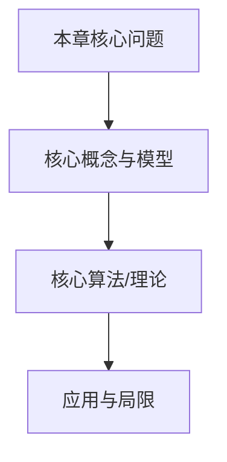

# 第X章 章节标题

> [!info] 本章导读与知识定位
> - **核心问题**：本章解决人工智能中的什么核心问题？
> - **教材出处**：`XX_第X章 标题.pdf`（印刷 `p.A–B` / 拆分 PDF `p.1–N`）
> - **前置依赖**：[[前置章节]]
> - **后续衔接**：[[后续章节]]



---

## 1. 核心术语与概念总表

| 中文术语 | 英文原名 | 严谨定义 | 教材页码 |
| :--- | :--- | :--- | :--- |
| | | | `印刷 p. / 拆分 p.` |

---

## 2. X.1 第一节标题

### 2.1 背景、前置知识与直观理解
> [!tip] 直观理解
> 用通俗语言或类比解释本节核心思想。

### 2.2 核心定义与数学推导
> [!note] 教材核心定义（第X章 X.1，印刷 `p.` / 拆分 `p.`）
> 精确陈述教材定义、定理或公式。

$$
% 在此书写 Obsidian 兼容 LaTeX 公式
$$

> [!abstract]- 详细数学推导（模型补充）
> 分步展示从前提到结论的完整推导过程。

### 2.3 算法原理、伪代码与 Python 实现
```text
% 对照原书伪代码框（核对附录B语法）
```

```python
# 独立可运行的 Python 实现（含详细中文注释与运行示例）
```

- **复杂度与理论性质**：时间复杂度、空间复杂度、完备性、最优性。

### 2.4 重要图表与案例解析
*(如需引用原图，使用相对路径 ``)*

---

## 3. 算法对比、常见误区与边界条件

| 维度 | 方法 A | 方法 B |
| :--- | :--- | :--- |
| 适用场景 | | |
| 时间/空间复杂度 | | |
| 完备性 / 最优性 | | |

> [!warning] 常见误区与易混淆概念
> 列出初学者最容易混淆的点及反例说明。

---

## 4. 经典例题与习题解析

> [!example] 教材例题 1（印刷 `p.` / 拆分 `p.`）
> **题目**：...
> **完整解析**：...

- **原书行内引用习题编号**：（如 `习题X.YYYY`，见配套网站）
- **【补充练习】**（按基础 / 进阶 / 综合分级，附详细解析；无法可靠求解的开放题明确标记）

---

## 5. 教材外有价值的拓展

> [!tip] 拓展视野（教材之外）
> 补充现代演进、工程实践或研究进展，并注明参考来源。

---

## 6. 本章索引同步清单（供更新全局索引使用）
- **新增术语**：...
- **新增公式**：...
- **新增算法**：...
- **建议抽离专题**：...
