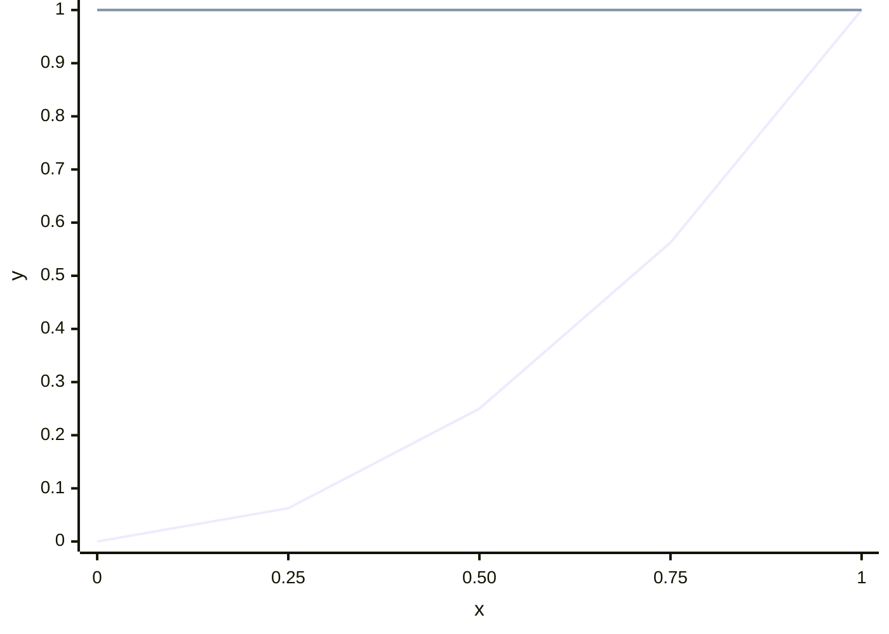
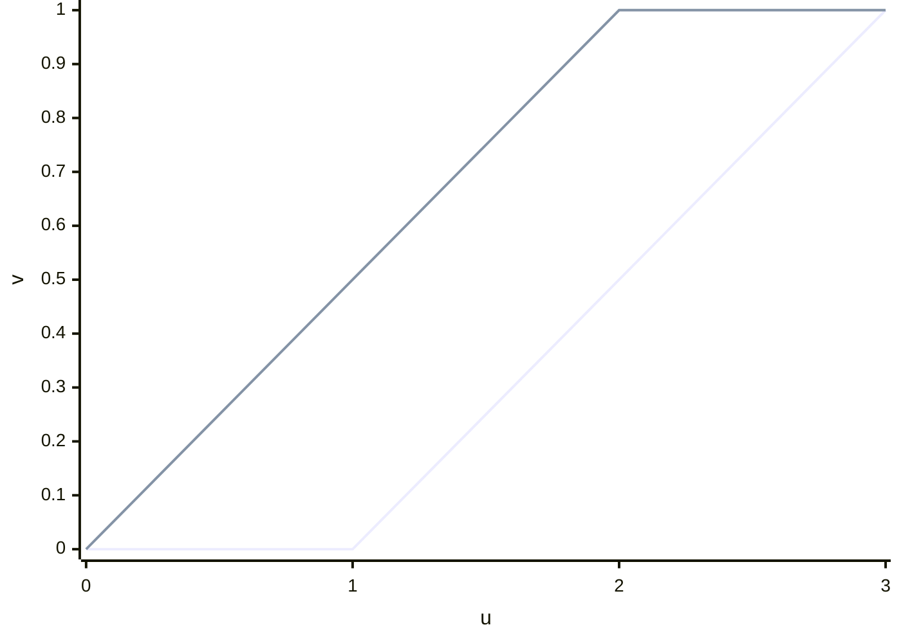

# 概率论习题课 01–06｜完整题目与详解

上海科技大学 MATH1212《概率论与数理统计 I》。全篇按讲义顺序收录 24 道主问题及其子问，包括原讲义的 Extension 和几何讨论。题面依据英文讲义用中文重述，保留关键数据、条件和原题号。标注的页码为 PDF 页码。

## 目录

| 习题课 | 讲义 | 内容 |
| --- | --- | --- |
| [[#第 1 次｜事件、条件概率与贝叶斯公式]] | Tutorial1_ppt.pdf | 容斥、独立性、交替射击、重复检测 |
| [[#第 2 次｜随机变量变换与分布函数]] | Tutorial2_solution.pdf | 离散与连续变换、多值逆像、乘积与比值、连分数 |
| [[#第 3 次｜联合分布、条件分布与二维变换]] | Tutorial3_solution.pdf | 支持区域、边缘与条件密度、雅可比、和与比例 |
| [[#第 4 次｜矩、矩母函数与线性预测]] | tutorial4_beamer.pdf | 期望和方差、MGF、协方差、线性最小均方误差 |
| [[#第 5 次｜条件期望、全方差与二元正态]] | Tutorial5_Solution.pdf | 检出与漏检、塔式性质、全方差、正态回归 |
| [[#第 6 次｜概率不等式、大数定律与中心极限定理]] | Tutorial6_Solution.pdf | Markov、Chebyshev、蒙特卡洛、正态与泊松近似 |
| [[#按题型复习]] | 题号索引 | 按解题入口查找例题 |

## 第 1 次｜事件、条件概率与贝叶斯公式

### T1-1 三事件容斥、独立性与交集的范围

**题目（第 3–4 页）**

1. 在概率空间 $(\Omega,\mathcal F,P)$ 中，设 $A,B,C\in\mathcal F$。证明
   $$
   P(A\cup B\cup C)=P(A)+P(B)+P(C)-P(A\cap B)-P(A\cap C)-P(B\cap C)+P(A\cap B\cap C).
   $$
2. 判断并证明或举反例。
   - (i) 若 $A,B$ 互斥且二者概率均为正，则 $A,B$ 不独立。
   - (ii) 若 $P(A\mid B)>P(A)$，则 $P(B\mid A)>P(B)$。
   - (iii) 若 $A,B,C$ 两两独立，则三者相互独立。
3. 若 $P(A)=0.7,\ P(B)=0.6$，求 $P(A\cap B)$ 的所有可能值。

**解答**

1. 先把 $A\cup B$ 看成整体。两事件公式给出
   $$
   P((A\cup B)\cup C)=P(A\cup B)+P(C)-P((A\cup B)\cap C).
   $$
   再展开 $P(A\cup B)$。由于 $(A\cup B)\cap C=(A\cap C)\cup(B\cap C)$，后一项等于 $P(A\cap C)+P(B\cap C)-P(A\cap B\cap C)$。代入整理即得。
2. (i) **真**。互斥使 $P(A\cap B)=0$，而 $P(A)P(B)>0$，所以独立性的乘积等式不成立。若有一方概率为零，互斥和独立可以同时成立。

   (ii) **真**。题设中的条件概率要求 $P(B)>0$。于是 $P(A\cap B)>P(A)P(B)\ge 0$，进而 $P(A)\ge P(A\cap B)>0$。除以 $P(A)$ 得 $P(B\mid A)>P(B)$。

   (iii) **假**。独立抛两次公平硬币，取 $A=\{HH,HT\}$、$B=\{HH,TH\}$、$C=\{HH,TT\}$。三事件各有概率 $1/2$，每对交集均为 $\{HH\}$，概率都是 $1/4$；三重交集也为 $\{HH\}$，概率 $1/4\ne 1/8$。
3. 设 $t=P(A\cap B)$。由交集包含于 $B$ 得 $t\le 0.6$，由 $P(A\cup B)=1.3-t\le 1$ 得 $t\ge0.3$。对于任意 $t\in[0.3,0.6]$，给四个互斥区域 $A\cap B,A\cap B^c,A^c\cap B,A^c\cap B^c$ 分配概率 $t,0.7-t,0.6-t,t-0.3$。它们非负、和为 1，且符合题设。因此整个区间都可实现。

### T1-2 交替射击与条件下的轮数

**题目（第 9–10 页）**

$A,B$ 轮流射击，$A$ 先射。$A$ 每次命中概率为 $p$，$B$ 为 $q$，各次射击独立，先命中者获胜。一轮指从 $A$ 开始，若 $A$ 未命中则轮到 $B$。

1. 求 $A$ 获胜的概率 $P_A$。
2. 已知 $A$ 获胜，求 $A$ 第一枪就命中的概率。
3. 已知第一轮双方均未命中，求 $A$ 最终获胜的概率。
4. 在 $A$ 获胜的情况下，令 $K$ 表示其命中的轮数。求 $P(K=k\mid A\text{ 获胜})$，并验证其和为 1。

**解答**

设 $s=(1-p)(1-q)$。$A$ 在第 $k$ 轮获胜，要求前 $k-1$ 轮双方全失手，且第 $k$ 轮 $A$ 命中。因此联合事件概率为 $s^{k-1}p$，各轮获胜事件互斥。

1. 若 $s<1$，则
   $$
   P_A=\sum_{k=1}^{\infty} s^{k-1}p
   =\frac{p}{1-s}=\frac{p}{p+q-pq}.
   $$
   若 $p=q=0$，比赛永不结束，$P_A=0$。
2. 第一枪命中必然使 $A$ 获胜。只要 $p>0$，
   $$
   P(A\text{ 第一枪命中}\mid A\text{ 获胜})=\frac{p}{P_A}=1-s.
   $$
3. 若 $s>0$，第一轮全失手后仍由 $A$ 先射，且之后的射击独立于第一轮，所以所求仍是 $P_A$，包括 $p=q=0$ 时的 0。若 $s=0$，题设的条件事件概率为零。
4. 若 $p>0$，除以 $P_A$ 得
   $$
   P(K=k\mid A\text{ 获胜})=(1-s)s^{k-1},\qquad k=1,2,\ldots .
   $$
   当 $0<s<1$，求和为 $(1-s)/(1-s)=1$；当 $s=0$，轮数集中在 1。若 $p=0$，第 2、4 问的条件事件概率为零。

### T1-3 群体患病率与重复阳性

**题目（第 14 页）**

总体分为三组 $H_1,H_2,H_3$。各组占比分别为 $50\%,30\%,20\%$，各组患病率分别为 $1\%,2\%,5\%$。令 $D$ 为患病，$T^+$ 为检测阳性。检测灵敏度为 $P(T^+\mid D)=0.95$，假阳性率为 $P(T^+\mid D^c)=0.04$。给定患病状态，两次检测结果条件独立。

1. 求 $P(T^+\mid H_1)$。
2. 求 $P(T^+)$。
3. 在检测阳性后求 $P(H_i\mid T^+)$，$i=1,2,3$。
4. 两次检测均阳性后，求患病的后验概率。

**解答**

第 1、3 问沿用讲义的隐含假设，即给定患病状态后，各组有相同的灵敏度和假阳性率。若两项只描述总体的平均检测表现，则仅凭题面数据无法确定组别内阳性率或阳性者的组别后验。

1. 以 $D,D^c$ 划分组内人群。若 $d_i=P(D\mid H_i)$，
   $$
   P(T^+\mid H_i)=0.95d_i+0.04(1-d_i)=0.04+0.91d_i.
   $$
   三组分别为 $0.0491,0.0582,0.0855$，第一问答案为 $0.0491$。
2. $P(T^+)=0.5(0.0491)+0.3(0.0582)+0.2(0.0855)=0.05911$。也可先求 $P(D)=0.021$，再算 $0.95(0.021)+0.04(0.979)$。
3. 由贝叶斯公式，把 $P(H_i)P(T^+\mid H_i)$ 除以 $P(T^+)$。

   | 组别 | $P(H_i\cap T^+)$ | $P(H_i\mid T^+)$ |
   | --- | ---: | ---: |
   | $H_1$ | $0.02455$ | $0.415327$ |
   | $H_2$ | $0.01746$ | $0.295381$ |
   | $H_3$ | $0.01710$ | $0.289291$ |

4. 两次检测使用相同的灵敏度和假阳性率。设 $E=\{T_1^+,T_2^+\}$，给定患病状态的独立性给出 $P(E\mid D)=0.95^2$、$P(E\mid D^c)=0.04^2$。因此
   $$
   P(D\mid E)=\frac{0.021(0.95)^2}{0.021(0.95)^2+0.979(0.04)^2}
   \approx 0.923661.
   $$
   讲义第 17 页给出 $0.9236$，四舍五入到四位小数为 $0.9237$。平方发生在给定 $D$ 或 $D^c$ 的条件概率里。总体中两次检测共享同一人的患病状态，通常不能将总体阳性率直接平方。

## 第 2 次｜随机变量变换与分布函数

### T2-1 离散型变量的平方

**题目（第 1 页）**

离散随机变量 $X$ 满足 $P(X=-1)=0.2$、$P(X=0)=0.3$、$P(X=1)=0.5$。求 $Y=X^2$ 的 PMF。

**解答**

对每个可能的 $y$，把所有满足 $x^2=y$ 的原取值概率相加：
$$
P(Y=0)=0.3,\qquad P(Y=1)=0.2+0.5=0.7.
$$
其余点的概率为 0。一般地，离散变换 $Y=g(X)$ 有 $p_Y(y)=\sum_{x:g(x)=y}p_X(x)$。

### T2-2 均匀变量的对数变换

**题目（第 1 页）**

设 $X\sim U(0,1)$，求 $Y=-2\ln X$ 的 PDF。

**解答**

$x\in(0,1)$ 时 $-2\ln x$ 的值域为 $(0,\infty)$，且函数严格递减。若 $y>0$，
$$
F_Y(y)=P(-2\ln X\le y)=P(X\ge e^{-y/2})=1-e^{-y/2}.
$$
若 $y\le0$，则 $F_Y(y)=0$。对 CDF 求导得 $f_Y(y)=\tfrac12 e^{-y/2}$（$y>0$），其他地方取 0。因此 $Y$ 服从速率为 $1/2$ 的指数分布。换元法也给出同样的系数：逆变换为 $x=e^{-y/2}$，逆导数绝对值为 $\tfrac12 e^{-y/2}$。

### T2-3 连续型变量的平方与两条逆分支

**题目（第 2 页）**

设 $X$ 有连续型分布，密度为 $f$。证明 $Y=X^2$ 的密度在 $y>0$ 时为
$$
g(y)=\frac{f(\sqrt y)+f(-\sqrt y)}{2\sqrt y}.
$$

**解答**

$y<0$ 时 CDF 为 0，$y=0$ 时 $F_Y(0)=P(X=0)=0$。对 $y>0$，
$$
F_Y(y)=P(-\sqrt y\le X\le\sqrt y)
=F_X(\sqrt y)-F_X(-\sqrt y).
$$
两个端点的导数分别为 $1/(2\sqrt y)$、$-1/(2\sqrt y)$，第二项前还有一个减号，于是两支密度相加。公式也可通过正、负两个半轴分别换元得到，密度等式按几乎处处理解。$y<0$ 的密度为 0；$y=0$ 的密度可任意指定，不产生点质量。若 $X$ 只取正值，其中负分支由 $f(-\sqrt y)=0$ 自动消去。

### T2-4 单位正方形上的乘积与比值

**题目（第 3 页）**

$(X_1,X_2)$ 的联合密度为 $f(x_1,x_2)=x_1+x_2$（$0<x_1,x_2<1$），其他地方为 0。

- (a) 求 $Y=X_1X_2$ 的 PDF。
- (b) 求 $Z=X_1/X_2$ 的 PDF。

**解答**

**(a)** $0<Y<1$。当 $0<y<1$ 时，双曲线 $x_2=y/x_1$ 在 $x_1=y$ 处穿过顶边 $x_2=1$。分别对整列和被截断的列积分：
$$
\begin{aligned}
F_Y(y)
&=\int_0^y\int_0^1(x_1+x_2)\,dx_2dx_1
+\int_y^1\int_0^{y/x_1}(x_1+x_2)\,dx_2dx_1\\
&=\frac{y^2+y}{2}+\int_y^1\left(y+\frac{y^2}{2x_1^2}\right)dx_1\\
&=\frac{y^2+y}{2}+\frac32y(1-y)=2y-y^2.
\end{aligned}
$$
在 $y\le0$ 和 $y\ge1$ 时，CDF 分别为 0 和 1。因此 $f_Y(y)=2(1-y)$（$0<y<1$），其他地方为 0。积分为 1。

**(b)** $Z>0$，所以 $z\le0$ 的 CDF 为 0。对 $z>0$，事件等价于 $x_1\le zx_2$，固定 $x_2$ 时上限为 $\min(1,zx_2)$。若 $0<z\le1$，全区间用 $zx_2$：
$$
F_Z(z)=\int_0^1\int_0^{zx_2}(x_1+x_2)\,dx_1dx_2
=\frac{z(z+2)}6.
$$
若 $z>1$，$x_2=1/z$ 是切换点：
$$
\begin{aligned}
F_Z(z)
&=\int_0^{1/z}\left(\frac{z^2}2+z\right)x_2^2\,dx_2+\int_{1/z}^1\left(\frac12+x_2\right)dx_2\\
&=\frac{z+2}{6z^2}+1-\frac1{2z}-\frac1{2z^2}
=1-\frac{2z+1}{6z^2}.
\end{aligned}
$$
于是
$$
f_Z(z)=
\begin{cases}
0,&z\le0,\\
(z+1)/3,&0<z\le1,\\
(z+1)/(3z^3),&z>1.
\end{cases}
$$
两段 CDF 在 $z=1$ 都是 $1/2$。这也可由交换 $X_1,X_2$ 的对称性得到，因 $P(X_1=X_2)=0$。

### T2-5 用 CDF 计算指数寿命

**题目（第 4 页）**

元件寿命 $T$ 以千小时为单位，密度为 $f(t)=0.1e^{-0.1t}$（$t\ge0$）。(1) 求 CDF。(2) 求元件至少工作 10 千小时的概率。

**解答**

$$
F_T(t)=
\begin{cases}0,&t<0,\\ 1-e^{-0.1t},&t\ge0.\end{cases}
$$
指数分布连续，故 $P(T\ge10)=1-F_T(10)=e^{-1}\approx0.3679$。一般分布的对应公式为 $P(T\ge t)=1-F_T(t^-)$，本题可以用 $F_T(t)$ 是因为该点没有质量。

### T2-6 连分数前两项的联合 PMF

**题目（第 4 页）**

$X\sim U[0,1]$，用连分数表示
$$
X=\frac1{Y_1+\dfrac1{Y_2+\dfrac1{Y_3+\cdots}}}.
$$
证明对正整数 $u,v$，
$$
P(Y_1=u,Y_2=v)=\frac1{(uv+1)(uv+u+1)}.
$$

**解答**

无理数有唯一的无限简单连分数展开。$[0,1]$ 内的有理数可按有限展开约定处理，它们构成零概率集。忽略该集合，$Y_1=\lfloor1/X\rfloor$，在 $Y_1=u$ 的条件下，$Y_2=\lfloor1/(1/X-u)\rfloor$。第一项要求 $1/(u+1)<X\le1/u$。第二项要求
$$
v\le\frac1{1/X-u}<v+1
\quad\Longleftrightarrow\quad
\frac v{uv+1}\le X<\frac{v+1}{uv+u+1}.
$$
这里可先写 $1/(v+1)<1/X-u\le1/v$，再两次整理。由于 $v\ge1$，新区间左端点 $\ge1/(u+1)$、右端点 $<1/u$，所以已满足第一项的区间要求（零概率端点除外）。

均匀分布下答案就是区间长度
$$
\frac{v+1}{uv+u+1}-\frac v{uv+1}
=\frac1{(uv+1)(uv+u+1)}.
$$
讲义把第二项对应区间写为左开右闭。按取整不等式推导得到左闭右开，端点的选择不改变概率。固定 $u$ 对 $v\ge1$ 求和，上面的长度表达式望远镜相消，得 $1/u-1/(u+1)$；再对 $u$ 求和为 1。

## 第 3 次｜联合分布、条件分布与二维变换

### T3-1 曲线支持域上的边缘与条件分布

**题目（第 1–2 页）**

$(X,Y)$ 的联合密度在 $0<x<1,\ x^2<y<1$ 上为常数 $c$，其他地方为 0。

- (a) 画出密度非零区域，求 $c$。
- (b) 求 $X,Y$ 的边缘密度，并写明支持范围。
- (c) 对 $0<y<1$，求 $f_{X\mid Y}(x\mid y)$，再计算 $P(X<1/2\mid Y=1/2)$。
- (d) 判断独立性，用联合密度或支持域说明。

**解答**

**(a)** 在单位正方形内，取抛物线 $y=x^2$ 上方、直线 $y=1$ 下方。图中两条线之间为所求区域，下边界曲线用采样点示意。

$$
1=\int_0^1\int_{x^2}^1 c\,dy\,dx=c\int_0^1(1-x^2)\,dx=\frac{2c}{3},
\qquad c=\frac32.
$$

**(b)** 固定 $x$，沿 $y$ 积分，上下限是 $x^2$ 和 1。固定 $y$，因 $x>0$，$x^2<y$ 等价于 $0<x<\sqrt y$。因此
$$
f_X(x)=\frac32(1-x^2)\quad(0<x<1),\qquad
f_Y(y)=\frac32\sqrt y\quad(0<y<1),
$$
各自在所写区间外为 0。两式积分均为 1。

**(c)** 在 $0<y<1$ 上有 $f_Y(y)>0$，故
$$
f_{X\mid Y}(x\mid y)=\frac{f_{X,Y}(x,y)}{f_Y(y)}
=\frac1{\sqrt y}\mathbf 1_{\{0<x<\sqrt y\}}.
$$
即 $X\mid Y=y$ 在该水平切片上均匀。$y=1/2$ 时，$1/2<1/\sqrt2$，所以概率为 $(1/2)/(1/\sqrt2)=1/\sqrt2$。这里用的是由联合密度构造的条件密度。连续变量单点的概率为零，不能将联合事件概率除以 $P(Y=1/2)$。

**(d)** 在正面积区域 $0<x<1,\ 0<y<x^2$ 上，联合密度为零，而两边缘密度的乘积为正，所以 $X,Y$ 不独立。对密度的乘积分解应检验几乎处处成立，单个边界点上的差异不足以推翻独立性。

### T3-2 线性变换与三段边缘密度

**题目（第 3–4 页）**

$X,Y$ 独立同分布于 $U(0,1)$，$U=X+2Y,\ V=Y$。

- (a) 求逆变换和雅可比行列式。
- (b) 画出 $(U,V)$ 的支持域并求其联合 PDF。
- (c) 求 $U$ 的边缘 PDF，解释为何在 $u=1,2$ 分段。
- (d) 判断 $U,V$ 是否独立，说明理由。

**解答**

**(a)** $x=u-2v,\ y=v$，逆变换矩阵为 $\begin{pmatrix}1&-2\\0&1\end{pmatrix}$，行列式为 1。

**(b)** 将逆变换代入 $0<x,y<1$，得到 $0<v<1,\ 2v<u<1+2v$。边界为顶点 $(0,0),(1,0),(3,1),(2,1)$ 依次相连的平行四边形。图中上下两条边界之间为所求区域。

原联合密度在单位正方形内为 1，乘以逆雅可比的绝对值后，$f_{U,V}(u,v)$ 在该平行四边形内仍为 1，区域外为 0。

**(c)** 求 $f_U(u)$ 时固定 $u$，切片长度由两组约束共同决定：
$$
\max\left(0,\frac{u-1}{2}\right)<v<\min\left(1,\frac u2\right).
$$
在 $u=1$ 时下限的来源切换，在 $u=2$ 时上限的来源切换。由上限减下限，
$$
f_U(u)=
\begin{cases}
u/2,&0<u<1,\\
1/2,&1\le u<2,\\
(3-u)/2,&2\le u<3,\\
0,&\text{其他}.
\end{cases}
$$
三段概率分别为 $1/4,1/2,1/4$。另外，从 $X+2Y$ 看，两项独立且分别均匀分布在长度为 1 和 2 的区间上，卷积的重叠长度先增加、后持平、再减小。

**(d)** 若 $V>3/4$，必有 $U>3/2$，所以 $P(U<1,V>3/4)=0$。而 $P(U<1)=1/4$、$P(V>3/4)=1/4$，乘积为 $1/16$，故不独立。

### T3-3 和与比例的联合分布

**题目（第 5–6 页）**

$X,Y$ 独立同分布于 $U(0,1)$。令 $R=X/(X+Y),\ S=X+Y$。

- (a) 用 $R,S$ 表示 $X,Y$，求逆变换雅可比行列式的绝对值。
- (b) 求 $(R,S)$ 的联合 PDF，包括完整支持范围。
- (c) 分段写出 $R$ 的边缘 PDF，并验证积分为 1。
- (d) 判断 $R,S$ 是否独立，并解释只对密度表达式做因式分解为何可能不够。

**解答**

**(a)** $x=rs,\ y=(1-r)s$。以 $(r,s)$ 为列变量，逆雅可比矩阵为 $\begin{pmatrix}s&r\\-s&1-r\end{pmatrix}$，行列式为 $s>0$。

**(b)** 由 $x,y>0$ 得 $s>0,\ 0<r<1$。由 $x,y<1$ 得 $s<1/r$ 且 $s<1/(1-r)$。令 $m(r)=\min(1/r,1/(1-r))$，则在 $0<r<1,\ 0<s<m(r)$ 上 $f_{R,S}(r,s)=s$，其余为 0。上边界在 $(1/2,2)$ 切换。

**(c)** 当 $r\le1/2$，有 $m(r)=1/(1-r)$，当 $r>1/2$，有 $m(r)=1/r$。积分得到
$$
f_R(r)=\int_0^{m(r)}s\,ds=
\begin{cases}
1/[2(1-r)^2],&0<r\le1/2,\\
1/(2r^2),&1/2<r<1,\\
0,&\text{其他}.
\end{cases}
$$
由 $f_R(r)=f_R(1-r)$，总积分为 $2\int_0^{1/2}\frac{dr}{2(1-r)^2}=[1/(1-r)]_0^{1/2}=1$。

**(d)** 当 $R<1/4$ 时，必有 $S<1/(1-R)<4/3$，故 $P(R<1/4,S>3/2)=0$。由刚求的密度，$P(R<1/4)=1/6$。在单位正方形上，$X+Y>3/2$ 是边长 $1/2$ 的直角三角形，故 $P(S>3/2)=1/8$。乘积 $1/48>0$，所以不独立。联合密度中的 $s$ 可写成 $1\cdot s$，但支持条件的指示函数仍同时包含 $r,s$，也必须参与独立性检验。

## 第 4 次｜矩、矩母函数与线性预测

### T4-1 归一化、方差与函数的期望

**题目（第 4–12 页）**

$X$ 的 PDF 在 $0<x<1$ 上为 $c(1+x^2)$，其他地方为 0。

- (a) 求 $c$。
- (b) 求 $E[X]$ 和 $\operatorname{Var}(X)$。
- (c) 令 $U=(1-X^2)^2$，求 $E[U]$。

**解答**

**(a)** $1=c\int_0^1(1+x^2)\,dx=4c/3$，所以 $c=3/4$。

**(b)** 对本题用到的非负整数 $k$，
$$
E[X^k]=\frac34\int_0^1(x^k+x^{k+2})\,dx
=\frac34\left(\frac1{k+1}+\frac1{k+3}\right).
$$
取 $k=1,2$，得 $E[X]=9/16,\ E[X^2]=2/5$。于是 $\operatorname{Var}(X)=2/5-(9/16)^2=107/1280$。

**(c)** 由同一公式 $E[X^4]=9/35$，所以
$$
E[U]=E[1-2X^2+X^4]=1-\frac45+\frac9{35}=\frac{16}{35}.
$$
求变换后的期望可直接对原变量积分，因此无需先求 $U$ 的分布。

### T4-2 泊松与正态的线性组合及其 MGF

**题目（第 14–23 页）**

设 $N\sim\operatorname{Poisson}(2)$、$Z\sim N(0,1)$，且二者独立。定义 $Y=2N-Z+1$。

- (a) 求 $M_Y(t)$。
- (b) 用 MGF 求 $E[Y]$、$E[Y^2]$ 与 $\operatorname{Var}(Y)$。
- (c) 用期望和方差运算法则核对均值与方差。

**解答**

**(a)** 独立性使指数的期望可分解为
$$
M_Y(t)=e^t M_N(2t)M_Z(-t)
=\exp\left[t+2(e^{2t}-1)+\frac{t^2}{2}\right],\quad t\in\mathbb R.
$$
其中 $M_N(t)=\exp(2(e^t-1))$、$M_Z(t)=e^{t^2/2}$。泊松项的系数 2 进入 MGF 的自变量，同时参数 2 保留在指数外层的泊松项中。

**(b)** 令 $K(t)=\log M_Y(t)$。则 $K'(t)=1+4e^{2t}+t$，$K''(t)=8e^{2t}+1$。由于 $M(0)=1$，
$$
E[Y]=M_Y'(0)=K'(0)=5,
\qquad
E[Y^2]=M_Y''(0)=K''(0)+K'(0)^2=34,
$$
所以 $\operatorname{Var}(Y)=34-25=9$。也直接得到 $K''(0)=9$。这里 MGF 在 0 的邻域存在，因而可以通过在 0 处求导获取矩。

**(c)** $E[Y]=2\cdot2-0+1=5$。独立性给出 $\operatorname{Cov}(N,Z)=0$，故 $\operatorname{Var}(Y)=2^2\operatorname{Var}(N)+(-1)^2\operatorname{Var}(Z)=4\cdot2+1=9$。

### T4-3 零相关但不独立的连续分布

**题目（第 25–36 页）**

在 $-1<x,y<1$ 时，$f_{X,Y}(x,y)=\frac14[1+h(x)h(y)]$，其中 $h(u)=u^2-\frac13$，区域外密度为 0。

- (a) 求 $f_X,f_Y$。
- (b) 求 $E[X],E[Y],\operatorname{Var}(X),\operatorname{Var}(Y)$。
- (c) 求 $E[XY]$、$\operatorname{Cov}(X,Y)$ 与相关系数 $\rho_{X,Y}$。
- (d) 判断 $X,Y$ 是否独立，并说明理由。

**解答**

**(a)** $\int_{-1}^{1}h(u)\,du=2/3-2/3=0$，所以 $f_X(x)=1/2$（$-1<x<1$），$f_Y$ 同理，区间外均为 0。密度合法性可直接核对：$-1/3\le h(u)<2/3$，故 $1+h(x)h(y)\ge 7/9>0$，积分由边缘密度等于 1。

**(b)** 两个边缘分布均为 $U(-1,1)$。对称性给出均值 0，二阶矩为 $\frac12\int_{-1}^1 u^2\,du=1/3$，即方差也是 $1/3$。

**(c)** 分开积分常数项和耦合项，
$$
E[XY]=\frac14\left(\int_{-1}^{1}u\,du\right)^2
+\frac14\left(\int_{-1}^{1}u h(u)\,du\right)^2=0.
$$
因为 $u$ 和 $u h(u)$ 均为奇函数。均值为零、方差为正，所以协方差和相关系数都是 0。

**(d)** 在 $(0,0)$，联合密度为 $5/18$，边缘密度乘积为 $1/4$。两者在原点附近都连续，所以差异延续到一个正面积的邻域，乘积分解不成立。也可直接比较 $E[X^2Y^2]$ 与 $E[X^2]E[Y^2]$：额外项为 $\frac14(\int_{-1}^1u^2h(u)\,du)^2=16/2025>0$。线性相关系数为零仍可存在对幅度的依赖。

### T4-4 线性最小均方误差预测

**题目（第 38–49 页）**

1. 已知 $E[X]=1,\ E[Y]=3,\ \operatorname{Var}(X)=4,\ \operatorname{Var}(Y)=9,\ \operatorname{Cov}(X,Y)=3$，求用 $X$ 预测 $Y$ 的最优线性预测。计算课件中给出的最小均方误差。
2. 令 $a^*,b^*$ 最小化 $L(a,b)=E[(Y-a-bX)^2]$，并定义 $R=Y-a^*-b^*X$。证明 $E[R]=0$ 和 $\operatorname{Cov}(X,R)=0$。
3. 用 $\langle U,V\rangle=E[UV]$ 理解几何意义。写出由 $1,X$ 张成的预测空间，解释 $Y=\widehat Y+R$ 和残差条件。用常数预测 $E[Y]$ 作基线，讨论 $L_{\mathrm{lin}}(Y;X)=\operatorname{Var}(Y)(1-\rho_{X,Y}^2)$，以及 $\rho_{X,Y}^2$ 代表的线性解释比例。

**解答**

**4.1** 设 $X,Y$ 有有限二阶矩。令 $\mu_X=E[X],\mu_Y=E[Y]$。把误差拆成中心化部分和常数后得到
$$
L(a,b)=(\mu_Y-a-b\mu_X)^2
+\operatorname{Var}(Y)-2b\operatorname{Cov}(X,Y)+b^2\operatorname{Var}(X).
$$
固定 $b$，由第一项知最优截距为 $a=\mu_Y-b\mu_X$。若 $\operatorname{Var}(X)>0$，再对 $b$ 配方得
$$
b^*=\frac{\operatorname{Cov}(X,Y)}{\operatorname{Var}(X)},\qquad
a^*=\mu_Y-b^*\mu_X,\qquad
L_{\mathrm{lin}}=\operatorname{Var}(Y)-\frac{\operatorname{Cov}(X,Y)^2}{\operatorname{Var}(X)}.
$$
代入得 $\widehat Y=9/4+(3/4)X$，最小均方误差为 $27/4$。

**4.2** 在最优点单独扰动截距 $s$，得到 $L(a^*+s,b^*)=E[R^2]-2sE[R]+s^2$。$s=0$ 是最小值点，一阶导数为零，所以 $E[R]=0$。再扰动斜率 $t$，$L(a^*,b^*+t)=E[R^2]-2tE[XR]+t^2E[X^2]$。由同样理由 $E[XR]=0$，因而 $\operatorname{Cov}(X,R)=0$。

**4.3** 在具有有限二阶矩的随机变量空间中，把几乎处处相等的变量视为同一元素，使用内积 $E[UV]$。预测空间是
$$
\mathcal S=\operatorname{span}\{1,X\}=\{a+bX:a,b\in\mathbb R\}.
$$
上一步说明残差同时与 $1$ 和 $X$ 正交，故 $R\perp\mathcal S$。对任意 $g\in\mathcal S$，
$$
E[(Y-g)^2]=E[R^2]+E[(\widehat Y-g)^2].
$$
因此 $\widehat Y$ 是 $Y$ 在 $\mathcal S$ 上的正交投影。常数基线 $\mu_Y$ 的均方误差为 $\operatorname{Var}(Y)$，改进量为 $\operatorname{Var}(\widehat Y)=\operatorname{Cov}(X,Y)^2/\operatorname{Var}(X)$。若两个方差均为正，改进量除以基线误差即 $\rho_{X,Y}^2$，所以 $L_{\mathrm{lin}}=\operatorname{Var}(Y)(1-\rho_{X,Y}^2)$。本题 $\rho=1/2$，误差相对常数基线下降 $25\%$。

若 $X$ 几乎处处为常数，预测空间只有常数，最优预测为 $E[Y]$，但斜率和截距的表示可能不唯一。若 $\operatorname{Var}(Y)=0$，误差为 0，比例和相关系数无须定义。一般情况下条件期望 $E[Y\mid X]$ 是在所有 $X$ 的平方可积函数中最优；当它本身是 $X$ 的仿射函数时，两种预测一致，见 [[#T5-4 二元正态的独立判据与条件期望]]。

## 第 5 次｜条件期望、全方差与二元正态

### T5-1 由检出总数估计实际故障数

**题目（第 1 页）**

工厂生产了 $n$ 台机器人，每台发生故障的概率为 $\phi$。对每台机器人进行检测，若有故障，以概率 $\delta$ 被检出。设 $X$ 是实际故障台数，$Y$ 是检出故障的台数。在通常的独立假设下证明
$$
E[X\mid Y]=\frac{n\phi(1-\delta)+(1-\phi)Y}{1-\phi\delta}.
$$

**解答**

沿用讲义的模型：检测无假阳性，各机器人的故障与检测结果组成独立同分布的随机对。令 $X_i,Y_i$ 分别表示第 $i$ 台实际有故障、被检出故障的指示变量，$X=\sum X_i$、$Y=\sum Y_i$。三个可能状态的概率如下。

| 状态 | $(X_i,Y_i)$ | 概率 |
| --- | --- | --- |
| 真阳性 | $(1,1)$ | $\phi\delta$ |
| 漏检 | $(1,0)$ | $\phi(1-\delta)$ |
| 无故障 | $(0,0)$ | $1-\phi$ |

如果第 $i$ 台已检出，则 $X_i=1$。如果未检出且 $1-\phi\delta>0$，其仍有故障的条件概率为
$$
a=P(X_i=1\mid Y_i=0)=\frac{\phi(1-\delta)}{1-\phi\delta}.
$$
先给定检出向量 $\mathbf Y=(Y_1,\ldots,Y_n)$。由于各对独立，$E[X_i\mid\mathbf Y]=E[X_i\mid Y_i]$，故
$$
E[X\mid\mathbf Y]
=\sum_i[Y_i+(1-Y_i)a]=Y+(n-Y)a.
$$
再对 $Y$ 取条件期望。由于 $Y$ 是 $\mathbf Y$ 的函数，塔式性质给出
$$
E[X\mid Y]
=E[E[X\mid \mathbf Y]\mid Y]
=Y+(n-Y)a
=\frac{n\phi(1-\delta)+(1-\phi)Y}{1-\phi\delta}.
$$

讲义中直接写 $E[X_i\mid Y]=E[X_i\mid Y_i]$ 的步骤需要更正。给定的是总数 $Y$ 时，通常不知道哪一台检出。由对称性，在 $n>0$ 时 $E[Y_i\mid Y]=Y/n$，所以单台的条件期望应为 $a+(1-a)Y/n$。

给定 $\mathbf Y$ 后，各台未检出机器人的故障状态仍条件独立。对任意检出向量，$X-Y\mid\mathbf Y\sim\operatorname{Binomial}(n-Y,a)$，该分布仅依赖总数。因此对任何有正概率的 $Y=y$，也有 $X-y\mid Y=y\sim\operatorname{Binomial}(n-y,a)$。若 $\phi\delta=1$，则 $\phi=\delta=1$，此时 $X=Y=n$，条件期望为 $n$。

### T5-2 全方差公式

**题目（第 2 页）**

定义 $\operatorname{Var}(Y\mid X)=E[(Y-E[Y\mid X])^2\mid X]$。证明：

- (a) $\operatorname{Var}(Y\mid X)=E[Y^2\mid X]-(E[Y\mid X])^2$。
- (b) $E[\operatorname{Var}(Y\mid X)]=E[Y^2]-E[(E[Y\mid X])^2]$。
- (c) $\operatorname{Var}(E[Y\mid X])=E[(E[Y\mid X])^2]-(E[Y])^2$。
- (d) $\operatorname{Var}(Y)=E[\operatorname{Var}(Y\mid X)]+\operatorname{Var}(E[Y\mid X])$。

**解答**

设 $E[Y^2]<\infty$，记 $m(X)=E[Y\mid X]$。条件 Jensen 不等式给出 $m(X)^2\le E[Y^2\mid X]$，保证后续各二阶矩有限。

**(a)** 展开平方。$m(X)$ 由 $X$ 决定，可以从对 $X$ 的条件期望里提出：
$$
E[(Y-m(X))^2\mid X]=E[Y^2\mid X]-2m(X)E[Y\mid X]+m(X)^2
=E[Y^2\mid X]-m(X)^2.
$$

**(b)** 对 (a) 两边取期望，由 $E[E[Y^2\mid X]]=E[Y^2]$ 得 $E[\operatorname{Var}(Y\mid X)]=E[Y^2]-E[m(X)^2]$。

**(c)** 由方差公式和 $E[m(X)]=E[Y]$ 得 $\operatorname{Var}(m(X))=E[m(X)^2]-(E[Y])^2$。

**(d)** 相加消去 $E[m(X)^2]$，右边变为 $E[Y^2]-(E[Y])^2=\operatorname{Var}(Y)$。第一项是各条件分布中剩余波动的平均值，第二项是不同 $X$ 下条件均值的波动。就平方损失而言，第一项正是以 $E[Y\mid X]$ 预测 $Y$ 的均方误差。

### T5-3 带额外条件的塔式性质

**题目（第 3 页）**

设 $X,Y,Z$ 为随机变量。证明
$$
E[E[Y\mid X,Z]\mid Z]=E[Y\mid Z].
$$
推导中应说明积分换序的条件。可假设 $E|Y|<\infty$，也可在允许扩展期望时处理 $Y\ge0$。

**解答**

**一般证明。** 令 $\mathcal G=\sigma(Z)$、$\mathcal H=\sigma(X,Z)$，则 $\mathcal G\subseteq\mathcal H$。取 $W=E[Y\mid\mathcal H]$。对任意 $A\in\mathcal G$，
$$
E[\mathbf 1_A W]=E[\mathbf 1_A Y]
$$
因为 $A$ 也属于 $\mathcal H$。所以 $W$ 与 $Y$ 在 $\mathcal G$ 上的条件期望拥有同样的积分刻画，由唯一性得 $E[W\mid\mathcal G]=E[Y\mid\mathcal G]$，等式几乎处处成立。证明适用于离散、连续和混合型随机变量。

**联合条件密度存在时。** 对几乎所有 $z$，
$$
\begin{aligned}
E[E[Y\mid X,Z]\mid Z=z]
&=\int_{\mathbb R}\int_{\mathbb R}
y f_{Y\mid X,Z}(y\mid x,z)f_{X\mid Z}(x\mid z)\,dy\,dx\\
&=\int_{\mathbb R} y\left[\int_{\mathbb R}
f_{X,Y\mid Z}(x,y\mid z)\,dx\right]dy\\
&=\int_{\mathbb R}y f_{Y\mid Z}(y\mid z)\,dy=E[Y\mid Z=z].
\end{aligned}
$$
若 $E|Y|<\infty$，则 $E[|Y|\mid Z]$ 几乎处处有限，绝对可积性允许使用 Fubini 定理；对非负 $Y$ 可用 Tonelli 定理。

**讲义条件修正。** $E|Y|<\infty$ 能推出 $E[|Y|\mid Z]<\infty$ 几乎处处，反向不成立。例如令 $Y=Z$ 为取有限值但均值无穷的非负变量，则 $E[|Y|\mid Z]=Z$ 几乎处处有限。若要用条件期望表达与全局可积性等价的条件，应写 $E\{E[|Y|\mid Z]\}<\infty$。

### T5-4 二元正态的独立判据与条件期望

**题目（第 4–6 页）**

$(X,Y)$ 服从二元正态分布，均值为 $\mu_X,\mu_Y$，方差为 $\sigma_X^2,\sigma_Y^2$，相关系数为 $\rho$，协方差为 $\rho\sigma_X\sigma_Y$。设 $\sigma_X,\sigma_Y>0$ 且 $|\rho|<1$，记 $a=(x-\mu_X)/\sigma_X,\ b=(y-\mu_Y)/\sigma_Y$，题给联合密度为
$$
f_{X,Y}(x,y)=\frac1{2\pi\sigma_X\sigma_Y\sqrt{1-\rho^2}}
\exp\left[-\frac{a^2-2\rho ab+b^2}{2(1-\rho^2)}\right],
\qquad (x,y)\in\mathbb R^2.
$$

- (a) 证明 $\operatorname{Cov}(X,Y)=0$（等价于 $\rho=0$）时，$X,Y$ 独立。
- (b) 举例说明一般的随机变量可以协方差为零且不独立，并验证例子。
- (c) 证明 $E[Y\mid X]=E[Y]+\dfrac{\operatorname{Cov}(X,Y)}{\operatorname{Var}(X)}(X-E[X])$。

**解答**

**(a)** 若协方差为零，则 $\rho=0$。联合密度分解为
$$
\left(\frac{e^{-a^2/2}}{\sqrt{2\pi}\sigma_X}\right)
\left(\frac{e^{-b^2/2}}{\sqrt{2\pi}\sigma_Y}\right).
$$
每个因子分别在自己的变量上积分为 1，故它们就是两条边缘密度。联合密度等于边缘密度的乘积，因而独立。

**(b)** 取 $U\sim U(-1,1)$，$V=U^2$。对称性给 $E[U]=E[U^3]=0$，所以 $\operatorname{Cov}(U,V)=E[U^3]-E[U]E[U^2]=0$。但事件 $A=\{|U|\le1/2\}$ 与 $B=\{V\le1/4\}$ 相同，均有概率 $1/2$，故 $P(A\cap B)=1/2\ne1/4=P(A)P(B)$。

讲义进一步给出了边缘均正态的例子。取 $U\sim N(0,1)$，$S$ 独立于 $U$ 且以相同概率取 $\pm1$，令 $V=SU$。由对称性 $V\sim N(0,1)$，而 $E[UV]=E[S]E[U^2]=0$。取 $A=\{|U|\le1\}$ 与 $B=\{|V|\le1\}$，两事件相同且概率严格介于 0 和 1，因此不独立。故两条正态边缘不足以说明联合正态。

**(c) 方法一：配方并求条件密度。** 用
$$
a^2-2\rho ab+b^2=(1-\rho^2)a^2+(b-\rho a)^2
$$
把联合密度拆成 $x$ 的正态因子与给定 $x$ 的 $y$ 正态因子。第二个因子对 $y$ 积分为 1，所以第一个因子就是 $f_X(x)$。两者相除得到
$$
Y\mid X=x\sim N\left(\mu_Y+\rho\frac{\sigma_Y}{\sigma_X}(x-\mu_X),\ 
\sigma_Y^2(1-\rho^2)\right).
$$
取条件分布的均值，并用 $\rho\sigma_Y/\sigma_X=\operatorname{Cov}(X,Y)/\operatorname{Var}(X)$，得到所需公式。

**(c) 方法二：构造正交残差。** 置 $c=\operatorname{Cov}(X,Y)/\operatorname{Var}(X)$、$W=Y-\mu_Y-c(X-\mu_X)$。则 $E[W]=0$、$\operatorname{Cov}(X,W)=0$，且线性变换保持联合正态，所以 $(X,W)$ 联合正态。由 (a) 得 $W$ 与 $X$ 独立，故 $E[W\mid X]=0$，条件期望公式随即成立。这里的条件均值恰好等于 [[#T4-4 线性最小均方误差预测]] 中的最佳仿射预测。若 $|\rho|=1$ 且两方差均正，题给联合密度不再适用，但残差方差为 0，$Y$ 几乎处处为 $X$ 的仿射函数，条件期望公式仍成立。

## 第 6 次｜概率不等式、大数定律与中心极限定理

### T6-1 Markov 不等式与等待时间

**题目（第 1 页）**

- (a) 设 $X\ge0$ 且 $E[X]<\infty$。证明对任意 $a>0$，$P(X\ge a)\le E[X]/a$。
- (b) 顾客等待时间 $T\ge0$，均值为 5 分钟。求 $P(T\ge20)$ 的上界。是否由此确定精确概率？
- (c) 构造一个均值为 5 且达到该上界的分布，并说明 (a) 为什么需要非负性。

**解答**

**(a)** $X\ge a$ 时有 $X\ge a\mathbf 1_{\{X\ge a\}}=a$，在其余情形右边为 0，由非负性同样成立。取期望并除以 $a$ 即得。等号要求非负差值 $X-a\mathbf1_{\{X\ge a\}}$ 几乎处处为零，即 $X$ 几乎处处只取 $0,a$。

**(b)** 上界为 $5/20=1/4$。均值只约束上界。例如 $T\equiv5$ 时尾概率为 0。

**(c)** 取 $P(T=20)=1/4,\ P(T=0)=3/4$，则 $E[T]=5$，且 $P(T\ge20)=1/4$。若去掉非负条件，取 $X=\pm1$ 各以概率 $1/2$，则 $E[X]=0$ 而 $P(X\ge1)=1/2$，原不等式失败。

### T6-2 Chebyshev 不等式与抽检样本量

**题目（第 2 页）**

- (a) 设 $E[X]=\mu$ 且 $\operatorname{Var}(X)=\sigma^2<\infty$，从 Markov 不等式证明 $P(|X-\mu|\ge a)\le \sigma^2/a^2$（$a>0$）。
- (b) 若 $E[X]=25,\ \operatorname{Var}(X)=16$，求 $P(17<X<33)$ 的下界及 $P(|X-25|\ge12)$ 的上界。
- (c) 独立抽检产品，每件有概率 $p$ 为次品。若 $Y\sim\operatorname{Binomial}(n,p)$，记 $\hat p=Y/n$。证明对 $\varepsilon>0$，
  $$
  P(|\hat p-p|\ge\varepsilon)\le\frac{p(1-p)}{n\varepsilon^2}\le\frac1{4n\varepsilon^2}.
  $$
  求能使所有 $p\in[0,1]$ 都满足 $P(|\hat p-p|<0.05)\ge0.95$ 的充分样本量，并判断是否必为最小样本量。

**解答**

**(a)** 对非负变量 $(X-\mu)^2$ 和阈值 $a^2$ 用 Markov，不等式右边为 $E[(X-\mu)^2]/a^2=\sigma^2/a^2$。

**(b)** $17<X<33$ 等价于 $|X-25|<8$，其补事件是 $|X-25|\ge8$。故左问下界为 $1-16/8^2=3/4$。右问上界是 $16/12^2=1/9$。严格和非严格不等号由事件的补集确定。

**(c)** $E[\hat p]=p$，$\operatorname{Var}(\hat p)=p(1-p)/n$。对 $\hat p$ 用 Chebyshev，再由 $p(1-p)=1/4-(p-1/2)^2\le1/4$ 得所求界。令 $1/[4n(0.05)^2]\le0.05$，得 $n\ge2000$。这给出 Chebyshev 法的充分样本量。事实上，对同一独立 Bernoulli 模型，Hoeffding 不等式给出上界 $2e^{-2n(0.05)^2}$，因此 $n=738$ 已足以达到同样的保证。

### T6-3 弱大数定律与蒙特卡洛积分

**题目（第 3 页）**

- (a) $X_1,X_2,\ldots$ 独立同分布，均值为 $\mu$，方差为 $\sigma^2<\infty$。用 Chebyshev 不等式证明 $\bar X_n=n^{-1}\sum_{i=1}^n X_i\xrightarrow{P}\mu$。
- (b) 设 $U_1,U_2,\ldots$ 独立同分布于 $U(0,1)$，定义 $\widehat\pi_n=\dfrac4n\sum_{i=1}^n\sqrt{1-U_i^2}$。证明 $\widehat\pi_n\xrightarrow{P}\pi$，并解释如何用它估计 $\pi$。
- (c) 求 $\operatorname{Var}(\widehat\pi_n)$，并用 Chebyshev 不等式给出 $P(|\widehat\pi_n-\pi|\ge\varepsilon)$ 的上界。

**解答**

**(a)** 由独立性，$E[\bar X_n]=\mu$ 且 $\operatorname{Var}(\bar X_n)=n\sigma^2/n^2=\sigma^2/n$。对每个固定 $\varepsilon>0$，
$$
P(|\bar X_n-\mu|\ge\varepsilon)\le\frac{\sigma^2}{n\varepsilon^2}\longrightarrow0,
$$
这蕴含依概率收敛。单次模拟中，误差仍可能随样本量有时变大、有时变小。

**(b)** 令 $V_i=4\sqrt{1-U_i^2}$，它们仍独立同分布，且有界。积分 $\int_0^1\sqrt{1-u^2}\,du$ 是单位圆的四分之一面积，因此 $E[V_i]=4(\pi/4)=\pi$。由 (a)，$\widehat\pi_n=\bar V_n\xrightarrow{P}\pi$。实际模拟中，在 $(0,1)$ 均匀取 $n$ 个横坐标，算出各点的圆弧高度，平均后乘 4。

**(c)** 由于 $E[U_i^2]=1/3$，
$$
E[V_i^2]=16(1-1/3)=32/3,\qquad
\operatorname{Var}(\widehat\pi_n)=\frac{32/3-\pi^2}{n}.
$$
估计量的期望等于 $\pi$，故对 $\varepsilon>0$，
$$
P(|\widehat\pi_n-\pi|\ge\varepsilon)\le\frac{32/3-\pi^2}{n\varepsilon^2}.
$$

### T6-4 中心极限定理、连续性修正与泊松近似

**题目（第 4–5 页）**

设 $\Phi$ 为标准正态 CDF，$z_q=\Phi^{-1}(q)$。

- (a) 陈述均值为 $\mu$、方差满足 $0<\sigma^2<\infty$ 时的 i.i.d. 中心极限定理，给出和 $S_n$ 与样本均值 $\bar X_n$ 的正态近似，说明与大数定律的区别。
- (b) 20 位员工每年的病假天数独立同分布，均值为 10 天，标准差为 2 天。用正态近似找一个整天预算 $B$，使 $P(S_{20}>B)$ 近似不超过 $0.20$。该结果是否与原分布无关？用 $z_{0.80}=0.8416$。
- (c) 在 84 个成人肺炎病例中，每一例由某细菌引起的概率为 $0.7$，且相互独立。设 $N$ 为该细菌引起的病例数，用连续性修正估算 $P(N\le52)$。给定 $\Phi(-1.5)=0.0668$。
- (d) 若 $D\sim\operatorname{Binomial}(50,0.01)$，给出 $P(D\le3)$ 的精确表达和泊松近似，并解释正态近似为何可能较差。

**解答**

**(a)** 对满足题设的 i.i.d. 序列，
$$
\frac{S_n-n\mu}{\sigma\sqrt n}
=\frac{\sqrt n(\bar X_n-\mu)}{\sigma}
\xrightarrow{d}N(0,1).
$$
把减去的均值和除去的标准差恢复后，$S_n$ 近似服从 $N(n\mu,n\sigma^2)$，$\bar X_n$ 近似服从 $N(\mu,\sigma^2/n)$。大数定律说明 $\bar X_n$ 集中到 $\mu$。CLT 则把中心化误差放大 $\sqrt n$ 倍，描述标准化后的分布形状。

**(b)** $E[S_{20}]=200$，$\operatorname{Var}(S_{20})=20\cdot 2^2=80$。用 $N(200,80)$ 近似，要求 $P(S_{20}\le B)\approx\Phi((B-200)/\sqrt{80})\ge0.80$。连续预算阈值为
$$
200+0.8416\sqrt{80}\approx207.5275\text{ 天}.
$$
按题意向上取整得 $B=208$ 天，对应近似超支概率 $1-\Phi(8/\sqrt{80})\approx0.186$。精度取决于原分布和样本量。若只用给出的均值、方差和独立性，可用 Chebyshev 给出真正的概率上界，例如取 $B=220$ 时，$P(S_{20}>220)\le80/20^2=0.20$。

**(c)** $N\sim\operatorname{Binomial}(84,0.7)$，均值 $58.8$，方差 $17.64$，标准差 $4.2$。正态曲线用区间 $[51.5,52.5]$ 代表整数 52 的概率，因此
$$
P(N\le52)\approx \Phi\left(\frac{52.5-58.8}{4.2}\right)=\Phi(-1.5)=0.0668.
$$
作为核对，二项精确和 $\sum_{k=0}^{52}\binom{84}{k}(0.7)^k(0.3)^{84-k}$ 约为 $0.06899$。

**(d)** 二项精确式与泊松近似分别为
$$
\begin{aligned}
P(D\le3)&=\sum_{k=0}^3\binom{50}{k}(0.01)^k(0.99)^{50-k}\approx 0.9984038,\\
P(D\le3)&\approx e^{-0.5}\sum_{k=0}^3\frac{0.5^k}{k!}\approx0.9982484.
\end{aligned}
$$
本题 $np=0.5$，质量高度集中在 0 和 1，且右偏明显。若用带连续性修正的正态近似，所得为 $\Phi((3.5-0.5)/\sqrt{0.495})\approx0.9999900$。比较补事件更直观：精确的 $P(D>3)\approx0.0015962$，正态近似仅约 $0.0000100$。样本量 $n$ 较大并不足以保证正态近似好，还需要考虑成功和失败的期望个数。

## 按题型复习

| 读题时的线索 | 第一步 | 对应题目 |
| --- | --- | --- |
| 求交集的可能范围 | 列出四个互斥区域，用非负性检查上下界和可实现性 | [[#T1-1 三事件容斥、独立性与交集的范围]] |
| 轮流试验、直到成功 | 写出在哪一轮获胜的联合事件，再求和或条件化 | [[#T1-2 交替射击与条件下的轮数]] |
| 检测后更新群体或疾病概率 | 明确在哪个条件下可以相乘，再写先验乘似然 | [[#T1-3 群体患病率与重复阳性]] |
| 对随机变量作非单调变换 | 找齐原像。离散型对概率求和，连续型分支换元或先求 CDF | [[#T2-1 离散型变量的平方]]、[[#T2-3 连续型变量的平方与两条逆分支]] |
| 联合密度要求边缘、条件或换元 | 先把原约束代入新坐标，再固定一变量找切片上下限 | [[#T2-4 单位正方形上的乘积与比值]]、[[#T3-2 线性变换与三段边缘密度]]、[[#T3-3 和与比例的联合分布]] |
| 判断独立性 | 检查完整密度的乘积是否几乎处处成立，或找一对事件直接比较概率 | [[#T3-1 曲线支持域上的边缘与条件分布]]、[[#T4-3 零相关但不独立的连续分布]] |
| 独立变量的线性组合 | 先去掉常数平移，再按各系数替换 MGF 的自变量 | [[#T4-2 泊松与正态的线性组合及其 MGF]] |
| 梳理条件信息或预测误差 | 先写清所给信息是总数、向量还是某个单变量，再使用塔式性质或全方差 | [[#T5-1 由检出总数估计实际故障数]]、[[#T5-2 全方差公式]]、[[#T5-3 带额外条件的塔式性质]] |
| 从均值及方差估计概率 | 区分严格概率界、依概率收敛和有限样本近似；正态分位数要恢复原单位 | [[#T6-2 Chebyshev 不等式与抽检样本量]]、[[#T6-3 弱大数定律与蒙特卡洛积分]]、[[#T6-4 中心极限定理、连续性修正与泊松近似]] |

