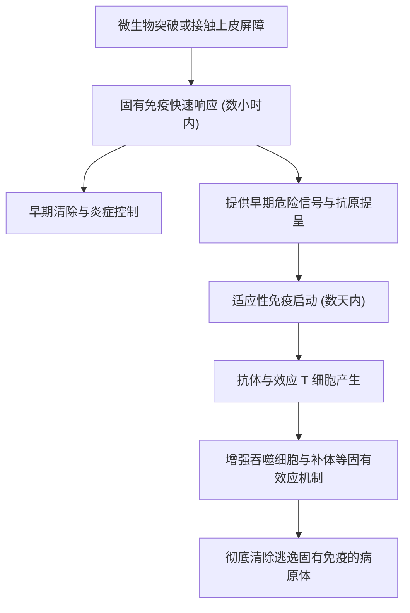
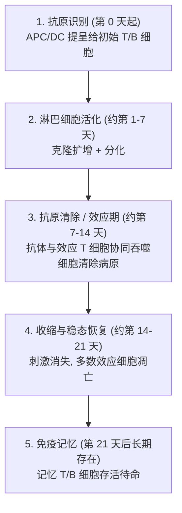

# 01 Overview of the Immune System · 免疫系统概述

[[00_免疫学知识库导航|返回总目录]] · 首章 · [[02_章节笔记/02 Cells and Tissues of the Immune System|下一章]]

## 教材与分析入口

- 本章教材：[[01_章节PDF/01 Overview of the Immune System.pdf|打开本章PDF]]
- 原始 PDF 第 15–26 页；拆分后共 12 页。
- 中文标题为学习用译名；英文标题依据本书书签。
- [[04_学习工具/Gemini逐章分析提示词|Gemini逐章分析提示词]]

## 本章原书结构

以下提纲来自原 PDF 书签，可用于核对 Gemini 是否覆盖本章内容。原书印刷页码与 PDF 文件页序不同。

- OVERVIEW OF INNATE AND ADAPTIVE IMMUNITY（原PDF第17页；本章PDF第3页）
- INTRODUCTION TO INNATE IMMUNITY（原PDF第18页；本章PDF第4页）
- INTRODUCTION TO ADAPTIVE IMMUNITY（原PDF第18页；本章PDF第4页）
  - Fundamental Properties of Adaptive Immune Responses（原PDF第18页；本章PDF第4页）
  - Overview of Humoral and Cell-Mediated Immunity（原PDF第20页；本章PDF第6页）
  - Initiation and Development of Adaptive Immune Responses（原PDF第23页；本章PDF第9页）
  - Major Features of Humoral Immunity（原PDF第25页；本章PDF第11页）
  - Major Features of Cell-Mediated Immunity（原PDF第25页；本章PDF第11页）
  - SUMMARY（原PDF第26页；本章PDF第12页）
- SELECTED READINGS（原PDF第26页；本章PDF第12页）

## 章节学习笔记

### 1. 本章定位与阅读范围说明

> [!note] 来源与待核实
> **教材范围核查（教材内容）**：本章为 *Cellular and Molecular Immunology*（第 11 版）第 1 章 *Overview of the Immune System*。上传章节 PDF 共 **12 页**（原书印刷页码第 1–12 页，与本章 PDF 第 1–12 页一一对应；对应整书原始 PDF 第 15–26 页）。全部 12 页正文、**Table 1.1–1.3** 及 **Fig. 1.1–1.7** 均可完整辨认，无缺页或不可读图表（原 PDF 第 1 页和第 11 页正文边缘各有两处批注图标轻微遮挡局部字母，但文字层完整可读，未影响语义）。

本章是全书的总纲，核心解决四个顶层问题：

1. 免疫系统的广义定义是什么？它为何既能抗感染、促修复，又能引起病理损伤与移植排斥？
2. **固有免疫（innate immunity）**与**适应性免疫（adaptive immunity）**在演化起源、识别逻辑、动力学和效应分工上如何协同？
3. 适应性免疫的四大核心属性（特异性、多样性、记忆性、自身耐受）分别由怎样的细胞学基础支撑？
4. **体液免疫（humoral immunity）**与**细胞免疫（cell-mediated immunity）**如何针对细胞外与细胞内不同生态位的微生物完成分工清除？

> [!tip] 理解线索
> 本章刻意只搭建“概念骨架”，把分子与解剖细节留给后续章节展开：淋巴细胞表面标志与淋巴器官见第 2 章；固有免疫机制见第 4 章；抗体与抗原性质见第 5 章；抗原提呈细胞与 MHC 见第 6 章；T 细胞受体见第 7 章；抗原受体多样性产生机制见第 8 章；自身耐受与自身免疫病见第 15 章；CD 分子与细胞因子速查见 Appendix I 与 Appendix II。

### 2. 免疫的广义定义、医学意义与学科演进（原书第 1–3 页；本章 PDF 第 1–3 页）

本节确立了现代免疫学的研究边界：免疫不再局限于“抗感染保护”，而是机体对所有被识别为外来或异常物质所发动的综合反应，既包含生理性防御与修复，也包含病理性炎症与组织损伤。

#### 2.1 免疫与免疫应答的双重内涵

- **词源与狭义定义（教材内容）**：**免疫（immunity）**源自拉丁语 *immunitas*（古罗马元老任职期间免受法律起诉的特权），在生物学语境下最初指机体对疾病（尤其是传染病）的保护能力。执行防御的细胞和分子构成**免疫系统（immune system）**，它们对外来物质入侵作出的协同反应称为**免疫应答（immune response）**。
- **核心生理功能（教材内容）**：免疫系统历经数亿年演化（应对微生物、多细胞寄生虫以及节肢动物和爬行动物毒素等选择压力），其最主要的生理功能是**抗微生物防御（defense against microbes）**——涵盖病毒、细菌、真菌和原虫——并在感染或其他原因造成组织损伤后**促进组织修复（tissue repair）**。
- **广义定义与病理面（教材内容）**：==免疫应答更包容的现代定义是：机体对被识别为“外来”或“异常”的微生物及分子所作出的反应，无论其后果是生理性保护还是病理性损伤。== 当免疫应答错误地针对非感染性环境物质、共生微生物或自身分子时，会引发**过敏性疾病（allergies）**、**自身免疫病（autoimmune diseases）**等高致病/致死率炎症性疾病；同时，免疫应答也是**器官移植排斥**和**基因治疗**中导入新蛋白的主要障碍。

#### 2.2 免疫学作为实验科学的发展脉络

- **早期观察与经验免疫（教材内容）**：公元前 5 世纪雅典历史学家修昔底德（Thucydides）最早记录了对所谓“瘟疫”（可能并非现代意义上的鼠疫）的获得性保护；更早的中国古代则有让儿童吸入天花康复者皮损结痂粉末以预防天花（人痘术）的记载。
- **主动操纵免疫的里程碑（教材内容）**：1798 年，英国医生爱德华·琴纳（Edward Jenner）基于“得过牛痘的挤奶女工不患天花”的观察，将牛痘脓疱液接种给一名 8 岁男孩，随后再接种天花未发病，奠定了**疫苗接种（vaccination**，源自拉丁语 *vaccinus*，“来自牛的”）的基础。约一百年后，路易·巴斯德（Louis Pasteur）与罗伯特·科赫（Robert Koch）确立了传染病与疫苗学原理。1980 年世界卫生组织（WHO）宣布天花成为首个通过疫苗在全球根除的疾病。
- **当代挑战与技术转型（教材内容）**：20 世纪 80 年代暴发的 **HIV-AIDS** 与 2019 年暴发的 **COVID-19（SARS-CoV-2）** 凸显了免疫系统的关键地位——SARS-CoV-2 疫苗挽救了数百万生命，而 HIV 疫苗至今未能成功，说明人类对免疫机制仍有大量未知。自 20 世纪 60 年代以来，细胞培养与单克隆抗体、重组 DNA、高通量测序（NGS）、分子结构解析以及转基因/基因敲除/基因编辑小鼠推动免疫学从描述性科学迈入细胞分子机制时代；90 年代起基于基础研究的靶向免疫疗法改变了炎症性疾病与肿瘤进程；近年来的**单细胞表型/转录组分析**与**时空生物学（spatial-temporal biology）**正进一步精细刻画免疫细胞亚群与细胞间互作。

#### 2.3 关键表格拆解：Table 1.1 与 Table 1.2

- **Table 1.1：Importance of the Immune System in Health and Disease**（原书第 2 页；本章 PDF 第 2 页）
  - **回答的问题**：免疫系统在健康与疾病中分别扮演哪些生理与病理角色？
  - **阅读顺序**：按左侧“Role of the Immune System”逐项对应右侧“Implications”，先看前三项生理功能，再看后两项病理/医学障碍。
  - **核心内容与结论（教材内容）**：抗感染（免疫缺陷导致易感，如 AIDS；疫苗可增强防御）、抗肿瘤（肿瘤免疫治疗的潜力）、调控组织再生与瘢痕形成（修复受损组织）、细胞损伤与病理性炎症（过敏、自身免疫病、其他炎症病以及感染本身的部分有害后果）、识别并损伤移植物与新导入蛋白（移植与基因治疗的屏障）。
- **Table 1.2：Effectiveness of Vaccines for Some Common Infectious Diseases**（原书第 2 页；本章 PDF 第 2 页）
  - **回答的问题**：疫苗在群体水平上对常见传染病发病率与致死率有多大影响？
  - **阅读顺序**：上半表对比美国历史峰值病例数与 2019 年病例数；下半表对比 2021 年 6 个月内美国新冠阳性人群中未接种者与接种者的平均每日死亡率（每 10 万人）。
  - **核心内容与结论（教材内容）**：白喉（206,939 → 2）、麻疹（894,134 → 1,192）、脊髓灰质炎麻痹型（21,269 → 0）、b 型流感嗜血杆菌（约 20,000 → 18）等发病率断崖式下降；COVID-19 阳性者日均死亡率从未接种组的 **1.3/10 万**降至接种组的 **0.1/10 万**。结论：**疫苗接种仍是预防传染病最有效的策略**（但不同病原体下降幅度有差异，且百日咳、乙肝等仍有一定残留病例，说明疫苗保护并非在所有疾病中都等同于完全根除——*辅助解释*）。

### 3. 固有免疫与适应性免疫总览（Overview of Innate and Adaptive Immunity）

本节阐明宿主抗微生物防御由**固有免疫**与**适应性免疫**两个既分工又深度耦合的分支共同完成，并从演化和“自身/非己”识别视角界定二者的根本差异。

#### 3.1 两大分支的动力学与双向协同

- **固有免疫（innate / natural / native immunity）（教材内容）**：在感染发生前即已完全就绪，既提供持续的屏障防御阻止入侵，又在感染后最初数小时至数天内迅速响应。
- **适应性免疫（adaptive / specific / acquired immunity）（教材内容）**：依赖病原体暴露刺激而启动，能够识别大量微生物及非微生物**抗原（antigens）**，并且随着对同一微生物的反复暴露，其应答强度与防御效能不断提高（即“适应”感染），从而清除那些演化出逃逸固有免疫机制的病原体。
- **双向耦合关系（教材内容）**：==固有免疫不仅承担早期防线，还为适应性免疫提供启动所需的早期危险信号；反过来，适应性免疫往往通过放大和增强固有免疫的效应机制来彻底清除微生物。==

图中箭头展示两道防线并非先后割裂的接力赛，而是闭环协同：固有免疫决定适应性免疫能否启动，适应性免疫则把原本特异性有限的吞噬细胞和补体“武装”成高度精准的清除工具。

#### 3.2 演化起源与“自身/非己”区分

- **系统发育演化（教材内容）**：固有免疫在演化上最古老，存在于所有多细胞生物（包括植物和昆虫）。约 **5 亿年前**，无颌鱼类（如七鳃鳗 lampreys、盲鳗 hagfish）出现了含淋巴细胞样细胞的免疫系统，能对免疫接种产生应答，其抗原受体具有有限变异性，但与后来演化出的高度可变抗体和 T 细胞受体不同。真正的适应性免疫仅见于脊椎动物：约 **3.6 亿年前**在有颌脊椎动物（如鲨鱼）中，具多样化抗原受体的淋巴细胞、抗体和特化淋巴组织在较短演化时间内协同出现。
- **自身与非己区分（教材内容）**：健康个体能识别并清除大量外来（非己，nonself）抗原，而通常不攻击自身（self）组织。在适应性免疫中，机体其实会不断产生能识别自身抗原的淋巴细胞，但这些细胞在造成自身组织损伤前会被**清除（eliminated）**或**失活（inactivated）**；固有免疫与适应性免疫分别采用不同机制维持对自身的无反应性。

#### 3.3 关键图表拆解：Fig. 1.1 与 Table 1.3

- **Fig. 1.1：Innate and adaptive immunity**（原书第 3 页；本章 PDF 第 3 页）
  - **回答的问题**：固有免疫与适应性免疫的主要细胞/分子成员及首次感染后的时间动力学有何区别？
  - **阅读顺序**：沿底部横轴从左向右看时间进程（Hours：0 → 6 → 12；Days：1 → 4 → 7），左侧对应固有免疫，右侧对应适应性免疫。
  - **机制与结论（教材内容）**：0–12 小时内由上皮屏障、吞噬细胞、树突状细胞、肥大细胞、NK 细胞及其他 ILCs 和补体提供初始防线；1–7 天内 B 细胞分化分泌抗体、T 细胞活化为效应 T 细胞。适应性免疫启动较慢，因为需要针对该微生物的特异性淋巴细胞完成活化、扩增与分化。图中时间仅为近似值，随不同感染而异。
- **Table 1.3：Features of Innate and Adaptive Immunity**（原书第 4 页；本章 PDF 第 4 页）
  - **回答的问题**：固有免疫与适应性免疫在核心特征与组成成分上如何逐项对照？
  - **核心对照总结（教材内容）**：

| 比较维度 | 固有免疫（Innate） | 适应性免疫（Adaptive） |
| --- | --- | --- |
| **特异性（Specificity）** | 针对相关微生物类群共享的分子及受损宿主细胞产生的分子 | 针对大量不同的微生物与非微生物抗原 |
| **多样性（Diversity）** | 低；识别分子由遗传的胚系（germline）基因编码 | 极高；抗原受体由淋巴细胞中基因片段的体细胞重组（somatic recombination）产生 |
| **记忆性（Memory）** | 有限（Limited） | 有（Yes） |
| **对自身无反应性** | 有（Yes） | 有（Yes） |
| **细胞与化学屏障** | 皮肤、黏膜上皮；抗菌分子 | 上皮内淋巴细胞；上皮表面分泌的抗体 |
| **分泌蛋白** | 补体、多种凝集素（lectins） | 抗体 |
| **主要细胞** | 吞噬细胞（巨噬细胞、中性粒细胞）、DC、NK 细胞、肥大细胞、嗜酸性粒细胞、ILCs | 淋巴细胞（B 细胞与 T 细胞） |

> [!warning] 易混点与适用边界
> **固有免疫的记忆性不是“绝对为零”而是“Limited（有限）”**：Table 1.3 明确将固有免疫的 Memory 标为 `Limited`，正文第 4 页同时指出固有免疫在反复暴露于同一微生物时动力学、强度和性质“通常（usually）与首次相同”。不要机械背成“固有免疫完全无记忆”。另外，表注提醒许多固有免疫成分同时也在适应性免疫的效应阶段发挥重要作用。

### 4. 固有免疫导论（Introduction to Innate Immunity）

本节概括固有免疫的识别逻辑、三大组成模块和两条核心抗微生物策略，说明它为何能在感染早期无差别地快速压制多种病原体。

#### 4.1 识别特点与三大组成成分

- **识别与动力学特征（教材内容）**：固有免疫受体识别的是**相关微生物类群共有的结构**以及受损细胞产生的分子，**不能区分微生物之间的精细差异**。不同微生物或组织损伤常诱发相似的固有免疫应答，且再次遇到同一微生物时，应答的速度、强度与性质通常与初次相同。
- **三大核心组成（教材内容）**：
  1. **物理与化学屏障**：上皮组织及上皮表面产生的抗菌化学物质。
  2. **固有免疫细胞**：吞噬细胞（中性粒细胞、巨噬细胞）、树突状细胞（DCs）、肥大细胞、自然杀伤（NK）细胞及其他固有淋巴样细胞（ILCs）（Table 1.3 另列出嗜酸性粒细胞）。其中 DC、部分巨噬细胞和肥大细胞常驻于大多数外周组织，充当监视入侵微生物的**哨兵（sentinels）**。
  3. **血液蛋白**：补体系统成分及其他炎症介质。

#### 4.2 两大抗微生物核心策略

1. **炎症（inflammation）**：招募吞噬细胞和其他白细胞到感染部位并摧毁微生物。
2. **抗病毒防御**：通过独立于炎症反应的机制，阻断病毒复制或直接杀伤被病毒感染的细胞（如 NK 细胞与抗病毒干扰素通路——*辅助解释*，具体分子机制教材留待第 4 章展开）。

#### 4.3 固有免疫的因果机制链（本章范围）

`微生物入侵或宿主细胞受损 -> 组织常驻哨兵（DC/巨噬细胞/肥大细胞）通过胚系编码受体识别共性结构 -> 触发炎症介质与补体活化（具体胞内信号通路与转录因子本章未展开，留待第 4 章） -> 招募吞噬细胞清除微生物，或启动独立于炎症的抗病毒防御 -> 同时产生早期危险信号并提呈抗原以启动适应性免疫`

### 5. 适应性免疫导论（Introduction to Adaptive Immunity）

本节从淋巴细胞出发，系统展开适应性免疫的核心性质、体液与细胞免疫分工、应答五阶段全流程，以及 B 细胞与 T 细胞各自的关键功能特征。

#### 5.1 适应性免疫的根本属性（Fundamental Properties of Adaptive Immune Responses）

本小节回答“有限的基因和细胞如何识别几乎无限的外来抗原、记住感染且不攻击自身”，核心支柱是**克隆选择学说**与动态稳态调控。

##### 5.1.1 特异性、多样性与克隆选择

- **抗原表位与精细特异性（教材内容）**：适应性免疫由**淋巴细胞（B 细胞与 T 细胞）**及其产物介导。单个淋巴细胞表面仅表达针对**单一抗原**的受体，能分辨复杂蛋白、多糖等大分子上不同局部区域的细微结构差异；这些被淋巴细胞特异性识别的局部称为**抗原决定簇（determinants）或表位（epitopes）**。
- **克隆选择（clonal selection）（教材内容）**：1957 年由麦克法兰·伯内特（Macfarlane Burnet）提出，现已被证实。==抗原特异性淋巴细胞克隆在接触抗原之前、且独立于抗原暴露就已经在中枢淋巴器官中预先发育成熟；外来抗原进入后，只是结合并“选择”预先存在的对应克隆使其活化、增殖和分化。==
- **淋巴细胞库与克隆分布（教材内容）**：个体内所有淋巴细胞抗原特异性的总和称为**淋巴细胞库（lymphocyte repertoire）**，估计可识别并区分 **$10^7$ 至 $10^9$** 种不同抗原表位。这种识别海量抗原的能力称为**多样性（diversity）**，源于抗原受体结合位点的结构变异（体细胞基因片段重组，第 8 章详述）。不同 T/B 细胞克隆表达不同受体，故抗原受体被称为**克隆分布（clonally distributed）**。

##### 5.1.2 记忆性、自身耐受与附加系统属性

- **免疫记忆（memory）（教材内容）**：首次接触抗原产生**初次免疫应答（primary immune response）**，同时生成长寿的**记忆细胞（memory cells）**；再次接触同一抗原引发**再次免疫应答（secondary immune response）**，特点是**启动更快、幅度更大，且往往在性质上不同于初次应答**。记忆应答更强的两个细胞学原因：（1）记忆细胞不断累积，数量多于初次暴露时原有的初始淋巴细胞；（2）单个记忆细胞对抗原刺激的反应速度更快、强度更高。这是疫苗提供长期保护的重要机制之一。
- **自身耐受（self-tolerance / nonreactivity to self）（教材内容）**：免疫无反应性称为**耐受（tolerance）**。自身耐受通过三种主要机制维持：清除表达自身抗原受体的淋巴细胞、使自身反应性淋巴细胞失活，或通过调节性细胞加以抑制。自身耐受的诱导或维持异常会导致针对自身（autologous）抗原的免疫应答，引发**自身免疫病（autoimmune diseases）**（第 15 章详述）。
- **系统性与正负反馈调节（教材内容）**：
  - **系统性（systemic）**：淋巴细胞等免疫细胞可在全身组织间循环，因此在某一局部（如手臂肌肉或皮下接种疫苗）启动的免疫应答可为全身远处组织提供保护。
  - **正反馈放大与负向控制**：活化后的淋巴细胞触发正反馈环路放大应答，使极少数特异性克隆足以扩增并清除感染；同时多种负向调控与**收缩（contraction）**机制随之启动，避免过度活化造成正常组织旁观者损伤（collateral damage）及自身免疫反应。

##### 5.1.3 关键图示拆解：Fig. 1.2 与 Fig. 1.3

- **Fig. 1.2：Specificity, memory, and contraction of adaptive immune responses**（原书第 5 页；本章 PDF 第 5 页）
  - **回答的问题**：同一次实验中如何同时直观看到适应性免疫的特异性、记忆性与收缩（稳态维持）？
  - **阅读顺序**：横轴为时间（Weeks 0–10），纵轴为血清抗体滴度。第 0 周注射 Antigen X，约第 5 周同时注射 Antigen X + Antigen Y。
  - **机制与结论（教材内容）**：
    - 第 0 周给 Antigen X → 仅激活抗 X 的初始 B 细胞 → 缓慢且低幅度的初次抗 X 应答 → 随后抗体滴度回落（**收缩，contraction**，维持稳态），留下抗 X 记忆 B 细胞。
    - 第 5 周同时给 Antigen X + Y → 抗 X 记忆 B 细胞迅速产生高幅度的**再次抗 X 应答（记忆性）**；而抗 Y 初始 B 细胞仅产生缓慢低幅度的**初次抗 Y 应答（特异性，证明对 X 的记忆不迁移给 Y）**。该规律同样适用于 T 细胞介导的免疫应答。
- **Fig. 1.3：Clonal selection**（原书第 5 页；本章 PDF 第 5 页）
  - **回答的问题**：抗原是“教导”淋巴细胞制造受体，还是“挑选”已有受体的细胞？
  - **阅读顺序**：自上而下分四层——中枢淋巴器官无抗原发育 → 成熟多样克隆进入外周淋巴组织 → 抗原 X/Y 分别结合对应克隆 → 仅被选中的克隆增殖分化并分泌抗 X/抗 Y 抗体。
  - **结论（教材内容）**：受体的产生完全先于且独立于抗原存在；图虽仅画 B 细胞，但同一原则同样适用于 T 细胞。

#### 5.2 体液免疫与细胞免疫概览（Overview of Humoral and Cell-Mediated Immunity）

本小节解决“不同空间位置的病原体分别由哪类淋巴细胞处理”以及“主动免疫与被动免疫有何临床与机制差异”，并回溯体液派与细胞派百年争论如何最终统一。

##### 5.2.1 两大适应性效应分支与 CD 分子标志

- **体液免疫（humoral immunity）（教材内容）**：由 **B 淋巴细胞**产生的**抗体（antibodies / immunoglobulins）**介导，分布于血液和黏膜分泌液中。主要防御**细胞外微生物及其毒素**（如胃肠道与呼吸道管腔、血液和细胞外间隙），通过中和感染力及调理吞噬/激活补体促清除。
- **细胞免疫（cell-mediated / cellular immunity）（教材内容）**：由 **T 淋巴细胞**介导。针对被吞噬细胞吞入却在胞内生存的微生物，以及侵入宿主细胞内复制的病毒（循环抗体无法进入细胞内触及它们）。通过辅助吞噬细胞杀灭胞内微生物或直接裂解受感染宿主细胞来清除感染储存库（reservoirs of infection）。
- **CD 分子（教材内容）**：不同淋巴细胞亚群可通过细胞膜表面蛋白区分，许多按**分化群（Cluster of Differentiation, CD）**编号命名；CD 分子不仅是鉴定标志，也直接参与淋巴细胞功能（第 2 章与 Appendix I 详述）。

##### 5.2.2 主动免疫与被动免疫对照

| 比较维度 | 主动免疫（Active immunity） | 被动免疫（Passive immunity） |
| --- | --- | --- |
| **获得方式** | 宿主自身接触微生物或疫苗抗原后发动免疫应答 | 直接输入来自已免疫个体（同种或异种）的抗体（或同基因动物的效应细胞） |
| **起效速度** | 较慢（需数天至数周建立应答） | 极快（输入即获得保护） |
| **特异性（Specificity）** | 有（Yes） | 有（Yes） |
| **免疫记忆（Memory）** | 有（Yes） | **无（No）** |
| **生理与临床实例** | 自然感染康复、各类预防性疫苗接种 | 生理：母体抗体经胎盘转运保护新生儿数月；临床：狂犬病与毒蛇咬伤抗毒素/抗体急救；遗传性抗体缺乏症患者输注健康供者混合免疫球蛋白 |

> [!warning] 易混点与适用边界
> **为何临床被动免疫只输抗体而不输异体淋巴细胞？（教材内容，Fig. 1.6 图注）**：淋巴细胞的过继转移只能在**遗传完全相同（genetically identical）的动物**间进行；在人类中，来自他人的淋巴细胞会被受者免疫系统识别为外来异物并排斥（注：仅涉及同卵双生或特殊移植方案的情况本章未展开）。

##### 5.2.3 经典实验证据与临床致敏概念

- **体液免疫奠基实验（教材内容）**：1890 年埃米尔·冯·贝林（Emil von Behring）与北里柴三郎（Shibasaburo Kitasato）将减毒白喉毒素免疫动物的血清转输给未免疫个体，使受者获得抗白喉感染的抵抗力，命名其中的活性成分为**抗毒素（antitoxins）**；这一被动免疫疗法挽救了致死性白喉患者，冯·贝林因此获首届诺贝尔生理学或医学奖（1901 年）。1890 年代保罗·埃尔利希（Paul Ehrlich）提出**侧链学说（side-chain theory）**，设想细胞用表面受体识别毒素并分泌这些受体，并首创**抗体（antibodies / *antikörper*）**与**抗原（antigens）**术语。
  - **严格概念区分（教材内容）**：现代定义中，**抗原（antigen）**指能与特异性淋巴细胞受体结合的任何分子（无论是否能诱发免疫应答）；**免疫原（immunogen）**指能刺激免疫应答的物质。日常语境中两者常互换使用（第 5 章详述）。
- **细胞免疫奠基实验（教材内容）**：1883 年伊利亚·梅契尼科夫（Ilya Metchnikoff）将刺扎入透明海星幼体，观察到吞噬细胞聚集包围异物，奠定细胞免疫学说（1908 年与埃尔利希共享诺贝尔奖）。20 世纪初阿尔姆罗斯·赖特（Sir Almroth Wright）发现免疫血清包被细菌可显著增强吞噬细胞吞噬，称为**调理作用（opsonization）**，架起了体液与细胞的桥梁。但直到 **20 世纪 50 年代**，实验证明对胞内菌**单核细胞增生李斯特菌（*Listeria monocytogenes*）**的保护力**只能通过细胞、而不能通过血清转移给动物**，细胞介导的特异性免疫才得以确凿确立。
- **临床免疫检测与“致敏”（教材内容）**：临床上常通过检测血清特异性抗体或皮内/体内给予纯化微生物成分观察反应来间接评估既往免疫。只有曾接触过该抗原（具免疫记忆）的个体才会出现反应，这类个体称为对该抗原**致敏（sensitized）**，该反应称为**敏感性（sensitivity）**，提示个体具备针对该微生物产生保护性免疫应答的能力（注：局限性在于其为间接指标，且过敏性致敏与保护性致敏的区分留待后续章节——*辅助解释*）。

##### 5.2.4 关键图示拆解：Fig. 1.4、Fig. 1.5 与 Fig. 1.6

- **Fig. 1.4：Types of adaptive immunity**（原书第 7 页；本章 PDF 第 7 页）
  - **回答的问题**：面对三类不同定位的微生物，体液免疫和细胞免疫各动用什么淋巴细胞与效应机制？
  - **阅读顺序**：从左到右分三列（细胞外微生物 / 被吞噬但可在巨噬细胞内存活的微生物 / 在感染细胞内复制的病毒等胞内微生物），自上而下依次看“微生物 → 应答淋巴细胞 → 效应机制 → 功能”。
  - **结论（教材内容）**：B 细胞分泌抗体阻止感染并清除胞外菌；辅助 T 细胞分泌细胞因子激活巨噬细胞和中性粒细胞杀灭胞内吞噬菌（同时也可协助应对部分胞外微生物）；CTL 直接杀伤受感染细胞以清除感染储存库。
- **Fig. 1.5：Classes of lymphocytes**（原书第 8 页；本章 PDF 第 8 页）
  - **回答的问题**：四大类淋巴细胞（B 细胞、辅助 T 细胞、CTL、调节性 T 细胞）的抗原识别方式与效应功能有何区别？
  - **阅读顺序**：自上而下 4 行，左列看“Antigen recognition”，右列看“Effector functions”。
  - **结论（教材内容）**：B 细胞直接识别多种抗原 → 中和、吞噬、补体活化；辅助 T 细胞识别 APC 表面提呈的蛋白肽段 → 分泌细胞因子，激活巨噬细胞、促进炎症、激活 T/B 细胞增殖分化；CTL 识别感染细胞表面提呈的蛋白肽段 → 杀伤感染细胞；调节性 T 细胞（Treg）→ 抑制其他应答 T 细胞（如针对自身抗原的反应）。
- **Fig. 1.6：Active and passive immunity**（原书第 9 页；本章 PDF 第 9 页）
  - **回答的问题**：主动免疫与被动免疫在形成路径、特异性与记忆性上有何核心差别？
  - **阅读顺序**：上行主动免疫（疫苗/感染 → 数天至数周 → 再次感染后康复 → Specificity: Yes, Memory: Yes）；下行被动免疫（输入免疫血清 → 立即面对感染可康复 → Specificity: Yes, Memory: No）。

#### 5.3 适应性免疫应答的启动与发育（Initiation and Development of Adaptive Immune Responses）

本小节按时间轴描绘一次完整适应性免疫应答从抗原捕获到记忆留存的五阶段动力学，并引出贯穿全程的分子信使——**细胞因子（cytokines）**与**趋化因子（chemokines）**。

##### 5.3.1 抗原捕获与五阶段标准动力学

- **抗原捕获与外周淋巴器官启动（教材内容）**：多数微生物经上皮屏障入侵并定植组织，而适应性免疫应答在**次级（外周）淋巴器官（secondary / peripheral lymphoid organs）**中启动。这一步依赖**抗原提呈细胞（antigen-presenting cells, APCs）**，其中最特化的是**树突状细胞（dendritic cells, DCs）**：捕获外环境入侵的微生物抗原 → 迁移转运至**淋巴结（lymph nodes）** → 将抗原提呈给**初始 T 淋巴细胞（naive T lymphocytes）**启动应答（第 2、6 章详述）。
- **克隆扩增、分化与收缩（教材内容）**：来自单个初始淋巴细胞的子代群体称为一个**克隆（clone）**。抗原识别（配合后续章节详述的共刺激等信号）驱动**克隆扩增（clonal expansion）**，同时活化淋巴细胞分化为两类命运：
  1. **效应细胞（effector cells）**：执行清除抗原的最终功能（常需巨噬细胞、中性粒细胞等非淋巴样效应细胞协同）。上述活化与分化通常耗时**数天**，这正是适应性免疫起步慢、必须由固有免疫先顶住早期防线的原因。
  2. **记忆细胞（memory cells）**：长期存活，待同种病原体再次入侵时迅速发动强烈应答。
- **收缩与稳态恢复（教材内容）**：感染清除后，淋巴细胞活化刺激消失，绝大多数效应细胞通过**凋亡（apoptosis）**死亡，免疫应答回落（contraction），恢复机体稳态，仅留下长寿记忆细胞。

这一五阶段主线（对应 Fig. 1.7）同时适用于 B 细胞介导的体液免疫和 T 细胞介导的细胞免疫，贯穿全书后续所有章节的机制分析。

##### 5.3.2 细胞因子与趋化因子

- **细胞因子（cytokines）（教材内容）**：免疫细胞之间以及免疫细胞与其他宿主细胞之间通过分泌蛋白进行通讯，这类结构与功能多样的分泌蛋白统称**细胞因子**。所有免疫细胞都至少分泌部分细胞因子，并表达多种细胞因子的特异性信号受体。它们在固有与适应性免疫的**启动阶段和效应阶段**均不可或缺，主要功能包括：促进免疫细胞生长与分化、激活淋巴细胞与吞噬细胞的效应功能、引导免疫细胞定向迁移。同时，细胞因子参与多种免疫性疾病，许多最有效的免疫疾病药物正是以细胞因子为靶点（Appendix II 详述）。
- **趋化因子（chemokines）（教材内容）**：结构相关的一大类细胞因子亚群，专门调控细胞**黏附（adhesion）**与定向**迁移（migration）**（如从血液进入组织及在组织内部移动）。

##### 5.3.3 关键图示拆解：Fig. 1.7

- **Fig. 1.7：Development of adaptive immune responses**（原书第 10 页；本章 PDF 第 10 页）
  - **回答的问题**：一次完整适应性免疫应答经历哪五个阶段，幅度随时间（0–21 天）如何演变？
  - **阅读顺序**：从左到右对照顶部 5 个阶段标签（Antigen recognition → Lymphocyte activation → Antigen elimination → Contraction [homeostasis] → Memory）与底部天数轴（0 → 7 → 14 → 21）及曲线高度。
  - **机制与结论（教材内容）**：曲线在第 0–7 天因克隆扩增与分化急剧攀升，第 7–14 天达峰执行清除，第 14–21 天因效应细胞凋亡迅速回落，21 天后维持在高于基线的平台（存活记忆细胞）。纵轴为任意单位，各阶段时长随具体免疫应答而异。

#### 5.4 体液免疫的主要特征（Major Features of Humoral Immunity）

本小节拆解 B 细胞如何识别不同化学性质的抗原、如何借助辅助 T 细胞实现抗体类别转换与亲和力成熟，以及不同抗体同种型如何分工清除细胞外病原体。

##### 5.4.1 B 细胞识别与两类体液应答路径

- **B 细胞受体与抗原范围（教材内容）**：每个 B 细胞克隆表达膜结合型抗体作为表面抗原受体，能直接识别**蛋白质、多糖、脂质和小分子**等多种化学性质的抗原。B 细胞分化为**浆细胞（plasma cells）**后，所分泌的抗体与最初识别抗原的膜受体具有**完全相同的抗原结合位点**。
- **T 细胞依赖性 vs. T 细胞非依赖性应答（教材内容）**：
  - **蛋白质抗原**：必须获得 **CD4+ 辅助 T 细胞**提供的活化信号（这正是“辅助 T 细胞”这一名称的历史由来）。早期产生 **IgM**，随后在辅助 T 细胞驱动下，同一 B 细胞克隆可发生**重链类别转换 / 同种型转换（heavy-chain class / isotype switching）**，改产 **IgG、IgA 或 IgE**，并发生**亲和力成熟（affinity maturation）**，产生对抗原亲和力更高的抗体，显著提升体液免疫效能。
  - **非蛋白质抗原（多糖、脂质）**：无需辅助 T 细胞参与即可直接刺激 B 细胞，但主要只产生 **IgM** 类别的抗体。

##### 5.4.2 抗体效应机制与同种型分工

- **抗体中和（neutralization）（教材内容）**：==抗体介导的中和作用（结合微生物并阻止其感染宿主细胞）是适应性免疫中唯一能在感染建立之前就阻断感染的机制，因此诱导强效中和抗体是疫苗设计的核心目标。==
- **不同抗体同种型的功能与半衰期对照（教材内容）**：

| 抗体类别 | 诱导背景与分布特点 | 核心效应功能 | 循环血浆半衰期 |
| --- | --- | --- | --- |
| **IgM** | 多糖/脂质应答主力；蛋白抗原应答早期产生 | 激活补体系统（补体产物促进吞噬与破坏微生物） | 仅数天 |
| **IgG** | 蛋白抗原经类别转换产生；可主动跨胎盘转运至胎儿 | 调理吞噬（中性粒细胞与巨噬细胞表达 IgG 受体）；激活补体；母婴经胎盘被动免疫保护新生儿 | **约 3 周**（显著长于其他类别） |
| **IgA** | 蛋白抗原经类别转换产生；经黏膜上皮分泌至管腔 | 在呼吸道、胃肠道等黏膜管腔内中和吸入或食入的微生物，防止黏膜感染 | 仅数天 |
| **IgE** | 蛋白抗原经类别转换产生 | 本章仅列出其属于类别转换产物，具体抗寄生虫与过敏效应机制留待后续章节（教材内容边界） | 仅数天 |

- **长期体液保护的双重保障（教材内容）**：
  1. **长寿浆细胞（long-lived plasma cells）**：部分浆细胞迁移至**骨髓**或**黏膜组织**存活数年，持续分泌低水平抗体，在病原体再次入侵时提供**即时保护**。
  2. **记忆 B 细胞（memory B cells）**：再次遇到微生物时迅速活化并分化为大量浆细胞，快速拉高抗体滴度。

##### 5.4.3 体液免疫因果机制链（本章范围）

`胞外微生物/毒素入侵 -> B 细胞表面膜结合抗体直接识别表位（若为蛋白抗原，需 CD4+ 辅助 T 细胞提供辅助信号） -> 胞内信号通路与转录调控（本章未展开具体分子） -> B 细胞克隆扩增、分化为浆细胞与记忆 B 细胞（蛋白抗原下伴随类别转换与亲和力成熟） -> 分泌 IgM/IgG/IgA/IgE 执行中和、调理吞噬与补体激活 -> 抗原清除后多数效应细胞凋亡，长寿浆细胞迁往骨髓/黏膜与记忆 B 细胞共同维持长期保护`

#### 5.5 细胞免疫的主要特征（Major Features of Cell-Mediated Immunity）

本小节解释 T 细胞为何只识别细胞相关蛋白肽段、不产生抗体，以及 CD4+ 辅助 T 细胞、CD8+ 细胞毒性 T 细胞和调节性 T 细胞如何各司其职。

##### 5.5.1 T 细胞的 MHC 限制性抗原识别

- **受体本质与识别对象（教材内容）**：T 细胞不产生抗体，其抗原受体（TCR）是结构上与抗体相关但截然不同的膜蛋白（第 7 章详述）。==绝大多数 T 细胞的抗原受体只能识别来自细胞内源或胞内摄取的外来蛋白所降解产生的肽段，且这些肽段必须与宿主主要组织相容性复合体（MHC）分子结合并展示在另一细胞表面；因此，T 细胞只识别细胞相关（cell-associated）抗原，而不识别游离的可溶性抗原。==（MHC 分子在胞内结合肽段后转运至细胞表面，第 6 章详述。）

##### 5.5.2 三大功能性 T 细胞亚群分工

| T 细胞亚群 | 关键表型与定位 | 核心作用方式 | 清除目标与生理功能 |
| --- | --- | --- | --- |
| **辅助 T 细胞（Helper T cells）** | **CD4+**；部分迁至外周感染灶，部分留在淋巴器官 | 分泌**细胞因子** + 表达**质膜表面蛋白** | 1. 在感染灶招募白细胞并刺激吞噬细胞产生杀微生物物质，帮吞噬细胞杀灭胞内吞噬病原；2. 分泌细胞因子激活**嗜酸性粒细胞（eosinophils）**，杀伤体积过大而无法被吞噬的**蠕虫（helminths）**；3. 在淋巴器官刺激 B 细胞产生高效、功能特化的抗体 |
| **细胞毒性 T 淋巴细胞（CTLs）** | **CD8+**；活化后迁至外周感染灶 | 产生直接杀伤受感染宿主细胞的效应分子 | 杀伤携带胞内微生物（如病毒，或被巨噬细胞吞噬后**逃逸至胞质溶胶 cytosol** 而躲开吞噬囊泡杀伤机器的细菌）的宿主细胞，彻底消除**感染储存库**；亦能杀伤表达外来样抗原的**肿瘤细胞** |
| **调节性 T 细胞（Regulatory T cells）** | 独立功能亚群（本章未标具体 CD 标志） | 抑制其他应答淋巴细胞 | 抑制免疫应答（如阻止针对自身抗原的有害反应），维持免疫耐受与稳态 |

##### 5.5.3 细胞免疫因果机制链（本章范围）

`胞内病毒复制或胞内菌定植/逃逸至胞质 -> 感染细胞或 APC 将蛋白降解为肽段并与 MHC 结合呈递至细胞表面 -> 初始 T 细胞在次级淋巴器官识别肽-MHC 复合物 -> 胞内信号转导与谱系分化转录调控（本章未展开具体分子） -> 克隆扩增并分化为效应 CD4+ Th、CD8+ CTL 与记忆 T 细胞 -> 效应 T 细胞迁至感染灶（或滞留淋巴器官辅助 B 细胞）再次识别抗原：CD4+ Th 激活巨噬细胞/嗜酸性粒细胞/B 细胞，CD8+ CTL 直接裂解感染细胞或肿瘤细胞 -> 感染消除后效应细胞凋亡收缩，Treg 协助负向控制，记忆 T 细胞长期留存`

### 6. 本章知识主线

1. **定义拓展**：免疫应答不仅保护宿主免受微生物侵害与促进组织修复，也会在针对无害环境物质、自身分子或移植物时造成病理损伤。
2. **双支协同**：固有免疫（胚系受体、快速、识别共性结构、炎症+抗病毒）负责早期压制与启动危险信号；适应性免疫（体细胞重组、高度多样与特异、克隆选择、记忆、自身耐受）虽起步慢但精度与威力更高，且常通过放大固有免疫机制清除病原。
3. **五步动力学**：抗原捕获与提呈（DC → 淋巴结）→ 克隆扩增与分化（耗时数天）→ 效应清除 → 凋亡收缩恢复稳态 → 记忆细胞与长寿浆细胞留存。
4. **空间分工**：体液免疫（B 细胞 → 抗体，可识别非蛋白及蛋白抗原，中和是唯一感染前阻断机制）主导**细胞外**防御；细胞免疫（T 细胞 → MHC 限制性识别细胞相关蛋白肽段，CD4+ Th 辅助吞噬细胞/嗜酸性粒细胞/B 细胞，CD8+ CTL 裂解胞内病原与肿瘤靶细胞）主导**细胞内**防御。

### 7. 核心结论速览

> [!abstract] 核心结论
> - **广义免疫应答**：对任何被识别为外来或异常分子的反应，涵盖抗感染、抗肿瘤、组织修复以及过敏、自身免疫与移植排斥。
> - **克隆选择学说**：抗原特异性淋巴细胞克隆在接触抗原前即已随机生成并预先存在，抗原仅起“选择并激活”作用；个体淋巴细胞库可达 $10^7$–$10^9$ 种特异性。
> - **主动 vs. 被动免疫**：二者均具特异性，但只有主动免疫能产生免疫记忆；母体 IgG 经胎盘转运是重要生理被动免疫，异体淋巴细胞在人类中会被排斥。
> - **中和作用的独特地位**：抗体介导的中和是适应性免疫中唯一能在感染建立前阻断感染的机制。
> - **T 细胞识别铁律**：T 细胞不分泌抗体，绝大多数只识别呈递在细胞表面 MHC 分子上的蛋白肽段（细胞相关抗原，不识别游离可溶性抗原）。
> - **细胞因子与趋化因子**：免疫细胞跨分支通讯的核心分泌蛋白；趋化因子是调控细胞黏附与定向迁移的细胞因子亚群。

### 8. 易混概念对照

| 易混概念对 | 核心差异 | 常见误区提醒 |
| --- | --- | --- |
| **抗原（Antigen） vs. 免疫原（Immunogen）** | 抗原指能结合特异性淋巴细胞受体的分子（无论是否诱导应答）；免疫原指能刺激产生免疫应答的物质 | 两者常混用，但严格定义下并非所有抗原都是免疫原 |
| **初次应答 vs. 再次应答** | 再次应答更快、幅度更大、性质常不同（如蛋白抗原下更快出现高亲和力 IgG） | 再次应答更强不仅因为记忆细胞反应更迅猛，还因为其起始数量远多于初始细胞 |
| **体液免疫 vs. 细胞免疫的识别对象** | B 细胞可直接识别完整蛋白、多糖、脂质与小分子；T 细胞只识别细胞表面 MHC 提呈的蛋白肽段 | T 细胞不能直接结合游离可溶性抗原，也不识别纯多糖或脂质（本章所述绝大多数 T 细胞规律） |
| **吞噬囊泡内细菌 vs. 逃逸至胞质的细菌** | 留在吞噬囊泡内的细菌可被 CD4+ Th 激活的巨噬细胞杀灭；逃逸到胞质溶胶（cytosol）的细菌躲过了囊泡杀伤机器，必须由 CD8+ CTL 直接杀伤宿主细胞清除 | 并非所有被巨噬细胞吞噬的细菌都只靠 CD4+ Th 就能解决，关键看细菌是否逃入胞质 |
| **主动免疫 vs. 被动免疫** | 主动免疫靠自身应答，慢起效、有记忆；被动免疫靠输入外源抗体，快起效、无记忆 | 被动免疫同样具有抗原特异性，缺少的是记忆性而非特异性 |
| **长寿浆细胞 vs. 记忆 B 细胞** | 长寿浆细胞定居骨髓/黏膜持续分泌低水平抗体提供“即时”保护；记忆 B 细胞平时不大量分泌，再次遇抗原后快速分化为大量新浆细胞 | 二者互补构成体液免疫的长期保护，不能混为一谈 |

### 9. 关键术语表与延伸追问

#### 9.1 本章核心术语中英对照

- **Immunity / Immune response**：免疫 / 免疫应答
- **Innate immunity / Adaptive immunity**：固有免疫 / 适应性免疫
- **Antigen / Immunogen / Determinant (Epitope)**：抗原 / 免疫原 / 抗原决定簇（表位）
- **Clonal selection / Lymphocyte repertoire / Clonal expansion**：克隆选择 / 淋巴细胞库 / 克隆扩增
- **Primary / Secondary immune response / Immunologic memory**：初次免疫应答 / 再次免疫应答 / 免疫记忆
- **Contraction / Homeostasis / Apoptosis**：收缩 / 稳态 / 凋亡
- **Self-tolerance / Autoimmune disease**：自身耐受 / 自身免疫病
- **Humoral immunity / Cell-mediated immunity**：体液免疫 / 细胞免疫
- **Active immunity / Passive immunity**：主动免疫 / 被动免疫
- **Opsonization / Neutralization**：调理作用 / 中和作用
- **Sensitized / Sensitivity**：致敏 / 敏感性
- **Antigen-presenting cell (APC) / Dendritic cell (DC)**：抗原提呈细胞 / 树突状细胞
- **Cluster of Differentiation (CD)**：分化群
- **Cytokines / Chemokines**：细胞因子 / 趋化因子
- **Plasma cell / Heavy-chain class (isotype) switching / Affinity maturation**：浆细胞 / 重链类别（同种型）转换 / 亲和力成熟
- **Major histocompatibility complex (MHC)**：主要组织相容性复合体
- **Helper T cell (CD4+) / Cytotoxic T lymphocyte (CTL, CD8+) / Regulatory T cell**：辅助 T 细胞 / 细胞毒性 T 淋巴细胞 / 调节性 T 细胞

#### 9.2 跨章节联想与下一轮追问

- **跨章衔接**：本章提到淋巴细胞在无抗原的中枢淋巴器官成熟、在外周淋巴结遇抗原活化，第 2 章将具体拆解骨髓/胸腺与淋巴结/脾脏的解剖分区以及初始与效应细胞的迁移路径。
- **待深挖问题**：
  1. 固有免疫的“有限记忆性（Table 1.3: Limited）”具体指什么现象？第 4 章是否会讨论训练免疫（trained immunity）？
  2. 多糖疫苗为何多诱发 IgM 且缺乏持久记忆？结合疫苗（conjugate vaccine）如何借用本章的“蛋白抗原 + CD4+ Th 辅助”原理打破这一限制？（留待 B 细胞活化章节验证。）
  3. 仅靠体细胞重组如何把有限基因组变成 $10^7$–$10^9$ 种受体库，同时避免自身反应性克隆泛滥？（第 8 章与第 15 章核心。）

### 10. 自测与答案

> [!question] 自测
> 1. 为什么现代免疫学不能再把“免疫应答”简单定义为“抵抗传染病的保护机制”？请结合教材给出更包容的定义并举两类反例。
> 2. 从演化时间轴看，固有免疫、无颌鱼类的类淋巴细胞系统与有颌脊椎动物的典型适应性免疫分别处于什么阶段？
> 3. 固有免疫与适应性免疫之间存在怎样的“双向协同”关系？为什么适应性免疫在首次感染时不能立刻起效？
> 4. 结合 **Fig. 1.2**，解释如果在第 5 周同时注射 Antigen X（第 0 周已注射）和 Antigen Y（首次注射），血清中抗 X 与抗 Y 抗体的变化分别体现了适应性免疫的哪些属性？
> 5. 为什么再次免疫应答在强度和速度上均显著优于初次应答？教材明确指出的两个细胞学原因是什么？
> 6. 阐述克隆选择学说的核心逻辑：抗原在淋巴细胞受体多样性形成过程中起的是“诱导/塑造”作用还是“选择”作用？
> 7. 为什么在手臂肌肉注射的疫苗能保护呼吸道或肠道免受感染？这体现了适应性免疫的哪项重要特征？
> 8. 对比主动免疫与被动免疫在**特异性**和**记忆性**上的异同，并解释为何临床上不能随意给普通患者输注他人的特异性淋巴细胞来实现被动细胞免疫。
> 9. 20 世纪 50 年代的单核细胞增生李斯特菌（*Listeria monocytogenes*）实验为什么成为确立细胞免疫地位的关键转折点？
> 10. 为什么多糖和脂类抗原通常主要诱导 **IgM**，而蛋白质抗原能进一步诱导 **IgG、IgA、IgE** 及更高亲和力的抗体？
> 11. 为什么疫苗研发高度重视诱导强效的**中和抗体**？同时，人体如何在感染痊愈多年后仍保持对同一病原体的即时抗体防线？
> 12. 某细菌被巨噬细胞吞噬后成功逃逸到细胞质溶胶（cytosol）中存活。此时单纯依靠抗体或 CD4+ 辅助 T 细胞激活巨噬细胞是否足够？机体需要哪类 T 细胞来清除这一感染储存库，原因是什么？

> [!success]- 参考答案
> 1. **答案**：因为非感染性环境物质、共生菌、自身分子及移植物同样能激活免疫应答并引起病理损伤（如过敏性疾病、自身免疫病、器官移植排斥与基因治疗障碍）。教材给出的更包容定义是：**对被识别为外来或异常的微生物及分子的反应，无论其结果是生理保护还是病理损伤**。
> 2. **答案**：固有免疫最古老，见于所有多细胞生物（包括植物与昆虫）；约 **5 亿年前**无颌鱼类（七鳃鳗、盲鳗）出现含有限可变抗原受体的淋巴细胞样细胞（不同于抗体/TCR）；约 **3.6 亿年前**有颌脊椎动物（如鲨鱼）协同演化出含多样化抗原受体的淋巴细胞、抗体及特化淋巴组织。
> 3. **答案**：固有免疫为适应性免疫提供早期危险信号（并由 DC 捕获提呈抗原）；适应性免疫则常通过增强吞噬细胞和补体等固有效应机制来清除病原。首次感染时适应性免疫起步慢，因为极少数抗原特异性初始淋巴细胞需要**数天**完成活化、克隆扩增和分化为效应细胞。
> 4. **答案**：抗 X 呈现快速、高幅度的再次应答，体现**记忆性**；抗 Y 仅呈现缓慢、低幅度的初次应答，说明对 X 的记忆不作用于 Y，体现**特异性**；每次应答达峰后滴度回落体现**收缩（稳态维持）**。
> 5. **答案**：两个原因：（1）每次抗原暴露生成的记忆细胞会累积，数量多于初次暴露时原有的抗原特异性初始淋巴细胞；（2）记忆细胞对抗原再次刺激的反应比初始淋巴细胞更迅速、更强烈。
> 6. **答案**：起**选择**作用。针对不同抗原的淋巴细胞克隆在接触抗原之前、且独立于抗原暴露就已在生发（中枢）淋巴器官中发育成熟；外来抗原只是结合并激活预先存在的匹配克隆。
> 7. **答案**：体现了适应性免疫的**系统性（systemic）**——淋巴细胞及其他免疫细胞能够在全身组织间循环迁移，因此一处启动的免疫应答可在远处组织发挥保护作用。
> 8. **答案**：两者**均具有抗原特异性**，但**只有主动免疫产生免疫记忆**，被动免疫无记忆。人类中来自他人的异体淋巴细胞会被受者免疫系统识别为外来异物并排斥（淋巴细胞过继转移仅限遗传完全相同的动物）。
> 9. **答案**：此前早期细胞派无法证明针对微生物的“特异性”免疫可由细胞介导；1950 年代实验表明对胞内菌 *Listeria monocytogenes* 的保护力**可通过细胞转移而不能通过血清转移**，直接确立了细胞介导特异性免疫的独立地位（现知特异性来自 T 细胞）。
> 10. **答案**：B 细胞对非蛋白抗原（多糖、脂质）的应答无需辅助 T 细胞参与，主要分泌 IgM；而对蛋白质抗原的应答需要 **CD4+ 辅助 T 细胞**提供辅助信号，后者不仅激活 B 细胞，还驱动**重链类别转换**（生成 IgG/IgA/IgE）与**亲和力成熟**。
> 11. **答案**：因为**抗体介导的中和作用是适应性免疫中唯一能在感染建立前阻断感染的机制**。长期即时防线依靠迁往骨髓或黏膜组织并存活数年的**长寿浆细胞**持续分泌低水平抗体，并由**记忆 B 细胞**在再感染时迅速分化补充大量浆细胞。
> 12. **答案**：不够。循环抗体无法进入细胞内，且巨噬细胞的杀伤机制主要局限于吞噬囊泡内，逃入胞质溶胶的细菌不受囊泡杀伤影响。此时必须依靠 **CD8+ 细胞毒性 T 淋巴细胞（CTLs）**识别感染细胞表面 MHC 提呈的肽段，直接杀伤受感染的宿主细胞以消除感染储存库。

### 11. 覆盖核对与待解决问题

| 原书模块 / 图表 | 覆盖状态 | 图表与页码核对 | 待核实 / 备注 |
| --- | --- | --- | --- |
| 引言：免疫定义、历史与当代进展（第 1–3 页） | 已覆盖 | Table 1.1、Table 1.2（原书/本章 PDF 第 2 页）已核对 | 第 1 页边缘批注图标不影响文字层读取 |
| OVERVIEW OF INNATE AND ADAPTIVE IMMUNITY（第 3–4 页） | 已覆盖 | Fig. 1.1（第 3 页）、Table 1.3（第 4 页）已核对 | 已明确标出固有免疫记忆性为 `Limited` |
| INTRODUCTION TO INNATE IMMUNITY（第 4 页） | 已覆盖 | 无独立新图，已承接 Table 1.3 | 详细分子机制教材留待第 4 章 |
| Fundamental Properties of Adaptive Immune Responses（第 4–6 页） | 已覆盖 | Fig. 1.2、Fig. 1.3（第 5 页）已核对 | 淋巴细胞库规模 $10^7$–$10^9$ 已核对 |
| Overview of Humoral and Cell-Mediated Immunity（第 6–9 页） | 已覆盖 | Fig. 1.4（第 7 页）、Fig. 1.5（第 8 页）、Fig. 1.6（第 9 页）已核对 | 已纳入 1883–1950s 四组奠基实验与 Fig. 1.6 异体淋巴细胞排斥注记 |
| Initiation and Development of Adaptive Immune Responses（第 9–11 页） | 已覆盖 | Fig. 1.7（第 10 页）已核对 | 已覆盖五阶段动力学、细胞因子与趋化因子 |
| Major Features of Humoral Immunity（第 11 页） | 已覆盖 | 承接 Fig. 1.4、Fig. 1.5 | 已明确 IgG 半衰期约 3 周及其他类别数天；IgE 具体效应机制本章未展开 |
| Major Features of Cell-Mediated Immunity（第 11 页） | 已覆盖 | 承接 Fig. 1.4、Fig. 1.5 | 已覆盖 CD4+ Th（吞噬细胞/嗜酸性粒细胞-蠕虫/B 细胞）、CD8+ CTL（含胞质逃逸菌与肿瘤）及 Treg；第 11 页批注图标不影响正文完整读取 |
| SUMMARY & SELECTED READINGS（第 12 页） | 已覆盖 | 第 12 页核心要点均已融汇至主线与自测 | 推荐文献为历史诺奖演讲、演化综述与人类免疫学新技术文献 |

## 待核对与追问

- [ ] 核对原书小节、关键图表与机制解释的覆盖情况。
- [ ] 区分教材原文、辅助解释和模型推断。
- [ ] 确认图表编号、原书页码与本章 PDF 页序。

## 复习记录

| 日期 | 复习内容 | 仍不理解的问题 |
| --- | --- | --- |
| | | |
