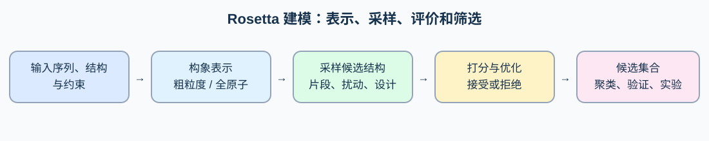
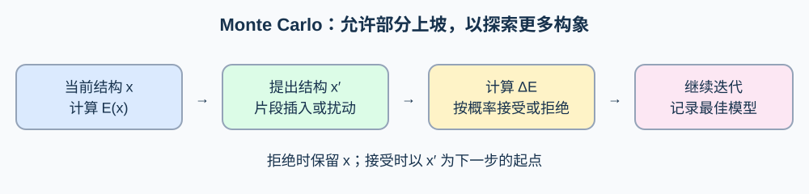
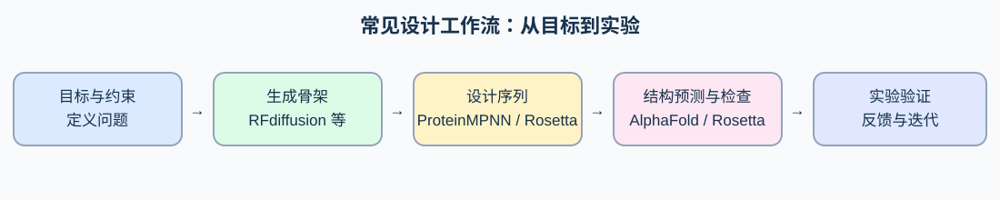

# Rosetta 蛋白质结构建模与计算设计：系统学习笔记

> 面向具备基础蛋白质结构知识的读者。本文以经典 Rosetta 思路为主线，兼顾实际操作；具体命令、默认参数和接口随版本变化，应以所安装版本的帮助与官方文档为准。整理日期：2026-11-12。

## 目录

1. [全景与核心思想](#1-全景与核心思想)
2. [结构表示与数据对象](#2-结构表示与数据对象)
3. [能量函数](#3-能量函数)
4. [采样与 Monte Carlo](#4-采样与-monte-carlo)
5. [片段组装](#5-片段组装)
6. [比较建模与环区建模](#6-比较建模与环区建模)
7. [Packing、最小化与 FastRelax](#7-packing最小化与-fastrelax)
8. [蛋白质设计](#8-蛋白质设计)
9. [突变效应与对接](#9-突变效应与对接)
10. [接口与入门实践](#10-接口与入门实践)
11. [分析、验证与复现](#11-分析验证与复现)
12. [与深度学习方法的比较](#12-与深度学习方法的比较)
13. [局限、常见误区与学习路线](#13-局限常见误区与学习路线)
14. [阅读资源](#14-阅读资源)

## 1. 全景与核心思想

Rosetta 是一套用于生物大分子结构建模、分析和设计的计算软件与方法集合，而不是单一的结构预测模型。它包含从头建模、基于模板的建模、局部重建、蛋白质与配体对接、突变效应估计、序列设计及实验数据约束建模等许多协议。不同协议共享若干构件，但其假设、采样方式和适用范围并不相同。



可用四个问题理解一个 Rosetta 协议：

1. **表示什么？** 蛋白质是粗粒度还是全原子？哪些残基、链和化学组分存在？
2. **怎样产生候选？** 插入片段、改变二面角、重排侧链，还是移动整个结合伙伴？
3. **怎样评价候选？** 采用哪个评分函数、约束和过滤指标？
4. **怎样选择及验证？** 比较独立轨迹、聚类、查看几何与实验一致性，再做实验检验。

结构预测可写成寻找低分构象的近似优化问题：给定序列 $S$，寻找 $x^* \approx \arg\min_x E(x\mid S)$。设计则可将序列 $S$ 与结构 $x$ 一同看作变量：寻找适合目标构象或功能约束的序列—结构组合。这是启发式表述，不意味着分数的全局最低点必然是天然结构或有功能的设计。

**重要区别：采样误差与评分误差。** 如果正确构象没有被产生，再好的评分也无法选出它；若正确构象产生了但分数排序错误，扩大采样也未必解决问题。实践中还存在输入结构、化学状态和目标定义的误差。

## 2. 结构表示与数据对象

### 2.1 主链与自由度

蛋白质主链可用二面角 $\phi$、$\psi$、$\omega$ 描述；侧链由一个或多个 $\chi$ 角描述。键长、键角通常接近理想值，但 Cartesian 协议允许相应的非理想几何变化。固定部分自由度可以减少搜索空间，同时也可能排除真实构象。

### 2.2 Centroid 与全原子

| 表示 | 内容 | 优势与限制 | 常见阶段 |
|---|---|---|---|
| Centroid（粗粒度） | 主链显式表示，侧链简化成质心等伪原子；具体细节随残基类型集而异 | 快速探索大尺度主链；无法精细评价侧链原子接触 | 经典从头折叠、部分环建模及对接初筛 |
| Full-atom（全原子） | 显式主链和侧链原子，通常也包括建模氢原子 | 可评估更精细的堆积、氢键和相互作用；计算更昂贵 | 精修、设计、界面分析 |

两种表示使用不同评分项和权重，分数通常不能直接比较；从 centroid 切换到全原子还需要重建并优化侧链。并非所有 Rosetta 协议都使用两阶段流程。

### 2.3 Pose、编号、FoldTree 和约束

- **Pose**：Rosetta 的中心结构对象，保存残基、坐标、连接关系、构象及相关信息。输入 PDB/mmCIF 只是序列化表示，不等同于 Pose。
- **编号**：Pose 内部通常从 1 连续编号；PDB 编号包含链 ID、残基号和可能的插入码。缺失残基、不同链和插入码会使两者不同。任何突变、选择器或约束都应先核对映射。
- **FoldTree**：描述用于传播坐标变化的运动学树；肽键边和表示刚体关系的 jump 决定某些运动如何影响下游原子。jump 不是“天然存在的共价键”，改变 FoldTree 可改变扰动传播方式。
- **Constraint**：将已知或假设的信息转成额外代价，例如原子间距离、角度或坐标约束。约束文件存在不等于约束一定生效：评分函数中相应项必须有非零权重，且要检查参考原子和编号。

## 3. 能量函数

### 3.1 加权和的思路

常见 Rosetta 总分可概括为 $E_{\mathrm{total}}=\sum_i w_i E_i$，其中 $E_i$ 是某个能量或统计项，$w_i$ 是其权重。模型包括物理启发项与经验/统计项，并非严格完整的第一性原理自由能。常见全原子权重集是 **ref2015**，但具体协议可能要求不同权重及选项。

| 常见项 | 直观作用 | 注意 |
|---|---|---|
| `fa_atr` / `fa_rep` | 原子间吸引 / 排斥，帮助形成合理接触 | 单看某一项可能奖励错误结构；严重碰撞常体现在排斥项 |
| `fa_sol` | 隐式溶剂化近似 | 不显式模拟所有水分子和溶剂动力学 |
| `fa_elec` | 静电相互作用的近似 | 对质子化、介电环境和离子条件敏感 |
| `hbond_*` | 不同类别氢键的方向性评价 | 埋藏极性原子是否满足氢键需单独检查 |
| `fa_dun` | 侧链 rotamer 概率相关项 | 与残基类型及主链构象有关 |
| `rama_prepro`、`p_aa_pp`、`omega` | 主链构象和肽键几何的统计或几何偏好 | 不应把统计偏好当成绝对禁令 |
| `ref` | 氨基酸类型参考项 | 序列设计时影响不同残基类型的相对偏好 |
| `cart_bonded` | Cartesian 最小化中的键长、键角等几何项 | 必须使用与 Cartesian 协议兼容的设置 |

以结构相似、序列和化学组成一致、相同权重与约束处理的候选比较更有意义。不同蛋白、不同长度、不同序列或不同权重集的总分不可简单横比。总分更低不保证溶解性、活性、结合能力或真实折叠状态更好。

### 3.2 REU 与自由能

Rosetta 分数通常以 **Rosetta energy units（REU）**报告。REU 不应未经验证地视为 kcal/mol；单个静态结构分数也不等于包含构象熵、溶剂和标准态的实验 Gibbs 自由能。特定已发表协议可能给出经验缩放，例如官方 `cartesian_ddg` 文档描述了特定情形的换算；不能将该系数普遍用于所有协议、能量项或体系。

## 4. 采样与 Monte Carlo



一次典型 Metropolis 步骤从当前构象 $x$ 产生候选 $x'$，计算 $\Delta E=E(x')-E(x)$。对对称提议，接受概率通常写为：

$$P_{\mathrm{accept}}=\min\left(1,\exp[-\Delta E/T]\right).$$

这里 $T$ 是与评分尺度相匹配的算法温度参数，不必直接解释成实验温度。下降的候选被接受；上升的候选有一定概率被接受，以帮助跨越局部障碍。非对称提议若要严格满足平衡采样，需考虑提议概率比；实际 Rosetta 优化协议可使用退火、阶段变化和启发式操作，不应自动解读为严格的平衡热力学采样。

**当前状态、最佳状态和输出状态可能不同。** 某一步接受了较高能结构不代表结果退化；许多协议还会单独记录历史最低分。温度过低容易困在局部，过高可能难以收敛；多次独立运行和检查结果多样性通常比相信单条轨迹更可靠。

### 4.1 最小化与采样的区别

最小化沿局部梯度调整连续自由度，适合消除局部碰撞和优化几何；它通常不能跨越很大的构象障碍。Monte Carlo、片段插入、loop 重建等能产生更大的变化。二者经常交替使用。

## 5. 片段组装

经典 Rosetta 从头建模利用天然蛋白中局部结构具有可复用模式的观察。先为每个目标序列位置寻找与局部序列、预测二级结构等相容的短片段，建立片段库；再把片段的主链构象信息插入对应窗口，结合评分与 Monte Carlo 反复搜索。

一个概念性流程：

1. 准备序列及每个位置的候选片段；经典流程常使用 3-mer 和 9-mer，具体依协议而定。
2. 从初始链或部分模型出发，在重叠窗口中反复插入片段，以改变局部主链二面角。
3. 在 centroid 表示下使用低分辨率评分和分阶段采样探索整体拓扑。
4. 从大量独立轨迹中产生 decoy，分析能量、结构聚类与收敛性。
5. 对选定候选恢复全原子侧链并进行精修与再评价。

片段提供的是**局部构象先验**，不是把整条蛋白机械拼成固定片段，也不能单独决定远程接触。插入一个局部片段可能改变下游全局空间位置；拓扑正确与否还依赖全局打分、约束和充分采样。长蛋白、多结构域、复杂拓扑和缺少有效约束时，组合空间特别大。现代工作可加入接触、距离或实验约束，但不能假设所有协议都会自动使用它们。[Rosetta Encyclopedia](https://docs.rosettacommons.org/docs/latest/rosetta_basics/RosettaEncyclopedia)

## 6. 比较建模与环区建模

### 6.1 Comparative modeling

当有相关结构模板时，利用模板的信息减少搜索空间：

1. 搜索并选择模板，评估序列相似性、覆盖度、分辨率、配体和生物学状态。
2. 对齐目标与模板；检查保守结构核心、二级结构和插入/缺失位置。
3. 将目标序列映射或 threading 到模板骨架；替换残基并处理缺失片段。
4. 对插入、缺失和低可信区域进行 loop rebuilding；对其他区域在合理约束下重排侧链及精修。
5. 生成多个模型，检查链连续性、局部几何、模板偏差及与实验数据的一致性。

模板质量和对齐错误常比后续精修更关键。多模板可以扩展覆盖但也可能引入不相容的状态。局部最低分不能证明对齐正确；应该检查不同对齐或模板产生的模型是否一致。[官方比较建模示例](https://docs.rosettacommons.org/demos/latest/public/legacy_comparative_modeling/comparative_modeling)

### 6.2 Loop modeling：既要探索，又要闭合

给定两侧锚点，环区建模需要在改变主链构象的同时连接两端，并避免碰撞、扭曲键几何和不合理二面角。常见方法包括：

- **CCD**：迭代调整二面角，使活动链末端接近目标锚点；实现相对直观，但闭合不代表构象正确。
- **KIC / NGK**：选择枢轴，采样其他自由度并求解闭合几何；可配合片段、二面角分布和能量优化。具体算法及推荐设置取决于任务与版本。
- **GeneralizedKIC**：将闭合推广到更多聚合物、连接方式和环状体系；闭合失败也应显式检查。

长环、埋藏环以及依赖结合伙伴的环往往难以确定；输出应包含多个候选、链闭合/几何检查和与实验的比较。无序区域可能是构象集合，强行给出单个精确结构往往不恰当。[环建模算法](https://docs.rosettacommons.org/docs/latest/rosetta_basics/structural_concepts/loopmodel-algorithms)；[GeneralizedKIC](https://docs.rosettacommons.org/docs/latest/scripting_documentation/RosettaScripts/composite_protocols/generalized_kic/GeneralizedKIC)

## 7. Packing、最小化与 FastRelax

### 7.1 侧链 packing

**Rotamer** 是侧链构象的常见离散状态。Packer 从每个可动位点的候选 rotamer 中寻找组合，使给定背景结构下的总分较低；常使用模拟退火等近似组合优化方法。由于各侧链相互作用，一个位点最优 rotamer 取决于邻居，不能简单逐位独立选择。

- **Repacking**：保持每个位点的氨基酸类型，只优化侧链构象。
- **Design packing**：同时允许位点从指定氨基酸类型和 rotamer 中选择。
- **固定**：某位置既不换类型也不重排侧链；不等于固定它的主链。
- 加入额外 rotamer、当前构象和邻域位置可改善搜索，也会增加开销。

TaskOperations、resfile 等用于控制可设计和可重排的残基；MoveMap 主要控制最小化可动自由度。二者不是同一件事，具体 mover 对两者的处理还需查文档。

### 7.2 FastRelax

FastRelax 通常交替执行侧链重排与连续最小化，并在重复过程中调整排斥项等权重，帮助结构从局部碰撞中恢复，再在完整评分下优化。实际步骤取决于 relax script 和版本。它适合**已有合理结构附近**的局部优化，不保证纠正错误折叠、错误对齐或严重缺失片段。

- **Torsion-space**：主要优化二面角；**Cartesian**：在笛卡尔坐标下允许非理想几何，需要兼容的评分函数及设置。
- 无约束的 relax 可使实验结构或预测结构偏离原始坐标；若需要保留参考构象，选择合适坐标约束并检查其权重。
- 生成多条独立轨迹，检查 RMSD、局部几何、氢键、碰撞和目标区域；最低总分并非唯一准则。
- FastRelax 的 MoveMap 和 packing 限制有特定交互与选项，固定 $\chi$ 自由度并不总是自动禁止该位置 packing，应查对应版本文档。[FastRelax 文档](https://docs.rosettacommons.org/docs/latest/scripting_documentation/RosettaScripts/Movers/movers_pages/FastRelaxMover)

## 8. 蛋白质设计

设计是寻找满足结构与功能要求的序列。最简单的固定骨架设计在目标主链不变时对选定位点进行氨基酸和 rotamer 搜索；柔性骨架设计允许局部或整体结构调整。两者都是近似优化，且都依赖目标状态建模正确。

### 8.1 从问题到候选

1. **定义目标与负目标**：稳定性、特异结合、催化几何、避免聚集或避免其他结合对象等；这些目标不一定能由同一个总分表达。
2. **准备结构与化学状态**：核对生物学组装体、缺失环、配体、金属、二硫键和质子化假设。
3. **选择设计空间**：限制功能位点，指定可设计位点及允许的氨基酸；周围位点可只重排，远处可固定。
4. **产生多样候选**：改变随机种子、骨架或约束，进行 design packing 和适当的精修。
5. **多指标筛选**：总分、界面、埋藏未满足极性基团、疏水暴露、几何及序列合理性；考虑负设计和对照。
6. **独立预测与实验**：重新预测或评估候选，并测试表达、稳定性与功能，根据结果迭代。

约束过强可能掩盖差几何，约束过弱可能丢失功能；固定骨架容易过拟合某个结构。对于酶设计，低能量或符合局部几何并不能证明催化：还需评估反应状态、动力学、底物结合和实验活性。

## 9. 突变效应与对接

### 9.1 稳定性 $\Delta\Delta G$

先写清楚符号。设折叠自由能 $\Delta G_{\rm fold}=G_{\rm folded}-G_{\rm unfolded}$，则：

$$\Delta\Delta G_{\rm fold}=\Delta G_{\rm fold}^{\rm mutant}-\Delta G_{\rm fold}^{\rm WT}.$$

按此约定，正值通常表示突变使折叠相对不利，即倾向于降低稳定性；若文献定义的是解折叠自由能，符号会相反。Rosetta 常以优化后突变体与野生型的能量差作为近似指标，具体计算、重复数、汇总方式及尺度要遵守所选协议，不能把它直接等同于上述完整自由能。

实践：使用经过适当准备的同一结构背景，核对突变的 PDB/Pose 编号和原氨基酸；分别对 WT 和 mutant 进行匹配的采样与优化；使用多个重复并报告离散程度。对 buried 极性网络、质子化变化、结构重排及多突变耦合尤其谨慎。`cartesian_ddg` 的官方教程针对单体稳定性列出具体预处理、评分参数、重复和输出方式；界面问题应采用针对性的协议并核查其验证范围。[cartesian_ddg 文档](https://docs.rosettacommons.org/docs/latest/cartesian-ddG)

### 9.2 蛋白质对接

对接探索结合伙伴的相对平移、旋转以及必要的侧链或主链柔性。经典 RosettaDock 思路可包含粗粒度刚体搜索，随后全原子界面重排和精修；局部对接依赖接近正确的起始姿态，全局搜索则需要更广泛采样。检查链划分、jump、结合位点、对称性和构象状态；不要只凭一条最低能模型认定结合模式。

粗略的分离能指标可写为 $\Delta E_{\rm interface}=E_{AB}-(E_A+E_B)$；具体数值依赖分离后是否重排、结构约束及协议。结合突变效应则比较 mutant 和 WT 的结合指标之差。它们都不是自动获得的实验结合自由能或 $K_d$。同时检查界面面积、形状互补、氢键、埋藏未满足极性基团、碰撞和竞争结合伙伴。蛋白—配体对接还依赖配体参数、质子化、构象和水/金属处理。

## 10. 接口与入门实践

### 10.1 三种入口

| 入口 | 用途 | 优势 | 注意 |
|---|---|---|---|
| Rosetta 命令行应用 | 运行已有专用协议 | 适合批处理和已有标准流程 | 可执行文件名、编译方式及选项随发行版变化 |
| RosettaScripts | 用 XML 组合 score functions、selectors、task operations、movers 和 filters | 适合声明和复用多步骤流程 | 定义组件不等于执行，必须在 `PROTOCOLS` 中加入；检查版本的 XML schema |
| PyRosetta | Python 中操作 Pose、评分、mover 与分析 | 适合交互、定制控制流和与数据分析结合 | API、安装和授权依发行版而变；Python 循环不一定适合密集底层计算 |

RosettaScripts 的典型逻辑是：`SCOREFXNS` 定义评分；`RESIDUE_SELECTORS` 选择区域；`TASKOPERATIONS` 限制 packing/design；`MOVERS` 定义操作；`FILTERS` 定义判据；`PROTOCOLS` 按顺序运行。过滤器失败可能终止该轨迹并影响输出，因此要检查日志及成功率。[RosettaScripts 文档](https://docs.rosettacommons.org/docs/latest/scripting_documentation/RosettaScripts/RosettaScripts)

### 10.2 PyRosetta 最小示例：读入和评分

以下示例假设已正确安装并获得适用许可，且 `input.pdb` 位于当前目录；它只读取、评分、输出副本，不进行设计或 relax。运行前检查文件与化学组分是否受支持。

```python
import pyrosetta

pyrosetta.init()
pose = pyrosetta.pose_from_pdb("input.pdb")
scorefxn = pyrosetta.create_score_function("ref2015")
score = scorefxn(pose)
print("residues:", pose.total_residue())
print("total score (REU):", score)
pose.dump_pdb("scored_copy.pdb")
```

保存为 `score_example.py` 后用已安装 PyRosetta 的 Python 环境运行 `python score_example.py`。检查日志中的未知残基、缺失原子和链处理；输出 PDB 不保证与输入逐字相同。首次学习时建议在小型、标准残基单链结构上运行，随后对照官方教程逐项添加操作。[PyRosetta 文档](https://www.pyrosetta.org/documentation)

### 10.3 RosettaScripts 最小示例：FastRelax

保存为 `relax.xml`，并使用本机 RosettaScripts 可执行文件。此例无坐标约束，可能改变输入结构；只作为理解协议结构的起点，不适合直接当成突变 ddG 的标准流程。

```xml
<ROSETTASCRIPTS>
  <SCOREFXNS>
    <ScoreFunction name="sf" weights="ref2015"/>
  </SCOREFXNS>
  <MOVERS>
    <FastRelax name="relax" scorefxn="sf" repeats="2"/>
  </MOVERS>
  <PROTOCOLS>
    <Add mover="relax"/>
  </PROTOCOLS>
  <OUTPUT scorefxn="sf"/>
</ROSETTASCRIPTS>
```

```bash
# 将路径替换为本地可执行文件；文件名因系统、编译而异
/path/to/rosetta_scripts -s input.pdb -parser:protocol relax.xml -nstruct 5
```

`-nstruct 5` 请求产生 5 个输出轨迹，不能保证每个输出都正确或相互独立到足以收敛。通过 `-help`、日志和本地版本文档确认数据库路径、输出位置和支持的选项。示例是说明性代码，未在本笔记环境中用 Rosetta 实际执行。

### 10.4 可复现的实践流程

1. **写清问题**：输入、目标状态、需要改变的自由度、评价指标和实验验证方式。
2. **准备输入**：检查链、序列、缺失残基、替代构象、配体/金属、二硫键和残基编号；保留原始文件。不要盲目删除对功能必要的组分。
3. **选协议**：先运行官方 demo 或已发表 protocol capture，再按问题逐步修改；确认数据库、参数文件、权重、约束和授权。
4. **小规模试运行**：检查日志、结构是否被正确读入，验证选择器、可动区域、设计位点和约束确实生效。
5. **批量采样**：按计算预算启动独立轨迹，记录随机种子、版本、命令、输入、权重及硬件/环境。
6. **分析与复核**：汇总分数与失败率、聚类、可视化、检查几何及任务特异指标，并与对照比较。
7. **实验及迭代**：筛选一组兼顾质量与多样性的候选，不仅送测单一最低分模型。

## 11. 分析、验证与复现

- **看分布**：比较独立轨迹的分数分布和最低分稳定性；随着采样增加检查是否出现新的低分簇。收敛是有用证据，但不是正确性的证明。
- **看结构**：RMSD 需先定义对齐原子与参考结构；局部 RMSD、接触图和聚类可以补充全局 RMSD。没有真值结构时不能计算与真值的 RMSD。
- **看化学**：检查碰撞、键几何、Ramachandran 离群、rotamer、埋藏未满足极性基团、二硫键及配体几何。对于界面和功能位点作局部检查。
- **看数据一致性**：将模型与实验密度、交联、突变或其他独立数据比较；用于建模的约束不能同时视作独立验证。
- **看不确定性**：改变模板、起始结构、随机种子或合理参数，查看结论是否稳健。对不同序列和长度比较时谨慎解释总分。
- **留记录**：软件和数据库版本、代码、参数、输入哈希、编号映射、随机种子、失败日志、筛选规则和全部候选的来源。

## 12. 与深度学习方法的比较



| 方法 | 典型输入 → 输出 | 主要作用 | 关键限制 |
|---|---|---|---|
| Rosetta | 序列、结构、约束 → 结构候选、分数或设计序列 | 显式结构采样、能量优化和可控协议 | 耗时、采样与打分误差；依赖化学状态及协议 |
| AlphaFold 系列 | 序列及具体版本支持的上下文 → 预测结构及置信指标 | 学习到的结构预测；具体能力随版本而变 | 置信度不是实验验证；状态、柔性与相互作用可能有误 |
| ProteinMPNN | 给定蛋白骨架及设计约束 → 相容序列 | 基于结构的快速序列设计 | 不保证表达、稳定性或功能；依赖输入骨架 |
| RFdiffusion | 设计条件、结构或基序等 → 新骨架候选 | 扩散模型生成满足条件的蛋白结构 | 生成结构需序列设计、独立评估与实验验证 |

它们解决的是相互关联但不同的任务。常见组合是 RFdiffusion 生成骨架、ProteinMPNN 设计序列、AlphaFold 类模型重新预测、Rosetta 做局部精修和几何/能量分析，再进行实验。这个流程不是唯一选择，亦不能假设各工具的误差独立；如果预测器和生成器共享训练偏差，相互印证也可能高估可信度。AlphaFold 的 pLDDT 是局部置信指标，PAE 可帮助判断区域相对位置的不确定性，均不直接衡量稳定性、结合亲和力或实验成功率。

原始研究：[AlphaFold 2](https://doi.org/10.1038/s41586-021-03819-2)；[ProteinMPNN](https://doi.org/10.1126/science.add2187)；[RFdiffusion](https://doi.org/10.1038/s41586-023-06415-8)。

## 13. 局限、常见误区与学习路线

### 局限

Rosetta 常使用隐式溶剂和近似能量模型；构象熵、动力学、pH、配体、金属和环境依赖效应可能未被充分表示。正确结果需要合理输入和足够采样，而构象空间巨大；低分模型、收敛簇或单个优化结构都不是天然结构、功能或热力学的证明。无序蛋白、多状态转换以及大型复合体尤其需要其他方法和实验信息。

### 常见误区

1. **“总分最低就是真实结构”**：分数是近似评价，需检查采样、几何和独立证据。
2. **“Relax 能从错误折叠中得到正确折叠”**：它主要优化局部，不能替代全局重建。
3. **“REU 就是 kcal/mol”**：不能泛化；特定协议的经验校准有适用边界。
4. **“固定主链就固定了一切”**：侧链 packing、jump 和其他自由度可能仍可变化，需分别设置并验证。
5. **“输入约束就必然生效”**：还要检查相关 score term 权重和实际应用。
6. **“高预测置信度等于高稳定性或强结合”**：预测置信度和实验性质是不同量。

### 建议学习顺序

先熟悉蛋白几何、结构文件和可视化；再用 PyRosetta 读取并评分小结构，弄清 Pose 和编号；然后学习 repacking、MoveMap、FastRelax，尝试局部设计与多轨迹分析；最后进入环重建、比较建模、对接和 ddG，并复现与目标问题相近的官方 demo。每一步都以已知结构、合理对照和可解释的失败案例检验理解。

## 14. 阅读资源

- [Rosetta 官方教程与 demos](https://docs.rosettacommons.org/demos/latest/Home)：按问题选择完整输入与协议。
- [Rosetta Encyclopedia](https://docs.rosettacommons.org/docs/latest/rosetta_basics/RosettaEncyclopedia)：基础概念与术语。
- [RosettaScripts 文档](https://docs.rosettacommons.org/docs/latest/scripting_documentation/RosettaScripts/RosettaScripts)：XML 结构、组件及协议。
- [PyRosetta 文档](https://www.pyrosetta.org/documentation)：安装、教程和 Python 接口。
- [FastRelax 文档](https://docs.rosettacommons.org/docs/latest/scripting_documentation/RosettaScripts/Movers/movers_pages/FastRelaxMover)；[环建模算法](https://docs.rosettacommons.org/docs/latest/rosetta_basics/structural_concepts/loopmodel-algorithms)；[cartesian_ddg](https://docs.rosettacommons.org/docs/latest/cartesian-ddG)。
- Alford 等，Rosetta 全原子能量函数：[The Rosetta All-Atom Energy Function for Macromolecular Modeling and Design](https://doi.org/10.1021/acs.jctc.7b00125)。
- Rohl 等，经典结构预测与片段组装：[Protein Structure Prediction Using Rosetta](https://doi.org/10.1016/S0076-6879(04)83004-0)。
- [AlphaFold 2 论文](https://doi.org/10.1038/s41586-021-03819-2)；[ProteinMPNN 论文](https://doi.org/10.1126/science.add2187)；[RFdiffusion 论文](https://doi.org/10.1038/s41586-023-06415-8)。

> 本文中的图为教学示意，并非分子结构的尺度图。复制或移动 Markdown 文件时，请同时保留同级的 `Rosetta_示意图` 文件夹，以维持相对图片链接。
