# 《蛋白质设计》图文详解复习笔记 — Chapter 0: Introduction to Protein Design（蛋白质设计导论）

> **课件范围**：Chapter 0 全章节（共 26 页 PPT，含 **17 张课件原图高清截图**、**10 幅权威文献/百科配图** 与 **8 幅结构化原理示意图**）  
> **核心模块**：蛋白质多样性（Protein Diversity）与计算蛋白质设计（Computational Protein Design）  
> **使用说明**：若在本地 Typora / Obsidian / VS Code 中打开本文件，请将压缩包完整解压，确保 `img/` 文件夹与本 `.md` 文件位于同一目录下，即可同时显示全部课件原图与文献网络配图。

## 一、 课程全貌与核心脉络概览（Slides 1, 8, 10, 23, 25, 26）

本讲作为《蛋白质设计》（Protein Design）的开篇导论，围绕**“自然界蛋白质为何如此多样且精巧”**以及**“人类如何突破自然演化的边界去设计全新蛋白质”**两大核心问题展开。

### 全章知识体系架构图

```text
                        ┌──────────────────────────────────────────────────────┐
                        │     Chapter 0: Introduction to Protein Design        │
                        └──────────────────────────┬───────────────────────────┘
                                                   │
                 ┌─────────────────────────────────┴─────────────────────────────────┐
                 ▼                                                                   ▼
┌─────────────────────────────────────────┐                         ┌─────────────────────────────────────────┐
│      模块一：蛋白质多样性本质            │                         │      模块二：计算蛋白质设计体系          │
│         (Protein Diversity)             │                         │    (Computational Protein Design)       │
├─────────────────────────────────────────┤                         ├─────────────────────────────────────────┤
│ • 宏观维度：Sequence → Structure → Func │                         │ 1. 三个设计层级 (Multiple Levels)       │
│ • 演化视角：生命之树与历史路径依赖       │                         │    • Level 1: 微调优化已有功能          │
│ • 物理视角：                             │                         │    • Level 2: 改写/组合已有结构与功能    │
│   - 构象空间 (~10^2N) 与 Levinthal 悖论 │                         │    • Level 3: 从头设计 (De novo design) │
│   - 折叠能量漏斗 F(phi, psi, chi)       │                         │ 2. 两大核心流派 (Two Schools)           │
│   - 序列空间 (20^N) 的组合爆炸          │                         │    • Sequence-centric (定向进化/适应度) │
└─────────────────────────────────────────┘                         │    • Structure-centric (基序+骨架+序列) │
                                                                    │ 3. 两大计算模型 (Computational Models)  │
                                                                    │    • 物理模型 (Rosetta: Pose/Mover/REU) │
                                                                    │    • 深度学习 (AlphaFold / RFdiffusion) │
                                                                    └─────────────────────────────────────────┘
```

| 核心模块 | 关键子主题 | 对应课件页码 | 核心科学问题 |
| :--- | :--- | :--- | :--- |
| **1. 蛋白质的多样性本质**（Protein Diversity） | 序列-结构-功能范式、演化视角、物理学视角（序列空间与构象空间） | Slides 1–7 | 自然界如何从天文数字般的可能序列与构象中筛选出具有特定功能的折叠态蛋白质？ |
| **2. 蛋白质设计的层级与两大流派**（Levels & Two Schools of Thought） | 三个功能设计层级；序列中心（Sequence-centric）vs. 结构中心（Structure-centric） | Slides 8–23 | 给定目标功能，我们应当通过“序列突变+功能筛选”模拟演化，还是通过“功能基序+骨架支撑+序列逆向设计”从头构建？ |
| **3. 计算蛋白质设计模型与学科意义**（Computational Models & Motivation） | 基于物理的模型（[Rosetta](https://rosettacommons.org/)）vs. 深度学习生成模型（[AlphaFold](https://pubmed.ncbi.nlm.nih.gov/34265844/) / Hallucination / [RFdiffusion](https://pubmed.ncbi.nlm.nih.gov/37433327/)） | Slides 24–26 | 如何用能量函数或深度生成网络高效搜索序列与结构空间？设计蛋白质的终极科学价值是什么？ |

## 二、 模块一：蛋白质的多样性与物理基础（Protein Diversity）

### 1. 宏观图景：序列、结构与功能的浩瀚世界（Slide 2）


*▲ 图 1-1（网络拓展配图）：结构生物学家兼科学插画家 [David S. Goodsell](https://pdb101.rcsb.org/motm/motm-goodsell) 绘制的蛋白质分子世界全景图（来源：[RCSB PDB Molecule of the Month](https://pdb101.rcsb.org/motm/motm-about)）*

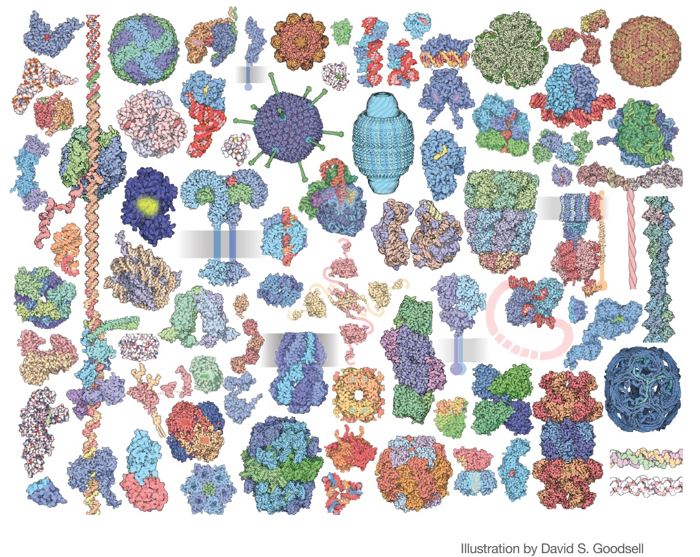
*▲ 课件原图（Slide 2）：An Immense World of Proteins（本地路径：`img/fig01_slide02_goodsell_proteins.png`）*

* **课件核心内容**：
  * 引用了 [David S. Goodsell](https://pdb101.rcsb.org/motm/motm-goodsell) 绘制的蛋白质分子全景图，直观展示了细胞内外形态各异的蛋白质机器（如跨膜通道、球状酶、纤维状胶原蛋白/肌动蛋白、病毒衣壳、核糖体及分子伴侣复合物等）。
  * 提出研究蛋白质的三大基本维度：**Sequence（序列）**、**Structure（结构）**、**Function（功能）**。
* **知识点深度拓展**：
  * **中心法则与结构生物学基本范式**：遗传信息由 DNA 转录为 mRNA，再经核糖体翻译为一维氨基酸线性序列（一级结构，Primary Structure）。在生理水相环境中，多肽链自发折叠为特定的三维空间结构（二级、三级及四级结构），进而凭借精确排布的催化残基或结合界面行使生物学功能（即 `Sequence → Structure → Function`）。
  * **结构多样性的尺度和层级**：蛋白质的大小跨度极大，从几十个氨基酸的小肽/微蛋白（Miniproteins）到由数十个亚基组装而成的兆道尔顿（MDa）级分子机器（如 ATP 合酶、蛋白酶体）。这种结构多样性使得蛋白质能够承担催化化学反应（酶）、信号转导（受体与激酶）、物质跨膜运输（离子通道与转运体）、机械支撑（胶原蛋白、肌动蛋白）以及免疫识别（抗体）等几乎所有生命活动。


*▲ 图 1-2（网络拓展配图）：蛋白质结构的四个层级——从氨基酸序列（Primary）到局部二级结构（Secondary，$\alpha$-螺旋与 $\beta$-折叠）、单链三维折叠（Tertiary）及多亚基组装（Quaternary）（来源：[Wikimedia Commons](https://en.wikipedia.org/wiki/Protein_folding)）*

### 2. 演化视角下的蛋白质多样性（Slide 3）


*▲ 图 1-3（网络拓展配图）：涵盖细菌（Bacteria）、古菌（Archaea）和真核生物（Eukaryota）三大域的系统发生生命之树（来源：[Wikimedia Commons](https://en.wikipedia.org/wiki/Last_universal_common_ancestor)）*

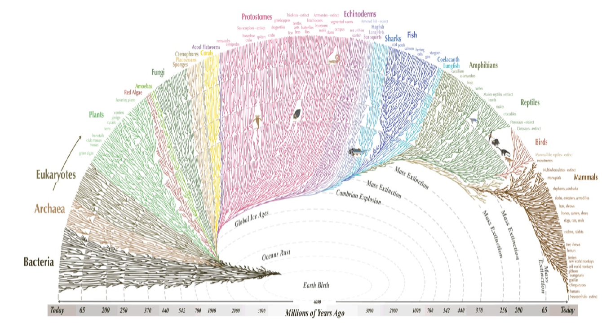
*▲ 课件原图（Slide 3）：Protein Diversity through the Lens of Evolution（本地路径：`img/fig02_slide03_tree_of_life.png`）*

* **课件核心内容**：
  * 展示了从地球诞生（Earth Birth，约 40–45 亿年前）到今天（Today）的生命演化扇形时间树，涵盖细菌（Bacteria）、古菌（Archaea）和真核生物（Eukaryotes：植物、真菌、原口动物、棘皮动物、鱼类、两栖类、爬行类、鸟类、哺乳动物等），并标注了海洋氧化（Oceans Rust）、全球冰期（Global Ice Ages）、寒武纪大爆发（Cambrian Explosion）及多次生物大灭绝（Mass Extinction）等关键地质与演化节点。
* **知识点深度拓展**：
  * **自然演化的路径依赖与偶然性（Path-Dependence & Historical Contingency）**：自然界现存的所有蛋白质都是数十亿年达尔文演化（随机基因突变、基因重组、基因复制与自然选择）的产物。自然演化并非从零开始遍历所有可能的氨基酸组合，而是在已有祖先蛋白（Ancestral Proteins）的基础上进行局部的“修补”（Tinkering）。
  * **自然采样空间的极度稀疏性**：由于演化受限于种群规模、世代时间、遗传密码约束以及“中间突变体必须保持一定生存适应度（Viability）”的限制，自然界在 40 亿年间实际探索过的蛋白质序列，仅仅是理论序列空间中极其微小的一粟（详见 Slide 6 的定量计算）。这正是人类开展**从头蛋白质设计（De novo Protein Design）**的根本契机——自然界未曾涉足的广阔空白地带中，蕴藏着无数具备全新结构和功能的稳定蛋白质。

### 3. 物理学视角：能量漏斗、构象空间与序列空间（Slides 4–7）

课件第 4 至 7 页从统计热力学与生物物理学角度，将蛋白质问题拆解为两个高维空间的映射关系：**构象空间（Conformational Space）**与**序列空间（Sequence Space）**。

#### （1） 折叠热力学与能量景观（Energy Landscape / Folding Funnel，Slides 4 & 5）


*▲ 图 1-4（网络拓展配图）：蛋白质折叠能量漏斗（Folding Funnel）模型——漏斗宽度代表构象熵（Conformational Entropy），深度代表焓/内能（Energy），多肽链从顶部高熵去折叠态沿漏斗壁向底部唯一天然态（Native State）汇聚（来源：[Wikimedia Commons](https://commons.wikimedia.org/wiki/File:Folding_funnel_schematic.svg)）*

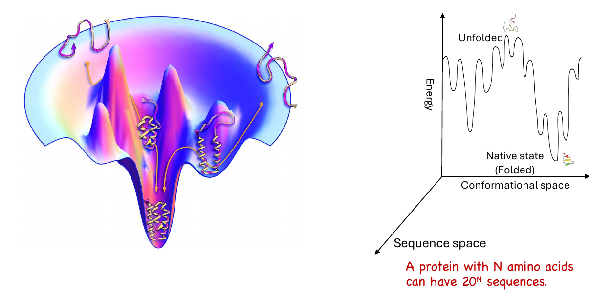
*▲ 课件原图（Slide 4）：Protein Diversity through the Lens of Physics — 折叠能量漏斗与能量-构象-序列三维映射（本地路径：`img/fig03_slide04_folding_funnel_physics.png`）*

```text
  能量 (Energy, E / ΔG)
   ▲
   │   ╭─╮ ╭─╮  Unfolded states (去折叠态：高能量、高构象熵，海量随机卷曲构象)
   │  ╭╯ ╰─╯ ╰╮
   │  │       ╰─╮ ╭─╮
   │  │         ╰─╯ │   ← 局部能量极小值 (Local minima / Kinetic traps：错误折叠或中间体)
   │                │ ╭─╮
   │                ╰─╯ │     ╭─╮
   │                    │     │ ╰─╮
   │                    │  ╭──╯   │
   │                    ╰──╯      │  Native state (天然折叠态：全局自由能最低点 Global Minimum)
   └──────────────────────────────┴────────────────────► 构象空间 (Conformational Space: φ, ψ, χ)
                              ╱
                            ╱
                          ▼
               序列空间 (Sequence Space: 20^N possible sequences)
```

* **课件核心内容**：
  * 左图展示了三维**折叠能量漏斗（Folding Funnel）**，右图展示了能量（Energy）随构象空间（Conformational Space）与序列空间（Sequence Space）变化的截面图。
  * **Unfolded state（去折叠态/非折叠态）**：位于漏斗顶部，能量高、构象熵极大，包含海量随机卷曲（Random Coil）构象。
  * **Native state（天然折叠态）**：位于漏斗底部全局能量极小值（Global Free Energy Minimum）处，构象唯一且热力学稳定。
  * 漏斗壁上的凹凸起伏代表局部能量极小值（Local Minima / Kinetic Traps，即折叠中间体或错误折叠态）。
* **知识点深度拓展**：
  * **安芬森法则（Anfinsen's Dogma / Thermodynamic Hypothesis）**：诺贝尔化学奖得主 Christian Anfinsen 通过核糖核酸酶 A（RNase A）的变性与复性实验证明，在生理环境（温度、溶剂、pH、离子强度）恒定的条件下，蛋白质的天然三维结构完全由其一维氨基酸序列决定，且天然态对应于体系吉布斯自由能（Gibbs Free Energy, $G$）最低的热力学稳定态：
    $$\Delta G_{\text{folding}} = G_{\text{folded}} - G_{\text{unfolded}} = \Delta H - T\Delta S < 0$$
  * **折叠的驱动力与热力学博弈**：
    * **构象熵（Conformational Entropy, $\Delta S_{\text{conf}} < 0$）**：多肽链从高度无序的去折叠态坍缩为有序的天然态，链自身的构象熵急剧减小，这在热力学上是不利的（$-T\Delta S_{\text{conf}} > 0$）。
    * **疏水效应（Hydrophobic Effect, $\Delta S_{\text{solvent}} > 0$）**：非极性侧链在去折叠态下暴露于水中，迫使周围水分子形成有序的“笼状结构”（Clathrate-like cage）；当蛋白质折叠将非极性残基埋藏于疏水核心（Hydrophobic Core）时，原本受束缚的水分子被释放回本体溶液，溶剂熵大幅增加，成为驱动蛋白质折叠最主要的自由能来源。
    * **焓变贡献（Enthalpic Contributions, $\Delta H < 0$）**：主链与侧链之间的分子内氢键（Hydrogen Bonds，驱动 $\alpha$-螺旋和 $\beta$-折叠形成）、紧密堆积带来的范德华相互作用（van der Waals packing）以及带电残基之间的盐桥/静电吸引（Electrostatic Attraction / Salt Bridges）共同提供了有利的负焓变。
    * **净稳定性边际（Marginal Stability）**：天然球状蛋白的净折叠自由能通常仅为 $\Delta G_{\text{folding}} \approx -5 \text{ to } -15 \text{ kcal/mol}$（仅相当于几根氢键的能量），这种“边缘稳定性”既保证了结构的成型，又赋予蛋白质在行使催化或变构调节功能时必需的构象柔性与动力学特征。

#### （2） 蛋白质构象空间与利文索尔悖论（Protein Conformational Space & Levinthal's Paradox，Slides 5 & 7）


*▲ 图 1-5（文献拓展配图）：多肽链主链扭转角/二面角 $\phi$（围绕 $\text{N}-\text{C}_\alpha$ 键）、$\psi$（围绕 $\text{C}_\alpha-\text{C}$ 键）与 $\omega$（肽平面角，约 $180^\circ$）的几何定义（来源：[PMC3149190](https://pmc.ncbi.nlm.nih.gov/articles/PMC3149190/)）*


*▲ 图 1-6（网络拓展配图）：拉氏图（Ramachandran Plot）中主链二面角 $(\phi, \psi)$ 因原子空间位阻而形成的允许区域（$\alpha$-螺旋区与 $\beta$-折叠区）（来源：[Wikimedia Commons](https://en.wikipedia.org/wiki/Ramachandran_plot)）*

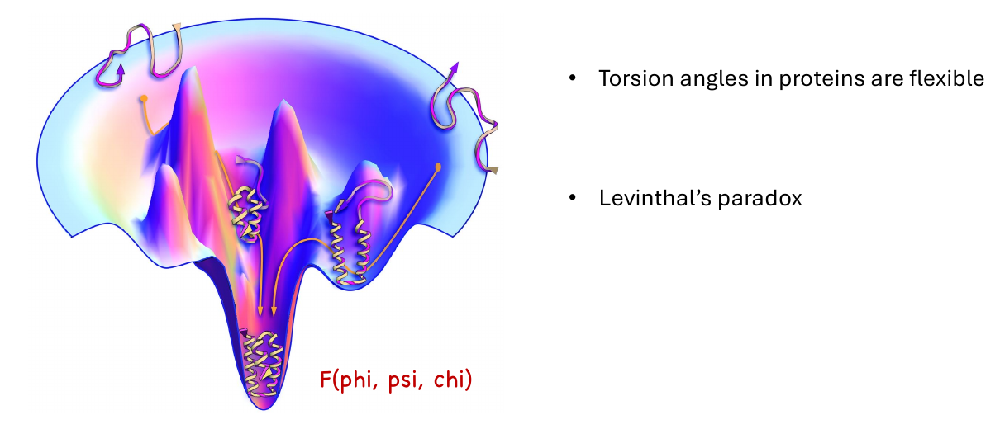
*▲ 课件原图（Slide 5）：Protein Conformational Space — 柔性扭转角 $F(\phi, \psi, \chi)$ 与利文索尔悖论（本地路径：`img/fig04_slide05_conformational_space.png`）*

```text
          H       O                 H       O
          │       ║                 │       ║
  ─── N ──┼── Cα ─┼── C ─────── N ──┼── Cα ─┼── C ───
          │   │   │             │   │   │   │
          ◀───┼───▶             ◀───┼───▶   │
           φ (phi)    ω ≈ 180°   φ (phi)    │
              ◀───────▶             ◀───────▶
               ψ (psi)               ψ (psi)
                  │                     │
                  ▼ 侧链旋转角          ▼ 侧链旋转角
               χ1, χ2... (chi)       χ1, χ2... (chi)
```

* **课件核心内容**：
  * 蛋白质中的扭转角/二面角（Torsion angles / Dihedral angles）是柔性的，蛋白质的能量可表示为全原子二面角的函数：$F(\phi, \psi, \chi)$。
  * 提出著名的**利文索尔悖论（Levinthal's Paradox）**。
  * Slide 7 给出定量估计：一条含有 $N$ 个氨基酸的多肽链，其主链可能构象数约为 **$\sim 10^{2N}$**。
* **知识点深度拓展**：
  * **蛋白质二面角定义（$\phi, \psi, \omega, \chi$）**：
    * **主链二面角**：由于肽键（$\text{C}-\text{N}$）具有部分双键性质，肽平面二面角 $\omega$ 通常固定为约 $180^\circ$（反式 *trans*，极少数脯氨酸前可呈 $0^\circ$ 顺式 *cis*）。因此，主链构象自由度主要取决于围绕 $\text{N}-\text{C}_\alpha$ 键旋转的 **$\phi$（phi）角**和围绕 $\text{C}_\alpha-\text{C}$ 键旋转的 **$\psi$（psi）角**。
    * **拉氏图（Ramachandran Plot）与 $\sim 10^{2N}$ 的推导**：虽然空间位阻（Steric Hindrance）限制了 $(\phi, \psi)$ 的允许区域（主要集中在右手 $\alpha$-螺旋区、$\beta$-折叠区和左手螺旋区），但若将每个残基的 $\phi$ 和 $\psi$ 各自离散化为约 10 个精细亚态（或考虑每个残基约有 $10^2 = 100$ 种主链局部构象采样），则长度为 $N$ 的多肽链就有 $(10^2)^N = 10^{2N}$ 种主链构象。即使用最保守的估计（每个残基仅取 3 种主链构象状态），$N=100$ 的小蛋白也有 $3^{100} \approx 5 \times 10^{47}$ 种主链构象。
    * **侧链二面角 $\chi$（chi）与旋转异构体（Rotamers）**：侧链单键的旋转角记为 $\chi_1, \chi_2, \chi_3, \chi_4$。由于局部空间位阻，侧链倾向于采取能量较低的离散构象（通常围绕 $60^\circ [g^+]$、$180^\circ [t]$、$-60^\circ [g^-]$ 分布），在计算蛋白质设计中将其归纳为**旋转异构体库（Rotamer Library）**，以将连续的侧链搜索空间转化为离散组合优化问题。
  * **利文索尔悖论（Levinthal's Paradox，1969）的本质与消解**：
    * **悖论陈述**：假设一条含 100 个残基的多肽链具有 $10^{100}$（或 $10^{200}$）种构象，即使多肽链以单键振动的物理极限速率（约 $10^{13}\text{ s}^{-1}$，即每皮秒尝试一种构象）进行随机穷举搜索，遍历所有构象所需的时间也将高达 $10^{87}$ 秒（远超宇宙年龄 $\sim 4 \times 10^{17}$ 秒）。然而在生物体内或体外实验中，蛋白质往往在**微秒（$\mu\text{s}$）到秒（$\text{s}$）**的时间尺度内就能准确完成折叠。
    * **现代能量漏斗理论对悖论的解答**：蛋白质折叠绝非在平坦能量面上的“大海捞针式随机搜索”，而是沿着具有强烈能量偏向的**漏斗状能量景观（Funneled Energy Landscape）**进行的协同过程。局部原生相互作用（Native Contacts）的形成会迅速降低体系自由能并大幅缩减后续构象搜索空间，引导多肽链沿多条并行的下坡路径（Parallel Pathways）快速汇聚至漏斗底部的天然态。
    * **对蛋白质设计的启示**：设计一个新蛋白质，不仅要让目标结构（Target State）的能量很低（**正向设计，Positive Design**），还必须保证其整体能量景观呈陡峭光滑的漏斗状，使所有非目标折叠态和聚集态的能量显著高于目标态（**负向设计，Negative Design**），从而确保设计出的序列不仅“热力学上最稳定”，而且在“动力学上可折叠（Foldable）”。

#### （3） 蛋白质序列空间（Protein Sequence Space，Slides 6 & 7）

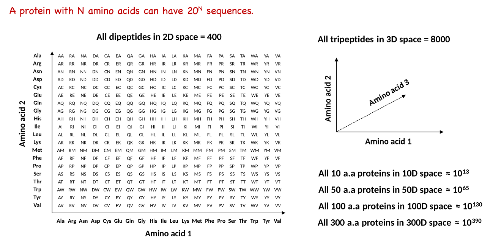
*▲ 课件原图（Slide 6）：Protein Sequence Space — 二肽（400）、三肽（8000）至 300 氨基酸蛋白质（$10^{390}$）的高维序列空间（引用自 [Thomas Shafee, 2014](https://commons.wikimedia.org/w/index.php?curid=94447984)，本地路径：`img/fig05_slide06_sequence_space.png`）*

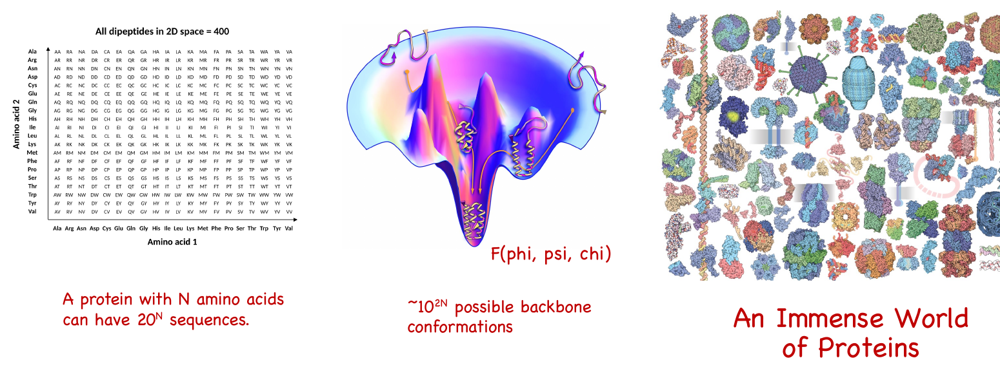
*▲ 课件原图（Slide 7）：Sequence ($20^N$), Structure ($\sim 10^{2N}$), Function 三元映射全景图（本地路径：`img/fig06_slide07_seq_struct_func_summary.png`）*

```text
  ┌───────────────────────── 蛋白质序列空间维度扩张示意 (20^N) ─────────────────────────┐
  │                                                                                     │
  │  [1] 2D 空间 (二肽 Dipeptides, N=2): 20 × 20 = 400 种序列                           │
  │      Amino acid 2 ▲                                                                 │
  │               Ala │ AA  RA  NA  DA  CA ... VA                                       │
  │               Arg │ AR  RR  NR  DR  CR ... VR                                       │
  │               ... │ ...                                                             │
  │               Val │ AV  RV  NV  DV  CV ... VV                                       │
  │                   └────────────────────────────► Amino acid 1 (Ala, Arg, ..., Val)  │
  │                                                                                     │
  │  [2] 3D 空间 (三肽 Tripeptides, N=3): 20^3 = 8,000 种序列                           │
  │  [3] 10D 空间 (10 a.a., N=10):        20^10  ≈ 10^13 种序列                         │
  │  [4] 50D 空间 (50 a.a., N=50):        20^50  ≈ 10^65 种序列                         │
  │  [5] 100D 空间 (100 a.a., N=100):     20^100 ≈ 10^130 种序列 (>> 宇宙原子总数 10^80)│
  │  [6] 300D 空间 (300 a.a., N=300):     20^300 ≈ 10^390 种序列                        │
  └─────────────────────────────────────────────────────────────────────────────────────┘
```

* **课件核心内容**：
  * 引用了 [Thomas Shafee (2014)](https://commons.wikimedia.org/w/index.php?curid=94447984) 博士论文中的序列空间维度示意图：由 20 种天然标准氨基酸组成的长度为 $N$ 的蛋白质，其理论可能序列总数为 **$20^N$**。
* **知识点深度拓展**：
  * **宇宙级尺度的直观对比（Combinatorial Explosion）**：可观测宇宙中的原子总数估计约为 $10^{80}$ 个，地球自诞生以来所有生物合成过的不同蛋白质序列总数估计不超过 $10^{40}\text{–}10^{50}$ 种。而一个仅含 100 个氨基酸的微型蛋白质，其理论序列空间就高达 $10^{130}$，比全宇宙原子总数还要多出 50 个数量级！
  * **序列-结构-功能三元定量映射（Slide 7 总结）**：
    $$\text{Sequence Space } (20^N) \xrightarrow{\text{Folding } F(\phi, \psi, \chi)} \text{Conformational Space } (\sim 10^{2N} \text{ backbones}) \xrightarrow{\text{Biochemical Activity}} \text{Immense World of Functions}$$
    这一定量对比揭示了计算蛋白质设计面临的核心数学挑战：**组合爆炸（Combinatorial Explosion）**与**高维非凸优化（High-Dimensional Non-Convex Optimization）**。任何暴力穷举在物理和计算上都是绝对不可能的，必须借助精巧的实验筛选策略或智能计算采样算法。

## 三、 模块二：蛋白质功能设计的三个层级（Multiple Levels of Designing Protein Function，Slides 8–10）

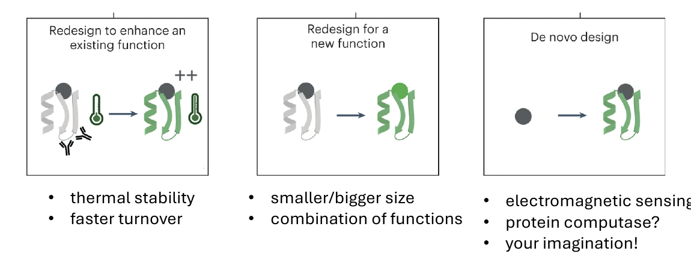
*▲ 课件原图（Slide 9）：Multiple levels of designing protein function — 蛋白质功能设计的三大递进层级（本地路径：`img/fig07_slide09_three_levels_design.png`）*

```text
┌─────────────────────────────┬─────────────────────────────┬─────────────────────────────┐
│  Level 1: 微调增强已有功能   │  Level 2: 改写/拓展结构与功能 │  Level 3: 从头设计全新蛋白质 │
│  (Redesign to enhance an    │  (Redesign for a new        │  (De novo design: create a  │
│   existing function)        │   function)                 │   new way of doing sth)     │
├─────────────────────────────┼─────────────────────────────┼─────────────────────────────┤
│   [天然蛋白] ──► [突变优化] │   [天然蛋白] ──► [结构改造] │     ( • )   ──► [全新折叠]  │
│    🌡️ ──► 🌡️++ (耐热/高速)  │    🧬 ──► 🧬+🟢 (新结合口袋)│     从零出发，无天然同源模板│
├─────────────────────────────┼─────────────────────────────┼─────────────────────────────┤
│ • 提升热稳定性 (Stability)  │ • 尺寸缩放 (Smaller/bigger) │ • 电磁感应蛋白?             │
│ • 加快催化周转 (Turnover)   │ • 功能组合 (Combination)    │ • 蛋白质计算逻辑门?         │
└─────────────────────────────┴─────────────────────────────┴─────────────────────────────┘
```

课件第 9 页通过清晰的示意图，按照**与天然蛋白质的偏离程度（改造幅度与创新难度）**，将蛋白质设计划分为由浅入深的三个层级：

| 设计层级 | 课件定义 | 图示特征与核心策略 | 典型目标与应用实例（课件列举 + 拓展） |
| :--- | :--- | :--- | :--- |
| **Level 1：微调已有功能**<br>（Redesign to enhance an existing function） | *To tune the function of an existing protein* | 保持原有三维骨架（灰色/绿色折叠拓扑）和原有底物/功能类型不变，仅通过局部氨基酸点突变优化性能指标（图示温度计与速率箭头 `++`）。 | • **热稳定性提升（Thermal stability）**：引入二硫键、优化疏水核心堆积、增加表面盐桥，使工业酶耐受高温或有机溶剂。<br>• **催化周转率提升（Faster turnover, $k_{\text{cat}}$）**：微调活性口袋过渡态稳定网络。<br>• **亲和力成熟（Affinity maturation）**：提升抗体对特定抗原的结合常数（$K_d$）。 |
| **Level 2：改写/拓展新功能**<br>（Redesign for a new function） | *To make new structural variations of an existing function* | 以天然蛋白质结构域为起点，改造局部结构区、结合口袋或进行结构域拼接/缩放，赋予其识别新底物或组合多种功能的能力。 | • **尺寸缩减或扩增（Smaller/bigger size）**：将庞大脆弱的天然受体裁剪为紧凑的微型蛋白结合剂（Miniprotein binders）。<br>• **功能组合（Combination of functions）**：构建双特异性抗体（Bispecific antibodies）、嵌合抗原受体（CAR-T）或变构融合蛋白传感器。 |
| **Level 3：从头设计（De novo design）**<br>（Create a new way of doing something） | *To create a new way of doing something* | 不依赖任何已知天然同源序列，从第一性原理（物理规律或深度生成网络）出发，从零（`• → 折叠蛋白`）构建自然界从未存在过的拓扑骨架与功能中心。 | • **电磁感应蛋白（Electromagnetic sensing?）**：拓展生物传感边界。<br>• **蛋白质计算机/逻辑门（Protein computase?）**：能执行分子逻辑运算（如 LOCKR 开关系统）的人工蛋白。<br>• **自然界不存在的荧光激活蛋白、人工荧光素酶、非天然催化反应酶**（Your imagination!）。 |

## 四、 模块三：蛋白质设计的两大核心流派（Two Schools of Thought，Slides 11–23）

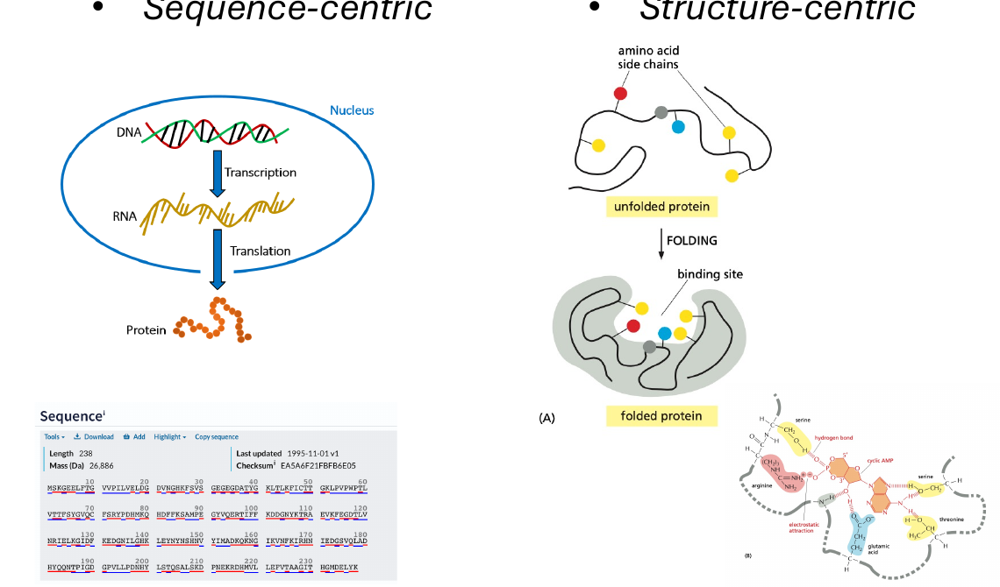
*▲ 课件原图（Slide 11）：Two Approaches to Protein Design — Sequence-centric 与 Structure-centric 两大流派总览（本地路径：`img/fig08_slide11_two_approaches_overview.png`）*

课件第 11 至 23 页系统阐述并对比了蛋白质功能设计的两大方法论范式：**以序列为中心的方法（Sequence-centric approach）**与**以结构为中心的方法（Structure-centric approach）**。

### 1. 流派一：以序列为中心的方法（Sequence-Centric Approaches，Slides 12–16）

#### （1） 核心逻辑与科学基础（Slide 12）
* **范式路径**：沿着中心法则（DNA $\xrightarrow{\text{Transcription}}$ RNA $\xrightarrow{\text{Translation}}$ Protein Sequence $\rightarrow$ Function），模仿自然演化（Natural Evolution），直接建立从**序列到功能（`Sequence → Function`）**的映射，绕过对三维原子结构中间态的显式物理建模。这一传统领域通常被称为**“蛋白质工程”（Protein Engineering）**。

#### （2） 适应度景观（Fitness Landscape，Slide 13）


*▲ 图 4-1（文献原图拓展）：蛋白质序列空间中的适应度景观（Fitness Landscape）与单氨基酸突变演化网络（来源：[Romero & Arnold, *Nat. Rev. Mol. Cell Biol.* 2009, PMC2997618](https://pmc.ncbi.nlm.nih.gov/articles/PMC2997618/)）*

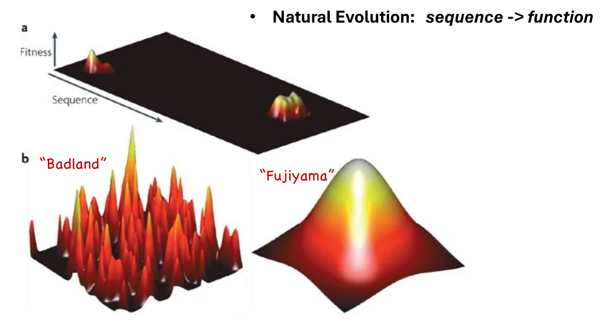
*▲ 课件原图（Slide 13）：Fitness Landscape — 稀疏功能峰、“Badland”（恶地型崎岖景观）与“Fujiyama”（富士山型平滑景观）（本地路径：`img/fig09_slide13_fitness_landscape.png`）*

```text
  Fitness (功能适应度)                                Fitness (功能适应度)
    ▲     /\      /\                                    ▲           ╭───╮
    │    /  \ /\ /  \    /\   "Badland" (恶地型)         │          ╱     ╲     "Fujiyama" (富士山型)
    │   /    V  V    \  /  \  • 强上位性 (Epistasis)     │         ╱       ╲    • 突变效应独立线性加和
    │  /              \/    \ • 多峰崎岖，易陷局部最优    │        ╱         ╲   • 平滑单峰，贪心爬山可达全局最优
    └────────────────────────► Sequence                 └───────────────────► Sequence
```

* **课件核心概念**：
  * 引用了 [Romero & Arnold (2009) *Nature Reviews Molecular Cell Biology*](https://pubmed.ncbi.nlm.nih.gov/19935669/)（[PMC 全文](https://pmc.ncbi.nlm.nih.gov/articles/PMC2997618/)）的经典综述图。
  * **定义**：**适应度景观（Fitness Landscape）**是描述高维蛋白质序列空间（底层平面坐标）到蛋白质特定生物学功能/适应度（垂直轴高度 Fitness）的映射曲面（由进化生物学家 Sewall Wright 于 1932 年首次提出，John Maynard Smith 于 1970 年引入蛋白质演化）。
  * **核心地形特征**：
    * **图 a（稀疏孤岛）**：在广阔的序列空间中，绝大多数随机序列都是无功能的（零适应度黑色平原，甚至无法折叠），具有活性的序列仅聚集成极少数孤立的“适应度山峰”。
    * **图 b 左：“Badland”（恶地/崎岖景观，Rugged Landscape）**：当氨基酸位点之间存在强烈的**上位性效应（Epistasis / Non-additive coupling）**——即一个位点突变对功能的影响高度依赖于其他位点的氨基酸类型时，景观呈现出千沟万壑、尖峰林立的“恶地”形态。在 Badland 上进行单步贪心爬山极易陷入局部次优峰（Local Optima）。
    * **图 b 右：“Fujiyama”（富士山型/平滑单峰景观，Smooth Mount Fuji Landscape）**：当各个位点的突变效应彼此独立、呈线性加和（Additive effects，无显著上位性）时，景观呈现平滑对称的单峰“富士山”形态，任何有益单点突变的累积都能稳步攀登至全局最高峰（Global Optimum）。
* **知识点深度拓展**：
  * 真实的蛋白质适应度景观往往介于“恶地”与“富士山”之间（即具有一定局部平滑度但整体存在多峰与上位性壁垒）。演化必须在保持功能不丧失的连续通道（Neutral Networks，中性演化网络）上通过单氨基酸替换逐步移动。

#### （3） 定向进化（Directed Evolution）与 2018 年诺贝尔化学奖（Slides 14 & 15）


*▲ 图 4-2（网络拓展配图）：定向进化（Directed Evolution）的“基因突变建库 → 表达筛选 → 迭代进化”闭环流程（来源：[Wikimedia Commons](https://en.wikipedia.org/wiki/Directed_evolution)）*

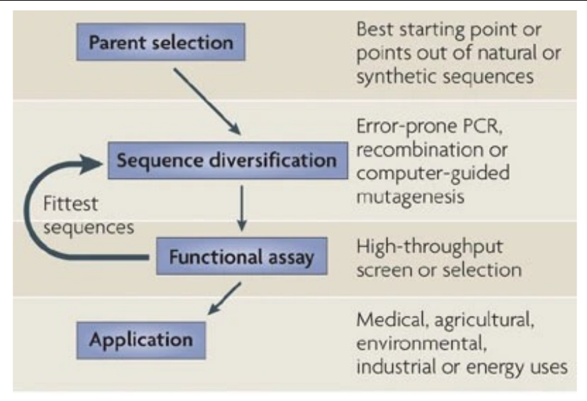
*▲ 课件原图（Slide 14）：Exploring the Fitness Landscape by Directed Evolution（本地路径：`img/fig10_slide14_directed_evolution_cycle.png`）*

```text
  ┌───────────────────┐
  │ Parent selection  │ 1. 亲本选择：从天然或合成序列中挑选最佳起始基因
  └─────────┬─────────┘
            ▼
  ┌───────────────────┐
  │     Sequence      │ 2. 序列多样化：易错 PCR (Error-prone PCR)、DNA 洗牌重组
  │  diversification  │◄───────────┐  (Recombination) 或计算引导定点突变
  └─────────┬─────────┘            │
            ▼                      │ Fittest sequences
  ┌───────────────────┐            │ (优胜序列作为下一轮亲本)
  │ Functional assay  │────────────┘ 3. 功能测定：高通量筛选 (High-throughput screen) 或选择
  └─────────┬─────────┘
            ▼
  ┌───────────────────┐
  │    Application    │ 4. 实际应用：医疗、农业、环境治理、工业催化或能源领域
  └───────────────────┘
```

* **定向进化的标准四步闭环流程（Slide 14，源自 [Romero & Arnold, 2009](https://pmc.ncbi.nlm.nih.gov/articles/PMC2997618/)）**：
  1. **亲本选择（Parent selection）**：从天然或合成序列中挑选具有微弱目标活性或高稳定性的最佳起始蛋白（Starting point），使其位于适应度山峰的脚下而非毫无活性的荒漠中。
  2. **序列多样化（Sequence diversification / Library generation）**：通过**易错 PCR（Error-prone PCR）**引入随机点突变、**DNA 洗牌/同源重组（DNA shuffling / Recombination）**组合不同亲本片段，或利用**计算机辅助定点饱和突变（Computer-guided / Site-saturation mutagenesis）**构建突变基因文库。
  3. **功能测定与高通量筛选（Functional assay: High-throughput screen or selection）**：将突变文库表达于宿主细胞或展示系统表面，利用多孔板酶活检测、流式细胞分选（FACS）、微流控液滴筛选或生存选择压力，筛选出功能提升的优胜突变体（Fittest sequences）。
  4. **迭代循环与实际应用（Iteration & Application）**：将筛选出的最优序列作为下一轮进化的新亲本，重复“突变—筛选”循环直至性能达标，最终投入**医疗（Medical）、农业（Agricultural）、环境治理（Environmental）、工业催化（Industrial）或能源（Energy）**应用。


*▲ 图 4-3（诺奖官方科普配图）：[2018 年诺贝尔化学奖](https://www.nobelprize.org/prizes/chemistry/2018/popular-information/)官方图解——Frances H. Arnold 开发的酶定向进化循环（来源：[NobelPrize.org](https://www.nobelprize.org/prizes/chemistry/2018/popular-information/)）*


*▲ 课件原图（Slide 15）：‘Revolution by Evolution’: Chemistry Nobel Prize 2018（本地路径：`img/fig11_slide15_nobel_prize_2018.png`）*

* **“Revolution by Evolution”：2018 年诺贝尔化学奖（Slide 15）**：
  * [2018 年诺贝尔化学奖](https://www.nobelprize.org/prizes/chemistry/2018/summary/)授予了三位利用进化力量改造蛋白质的先驱：
    * **[Frances H. Arnold](https://www.nobelprize.org/prizes/chemistry/2018/arnold/facts/)**（加州理工学院，获奖份额 1/2）：表彰其开创了**“酶的定向进化”（for the directed evolution of enzymes）**。她于 1993 年首次利用迭代易错 PCR 和筛选成功改造枯草杆菌蛋白酶 E（Subtilisin E），使其在高浓度有机溶剂（DMF）中仍保持极高活性，后续更演化出能催化自然界从未有过的碳-硅键（$\text{C}-\text{Si}$）和碳-硼键（$\text{C}-\text{B}$）形成反应的工程化细胞色素 P450 酶。
    * **[George P. Smith](https://www.nobelprize.org/prizes/chemistry/2018/summary/) 与 [Sir Gregory P. Winter](https://www.nobelprize.org/prizes/chemistry/2018/summary/)**（共同分享 1/2）：表彰其发明并发展了**“多肽和抗体的噬菌体展示技术”（for the phage display of peptides and antibodies）**。通过将外源基因融合到噬菌体衣壳蛋白基因上，实现了**基因型（包在噬菌体内部的 DNA）与表型（展示在噬菌体表面的蛋白质结合活性）的物理偶联**，从而能从百亿级（$10^{10}$）文库中快速淘选出高亲和力抗体（如全球首个全人源单克隆抗体药物阿达木单抗 Adalimumab/Humira）。

#### （4） 序列中心流派的现代演进：实验设计与数据驱动建模（Slide 16）
* **课件核心总结**：
  * 序列中心方法围绕 **Sequence Diversity（序列多样性生成）$\rightleftharpoons$ Function Selection（功能选择）** 的双向闭环展开，包含两大支柱：
    1. **实验设计（Experimental design）**：以定向进化、噬菌体/酵母展示、深度突变扫描（Deep Mutational Scanning, DMS）为代表的高通量湿实验体系。
    2. **数据驱动的计算建模（Data-driven computational modeling）**：利用海量演化同源序列（MSA）或实验测得的“序列-活性”配对数据，训练机器学习/深度学习模型（如高斯过程回归、蛋白质语言模型 ESM / ProGen、机器学习引导的定向进化 MLDE），预测未测序列的适应度，从而在充满局部陷阱的“Badland”景观上实现跨步跳跃，大幅减少实验筛选轮次。

### 2. 流派二：以结构为中心的方法（Structure-Centric Protein Design，Slides 17–21）

#### （1） 逆向思维范式与结构中心设计三步曲（Slides 17 & 18，以识别 cAMP 为例）

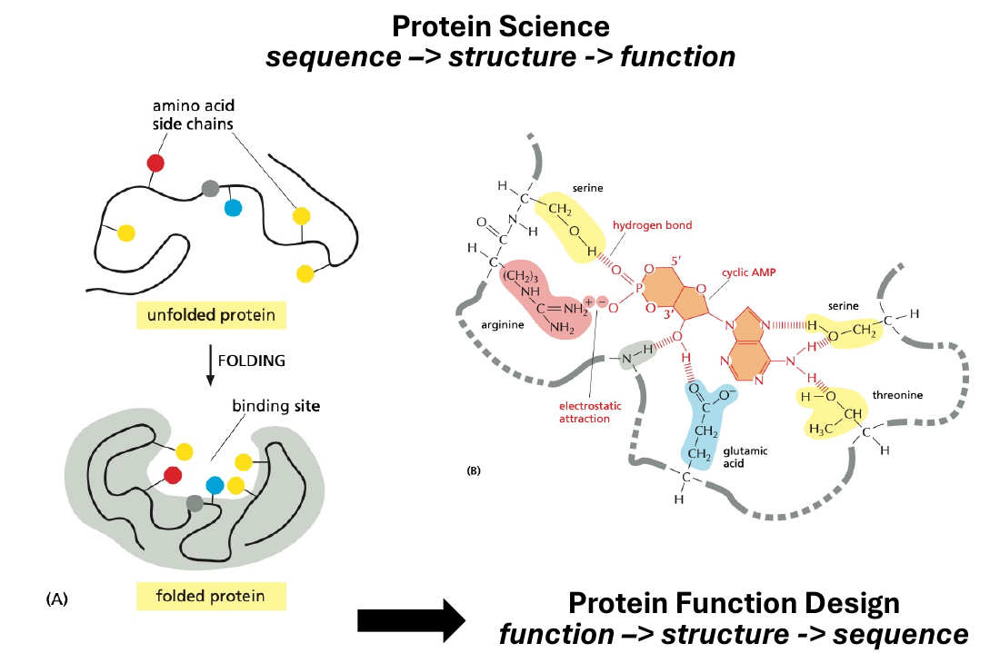
*▲ 课件原图（Slide 17）：Protein Science (`sequence -> structure -> function`) 与 Protein Function Design (`function -> structure -> sequence`) 的逆向范式对比及 cAMP 结合位点化学相互作用（本地路径：`img/fig12_slide17_cAMP_structure_centric.png`）*

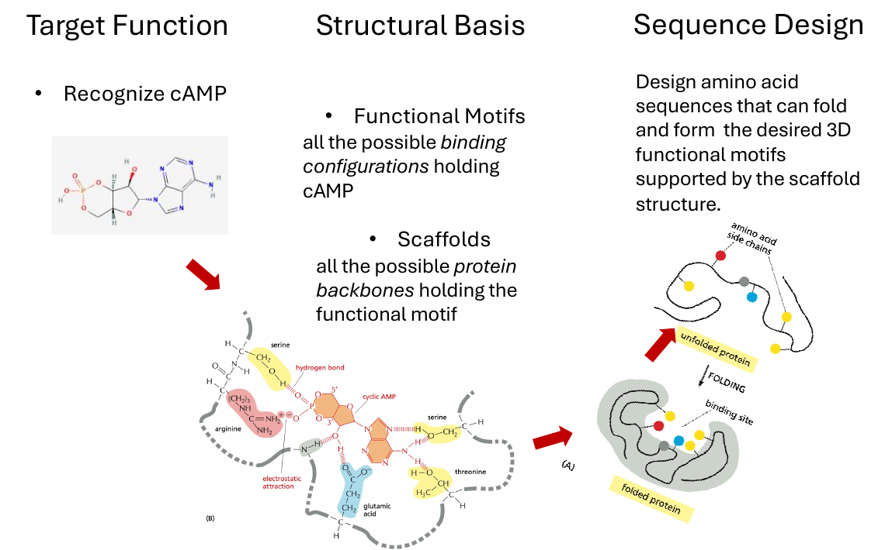
*▲ 课件原图（Slide 18）：Structure-Centric Protein Design 三步流程（Target Function → Structural Basis → Sequence Design）（本地路径：`img/fig13_slide18_structure_centric_3steps.png`）*

```text
  【蛋白质科学 Protein Science（正向研究）】
    Sequence (氨基酸序列) ──────► Structure (三维折叠结构) ──────► Function (结合/催化功能)

  【蛋白质功能设计 Protein Function Design（逆向设计）】
    Function (目标功能)   ──────► Structure (功能基序+骨架) ──────► Sequence (逆向序列设计)
           │                                │                                │
           ▼                                ▼                                ▼
    [1. Target Function]          [2. Structural Basis]            [3. Sequence Design]
    • 识别目标配体 cAMP            • Functional Motifs (功能基序):  • 设计完整的氨基酸序列，使其
      (环磷酸腺苷)                  枚举能与 cAMP 形成氢键(Ser/Thr)  能自发折叠为所选 Scaffold，
                                    和静电吸引(Arg/Glu)的侧链构型    并在活性位点精确摆出目标
                                  • Scaffolds (蛋白质骨架):          3D Functional Motif
                                    搜寻或生成能几何支撑该基序的主链
```

* **结构中心设计的标准三步曲（Slide 18）**：
  1. **第一步：定义目标功能（Target Function）** —— 例如特异性识别并结合第二信使分子环磷酸腺苷（Recognize cAMP）。
  2. **第二步：构建结构基础（Structural Basis）** —— 拆分为**“功能基序（Functional Motifs）”**与**“蛋白质骨架（Scaffolds）”**：
     * **功能基序（Functional Motifs）**：能够托住并识别配体（cAMP）的所有可能的局部结合构型（*all the possible binding configurations holding cAMP*，如精氨酸 Arginine 与谷氨酸 Glutamic acid 提供静电吸引，丝氨酸 Serine 与苏氨酸 Threonine 提供氢键）。在计算设计中常通过 **Theozyme（理论酶）**或 **Rotamer Interaction Field (RIF，旋转异构体相互作用场)** 构建。
     * **蛋白质骨架（Scaffolds）**：能够在三维空间中几何精确地承载并固定上述功能基序的所有蛋白质主链结构（*all the possible protein backbones holding the functional motif*）。
  3. **第三步：序列设计（Sequence Design）** —— 设计完整的氨基酸序列，使其在热力学驱动下能够自发折叠（Fold）为所选的骨架结构，并在结合位点精准形成预设的三维功能基序。

#### （2） 经典案例精读一：从头设计荧光激活 $\beta$-桶蛋白（De Novo Fluorescence-Activating Proteins / $\beta$-Barrel，Slides 19 & 20）


*▲ 图 4-4（PDB 晶体结构图）：从头设计的 8 股反平行 $\beta$-桶荧光激活蛋白（bFAP, [PDB: 6D0T](https://www.rcsb.org/structure/6d0t)）与内部锁定的生色团小分子 DFHBI 三维结构（来源：[Dou et al., *Nature* 2018](https://pubmed.ncbi.nlm.nih.gov/30209393/)）*

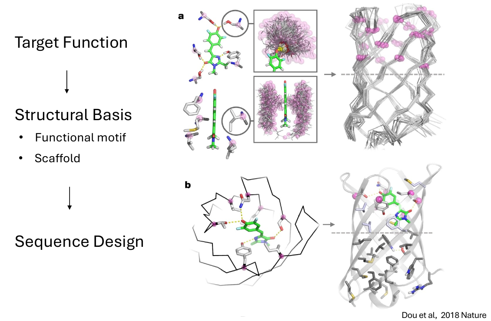
*▲ 课件原图（Slide 20）：De Novo Fluorescence-Activating beta Barrel（Dou et al., 2018 *Nature*）——图 a 为生色团 DFHBI 的旋转异构体相互作用场（Functional motif）与从头构建的 $\beta$-桶骨架（Scaffold），图 b 为序列设计后的全原子结合口袋（本地路径：`img/fig14_slide20_de_novo_beta_barrel.png`）*

* **文献出处**：[Dou et al., "De novo design of a fluorescence-activating $\beta$-barrel", *Nature* 561, 485–491 (2018)](https://pubmed.ncbi.nlm.nih.gov/30209393/)（[PMC 全文](https://pmc.ncbi.nlm.nih.gov/articles/PMC6275156/)，[PDB: 6D0T](https://www.rcsb.org/structure/6d0t)，华盛顿大学 David Baker 实验室）。
* **科学背景与目标功能（Target Function，Slide 19）**：
  * 天然绿色荧光蛋白（GFP）由 11 股 $\beta$-折叠片围成桶状结构，其荧光来源于内部的生色团（Chromophore）。当生色团小分子（如合成类似物 **DFHBI**）游离在溶液中时，其芳香环之间可以自由旋转，激发态能量通过非辐射内转换（分子内扭转）以热能形式耗散，因此几乎不发荧光。
  * **发荧光的物理化学机制**：如果用一个刚性的蛋白质结合口袋将生色团紧紧夹持在**平面构象（Planar conformation）**，抑制其单键旋转耗能，生色团吸收光子后就会以高量子产率辐射出荧光。
* **结构基础与计算流程（Structural Basis & Sequence Design，Slides 19 & 20）**：
  1. **构建骨架（Scaffold）**：Dou 等人揭示了在桶壁特定位置引入**甘氨酸扭结（Glycine kinks）**和 **$\beta$-凸起（$\beta$-bulges）**的几何规律，成功从头构建出高度稳定的 8 股 $\beta$-桶主链骨架家族。
  2. **构建功能基序（Functional Motif，Slide 20 图 a）**：针对平面构象的 DFHBI 生色团，计算生成成千上万种能与其酚羟基和咪唑啉酮环形成氢键及平面疏水堆积的氨基酸侧链相互作用构型（RIF），筛选出可将 DFHBI 锁定在平面构象的功能基序。
  3. **基序植入与序列设计（Motif Grafting & Sequence Design，Slide 20 图 b）**：将上述功能基序匹配（Dock/Graft）到从头生成的 $\beta$-桶骨架内部腔体中，再用 Rosetta 对周围残基进行序列优化，确保主链与配体紧密互补且整体能够正确折叠。

#### （3） 经典案例精读二：利用深度学习从头设计人工荧光素酶（De novo design of a luciferase by deep learning，Slide 21）

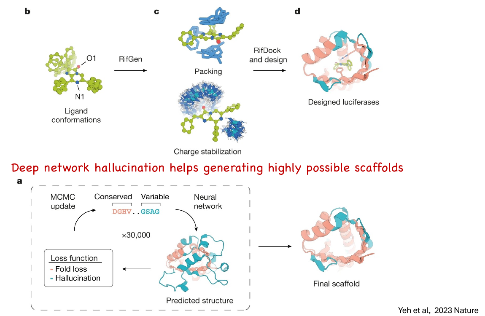
*▲ 课件原图（Slide 21）：De novo design of a luciferase by deep learning（Yeh et al., 2023 *Nature*）——下半部分图 a 展示深度网络幻觉（Deep network hallucination）生成定制骨架，上半部分图 b–d 展示 RifGen 与 RifDock 构建催化过渡态结合口袋（本地路径：`img/fig15_slide21_deep_learning_luciferase.png`）*

```text
  ┌─────────────────── Slide 21: 深度学习从头设计人工荧光素酶 (Yeh et al., 2023 Nature) ───────────────────┐
  │                                                                                                       │
  │  【阶段一 (图 a)：深度网络幻觉生成高可折叠定制骨架 (Deep Network Hallucination)】                        │
  │                                                                                                       │
  │     ┌──► 序列组合 [Conserved 保守核心 (粉色) + Variable 可变口袋区 (青色)] ──┐                        │
  │     │                                                                        ▼                        │
  │   MCMC update                                                         Neural network                  │
  │   (×30,000 步随机突变迭代)                                             (结构预测神经网络)              │
  │     ▲                                                                        │                        │
  │     └─── Loss function (损失函数: Fold loss + Hallucination) ◄── Predicted structure ──► Final        │
  │                                                                                          scaffold     │
  │                                                                                                       │
  │  【阶段二 (图 b → c → d)：基于过渡态基序的对接与全序列设计 (RifGen & RifDock)】                        │
  │                                                                                                       │
  │   (b) Ligand conformations        (c) Functional Motif 相互作用场           (d) Designed luciferases  │
  │       发光底物 DTZ 构象     ────►     • Packing (疏水紧密堆积)       ────►      高催化活性与高特异性   │
  │       (关键原子 O1, N1)     RifGen    • Charge stabilization         RifDock    的人工荧光素酶 (LuxSit) │
  │                                         (精氨酸等稳定过渡态负电荷)   & design                         │
  └───────────────────────────────────────────────────────────────────────────────────────────────────────┘
```

* **文献出处**：[Yeh et al., "De novo design of luciferases using deep learning", *Nature* 614, 774–780 (2023)](https://pubmed.ncbi.nlm.nih.gov/36813896/)（[PMC 全文](https://pmc.ncbi.nlm.nih.gov/articles/PMC9946828/)，David Baker 实验室）。
* **Slide 21 流程图逐项拆解（必考细节）**：
  * **下半部分（图 a）：深度网络幻觉生成高可能性骨架（Deep network hallucination helps generating highly possible scaffolds）**
    1. **序列分区（Conserved vs. Variable）**：固定维持核糖体蛋白样拓扑核心的关键保守序列区（Conserved，粉色），同时将形成结合口袋的环区和螺旋区设为可变区（Variable，青色）。
    2. **马尔可夫链蒙特卡洛迭代（MCMC update, $\times 30,000$ 步）**：在序列空间中不断对可变区进行随机氨基酸突变，每次突变后输入深度学习结构预测神经网络（Neural network）预测其三维结构概率分布（Predicted structure）。
    3. **损失函数优化（Loss function: Fold loss + Hallucination）**：通过最小化包含“折叠置信度损失（Fold loss，维持已定义核心结构）”和“幻觉损失（Hallucination loss，最大化全序列距离图预测的清晰度/信息熵降低，迫使网络‘幻觉’出具有明确紧凑三级结构但序列全新的可变口袋区）”的复合损失函数，经 30,000 步 MCMC 优化，大批量生成数以万计拥有不同形状深腔口袋的定制化高可折叠骨架（Final scaffold）。
  * **上半部分（图 b → c → d）：功能基序生成与对接设计（RifGen & RifDock）**
    1. **图 b（Ligand conformations $\xrightarrow{\text{RifGen}}$）**：围绕发光底物 DTZ 的反应过渡态（标注了关键氧原子 $\text{O1}$ 与氮原子 $\text{N1}$），使用 **RifGen** 枚举所有能与之形成疏水堆积（Packing）和负电荷过渡态稳定相互作用（Charge stabilization，如精氨酸侧链胍基稳定阴离子中间体）的氨基酸旋转异构体场（图 c）。
    2. **图 c $\rightarrow$ d（$\xrightarrow{\text{RifDock and design}}$ Designed luciferases）**：利用 **RifDock** 将底物及相互作用场快速刚体对接到由深度网络幻觉生成的海量支架口袋中，筛选出既能完美包裹底物又能稳定过渡态负电荷的骨架，随后通过 ProteinMPNN / Rosetta 进行全序列优化，获得高催化效率的从头设计荧光素酶（Designed luciferases，命名为 **LuxSit**）。

### 3. 两大设计流派的全方位对比总结（Slide 22）

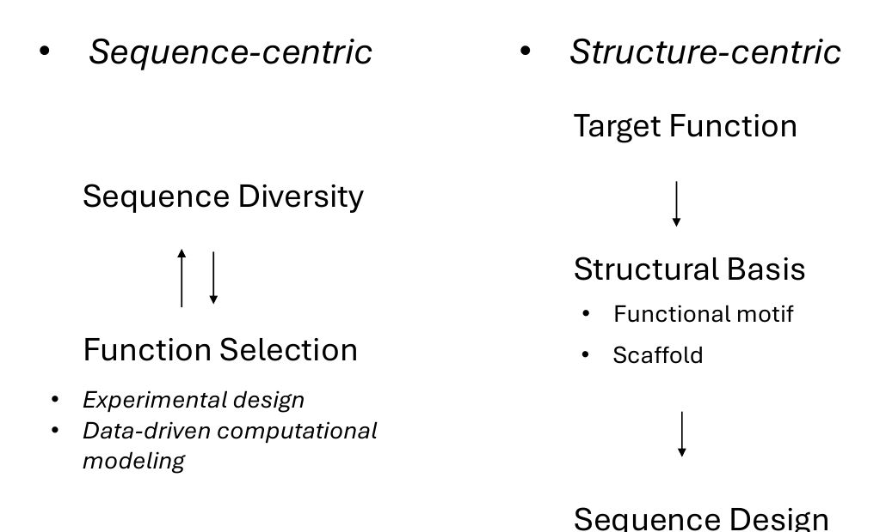
*▲ 课件原图（Slide 22）：Two Approaches to Protein Function Design 并置总结图（本地路径：`img/fig16_slide22_two_approaches_comparison.png`）*

| 对比维度 | 以序列为中心（Sequence-Centric Approach） | 以结构为中心（Structure-Centric Approach） |
| :--- | :--- | :--- |
| **核心工作流** | `Sequence Diversity` $\rightleftharpoons$ `Function Selection` | `Target Function` $\rightarrow$ `Structural Basis (Motif + Scaffold)` $\rightarrow$ `Sequence Design` |
| **主要实现手段** | 实验筛选（定向进化、展示技术）+ 数据驱动计算建模（MSA 统计模型、蛋白质语言模型、MLDE） | 物理能量建模（Rosetta）+ 深度结构生成与逆折叠网络（Hallucination, RFdiffusion, ProteinMPNN） |
| **是否依赖起始天然蛋白** | **强依赖**：通常需要一个具有微弱基础活性的天然或合成亲本蛋白作为演化起点 | **不依赖（支持 De novo）**：可以从零根据化学反应过渡态或目标结合界面从头构建 |
| **对三维原子结构的依赖** | **低**：无需预先知道高分辨率晶体结构或精确催化机制即可启动筛选 | **高**：必须明确目标功能的原子级几何约束（Functional motif）与主链支撑（Scaffold） |
| **探索序列空间的方式** | 局部逐步爬山（Stepwise local walk）或受训于同源序列分布的插值采样 | 全局跨越式采样（直接跳到自然界从未探索过的全新拓扑结构区域） |
| **主要局限性** | 难以跨越宽阔的“无活性峡谷”创造全新折叠拓扑；受限于高通量实验筛选表型（Assay）的通量上限（通常 $10^4\text{–}10^{10}$） | 物理力场对精细水分子网络、长程变构动力学和过渡态量子化学效应的刻画仍有误差，常需结合实验进化微调 |
| **两者在现代研究中的融合** | 现代蛋白质设计往往先用 **Structure-centric** 方法从头设计出具有初步活性的全新蛋白骨架（从 0 到 1），再用 **Sequence-centric** 的定向进化或机器学习引导突变对其进行活性成熟与微调（从 1 到 100）。 |

## 五、 模块四：计算蛋白质设计的两大核心模型（Computational Models for Designing Proteins，Slides 24 & 25）

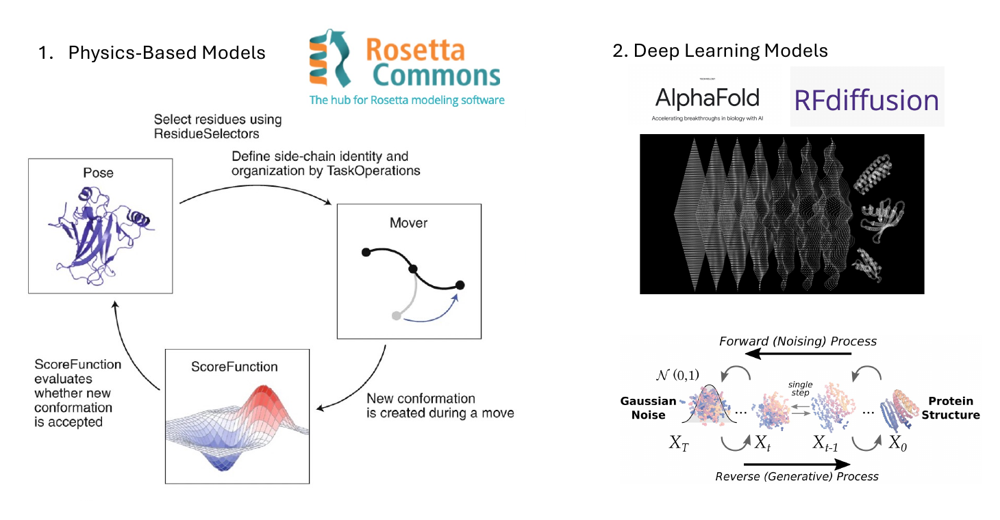
*▲ 课件原图（Slide 24）：Computational Models for Designing Proteins — 左：基于物理的 Rosetta 建模循环；右：基于深度学习的 AlphaFold 与 RFdiffusion 去噪扩散生成过程（本地路径：`img/fig17_slide24_rosetta_vs_deeplearning.png`）*

### 1. 基于物理的模型（Physics-Based Models）：以 Rosetta 为代表（Slide 24 左）

```text
  ┌──────────────────── Rosetta 物理建模与设计闭环 (Slide 24 左) ────────────────────┐
  │                                                                                  │
  │   Select residues using ResidueSelectors (选择目标残基区域)                      │
  │   Define side-chain identity and organization by TaskOperations (定义允许的突变) │
  │                                     │                                            │
  │                                     ▼                                            │
  │   ┌──────────────────┐                              ┌──────────────────┐         │
  │   │       Pose       │ ───────────────────────────► │      Mover       │         │
  │   │ (当前三维构象态)  │                              │ (构象/序列采样器) │         │
  │   └──────────────────┘                              └────────┬─────────┘         │
  │            ▲                                                 │                   │
  │            │ ScoreFunction evaluates                         │ New conformation  │
  │            │ whether new conformation                        │ is created        │
  │            │ is accepted (Metropolis 准则判断是否接受)        │ during a move     │
  │            │                                                 ▼                   │
  │            └────────────────────────────────────────┌──────────────────┐         │
  │                                                     │  ScoreFunction   │         │
  │                                                     │ (物理能量评分函数)│         │
  │                                                     └──────────────────┘         │
  └──────────────────────────────────────────────────────────────────────────────────┘
```

* **代表软件与社区**：**[Rosetta Commons](https://rosettacommons.org/)**（由 David Baker 实验室发起并由全球数十个顶尖结构生物物理实验室共同维护的生物大分子建模与设计软件套件）。
* **核心物理假设**：遵循安芬森热力学假说，通过构建经验/半物理全原子能量函数（Energy Function / ScoreFunction），在序列和构象空间中搜索能量最低的状态。
* **Slide 24 左图：Rosetta 架构四大核心组件解析（必考框图）**：
  1. **Pose（构象状态对象）**：Rosetta 中表示一个蛋白质分子体系的核心数据结构（对象），完整存储了当前多肽链的氨基酸序列、主链与侧链二面角 $(\phi, \psi, \omega, \chi)$、三维原子笛卡尔坐标以及当前的能量评分信息。
  2. **ResidueSelectors & TaskOperations（残基选择器与任务操作器）**：
     * **ResidueSelectors**：用于在三维空间或序列上选定需要操作的特定残基子集（例如：仅选择距离配体 $8\text{ \AA}$ 以内的口袋残基，或仅选择表面暴露残基）。
     * **TaskOperations**：定义在每个被选中的残基位点上允许执行的操作规则——例如哪些位点允许改变氨基酸种类（Design / Mutation）、允许突变成哪几种氨基酸，哪些位点只允许调整侧链构象（Repacking，重新堆积旋转异构体），哪些位点完全冻结（Fixed）。
  3. **Mover（采样/移动算子）**：对输入的 `Pose` 施加一次具体的构象或序列变换，从而产生一个新的候选构象（*New conformation is created during a move*）。常见的 Mover 包括：主链微扰（Backbone perturbation / Fragment insertion）、刚体对接移动（Rigid-body docking）、侧链旋转异构体替换与打包（PackRotamersMover）以及能量梯度最小化（MinMover）。
  4. **ScoreFunction（能量评分函数）**：用于计算新生成的 `Pose` 的总自由能近似值（以 Rosetta Energy Units, REU 为单位），并根据**蒙特卡洛梅特罗波利斯准则（Metropolis Monte Carlo criterion）**评估是否接受这次移动（*ScoreFunction evaluates whether new conformation is accepted*）：
     * 若新构象能量降低（$\Delta E < 0$），则以 $100\%$ 概率接受；
     * 若新构象能量升高（$\Delta E > 0$），则以玻尔兹曼概率 $P = \exp(-\Delta E / k_B T)$ 有条件接受，从而帮助体系跳出局部能量极小值陷阱（Simulated Annealing，模拟退火）。
* **知识点拓展：Rosetta 能量函数（如 `ref2015`）包含哪些物理项？**
  $$E_{\text{total}} = \sum w_i E_i = E_{\text{vdW (atr/rep)}} + E_{\text{solvation (Lazaridis-Karplus)}} + E_{\text{elec}} + E_{\text{hbond}} + E_{\text{rama}} + E_{\text{rotamer}} + E_{\text{ref}}$$
  涵盖范德华吸引与排斥（Lennard-Jones 12-6 势）、隐式溶剂化自由能（惩罚极性原子埋藏、奖励非极性原子埋藏）、静电库仑相互作用、方向性氢键势、主链拉氏图偏好势、侧链旋转异构体内部能量以及各氨基酸的参考态能量（Reference energies，用于序列设计时平衡不同氨基酸的固有能量基线）。

### 2. 深度学习模型（Deep Learning Models）：以 AlphaFold 与 RFdiffusion 为代表（Slide 24 右）


*▲ 图 5-1（文献原图拓展）：[AlphaFold2](https://pmc.ncbi.nlm.nih.gov/articles/PMC8371605/) 高精度蛋白质三维结构预测示意（来源：[Jumper et al., *Nature* 2021, PMC8371605](https://pmc.ncbi.nlm.nih.gov/articles/PMC8371605/)）*


*▲ 图 5-2（官方原理配图）：[RFdiffusion](https://www.bakerlab.org/2023/07/11/diffusion-model-for-protein-design/) 去噪扩散生成过程——从随机高斯噪声云逐步去噪收敛为全新的稳定蛋白质三维结构（来源：[Baker Lab / Institute for Protein Design](https://www.bakerlab.org/2023/07/11/diffusion-model-for-protein-design/)）*

```text
  ┌──────────────── 去噪扩散模型 (RFdiffusion DDPM) 原理图 (Slide 24 右下) ────────────────┐
  │                                                                                        │
  │                        ◄──────── Forward (Noising) Process (前向加噪过程) ────────     │
  │                                                                                        │
  │   Gaussian Noise N(0,1)         中间噪声态            single step      Protein Structure│
  │    (纯随机高斯噪声云)                                  (单步去噪)       (真实三维折叠结构)│
  │          X_T          ──────►      X_t      ──────►     X_(t-1)  ──────►      X_0      │
  │                                                                                        │
  │                        ────────► Reverse (Generative) Process (反向生成过程) ────►     │
  └────────────────────────────────────────────────────────────────────────────────────────┘
```

* **代表模型**：**[AlphaFold](https://pubmed.ncbi.nlm.nih.gov/34265844/)**（[Jumper et al., *Nature* 2021](https://pmc.ncbi.nlm.nih.gov/articles/PMC8371605/)，Google DeepMind）与 **[RFdiffusion](https://pubmed.ncbi.nlm.nih.gov/37433327/)**（[Watson et al., *Nature* 2023](https://pmc.ncbi.nlm.nih.gov/articles/PMC10468394/)，Baker Lab）。
* **Slide 24 右下图：去噪扩散概率模型（Denoising Diffusion Probabilistic Models, DDPM）原理拆解**：
  * **前向加噪过程（Forward / Noising Process，从右向左 $X_0 \rightarrow X_{t-1} \rightarrow X_t \rightarrow X_T$）**：
    * 起点 $X_0$ 是来自 PDB 数据库的真实蛋白质三维结构（Protein Structure，将每个残基主链表示为三维空间中的刚体标架 Rigid-body frames：包含 $\text{C}_\alpha$ 平移坐标 $\mathbb{R}^3$ 与主链旋转朝向矩阵 $SO(3)$）。
    * 在时间步 $t = 1, \dots, T$ 中，逐步向蛋白质主链的坐标和旋转角度注入高斯噪声（Gaussian Noise），直到第 $T$ 步结构完全退化为服从标准正态分布 $\mathcal{N}(0, 1)$ 的随机噪声云 $X_T$。
  * **反向生成过程（Reverse / Generative Process，从左向右 $X_T \rightarrow X_t \rightarrow X_{t-1} \rightarrow X_0$）**：
    * 在生成新蛋白质时，从纯随机高斯噪声 $X_T \sim \mathcal{N}(0, 1)$ 出发；
    * 经过训练的深度神经网络（RFdiffusion，在每个单步 `single step` 预测当前噪声结构向真实蛋白质流形演化的去噪方向）逐步去除噪声，将杂乱无章的残基坐标逐步雕琢（Denoising trajectory）为一个物理合理、二级结构排布紧凑的全新蛋白质主链结构 $X_0$。
  * **条件引导生成（Conditional Generation）与下游序列设计**：
    * RFdiffusion 支持强大的条件控制：可以固定某个功能基序（Motif scaffolding，如酶活性位点）、指定靶标蛋白表面热点残基（Binder design，从头设计高亲和力结合蛋白）或指定对称群（Symmetric oligomers，设计二十面体纳米笼）。
    * 当 RFdiffusion 生成主链坐标 $X_0$ 后，通常配合图神经网络逆折叠模型 **ProteinMPNN** 为该主链快速设计氨基酸序列，最后用 **AlphaFold2** 进行闭环结构复核。

### 3. 物理模型与深度学习模型的对比

| 维度 | 基于物理的模型（Physics-Based Models, 如 Rosetta） | 深度学习模型（Deep Learning Models, 如 RFdiffusion + ProteinMPNN + AF2） |
| :--- | :--- | :--- |
| **理论根基** | 统计热力学、分子力学力场与经验能量项加权组合 | 从海量已知蛋白质结构（PDB）与序列（UniProt）数据中学习高维流形分布 |
| **采样搜索效率** | 较慢：依赖高维空间中的局部蒙特卡洛（MCMC）随机游走与碎片组装，易受局部能量壁垒阻滞 | 极快：通过连续梯度去噪或端到端神经网络直接生成全局协调的三维骨架与序列 |
| **可解释性** | 极高：每一项能量贡献（氢键、范德华碰撞、静电、溶剂化）均有明确的物理化学意义 | 相对黑盒：依赖隐式特征表征，但在几何一致性和实验成功率上往往显著优于传统方法 |
| **对小分子/非天然化学环境的泛化** | 强：只要参数化了非天然氨基酸或小分子力场即可直接计算 | 早期仅限标准 20 种氨基酸，最新全原子模型（如 RoseTTAFold All-Atom / RFdiffusion All-Atom / AlphaFold3）已拓展至小分子配体、核酸和金属离子 |

## 六、 模块五：为什么我们要设计蛋白质？（Why Do We Want to Design Proteins?，Slide 26）

课件最后一页回归科学哲学与工程愿景，总结了推动蛋白质设计领域发展的两大根本驱动力：

### 1. 深化我们对蛋白质科学基本原理的认知（To deepen our understanding of protein science）
> 正如物理学家理查德·费曼（Richard Feynman）的名言：*"What I cannot create, I do not understand."*（凡我不能创造的，我就还没有真正理解。）

* **蛋白质物理学（Protein physics）**：物理定律（量子力学、统计热力学、静电与疏水相互作用）究竟是如何精确解释并支配蛋白质折叠与催化的？如果我们的物理力场或计算模型能够从头设计出按预期折叠并工作的蛋白质，就证明我们真正掌握了支配生物大分子的物理法则。
* **蛋白质生物学（Protein biology）**：探索分子设计原则（Molecular design principles）、蛋白质演化的约束机制与可演化性（Evolvability）。
* **蛋白质结构与序列的基本规则（Basic rules about protein structure and sequences）**：提炼二级结构拓扑连接规则（如 $\beta$-桶中的甘氨酸扭结规律）、疏水核心紧密堆积法则以及序列-结构简并性规律。

### 2. 创造自然界中前所未有的全新功能（To enable functions not yet seen in nature）
* **核心论断**：*Most of the protein sequence-structure space is not explored by natural proteins!*（绝大多数蛋白质序列-结构空间从未被天然蛋白质探索过！）
* **工程应用前景**：
  * 自然演化只服务于生物体在特定生态位中的繁衍与生存，从未针对人类现代社会的医学、工业与技术需求进行优化。
  * 通过蛋白质设计，我们可以开拓那片占比超过 $99.999\dots\%$ 的未探索序列与结构荒原，创造出：
    * **新型生物医药**：靶向“不可成药”位点的超稳定微型蛋白抑制剂、广谱抗病毒纳米颗粒疫苗、靶向递送载体、智能细胞疗法逻辑门开关；
    * **绿色生物制造与合成生物学**：能降解塑料（如 PET 水解酶）、固定二氧化碳、催化非天然化学合成反应的人工酶；
    * **生物材料与分子器件**：自组装蛋白质纳米材料、生物发光探针（如 LuxSit 荧光素酶）、荧光激活传感器（如 bFAPs）以及分子级信息存储与计算元件。

## 七、 核心复习自测题与考点速查（Exam Review Q&A）

1. **问：为什么长度为 $N$ 的蛋白质序列空间大小是 $20^N$，而主链构象空间约为 $10^{2N}$？这两者说明了什么问题？**
   * **答**：天然蛋白质由 20 种标准氨基酸组成，每个位点有 20 种选择，因此长度为 $N$ 的序列组合数为 $20^N$（如 $N=100$ 时为 $20^{100} \approx 10^{130}$）。而在构象空间中，每个氨基酸残基的主链构象由二面角 $(\phi, \psi)$ 决定，若将每个残基的 $(\phi, \psi)$ 允许区域离散化为约 $10^2 = 100$ 种亚态，则 $N$ 个残基的主链构象组合数约为 $(10^2)^N = 10^{2N}$。这说明无论在构象空间（折叠问题，引出 Levinthal 悖论）还是序列空间（设计问题），随机穷举都是绝对不可能的，必须依靠漏斗状能量景观或智能计算/演化策略进行定向导航。

2. **问：简述蛋白质科学（Protein Science）与结构中心蛋白质设计（Structure-Centric Protein Design）在逻辑路径上的本质区别。**
   * **答**：蛋白质科学遵循正向路径 `Sequence → Structure → Function`，即解析已知天然序列如何折叠并发挥功能；而结构中心蛋白质设计遵循逆向工程路径 `Function → Structure → Sequence`，即先根据目标功能确定活性部位的几何构型（Functional motif），再寻找或从头构建能支撑该基序的主链骨架（Scaffold），最后设计能折叠成该骨架并固定功能基序的氨基酸序列（Sequence design）。

3. **问：在适应度景观（Fitness Landscape）中，“Badland”和“Fujiyama”分别代表什么含义？它们对定向进化有何影响？**
   * **答**：“Fujiyama”（富士山型）代表平滑的单峰景观，各突变位点之间表现为独立的加和效应，单步贪心筛选即可直达全局最优；“Badland”（恶地型）代表高度崎岖的多峰景观，源于位点间强烈的**上位性（Epistasis）**，传统的单步定向进化极易被困在局部极大值（Local optima），需要借助重组（DNA shuffling）、多位点组合突变或数据驱动的机器学习模型来跨越适应度低谷。

4. **问：对比 Dou et al. (2018) 设计荧光激活 $\beta$-桶蛋白与 Yeh et al. (2023) 设计人工荧光素酶在骨架生成策略上的演进。**
   * **答**：两者均遵循 `Target Function → Structural Basis (Functional Motif + Scaffold) → Sequence Design` 的结构中心框架，并都使用了旋转异构体相互作用场（RIF）来构建结合/催化口袋基序。核心演进在于**骨架（Scaffold）的获取方式**：2018 年工作依赖基于物理与几何规则（如引入 Glycine kinks 与 $\beta$-bulges）在 Rosetta 中构建的参数化 $\beta$-桶骨架；而 2023 年工作引入了**深度学习网络幻觉（Deep network hallucination）**，通过 30,000 步 MCMC 突变优化复合损失函数（Fold loss + Hallucination loss），快速生成了海量口袋形状高度多样且高可折叠性的定制化骨架，再结合 RifGen/RifDock 实现了高活性人工荧光素酶的从头设计。

## 八、 课件核心参考文献与扩展阅读链接

* **Romero, P. A. & Arnold, F. H. (2009)**：[Exploring protein fitness landscapes by directed evolution](https://pubmed.ncbi.nlm.nih.gov/19935669/)（*Nature Reviews Molecular Cell Biology*, 10, 866–876；[PMC 免费全文](https://pmc.ncbi.nlm.nih.gov/articles/PMC2997618/)）—— 对应课件 Slides 13–14 适应度景观与定向进化。
* **The Nobel Prize in Chemistry 2018**：[Frances H. Arnold, George P. Smith, and Sir Gregory P. Winter](https://www.nobelprize.org/prizes/chemistry/2018/summary/) —— 对应课件 Slide 15 酶的定向进化与噬菌体展示技术。
* **Dou, J. et al. (2018)**：[De novo design of a fluorescence-activating $\beta$-barrel](https://pubmed.ncbi.nlm.nih.gov/30209393/)（*Nature*, 561, 485–491；[PMC 免费全文](https://pmc.ncbi.nlm.nih.gov/articles/PMC6275156/)；[RCSB PDB: 6D0T](https://www.rcsb.org/structure/6d0t)）—— 对应课件 Slides 19–20 从头设计荧光激活 $\beta$-桶蛋白。
* **Yeh, A. H.-W. et al. (2023)**：[De novo design of luciferases using deep learning](https://pubmed.ncbi.nlm.nih.gov/36813896/)（*Nature*, 614, 774–780；[PMC 免费全文](https://pmc.ncbi.nlm.nih.gov/articles/PMC9946828/)）—— 对应课件 Slide 21 深度网络幻觉与 RifGen/RifDock 从头设计人工荧光素酶。
* **Jumper, J. et al. (2021)**：[Highly accurate protein structure prediction with AlphaFold](https://pubmed.ncbi.nlm.nih.gov/34265844/)（*Nature*, 596, 583–589；[PMC 免费全文](https://pmc.ncbi.nlm.nih.gov/articles/PMC8371605/)）—— 对应课件 Slide 24 深度学习蛋白质结构预测。
* **Watson, J. L. et al. (2023)**：[De novo design of protein structure and function with RFdiffusion](https://pubmed.ncbi.nlm.nih.gov/37433327/)（*Nature*, 620, 1089–1100；[PMC 免费全文](https://pmc.ncbi.nlm.nih.gov/articles/PMC10468394/)）—— 对应课件 Slide 24 基于去噪扩散模型的蛋白质从头生成。
* **Rosetta Commons**：[Rosetta Modeling and Design Software Suite](https://rosettacommons.org/) —— 对应课件 Slide 24 基于物理的蛋白质设计平台。
* **David S. Goodsell / RCSB PDB**：[Molecule of the Month](https://pdb101.rcsb.org/motm/motm-about) —— 对应课件 Slides 2 & 7 蛋白质分子世界手绘插图。
