# 《蛋白质设计》 (Protein Design)
## 第一章：分子驱动力与统计热力学基础 (Chapter 1: Molecular Driving Forces) 课程讲义全景精要与深度解析笔记

> **课程信息**：Protein Design — Chapter 1: Molecular Driving Forces（全章节 25 页 PPT 完整精析 + 全套 Quiz 习题推导解答）  
> **配套图像**：含 **17 张课件原图高清裁切配图**（`img/`）、**权威物理/热力学百科配图** 与 **结构化原理示意图**  
> **参考教材**：
> 1. Ken A. Dill & Sarina Bromberg, *Molecular Driving Forces: Statistical Thermodynamics in Biology, Chemistry, Physics, and Nanoscience* (2nd Edition), Garland Science — Ch. 1 (Principles of Probability), Ch. 5 (Entropy and the Boltzmann Law), Ch. 10 (The Boltzmann Distribution Law)
> 2. Addison Ault, "ivo/Boltzmann Distribution as Molecular Driving Force", *Journal of Chemical Education*

## 目录与知识架构

1. **引言：什么是分子驱动力？(Motivation & Philosophical Foundation, Slides 1–5)**
   - 1.1 为什么蛋白质设计必须从统计热力学出发？
   - 1.2 分子演化的终极方向：Addison Ault 论断与最大概率原理
   - 1.3 统计力学的四大支柱：微观态 (Microstates) 与宏观态 (Macrostates)
2. **第一节：概率论基础、排列组合与生物分子计数 (2.1 Principles of Probability & Combinatorics, Slides 6–9 & 22)**
   - 2.1 概率的两种解释（频率 vs. 不完备知识）与加法/乘法法则
   - 2.2 阶乘记号 (Factorial Notation) 与求和记号 (Summations)
   - 2.3 多重度 (Multiplicity, $W$) 与多项式/二项式组合公式
   - 2.4 **【课件 Quiz 深度精解 1】**：蛋白质二硫键配对的组合数学 (Slide 7, Problem 1.11)
   - 2.5 **【课件 Quiz 深度精解 2】**：生物膜离子通道开启事件的二项分布 (Slide 8, Problem 1.21)
   - 2.6 **【课件 Quiz 深度精解 3】**：DNA 合成突变率、序列组合与相邻突变条件概率 (Slide 9, Problem 1.27)
3. **第二节：熵 (Entropy) 与玻尔兹曼-吉布斯-香农定律 (2.2 Entropy & The Boltzmann Law, Slides 10–15)**
   - 3.1 玻尔兹曼墓碑公式 $S = k \ln W$ 的物理本质
   - 3.2 从多重度公式到吉布斯-香农熵 $S/k = -\sum p_i \ln p_i$ 的严格斯特林近似推导 (Slide 12)
   - 3.3 熵作为概率分布“平坦度 (Flatness)”的度量：袜子颜色分布实例 (Slide 13, Example 5.2)
   - 3.4 **【课件 Quiz 深度精解 4】**：尖峰分布 (Peaked) 与平坦分布 (Flat) 的熵值对比 (Slide 14, Problem 5.2)
   - 3.5 **【课件 Quiz 深度精解 5】**：两个不同偏好尖峰分布的熵置换不变性证明 (Slide 15, Problem 5.4)
4. **第三节：玻尔兹曼分布定律与配分函数 (2.3 The Boltzmann Distribution Law, Slides 16–19)**
   - 4.1 玻尔兹曼分布 (Boltzmann Distribution) 与正则配分函数 (Partition Function, $Q$)
   - 4.2 经典案例剖析：蛋白质表面柔性环 (Protein Loop) 的三态构象建模与系综平均 (Slide 17, Example 10.7)
   - 4.3 **【课件 Quiz 深度精解 6】**：由实验观测居群概率逆推构象能级 (Slide 18, Problem 10.9)
   - 4.4 **【课件 Quiz 深度精解 7】**：蛋白质六构象系综、能级简并度 (Degeneracy) 与平均能量 (Slide 19, Problem 10.14)
5. **第四节：连续构象空间、高斯分布与蛋白质柔性动力学 (2.4 Gaussian Distribution & Protein Dynamics, Slides 20–21 & 23)**
   - 5.1 高斯分布 (Gaussian Distribution) 的数学形式与物理起源 (Slide 23)
   - 5.2 **【课件 Quiz 深度精解 8】**：由分子二面角高斯分布反推底层简谐势能函数 (Slide 20, Problem 10.16)
   - 5.3 **【课件 Quiz 深度精解 9】**：蛋白质双结构域铰链运动 (Hinge Motions) 的热力学与突变熵变全解 (Slide 21, Problem 10.18)
6. **第五节：统计热力学矩分析——期望值与方差 (2.5 Expected Value & Variance, Slides 24–25)**
   - 6.1 离散与连续分布的期望值 / 系综平均值 $\langle x \rangle$ 与 $\langle f(x) \rangle$
   - 6.2 方差 (Variance, $\sigma^2$) 的定义与 $\sigma^2 = \langle x^2 \rangle - \langle x \rangle^2$ 的严格代数证明
7. **第六节：核心公式速查表与蛋白质设计易错点深度辨析 (Summary & Pitfalls)**

### 全章知识逻辑脉络图

```text
                ┌──────────────────────────────────────────────────────────────┐
                │          Chapter 1: Molecular Driving Forces                 │
                │    (Ref: Ken A. Dill & Sarina Bromberg, 2nd Edition)         │
                └──────────────────────────────┬───────────────────────────────┘
                                               │
        ┌──────────────────────────────────────┼──────────────────────────────────────┐
        ▼                                      ▼                                      ▼
┌───────────────────────────────┐    ┌───────────────────────────────┐    ┌───────────────────────────────┐
│   1. 概率论与组合计数基础      │    │   2. 熵与微观状态多重度       │    │   3. 玻尔兹曼分布与蛋白质建模  │
│ (Probability & Combinatorics) │    │   (Entropy & Multiplicity)    │    │    (Boltzmann Distribution)   │
├───────────────────────────────┤    ├───────────────────────────────┤    ├───────────────────────────────┤
│ • 微观态 (r,v) vs 宏观态 (E,T)│    │ • 玻尔兹曼定律: S = k ln W    │    │ • 玻尔兹曼因子: exp(-E_j/kT)  │
│ • 独立乘法与互斥加法法则      │───►│ • 斯特林近似 (x! ≈ (x/e)^x)   │───►│ • 配分函数: Q = Σ exp(-E_j/kT)│
│ • 多项式重数: W = N!/(n1!..nt!)│   │ • 香农/吉布斯熵:              │    │ • 构象概率: p_j* = e^(-E_j/kT)/Q│
│ • 二硫键配对: W = (n-1)!!     │    │   S/k = - Σ p_i ln p_i        │    │ • 逆玻尔兹曼: E(θ) = -kT ln p │
│ • 离子通道与 DNA 合成二项分布 │    │ • 分布平坦度与最大熵原理      │    │ • 蛋白质环(Loop)与铰链(Hinge) │
└───────────────────────────────┘    └───────────────────────────────┘    └───────────────────────────────┘
```

## 1. 引言：什么是分子驱动力？(Motivation & Philosophical Foundation, Slides 1–5)

### 1.1 为什么蛋白质设计必须从统计热力学出发？
在 Chapter 0 中我们看到，蛋白质折叠与功能设计的核心挑战在于如何从 $20^N$ 的序列空间和 $\sim 10^{2N}$ 的构象空间中找到热力学稳定的天然态（Native State）。宏观上，我们观察到多肽链自发折叠为紧凑的三维结构、配体自发结合到受体口袋；但在微观分子尺度上，并没有任何“神秘的外力”推着某一个特定分子去折叠——分子世界的一切运动都受到永不停息的**布朗热运动（Thermal Fluctuations）**与**分子间相互作用势能**的共同支配。

为了定量描述并预测蛋白质的折叠稳定性、构象居群分布以及能量评分函数（如 Rosetta 的 ScoreFunction），本课程第 1 章引入了生物物理学家 **Ken A. Dill** 与 **Sarina Bromberg** 的经典名著 [*Molecular Driving Forces: Statistical Thermodynamics in Biology, Chemistry, Physics, and Nanoscience* (2nd Edition)](https://books.google.com/books/about/Molecular_Driving_Forces.html?id=1gYPBAAAQBAJ) 的核心理论体系。

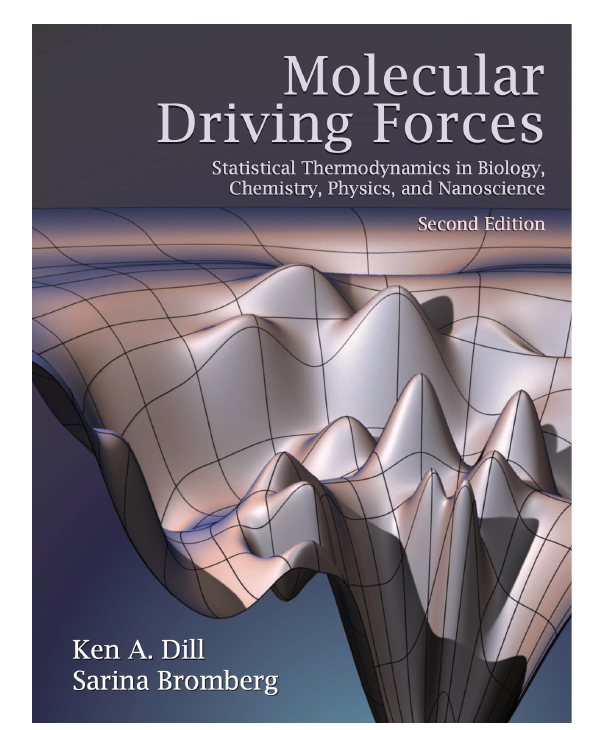
*▲ 课件原图（Slide 2）：本课程核心参考教材 Ken A. Dill & Sarina Bromberg《Molecular Driving Forces》（第 2 版）封面——崎岖的分子自由能景观漏斗（本地路径：`img/ch1_fig01_slide02_book_cover.png`）*

### 1.2 分子演化的终极方向：Addison Ault 论断与最大概率原理
课件第 3 页引用了化学教育家 Addison Ault 在 *Journal of Chemical Education* 上发表的一段极具洞察力的论述：

> *"The reason that a system will evolve to a Boltzmann distribution is that a Boltzmann distribution is so very much more highly probable than any other distribution. ... Actually, a Boltzmann distribution is so much more highly probable than any other distribution that evolution to a Boltzmann distribution is inevitable. **This evolution is the molecular driving force.**"*  
> —— Addison Ault, *Journal of Chemical Education*

- **物理本质解读**：
  - 为什么孤立或恒温体系总是自发地向热力学平衡态（即玻尔兹曼分布）演化？并不是因为每个微观粒子“知道”自己应该去哪个能级，而是因为在约束条件下，**对应于玻尔兹曼分布的微观排列方式数（多重度 $W$）比任何其他非平衡分布大出天文数字般的数量级**。
  - 体系向高概率（高多重度、高熵/低自由能）宏观态演化的统计必然性，就是所谓的**“分子驱动力”（Molecular Driving Force）**。

### 1.3 统计力学的四大支柱：微观态 (Microstates) 与宏观态 (Macrostates)
课件第 4–5 页提炼了统计力学（Statistical Mechanics）的四个核心概念：**Microstates and macrostates（微观态与宏观态）**、**Probability（概率）**、**Equilibrium（平衡态）**、**Entropy（熵）**，并对微观态与宏观态给出了严格区分：

> **定义（宏观态 Macrostate vs. 微观态 Microstate，Slide 5）**：
> 1. **宏观态 (Macrostate)**：体系的一组宏观可观测性质的集合，例如溶液中蛋白质分子的总能量（Total energy, $E$）、温度（$T$）、体积（$V$）、压强（$P$）或平均端到端距离。
> 2. **微观态 (Microstate)**：在某一特定瞬间，体系中**每一个粒子具体的空间位置坐标（Positions, $\mathbf{r}_i$）与运动速度/动量（Velocities, $\mathbf{v}_i$）**（或在离散晶格/构象模型中，每个氨基酸残基所处的具体二面角构象 $(\phi_i, \psi_i, \chi_i)$）。
> 3. **统计力学的核心桥梁**：单一宏观态往往对应着数以百万计（乃至 $10^{23}$ 量级）的不同微观态。**统计力学在海量微观态与单一宏观可观测态之间建立起了定量的概率联系（Probabilistic link）。**

```text
  【微观态 Microstates (原子级坐标/构象)】              【宏观态 Macrostate (实验可测性质)】
  ┌──────────────────────────────────────┐
  │ Microstate 1: 构象 A1 (E = -5 kcal)  │──┐
  │ Microstate 2: 构象 B1 (E = -3 kcal)  │──┼──► 统计力学概率加权 (Boltzmann / 配分函数 Q)
  │ Microstate 3: 构象 B2 (E = -3 kcal)  │──┤             │
  │ ...                                  │  │             ▼
  │ Microstate M: 构象 F1 (E = +2 kcal)  │──┘   宏观可测量：平均能量 <E>、热容 Cv、自由能 ΔG、荧光距离 <l>
  └──────────────────────────────────────┘
```

> **【深度补充解释 1：等概率原理 (Principle of Equal A Priori Probabilities) 与蛋白质构象系综】**  
> 在统计力学中，对于一个处于热力学平衡的孤立体系（给定总能量 $E$、体积 $V$、粒子数 $N$），**所有满足该宏观能量约束的微观态出现的先验概率是完全相等的**。  
> 而在生物物理实验（恒温恒压水相环境，即正则系综 Canonical Ensemble）中，蛋白质分子与周围海量水分子（热浴 Heat Bath）不断交换能量。此时，蛋白质分子的某一个具体微观构象 $i$ 出现的概率不再相等，而是严格取决于它使整个“蛋白质+水浴”总体系损失了多少微观状态数——这直接导出了后文的**玻尔兹曼分布 $p_i \propto e^{-E_i/k_B T}$**。

## 2. 第一节：概率论基础、排列组合与生物分子计数 (2.1 Principles of Probability & Combinatorics, Slides 6–9 & 22)

### 2.1 概率的两种解释与基本运算法则 (Slide 6)
课件第 6 页总结了概率论（Probability Theory）在分子科学中的三大基石：

1. **概率的物理与信息论含义**：
   - **频率学派视角 (Frequencies)**：在大量重复独立试验中，某一事件发生的相对频率极限；
   - **贝叶斯/信息论视角 (Incomplete knowledge)**：在信息不完备的条件下，对某一未知状态成立程度的一致性逻辑推断（Degree of belief）。
2. **加法法则与乘法法则 (Addition & Multiplication Rules)**：
   - **加法法则（OR / 互斥事件并集）**：若事件 $A$ 与 $B$ 互斥（Mutually exclusive, $A \cap B = \emptyset$），则：
     $$P(A \text{ or } B) = P(A \cup B) = P(A) + P(B)$$
     若不互斥，则 $P(A \cup B) = P(A) + P(B) - P(A \cap B)$。
   - **乘法法则（AND / 独立事件交集）**：若事件 $A$ 与 $B$ 相互独立（Independent），则同时发生的联合概率为：
     $$P(A \text{ and } B) = P(A \cap B) = P(A) P(B)$$
     若不独立，则需使用条件概率：$P(A \cap B) = P(A) P(B \mid A)$。
3. **分布函数 (Distribution Functions)**：将概率集合组织为完整的数学函数，分为**离散型分布（Discrete，如二项分布、离散玻尔兹曼能级分布）**与**连续型分布（Continuous，如二面角高斯分布、连续指数分布）**。
4. **组合数学 (Combinatorics)**：对体系可能排列方式总数（Arrangements / Multiplicity $W$）的精确计数。

### 2.2 阶乘记号与求和记号 (Slide 22)
课件第 22 页补充了组合计数与统计矩推导中最基础的两个数学记号：

> **定义（阶乘 Factorial 与求和 Summation，Slide 22）**：
> 1. **阶乘记号 ($N!$)**：表示从 $1$ 到正整数 $N$ 的连乘积：
>    $$N! = 1 \cdot 2 \cdot 3 \cdots (N-2)(N-1)N$$
>    **特殊规定**：零的阶乘定义为 **$0! = 1$**（保证组合公式 $\binom{N}{0} = \frac{N!}{0!N!} = 1$ 的自洽性）。
> 2. **求和记号 ($\Sigma$)**：以离散期望值形式为例：
>    $$\sum_{i=1}^6 i p_i = p_1 + 2p_2 + 3p_3 + 4p_4 + 5p_5 + 6p_6 \qquad (1.25)$$

### 2.3 多重度 (Multiplicity, $W$) 与多项式/二项式组合公式 (Slide 11)
在统计热力学中，**多重度 (Multiplicity, 记作 $W$)** 是指实现某一个宏观分布状态所对应的微观排列方式总数：

1. **独立复合事件的乘法多重度（式 1.2）**：  
   若事件 $A$ 有 $n_A$ 种可能结果，事件 $B$ 有 $n_B$ 种可能结果，事件 $C$ 有 $n_C$ 种可能结果，则组合事件的总可能方式数为：
   $$W = n_A n_B n_C \qquad (1.2)$$
2. **多项式分布多重度（Multinomial Multiplicity，式 1.21）**：  
   将 $N$ 个对象归入 $t$ 个不同类别（Categories），其中第 $i$ 类包含 $n_i$ 个彼此不可区分（Indistinguishable）的对象（满足 $\sum_{i=1}^t n_i = N$），则不同排列方式的总数 $W$ 为：
   $$W = \frac{N!}{n_1! n_2! \cdots n_t!} = \frac{N!}{\prod_{i=1}^t n_i!} \qquad (1.21)$$
3. **二项式分布多重度（Binomial Multiplicity，式 1.22）**：  
   当类别数 $t = 2$（如硬币正/反面、离子通道开/关、DNA 碱基正确/突变）时，$N$ 次试验中恰好出现 $n$ 次成功的序列排列总数为：
   $$W(n, N) = \binom{N}{n} = \frac{N!}{n!(N - n)!} \qquad (1.22)$$

### 2.4 【课件 Quiz 深度精解 1】：蛋白质二硫键配对的组合数学 (Slide 7, Problem 1.11)

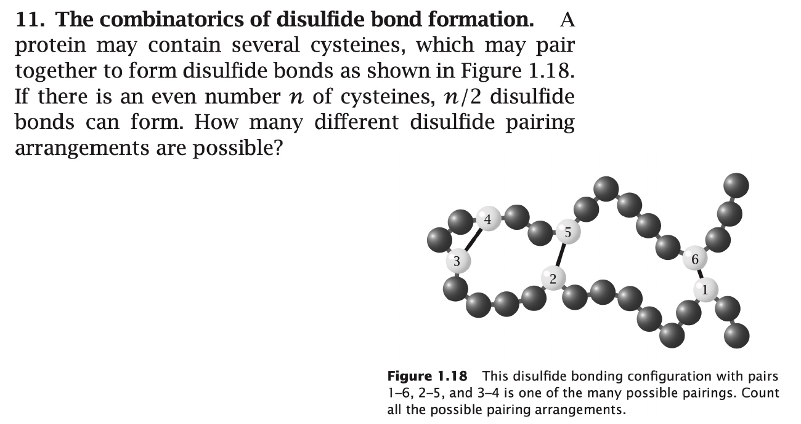
*▲ 课件原图（Slide 7）：蛋白质中半胱氨酸（Cysteines）形成二硫键的组合计数问题（本地路径：`img/ch1_fig02_slide07_disulfide_bonds.png`）*

> **题目原题（Dill & Bromberg, Problem 1.11）**：  
> *The combinatorics of disulfide bond formation.* A protein may contain several cysteines, which may pair together to form disulfide bonds as shown in Figure 1.18. If there is an even number $n$ of cysteines, $n/2$ disulfide bonds can form. How many different disulfide pairing arrangements are possible?  
> （一条蛋白质多肽链含有偶数 $n$ 个半胱氨酸残基，它们两两配对可形成 $n/2$ 个二硫键，如图 1.18 展示了 $n=6$ 时 `1–6, 2–5, 3–4` 的一种配对构型。请问总共有多少种不同的二硫键完全配对方式？）

#### 严谨推导与双视角证明：

- **方法一：递推分步配对法（Sequential Pairing，最直观）**
  1. 先任选第 1 个半胱氨酸（例如 1 号残基）：它可以与剩下的 $n - 1$ 个半胱氨酸中的任意一个形成第一对二硫键，共有 **$(n - 1)$** 种选择；
  2. 第一对二硫键形成后，还剩下 $n - 2$ 个未配对的半胱氨酸。从中任选下一个未配对的半胱氨酸，它可以与其余 $n - 3$ 个半胱氨酸中的任意一个配对，共有 **$(n - 3)$** 种选择；
  3. 依此类推，直到最后剩下 2 个半胱氨酸，只有 **$1$** 种配对方式。
  4. 根据乘法法则，将各步选择数相乘，得到总配对方式数（即奇数双阶乘 Double Factorial）：
     $$W(n) = (n - 1) \times (n - 3) \times (n - 5) \times \cdots \times 3 \times 1 = (n - 1)!!$$

- **方法二：全排列消序法（Permutation & Symmetry Reduction）**
  1. 将 $n$ 个带编号的半胱氨酸排成一列，共有 $n!$ 种全排列，将其按顺序两两分组作为 $k = n/2$ 对二硫键；
  2. **消除每对二硫键内部的顺序冗余**：每一对二硫键内部（例如 `1–6` 与 `6–1`）代表同一个共价化学键，共有 $2! = 2$ 种重复，因此 $n/2$ 对二硫键需除以 $2^{n/2}$；
  3. **消除二硫键之间的排列顺序冗余**：$n/2$ 对二硫键谁先列出、谁后列出（例如 `{1–6, 2–5, 3–4}` 与 `{2–5, 1–6, 3–4}`）属于同一种拓扑配对状态，需除以 $(n/2)!$。
  4. 由此得到完全等价的闭合阶乘公式：
     $$W(n) = \frac{n!}{2^{n/2} (n/2)!}$$
     *化简验证*：将分子展开并提取偶数项 $n(n-2)(n-4)\cdots 2 = 2^{n/2} (n/2)!$，与分母约分后恰好剩下奇数乘积 $(n-1)(n-3)\cdots 3 \cdot 1 = (n-1)!!$。 $\blacksquare$

- **典型数值与蛋白质科学意义（连接安芬森 RNase A 实验）**：
  - 当 $n = 2$（1 对二硫键）：$W(2) = 1$ 种；
  - 当 $n = 4$（2 对二硫键）：$W(4) = 3 \times 1 = 3$ 种；
  - **当 $n = 6$（如课件图 1.18，3 对二硫键）**：$W(6) = 5 \times 3 \times 1 = \mathbf{15}$ 种；
  - **当 $n = 8$（如核糖核酸酶 A [RNase A]，4 对二硫键）**：$W(8) = 7 \times 5 \times 3 \times 1 = \mathbf{105}$ 种！  
    *(注：Christian Anfinsen 正是通过证明含有 8 个半胱氨酸的 RNase A 在撤去变性剂尿素后，能从 105 种可能的二硫键配对中 $100\%$ 自发恢复到唯一的天然配对构象，从而确立了蛋白质折叠的热力学假说并荣膺 1972 年诺贝尔化学奖！)*

### 2.5 【课件 Quiz 深度精解 2】：生物膜离子通道开启事件的二项分布 (Slide 8, Problem 1.21)

> **题目原题（Dill & Bromberg, Problem 1.21）**：  
> *Ion-channel events.* A biological membrane contains $N$ ion-channel proteins. The fraction of time that any one protein is open to allow ions to flow through is $q$. Express the probability $P(m, N)$ that $m$ of the channels will be open at any given time.  
> （生物膜上含有 $N$ 个独立的离子通道蛋白。单个通道蛋白处于开启状态允许离子流过的时间占比/概率为 $q$。请写出在任意给定时刻，恰有 $m$ 个通道同时处于开启状态的概率表达式 $P(m, N)$。）

#### 严谨推导与解答：
1. **单通道状态概率**：在任意时刻，单个离子通道处于“开启（Open）”状态的概率为 $p_{\text{open}} = q$；由于通道只有“开”和“关”两种状态（完备且互斥），处于“关闭（Closed）”状态的概率为 $p_{\text{closed}} = 1 - q$。
2. **特定微观序列的概率**：假设指定某一组特定的 $m$ 个通道开启、其余 $N - m$ 个通道关闭，由独立事件乘法法则，该特定微观状态出现的概率为：
   $$P(\text{specific microstate}) = q^m (1 - q)^{N - m}$$
3. **宏观状态的多重度计数**：从 $N$ 个可区分的离子通道中任选 $m$ 个处于开启状态，共有二项式系数种组合方式：
   $$W(m, N) = \binom{N}{m} = \frac{N!}{m!(N - m)!}$$
4. **总概率表达式**：将互斥的 $\binom{N}{m}$ 种微观态概率相加，即得二项分布（Binomial Distribution）公式：
   $$P(m, N) = \binom{N}{m} q^m (1 - q)^{N - m} = \frac{N!}{m!(N - m)!} q^m (1 - q)^{N - m}, \quad m = 0, 1, 2, \dots, N \quad \blacksquare$$

### 2.6 【课件 Quiz 深度精解 3】：DNA 合成突变率与条件概率分析 (Slide 9, Problem 1.27)

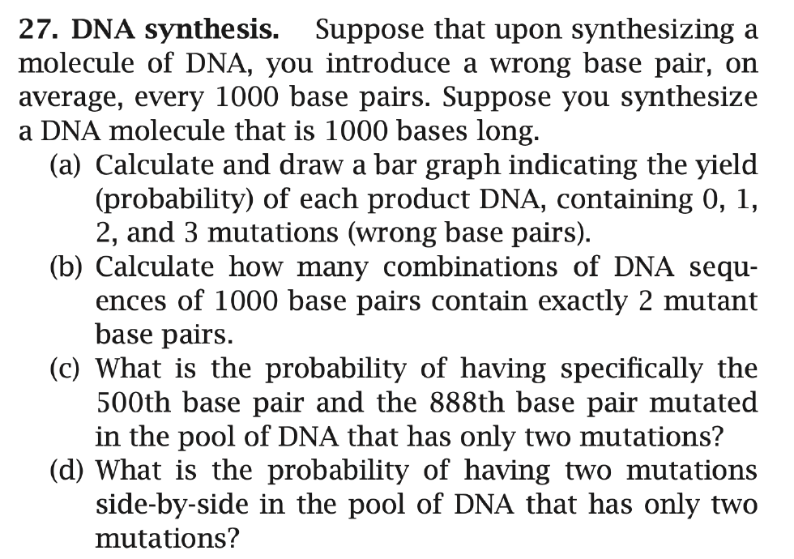
*▲ 课件原图（Slide 9）：DNA 合成中的错配突变概率与组合数学问题（本地路径：`img/ch1_fig03_slide09_dna_synthesis.png`）*

> **题目原题（Dill & Bromberg, Problem 1.27）**：  
> *DNA synthesis.* Suppose that upon synthesizing a molecule of DNA, you introduce a wrong base pair, on average, every 1000 base pairs. Suppose you synthesize a DNA molecule that is 1000 bases long.  
> (a) Calculate and draw a bar graph indicating the yield (probability) of each product DNA, containing 0, 1, 2, and 3 mutations (wrong base pairs).  
> (b) Calculate how many combinations of DNA sequences of 1000 base pairs contain *exactly* 2 mutant base pairs.  
> (c) What is the probability of having specifically the 500th base pair and the 888th base pair mutated in the pool of DNA that has only two mutations?  
> (d) What is the probability of having two mutations side-by-side in the pool of DNA that has only two mutations?

#### 完整分步推导与解答：

##### (a) 含有 $m = 0, 1, 2, 3$ 个突变碱基对的产物产率（概率）计算与柱状图
- **模型参数**：DNA 总长度 $N = 1000$，每个位点发生错误配对（突变）的概率为 $p = \frac{1}{1000} = 0.001$，正确配对的概率为 $1 - p = 0.999$。
- **精确二项分布计算**（$P(m) = \binom{1000}{m} (0.001)^m (0.999)^{1000-m}$）与 **泊松近似**（$\lambda = Np = 1000 \times 0.001 = 1, P(m) \approx \frac{1^m}{m!}e^{-1}$）：
  1. **$m = 0$（完全无突变的野生型产物）**：
     $$P(0) = \binom{1000}{0} (0.001)^0 (0.999)^{1000} = (0.999)^{1000} \approx \mathbf{0.36770} \quad (\text{泊松近似: } e^{-1} \approx 0.36788)$$
  2. **$m = 1$（恰好含 1 个突变）**：
     $$P(1) = 1000 \times (0.001)^1 \times (0.999)^{999} = (0.999)^{999} \approx \mathbf{0.36806} \quad (\text{泊松近似: } 1 \cdot e^{-1} \approx 0.36788)$$
  3. **$m = 2$（恰好含 2 个突变）**：
     $$P(2) = \frac{1000 \times 999}{2!} (0.001)^2 (0.999)^{998} = 0.4995 \times (0.999)^{998} \approx \mathbf{0.18403} \quad (\text{泊松近似: } \frac{1}{2}e^{-1} \approx 0.18394)$$
  4. **$m = 3$（恰好含 3 个突变）**：
     $$P(3) = \frac{1000 \times 999 \times 998}{3!} (0.001)^3 (0.999)^{997} \approx 0.166167 \times (0.999)^{997} \approx \mathbf{0.06128} \quad (\text{泊松近似: } \frac{1}{6}e^{-1} \approx 0.06131)$$
  *(注：前四项概率之和为 $0.36770 + 0.36806 + 0.18403 + 0.06128 = 0.98107$，即超过 $98.1\%$ 的合成产物突变数不超过 3 个。)*

```text
  DNA 合成产物突变数分布柱状图 (Yield vs. Number of Mutations m)
  Probability P(m)
   0.40 ┤    ████ (0.3677)     ████ (0.3681)
   0.30 ┤    ████              ████
   0.20 ┤    ████              ████              ████ (0.1840)
   0.10 ┤    ████              ████              ████              ████ (0.0613)
   0.00 └─────┴─────────────────┴─────────────────┴─────────────────┴──────────► 突变个数 m
             m = 0             m = 1             m = 2             m = 3
```

##### (b) 恰好含有 2 个突变碱基对的 DNA 组合方式总数
- 从 $N = 1000$ 个碱基对位置中任选 $m = 2$ 个发生突变的位置，其位置组合数（多重度）为：
  $$W(2, 1000) = \binom{1000}{2} = \frac{1000!}{2! \cdot 998!} = \frac{1000 \times 999}{2} = \mathbf{499,500} \text{ 种位置组合}$$
  *(拓展补充：若进一步区分每个突变位点具体突变成了哪一种错误碱基——因为 A/T/C/G 四种碱基中除去 1 种正确碱基外有 3 种错误替换可能，则具体的突变序列分子种类数为 $\binom{1000}{2} \times 3^2 = 499,500 \times 9 = 4,495,500$ 种；教材标准答案默认按突变位置组合计为 $499,500$。)*

##### (c) 在仅含 2 个突变的 DNA 池中，恰好是第 500 位和第 888 位发生突变的概率
- 在已知某条 DNA 恰好含有 2 个突变的条件池（Conditioned on $m = 2$）中，所有 $W(2, 1000) = 499,500$ 种双突变位置组合出现的可能性完全相等。
- “第 500 位且第 888 位突变”只是这 $499,500$ 种等可能组合中的**唯一特定一种**，因此其条件概率为：
  $$P(\text{500th and 888th mutated} \mid m = 2) = \frac{1}{W(2, 1000)} = \frac{1}{499,500} \approx \mathbf{2.002 \times 10^{-6}} \quad \blacksquare$$

##### (d) 在仅含 2 个突变的 DNA 池中，两个突变位置紧挨着（Side-by-side）的概率
- 在长度为 $N = 1000$ 的线性 DNA 链上，紧挨着的相邻碱基对位置组合依次为：$(1, 2), (2, 3), (3, 4), \dots, (999, 1000)$，共计 **$N - 1 = 999$ 种**有利构型。
- 因此，在双突变 DNA 池中出现相邻突变的概率为：
  $$P(\text{side-by-side} \mid m = 2) = \frac{N - 1}{\binom{N}{2}} = \frac{N - 1}{\frac{N(N - 1)}{2}} = \frac{2}{N} = \frac{999}{499,500} = \frac{2}{1000} = \mathbf{0.002} \quad (0.2\%) \quad \blacksquare$$

## 3. 第二节：熵 (Entropy) 与玻尔兹曼-吉布斯-香农定律 (2.2 Entropy & The Boltzmann Law, Slides 10–15)

### 3.1 玻尔兹曼墓碑公式 $S = k \ln W$ 的物理本质 (Slides 10–11)


*▲ 图 3-1（网络拓展配图）：镌刻在维也纳中央公墓 [Ludwig Boltzmann](https://en.wikipedia.org/wiki/Ludwig_Boltzmann)（1844–1906）墓碑顶部的统计热力学核心方程 $S = k \log W$（来源：[Wikimedia Commons](https://commons.wikimedia.org/wiki/File:Zentralfriedhof_Vienna_-_Boltzmann.JPG)）*

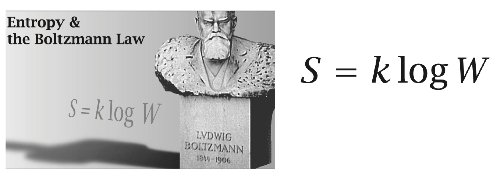
*▲ 课件原图（Slide 10）：Entropy & the Boltzmann Law $S = k \log W$（本地路径：`img/ch1_fig04_slide10_boltzmann_tombstone.png`）*

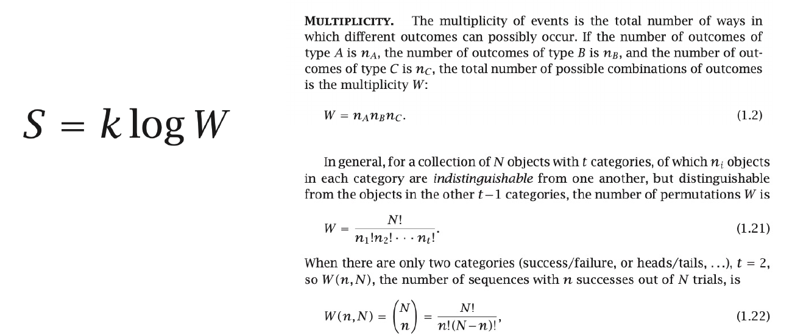
*▲ 课件原图（Slide 11）：从概率与排列组合多重度 $W$ 理解熵（本地路径：`img/ch1_fig05_slide11_multiplicity_entropy.png`）*

> **定律（玻尔兹曼熵公式，Boltzmann's Entropy Law）**：  
> 宏观状态的熵 $S$ 与该宏观态所包含的微观状态多重度 $W$ 的自然对数成正比：
> $$S = k_B \ln W$$
> 其中 $k_B = 1.380649 \times 10^{-23}\text{ J}\cdot\text{K}^{-1}$ 为玻尔兹曼常数（在摩尔量纲下常用气体常数 $R = N_A k_B \approx 1.987\text{ cal}\cdot\text{mol}^{-1}\cdot\text{K}^{-1} \approx 8.314\text{ J}\cdot\text{mol}^{-1}\cdot\text{K}^{-1}$）。

- **为什么熵必须定义为多重度 $W$ 的对数（$\ln W$）？**
  - **微观多重度是乘性的（Multiplicative）**：对于两个相互独立的子系统 $A$ 和 $B$，总系统的微观状态数为 $W_{AB} = W_A \cdot W_B$；
  - **宏观热力学熵是广延量/加和性的（Extensive / Additive）**：总系统的熵必须等于两个子系统熵之和 $S_{AB} = S_A + S_B$；
  - 数学上唯一能将乘积转化为加和的连续单调函数就是**对数函数**：
    $$S_{AB} = k_B \ln(W_A W_B) = k_B \ln W_A + k_B \ln W_B = S_A + S_B$$

### 3.2 从多重度公式到吉布斯-香农熵 $S/k = -\sum p_i \ln p_i$ 的严格斯特林近似推导 (Slide 12)

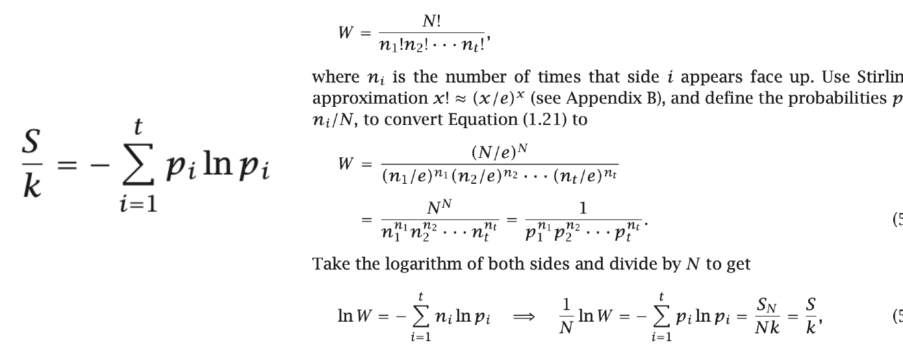
*▲ 课件原图（Slide 12）：利用斯特林近似从多项式多重度 $W$ 推导吉布斯-香农熵公式 $\frac{S}{k} = -\sum_{i=1}^t p_i \ln p_i$（本地路径：`img/ch1_fig06_slide12_stirling_shannon_derivation.png`）*

课件第 12 页给出了统计力学中最核心的数学推导之一：**如何从离散计数多重度 $W$ 推导出概率分布表示的熵公式**。

#### 严格分步推导（必考推导题）：
1. **多项式多重度起点**：  
   设在 $N$ 次独立观测（或 $N$ 个粒子/分子构成的系综）中，共有 $t$ 种可能的状态类别，其中第 $i$ 类状态出现的次数为 $n_i$（满足 $\sum_{i=1}^t n_i = N$），则总排列重数为：
   $$W = \frac{N!}{n_1! n_2! \cdots n_t!}$$
2. **引入斯特林近似（Stirling's Approximation）**：  
   当粒子数或观测数 $N$ 与各状态计数 $n_i$ 很大时，阶乘可用斯特林公式近似：
   $$x! \approx \left(\frac{x}{e}\right)^x \quad \Longleftrightarrow \quad \ln(x!) \approx x \ln x - x$$
3. **代入多重度表达式并化简（课件式 5.3）**：  
   将 $N! \approx (N/e)^N$ 和 $n_i! \approx (n_i/e)^{n_i}$ 代入 $W$：
   $$W \approx \frac{(N/e)^N}{(n_1/e)^{n_1} (n_2/e)^{n_2} \cdots (n_t/e)^{n_t}}$$
   注意到分母中 $e$ 的指数之和为 $\sum_{i=1}^t n_i = N$，因此分子与分母中的 $e^{-N}$ 恰好完全抵消！同时将分子的 $N^N$ 改写为 $N^{\sum_{i=1}^t n_i} = N^{n_1} N^{n_2} \cdots N^{n_t}$：
   $$W = \frac{N^N}{n_1^{n_1} n_2^{n_2} \cdots n_t^{n_t}} = \frac{1}{\left(\frac{n_1}{N}\right)^{n_1} \left(\frac{n_2}{N}\right)^{n_2} \cdots \left(\frac{n_t}{N}\right)^{n_t}}$$
   定义第 $i$ 个状态的出现频率（概率）为 $p_i = \frac{n_i}{N}$，则上式化为极其简洁的形式：
   $$W = \frac{1}{p_1^{n_1} p_2^{n_2} \cdots p_t^{n_t}} = \prod_{i=1}^t p_i^{-n_i} \qquad (5.3)$$
4. **两边取自然对数并除以总粒子数 $N$（课件式 5.4）**：
   $$\ln W = \ln\left(\prod_{i=1}^t p_i^{-n_i}\right) = -\sum_{i=1}^t n_i \ln p_i$$
   两边同除以 $N$，并利用 $p_i = \frac{n_i}{N}$ 以及平均每个粒子的熵 $S = \frac{S_N}{N} = \frac{k \ln W}{N}$：
   $$\frac{1}{N} \ln W = -\sum_{i=1}^t \left(\frac{n_i}{N}\right) \ln p_i \quad \Longrightarrow \quad \frac{S}{k} = -\sum_{i=1}^t p_i \ln p_i \qquad (5.4) \quad \blacksquare$$

> **【深度补充解释 2：玻尔兹曼熵、吉布斯熵与香农信息熵的大一统】**  
> 公式 $\frac{S}{k} = -\sum_{i=1}^t p_i \ln p_i$ 被称为**玻尔兹曼-吉布斯-香农熵 (Boltzmann-Gibbs-Shannon Entropy)**：
> - 当所有 $t$ 个微观态等概率出现时（即均匀分布 $p_i = \frac{1}{t}$），代入上式得：
>   $$\frac{S}{k} = -\sum_{i=1}^t \frac{1}{t} \ln\left(\frac{1}{t}\right) = -t \cdot \frac{1}{t} (-\ln t) = \ln t$$
>   完美退化回玻尔兹曼公式 $S = k \ln W$！
> - 在蛋白质设计中，该公式直接用于计算**侧链构象熵（Side-chain conformational entropy）**与**序列位置信息熵（Sequence conservation / WebLogo）**：如果多序列比对（MSA）中某个氨基酸位点只允许出现唯一种类的氨基酸（$p_1 = 1, \text{其余 } p_i = 0$），则该位点序列熵 $S = 0$，说明该位点在进化上极端保守（通常是核心催化残基或结构支点）。

### 3.3 熵作为概率分布“平坦度 (Flatness)”的度量：袜子颜色分布实例 (Slide 13, Example 5.2)

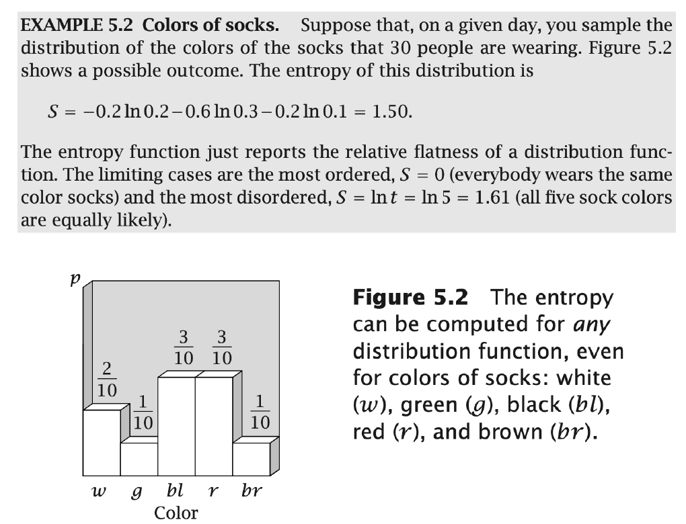
*▲ 课件原图（Slide 13）：Example 5.2 袜子颜色分布的熵计算与分布平坦度解释（本地路径：`img/ch1_fig07_slide13_socks_entropy_example.png`）*

- **案例解析（Slide 13, Example 5.2）**：
  - 抽样调查 30 个人穿的袜子颜色，共有 $t = 5$ 种颜色：白色（$w, p_w = 2/10 = 0.2$）、绿色（$g, p_g = 1/10 = 0.1$）、黑色（$bl, p_{bl} = 3/10 = 0.3$）、红色（$r, p_r = 3/10 = 0.3$）、棕色（$br, p_{br} = 1/10 = 0.1$）。
  - 代入无量纲熵公式：
    $$\frac{S}{k} = -\sum_{i=1}^5 p_i \ln p_i = -0.2\ln(0.2) - 2 \times (0.3\ln 0.3) - 2 \times (0.1\ln 0.1)$$
    $$= -0.2(-1.6094) - 0.6(-1.2040) - 0.2(-2.3026) = 0.3219 + 0.7224 + 0.4605 = \mathbf{1.50}$$
- **核心物理直觉（必记结论）**：
  - **熵函数本质上是概率分布函数“相对平坦度（Relative Flatness）”或“分散度（Spread）”的定量指标**！
  - **最小熵极限（最有序/最集中，Most Ordered / Peaked）**：所有人穿同一种颜色的袜子（某一 $p_k = 1$，其余 $p_i = 0$），此时 **$S/k = 0$**（完全确定，毫无不确定性）。
  - **最大熵极限（最无序/最平坦，Most Disordered / Flat）**：5 种颜色的袜子完全等可能出现（$p_i = 1/5 = 0.2$），此时 **$S_{\max}/k = \ln t = \ln 5 \approx 1.61$**。

### 3.4 【课件 Quiz 深度精解 4】：尖峰分布与平坦分布的熵值对比 (Slide 14, Problem 5.2)

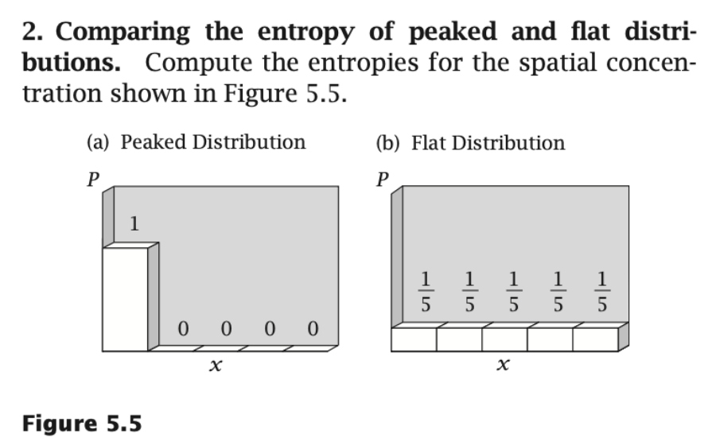
*▲ 课件原图（Slide 14）：Figure 5.5 尖峰分布（Peaked Distribution）与平坦分布（Flat Distribution）的熵计算对比（本地路径：`img/ch1_fig08_slide14_peaked_vs_flat_entropy.png`）*

> **题目原题（Dill & Bromberg, Problem 5.2）**：  
> *Comparing the entropy of peaked and flat distributions.* Compute the entropies for the spatial concentration shown in Figure 5.5: (a) Peaked Distribution $P = (1, 0, 0, 0, 0)$; (b) Flat Distribution $P = (1/5, 1/5, 1/5, 1/5, 1/5)$.

#### 严谨推导与解答：
1. **图 (a) 尖峰分布（Peaked Distribution）**：  
   粒子 $100\%$ 集中在第 1 个格子里，概率分布为 $p_1 = 1, p_2 = p_3 = p_4 = p_5 = 0$。  
   由洛必达法则可知极限 $\lim_{p \to 0^+} p \ln p = \lim_{p \to 0^+} \frac{\ln p}{1/p} = \lim_{p \to 0^+} (-p) = 0$，因此规定 $0 \ln 0 = 0$。代入熵公式：
   $$\frac{S_{\text{peaked}}}{k} = -\sum_{i=1}^5 p_i \ln p_i = -(1 \ln 1 + 0 + 0 + 0 + 0) = \mathbf{0}$$
2. **图 (b) 平坦分布（Flat Distribution）**：  
   粒子均匀分布在 5 个格子里，概率分布为 $p_1 = p_2 = p_3 = p_4 = p_5 = \frac{1}{5}$。代入熵公式：
   $$\frac{S_{\text{flat}}}{k} = -\sum_{i=1}^5 \left(\frac{1}{5} \ln \frac{1}{5}\right) = -5 \times \frac{1}{5} (-\ln 5) = \ln 5 \approx \mathbf{1.6094} \quad \blacksquare$$
3. **物理意义（气体扩散与蛋白质去折叠）**：当装在左端格子的溶质分子向整个容器自由扩散时，其空间位置分布从图 (a) 的尖峰分布自发演化为图 (b) 的平坦分布，体系熵增加 $\Delta S = k \ln 5 > 0$。这正是自由扩散与未折叠多肽链倾向于探索广阔构象空间的熵驱动力！

### 3.5 【课件 Quiz 深度精解 5】：两个不同偏好尖峰分布的熵对比 (Slide 15, Problem 5.4)

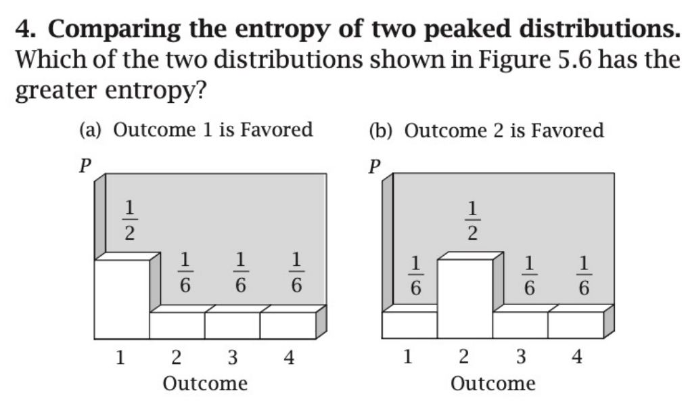
*▲ 课件原图（Slide 15）：Figure 5.6 比较两个偏好不同结果的分布的熵（本地路径：`img/ch1_fig09_slide15_two_peaked_distributions.png`）*

> **题目原题（Dill & Bromberg, Problem 5.4）**：  
> *Comparing the entropy of two peaked distributions.* Which of the two distributions shown in Figure 5.6 has the greater entropy?  
> (a) Outcome 1 is Favored: $P = (1/2, 1/6, 1/6, 1/6)$  
> (b) Outcome 2 is Favored: $P = (1/6, 1/2, 1/6, 1/6)$

#### 严谨推导与核心结论：
- **计算图 (a) 的熵**：
  $$\frac{S_a}{k} = -\left( \frac{1}{2}\ln\frac{1}{2} + \frac{1}{6}\ln\frac{1}{6} + \frac{1}{6}\ln\frac{1}{6} + \frac{1}{6}\ln\frac{1}{6} \right) = \frac{1}{2}\ln 2 + \frac{1}{2}\ln 6 = \frac{1}{2}\ln 12 \approx \mathbf{1.2425}$$
- **计算图 (b) 的熵**：
  $$\frac{S_b}{k} = -\left( \frac{1}{6}\ln\frac{1}{6} + \frac{1}{2}\ln\frac{1}{2} + \frac{1}{6}\ln\frac{1}{6} + \frac{1}{6}\ln\frac{1}{6} \right) = \frac{1}{2}\ln 2 + \frac{1}{2}\ln 6 = \frac{1}{2}\ln 12 \approx \mathbf{1.2425}$$
- **结论：两者的熵完全相等（$S_a = S_b$）！** $\blacksquare$
- **核心考点剖析（置换不变性 Permutation Invariance）**：  
  求和式 $S/k = -\sum_{i=1}^t p_i \ln p_i$ 对状态下标 $i$ 的排列顺序具有**完全对称性（置换不变性）**。熵只取决于概率分布的“形状/平坦程度”（即有一个状态占 $1/2$、三个状态占 $1/6$），而与**哪一个具体状态**获得了 $1/2$ 的高概率毫无关系！

## 4. 第三节：玻尔兹曼分布定律与配分函数 (2.3 The Boltzmann Distribution Law, Slides 16–19)

### 4.1 玻尔兹曼分布与正则配分函数 (Slide 16)


*▲ 图 4-1（网络拓展配图）：不同温度 $T$ 下的玻尔兹曼指数分布曲线——温度越低，粒子越高度集中在低能基态；温度越高，高能激发态居群占比越大，分布越趋于平坦（来源：[Wikimedia Commons](https://en.wikipedia.org/wiki/Boltzmann_distribution)）*

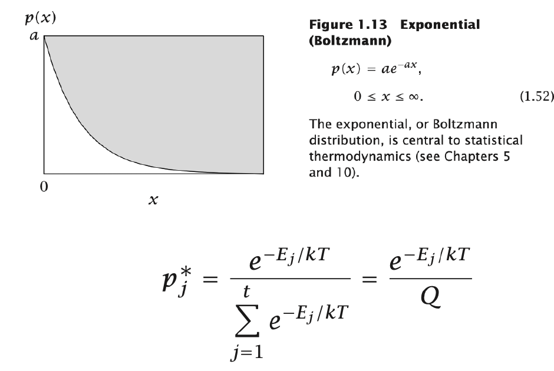
*▲ 课件原图（Slide 16）：指数分布 $p(x) = a e^{-ax}$ 与离散玻尔兹曼分布定律 $p_j^* = \frac{e^{-E_j/kT}}{Q}$（本地路径：`img/ch1_fig10_slide16_boltzmann_distribution.png`）*

> **定律（玻尔兹曼分布定律，The Boltzmann Distribution Law，Slide 16）**：  
> 在恒温 $T$ 的正则系综平衡态下，体系处于能量为 $E_j$ 的第 $j$ 个微观态的平衡概率 $p_j^*$ 随该状态能量呈指数衰减：
> $$p_j^* = \frac{e^{-E_j / k_B T}}{\sum_{j=1}^t e^{-E_j / k_B T}} = \frac{e^{-E_j / k_B T}}{Q}$$
> 其中：
> - **$e^{-E_j / k_B T}$** 称为**玻尔兹曼因子（Boltzmann factor / Statistical weight）**；
> - **$Q = \sum_{j=1}^t e^{-E_j / k_B T}$**（单分子体系常记为小写 $q$）称为**正则配分函数（Canonical Partition Function）**，它是所有可能微观状态的玻尔兹曼因子之和，起归一化常数作用（确保 $\sum_{j=1}^t p_j^* = 1$）。

> **【深度补充解释 3：为什么玻尔兹曼分布是满足平均能量约束的最大熵分布？】**  
> 在给定总概率归一化约束 $\sum_{j=1}^t p_j = 1$ 和宏观平均能量约束 $\langle E \rangle = \sum_{j=1}^t p_j E_j = U$ 的条件下，使用**拉格朗日乘子法（Lagrange Multipliers）**最大化熵函数 $S/k = -\sum p_j \ln p_j$：
> $$\mathcal{L}(\{p_j\}, \alpha, \beta) = -\sum_{j=1}^t p_j \ln p_j - \alpha \left(\sum_{j=1}^t p_j - 1\right) - \beta \left(\sum_{j=1}^t p_j E_j - U\right)$$
> 对每一个 $p_j$ 求偏导并令其为 0：
> $$\frac{\partial \mathcal{L}}{\partial p_j} = -\ln p_j^* - 1 - \alpha - \beta E_j = 0 \quad \Longrightarrow \quad p_j^* = e^{-(1+\alpha)} e^{-\beta E_j} = \frac{e^{-\beta E_j}}{\sum_i e^{-\beta E_i}}$$
> 结合热力学恒等式 $\frac{\partial S}{\partial U} = \frac{1}{T}$ 可严格证明拉格朗日乘子 $\beta = \frac{1}{k_B T}$！  
> **物理精髓**：玻尔兹曼分布正是微观随机性（趋向最大熵 $S$）与宏观能量约束（趋向低能量 $E$）相妥协的唯一热力学平衡解，对应于亥姆霍兹自由能 $F = U - TS = -k_B T \ln Q$ 的全局极小值！

### 4.2 经典案例剖析：蛋白质表面柔性环 (Protein Loop) 的三态构象建模 (Slide 17, Example 10.7)

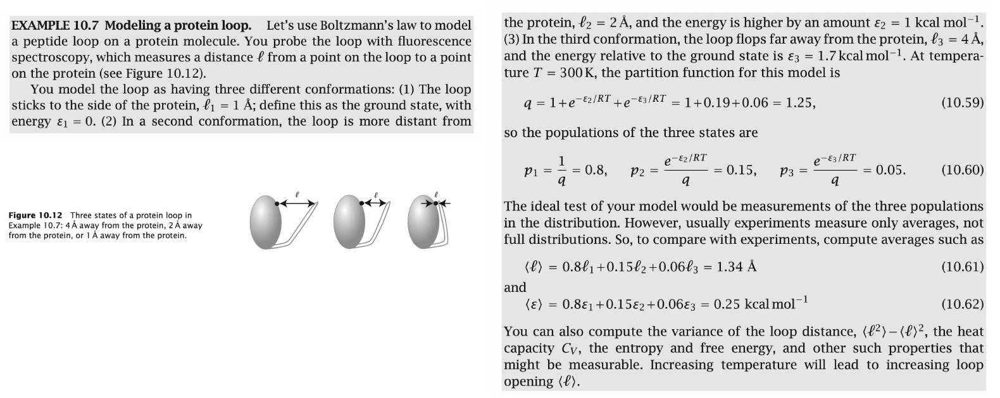
*▲ 课件原图（Slide 17）：Example 10.7 用玻尔兹曼定律对蛋白质多肽环（Peptide Loop）的三态打开构象进行建模并计算实验可观测均值（本地路径：`img/ch1_fig11_slide17_protein_loop_modeling.png`）*

课件第 17 页通过一个生动的生物物理实例（荧光光谱测量蛋白质表面多肽环的距离 $\ell$），展示了如何从微观构象能级计算出宏观实验可观测平均值：

1. **三态模型设定（$T = 300\text{ K}$，此时热能尺度 $RT \approx 0.6\text{ kcal}\cdot\text{mol}^{-1}$）**：
   - **构象 1（Ground state，闭合紧贴态）**：环紧贴蛋白质主体表面，距离 $\ell_1 = 1\text{ \AA}$，定义基态能量 $\varepsilon_1 = 0\text{ kcal}\cdot\text{mol}^{-1}$；
   - **构象 2（中间微张态）**：环稍微离开蛋白质表面，距离 $\ell_2 = 2\text{ \AA}$，能量升高 $\varepsilon_2 = 1.0\text{ kcal}\cdot\text{mol}^{-1}$；
   - **构象 3（完全张开态）**：环大幅向外翻转，距离 $\ell_3 = 4\text{ \AA}$，能量升高 $\varepsilon_3 = 1.7\text{ kcal}\cdot\text{mol}^{-1}$。
2. **第一步：计算分子配分函数 $q$（式 10.59）**：
   $$q = e^{-\varepsilon_1/RT} + e^{-\varepsilon_2/RT} + e^{-\varepsilon_3/RT} = 1 + e^{-1.0 / 0.6} + e^{-1.7 / 0.6} \approx 1 + 0.19 + 0.06 = \mathbf{1.25}$$
3. **第二步：计算三个构象的平衡居群占比 $p_1, p_2, p_3$（式 10.60）**：
   $$p_1 = \frac{1}{1.25} = \mathbf{0.80} \ (80\%), \qquad p_2 = \frac{0.19}{1.25} \approx \mathbf{0.15} \ (15\%), \qquad p_3 = \frac{0.06}{1.25} \approx \mathbf{0.05} \ (5\%)$$
4. **第三步：计算宏观实验可测的系综平均值（Ensemble Averages，式 10.61–10.62）**：
   - 常规荧光实验无法直接看到单个分子的瞬时状态，测到的是溶液中海量分子的系综平均距离 $\langle \ell \rangle$ 与平均能量 $\langle \varepsilon \rangle$：
     $$\langle \ell \rangle = p_1 \ell_1 + p_2 \ell_2 + p_3 \ell_3 = 0.80(1\text{ \AA}) + 0.15(2\text{ \AA}) + 0.06(4\text{ \AA}) \approx \mathbf{1.34\text{ \AA}}$$
     $$\langle \varepsilon \rangle = p_1 \varepsilon_1 + p_2 \varepsilon_2 + p_3 \varepsilon_3 = 0.80(0) + 0.15(1.0) + 0.05(1.7) \approx \mathbf{0.25\text{ kcal}\cdot\text{mol}^{-1}}$$
   - **温度效应预测**：当升高温度 $T$ 时，高能展开态（构象 2 和 3）的玻尔兹曼权重 $e^{-\varepsilon/RT}$ 增大，导致多肽环的平均张开距离 $\langle \ell \rangle$ 随温度升高而增大（热变性展开）。

### 4.3 【课件 Quiz 深度精解 6】：由观测居群概率逆推构象能级 (Slide 18, Problem 10.9)

> **题目原题（Dill & Bromberg, Problem 10.9）**：  
> *Computing the Boltzmann distribution.* You have a thermodynamic system with three states. You observe the probabilities $p_1 = 0.9$, $p_2 = 0.09$, and $p_3 = 0.01$ at $T = 300\text{ K}$. What are the energies $\varepsilon_2$ and $\varepsilon_3$ of states 2 and 3 relative to the ground state?  
> （一个三态热力学体系在 $T = 300\text{ K}$ 下测得各态居群概率分别为 $p_1 = 0.9, p_2 = 0.09, p_3 = 0.01$。设状态 1 为基态 $\varepsilon_1 = 0$，求状态 2 和状态 3 相对于基态的能量 $\varepsilon_2$ 和 $\varepsilon_3$。）

#### 严谨推导与解答（逆玻尔兹曼法 Inverse Boltzmann Formula）：
1. **建立概率比值与能级差的关系**：  
   根据玻尔兹曼分布定律，$p_j = \frac{e^{-\varepsilon_j / RT}}{q}$。将状态 $j$ 的概率除以基态（状态 1，$\varepsilon_1 = 0$）的概率，配分函数 $q$ 直接约去：
   $$\frac{p_j}{p_1} = \frac{e^{-\varepsilon_j / RT}}{e^{-\varepsilon_1 / RT}} = e^{-(\varepsilon_j - \varepsilon_1)/RT} = e^{-\varepsilon_j / RT}$$
   两边取自然对数，得到**逆玻尔兹曼公式（Inverse Boltzmann Relation）**：
   $$\varepsilon_j = -RT \ln\left(\frac{p_j}{p_1}\right) = RT \ln\left(\frac{p_1}{p_j}\right)$$
2. **确定 $T = 300\text{ K}$ 下的热能常数 $RT$**：
   - 按国际标准精确值：$R = 1.9872 \times 10^{-3}\text{ kcal}\cdot\text{mol}^{-1}\cdot\text{K}^{-1} \implies RT = 0.59616\text{ kcal}\cdot\text{mol}^{-1} \approx \mathbf{0.60\text{ kcal}\cdot\text{mol}^{-1}}$（或以焦耳计：$R = 8.3145\text{ J}\cdot\text{mol}^{-1}\cdot\text{K}^{-1} \implies RT = \mathbf{2.494\text{ kJ}\cdot\text{mol}^{-1}}$；单分子尺度 $k_B T = 4.142 \times 10^{-21}\text{ J}$）。
3. **代入计算 $\varepsilon_2$ 和 $\varepsilon_3$**：
   - **状态 2 的相对能量 $\varepsilon_2$**：
     $$\frac{p_1}{p_2} = \frac{0.9}{0.09} = 10 \quad \Longrightarrow \quad \varepsilon_2 = RT \ln(10) \approx 2.3026 RT$$
     - 以 $\text{kcal/mol}$ 为单位：$\varepsilon_2 \approx 0.5962 \times 2.3026 = \mathbf{1.373\text{ kcal}\cdot\text{mol}^{-1}}$（若取近似 $RT \approx 0.60\text{ kcal/mol}$，则 $\varepsilon_2 \approx \mathbf{1.38\text{ kcal}\cdot\text{mol}^{-1}}$）；
     - 以 $\text{kJ/mol}$ 为单位：$\varepsilon_2 \approx 2.494 \times 2.3026 = \mathbf{5.74\text{ kJ}\cdot\text{mol}^{-1}}$。
   - **状态 3 的相对能量 $\varepsilon_3$**：
     $$\frac{p_1}{p_3} = \frac{0.9}{0.01} = 90 \quad \Longrightarrow \quad \varepsilon_3 = RT \ln(90) \approx 4.4998 RT$$
     - 以 $\text{kcal/mol}$ 为单位：$\varepsilon_3 \approx 0.5962 \times 4.4998 = \mathbf{2.683\text{ kcal}\cdot\text{mol}^{-1}}$（若取近似 $RT \approx 0.60\text{ kcal/mol}$，则 $\varepsilon_3 \approx \mathbf{2.70\text{ kcal}\cdot\text{mol}^{-1}}$）；
     - 以 $\text{kJ/mol}$ 为单位：$\varepsilon_3 \approx 2.494 \times 4.4998 = \mathbf{11.22\text{ kJ}\cdot\text{mol}^{-1}}$。 $\blacksquare$

> **【深度补充解释 4：“十倍居群法则”与 Rosetta 知识库统计势】**  
> 从本题 $\frac{p_1}{p_2} = 10 \iff \Delta \varepsilon = RT \ln 10 \approx 1.37\text{–}1.4\text{ kcal/mol}$ 可以记住一条在生物化学与蛋白质设计中极为实用的经验黄金法则：  
> **在室温（$300\text{ K}$）下，自由能每降低约 $1.4\text{ kcal/mol}$（约半根氢键的能量），该构象或结合态的平衡居群占比/亲和力常数就会提升整整 $10$ 倍！**

### 4.4 【课件 Quiz 深度精解 7】：蛋白质六构象系综、能级简并度与平均能量 (Slide 19, Problem 10.14)

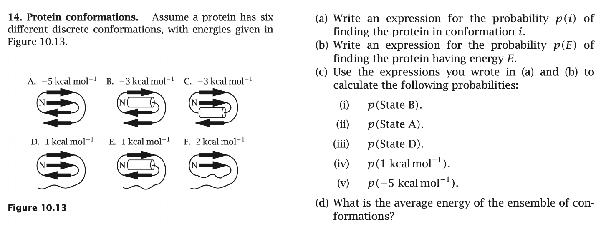
*▲ 课件原图（Slide 19）：Figure 10.13 具有 6 种离散构象的蛋白质系综及其能级分布计算（本地路径：`img/ch1_fig12_slide19_protein_conformations_quiz.png`）*

> **题目原题（Dill & Bromberg, Problem 10.14）**：  
> *Protein conformations.* Assume a protein has six different discrete conformations, with energies given in Figure 10.13:  
> - State A: $\varepsilon_A = -5\text{ kcal mol}^{-1}$  
> - State B: $\varepsilon_B = -3\text{ kcal mol}^{-1}$  
> - State C: $\varepsilon_C = -3\text{ kcal mol}^{-1}$  
> - State D: $\varepsilon_D = 1\text{ kcal mol}^{-1}$  
> - State E: $\varepsilon_E = 1\text{ kcal mol}^{-1}$  
> - State F: $\varepsilon_F = 2\text{ kcal mol}^{-1}$  
> (a) Write an expression for the probability $p(i)$ of finding the protein in conformation $i$.  
> (b) Write an expression for the probability $p(E)$ of finding the protein having energy $E$.  
> (c) Use the expressions you wrote in (a) and (b) to calculate at $T = 300\text{ K}$: (i) $p(\text{State B})$, (ii) $p(\text{State A})$, (iii) $p(\text{State D})$, (iv) $p(1\text{ kcal mol}^{-1})$, (v) $p(-5\text{ kcal mol}^{-1})$.  
> (d) What is the average energy of the ensemble of conformations?

#### 完整分步推导与解答（微观态概率 $p(i)$ vs. 简并能级概率 $p(E)$）：

##### (a) 蛋白质处于特定微观构象 $i$ 的概率表达式 $p(i)$
设共有 $6$ 个离散微观构象 $i \in \{A, B, C, D, E, F\}$，各自能量为 $\varepsilon_i$。根据玻尔兹曼分布：
$$p(i) = \frac{e^{-\varepsilon_i / RT}}{Q}, \qquad \text{其中 } Q = \sum_{i \in \{A,B,C,D,E,F\}} e^{-\varepsilon_i / RT}$$

##### (b) 蛋白质具有特定宏观能量值 $E$ 的概率表达式 $p(E)$（引入能级简并度 Degeneracy $g(E)$）
注意到构象 B 和 C 具有相同的能量 $E = -3\text{ kcal/mol}$，构象 D 和 E 具有相同的能量 $E = +1\text{ kcal/mol}$。  
定义**能级简并度（Degeneracy / Density of States, $g(E)$）**为具有相同能量 $E$ 的不同微观构象个数：
- $g(-5) = 1$（仅构象 A）；
- $g(-3) = 2$（构象 B 和 C）；
- $g(+1) = 2$（构象 D 和 E）；
- $g(+2) = 1$（仅构象 F）。

由互斥事件加法法则，蛋白质处于能量为 $E$ 的宏观态概率等于该能级下所有 $g(E)$ 个微观态概率之和：
$$p(E) = \sum_{i: \varepsilon_i = E} p(i) = \frac{g(E) e^{-E / RT}}{Q}, \qquad \text{其中 } Q = \sum_{\text{all energy levels } E} g(E) e^{-E / RT}$$

##### (c) 在 $T = 300\text{ K}$ 下的具体数值计算
取室温 $T = 300\text{ K}$ 下的标准热能 $RT = 0.59616\text{ kcal}\cdot\text{mol}^{-1}$（注：若按部分课堂简化取 $RT = 0.60\text{ kcal}\cdot\text{mol}^{-1}$，括号内同时给出对应值，方便核对不同精度要求）：

1. **计算各构象的玻尔兹曼权重 $e^{-\varepsilon_i / RT}$**：
   - State A ($\varepsilon_A = -5$)：$e^{5 / 0.59616} = e^{8.3870} \approx \mathbf{4389.64}$ （若 $RT=0.60$，则为 $e^{8.3333} \approx 4160.26$）
   - State B, C ($\varepsilon_B = \varepsilon_C = -3$)：$e^{3 / 0.59616} = e^{5.0322} \approx \mathbf{153.27}$ （若 $RT=0.60$，则为 $e^{5.0000} \approx 148.41$）
   - State D, E ($\varepsilon_D = \varepsilon_E = +1$)：$e^{-1 / 0.59616} = e^{-1.6774} \approx \mathbf{0.1869}$ （若 $RT=0.60$，则为 $e^{-1.6667} \approx 0.1889$）
   - State F ($\varepsilon_F = +2$)：$e^{-2 / 0.59616} = e^{-3.3548} \approx \mathbf{0.0349}$ （若 $RT=0.60$，则为 $e^{-3.3333} \approx 0.0357$）
2. **计算总配分函数 $Q$**：
   $$Q = 4389.64 + 2 \times 153.27 + 2 \times 0.1869 + 0.0349 = \mathbf{4696.59} \quad (\text{若 } RT=0.60, \ Q = \mathbf{4457.50})$$
3. **逐项求解 (i)–(v)**：
   - **(i) $p(\text{State B})$**：
     $$p(\text{State B}) = \frac{153.27}{4696.59} \approx \mathbf{0.03263} \ (3.26\%) \quad [\text{若 } RT=0.60: \ \mathbf{0.03329} \ (3.33\%)]$$
   - **(ii) $p(\text{State A})$**：
     $$p(\text{State A}) = \frac{4389.64}{4696.59} \approx \mathbf{0.93464} \ (93.46\%) \quad [\text{若 } RT=0.60: \ \mathbf{0.93332} \ (93.33\%)]$$
   - **(iii) $p(\text{State D})$**：
     $$p(\text{State D}) = \frac{0.1869}{4696.59} \approx \mathbf{3.979 \times 10^{-5}} \quad [\text{若 } RT=0.60: \ \mathbf{4.237 \times 10^{-5}}]$$
   - **(iv) $p(1\text{ kcal mol}^{-1})$**（注意简并度 $g(+1) = 2$，包含构象 D 和 E！）：
     $$p(1\text{ kcal mol}^{-1}) = p(\text{State D}) + p(\text{State E}) = 2 \times 3.979 \times 10^{-5} \approx \mathbf{7.958 \times 10^{-5}} \quad [\text{若 } RT=0.60: \ \mathbf{8.475 \times 10^{-5}}]$$
   - **(v) $p(-5\text{ kcal mol}^{-1})$**（简并度 $g(-5) = 1$，仅含构象 A）：
     $$p(-5\text{ kcal mol}^{-1}) = p(\text{State A}) \approx \mathbf{0.93464} \ (93.46\%) \quad [\text{若 } RT=0.60: \ \mathbf{0.93332}]$$

##### (d) 构象系综的平均能量 $\langle E \rangle$
$$\langle E \rangle = \sum_{E} E \cdot p(E) = (-5) \cdot p(-5) + (-3) \cdot [2 p(\text{State B})] + (1) \cdot p(+1) + (2) \cdot p(+2)$$
$$= (-5)(0.93464) + (-3)(0.06527) + (1)(7.96 \times 10^{-5}) + (2)(7.43 \times 10^{-6})$$
$$= -4.6732 - 0.1958 + 0.0001 = \mathbf{-4.869\text{ kcal}\cdot\text{mol}^{-1}} \quad [\text{若 } RT=0.60: \ \mathbf{-4.866\text{ kcal}\cdot\text{mol}^{-1}}] \quad \blacksquare$$

## 5. 第四节：连续构象空间、高斯分布与蛋白质柔性动力学 (2.4 Gaussian Distribution & Protein Dynamics, Slides 20–21 & 23)

### 5.1 高斯分布 (Gaussian Distribution) 的数学形式与物理起源 (Slide 23)

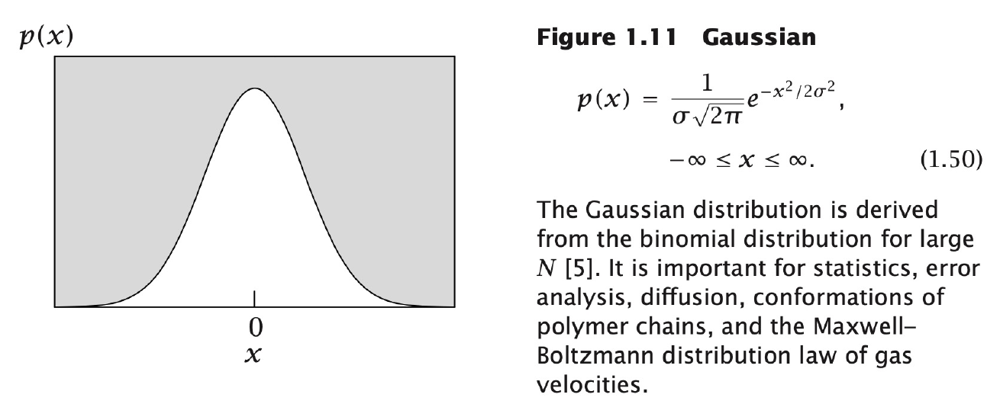
*▲ 课件原图（Slide 23）：Figure 1.11 高斯分布（正态分布）密度曲线及其物理背景（本地路径：`img/ch1_fig15_slide23_gaussian_distribution.png`）*

> **定义（高斯分布 / 正态分布，Gaussian Distribution，Slide 23 式 1.50）**：  
> 均值为 $0$（或中心在 $\theta_0$）、标准差为 $\sigma$ 的一维连续高斯概率密度函数为：
> $$p(x) = \frac{1}{\sigma\sqrt{2\pi}} e^{-x^2 / 2\sigma^2}, \qquad -\infty \le x \le \infty \qquad (1.50)$$
> - **数学起源**：由二项分布在试验次数 $N \to \infty$ 时的极限（中心极限定理 / 棣莫弗-拉普拉斯定理）导出；
> - **生物物理应用**：误差分析、分子布朗扩散位移、高分子/多肽链的末端距构象分布、气体分子麦克斯韦-玻尔兹曼速度分布以及蛋白质键长/键角/二面角的热涨落。

### 5.2 【课件 Quiz 深度精解 8】：由分子二面角高斯分布反推底层简谐势能函数 (Slide 20, Problem 10.16)

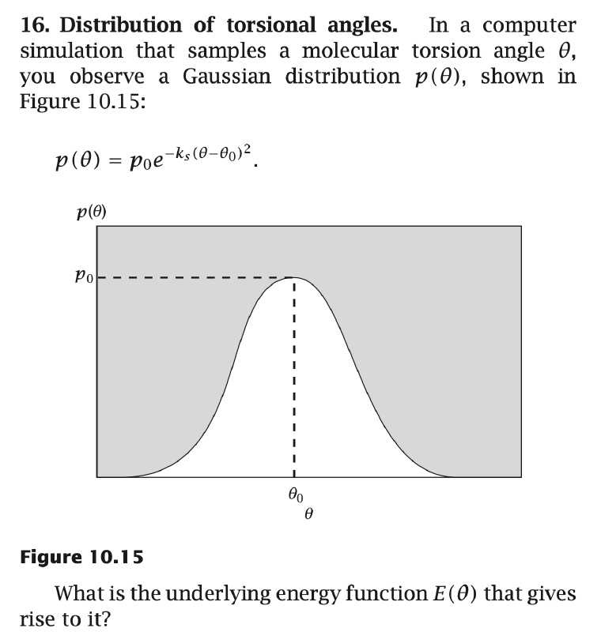
*▲ 课件原图（Slide 20）：Figure 10.15 分子模拟中采样得到的二面角 $\theta$ 高斯分布与势能函数反演（本地路径：`img/ch1_fig13_slide20_torsional_angle_gaussian.png`）*

> **题目原题（Dill & Bromberg, Problem 10.16）**：  
> *Distribution of torsional angles.* In a computer simulation that samples a molecular torsion angle $\theta$, you observe a Gaussian distribution $p(\theta)$, shown in Figure 10.15:
> $$p(\theta) = p_0 e^{-k_s (\theta - \theta_0)^2}$$
> What is the underlying energy function $E(\theta)$ that gives rise to it?

#### 严谨推导与解答：
1. **写出连续变量的玻尔兹曼分布关系**：  
   在恒温 $T$ 的分子动力学（MD）或蒙特卡洛（MC）模拟中，扭转角 $\theta$ 的平衡概率密度分布由其底层势能函数 $E(\theta)$ 决定：
   $$p(\theta) = \frac{e^{-E(\theta) / k_B T}}{Q}$$
2. **在平衡角 $\theta = \theta_0$ 处对齐基准能量**：  
   当 $\theta = \theta_0$ 时，概率密度达到峰值 $p(\theta_0) = p_0 = \frac{e^{-E(\theta_0)/k_B T}}{Q}$。将 $p(\theta)$ 除以 $p_0$：
   $$\frac{p(\theta)}{p_0} = e^{-[E(\theta) - E(\theta_0)] / k_B T} = e^{-k_s (\theta - \theta_0)^2}$$
3. **两边取自然对数解出 $E(\theta)$**：
   $$-\frac{E(\theta) - E(\theta_0)}{k_B T} = -k_s (\theta - \theta_0)^2 \quad \Longrightarrow \quad E(\theta) = E(\theta_0) + k_B T k_s (\theta - \theta_0)^2$$
   若令平衡位置 $\theta_0$ 处的参考势能零点 $E(\theta_0) = 0$，则底层势能函数为**二次简谐势（Harmonic / Hookean Spring Potential）**：
   $$E(\theta) = k_B T k_s (\theta - \theta_0)^2 \quad (\text{或按摩尔单位写作 } E(\theta) = RT k_s (\theta - \theta_0)^2) \quad \blacksquare$$

> **【深度补充解释 5：高斯涨落 $\Longleftrightarrow$ 简谐弹簧势（胡克定律）】**  
> 本题揭示了分子模拟与蛋白质力场设计中的一条核心对偶定理：  
> **任何围绕平衡位置呈高斯分布（正态分布）的结构自由度，其背后的有效势能面必然是抛物线型的简谐弹簧势（Hooke's Law，$E(\theta) = \frac{1}{2} K_{\text{spring}} (\theta - \theta_0)^2$，其中等效劲度系数 $K_{\text{spring}} = 2 k_B T k_s = \frac{k_B T}{\sigma^2}$）！**  
> 这就是为什么在 Rosetta 和经典分子力场（AMBER / CHARMM）中，键长、键角以及二面角约束（Coordinate/Dihedral Constraints）普遍采用二次函数形式，且从 PDB 数据库统计出的二面角分布方差 $\sigma^2$ 可以直接换算为力场弹簧常数！

### 5.3 【课件 Quiz 深度精解 9】：蛋白质双结构域铰链运动 (Hinge Motions) 的热力学与突变熵变全解 (Slide 21, Problem 10.18)

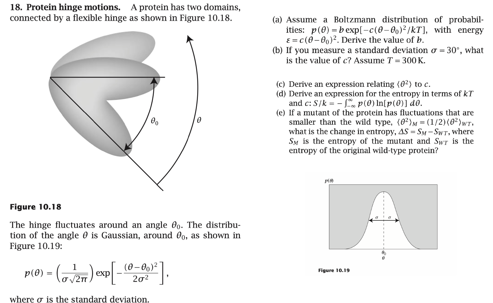
*▲ 课件原图（Slide 21）：Figure 10.18 & 10.19 蛋白质双结构域柔性铰链运动的高斯涨落、能量常数与构象熵变综合压轴题（本地路径：`img/ch1_fig14_slide21_protein_hinge_motions.png`）*

> **题目原题（Dill & Bromberg, Problem 10.18 — 本章综合压轴大题）**：  
> *Protein hinge motions.* A protein has two domains, connected by a flexible hinge as shown in Figure 10.18. The hinge fluctuates around an angle $\theta_0$. The distribution of the angle $\theta$ is Gaussian, around $\theta_0$, as shown in Figure 10.19:
> $$p(\theta) = \left(\frac{1}{\sigma\sqrt{2\pi}}\right) \exp\left[-\frac{(\theta - \theta_0)^2}{2\sigma^2}\right]$$
> (a) Assume a Boltzmann distribution of probabilities: $p(\theta) = b \exp[-c(\theta - \theta_0)^2 / kT]$, with energy $\varepsilon = c(\theta - \theta_0)^2$. Derive the value of $b$.  
> (b) If you measure a standard deviation $\sigma = 30^\circ$, what is the value of $c$? Assume $T = 300\text{ K}$.  
> (c) Derive an expression relating $\langle \theta^2 \rangle$ (or $\langle (\theta - \theta_0)^2 \rangle$) to $c$.  
> (d) Derive an expression for the entropy in terms of $kT$ and $c$: $S/k = -\int_{-\infty}^\infty p(\theta) \ln[p(\theta)] d\theta$.  
> (e) If a mutant of the protein has fluctuations that are smaller than the wild type, $\langle \theta^2 \rangle_M = (1/2) \langle \theta^2 \rangle_{WT}$, what is the change in entropy, $\Delta S = S_M - S_{WT}$, where $S_M$ is the entropy of the mutant and $S_{WT}$ is the entropy of the original wild-type protein?

#### 完整五问逐一严谨推导：

##### (a) 推导归一化前置因子 $b$ 的表达式
- **方法一（直接对比系数法）**：  
  对比玻尔兹曼形式 $p(\theta) = b \exp\left[-\frac{c(\theta - \theta_0)^2}{kT}\right]$ 与标准高斯形式 $p(\theta) = \frac{1}{\sigma\sqrt{2\pi}} \exp\left[-\frac{(\theta - \theta_0)^2}{2\sigma^2}\right]$ 的指数项：
  $$\frac{c}{kT} = \frac{1}{2\sigma^2} \quad \Longrightarrow \quad \sigma = \sqrt{\frac{kT}{2c}}$$
  将 $\sigma$ 代入标准高斯分布的归一化前缀 $\frac{1}{\sigma\sqrt{2\pi}}$：
  $$b = \frac{1}{\sqrt{\frac{kT}{2c}} \cdot \sqrt{2\pi}} = \sqrt{\frac{c}{\pi kT}}$$
- **方法二（利用高斯积分公式直接归一化）**：  
  由全概率归一化条件 $\int_{-\infty}^\infty p(\theta) d\theta = 1$，令 $u = \theta - \theta_0$，利用标准高斯积分公式 $\int_{-\infty}^\infty e^{-\alpha u^2} du = \sqrt{\frac{\pi}{\alpha}}$（此处 $\alpha = \frac{c}{kT}$）：
  $$b \int_{-\infty}^\infty e^{-\frac{c}{kT} u^2} du = b \sqrt{\frac{\pi kT}{c}} = 1 \quad \Longrightarrow \quad b = \mathbf{\sqrt{\frac{c}{\pi kT}}} \quad \blacksquare$$

##### (b) 已知 $\sigma = 30^\circ, T = 300\text{ K}$，计算铰链刚度系数 $c$ 的数值
由第 (a) 问导出的关系式：
$$c = \frac{kT}{2\sigma^2} \quad (\text{或摩尔量纲下 } c = \frac{RT}{2\sigma^2})$$
在 $T = 300\text{ K}$ 下，分别按**角度（Degrees）**和**弧度（Radians，$\sigma = 30^\circ = \frac{\pi}{6}\text{ rad} \approx 0.5236\text{ rad}$）**两种常用单位制给出精确结果：
1. **以角度（$\text{deg}$）为单位（$\sigma^2 = (30^\circ)^2 = 900\text{ deg}^2$，$2\sigma^2 = 1800\text{ deg}^2$）**：
   - 摩尔能量单位（$\text{kcal}\cdot\text{mol}^{-1}\cdot\text{deg}^{-2}$，$RT \approx 0.5962\text{ kcal/mol}$）：
     $$c = \frac{0.5962\text{ kcal}\cdot\text{mol}^{-1}}{2 \times (30\text{ deg})^2} = \frac{0.5962}{1800} \approx \mathbf{3.31 \times 10^{-4}\text{ kcal}\cdot\text{mol}^{-1}\cdot\text{deg}^{-2}} \quad (\text{或 } \mathbf{1.39 \times 10^{-3}\text{ kJ}\cdot\text{mol}^{-1}\cdot\text{deg}^{-2}})$$
   - 单分子能量单位（$\text{J}\cdot\text{deg}^{-2}$，$k_B T = 1.3806 \times 10^{-23} \times 300 = 4.142 \times 10^{-21}\text{ J}$）：
     $$c = \frac{4.142 \times 10^{-21}\text{ J}}{1800\text{ deg}^2} \approx \mathbf{2.30 \times 10^{-24}\text{ J}\cdot\text{deg}^{-2}}$$
2. **以弧度（$\text{rad}$）为单位（$\sigma = \frac{\pi}{6}\text{ rad}, 2\sigma^2 = \frac{\pi^2}{18} \approx 0.5483\text{ rad}^2$）**：
   - 摩尔能量单位：$c = \frac{0.5962}{0.5483} \approx \mathbf{1.087\text{ kcal}\cdot\text{mol}^{-1}\cdot\text{rad}^{-2}}$（或 $\mathbf{4.55\text{ kJ}\cdot\text{mol}^{-1}\cdot\text{rad}^{-2}}$）；
   - 单分子能量单位：$c = \frac{4.142 \times 10^{-21}}{0.5483} \approx \mathbf{7.55 \times 10^{-21}\text{ J}\cdot\text{rad}^{-2}}$。 $\blacksquare$

##### (c) 推导均方涨落 $\langle \theta^2 \rangle$（相对于平衡位置 $\theta_0 = 0$，即方差 $\sigma^2 = \langle (\theta - \theta_0)^2 \rangle$）与 $c$ 的关系
由高斯分布的二阶中心矩（方差）定义及第 (a) 问中的参数对应关系 $\frac{c}{kT} = \frac{1}{2\sigma^2}$：
$$\langle (\theta - \theta_0)^2 \rangle = \sigma^2 = \mathbf{\frac{kT}{2c}} \quad (\text{当设平衡零点 } \theta_0 = 0 \text{ 时，即 } \langle \theta^2 \rangle = \mathbf{\frac{kT}{2c}}) \quad \blacksquare$$
*(物理洞察——能量均分定理 Equipartition Theorem：将 $\langle (\theta - \theta_0)^2 \rangle = \frac{kT}{2c}$ 代入铰链势能期望值，立刻得到 $\langle \varepsilon \rangle = c \langle (\theta - \theta_0)^2 \rangle = \frac{1}{2}kT$！这正是经典统计力学中“每一个二次型简谐自由度平均分配 $\frac{1}{2}k_B T$ 热能”的能量均分定理！)*

##### (d) 用 $kT$ 和 $c$ 推导铰链运动构象熵 $S/k$ 的解析表达式
将 $p(\theta) = b \exp\left[-\frac{c(\theta - \theta_0)^2}{kT}\right]$（其中 $b = \sqrt{\frac{c}{\pi kT}}$）及其自然对数 $\ln p(\theta) = \ln b - \frac{c(\theta - \theta_0)^2}{kT}$ 代入连续微分熵积分公式：
$$\frac{S}{k} = -\int_{-\infty}^\infty p(\theta) \ln[p(\theta)] d\theta = -\int_{-\infty}^\infty p(\theta) \left[ \ln b - \frac{c(\theta - \theta_0)^2}{kT} \right] d\theta$$
将积分拆分为两项：
$$\frac{S}{k} = -\ln b \underbrace{\int_{-\infty}^\infty p(\theta) d\theta}_{= 1 \text{ (归一化)}} + \frac{c}{kT} \underbrace{\int_{-\infty}^\infty (\theta - \theta_0)^2 p(\theta) d\theta}_{= \langle (\theta - \theta_0)^2 \rangle = \frac{kT}{2c}}$$
代入 $b = \left(\frac{c}{\pi kT}\right)^{1/2}$ 以及第二项乘积 $\frac{c}{kT} \cdot \frac{kT}{2c} = \frac{1}{2}$：
$$\frac{S}{k} = -\frac{1}{2} \ln\left(\frac{c}{\pi kT}\right) + \frac{1}{2} = \frac{1}{2} \ln\left(\frac{\pi kT}{c}\right) + \frac{1}{2} = \mathbf{\frac{1}{2} \ln\left(\frac{\pi e kT}{c}\right)} \quad \blacksquare$$
*(注：若用标准差 $\sigma = \sqrt{\frac{kT}{2c}}$ 表示，则高斯分布的熵为 $\frac{S}{k} = \frac{1}{2}\ln(2\pi e \sigma^2) = \ln(\sigma\sqrt{2\pi e})$，直接表明分布越宽 $\sigma$ 越大，构象熵越高！)*

##### (e) 突变体构象涨落减半（$\langle \theta^2 \rangle_M = \frac{1}{2} \langle \theta^2 \rangle_{WT}$）时的熵变 $\Delta S = S_M - S_{WT}$
1. 由第 (c) 问 $\langle \theta^2 \rangle = \frac{kT}{2c}$ 可知，突变体的均方涨落减半（$\langle \theta^2 \rangle_M = \frac{1}{2}\langle \theta^2 \rangle_{WT}$）意味着突变体铰链刚度系数变大为野生型的 2 倍（$c_M = 2 c_{WT}$）。
2. 代入第 (d) 问导出的熵公式计算熵变 $\Delta S = S_M - S_{WT}$：
   $$\Delta S = S_M - S_{WT} = k \left[ \frac{1}{2}\ln\left(\frac{\pi kT}{c_M}\right) + \frac{1}{2} \right] - k \left[ \frac{1}{2}\ln\left(\frac{\pi kT}{c_{WT}}\right) + \frac{1}{2} \right]$$
   $$\Delta S = \frac{1}{2} k \ln\left(\frac{c_{WT}}{c_M}\right) = \frac{1}{2} k \ln\left(\frac{\langle \theta^2 \rangle_M}{\langle \theta^2 \rangle_{WT}}\right) = \frac{1}{2} k \ln\left(\frac{1}{2}\right) = \mathbf{-\frac{1}{2} k \ln 2 \approx -0.3466 k}$$
   （若按摩尔熵单位表示，则 $\Delta S = -\frac{1}{2} R \ln 2 \approx \mathbf{-0.689\text{ cal}\cdot\text{mol}^{-1}\cdot\text{K}^{-1}} \approx \mathbf{-2.88\text{ J}\cdot\text{mol}^{-1}\cdot\text{K}^{-1}}$。） $\blacksquare$
3. **对蛋白质设计的指导意义**：在蛋白质设计中（例如通过引入脯氨酸 Proline 或二硫键使柔性铰链区刚性化 Rigidfication），当突变使局部构象涨落方差减半时，该折叠态或未结合态的构象熵降低了 $\frac{1}{2} k \ln 2$。如果我们要设计高亲和力的结合蛋白（Binder）或高耐热酶，预先把未结合态/去折叠态的柔性环刚性化，就能减少结合或折叠过程中的构象熵损失（Conformational entropy penalty），从而显著提升结合亲和力与热稳定性！

## 6. 第五节：统计热力学矩分析——期望值与方差 (2.5 Expected Value & Variance, Slides 24–25)

### 6.1 离散与连续分布的期望值 / 系综平均值 (Slide 24)

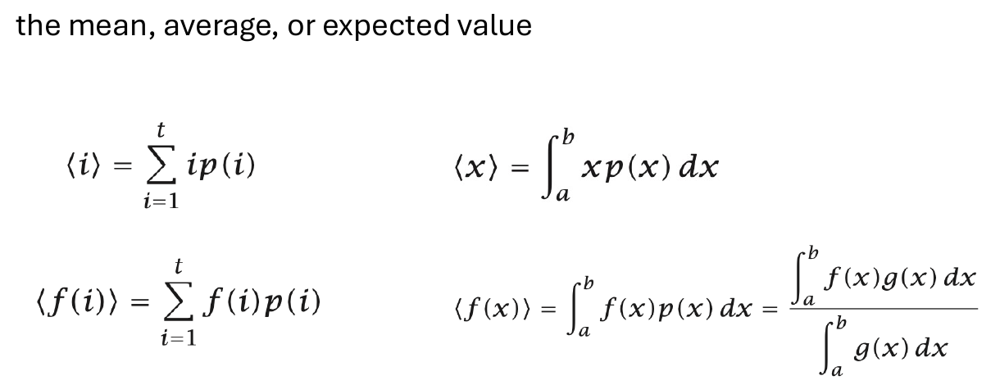
*▲ 课件原图（Slide 24）：离散与连续概率分布下随机变量及其函数 $f(x)$ 的期望值（均值 / 系综平均值）计算公式（本地路径：`img/ch1_fig16_slide24_expected_value_formulas.png`）*

课件第 24 页总结了统计力学中用尖括号 $\langle \cdots \rangle$ 表示的**期望值（Expected Value / Mean / Ensemble Average）**的四大基础公式：

| 统计量类型 | 离散型分布 (Discrete Distribution) | 连续型分布 (Continuous Distribution) |
| :--- | :--- | :--- |
| **一阶矩（均值 / 期望值）** | $\langle i \rangle = \sum_{i=1}^t i p(i)$ | $\langle x \rangle = \int_a^b x p(x) dx$ |
| **任意函数 $f$ 的期望值** | $\langle f(i) \rangle = \sum_{i=1}^t f(i) p(i)$ | $\langle f(x) \rangle = \int_a^b f(x) p(x) dx = \frac{\int_a^b f(x) g(x) dx}{\int_a^b g(x) dx}$ |

- **注**：连续型右下角公式中的 $g(x)$ 代表**未归一化的统计权重函数**（例如玻尔兹曼因子 $g(x) = e^{-E(x)/kT}$），分母 $\int_a^b g(x) dx = Q$ 即为连续配分函数，因此 $p(x) = \frac{g(x)}{\int_a^b g(x) dx}$。

### 6.2 方差 (Variance, $\sigma^2$) 的定义与 $\sigma^2 = \langle x^2 \rangle - \langle x \rangle^2$ 的严格证明 (Slide 25)

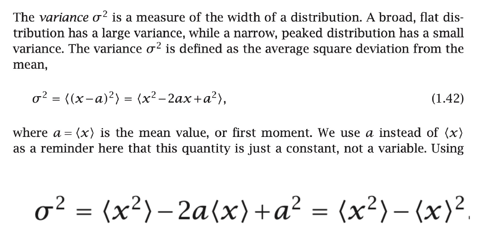
*▲ 课件原图（Slide 25）：方差 $\sigma^2$ 的物理意义与 $\sigma^2 = \langle x^2 \rangle - \langle x \rangle^2$ 恒等式推导（本地路径：`img/ch1_fig17_slide25_variance_derivation.png`）*

> **定义与定理（方差 Variance 及其展开恒等式，Slide 25 式 1.42）**：  
> **方差 $\sigma^2$** 是衡量概率分布宽度（Width / 涨落幅度）的二阶中心矩：宽而平坦的分布具有大方差，窄而尖锐的分布具有小方差。定义为变量 $x$ 偏离其均值 $a = \langle x \rangle$ 的平方的期望值：
> $$\sigma^2 = \langle (x - a)^2 \rangle = \langle x^2 \rangle - \langle x \rangle^2 \qquad (1.42)$$

#### 严格代数证明（Slide 25）：
1. 记常数 $a = \langle x \rangle$ 为随机变量的一阶矩（均值）。将平方项 $(x - a)^2$ 展开：
   $$\sigma^2 = \langle (x - a)^2 \rangle = \langle x^2 - 2ax + a^2 \rangle$$
2. 利用期望算子（求和或积分）的**线性性质（Linearity of Expectation）**，并注意 $a = \langle x \rangle$ 是一个确定常数（可提出尖括号外，且常数的期望等于自身 $\langle a^2 \rangle = a^2$）：
   $$\sigma^2 = \langle x^2 \rangle - 2a \langle x \rangle + a^2$$
3. 将 $a = \langle x \rangle$ 代回上式：
   $$\sigma^2 = \langle x^2 \rangle - 2\langle x \rangle \langle x \rangle + \langle x \rangle^2 = \langle x^2 \rangle - 2\langle x \rangle^2 + \langle x \rangle^2 = \mathbf{\langle x^2 \rangle - \langle x \rangle^2} \quad \blacksquare$$

## 7. 第六节：核心公式速查表与蛋白质设计易错点深度辨析 (Summary & Pitfalls)

### 7.1 本章核心统计热力学公式全景速查表

| 物理/数学概念 | 核心公式表达式 | 变量解释与物理背景 | 对应课件页码 |
| :--- | :--- | :--- | :--- |
| **多项式排列多重度** | $W = \frac{N!}{n_1! n_2! \cdots n_t!}$ | $N$ 个个体分入 $t$ 个类别（各类含 $n_i$ 个不可区分个体）的排列数 | Slide 11 |
| **二硫键完全配对数** | $W(n) = (n-1)!! = \frac{n!}{2^{n/2}(n/2)!}$ | 含偶数 $n$ 个半胱氨酸的蛋白质形成 $n/2$ 对二硫键的总配对方式 | Slide 7 |
| **二项分布** | $P(m, N) = \frac{N!}{m!(N-m)!} q^m (1-q)^{N-m}$ | $N$ 个独立离子通道或 DNA 位点中恰有 $m$ 个开启/突变的概率 | Slides 8–9 |
| **斯特林近似** | $x! \approx \left(\frac{x}{e}\right)^x \iff \ln(x!) \approx x\ln x - x$ | 大数阶乘向指数/对数转化的核心近似工具 | Slide 12 |
| **玻尔兹曼熵定律** | $S = k_B \ln W$ | 宏观热力学熵与微观状态多重度 $W$ 的对数映射 | Slides 10–11 |
| **吉布斯-香农熵** | $\frac{S}{k_B} = -\sum_{i=1}^t p_i \ln p_i$ | 任意概率分布平坦度的度量；完全有序为 $0$，均匀分布达最大 $\ln t$ | Slides 12–15 |
| **玻尔兹曼分布定律** | $p_j^* = \frac{e^{-E_j / k_B T}}{Q}, \quad Q = \sum_{j=1}^t e^{-E_j / k_B T}$ | 恒温平衡态下微观构象 $j$ 的出现概率；$Q$ 为配分函数 | Slides 16–17 |
| **含简并度的能级概率** | $p(E) = \frac{g(E) e^{-E / k_B T}}{Q}$ | $g(E)$ 为能量等于 $E$ 的不同微观构象简并度（Degeneracy） | Slide 19 |
| **逆玻尔兹曼公式** | $E(\theta) - E_0 = -k_B T \ln\left[\frac{p(\theta)}{p_0}\right]$ | 由构象采样分布反推有效势能面（统计势理论基础） | Slides 18, 20 |
| **简谐铰链高斯分布** | $p(\theta) = \sqrt{\frac{c}{\pi kT}} e^{-c(\theta-\theta_0)^2/kT}, \ \sigma^2 = \frac{kT}{2c}$ | 简谐势 $\varepsilon = c(\theta-\theta_0)^2$ 下的角度高斯涨落；熵 $S/k = \frac{1}{2}\ln\left(\frac{\pi e kT}{c}\right)$ | Slide 21 |
| **期望值与方差恒等式** | $\langle f(x) \rangle = \int f(x)p(x)dx, \ \sigma^2 = \langle x^2 \rangle - \langle x \rangle^2$ | 宏观可观测均值与分布宽度（热涨落幅度）的通用计算法则 | Slides 24–25 |

### 7.2 核心易错点与解题陷阱深度辨析

#### 辨析 1：微观构象概率 $p(i)$ 与宏观能级概率 $p(E)$ 的混淆陷阱（对应 Slide 19 Problem 10.14）
- **常见错误**：在计算“蛋白质能量为 $E = +1\text{ kcal/mol}$ 的概率”时，直接套用单状态公式 $\frac{e^{-1/RT}}{Q}$，漏乘了该能级包含的构象个数（简并度 $g(E)$）！
- **正确法则**：
  - 问**某一个具体构象**（如 $p(\text{State D})$）时，分子只有一项 $e^{-\varepsilon_D/RT}$；
  - 问**某一个能量值**（如 $p(1\text{ kcal/mol})$）时，必须将该能级下所有简并构象（State D 和 State E）的概率相加，即分子必须乘以简并度 $g(E) = 2$！
  - 这也直接解释了为什么蛋白质在高温下会去折叠：虽然单个去折叠构象的能量 $E_{\text{unfolded}}$ 很高（玻尔兹曼因子 $e^{-E/RT}$ 很小），但去折叠态的**构象简并度 $g(E_{\text{unfolded}}) = e^{S_{\text{conf}}/k}$ 大得惊人**，乘积 $g(E)e^{-E/RT} = e^{-(E - TS)/kT} = e^{-G/kT}$ 在高温下反而超过了唯一的天然态！

#### 辨析 2：玻尔兹曼因子中的温度与能量单位匹配问题（$k_B T$ vs. $RT$）
- 在做计算题时，务必检查题目给出的能量 $\varepsilon$ 是**单分子能量**（单位：$\text{J}$ 或 $\text{eV}$）还是**摩尔能量**（单位：$\text{kcal}\cdot\text{mol}^{-1}$ 或 $\text{kJ}\cdot\text{mol}^{-1}$）：
  - 若能量单位含 $\text{mol}^{-1}$（如课件 Slides 17, 19 中的 $\text{kcal}\cdot\text{mol}^{-1}$），指数分母必须用摩尔气体常数 $RT$（在 $T = 300\text{ K}$ 时，$RT \approx 0.596\text{ kcal}\cdot\text{mol}^{-1} \approx 0.60\text{ kcal}\cdot\text{mol}^{-1}$ 或 $2.494\text{ kJ}\cdot\text{mol}^{-1}$）；
  - 若能量针对单个分子且以焦耳（$\text{J}$）为单位，则分母使用玻尔兹曼常数 $k_B T$（在 $T = 300\text{ K}$ 时，$k_B T \approx 4.14 \times 10^{-21}\text{ J}$）。
  - 注意无量纲比值关系：$\frac{\varepsilon_{\text{molar}}}{RT} = \frac{\varepsilon_{\text{molecular}}}{k_B T}$，指数幂次本身必须是**纯无量纲数**！

#### 辨析 3：熵对状态标签顺序的不敏感性（对应 Slide 15 Problem 5.4）
- 熵 $S = -k \sum p_i \ln p_i$ 仅度量概率分布列表 $\{p_1, p_2, \dots, p_t\}$ 的分散程度（Flatness），与哪个状态排第一、哪个状态排第二无关。只要两个分布的概率数值集合是彼此的排列置换（Permutation），它们的熵就严格相等。
