# 《蛋白质设计》 (Protein Design)
## 第二章：蛋白质折叠物理学 — 分子作用力、热力学相变与折叠动力学 (Chapter 2: Protein Folding) 课程讲义全景精要与深度解析笔记

> **课程信息**：Protein Design — Chapter 2: Protein Folding（全章节 41 页 PPT 完整精析）  
> **配套图像**：含 **23 张课件原图高清裁切配图**（`img/`）与 **结构化原理示意图**（解压压缩包后将 `img/` 与本 `.md` 文件置于同一目录即可离线完整显示所有课件原图）  
> **参考教材与核心文献（Slide 2 & Slide 39）**：
> 1. Alexei V. Finkelstein & Oleg B. Ptitsyn, *Protein Physics: A Course of Lectures* (Academic Press), Chapters 17, 18, 19, 20, 21
> 2. Christian B. Anfinsen, E. Haber, M. Sela, F. H. White Jr. (1961), ["The kinetics of formation of native ribonuclease during oxidation of the reduced polypeptide chain"](https://pubmed.ncbi.nlm.nih.gov/13683522/), *Proc. Natl. Acad. Sci. U.S.A.* 47(9), 1309–1314
> 3. Christian B. Anfinsen (1973), ["Principles that govern the folding of protein chains"](https://pubmed.ncbi.nlm.nih.gov/4124164/), *Science* 181(4096), 223–230
> 4. Cyrus Levinthal (1968), "Are there pathways for protein folding?", *J. Chim. Phys. Chim. Biol.* 65, 44–45; & (1969) "How to fold graciously"
> 5. Eugene I. Shakhnovich & Alexei V. Finkelstein (1989), ["Theory of cooperative transitions in protein molecules. I. Why denaturation of globular protein is a first-order phase transition"](https://pubmed.ncbi.nlm.nih.gov/2597723/), *Biopolymers* 28(10), 1667–1680
> 6. Seth Cooper, Firas Khatib, David Baker et al. (2010), ["Predicting protein structures with a multiplayer online game (Foldit)"](https://pubmed.ncbi.nlm.nih.gov/20686574/), *Nature* 466, 756–760

## 目录与知识架构

1. **引言与全章脉络：从分子相互作用到折叠漏斗 (Outline & Philosophical Foundation, Slides 1–3, 35–36)**
   - 1.1 蛋白质折叠的三大核心科学问题
   - 1.2 全章知识逻辑框架图
2. **第一节：蛋白质基础与分子力场相互作用 (1. Protein Basics & Molecular Forces, Slides 4–11 & 40–41)**
   - 2.1 蛋白质的双重属性：生物学视角（中心法则）vs. 物理学视角（水相疏水坍缩）
   - 2.2 维持蛋白质三维结构的三大非共价作用力与力场势函数 (Force Field Potentials)
   - 2.3 **氢键 (Hydrogen Bonds)**：部分共价特性、几何方向性与“水分子竞争/埋藏惩罚”机制 (Slides 6–7)
   - 2.4 **范德华相互作用 (van der Waals Attractions)**：Lennard-Jones 6-12 势函数、组合规则与原子参数表 (Slides 8–9)
   - 2.5 **静电相互作用 (Electrostatic Attractions)**：库仑定律 ($k=332$)、介电屏蔽、长程静电导航与多极矩衰减层级 (Slide 10)
   - 2.6 **蛋白质三级结构拓扑分类 (Protein Fold Classes)**：全 $\alpha$、全 $\beta$、$\alpha/\beta$ 与 $\alpha+\beta$ 经典折叠拓扑 (Slides 40–41)
3. **第二节：蛋白质折叠热力学 (2. Thermodynamics of Protein Folding, Slides 12–25)**
   - 3.1 安芬森法则 (Anfinsen's Dogma) 与蛋白质折叠的热力学假说 (Slides 13–14)
   - 3.2 蛋白质变性的协同性 (Cooperativity) 与“S 型 (S-shaped)”全或无跃迁 (Slide 15)
   - 3.3 蛋白质疏水核心的类晶体紧密堆积 (Solid-Crystal-Like Close Packing) 与 $30\text{ \AA}^3$ 空腔阈值 (Slide 16)
   - 3.4 熔球态 (Molten Globule State)：二级结构保留而侧链核心液化的中间态 (Slide 17)
   - 3.5 为什么球状蛋白变性近似于**一级相变 (First-Order Phase Transition)**？自由能垒 $B$ 的微观物理起源 (Slides 18, 20, 23)
   - 3.6 溶菌酶 (Lysozyme) 的构象相图 (Phase Diagram)：Native、Coil 与 Molten Globule 的三相平衡 (Slide 19)
   - 3.7 **蛋白质区别于随机异聚物的本质物理特征**：能谱中的**大能量隙 (Large Energy Gap, $\Delta E$)** (Slides 21–22, 24–25)
4. **第三节：蛋白质折叠动力学 (3. Kinetics of Protein Folding: How to Fold Graciously?, Slides 26–39)**
   - 4.1 利文索尔悖论 (Levinthal's Paradox) 的定量重述 ($10^{300}$ 构象) 与利文索尔原始动力学路径假说 (Slides 27–28)
   - 4.2 终极思辨：蛋白质折叠究竟受动力学控制还是热力学控制？(Slide 29)
   - 4.3 漏斗状能量景观 (Funnel-Like Energy Landscape)：高尔夫球场模型 vs. 光滑漏斗 vs. 崎岖漏斗 (Slide 30)
   - 4.4 序列凝聚折叠路径与成核-生长毛细理论：为什么折叠能垒满足 $\Delta F^\# \propto L^{2/3}$ 标度律？(Slides 31–32)
   - 4.5 蛋白质 G 的拉链-组装 (ZAM) 分级折叠路径与“熵-能即时补偿”机制 (Slides 33–34)
   - 4.6 计算机蛋白质折叠模拟与公民科学游戏 **Foldit** (Slides 37–39)
5. **第四节：核心公式速查表、重要物理常数与考前高频必考问答题精解 (Summary, Constants & Exam Q&A)**

### 全章知识逻辑脉络图

```text
                ┌────────────────────────────────────────────────────────────────────┐
                │                  Chapter 2: Protein Folding                        │
                │       (Ref: Finkelstein & Ptitsyn, Protein Physics Ch. 17-21)      │
                └─────────────────────────────────┬──────────────────────────────────┘
                                                  │
        ┌─────────────────────────────────────────┼─────────────────────────────────────────┐
        ▼                                         ▼                                         ▼
┌───────────────────────────────┐     ┌───────────────────────────────────┐     ┌───────────────────────────────┐
│   1. 蛋白质基础与分子力场      │     │     2. 蛋白质折叠热力学            │     │     3. 蛋白质折叠动力学        │
│  (Protein Basics & Forces)    │     │  (Thermodynamics of Folding)      │     │    (Kinetics of Folding)      │
├───────────────────────────────┤     ├───────────────────────────────────┤     ├───────────────────────────────┤
│ • 水相折叠: 疏水核心 + 极性表面│     │ • 安芬森法则: 天然态 = 全局自由能谷│     │ • 利文索尔悖论: 150 aa → 10^300│
│ • 三大非共价力场势 (Interactions)│   │ • 协同性 S 型变性曲线 ("全或无")   │     │ • 高尔夫球场 vs 折叠能量漏斗  │
│   1) 氢键: ~1.8 Å, 180°, 水竞争│───►│ • 固态晶体般核心 vs 液态熔球态(MG) │───►│ • 连续成核路径与表面张力能垒: │
│   2) 范德华力: LJ 6-12 势函数  │     │ • 一级相变能垒起源: 熵跃迁滞后于能量│     │   ΔF# = ΔE - TΔS ∝ L^(2/3)   │
│   3) 静电作用: 库仑定律(k=332) │     │ • 蛋白质 vs 随机异聚物的本质区别: │     │ • 熵-能即时补偿消除搜索悖论   │
│ • 四大结构拓扑: α, β, α/β, α+β │     │   宽能量隙 (Large Energy Gap ΔE)  │     │ • Protein G (ZAM) 与 Foldit   │
└───────────────────────────────┘     └───────────────────────────────────┘     └───────────────────────────────┘
```

## 1. 第一节：蛋白质基础与分子力场相互作用 (1. Protein Basics & Molecular Forces, Slides 4–11 & 40–41)

### 1.1 蛋白质的双重属性：生物学视角 vs. 物理学视角 (Slide 4)

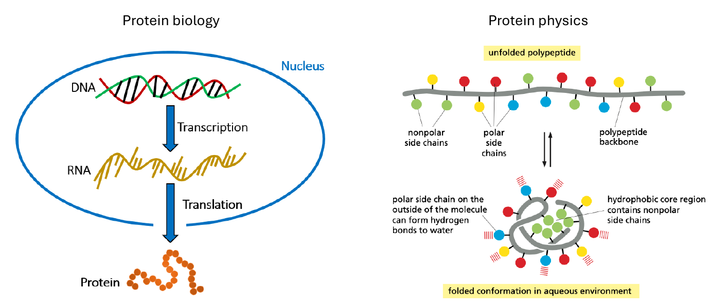
*▲ 课件原图（Slide 4）：从蛋白质生物学（中心法则遗传信息流）与蛋白质物理学（水相中非极性侧链疏水坍缩与极性侧链溶剂氢键）两个维度定义蛋白质（本地路径：`img/ch2_fig01_slide04_biology_vs_physics.png`）*

课件第 4 页从两个互补学科视角回答了 *"What is a protein?"*：
1. **蛋白质生物学视角 (Protein biology)**：遗传信息在细胞核内由 DNA 转录（Transcription）为 RNA，再经翻译（Translation）合成为具有特定氨基酸序列的线性多肽链，服务于生物体在漫长演化中形成的生理功能。
2. **蛋白质物理学视角 (Protein physics)**：蛋白质是一条由 20 种不同物理化学性质的单体共价连接而成的**异聚物（Heteropolymer）**。在水溶液环境（Aqueous environment）中，原本舒展的去折叠多肽链（Unfolded polypeptide）发生自发折叠：
   - **非极性侧链（Nonpolar / Hydrophobic side chains，图中绿球）**：聚集并埋藏于分子内部，形成排斥水分子的**疏水核心区（Hydrophobic core region）**；
   - **极性/带电侧链（Polar / Charged side chains，图中红/黄/蓝球）**：分布在分子外表面，与周围水分子形成广泛的氢键网络（Hydrogen bonds to water）。

### 1.2 维持蛋白质三维结构的三大非共价作用力与力场势函数 (Slides 5 & 11)

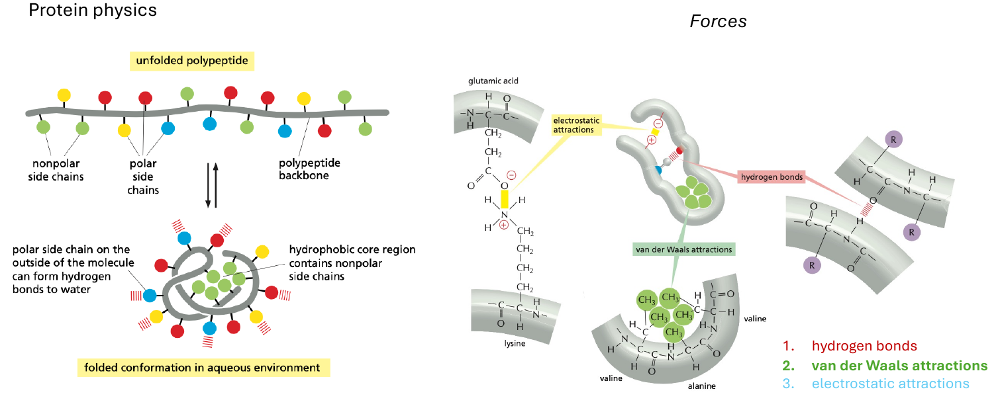
*▲ 课件原图（Slide 5 & 11）：支配蛋白质折叠并构成计算机分子力场势函数（Force field potential）的三大非共价相互作用（本地路径：`img/ch2_fig02_slide05_three_forces_overview.png`）*

在计算蛋白质设计（如 Rosetta 评分函数）与分子动力学力场（如 AMBER、CHARMM）中，蛋白质构象的势能（Force field potential / Interacting energy $E$）主要由以下三类非共价相互作用构成：
1. **氢键 (Hydrogen bonds)**：如主链羰基氧（$\text{C=O}$）与酰胺氢（$\text{N-H}$）之间的定向吸引；
2. **范德华吸引力 (van der Waals attractions)**：如疏水核心内缬氨酸（Valine）、丙氨酸（Alanine）等非极性侧链之间的紧密堆积作用；
3. **静电吸引力 (Electrostatic attractions)**：如带负电的谷氨酸侧链（Glutamic acid, $-\text{COO}^-$）与带正电的赖氨酸侧链（Lysine, $-\text{NH}_3^+$）之间的盐桥（Salt bridge）相互作用。

### 1.3 氢键 (Hydrogen Bonds)：部分共价特性、几何方向性与“水分子竞争”机制 (Slides 6–7)

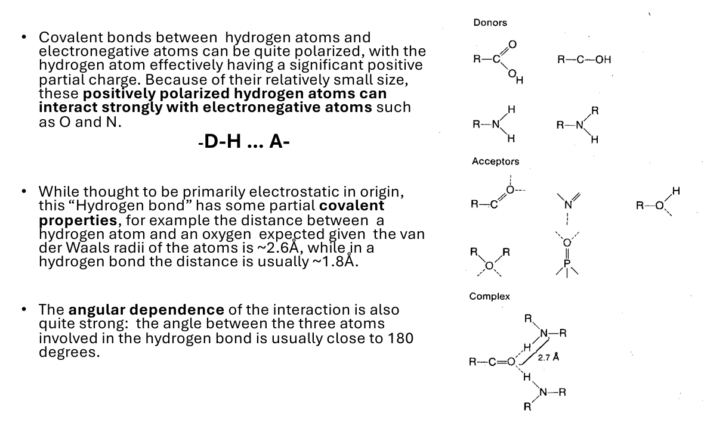
*▲ 课件原图（Slide 6）：氢键的极化机制、常见供体（Donors）与受体（Acceptors）化学基团及几何距离/角度特征（本地路径：`img/ch2_fig03_slide06_hydrogen_bonds_geometry.png`）*

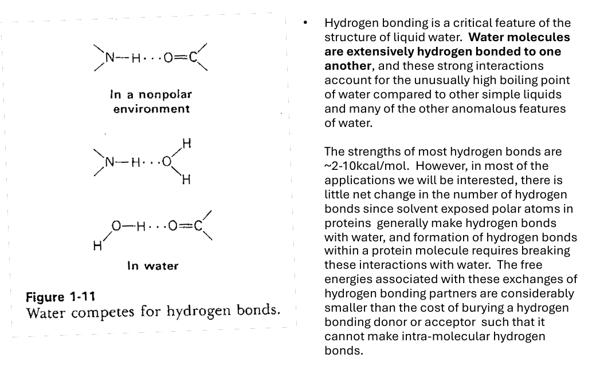
*▲ 课件原图（Slide 7）：Figure 1-11 液态水中的氢键交换平衡——水分子与蛋白质分子内氢键的竞争关系（本地路径：`img/ch2_fig04_slide07_water_competes_hbonds.png`）*

> **定义与物理性质（氢键 Hydrogen Bond，Slides 6–7）**：
> - **化学表示**：$-\text{D}-\text{H}^{\delta+} \cdots \text{A}^{\delta-}-$，其中 $\text{D}$（Donor，供体）为共价连接氢原子的强电负性原子（如 $\text{O}, \text{N}$），$\text{A}$（Acceptor，受体）为带有孤对电子的强电负性原子（如羰基氧 $\text{=O}$、羟基氧 $-\text{O}-$, 氮原子 $\text{N:}$）。
> - **形成原因**：氢原子与电负性原子之间的共价键高度极化，使氢原子带有显著的部分正电荷（Partial positive charge）；同时由于氢原子半径极小（无内层电子屏蔽），允许受体电负性原子极其紧密地靠近。
> - **三大核心物理特征（必考要点）**：
>   1. **部分共价性质与距离缩短（Partial Covalent Properties）**：虽然氢键主要源于静电吸引，但它具有显著的轨道重叠（部分共价特征）。例如，氢原子（$r_H \approx 0.8\text{–}1.0\text{ \AA}$）与氧原子（$r_O \approx 1.6\text{ \AA}$）按范德华半径之和预期的非键接触距离约为 **$\sim 2.6\text{ \AA}$**，而在实际氢键中，$\text{H}\cdots\text{O}$ 距离缩短至 **$\sim 1.8\text{ \AA}$**（供体与受体母核重原子 $\text{N}\cdots\text{O}$ 之间的距离约为 **$\sim 2.7\text{–}3.0\text{ \AA}$**）。
>   2. **强烈的角度依赖性（Strong Angular Dependence）**：氢键具有高度的方向性，参与成键的三个原子（$\text{D}-\text{H}\cdots\text{A}$）倾向于共线排列，键角通常接近 **$180^\circ$**。
>   3. **键能范围**：单个氢键的结合能通常在 **$\sim 2\text{–}10\text{ kcal/mol}$** 之间。

> **【深度补充解释 1：为什么水相中形成蛋白质分子内氢键净自由能增益很小，但“未满足的埋藏极性原子”却是蛋白质设计的大忌？】**  
> 课件第 7 页（图 1-11）阐述了一个在蛋白质折叠与计算设计中至关重要的热力学原理：
> - **在非极性环境（真空或脂双层内部）中**：多肽链直接形成分子内氢键 $\text{N}-\text{H} + \text{O=C} \to \text{N}-\text{H}\cdots\text{O=C}$，净释放 $2\text{–}10\text{ kcal/mol}$ 的巨大能量。
> - **在水溶液（In water）中**：去折叠态的多肽链极性基团原本就已经与周围水分子形成了良好的氢键（$\text{N}-\text{H}\cdots\text{OH}_2$ 与 $\text{HOH}\cdots\text{O=C}$）。当蛋白质折叠形成分子内氢键时，**必须先打断两组“蛋白质-水”氢键，才能形成一组“蛋白质-蛋白质”氢键并释放出一分子“水-水”氢键**：
>   $$(\text{N}-\text{H}\cdots\text{OH}_2) + (\text{H}-\text{O}-\text{H}\cdots\text{O=C}) \rightleftharpoons (\text{N}-\text{H}\cdots\text{O=C}) + (\text{H}-\text{O}-\text{H}\cdots\text{OH}_2)$$
> - **核心结论**：
>   1. 在折叠过程中，体系**氢键的总数量几乎没有净变化（Little net change in the number of hydrogen bonds）**，因此这种“氢键伙伴交换”带来的净自由能收益相对较小（仅约 $0.5\text{–}1.5\text{ kcal/mol}$）。
>   2. **然而，如果将一个极性供体或受体埋藏进蛋白质疏水核心内部，却没有为它配对形成分子内氢键（即 Buried Unsatisfied Polar Atom），那就意味着凭空打断了它与水分子的氢键（付出 $4\text{–}6\text{ kcal/mol}$ 的去溶剂化惩罚 Desolvation Penalty）却没有任何补偿！**
>   3. 这正是为什么所有球状蛋白质一旦将极性多肽主链埋入疏水核心，就**必须**形成规则的二级结构（$\alpha$-螺旋或 $\beta$-折叠）以使主链 $\text{N-H}$ 和 $\text{C=O}$ 全部配对饱和；同时在 Rosetta 从头设计中，`buried_unsat_hbond`（埋藏未满足氢键数）是筛选成功设计最严格的淘汰指标之一！

### 1.4 范德华相互作用 (van der Waals Attractions)：Lennard-Jones 6-12 势函数 (Slides 8–9)

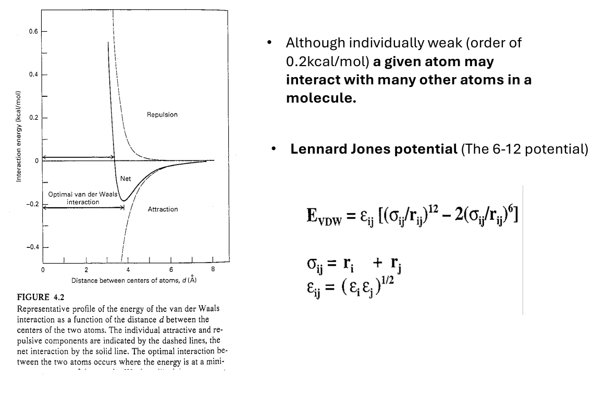
*▲ 课件原图（Slide 8）：Figure 4.2 范德华相互作用势能曲线（排斥项、吸引项与净合势能）及 Lennard-Jones 6-12 势函数公式（本地路径：`img/ch2_fig05_slide08_lennard_jones_potential.png`）*

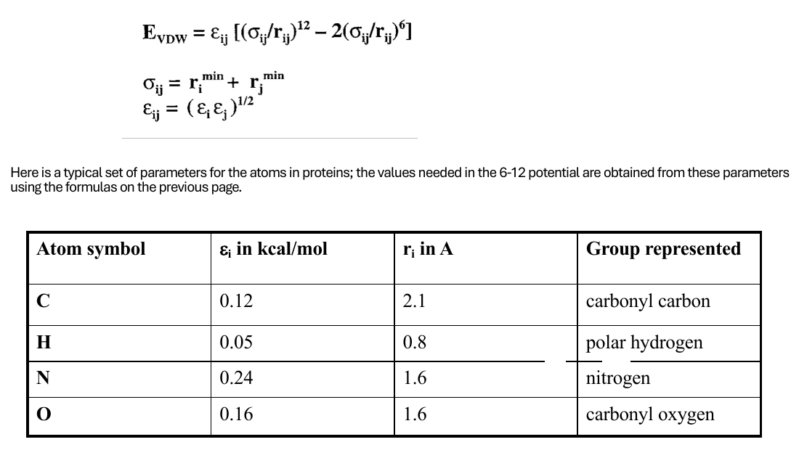
*▲ 课件原图（Slide 9）：蛋白质常见重原子与极性氢原子的 6-12 范德华参数表（本地路径：`img/ch2_fig06_slide09_vdw_parameters_table.png`）*

> **定律与公式（Lennard-Jones 6-12 势函数，Slides 8–9）**：  
> 两个非键原子 $i$ 和 $j$（中心距离为 $r_{ij}$）之间的范德华相互作用势能由经典的 **Lennard-Jones 6-12 势（6-12 Potential）**描述：
> $$E_{\text{VDW}}(r_{ij}) = \varepsilon_{ij} \left[ \left(\frac{\sigma_{ij}}{r_{ij}}\right)^{12} - 2 \left(\frac{\sigma_{ij}}{r_{ij}}\right)^6 \right]$$
> 其中异种原子对的参数通过以下**组合规则（Combining Rules）**由单原子参数计算得到：
> $$\sigma_{ij} = r_i^{\min} + r_j^{\min}, \qquad \varepsilon_{ij} = (\varepsilon_i \varepsilon_j)^{1/2}$$

#### 公式物理意义与数学特征拆解（必考细节）：
1. **短程泡利排斥项 $\propto (\sigma_{ij} / r_{ij})^{12}$**：当两原子距离过近（$r_{ij} < \sigma_{ij}$）时，原子外层电子云发生重叠，由于泡利不相容原理（Pauli Exclusion Principle），能量以 $r^{-12}$ 极陡峭地飙升为正无穷，形成刚性球般的空间位阻（Steric clash）。
2. **长程伦敦色散吸引项 $\propto -2(\sigma_{ij} / r_{ij})^6$**：当两原子处于中等距离时，瞬时偶极-诱导偶极相互作用（London dispersion forces）产生随 $r^{-6}$ 衰减的微弱吸引力。
3. **最优接触距离 $r_{ij} = \sigma_{ij}$ 与势阱深度 $-\varepsilon_{ij}$ 的极值验证**：  
   对 $E_{\text{VDW}}(r_{ij})$ 关于 $r_{ij}$ 求一阶导数并令其为 $0$：
   $$\frac{dE_{\text{VDW}}}{dr_{ij}} = \varepsilon_{ij} \left[ -12 \frac{\sigma_{ij}^{12}}{r_{ij}^{13}} + 12 \frac{\sigma_{ij}^6}{r_{ij}^7} \right] = \frac{12 \varepsilon_{ij} \sigma_{ij}^6}{r_{ij}^7} \left[ 1 - \left(\frac{\sigma_{ij}}{r_{ij}}\right)^6 \right] = 0 \quad \Longleftrightarrow \quad r_{ij}^* = \sigma_{ij} = r_i^{\min} + r_j^{\min}$$
   将 $r_{ij} = \sigma_{ij}$ 代回势函数，得到最低势能（Optimal van der Waals interaction）：
   $$E_{\text{VDW}}(\sigma_{ij}) = \varepsilon_{ij} (1 - 2) = -\varepsilon_{ij}$$
   *(注：当 $r_{ij} = 2^{-1/6}\sigma_{ij} \approx 0.891 \sigma_{ij}$ 时，排斥项与吸引项恰好抵消，$E_{\text{VDW}} = 0$；一旦 $r_{ij} < 0.89 \sigma_{ij}$，原子发生严重空间碰撞！)*
4. **“积少成多”效应**：虽然单对原子的范德华吸引势阱很浅（约 **$0.05\text{–}0.24\text{ kcal/mol}$**，数量级约为 $\sim 0.2\text{ kcal/mol}$），但在紧密堆积的蛋白质疏水核心中，每个原子周围同时与十几个邻近原子接触，成百上千对原子的范德华吸引累加起来，构成了稳定折叠态的巨大焓变贡献。

#### 蛋白质典型原子的 Lennard-Jones 参数速查表（Slide 9）

| 原子符号 (Atom symbol) | 势阱深度 $\varepsilon_i$ ($\text{kcal/mol}$) | 范德华半径 $r_i^{\min}$ ($\text{\AA}$) | 代表的蛋白质化学基团 (Group represented) |
| :--- | :--- | :--- | :--- |
| **$\text{C}$** | $0.12$ | $2.1$ | 羰基碳 (Carbonyl carbon) |
| **$\text{H}$** | $0.05$ | $0.8$ | 极性氢 (Polar hydrogen) |
| **$\text{N}$** | $0.24$ | $1.6$ | 氮原子 (Nitrogen) |
| **$\text{O}$** | $0.16$ | $1.6$ | 羰基氧 (Carbonyl oxygen) |

* **随堂计算示例**：计算主链羰基碳（$\text{C}$）与羰基氧（$\text{O}$）之间的最优范德华接触距离 $\sigma_{\text{CO}}$ 与最大吸引能 $\varepsilon_{\text{CO}}$：
  - 最优距离：$\sigma_{\text{CO}} = r_{\text{C}}^{\min} + r_{\text{O}}^{\min} = 2.1 + 1.6 = \mathbf{3.7\text{ \AA}}$；
  - 势阱深度：$\varepsilon_{\text{CO}} = \sqrt{0.12 \times 0.16} = \sqrt{0.0192} \approx \mathbf{0.1386\text{ kcal/mol}}$（即在 $3.7\text{ \AA}$ 处能量最低，为 $-0.139\text{ kcal/mol}$）。

### 1.5 静电相互作用 (Electrostatic Attractions)：库仑定律、介电屏蔽与多极矩衰减 (Slide 10)

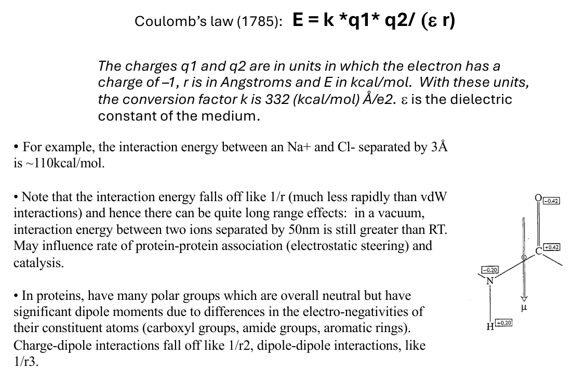
*▲ 课件原图（Slide 10）：库仑定律（转换常数 $k=332$）、长程静电导引效应及多肽链酰胺基团偶极矩分布（本地路径：`img/ch2_fig07_slide10_coulomb_electrostatics.png`）*

> **定律与公式（分子生物物理单位制下的库仑定律，Coulomb's Law，Slide 10）**：  
> 两个点电荷 $q_1$ 和 $q_2$ 在介电常数为 $\varepsilon$ 的介质中相距 $r$ 时的静电相互作用能为：
> $$E_{\text{elec}} = \frac{k q_1 q_2}{\varepsilon r}$$
> **标准单位约定（必记常数）**：
> - 电荷 $q_1, q_2$：以基本电荷 $e$ 为单位（即电子电荷为 $-1$，质子为 $+1$）；
> - 距离 $r$：以埃（$\text{\AA} = 10^{-10}\text{ m}$）为单位；
> - 能量 $E$：以 $\text{kcal/mol}$ 为单位；
> - **单位转换常数 $k$**：**$k = 332\text{ (kcal/mol)}\cdot\text{\AA}/e^2$**；
> - $\varepsilon$：介质的相对介电常数（真空 $\varepsilon = 1$；蛋白质疏水核心内部 $\varepsilon \approx 2\text{–}4$；水溶液中 $\varepsilon \approx 80$）。

#### 核心物理特性与距离衰减层级：
1. **典型数值算例（Slide 10）**：  
   在真空中（$\varepsilon = 1$），相距 $r = 3\text{ \AA}$ 的 $\text{Na}^+ (q_1 = +1)$ 与 $\text{Cl}^- (q_2 = -1)$ 离子对之间的静电吸引能高达：
   $$E = \frac{332 \times (+1) \times (-1)}{1 \times 3} = -110.67\text{ kcal/mol} \approx \mathbf{-110\text{ kcal/mol}}$$
   而在水溶液（$\varepsilon \approx 80$）中，由于极性水分子的取向屏蔽（Dielectric screening），该相互作用减弱为 $E \approx -110.7 / 80 \approx -1.38\text{ kcal/mol}$。
2. **长程效应与静电导引（Electrostatic Steering）**：  
   库仑能按 **$1/r$** 缓慢衰减（远比范德华力的 $1/r^6$ 衰减慢得多）。在真空中，即便两个离子相距 **$50\text{ nm} = 500\text{ \AA}$**，其相互作用能 $E = \frac{332}{500} \approx 0.664\text{ kcal/mol}$ 依然大于室温热运动能 $RT \approx 0.6\text{ kcal/mol}$！在生物学中，这种长程静电力能够显著加速蛋白质-蛋白质结合速率（**Electrostatic steering，静电导引**）并稳定酶催化过渡态。
3. **蛋白质中的偶极相互作用与距离衰减层级（Slide 10 右下肽键偶极图）**：  
   蛋白质中含有大量整体电中性但具有显著**偶极矩（Dipole moment, $\vec{\mu}$）**的极性基团（如羧基、芳香环，以及图中带部分电荷 $\text{C}^{+0.42}=\text{O}^{-0.42}$ 与 $\text{N}^{-0.20}-\text{H}^{+0.20}$ 的肽键酰胺基团）：

| 相互作用类型 | 距离衰减标度 | 典型蛋白质基团示例 | 作用程分类 |
| :--- | :--- | :--- | :--- |
| **电荷–电荷 (Charge–charge / Ion–ion)** | $\propto \mathbf{1 / r}$ | $\text{Lys}^+ (-\text{NH}_3^+) \cdots \text{Glu}^- (-\text{COO}^-)$ 盐桥 | 长程作用 (Long-range) |
| **电荷–偶极 (Charge–dipole)** | $\propto \mathbf{1 / r^2}$ | $\text{Arg}^+$ 侧链与 $\alpha$-螺旋宏偶极或主链羰基 | 中长程作用 |
| **偶极–偶极 (Dipole–dipole)** | $\propto \mathbf{1 / r^3}$ | 两个肽平面酰胺偶极之间的取向相互作用 | 中短程作用 |
| **诱导偶极/色散力 (vdW attraction)** | $\propto \mathbf{1 / r^6}$ | $\text{Val}, \text{Leu}, \text{Ile}, \text{Ala}$ 疏水侧链堆积 | 短程接触作用 |
| **泡利电子云排斥 (vdW repulsion)** | $\propto \mathbf{1 / r^{12}}$ | 任何距离小于范德华半径之和的原子对 | 极短程硬核排斥 |

### 1.6 蛋白质三级结构拓扑分类 (Protein Fold Classes, Slides 40–41)

课件第 40–41 页展示了自然界与从头设计中最经典的六种蛋白质结构域拓扑（对应结构分类数据库 SCOP / CATH 的四大主类：全 $\alpha$、全 $\beta$、$\alpha/\beta$、$\alpha+\beta$）：

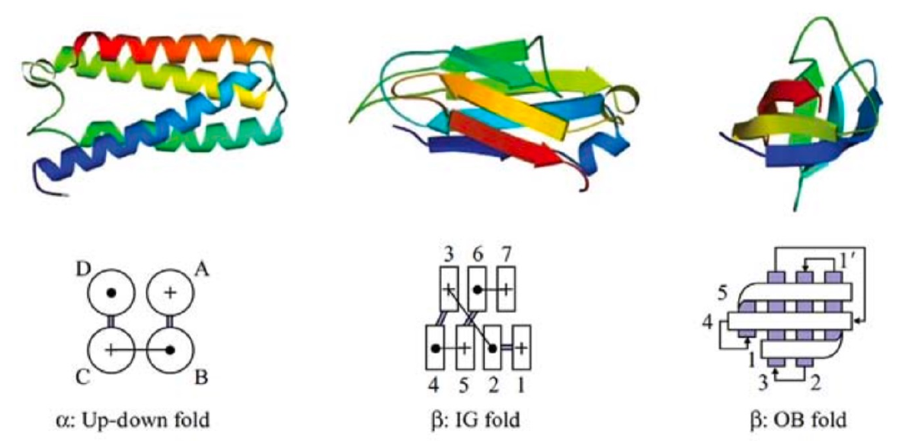
*▲ 课件原图（Slide 40）：全 $\alpha$ 拓扑（Up-down 四螺旋束）与全 $\beta$ 拓扑（IG 免疫球蛋白折叠、OB 寡核苷酸结合桶）的三维彩带图与拓扑连接图（本地路径：`img/ch2_fig22_slide40_alpha_beta_folds.png`）*

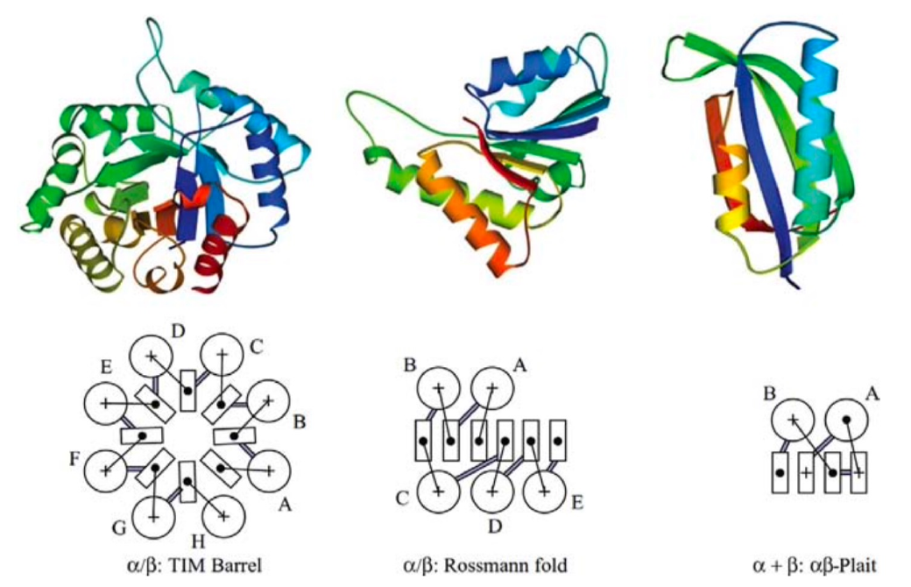
*▲ 课件原图（Slide 41）：$\alpha/\beta$ 拓扑（TIM 桶、Rossmann 折叠）与 $\alpha+\beta$ 拓扑（$\alpha\beta$-Plait 铁氧还蛋白样折叠）的三维结构与拓扑图（本地路径：`img/ch2_fig23_slide41_alphabeta_folds.png`）*

| 结构分类大类 | 课件展示代表折叠 (Fold Name) | 拓扑连接图符号与结构特征解读（图例：圆圈 = $\alpha$-螺旋，方块/箭头 = $\beta$-折叠股，`+`/`•` 代表链穿出/穿入纸面方向） | 典型生物学代表蛋白 |
| :--- | :--- | :--- | :--- |
| **All-$\alpha$（全 $\alpha$ 蛋白）** | **$\alpha$: Up-down fold**（上下反平行四螺旋束） | 由 A、B、C、D 四根近平行/反平行的 $\alpha$-螺旋按上下交替（`+` 与 `•` 交替）围成中心疏水核心。 | 肌红蛋白、细胞色素 $b_{562}$、从头设计四螺旋束 |
| **All-$\beta$（全 $\beta$ 蛋白）** | **$\beta$: IG fold**（免疫球蛋白折叠）<br>**$\beta$: OB fold**（寡核苷酸/寡糖结合折叠） | • **IG fold**：由两片反平行 $\beta$-折叠片（`4-5-2-1` 与 `3-6-7`）面对面贴合形成“$\beta$-三明治（$\beta$-sandwich）”结构。<br>• **OB fold**：5 股反平行 $\beta$-折叠卷曲闭合为正交桶状结构。 | 抗体可变区/恒定区（IG fold）、单链 DNA 结合蛋白（OB fold） |
| **$\alpha/\beta$（$\alpha$ 与 $\beta$ 交替蛋白）** | **$\alpha/\beta$: TIM Barrel**（$(\beta\alpha)_8$ 桶）<br>**$\alpha/\beta$: Rossmann fold**（罗斯曼折叠） | $\beta$-折叠股主要为**平行排列（Parallel $\beta$-sheet，方向同为 `+`）**，由于右手交叉连接规则，连接两股平行 $\beta$-股的片段必须是跨在外侧的 $\alpha$-螺旋：<br>• **TIM Barrel**：8 股平行 $\beta$-片围成内桶，8 根 $\alpha$-螺旋围在外圈。<br>• **Rossmann fold**：中央 6 股平行 $\beta$-片，两侧各夹持一层 $\alpha$-螺旋（三明治型）。 | 丙糖磷酸异构酶（TIM barrel，约占自然界酶的 $10\%$）、脱氢酶辅酶 $\text{NAD}^+$ 结合域（Rossmann fold） |
| **$\alpha+\beta$（$\alpha$ 与 $\beta$ 分离蛋白）** | **$\alpha+\beta$: $\alpha\beta$-Plait**（$\alpha\beta$-辫状/铁氧还蛋白样折叠） | 二级结构按序列顺序为 $\beta\alpha\beta\beta\alpha\beta$：底面是一张 4 股**反平行 $\beta$-折叠片**，顶面并排架着两根 $\alpha$-螺旋（A 和 B），呈双层不对称结构。 | 核糖体蛋白 S6、泛素（Ubiquitin）、Protein G（Slide 33） |

## 2. 第二节：蛋白质折叠热力学 (2. Thermodynamics of Protein Folding, Slides 12–25)

### 2.1 安芬森法则 (Anfinsen's Dogma) 与热力学假说 (Slides 13–14)

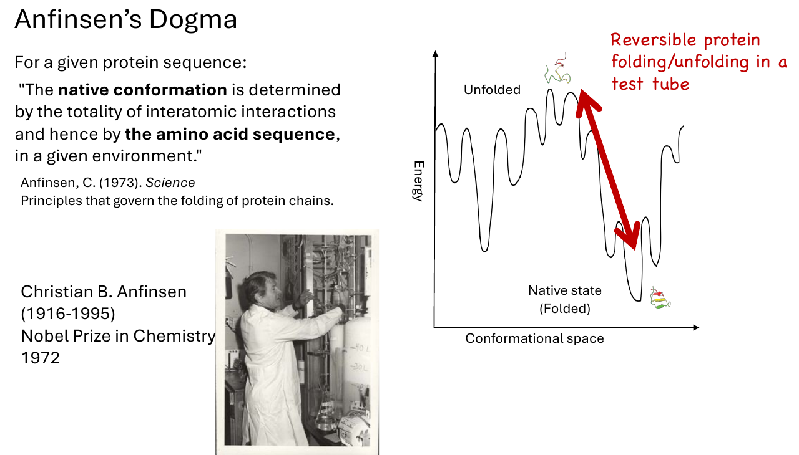
*▲ 课件原图（Slide 13）：安芬森法则（1972 年诺贝尔化学奖）——体外试管中可逆的蛋白质去折叠与复性实验证明天然构象位于自由能全局最低谷（本地路径：`img/ch2_fig08_slide13_anfinsen_dogma.png`）*

> **定律（安芬森法则 / 热力学假说，Anfinsen's Dogma，[Anfinsen, *Science* 1973](https://pubmed.ncbi.nlm.nih.gov/4124164/)，Slide 13）**：  
> *"For a given protein sequence: **The native conformation is determined by the totality of interatomic interactions and hence by the amino acid sequence, in a given environment.**"*  
> （对于给定的蛋白质氨基酸序列，在给定的生理环境［温度、pH、离子强度、溶剂］下，其天然三维构象完全由分子内外所有原子间相互作用的总和所决定，因而完全编码在其氨基酸序列之中。）

- **实验证据**：在体外试管（Test tube）中，加入高浓度化学变性剂（尿素 Urea 或盐酸胍 $\text{GuHCl}$）及还原剂使核糖核酸酶 A（RNase A）完全去折叠并丧失活性；当透析除去变性剂和还原剂后，蛋白质无需任何细胞内分子伴侣辅助，即可**$100\%$ 可逆地自发重折叠（Reversible protein folding/unfolding）**回天然活性构象。
- **热力学推论**：可逆性意味着折叠过程达到了热力学平衡态，即天然态（Native state）对应于构象空间中的**吉布斯/亥姆霍兹自由能全局极小值（Global Free Energy Minimum）**。

### 2.2 蛋白质变性的协同性 (Cooperativity) 与“S 型”全或无跃迁 (Slide 15)

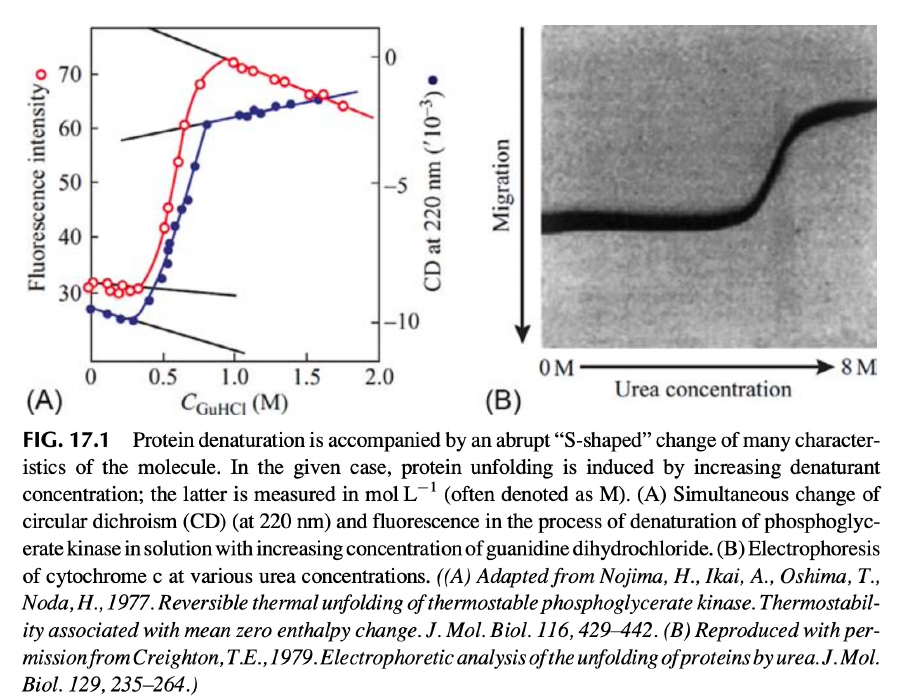
*▲ 课件原图（Slide 15）：FIG. 17.1 蛋白质变性的“S 型（Sigmoidal）”协同跃迁曲线——(A) 磷酸甘油酸激酶随盐酸胍浓度变化的圆二色谱（220 nm，监测二级结构）与荧光强度（监测三级结构芳香族微环境）同步突变；(B) 细胞色素 c 在 0–8 M 尿素梯度电泳中的迁移率突变（本地路径：`img/ch2_fig09_slide15_cooperative_s_shaped_unfolding.png`）*

课件第 15 页展示了蛋白质折叠热力学最显著的实验现象——**高度协同的“S 型”变性曲线（Cooperative "S-shaped" transition）**：
1. **多指标同步突变（图 17.1 A）**：随着变性剂盐酸胍（$C_{\text{GuHCl}}$）浓度从 $0\text{ M}$ 增加到 $2.0\text{ M}$，反映 $\alpha$-螺旋二级结构含量的 $220\text{ nm}$ 圆二色谱信号（$\text{CD}_{220\text{ nm}}$，黑点）与反映疏水核心三级结构紧密程度的色氨酸荧光强度（Fluorescence intensity，红圈）在 $C_{\text{GuHCl}} \approx 0.7\text{ M}$ 狭窄区间内**完全同步地发生陡峭跃迁**。
2. **“全或无（All-or-None）”双态共存本质**：  
   蛋白质变性并不是像加热软化塑料那样一点点渐进松散，而是像**宏观冰块融化成水（宏观固体的熔化相变）**一样：在转变中点附近，溶液中几乎只存在**完全折叠的天然态（Native, $N$）**和**完全去折叠的变性态（Denatured, $D$）**两个居群，而处于半折叠状态的分子居群极少（因为中间态处于高自由能垒顶峰！）。

### 2.3 固体晶体般的疏水核心堆积 vs. 液态熔球态 (Slides 16–17)

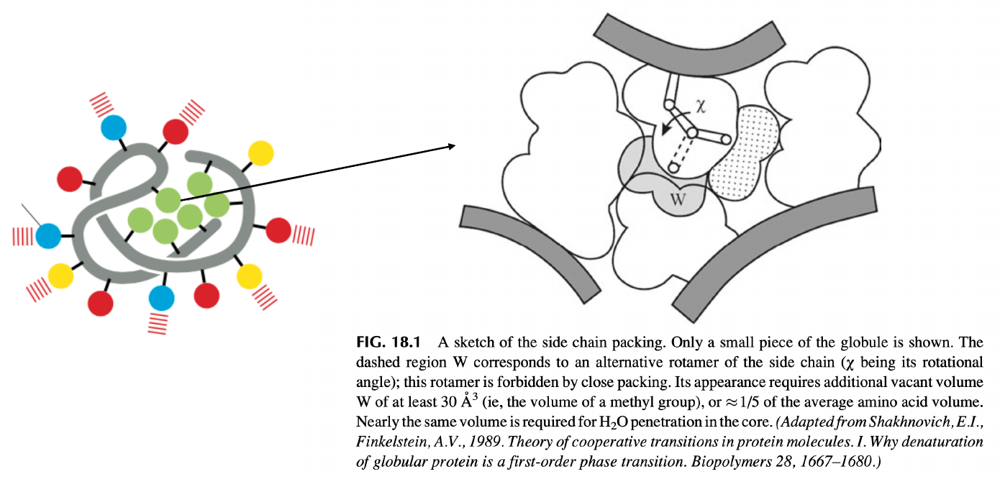
*▲ 课件原图（Slide 16）：FIG. 18.1 蛋白质内部像分子晶体一样紧密咬合——侧链扭转角 $\chi$ 若要翻转到虚线所示的另一旋转异构体位置 $W$，必须产生至少 $30\text{ \AA}^3$（相当于一个甲基 $-\text{CH}_3$ 或水分子体积）的局部空腔（本地路径：`img/ch2_fig10_slide16_solid_core_packing.png`）*

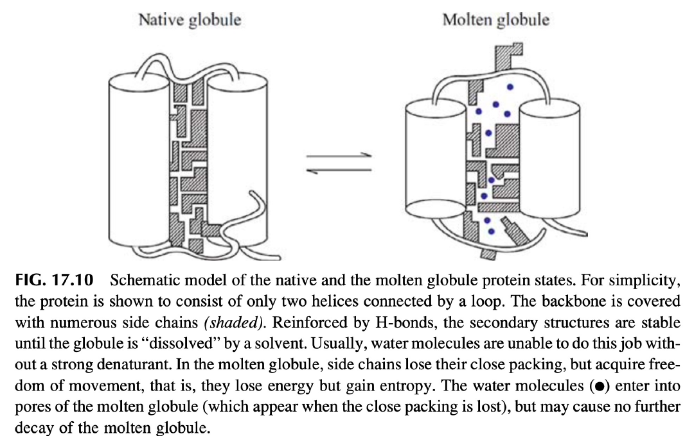
*▲ 课件原图（Slide 17）：FIG. 17.10 天然球状态（Native globule，核心侧链如齿轮般紧密咬合）与熔球态（Molten globule，二级结构螺旋仍在，但核心侧链失去紧密堆积而获得旋转自由度，水分子渗入微孔）对比模型（本地路径：`img/ch2_fig11_slide17_molten_globule.png`）*

课件第 16–17 页（引用自 [Shakhnovich & Finkelstein, *Biopolymers* 1989](https://pubmed.ncbi.nlm.nih.gov/2597723/)）从微观立体几何角度揭示了为什么蛋白质核心具有刚性合作性：
1. **天然态核心 = 分子固体晶体（Native Core as a Solid Crystal，Slide 16）**：
   - 天然球状蛋白内部的填充分数极高（约 $0.75$，与有机分子晶体相当），侧链像三维拼图或齿轮一样严丝合缝地咬合在一起。
   - 如果内部某一个侧链想要围绕其 $\chi$ 角旋转到另一个旋转异构体构象（图中虚线区域 $W$），周围侧链会造成严重的空间位阻，除非球状体膨胀并在该侧链旁腾出至少 **$W \approx 30\text{ \AA}^3$** 的空隙体积（相当于一个甲基 $-\text{CH}_3$ 的体积、平均氨基酸体积的 $1/5$，或一个水分子的体积）。
2. **熔球态（Molten Globule, MG，Slide 17）**：
   - 当温度升高或处于低 pH（如 $\text{pH } 2$）但未加高浓度变性剂时，蛋白质有时会进入一种特殊的紧凑中间态——**熔球态（Molten globule）**。
   - **结构特征**：主链氢键支撑的二级结构（$\alpha$-螺旋和 $\beta$-折叠）依然基本完好，整体回转半径仅比天然态略微膨胀（约 $10\%\text{–}15\%$）；但**三级结构的紧密侧链堆积已经融化（Core becomes fluid）**，侧链获得了旋转异构化运动的构象熵（Gain entropy），同时付出了范德华吸引能减弱的代价（Lose energy），水分子（图中黑点 $\bullet$）开始渗入松动核心的孔隙中。

### 2.4 为什么蛋白质变性近似于一级相变？自由能垒与“熵跃迁”的物理起源 (Slides 18–20 & 23)

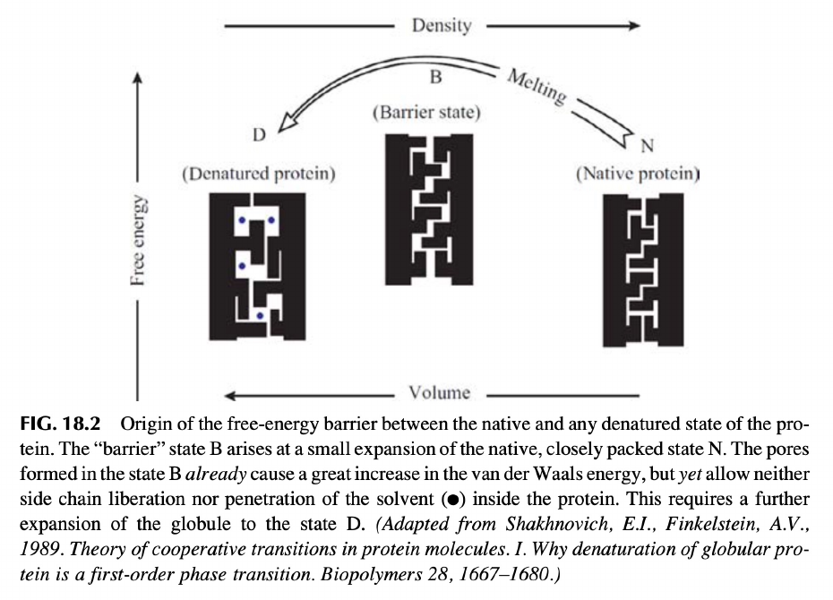
*▲ 课件原图（Slide 18）：FIG. 18.2 天然态（N）与变性态（D）之间自由能垒态（Barrier state B）的微观起源（本地路径：`img/ch2_fig12_slide18_first_order_barrier_origin.png`）*

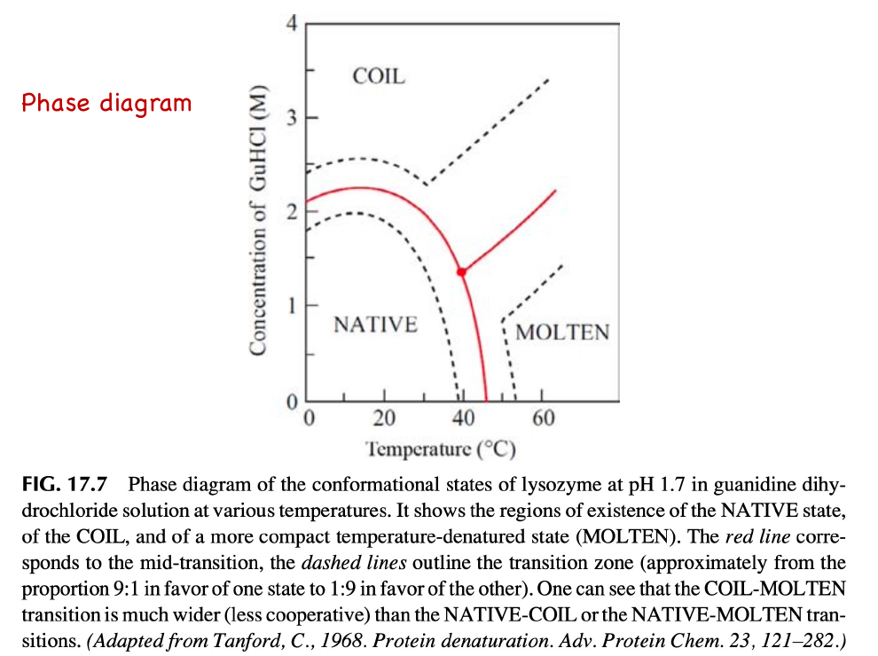
*▲ 课件原图（Slide 19）：FIG. 17.7 溶菌酶（Lysozyme, pH 1.7）在“温度–盐酸胍浓度”平面上的构象相图（Native、Coil、Molten 三相区及相变边界）（本地路径：`img/ch2_fig13_slide19_lysozyme_phase_diagram.png`）*

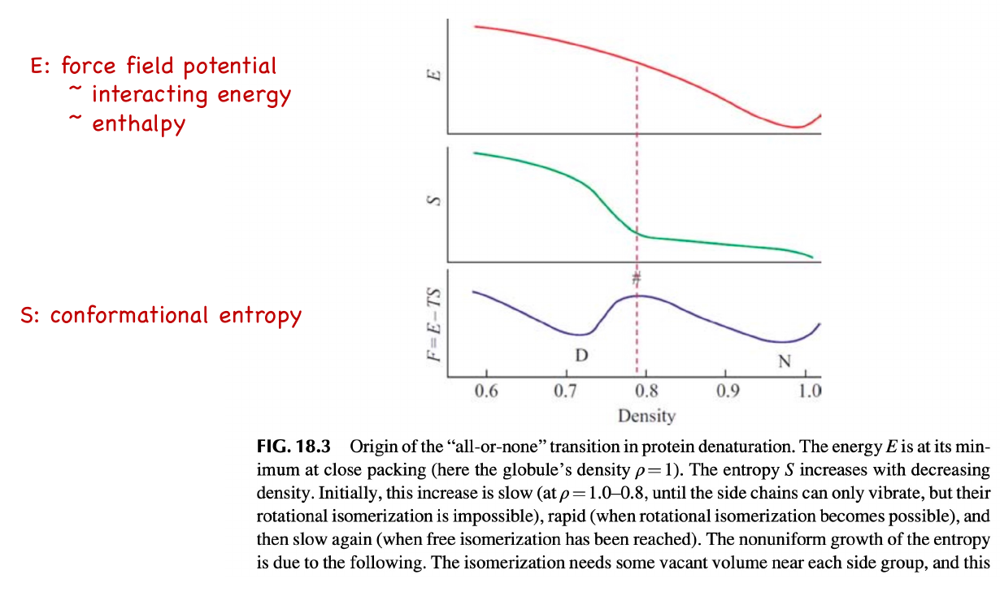
*▲ 课件原图（Slide 23）：FIG. 18.3 蛋白质变性“全或无”跃迁的定量图像——随球状体密度 $\rho$ 从 $1.0$（紧密堆积天然态 N）下降至 $0.6$（变性态 D），能量 $E(\rho)$、构象熵 $S(\rho)$ 与亥姆霍兹自由能 $F(\rho) = E - TS$ 的变化曲线（本地路径：`img/ch2_fig15_slide23_entropy_jump_density_profiles.png`）*

课件第 18、20 与 23 页回答了本章最深刻的热力学核心问题：**为什么单个蛋白质分子的去折叠表现为“全或无”的近似一级相变（First-order phase transition），即为什么在天然态 $N$ 和变性态 $D$ 之间必然存在一个自由能垒 $B$（$\ddagger$）？**

#### 自由能垒产生的三步微观物理机制（结合 Slide 18 图 18.2 与 Slide 23 图 18.3，必考论述题）：

```text
  密度区间         ρ = 1.0 (Native N) ──────► ρ ≈ 0.85 (Barrier B / ‡) ──────► ρ < 0.75 (Denatured D)
  ───────────────────────────────────────────────────────────────────────────────────────────────────
  微观几何状态     侧链紧密咬合如晶体         微膨胀产生小孔隙 (< 30 ų)       膨胀跨过阈值 (> 30 ų)
  内能 E (vdW)     最低 (紧密范德华接触)      急剧上升! (短程范德华吸引断裂)    继续缓慢上升
  构象熵 S (rot)   最低 (侧链仅能微幅振动)    几乎不变! (空隙仍不足以允许翻转)  突然暴涨! (侧链自由旋转+水渗入)
  自由能 F = E-TS  低谷 (天然态极小值 N)      尖峰! (ΔE 已付出，-TΔS 未补偿)    低谷 (变性态极小值 D)
```

1. **阶段一：从天然态（$\rho = 1.0$, State N）微幅膨胀至能垒态（$\rho \approx 0.8\text{–}0.9$, Barrier State B）——“只付代价，未得回报”**
   - 当紧密堆积的天然态（$\rho = 1.0$）发生微小体积膨胀时，原子间距离稍微拉开。由于范德华吸引力是极短程作用（$\propto r^{-6}$），这一微小膨胀导致球体内部出现微孔（Pores），**瞬间打断了大量范德华吸引接触，导致相互作用能 $E(\rho)$ 急剧升高（图 18.3 红线上升）**。
   - 然而，此时产生的局部空隙体积还不到 $30\text{ \AA}^3$ 的阈值——**既不足以让侧链跨过空间位阻发生旋转异构化（Rotational isomerization is still impossible，侧链仍只能原位微幅振动），也不足以让水分子渗入核心内部形成有利的水合作用**！因此在 $\rho = 1.0 \to 0.8$ 区间内，**构象熵 $S(\rho)$ 增长极其缓慢（图 18.3 绿线平坦段）**。
   - 结果：在 $\rho \approx 0.8$ 处，能量 $E$ 已经大幅升高，而熵项 $-TS$ 却未能提供补偿，导致自由能 $F(\rho) = E(\rho) - T S(\rho)$ 形成一个高耸的**自由能垒峰（Barrier state B / $\ddagger$，图 18.3 蓝线峰值）**！
2. **阶段二：跨过临界膨胀阈值（$\rho < 0.8 \to 0.7$, State D）——“熵的突然跃迁（A Sudden Jump in Entropy）”**
   - 一旦球状体的膨胀跨过了临界体积阈值（每个侧链周围空隙达到 $\ge 30\text{ \AA}^3$），所有侧链的旋转自由度被瞬间解放（Free rotational isomerization），同时溶剂水分子大量涌入孔隙。
   - 这导致**构象熵 $S(\rho)$ 在 $\rho \approx 0.8$ 附近发生陡峭的“S 型突然跃迁”（Sudden jump in entropy，图 18.3 绿线陡升段）**，使得 $-TS$ 项大幅降低，从而在 $\rho \approx 0.7$ 处形成第二个自由能极小值——即**变性态（Denatured state D）**。
3. **宏观推论**：正因为 $N$ 与 $D$ 之间隔着由“能量损失超前、熵增益滞后”造成的自由能垒 $\ddagger$，蛋白质能够耐受一定限度内的环境温度或变性剂波动而不发生渐进解体；一旦环境越过相变中点，整个蛋白质分子就会像宏观晶体融化一样发生“全或无（All-or-none）”的整体协同跃迁！

### 2.5 蛋白质区别于随机异聚物的本质物理特征：大能量隙 (Large Energy Gap, Slides 21–22, 24–25)

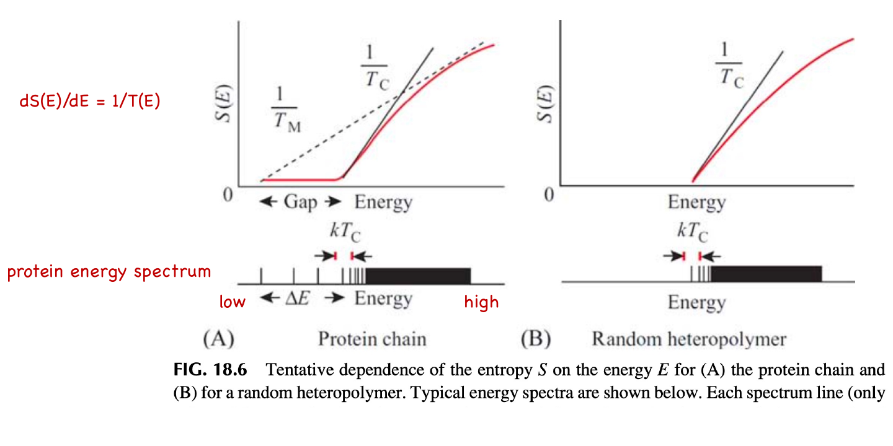
*▲ 课件原图（Slide 22）：FIG. 18.6 蛋白质链（A）与随机异聚物（B）的微正则构象熵 $S(E)$ 曲线及底层能谱（Energy spectrum）对比——天然蛋白质的标志性特征是最低能态与错误折叠态之间存在巨大的能量隙（Gap $\Delta E \gg k_B T_C$）（本地路径：`img/ch2_fig14_slide22_energy_spectrum_gap.png`）*

课件第 21–22 及 24–25 页提出了蛋白质物理学与蛋白质设计中最核心的判据问题：
> **“究竟是什么物理性质将真正的蛋白质（Protein）与普通的随机氨基酸异聚物（Random heteropolymer）区分开来？”**  
> (*Which physical property distinguishes the protein from a random heteropolymer?*)

#### 深度解析（基于 Bryngelson-Wolynes 随机能量模型 REM 与 Shakhnovich-Finkelstein 能谱理论）：
1. **按能量对构象空间编目（Slide 21）**：  
   一条多肽链共有海量可能构象，每个构象具有能量 $E$。将具有相同能量 $E$ 的构象归为一个能级，其构象数目 $\Omega(E)$ 定义了该能级的微正则构象熵：
   $$S(E) = k_B \ln \Omega(E)$$
   根据热力学基本关系，熵对能量的导数即为微正则温度的倒数：
   $$\frac{dS(E)}{dE} = \frac{1}{T(E)}$$
2. **随机异聚物（Random Heteropolymer，图 18.6 B）的困境**：
   - 随机序列中的疏水、极性与带电残基随机排布，在折叠时必然产生严重的**能量阻挫（Energetic Frustration）**——无论怎么折叠，总有一部分有利相互作用无法同时满足。
   - 因此，随机异聚物的能谱（Energy spectrum）在底部是稠密连续的，最低能态与次低能的大量错误折叠态（Misfolded states）之间没有明显的能量间隔（$\Delta E \sim k_B T_C$，其中 $T_C$ 为玻璃化转变温度）。当降温至 $T_C$ 时，随机异聚物会陷入无数个能量相近的局部陷阱中（冻结为无定形的玻璃态，无法形成唯一结构）。
3. **天然/成功设计的蛋白质（Protein Chain，图 18.6 A & Slide 25）的决定性特征——大能量隙（Large Energy Gap, $\Delta E$）**：
   - 进化筛选出的天然蛋白质（或计算设计出的优良人工蛋白），其氨基酸序列与目标三维拓扑高度契合（**最小阻挫原理 Principle of Minimal Frustration**），使得疏水埋藏、氢键配对和范德华堆积在唯一的天然折叠态（Native fold）中**同时得到满足**！
   - 这使得天然态的能量远远低于所有其他错误折叠构象的连续能带底部，在能谱上形成一个**宽阔的能量隙（Large Energy Gap, $\Delta E \gg k_B T_C$）**！
   - 在图 18.6 (A) 中，从基态（$E_{\min}, S=0$）向连续能带引切线，切线斜率 $\frac{1}{T_M}$ 决定了蛋白质的熔解变性温度 $T_M$。正因为存在宽阔的 $\text{Gap } \Delta E$，切线斜率 $\frac{1}{T_M} < \frac{1}{T_C}$，即**熔解温度显著高于玻璃化冻结温度（$T_M > T_C$）**。这保证了蛋白质既能发生敏锐的“全或无”协同折叠，又能在环境温度或 pH 发生小幅波动时保持天然结构的高度稳定！

> **【深度补充解释 2：能量隙 $\Delta E$ 对计算蛋白质设计（Positive vs. Negative Design）的直接指导】**  
> Slide 25 的结论直接解释了为什么在蛋白质设计中，仅仅寻找“使目标骨架能量 $E_{\text{target}}$ 较低的序列”（正向设计 Positive Design）往往是不够的（比如设计出一个全部由疏水亮氨酸组成的序列，它在目标结构中能量也很低，但在无数其他紧凑错误折叠态或聚集态中能量同样很低，即**没有 Energy Gap**！）。  
> 真正成功的蛋白质设计必须最大化**目标态与所有竞争错误折叠态之间的能量隙 $\Delta E = E_{\text{misfolded}} - E_{\text{native}}$**（负向设计 Negative Design）。近年来的深度学习逆折叠模型（如 ProteinMPNN）和基于 AlphaFold 损失函数的幻觉设计（Hallucination，见 Chapter 0 Slide 21 的 Fold loss / pLDDT + pTM），本质上都是在序列空间中最大化目标折叠态相对于其他替代构象的概率优势，即最大化有效能量隙 $\Delta E$！

## 3. 第三节：蛋白质折叠动力学 (3. Kinetics of Protein Folding: How to Fold Graciously?, Slides 26–39)

### 3.1 利文索尔悖论 (Levinthal's Paradox) 与原始动力学路径假说 (Slides 27–28)

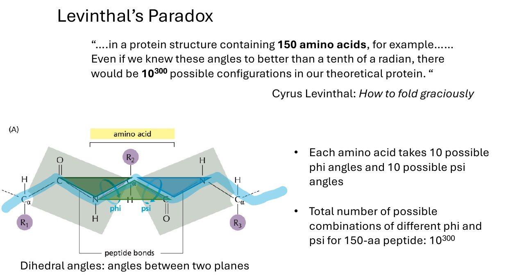
*▲ 课件原图（Slide 27）：Cyrus Levinthal (1969)《How to fold graciously》提出的利文索尔悖论——150 个氨基酸的多肽链若每个残基取 10 种 $\phi$ 角和 10 种 $\psi$ 角，总构象数高达 $10^{300}$（本地路径：`img/ch2_fig16_slide27_levinthal_paradox_dihedrals.png`）*

1. **利文索尔悖论的定量计算（Slide 27）**：
   - 多肽链的主链构象由两个平面之间的扭转角/二面角（Dihedral angles: $\phi$ 和 $\psi$）决定。
   - Cyrus Levinthal 在 1968/1969 年指出：以一条含有 $L = 150$ 个氨基酸的蛋白质为例，即使我们将主链二面角仅精确到十分之一弧度（即假设每个氨基酸残基可取 $10$ 种可能的 $\phi$ 角和 $10$ 种可能的 $\psi$ 角，每个残基有 $10 \times 10 = 100 = 10^2$ 种主链构象），整条 150 残基多肽链的可能构象总数也将达到：
     $$N_{\text{conf}} = (10 \times 10)^{150} = (10^2)^{150} = \mathbf{10^{300}}$$
   - 如果蛋白质通过随机盲目尝试来寻找天然态，哪怕每秒钟尝试 $10^{13}$ 种构象，也需要 $10^{287}$ 秒，这在物理上绝无可能实现；然而真实蛋白质在生物体内仅需毫秒至秒级即可优雅地完成折叠（*fold graciously*）。
2. **利文索尔当年的回答（Levinthal's Answer，Slide 28）**：
   - Levinthal 本人当年据此推测：蛋白质折叠必定遵循某条特定的、预设好的动力学路径（Specific pathway），而天然折叠态仅仅是这条路径的终点——不管它是不是全局最稳定的折叠态。
   - 换言之，**Levinthal 当年认为天然蛋白质结构是由动力学控制的（Determined by kinetics），对应于最容易到达的局部自由能极小值，而非全局自由能极小值**。

### 3.2 动力学控制 vs. 热力学控制的大和解：漏斗状能量景观 (Slides 29–30)

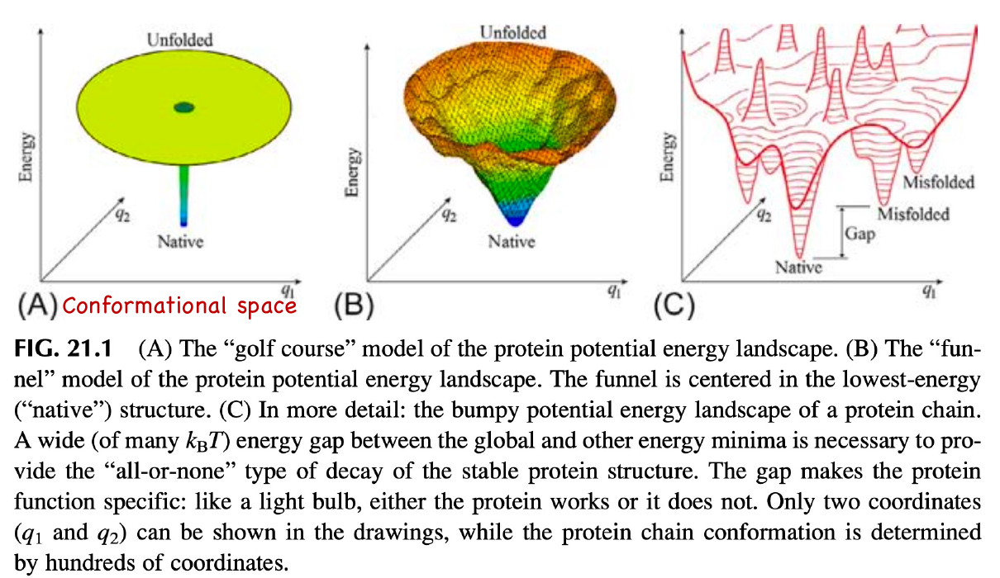
*▲ 课件原图（Slide 30）：FIG. 21.1 蛋白质势能景观的三种模型对比——(A) 利文索尔设想的“高尔夫球场（Golf course）”平坦景观；(B) 理想光滑“折叠漏斗（Funnel）”景观；(C) 具有局部起伏但核心存在宽能量隙（Gap）的真实崎岖漏斗景观（本地路径：`img/ch2_fig17_slide30_golf_course_vs_funnel.png`）*

课件第 29 页提出了困扰结构生物学数十年的哲学追问：
- 在从序列预测蛋白质结构时，我们究竟应该寻找**能量最低的结构（热力学目标）**，还是**折叠最快的结构（动力学目标）**？
- 在设计蛋白质时，我们应该**最大化结构的能量稳定化 $\Delta E$**，还是**专门设计一条通向终点的快速折叠路径**？
- **核心洞察（Slide 29 第 3 点 & Slide 30）**：**也许，“能量最低的结构”会自动在构象空间中形成一个汇聚所有快速折叠路径的焦点（Focus / Funnel），从而自动具备快速折叠的能力！**

#### 三种能量景观模型的物理对比（Slide 30 FIG. 21.1）：

| 景观模型 | 几何形态特征 | 物理含义与折叠动力学表现 |
| :--- | :--- | :--- |
| **(A) “高尔夫球场”模型**<br>(The "Golf Course" Model) | 整个构象空间是一片完全平坦的高原，唯有天然态（Native）处有一个针孔大小的深洞。 | 对应 Levinthal 悖论的前提假设：无任何能量梯度指引，多肽链在高原上做无偏随机游走，永远找不到球洞。 |
| **(B) 光滑“漏斗”模型**<br>(The Smooth "Funnel" Model) | 以全局最低能量的天然态（Native）为中心，四周能量随原生接触的形成而平滑单调下降。 | 热力学与动力学的完美统一：无论去折叠链从漏斗边缘何处出发，朝向天然态的任何局部折叠步骤都会带来能量下降，从而沿无数条并行下坡路径快速汇聚至谷底。 |
| **(C) 含能量隙的崎岖漏斗模型**<br>(The Bumpy Funnel with Energy Gap) | 漏斗壁上存在许多对应于错误折叠态（Misfolded）的局部小坑（凹凸起伏），但在全局最低点 Native 与所有 Misfolded 态之间存在一个**宽达数个 $k_B T$ 的能量隙（Gap）**。 | 最符合真实蛋白质的物理图像：宽阔的 **Gap** 既保证了热力学上的“全或无”双态稳定性（像电灯泡一样，要么正常工作，要么彻底变性），又防止多肽链被永久困在错误折叠陷阱中。 |

### 3.3 序列凝聚折叠路径与表面张力能垒标度律：$\Delta F^\# \propto L^{2/3}$ (Slides 31–32)

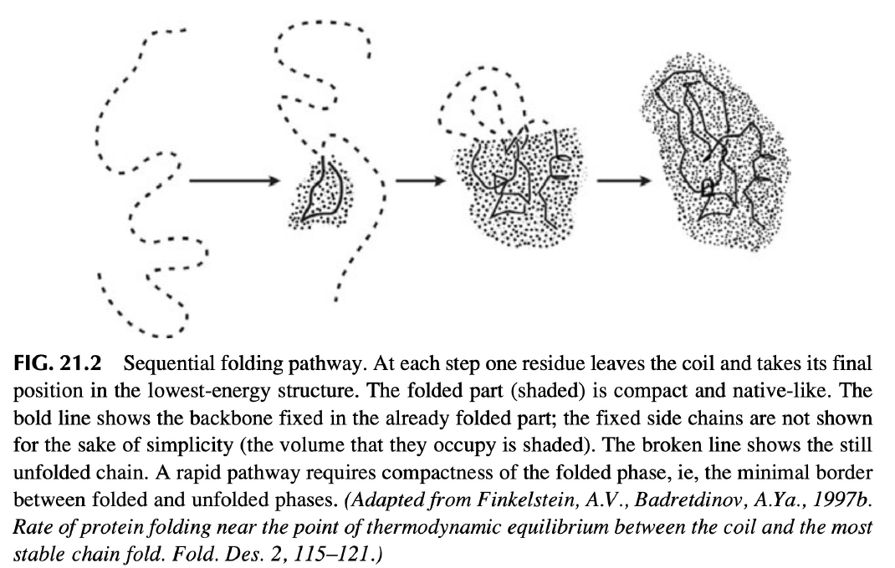
*▲ 课件原图（Slide 31）：FIG. 21.2 紧凑序列折叠路径（Sequential folding pathway）——在每一步中，一个氨基酸残基离开无规卷曲相（虚线）并加入已折叠的紧凑天然样核心相（阴影实线）（引用自 Finkelstein & Badretdinov, 1997，本地路径：`img/ch2_fig18_slide31_sequential_folding_pathway.png`）*

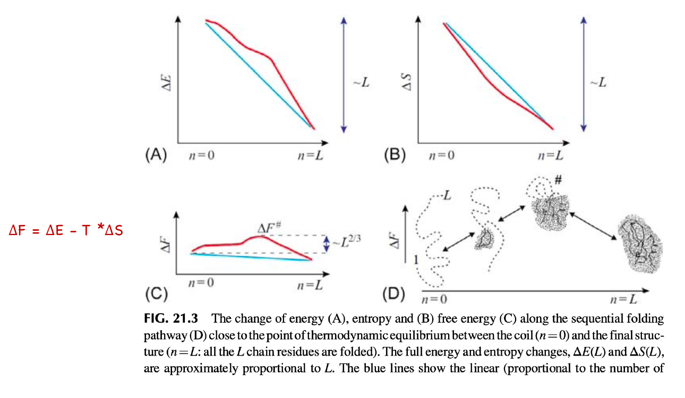
*▲ 课件原图（Slide 32）：FIG. 21.3 在相变平衡点附近沿紧凑折叠路径（从 $n=0$ 到 $n=L$）的能量 $\Delta E$（图 A）、熵 $\Delta S$（图 B）及自由能 $\Delta F = \Delta E - T\Delta S$（图 C、D）变化——过渡态自由能垒高度标度为 $\Delta F^\# \sim L^{2/3}$（本地路径：`img/ch2_fig19_slide32_free_energy_barrier_L23.png`）*

课件第 31–32 页（源自 Finkelstein & Badretdinov, *Folding & Design* 1997 的**成核-生长毛细理论 Capillarity / Nucleation-Growth Theory**）用极度优美的物理标度分析回答了：**“为什么一条含有 $L$ 个残基的蛋白质能在合理时间内越过自由能垒找到最低能态？”**

#### 严谨物理推导：为什么折叠能垒 $\Delta F^\# \propto L^{2/3}$ 而不是 $\propto L$？（必考核心机制）
1. **紧凑成核折叠路径假设（Slide 31 图 21.2）**：  
   设整条多肽链总长度为 $L$ 个残基。考虑一条紧凑的逐步折叠路径：在中间时刻，已有 $n$ 个残基（$0 \le n \le L$）脱离无规卷曲态（Unfolded coil，虚线），凝聚成一个紧凑的、具有天然态局部构象的球状折叠核（Folded phase，图中阴影区），其余 $L - n$ 个残基仍处于去折叠相。
2. **体相项（Bulk terms）的线性抵消（Slide 32 图 21.3 A & B 中的蓝线）**：
   - **构象熵损失 $\Delta S(n)$（图 B）**：每当 1 个残基从自由旋转的无规卷曲被固定到折叠核中，它就损失一份固定的构象熵，因此总熵损失基本上与已折叠残基数 $n$ 成正比（线性下降，总幅度 $\Delta S(L) \propto -L$）。
   - **相互作用能降低 $\Delta E(n)$（图 A）**：在折叠完成时（$n = L$），总稳定化能量 $\Delta E(L)$ 也与残基总数成正比（$\propto -L$）。在热力学相变中点（Melting equilibrium，$T = T_M$）附近，完全折叠态与完全去折叠态自由能相等（$\Delta F(L) = \Delta E(L) - T_M \Delta S(L) = 0$），这意味着**蓝线所示的线性体相能量项与线性体相熵项处处精确抵消**！
3. **界面表面张力项（Surface boundary cost）与 $L^{2/3}$ 能垒的产生（Slide 32 图 21.3 A & C 中的红线）**：
   - 在折叠进行到一半（例如 $n \approx L/2$，过渡态 $\#$）时，已折叠相（阴影区）与未折叠相之间存在一个**分界面（Boundary interface）**。
   - 位于折叠核**表面边界上**的氨基酸残基虽然已经固定了构象（**已经付出了全部的构象熵代价 $\Delta S$**），但它们朝向未折叠区的一侧还没有形成完整的天然疏水/范德华接触（**尚未获得全部的能量回报 $\Delta E$**）！
   - 根据三维几何学，一个包含 $n \sim L$ 个残基的紧凑三维球体的体积 $V \propto L$，而其**表面积（Surface area）与体积的 $2/3$ 次方成正比，即 $A_{\text{surface}} \propto V^{2/3} \propto L^{2/3}$**！
   - 因此，红线所示的真实能量 $\Delta E(n)$ 比蓝线线性值高出一个正比于表面积的界面能亏损，从而在自由能曲线 $\Delta F(n) = \Delta E(n) - T \Delta S(n)$（图 C）上产生一个高度正比于 **$L^{2/3}$** 的过渡态活化能垒：
     $$\Delta F^\# = \Delta E^\# - T\Delta S^\# \propto L^{2/3}$$
4. **消除利文索尔悖论的动力学时间标度**：
   - 如果没有“熵-能即时补偿”（例如必须等所有 $L$ 个残基全部摆好位置才能形成接触获得能量），那么能垒将正比于链长 $\Delta F^\# \propto L$，折叠时间 $\tau \propto e^{cL} \sim 10^{300}$ 秒（即利文索尔悖论）。
   - 而在紧凑成核路径下，**每一步的熵减少（Entropy decrease）都立即或几乎立即被新形成接触的能量降低（Energy decrease）所补偿（Slide 34 核心结论）**，仅剩下微小的表面项能垒 $\Delta F^\# \propto L^{2/3}$，使得天然蛋白质能够在毫秒至秒级内迅速跨越能垒完成折叠！

### 3.4 蛋白质 G 的 ZAM 分级折叠路径实例 (Slides 33–34)

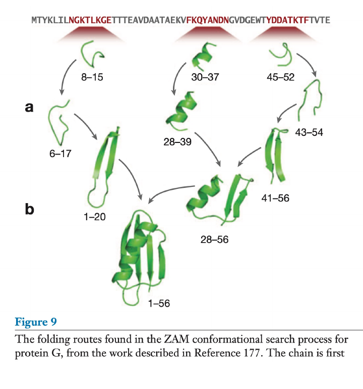
*▲ 课件原图（Slide 33）：Figure 9 利用拉链与组装模型（Zipping and Assembly Model, ZAM）模拟揭示的 56 残基 Protein G 分级折叠路径（本地路径：`img/ch2_fig20_slide33_protein_G_ZAM_pathway.png`）*

课件第 33 页展示了由 Ken Dill 团队提出的**拉链与组装模型（Zipping and Assembly Model, ZAM）**对 56 个氨基酸的 **Protein G**（经典的 $\alpha+\beta$ Plait 折叠，含 1 根中央 $\alpha$-螺旋和 4 股 $\beta$-折叠片）折叠全过程的拆解：
1. **第一步（局部成核 Zipping）**：多肽链不同局部片段首先独立、快速地形成短程疏水簇与二级结构雏形——N 端片段 `8–15` 卷曲为发夹并扩展为 `6–17` $\to$ `1–20`（N 端 $\beta$-发夹）；中央片段 `30–37` 折叠为 $\alpha$-螺旋并延伸至 `28–39`；C 端片段 `45–52` 形成发夹并延伸为 `43–54` $\to$ `41–56`（C 端 $\beta$-发夹）。
2. **第二步（亚结构域组装 Assembly）**：中央 $\alpha$-螺旋（`28–39`）与 C 端 $\beta$-发夹（`41–56`）率先靠拢组装为稳定的 `28–56` 亚结构域。
3. **第三步（全局闭合）**：N 端 $\beta$-发夹（`1–20`）与 `28–56` 亚结构域对接，完成全长 `1–56` 天然三级结构的组装。
4. **Slide 34 三条核心总结（必背考点）**：
   - 当沿着这些路径向能量极小值移动时，蛋白质**赢得稳定化能量（Gains stabilizing energy, $\Delta E < 0$）但损失构象熵（Loses entropy, $\Delta S < 0$）**，结构变得越来越紧凑、越来越固定；
   - 天然态的能量极小值越深（即 Energy gap 越大），折叠过程中的能量收益就越大，就越容易克服“熵阻力（Entropic resistance, $-T\Delta S > 0$）”；
   - **只要存在一条折叠路径，使得路径上每一步的构象熵减少都能被能量降低立即（或几乎立即）补偿（Entropy-Energy Compensation），利文索尔悖论就被彻底化解！**

### 3.5 计算机蛋白质折叠模拟与公民科学游戏 Foldit (Slides 37–39)


*▲ 课件原图（Slide 38）：基于 Rosetta 物理能量引擎开发的公民科学多人在线蛋白质折叠与设计游戏 Foldit（本地路径：`img/ch2_fig21_slide38_39_foldit_game.png`）*

- **计算机模拟（Slide 37）**：通过分子动力学（Molecular Dynamics）或 Rosetta 蒙特卡洛采样在计算机中模拟多肽链从线性伸展态坍缩折叠为天然三维结构的过程。
- **Foldit 多人在线科学游戏（Slides 38–39，[Cooper et al., *Nature* 2010](https://pubmed.ncbi.nlm.nih.gov/20686574/)）**：
  - 由华盛顿大学 David Baker 实验室与计算机科学系联合开发（[https://fold.it](https://fold.it)），底层直接运行 **Rosetta 物理力场能量评分函数**（将氢键、范德华紧密堆积、埋藏疏水残基、避免空间碰撞与未满足极性原子转化为游戏得分）。
  - 玩家利用人类的三维空间直觉与模式识别能力，在电脑上拖拽、旋转多肽链的主链与侧链（对应 Rosetta 中的 Pull/Wiggle/Shake/Mutate 操作），帮助跨越计算机自动采样容易卡住的高自由能垒，成功解析了逆转录病毒蛋白酶晶体结构并实现了从头蛋白质设计。

## 4. 第四节：核心公式速查表、重要物理常数与考前高频必考问答题精解 (Summary, Constants & Exam Q&A)

### 4.1 本章核心物理公式与关键参数速查表

| 物理概念 / 定律 | 数学公式 / 定量数值 | 符号解释与物理意义 | 对应课件页码 |
| :--- | :--- | :--- | :--- |
| **氢键几何参数与键能** | $-\text{D}-\text{H}\cdots\text{A}-$<br>$d_{\text{H}\cdots\text{O}} \approx \mathbf{1.8\text{ \AA}}$（vdW 预期 $2.6\text{ \AA}$）<br>$\theta_{\text{D-H}\cdots\text{A}} \approx \mathbf{180^\circ}, \ E \approx \mathbf{2\text{–}10\text{ kcal/mol}}$ | 具有部分共价特征与强烈共线角度偏好；水相中受水分子竞争，埋藏未满足极性基团惩罚极大 | Slides 6–7 |
| **Lennard-Jones 6-12 势** | $E_{\text{VDW}} = \varepsilon_{ij} \left[ \left(\frac{\sigma_{ij}}{r_{ij}}\right)^{12} - 2\left(\frac{\sigma_{ij}}{r_{ij}}\right)^6 \right]$ | $\sigma_{ij} = r_i^{\min} + r_j^{\min}$ 为最优接触距离；$\varepsilon_{ij} = (\varepsilon_i \varepsilon_j)^{1/2}$ 为最优吸引势阱深度（单原子对 $\sim 0.2\text{ kcal/mol}$） | Slides 8–9 |
| **库仑静电定律** | $E_{\text{elec}} = \frac{k q_1 q_2}{\varepsilon r}$<br>**$k = 332\text{ (kcal/mol)}\cdot\text{\AA}/e^2$** | $q_1, q_2$ 以电子电荷 $e$ 为单位，$r$ 以 $\text{\AA}$ 为单位；真空中 $3\text{ \AA}$ 的 $\text{Na}^+\text{Cl}^-$ 吸引能约为 $-110\text{ kcal/mol}$ | Slide 10 |
| **静电多极衰减层级** | 离子-离子 $\propto \mathbf{1/r}$<br>电荷-偶极 $\propto \mathbf{1/r^2}$<br>偶极-偶极 $\propto \mathbf{1/r^3}$ | 静电力衰减远慢于范德华力（$1/r^6$），具有显著长程导引效应（Electrostatic steering） | Slide 10 |
| **核心侧链翻转空腔阈值** | $W_{\min} \approx \mathbf{30\text{ \AA}^3}$ | 相当于 1 个甲基（$-\text{CH}_3$）、平均氨基酸体积的 $1/5$ 或 1 个水分子的体积 | Slide 16 |
| **微正则熵与温度关系** | $S(E) = k_B \ln \Omega(E), \quad \frac{dS(E)}{dE} = \frac{1}{T(E)}$ | 能谱中存在宽能量隙 $\Delta E \gg k_B T_C$ 是真蛋白质区别于随机异聚物的决定性特征 | Slide 22 |
| **自由能与成核能垒标度** | $\Delta F = \Delta E - T\Delta S$<br>**$\Delta F^\# \propto L^{2/3}$** | 沿紧凑成核折叠路径，体相熵与体相能线性抵消，能垒仅源于折叠核表面未满足接触（正比于表面积 $L^{2/3}$） | Slide 32 |

### 4.2 考前高频必考问答题与深度辨析（Exam Review Q&A）

#### 问题 1：既然单个氢键的键能高达 $2\text{–}10\text{ kcal/mol}$，为什么说在蛋白质水相折叠过程中，氢键并不是驱动折叠的主要净自由能来源，但同时氢键又对蛋白质三维结构的稳定和特异性不可或缺？（对应 Slide 7）
- **标准解答**：
  1. **水分子竞争导致净自由能变化很小**：在去折叠态下，多肽链暴露在水中的极性供体（$-\text{NH}$）和受体（$-\text{C=O}$）已经与水分子形成了稳定的氢键。折叠形成蛋白质分子内氢键时，必须先打断“蛋白质–水”氢键，再形成“蛋白质–蛋白质”氢键与“水–水”氢键。整个过程中体系的氢键总数几乎不变，因此这种氢键伙伴交换（Exchange of hydrogen-bonding partners）带来的净自由能增益很小。
  2. **去溶剂化惩罚决定结构特异性**：驱动蛋白质坍缩的主要动力是**疏水效应**，但当疏水核心坍缩顺带将极性主链埋入低介电常数的内部时，如果极性基团不能形成分子内氢键，就会净损失原本与水形成的氢键（每个未满足氢键付出 $4\text{–}6\text{ kcal/mol}$ 的巨大热力学惩罚）。因此，多肽链被迫折叠为规则的 $\alpha$-螺旋和 $\beta$-折叠以规避埋藏未满足极性原子的惩罚，从而赋予了蛋白质精确的二级和三级结构几何特异性。

#### 问题 2：为什么球状蛋白质的变性（去折叠）过程表现为一个没有大量中间态居群的“全或无（All-or-None）”一级相变过程？（对应 Slides 15–20, 23）
- **标准解答**：
  1. 天然球状蛋白的内部像固体分子晶体一样紧密堆积（$\rho \approx 1.0$），范德华吸引力的作用距离极短（$\propto r^{-6}$），而侧链旋转异构化需要至少 $30\text{ \AA}^3$ 的局部空腔体积。
  2. 当蛋白质从天然态开始微幅膨胀（$\rho = 1.0 \to 0.85$）时，短程范德华接触立即断裂，导致内能 $E$ 急剧升高；但此时的空隙体积仍小于 $30\text{ \AA}^3$，侧链依然无法自由翻转，构象熵 $S$ 几乎没有增加。
  3. 只有当膨胀跨过临界阈值（$\rho < 0.8$）时，侧链旋转自由度和溶剂渗透才同时放开，引发**构象熵的突然跃迁（Sudden jump in entropy）**。这种“能量上升超前、熵增加滞后”的非同步性在天然态 $N$ 与变性态 $D$ 之间造就了一个高自由能垒 $\ddagger$，使得半膨胀中间态在热力学上极不稳定，从而表现为“全或无”的一级相变。

#### 问题 3：蛋白质与随机氨基酸异聚物在能谱（Energy Spectrum）和能量景观（Energy Landscape）上有何本质区别？这对解决利文索尔悖论有何意义？（对应 Slides 22, 25, 30–36）
- **标准解答**：
  1. **热力学能谱区别**：随机异聚物的能谱是连续稠密的，最低能态与大量错误折叠态之间没有明显间隔；而蛋白质的能谱在全局最低能天然态与大量变性/错误折叠态之间存在一个**宽阔的能量隙（Large Energy Gap, $\Delta E \gg k_B T_C$）**，保证天然态在生理温度下唯一稳定并能容忍环境波动。
  2. **动力学折叠漏斗与熵-能补偿**：在动力学上，这个深邃的能量最低谷在构象空间中构成了**漏斗状能量景观（Funnel-like energy landscape）**的中心。沿着紧凑成核折叠路径，每一步构象熵的减少（$\Delta S < 0$）都立即被新形成的天然接触带来的能量降低（$\Delta E < 0$）所补偿，仅剩下正比于折叠核表面积的微小能垒 $\Delta F^\# \propto L^{2/3}$，从而彻底避免了在平坦高尔夫球场上的 $10^{300}$ 盲目随机搜索。
