# 《蛋白质设计》 (Protein Design)
## 第三章：蛋白质的结构与功能 (Chapter 3: Protein Structure and Function) 课程讲义全景精要与深度解析笔记

> **课程信息**：Protein Design — 第 3 次课：蛋白质的结构与功能（全章节 85 页 PPT 完整精析，主讲：许文青 / 豆佳宜）  
> **配套图像**：含 **34 张课件原图高清裁切配图**（`img/`）与 **结构化原理示意图**（解压压缩包后将 `img/` 与本 `.md` 文件置于同一目录即可离线完整显示所有课件原图）  
> **参考教材与核心文献（Slides 1–4, 50, 81, 85）**：
> 1. Thomas E. Creighton, *Proteins: Structures and Molecular Properties* (2nd Edition), W. H. Freeman
> 2. Ken A. Dill & Sarina Bromberg, *Molecular Driving Forces* (2nd Edition), Garland Science
> 3. Alexei V. Finkelstein & Oleg B. Ptitsyn, *Protein Physics: A Course of Lectures*, Academic Press
> 4. Jenny Gu & Philip E. Bourne, *Structural Bioinformatics* (2nd Edition), Wiley-Blackwell
> 5. Cyrus Chothia, Michael Levitt, & David Richardson (1977), ["Structure of proteins: packing of alpha-helices and pleated sheets"](https://pubmed.ncbi.nlm.nih.gov/270659/), *Proc. Natl. Acad. Sci. U.S.A.* 74(10), 4130–4134
> 6. Michel Goedert (2015), ["Alzheimer's and Parkinson's diseases: The prion concept in relation to assembled A$\beta$, tau, and $\alpha$-synuclein"](https://pubmed.ncbi.nlm.nih.gov/26250687/), *Science* 349(6248), 1255555
> 7.Bo Wang et al. (2021), ["Liquid–liquid phase separation in human health and diseases"](https://pmc.ncbi.nlm.nih.gov/articles/PMC8326283/), *Signal Transduction and Targeted Therapy* 6, 290
> 8. Davis M. Wilson III et al. (2023), ["Hallmarks of neurodegenerative diseases"](https://pubmed.ncbi.nlm.nih.gov/36803602/), *Cell* 186(4), 693–714

## 目录与知识架构

1. **引言：蛋白质结构的“理解、模拟与创造”及课程教学体系 (Introduction & Course Framework, Slides 1–6)**
   - 1.1 结构生物学的三大支柱与国际蛋白质结构数据库 (wwPDB)
   - 1.2 《蛋白质设计》三大教学模块全景脉络
   - 1.3 蛋白质 3D 结构决定功能与调控机制的总体逻辑
2. **第一节：蛋白质的分子组成和化学结构 (1. Molecular Component of Proteins, Slides 7–29)**
   - 2.1 蛋白质的生物学重要性与八大生理功能 (Slides 8–9)
   - 2.2 蛋白质的元素组成与凯氏定氮“$16\%$ 含氮量法则” (Slide 10)
   - 2.3 蛋白质的基本组成单位：$\text{L}-\alpha$-氨基酸的手性构型 (Slides 11–13)
   - 2.4 **20 种标准氨基酸的五类分法、全参数对照表与特殊氨基酸精析** (Slides 14–20)
   - 2.5 **氨基酸的三大理化性质**：两性解离与等电点 ($\text{pI}$) 计算、$280\text{ nm}$ 紫外吸收、茚三酮显色反应 (Slides 21–23)
   - 2.6 肽键、多肽链方向性与生物活性肽——**谷胱甘肽 (GSH/GSSG)** 氧化还原系统 (Slides 24–27)
   - 2.7 蛋白质的一级结构 (Primary Structure) 经典实例与四大序列数据库 (Slides 28–29)
3. **第二节：蛋白质的空间结构 (2. The Molecular Structure of Protein, Slides 30–62)**
   - 3.1 蛋白质结构的四个层次概览 (Slides 31–32, 61)
   - 3.2 二级结构的基础：**肽单元 (Peptide Unit) 六原子平面**、部分双键性质与主链二面角 $(\phi, \psi)$ (Slides 33–36)
   - 3.3 **$\alpha$-螺旋 ($\alpha$-Helix) 与螺旋家族 ($\alpha, 3_{10}, \pi$) 参数对比及四大不稳定因素** (Slides 37–40)
   - 3.4 **$\beta$-折叠 ($\beta$-Pleated Sheet)**：顺/反平行氢键网络与左手超螺旋扭曲 (Left-handed Twist) (Slides 41–43, 54)
   - 3.5 $\beta$-转角 ($\beta$-Turn)、无规卷曲 (Random Coil) 与超二级结构/**模体 (Motif：EF-hand 与锌指)** (Slides 44–46)
   - 3.6 **蛋白质的三级结构 (Tertiary Structure)** 与**稳定蛋白质结构的“五条黄金准则”** (Slides 47–48)
   - 3.7 **Chothia 螺旋表面山脊与沟槽堆积理论 (Ridges-into-Grooves)** 与亮氨酸拉链 (Leucine Zipper) (Slides 49–51)
   - 3.8 经典三级结构拓扑案例：四螺旋束、肌红蛋白、视黄醇结合 $\beta$-桶与 TIM 桶 (Slides 52–53, 55–56)
   - 3.9 **结构域 (Domain)**、演化保守模块 (SH3 / PDZ / Pumilio) 与**分子伴侣 (Chaperone)** (Slides 57–59)
   - 3.10 **蛋白质的四级结构 (Quaternary Structure)**、亚基缔合与多结构域亚稳态信号复合物 (Slides 60–62)
4. **第三节：蛋白质结构与功能的关系 (3. The Relation of Structure and Function, Slides 63–73)**
   - 4.1 一级结构与功能的关系：RNase A 复性、同源胰岛素比较、细胞色素 c 进化树与**镰刀形红细胞贫血“分子病” ($\beta\text{E6V}$)** (Slides 64–67)
   - 4.2 空间结构与功能的关系：**肌红蛋白 (Mb) 与血红蛋白 (Hb) 的结构与储氧/运氧对比** (Slides 68–70)
   - 4.3 **协同效应 (Cooperativity) 与变构效应 (Allosteric Effect)**：血红蛋白氧合引发 $T \to R$ 态构象转换的原子级力学链条 (Slides 71–73)
5. **第四节：蛋白质的理化性质、功能性相分离与构象疾病 (4. Physicochemical Properties, LLPS & Conformational Diseases, Slides 74–85)**
   - 5.1 蛋白质的两性电离、等电点 ($\text{pI}$) 与胶体稳定性（水化膜 + 表面同种电荷）(Slides 74–76)
   - 5.2 蛋白质的变性 (Denaturation)、复性 (Renaturation) 与沉淀 (Precipitation) 的本质辨析 (Slides 78–80)
   - 5.3 **前沿拓展一：蛋白质功能性相变——液-液相分离 (LLPS)** 的发现历程与七大生理功能 (Slides 77, 81)
   - 5.4 **前沿拓展二：蛋白质构象疾病 (Conformational Diseases)**——疯牛病朊病毒 ($\text{PrP}^\text{C} \to \text{PrP}^\text{Sc}$) 与三大神经退行性疾病靶点 ($\text{A}\beta, \text{Tau}, \alpha\text{-synuclein}, \text{TDP-43}$) (Slides 82–85)
6. **第五节：核心知识点速查总表与考前必考重点问答题精解 (Summary Tables & Exam Review Q&A)**

### 全章知识逻辑脉络图

```text
                ┌──────────────────────────────────────────────────────────────────────┐
                │            Chapter 3: 蛋白质的结构与功能 (85 页全全景)                 │
                │   (理解 Experimental ↔ 模拟 Computational ↔ 创造 Protein Design)     │
                └──────────────────────────────────┬───────────────────────────────────┘
                                                   │
     ┌──────────────────────┬──────────────────────┴──────────────────────┬──────────────────────┐
     ▼                      ▼                                             ▼                      ▼
┌────────────────────┐ ┌─────────────────────────┐               ┌────────────────────┐ ┌────────────────────┐
│ 第一节: 分子组成    │ │   第二节: 空间结构层次   │               │ 第三节: 结构与功能  │ │ 第四节: 理化与相变  │
├────────────────────┤ ├─────────────────────────┤               ├────────────────────┤ ├────────────────────┤
│• 元素: 平均含N 16% │ │• 二级: 肽单元6原子平面   │               │• 一级决定空间与功能│ │• 胶体稳定两大因素: │
│• 20种 L-α-氨基酸   │ │  - α螺旋 (3.6残基/0.54nm)│              │  - RNase A 可逆复性│ │  表面电荷 + 水化膜 │
│  (Gly无手性,Pro亚氨)│ │  - 3_10螺旋与π螺旋对比  │               │  - 胰岛素种属差异  │ │• 变性(次级键/二硫键│
│• 五类氨基酸与pI计算│ │  - β折叠(顺/反平行,左扭) │               │  - 镰刀贫血(βE6V)  │ │  断裂,一级结构不变)│
│• 280nm紫外(Trp/Tyr)│ │  - β转角(4残基)与无规卷曲│               │• Mb vs Hb 与变构:  │ │• 功能性液液相分离  │
│• 茚三酮反应(570nm) │ │  - 模体(EF-hand, 锌指)   │               │  - Fe2+入孔拉动F8  │ │  (LLPS七大生理功能)│
│• 肽键与谷胱甘肽GSH │ │• 三级: 稳定结构5大黄金律 │               │  - 扯断8对盐键     │ │• 构象病与淀粉样聚集│
│• 一级结构与UniProt │ │  - 螺旋山脊沟槽堆积(50°) │               │  - T态→R态正协同   │ │  (PrP, Aβ, Tau,    │
│                    │ │  - 结构域与分子伴侣      │               │                    │ │   α-syn, TDP-43)   │
│                    │ │• 四级: 亚基非共价缔合    │               │                    │ │                    │
└────────────────────┘ └─────────────────────────┘               └────────────────────┘ └────────────────────┘
```

## 1. 引言：蛋白质结构的“理解、模拟与创造”及课程教学体系 (Slides 1–6)

### 1.1 结构生物学的三大支柱与国际蛋白质结构数据库 (wwPDB, Slide 1)

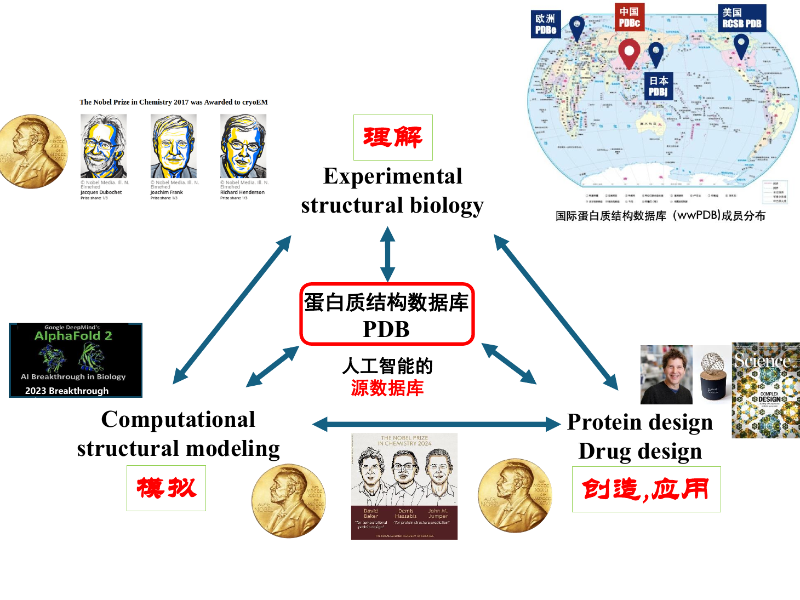
*▲ 课件原图（Slide 1）：围绕国际蛋白质结构数据库（PDB）构建的“理解（实验结构生物学）— 模拟（计算结构建模）— 创造与应用（蛋白质设计与药物设计）”铁三角体系（本地路径：`img/ch3_fig01_slide01_pdb_hub_overview.png`）*

课件第 1 页高屋建瓴地勾勒出当代蛋白质科学的宏大范式演进——以**蛋白质结构数据库（[PDB](https://www.wwpdb.org/)，人工智能的源数据库）**为核心枢纽的三大维度：
1. **理解（Experimental structural biology，实验结构生物学）**：通过 X 射线晶体衍射（X-ray crystallography）、核磁共振（NMR）以及冷冻电镜技术（Cryo-EM，Jacques Dubochet、Joachim Frank 与 Richard Henderson 荣膺 **2017 年诺贝尔化学奖**）实验测定生物大分子三维原子坐标，并存入全球蛋白质数据库联盟 **wwPDB**（四大核心节点：美国 **RCSB PDB**、欧洲 **PDBe**、日本 **PDBj** 以及中国 **PDBc**）。
2. **模拟（Computational structural modeling，计算结构建模）**：基于 PDB 积累的二十余万个实验结构与海量共演化序列，以 Google DeepMind 的 **AlphaFold2**（获 2023 年科学突破奖 Breakthrough Prize）与华盛顿大学 Baker Lab 的 **RoseTTAFold** 为代表的深度学习模型彻底攻克了从一维序列高精度预测三维结构的世纪难题。
3. **创造与应用（Protein design & Drug design，蛋白质设计与药物设计）**：利用物理建模（Rosetta）与生成式人工智能（ProteinMPNN、LigandMPNN、RFdiffusion）从头创造自然界从未存在过的全新功能蛋白与靶向药物。**2024 年诺贝尔化学奖**正是由开创“计算蛋白质设计”的 **David Baker**（1/2）与实现“蛋白质结构预测”的 **Demis Hassabis & John M. Jumper**（1/2）共同荣膺！

### 1.2 蛋白质 3D 结构决定其功能与调控机制 (Slides 2–6)

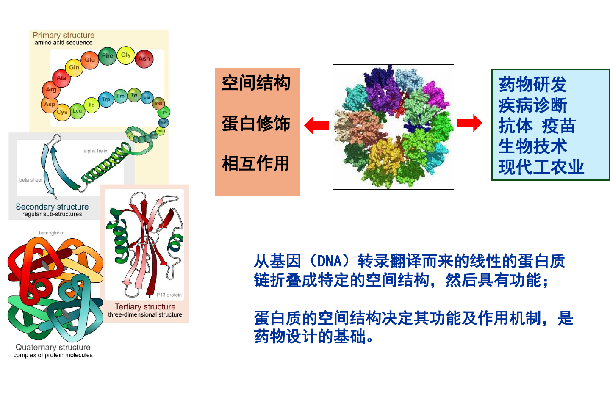
*▲ 课件原图（Slide 5）：从基因转录翻译的一维序列到一、二、三、四级空间结构，以及空间结构通过翻译后修饰与分子间相互作用决定生理功能与生物医药应用的总体逻辑（本地路径：`img/ch3_fig02_slide05_structure_determines_function.png`）*

- **核心范式（Slide 5）**：从基因（DNA）转录翻译而来的线性蛋白质多肽链，必须折叠成特定的三维空间结构（一级 $\to$ 二级 $\to$ 三级 $\to$ 四级结构），并在细胞内接受动态的**蛋白修饰（Post-translational modifications）**、介导特异性的**分子间相互作用（Interactions）**，从而行使生物学功能。掌握蛋白质的三维结构及其作用机制，是开展理性**药物研发、疾病诊断、抗体/疫苗工程、生物技术及现代工农业应用**的基石。

## 2. 第一节：蛋白质的分子组成和化学结构 (1. Molecular Component of Proteins, Slides 7–29)

### 2.1 蛋白质的生物学重要性与八大生理功能 (Slides 8–9)

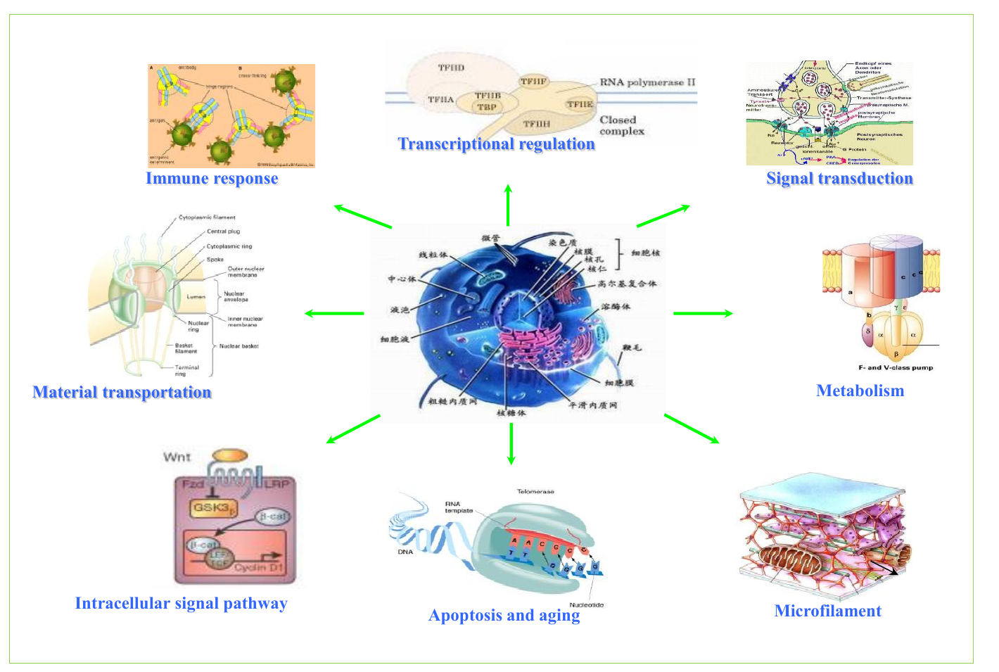
*▲ 课件原图（Slide 9）：蛋白质在活细胞内执行的八大类生物学功能全景示意（本地路径：`img/ch3_fig03_slide09_cellular_functions_panorama.png`）*

课件第 8–9 页系统总结了蛋白质在生命活动中的三大定位与八大具体功能：
1. **蛋白质是生物体主要的功能执行者**；
2. **蛋白质具有高度多样性的生物学功能**：
   - **(1) 生物催化剂**：**酶类（Enzymes）**，已知达 3000 种以上（如 RNA 聚合酶 II、激酶、代谢酶）；
   - **(2) 代谢调节作用**：**激素蛋白/多肽类激素**（如胰岛素、生长激素）；
   - **(3) 免疫保护作用（Immune response）**：**抗体（免疫球蛋白 Ig）**、补体与细胞因子；
   - **(4) 物质的转运和存储（Material transportation）**：如血液中运输氧气的**血红蛋白（Hb）**、肌肉中储存氧气的**肌红蛋白（Mb）**、转运脂类的**脂蛋白**、核孔复合物（Nuclear pore complex）及跨膜质子泵（F-/V-class ATPase pump）；
   - **(5) 运动与支持作用（Microfilament & Cytoskeleton）**：**肌动蛋白（Actin）**、肌球蛋白（Myosin）、微管蛋白（Tubulin）与胶原蛋白（Collagen）；
   - **(6) 控制生长、分化、凋亡与衰老（Transcriptional regulation, Apoptosis and aging）**：**核蛋白、组蛋白（Histones）**、转录因子（如 TFIID/TFIIB 复合物）及端粒酶（Telomerase）；
   - **(7) 参与细胞间与细胞内信息传递（Signal transduction & Intracellular signal pathway）**：如突触神经递质受体、跨膜受体（Wnt/Frizzled/LRP 通路、GPCR）；
   - **(8) 参与组成生物膜**：膜整合蛋白与外周膜蛋白；
3. **氧化供能**：在机体需要时，蛋白质亦可分解氧化提供生理能量。

### 2.2 蛋白质的元素组成与“$16\%$ 平均含氮量”定氮法则 (Slide 10)

> **定义与定量法则（蛋白质元素组成与凯氏定氮换算，Slide 10）**：
> - **主要元素**：所有蛋白质均含有 **碳（$\text{C}$，约 $50\%\text{–}55\%$）、氢（$\text{H}$，约 $6\%\text{–}7\%$）、氧（$\text{O}$，约 $19\%\text{–}24\%$）、氮（$\text{N}$，平均约 $16\%$）** 和 **硫（$\text{S}$，约 $0\%\text{–}4\%$，源自半胱氨酸和甲硫氨酸）**。
> - **微量元素**：有些结合蛋白含有少量**磷（$\text{P}$，如酪蛋白、磷酸化信号蛋白）**或金属元素**铁（$\text{Fe}$，血红蛋白/细胞色素）、铜（$\text{Cu}$）、锌（$\text{Zn}$，锌指蛋白/碳酸酐酶）、锰（$\text{Mn}$）、钴（$\text{Co}$）、钼（$\text{Mo}$）**，个别蛋白质还含有**碘（$\text{I}$，如甲状腺球蛋白）**。
> - **核心定量考点（凯氏定氮法基础）**：  
>   蛋白质是生物体内最主要的高分子含氮化合物，且各种不同蛋白质的含氮量非常接近，**平均含 $\text{N}$ 量为 $16\%$**！  
>   由此导出著名的**蛋白质换算系数 $6.25$**：每测出样品中含有 $1\text{ g}$ 蛋白氮，即代表样品中含有蛋白质：
>   $$\text{蛋白质含量} = \text{含氮量} \times \frac{100}{16} = \text{含氮量} \times \mathbf{6.25}$$

### 2.3 蛋白质的基本组成单位：$\text{L}-\alpha$-氨基酸的手性构型 (Slides 11–13)

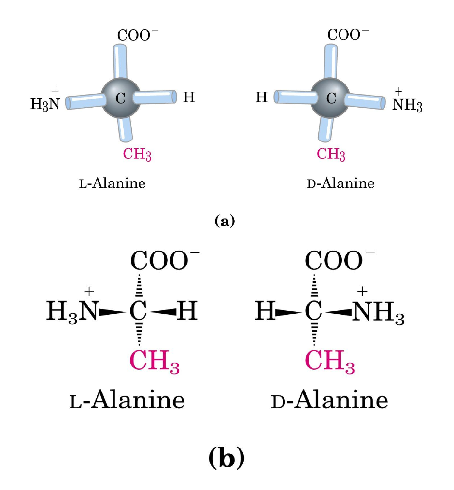
*▲ 课件原图（Slide 12）：L-丙氨酸（L-Alanine）与 D-丙氨酸（D-Alanine）的三维球棍模型与费歇尔/楔形投影式镜像对称关系（本地路径：`img/ch3_fig04_slide12_L_vs_D_alanine.png`）*

- **L-$\alpha$-氨基酸通式（Slides 11 & 13）**：
  - 自然界中已发现的氨基酸有 300 余种，但由遗传密码直接编码、参与合成人体蛋白质的标准氨基酸仅有 **20 种**。
  - **结构共性**：氨基（$-\text{NH}_3^+$）与羧基（$-\text{COO}^-$）、氢原子（$-\text{H}$）以及侧链基团（$-\text{R}$）共同连接在同一个与羧基直接相邻的碳原子——**$\alpha$-碳原子（$\text{C}_\alpha$）**上。
  - **手性特征（Chirality）**：除**甘氨酸（Glycine，$\text{R} = -\text{H}$）**因 $\text{C}_\alpha$ 连接两个相同的氢原子而**无手性碳原子（不具旋光性）**外，其余 19 种标准氨基酸的 $\text{C}_\alpha$ 均为不对称手性碳原子，且在天然蛋白质中**全部属于 $\text{L}-\alpha$-氨基酸**（在费歇尔投影式中，将 $-\text{COO}^-$ 置于上方、$-\text{R}$ 置于下方垂直轴时，$-\text{NH}_3^+$ 位于**左侧 Left** 即为 $\text{L}$-型；位于右侧即为 $\text{D}$-型）。

### 2.4 20 种标准氨基酸的五类分法、全参数对照表与特殊氨基酸精析 (Slides 14–20)

课件第 14–18 页根据 **$\text{R}$ 侧链的化学结构与理化性质（极性与酸碱解离带电状态）**，将 20 种标准氨基酸划分为以下五大类：

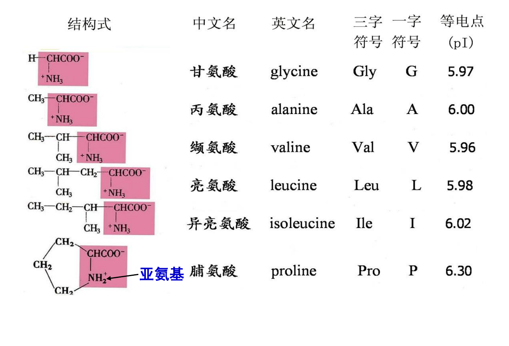
*▲ 课件原图（Slide 15）：(一) 侧链含烃链的非极性脂肪族氨基酸（Gly, Ala, Val, Leu, Ile, Pro）（本地路径：`img/ch3_fig05_slide15_nonpolar_aliphatic_aa.png`）*

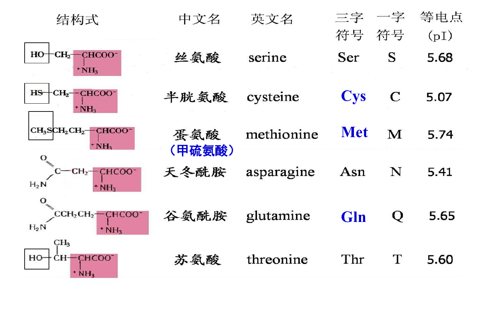
*▲ 课件原图（Slide 16）：(二) 侧链有极性但不带电荷的极性中性氨基酸（Ser, Cys, Met, Asn, Gln, Thr）（本地路径：`img/ch3_fig06_slide16_polar_uncharged_aa.png`）*

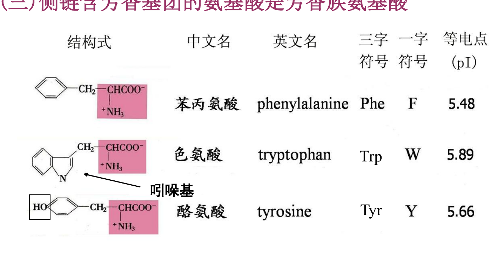
*▲ 课件原图（Slide 17）：(三) 侧链含芳香基团的芳香族氨基酸（Phe, Trp, Tyr）（本地路径：`img/ch3_fig07_slide17_aromatic_aa.png`）*

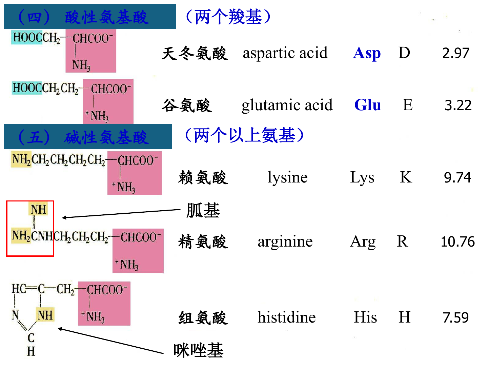
*▲ 课件原图（Slide 18）：(四) 酸性氨基酸（Asp, Glu）与 (五) 碱性氨基酸（Lys, Arg, His）（本地路径：`img/ch3_fig08_slide18_acidic_basic_aa.png`）*

#### 20 种标准氨基酸全参数与蛋白质设计角色速查总表（整合 Slides 14–20）

| 分类（课件五分法） | 中文名 | 英文名 | 三字母 | 单字母 | 等电点 ($\text{pI}$) | $\text{R}$ 侧链特征官能团与结构要点 | 在蛋白质结构与计算设计中的典型角色 |
| :--- | :--- | :--- | :--- | :--- | :--- | :--- | :--- |
| **(一) 非极性脂肪族氨基酸**<br>（6 种，Slide 15） | **甘氨酸** | Glycine | Gly | **G** | $5.97$ | $-\text{H}$（**唯一无手性碳**，体积最小） | 拉氏图允许区最广；构成紧密转角与 $\beta$-桶甘氨酸扭结（Glycine kink）；破坏 $\alpha$-螺旋稳定性 |
| | **丙氨酸** | Alanine | Ala | **A** | $6.00$ | $-\text{CH}_3$（甲基） | **$\alpha$-螺旋倾向性最高**的标准氨基酸；常用于丙氨酸扫描突变（Alanine scanning）检测热点残基 |
| | **缬氨酸** | Valine | Val | **V** | $5.96$ | $-\text{CH}(\text{CH}_3)_2$（异丙基，$\mathbf{\beta}$\textbf{-碳支链}） | 疏水核心紧密堆积主力；因 $\text{C}_\beta$ 支链位阻，**偏好形成 $\beta$-折叠** |
| | **亮氨酸** | Leucine | Leu | **L** | $5.98$ | $-\text{CH}_2\text{CH}(\text{CH}_3)_2$（异丁基，$\gamma$-支链） | 疏水核心与亮氨酸拉链（Leucine zipper $d$ 位）核心残基，强促 $\alpha$-螺旋形成 |
| | **异亮氨酸** | Isoleucine | Ile | **I** | $6.02$ | $-\text{CH}(\text{CH}_3)\text{CH}_2\text{CH}_3$（仲丁基，$\mathbf{\beta}$\textbf{-碳手性支链}） | 含第 2 个手性碳（$\text{C}_\beta$）；强疏水性，偏好 $\beta$-折叠与疏水核心 |
| | **脯氨酸** | Proline | Pro | **P** | $6.30$ | 侧链丙基环化连回主链 $\text{N}$ 形成**五元吡咯烷环（亚氨基）** | **“螺旋破坏者”**（主链 $\text{N}$ 无氢且 $\phi \approx -60^\circ$ 锁定）；**常位于 $\beta$-转角第 2 位**；唯一易发生顺式（*cis*）肽键的残基 |
| **(二) 极性中性氨基酸**<br>（6 种，Slide 16） | **丝氨酸** | Serine | Ser | **S** | $5.68$ | $-\text{CH}_2\text{OH}$（伯醇羟基） | 氢键供/受体；丝氨酸蛋白酶催化三联体亲核残基；激酶磷酸化位点 |
| | **半胱氨酸** | Cysteine | Cys | **C** | $5.07$ | $-\text{CH}_2\text{SH}$（**巯基 Sulfhydryl**） | 两个 $-\text{SH}$ 氧化脱氢形成共价**二硫键（$-\text{S}-\text{S}-$，胱氨酸）**；配位 $\text{Zn}^{2+}$（锌指）与铁硫簇 |
| | **蛋氨酸**<br>（甲硫氨酸） | Methionine | Met | **M** | $5.74$ | $-\text{CH}_2\text{CH}_2\text{SCH}_3$（甲硫醚基，实质偏疏水） | 翻译起始氨基酸；侧链硫醚柔性高，常填充疏水核心空隙（如视黄醇结合口袋） |
| | **天冬酰胺** | Asparagine | Asn | **N** | $5.41$ | $-\text{CH}_2\text{CONH}_2$（$\beta$-酰胺基） | 双功能氢键供/受体；$\alpha$-螺旋 N 端封端（N-capping）；N-连接糖基化位点 |
| | **谷氨酰胺** | Glutamine | Gln | **Q** | $5.65$ | $-\text{CH}_2\text{CH}_2\text{CONH}_2$（$\gamma$-酰胺基） | 亲水表面极性氢键网络；PolyQ 异常扩增可引发亨廷顿舞蹈病淀粉样聚集 |
| | **苏氨酸** | Threonine | Thr | **T** | $5.60$ | $-\text{CH}(\text{OH})\text{CH}_3$（仲醇羟基，$\mathbf{\beta}$\textbf{-碳手性支链}） | 含第 2 个手性碳；兼具极性氢键能力与 $\beta$-折叠偏好；磷酸化修饰位点 |
| **(三) 芳香族氨基酸**<br>（3 种，Slide 17） | **苯丙氨酸** | Phenylalanine | Phe | **F** | $5.48$ | $-\text{CH}_2-\text{C}_6\text{H}_5$（苯甲基，强疏水） | 疏水核心芳香环 $\pi-\pi$ 堆积；紫外吸收极弱（$257\text{ nm}$） |
| | **色氨酸** | Tryptophan | Trp | **W** | $5.89$ | 含双环**吲哚基（Indole group）** | 体积最大；**$280\text{ nm}$ 紫外吸收与内源荧光最强**；吲哚 $-\text{NH}$ 可作氢键供体 |
| | **酪氨酸** | Tyrosine | Tyr | **Y** | $5.66$ | $-\text{CH}_2-\text{C}_6\text{H}_4\text{OH}$（酚羟基） | 兼具芳香堆积与酚羟基氢键能力；具 **$280\text{ nm}$ 紫外吸收**；酪氨酸激酶磷酸化位点 |
| **(四) 酸性氨基酸**<br>（2 种，两个羧基，Slide 18） | **天冬氨酸** | Aspartic acid | Asp | **D** | $2.97$ | $-\text{CH}_2\text{COO}^-$（$\beta$-羧基，生理 $\text{pH}$ 带 $-1$ 电荷） | 形成表面盐桥、配位 $\text{Ca}^{2+}/\text{Mg}^{2+}$（如 EF-hand）、构成酶催化三联体 |
| | **谷氨酸** | Glutamic acid | Glu | **E** | $3.22$ | $-\text{CH}_2\text{CH}_2\text{COO}^-$（$\gamma$-羧基，带 $-1$ 电荷） | 强亲水负电表面残基；HbA $\beta 6$ 位残基（突变为 Val 即引发镰刀形贫血） |
| **(五) 碱性氨基酸**<br>（3 种，两个以上氨基，Slide 18） | **赖氨酸** | Lysine | Lys | **K** | $9.74$ | $-(\text{CH}_2)_4\text{NH}_3^+$（$\varepsilon$-伯氨基，带 $+1$ 电荷） | 长柔性烃链末端带正电；形成盐桥；泛素化、乙酰化、甲基化核心修饰位点 |
| | **精氨酸** | Arginine | Arg | **R** | $10.76$ | 含平面共轭**胍基（Guanidinium group）**（碱性最强，带 $+1$ 电荷） | 胍基可同时形成多达 5 个定向氢键与双齿盐桥，常用于识别磷酸基团（如 cAMP/DNA）及阳离子-$\pi$ 相互作用 |
| | **组氨酸** | Histidine | His | **H** | $7.59$ | 含五元芳杂环**咪唑基（Imidazole group）**（$\text{pK}_R \approx 6.0$） | **唯一在生理 $\text{pH } 7.0$ 附近可逆解离的氨基酸**（既可作质子受体又可作供体）；血红蛋白 His F8 配位 $\text{Fe}^{2+}$ 及锌指配位 $\text{Zn}^{2+}$ |

#### 几种特殊氨基酸的重点剖析（Slides 19–20）：

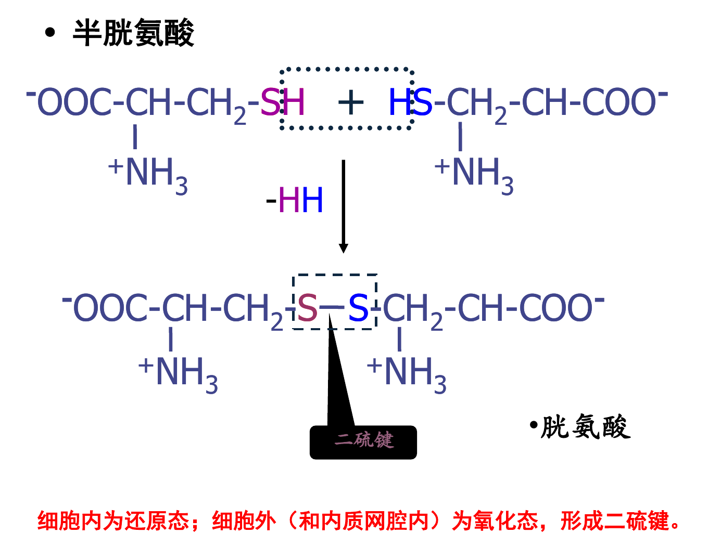
*▲ 课件原图（Slide 20）：两个半胱氨酸（Cysteine）的巯基（$-\text{SH}$）脱氢（$-2\text{H}$）形成二硫键（$-\text{S}-\text{S}-$）生成胱氨酸（Cystine）及其细胞内外氧化还原区室化规律（本地路径：`img/ch3_fig09_slide20_cysteine_disulfide_bond.png`）*

1. **甘氨酸（Gly）**：$\text{R} = -\text{H}$，唯一**无手性碳原子**的氨基酸，空间位阻最小，允许主链采取其他氨基酸被禁止的 $(\phi, \psi)$ 角度（如左手螺旋区）。
2. **脯氨酸（Pro）**：唯一**环状亚氨基酸（Imino acid）**，侧链丙基回环共价连接在主链 $\alpha$-氨基氮原子上，导致：① 成肽后主链 $\text{N}$ 上没有氢原子，无法作为氢键供体；② 五元环刚性约束使主链 $\phi$ 角固定在约 $-60^\circ$，成为天然的“$\alpha$-螺旋破坏者”与“$\beta$-转角形成者”。
3. **半胱氨酸（Cys）与二硫键（Disulfide bond，Slide 20）**：
   - 两分子半胱氨酸的巯基（$-\text{SH}$）氧化脱去两个氢原子（$-2\text{H}$），通过共价**二硫键（$-\text{S}-\text{S}-$）**相连成为一分子**胱氨酸（Cystine）**。
   - **细胞区室化铁律（必考细节，Slide 20 红字）**：由于细胞质内含有高浓度的还原型谷胱甘肽（$\text{GSH}/\text{GSSG} > 100$），**细胞质内（Intracellular cytosol）的蛋白质半胱氨酸通常处于还原态（游离 $-\text{SH}$）**；而在**细胞外（Extracellular）以及真核细胞内质网腔（ER lumen）和细菌周质空间（Periplasm）**中，环境呈氧化性，半胱氨酸氧化形成共价**二硫键（$-\text{S}-\text{S}-$）**，起到交联锁死三级和四级结构、抵御胞外蛋白酶降解和热变性的作用！

### 2.5 氨基酸的三大理化性质 (Slides 21–23)

#### (1) 两性解离与等电点 ($\text{pI}$，Slide 21)

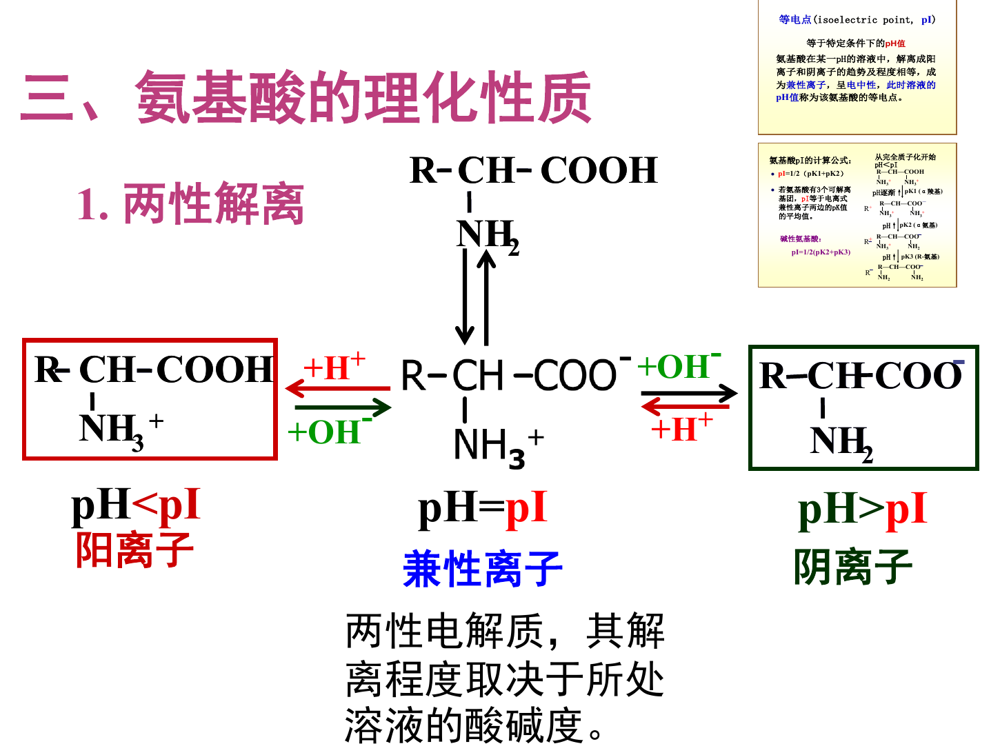
*▲ 课件原图（Slide 21）：氨基酸在不同溶液 pH 下的两性解离平衡（阳离子 $\rightleftharpoons$ 兼性离子 $\rightleftharpoons$ 阴离子）及等电点 $\text{pI}$ 的计算公式（本地路径：`img/ch3_fig10_slide21_aa_zwitterion_pI.png`）*

> **定义与公式（氨基酸的两性解离与等电点 Isoelectric Point, $\text{pI}$，Slide 21）**：
> - **两性电解质（Amphoteric electrolyte）**：氨基酸既含酸性基团（$-\text{COOH}$）又含碱性基团（$-\text{NH}_2$），在溶液中可根据环境 $\text{pH}$ 发生质子得失：
>   $$\underset{\text{pH} < \text{pI} \text{（阳离子，净电荷 } > 0\text{）}}{\text{H}_3\overset{+}{\text{N}}-\text{CH}(\text{R})-\text{COOH}} \underset{+\text{H}^+}{\overset{+\text{OH}^- \ (\text{pK}_1)}{\rightleftharpoons}} \underset{\text{pH} = \text{pI} \text{（兼性离子 Zwitterion，净电荷 } = 0\text{）}}{\text{H}_3\overset{+}{\text{N}}-\text{CH}(\text{R})-\text{COO}^-} \underset{+\text{H}^+}{\overset{+\text{OH}^- \ (\text{pK}_2)}{\rightleftharpoons}} \underset{\text{pH} > \text{pI} \text{（阴离子，净电荷 } < 0\text{）}}{\text{H}_2\text{N}-\text{CH}(\text{R})-\text{COO}^-}$$
> - **等电点 ($\text{pI}$) 定义**：在某一特定 $\text{pH}$ 的溶液中，氨基酸解离成阳离子和阴离子的趋势及程度完全相等，成为净电荷为零、在电场中不发生迁移的电中性**兼性离子（Zwitterion）**，此时溶液的 $\text{pH}$ 值称为该氨基酸的**等电点 ($\text{pI}$)**。
> - **等电点 $\text{pI}$ 计算法则（必考计算公式）**：
>   1. **仅含两个可解离基团的中性氨基酸**：
>      $$\text{pI} = \frac{1}{2}(\text{pK}_1 + \text{pK}_2)$$
>   2. **含有三个可解离基团的酸性或碱性氨基酸**：**$\text{pI}$ 严格等于电离平衡式中“电中性兼性离子（净电荷为 0 的物种）”左右两侧紧邻的两个 $\text{pK}$ 值的算术平均值！**
>      - **酸性氨基酸（Asp, Glu，侧链含羧基 $\text{pK}_R$，按酸性强弱排序 $\text{pK}_1 < \text{pK}_R < \text{pK}_2$）**：  
>        完全质子化时带 $+1$ 电荷 $\xrightarrow{\text{pK}_1 (\alpha\text{-羧基})}$ **兼性离子（$0$ 价）** $\xrightarrow{\text{pK}_R (\text{R-羧基})}$ $-1$ 价 $\xrightarrow{\text{pK}_2 (\alpha\text{-氨基})}$ $-2$ 价。故：
>        $$\text{pI}_{\text{酸性}} = \frac{1}{2}(\text{pK}_1 + \text{pK}_R)$$
>      - **碱性氨基酸（Lys, Arg, His，侧链含碱性氮 $\text{pK}_3$，按解离顺序 $\text{pK}_1 < \text{pK}_2 < \text{pK}_3$）**：  
>        完全质子化时带 $+2$ 电荷 $\xrightarrow{\text{pK}_1 (\alpha\text{-羧基})}$ $+1$ 价 $\xrightarrow{\text{pK}_2 (\alpha\text{-氨基})}$ **兼性离子（$0$ 价）** $\xrightarrow{\text{pK}_3 (\text{R-氨基})}$ $-1$ 价。故：
>        $$\text{pI}_{\text{碱性}} = \frac{1}{2}(\text{pK}_2 + \text{pK}_3)$$

#### (2) 芳香族氨基酸的紫外吸收性质 (Slide 22)

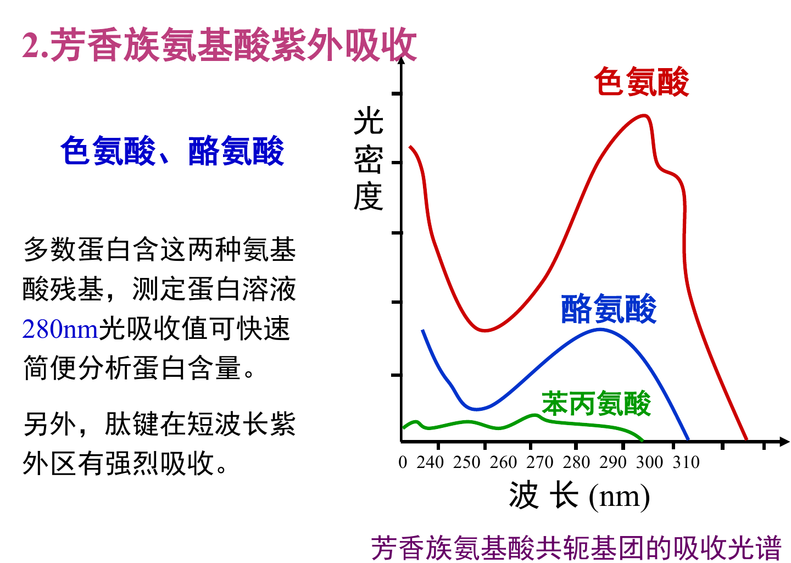
*▲ 课件原图（Slide 22）：色氨酸（Trp）、酪氨酸（Tyr）与苯丙氨酸（Phe）在紫外区的吸收光谱对比（本地路径：`img/ch3_fig11_slide22_uv_absorption_280nm.png`）*

- **吸收峰特征**：构成蛋白质的 20 种氨基酸中，唯有三种芳香族氨基酸（**色氨酸 Trp、酪氨酸 Tyr、苯丙氨酸 Phe**）因其侧链含有共轭双键芳香环体系而具有近紫外光吸收能力。其中**色氨酸（Trp，含吲哚环）**和**酪氨酸（Tyr，含酚羟基）**在 **$280\text{ nm}$** 波长附近有强烈的特征紫外吸收峰（$\text{Trp} \gg \text{Tyr} \gg \text{Phe}$，苯丙氨酸在 $257\text{ nm}$ 处吸收极弱）。
- **实际应用**：由于绝大多数蛋白质都含有色氨酸和酪氨酸残基，利用分光光度计测定蛋白质溶液在 **$280\text{ nm}$ 处的吸光度（$A_{280}$ / $\text{OD}_{280}$）**，结合朗伯-比尔定律（$A = \varepsilon c l$），即可快速、无损、简便地定量分析蛋白质浓度。此外，多肽主链的**肽键（酰胺键）在远紫外区（$190\text{–}220\text{ nm}$）**具有极强吸收。

#### (3) 茚三酮反应 (Ninhydrin Reaction, Slide 23)

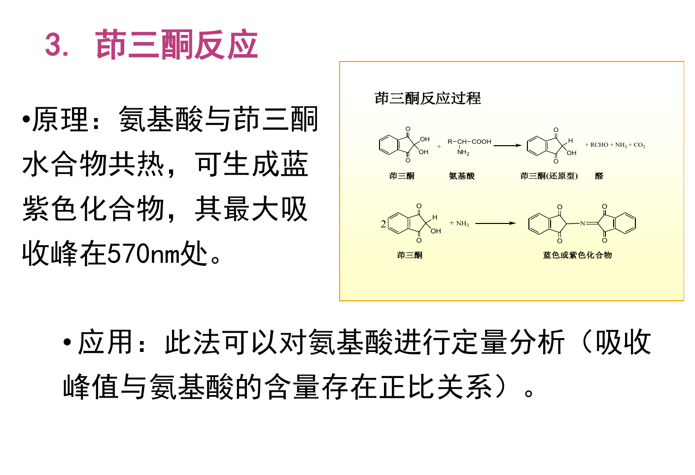
*▲ 课件原图（Slide 23）：氨基酸与水合茚三酮共热脱氨脱羧生成蓝紫色化合物（570 nm 吸收峰）的化学反应方程式（本地路径：`img/ch3_fig12_slide23_ninhydrin_reaction.png`）*

- **化学原理**：$\alpha$-氨基酸与水合茚三酮（Ninhydrin hydrate）弱酸性水溶液共热时，氨基酸被氧化脱氨、脱羧生成相应的醛（$\text{RCHO}$）、$\text{CO}_2$ 和游离 $\text{NH}_3$，水合茚三酮则被还原为还原型茚三酮；随后 $\text{NH}_3$ 与一分子还原型茚三酮和另一分子水合茚三酮缩合，生成**蓝紫色化合物（Ruhemann's purple）**，其最大吸收峰位于 **$570\text{ nm}$** 处（注：脯氨酸因系亚氨基酸，与茚三酮反应生成黄色化合物，最大吸收峰在 $440\text{ nm}$）。
- **应用**：$570\text{ nm}$ 处的吸光度峰值与样品中游离 $\alpha$-氨基酸的含量成正比，广泛用于氨基酸自动分析仪与薄层色谱的定性定量检测。

### 2.6 肽键、多肽链方向性与生物活性肽——谷胱甘肽 (GSH, Slides 24–27)

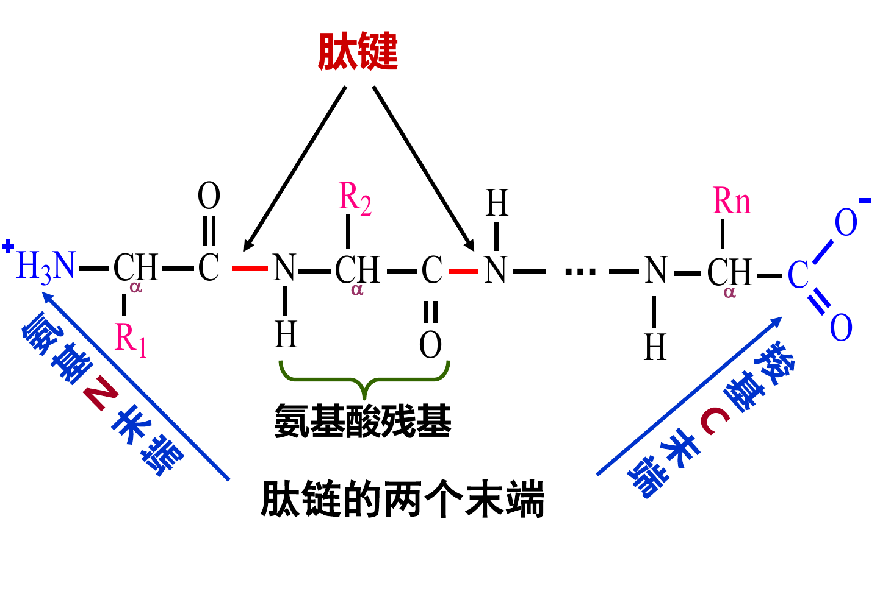
*▲ 课件原图（Slide 25）：多肽链的主链结构、肽键位置、氨基酸残基定义以及氨基 N 末端与羧基 C 末端方向性（本地路径：`img/ch3_fig13_slide25_polypeptide_backbone_termini.png`）*

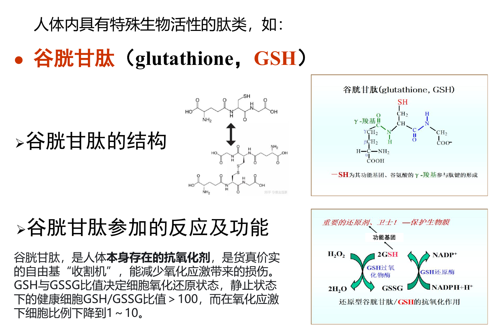
*▲ 课件原图（Slide 27）：谷胱甘肽（GSH）的化学结构（$\gamma$-谷氨酰半胱氨酰甘氨酸）及其通过 GSH 过氧化物酶与 GSH 还原酶清除过氧化氢（$\text{H}_2\text{O}_2$）的氧化还原循环（本地路径：`img/ch3_fig14_slide27_glutathione_GSH_GSSG.png`）*

1. **肽键（Peptide bond）与多肽链方向性（Slides 24–26）**：
   - **肽键形成**：由一个氨基酸的 **$\alpha$-羧基**与另一个氨基酸的 **$\alpha$-氨基**脱水缩合（脱去一分子 $\text{H}_2\text{O}$）而形成的共价**酰胺键（$-\text{CO}-\text{NH}-$）**。
   - **氨基酸残基（Amino acid residue）**：肽链中的氨基酸分子因脱水缩合失去一分子水而基团不全，称为氨基酸残基。$N$ 个氨基酸缩合形成 $N$ 肽，含有 $N - 1$ 个肽键。
   - **方向性约定**：多肽链有严格的两端——带有游离 $\alpha$-氨基的一端称为 **N 末端（Amino terminus / N-terminus，书写在左侧，编号第 1 位）**，带有游离 $\alpha$-羧基的一端称为 **C 末端（Carboxyl terminus / C-terminus，书写在右侧，编号第 $n$ 位）**。
2. **生物活性肽代表——谷胱甘肽（Glutathione, GSH，Slide 27 必考细节）**：
   - **化学组成与特殊异肽键**：GSH 是由**谷氨酸（Glu）、半胱氨酸（Cys）和甘氨酸（Gly）**缩合而成的三肽，化学全称为 **$\gamma$-谷氨酰半胱氨酰甘氨酸**。**特别注意**：第一个肽键是由谷氨酸侧链的 **$\gamma$-羧基**（而非普通蛋白质中的 $\alpha$-羧基！）与半胱氨酸的 $\alpha$-氨基缩合而成的，这种特殊的 $\gamma$-肽键使其能抵御细胞内普通肽酶的水解！
   - **核心功能基团与氧化还原循环**：
     - **功能基团**：半胱氨酸残基上的游离**巯基（$-\text{SH}$）**（因此还原型谷胱甘肽常简写为 **$\text{G}-\text{SH}$**）。
     - **抗氧化机制（自由基“收割机”与生物膜卫士）**：两分子还原型 $\text{GSH}$ 在 **$\text{GSH}$ 过氧化物酶（Glutathione peroxidase）**催化下，将有毒的过氧化氢（$\text{H}_2\text{O}_2$）或脂质过氧化物还原为无害的 $2\text{H}_2\text{O}$，自身通过二硫键交联转化为氧化型谷胱甘肽（**$\text{GSSG}$**）；随后在 **$\text{GSH}$ 还原酶（Glutathione reductase）**催化下，利用磷酸戊糖途径产生的 **$\text{NADPH} + \text{H}^+$** 将 $\text{GSSG}$ 重新还原为 $2\text{GSH}$。
     - **定量生理指标**：$\text{GSH}/\text{GSSG}$ 比值直接决定细胞的氧化还原状态——在正常静息状态的健康细胞中 **$\text{GSH}/\text{GSSG} > 100$**；而在氧化应激（Oxidative stress）状态下，该比值急剧下降至 **$1\text{–}10$**。

### 2.7 蛋白质的一级结构 (Primary Structure) 与序列数据库 (Slides 28–29)

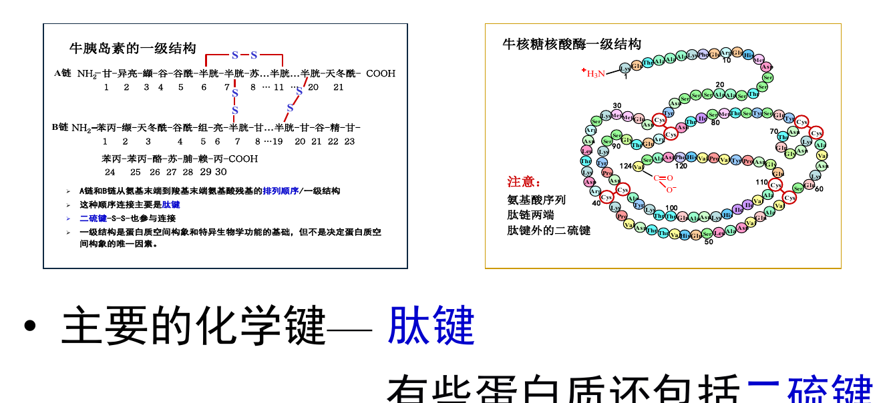
*▲ 课件原图（Slide 28）：牛胰岛素（A 链 21 aa + B 链 30 aa，含 2 对链间二硫键与 1 对链内二硫键）与牛核糖核酸酶 A（单链 124 aa，含 4 对链内二硫键）的一级结构图（本地路径：`img/ch3_fig15_slide28_insulin_rnaseA_primary_structure.png`）*

- **定义（Slide 28）**：蛋白质的一级结构是指多肽链中**从 N 端到 C 端氨基酸残基的排列顺序**。
- **维持一级结构的化学键**：主要是共价**肽键**，在某些蛋白质中还包括所有共价**二硫键（$-\text{S}-\text{S}-$）的位置**（例如牛胰岛素由 21 残基的 A 链和 30 残基的 B 链组成，含 `A6-A11` 链内二硫键及 `A7-B7`、`A20-B19` 两对链间二硫键；牛核糖核酸酶 A 含 124 个残基及 4 对链内二硫键）。
- **四大国际蛋白质序列（一级结构）数据库（Slide 29）**：
  1. **UniProt** ([http://www.uniprot.org](https://www.uniprot.org/))：全球最权威、最全面的蛋白质序列与功能注释知识库（整合了人工审阅的 Swiss-Prot、自动注释的 TrEMBL 与 PIR）；
  2. **EMBL**（European Molecular Biology Laboratory Data Library，欧洲分子生物学实验室数据库）；
  3. **GenBank**（美国国家生物技术信息中心 NCBI 维护的基因与翻译蛋白序列库）；
  4. **PIR**（Protein Identification Resource Sequence Database，由 Margaret Dayhoff 创立的早期蛋白质序列库）。

## 3. 第二节：蛋白质的空间结构 (2. The Molecular Structure of Protein, Slides 30–62)

### 3.1 二级结构的基础：肽单元 (Peptide Unit) 平面与主链二面角 (Slides 33–36)

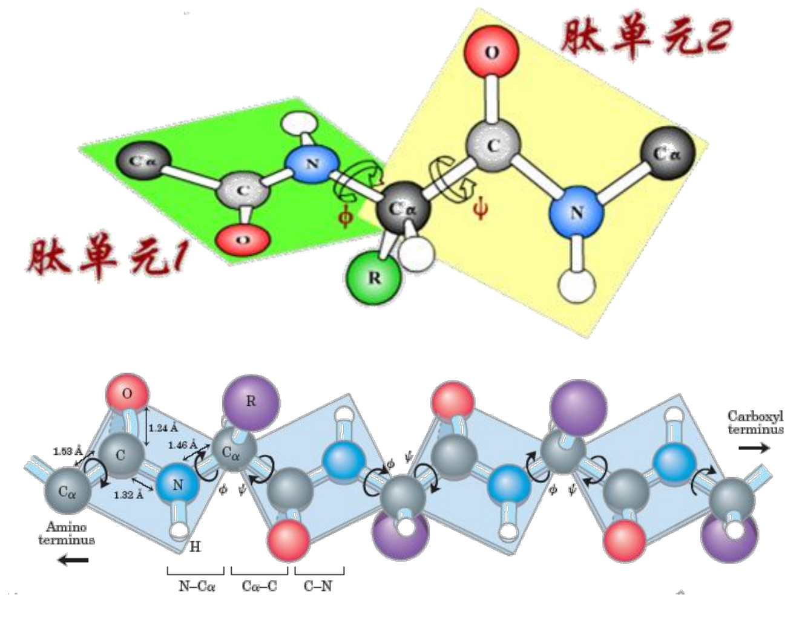
*▲ 课件原图（Slide 35）：两个相邻刚性肽单元（酰胺平面）围绕共用 $\text{C}_\alpha$ 原子的单键旋转角 $\phi$（$\text{N}-\text{C}_\alpha$ 键）与 $\psi$（$\text{C}_\alpha-\text{C}$ 键）及精确共价键长参数（本地路径：`img/ch3_fig16_slide35_peptide_planes_phi_psi.png`）*

> **定义与几何性质（二级结构 Secondary Structure 与肽单元 Peptide Unit，Slides 33–35）**：
> - **二级结构定义（三个关键词：主链、肽段、局部）**：指蛋白质分子中某一段肽链的**局部空间结构**，即该段肽链**主链骨架原子（Main-chain backbone atoms）的相对空间位置，不涉及 $\text{R}$ 侧链的构象**。主要维系化学键为**主链氢键**。
> - **肽单元（Peptide unit / 肽键平面 / 酰胺平面，Slide 34）**：参与组成肽键的 **6 个原子（$\text{C}_{\alpha 1}, \text{C}, \text{O}, \text{N}, \text{H}, \text{C}_{\alpha 2}$）**位于同一个刚性平面上。
>   - **部分双键性质**：标准 $\text{C}-\text{N}$ 单键键长为 $0.149\text{ nm}$（$1.49\text{ \AA}$），$\text{C=N}$ 双键键长为 $0.127\text{ nm}$（$1.27\text{ \AA}$），而蛋白质中肽键（$\text{C}-\text{N}$）的实际键长为 **$0.132\text{ nm}$（$1.32\text{ \AA}$）**（同时羰基 $\text{C=O}$ 键长由 $1.21\text{ \AA}$ 略微拉长至 $1.24\text{ \AA}$）。这表明氮原子的孤对电子与羰基 $\pi$ 键发生了 **$p-\pi$ 共轭离域**，赋予肽键约 $40\%$ 的**部分双键性质，因此肽键不能自由旋转**！
>   - **反式构型（*trans* configuration）**：肽平面上的羰基氧（$\text{O}$）与酰胺氢（$\text{H}$）以及两个相邻的 $\text{C}_\alpha$ 原子绝大多数呈对角线**反式排列（$\omega \approx 180^\circ$）**，以避免相邻残基 $\text{C}_\alpha$ 及 $\text{R}$ 侧链之间的空间位阻碰撞。
>   - **主链自由度 $(\phi, \psi)$**：整条多肽主链可视为由一连串刚性肽平面通过共用的 $\text{C}_\alpha$ 铰链连接而成，仅能围绕 $\text{N}-\text{C}_\alpha$ 单键（键长 $1.46\text{ \AA}$，旋转角记为 **$\phi$**）和 $\text{C}_\alpha-\text{C}$ 单键（键长 $1.53\text{ \AA}$，旋转角记为 **$\psi$**）自由旋转。

### 3.2 $\alpha$-螺旋 ($\alpha$-Helix) 与螺旋家族 ($\alpha, 3_{10}, \pi$) 参数对比及影响因素 (Slides 37–40)

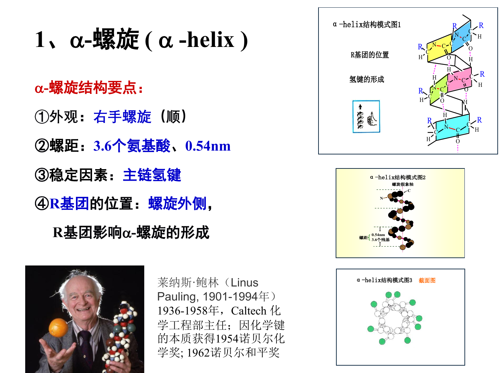
*▲ 课件原图（Slide 37）：Linus Pauling（1954 诺贝尔化学奖）提出的右手 $\alpha$-螺旋结构要点、螺距参数、氢键模式与俯视截面图（本地路径：`img/ch3_fig17_slide37_alpha_helix_pauling.png`）*

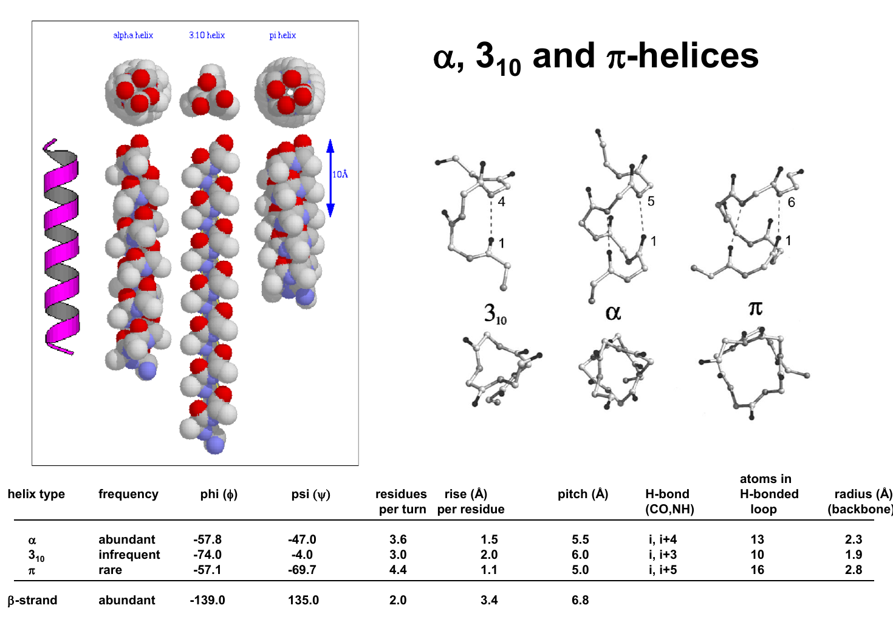
*▲ 课件原图（Slide 38）：三种多肽螺旋（$\alpha$-helix, $3_{10}$-helix, $\pi$-helix）的三维原子模型、氢键闭合环原子数与全套几何参数对比表（本地路径：`img/ch3_fig18_slide38_helix_types_comparison_table.png`）*

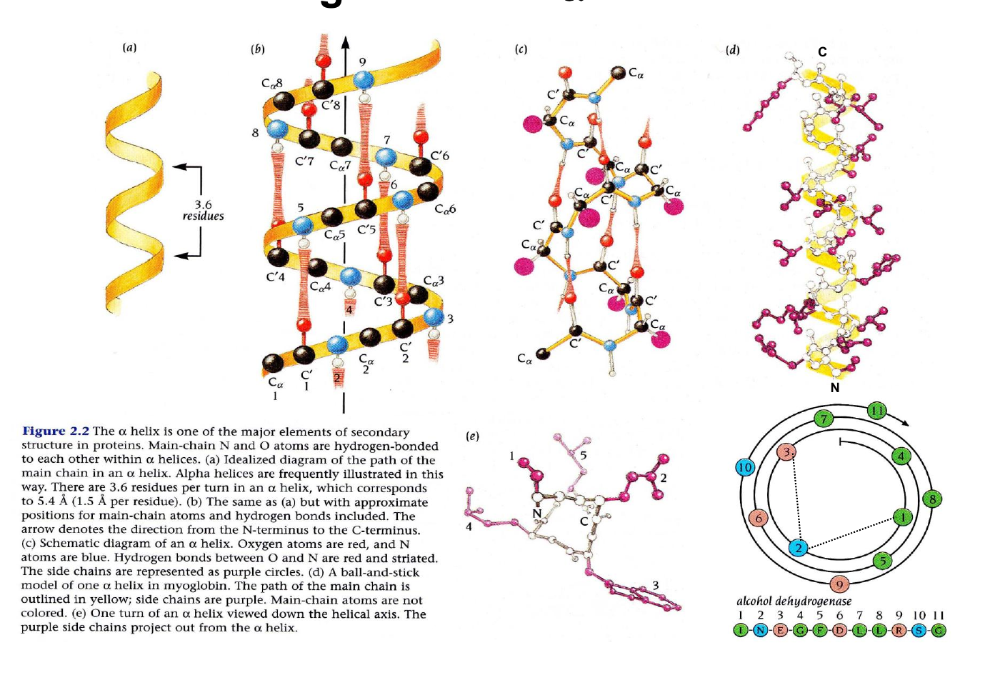
*▲ 课件原图（Slide 39）：右手 $\alpha$-螺旋的N$\to$C端走向、球棍模型、俯视图及乙醇脱氢酶螺旋轮（Helical wheel，每残基旋转 $100^\circ$）两亲性分布图（本地路径：`img/ch3_fig19_slide39_right_handed_alpha_helix_wheel.png`）*

#### (1) 标准 $\alpha$-螺旋（$3.6_{13}$-Helix）的四大结构要点（Slide 37，必背！）
1. **旋转方向**：天然蛋白质中的 $\alpha$-螺旋几乎全为**右手螺旋（Right-handed helix）**（用右手握拳，大拇指指向螺旋上升方向，四指弯曲方向即为多肽链顺时针盘旋方向）；
2. **几何尺寸参数**：每旋转一圈包含 **$3.6$ 个氨基酸残基**，螺距（Pitch）为 **$0.54\text{ nm}$（$5.4\text{–}5.5\text{ \AA}$）**；因此每个氨基酸残基沿螺旋轴上升的高度（Rise per residue）为 $0.54\text{ nm} / 3.6 = \mathbf{0.15\text{ nm} \ (1.5\text{ \AA})}$，每个残基绕轴旋转角度为 $360^\circ / 3.6 = \mathbf{100^\circ}$；
3. **稳定化学键（主链氢键）**：第 $i$ 个氨基酸残基的主链羰基氧（$-\text{C=O}$）与沿着序列向 C 端方向第 **$i+4$** 个残基的主链氨基氢（$-\text{N-H}$）形成氢键；由该氢键闭合形成的环状结构共包含 **13 个主链原子**（因此 $\alpha$-螺旋在晶体学命名法中记为 **$3.6_{13}$-螺旋**）。所有主链氢键均与螺旋长轴近乎平行排列，且所有 $\text{C=O}$ 均指向 C 端、所有 $\text{N-H}$ 均指向 N 端，叠加形成一个N端带部分正电（$\delta^+$）、C端带部分负电（$\delta^-$）的**螺旋宏偶极（Helix macrodipole）**；
4. **$\text{R}$ 侧链位置**：所有氨基酸的 $\text{R}$ 侧链均伸向螺旋圆柱体的**外侧**（螺旋中心内部由主链紧密填充，不留空腔）。

#### (2) 三种螺旋（$\alpha, 3_{10}, \pi$）与 $\beta$-折叠股几何参数完整对照表（Slide 38 原表整理）

| 二级结构类型 (Helix / Strand type) | 自然界出现频率 (Frequency) | 主链二面角 $\phi$ ($\text{deg}$) | 主链二面角 $\psi$ ($\text{deg}$) | 每圈残基数 (Residues per turn, $n$) | 单残基上升高度 (Rise per residue, $\text{\AA}$) | 螺距 (Pitch, $\text{\AA}$) | 氢键配对模式 ($\text{CO} \cdots \text{HN}$) | 氢键闭合环内原子数 (Atoms in loop) | 主链半径 (Radius, $\text{\AA}$) |
| :--- | :--- | :--- | :--- | :--- | :--- | :--- | :--- | :--- | :--- |
| **$\alpha$-螺旋 ($\alpha$-helix, $3.6_{13}$)** | **极丰富 (abundant)** | $-57.8^\circ$ | $-47.0^\circ$ | **$3.6$** | **$1.5$** | **$5.5$** ($5.4$) | **$i \to i+4$** | **$13$** | $2.3$ |
| **$3_{10}$-螺旋 ($3_{10}$-helix)** | 较少见 (infrequent，常在 $\alpha$-螺旋末端短片段) | $-74.0^\circ$ | $-4.0^\circ$ | **$3.0$** | **$2.0$** | **$6.0$** | **$i \to i+3$** | **$10$** | $1.9$（过紧，存在轻微位阻） |
| **$\pi$-螺旋 ($\pi$-helix, $4.4_{16}$)** | 极罕见 (rare) | $-57.1^\circ$ | $-69.7^\circ$ | **$4.4$** | **$1.1$** | **$5.0$** | **$i \to i+5$** | **$16$** | $2.8$（过宽，中心出现空洞损失范德华力） |
| **$\beta$-折叠股 ($\beta$-strand)** | **极丰富 (abundant)** | $-139.0^\circ$ | $+135.0^\circ$ | **$2.0$** | **$3.4$** | **$6.8$** | 股间氢键 | — | — |

> **【深度补充解释 1：为什么自然界偏爱 $\alpha$-螺旋，而 $3_{10}$-螺旋和 $\pi$-螺旋却很少见？】**  
> 从 Slide 38 的参数表可以看出物理原因：
> - **$\alpha$-螺旋（$3.6_{13}$）**处于几何与能量的“黄金甜点（Sweet spot）”：$i \to i+4$ 氢键几乎呈完美的 $180^\circ$ 线性排列，且半径 $2.3\text{ \AA}$ 使得螺旋内部主链原子恰好实现紧密范德华接触（既无碰撞也无空洞）。
> - **$3_{10}$-螺旋**太瘦（半径仅 $1.9\text{ \AA}$），主链原子略微拥挤且 $i \to i+3$ 氢键呈一定弯折角，能量略高，因此通常只在 $\alpha$-螺旋的 N/C 末端出现 1 圈作为过渡。
> - **$\pi$-螺旋（$4.4_{16}$）**太胖（半径达 $2.8\text{ \AA}$），导致螺旋轴中心出现一个既放不进水分子、又无法形成紧密范德华接触的轴向空腔（违反了稳定结构黄金法则第 2 条 *Not create internal cavities*），同时每形成一圈需要固定 4.4 个残基，构象熵损失更大。

#### (3) 影响 $\alpha$-螺旋稳定的四大不利因素（Slide 40，必考简答题）
1. **酸性或碱性氨基酸集中的区域**：在生理 $\text{pH}$ 下，连续的谷氨酸/天冬氨酸（带负电）或连续的赖氨酸/精氨酸（带正电）会产生强烈的**同种电荷静电排斥**，破坏螺旋稳定性；
2. **较大的 $\text{R}$ 侧链（或 $\text{C}_\beta$ 支链残基如 Val, Ile, Thr）集中**：相邻大侧链之间产生强烈的**空间位阻效应（Steric clash）**，不利于 $\alpha$-螺旋形成；
3. **脯氨酸（Proline）**：属环状**亚氨基酸**，成肽后主链 $\text{N}$ 上缺乏氢原子无法形成 $i \to i+4$ 氢键，且五元环锁死 $\phi$ 角，迫使螺旋中断或产生约 $30^\circ$ 弯折（Helix breaker）；
4. **甘氨酸（Glycine）**：**无侧链（$\text{R} = -\text{H}$）**，主链构象极其柔顺，将其固定为单一 $\alpha$-螺旋构象需要付出巨大的构象熵代价，极易导致螺旋发生柔性扭转或解旋。

### 3.3 $\beta$-折叠 ($\beta$-Pleated Sheet) 与左手扭曲法则 (Slides 41–43, 54)

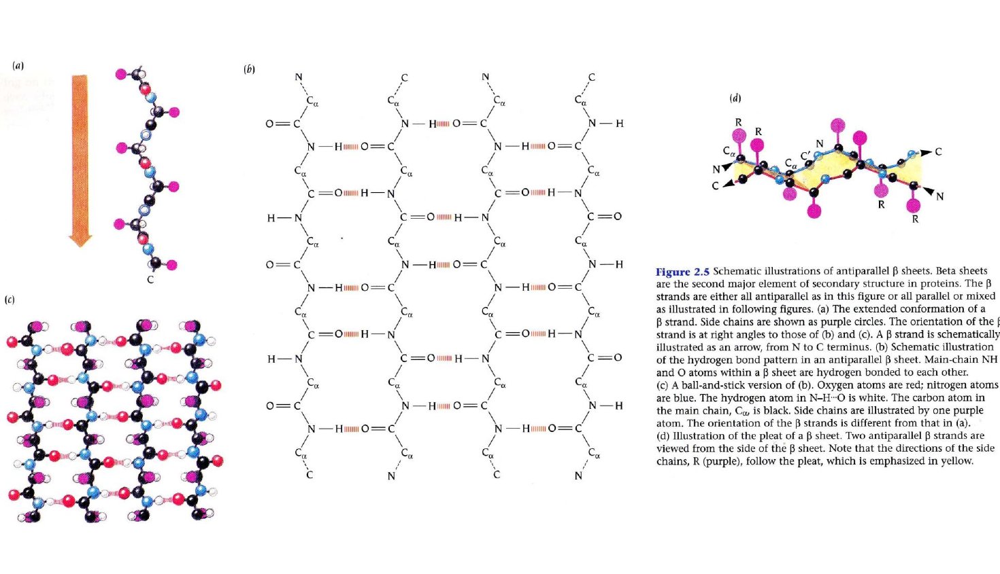
*▲ 课件原图（Slide 42）：反平行 $\beta$-折叠（Anti-parallel $\beta$-sheet）的N$\to$C走向、平直氢键网络与侧面折纸锯齿构象（本地路径：`img/ch3_fig20_slide42_antiparallel_beta_sheet.png`）*

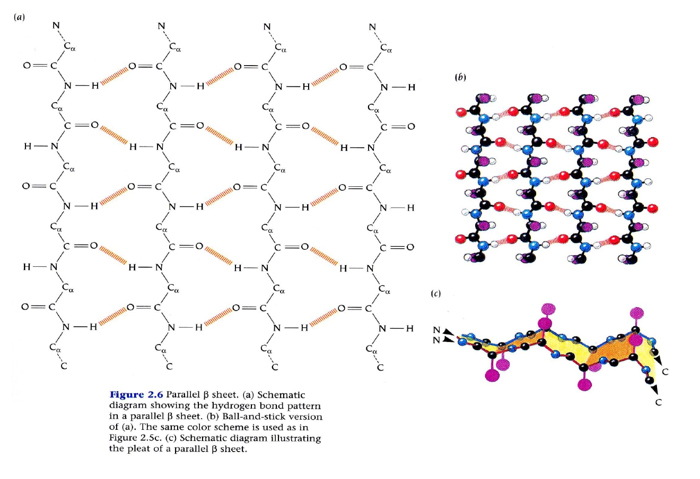
*▲ 课件原图（Slide 43）：平行 $\beta$-折叠（Parallel $\beta$-sheet）的同向肽链排列、斜向交错氢键网络与侧面锯齿构象（本地路径：`img/ch3_fig21_slide43_parallel_beta_sheet.png`）*

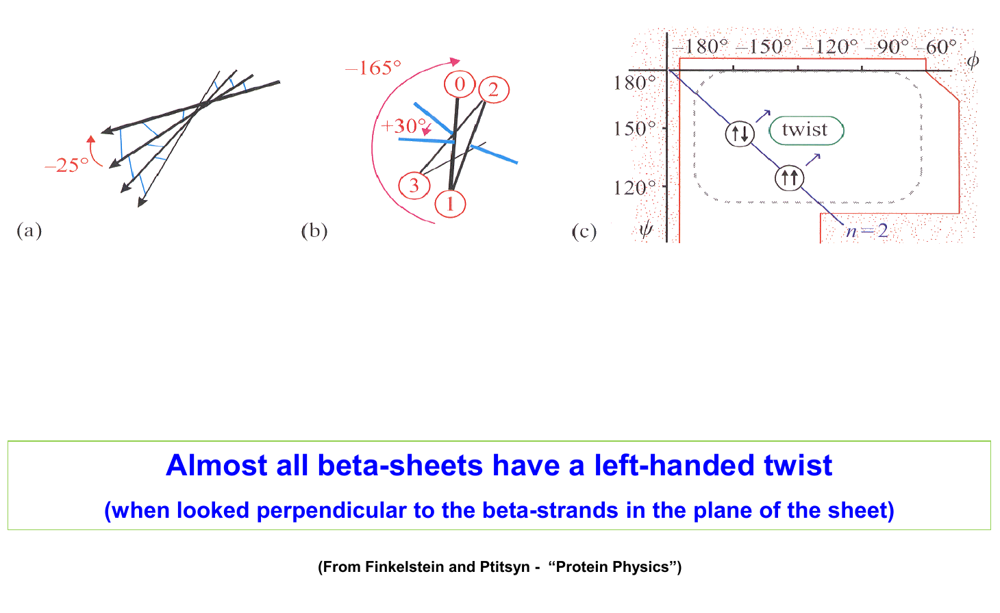
*▲ 课件原图（Slide 54）：当在折叠片平面内垂直于 $\beta$-链方向观察时，几乎所有天然 $\beta$-折叠片均呈现左手扭曲（Left-handed twist，引用自 Finkelstein & Ptitsyn *Protein Physics*）（本地路径：`img/ch3_fig26_slide54_beta_sheet_left_handed_twist.png`）*

1. **$\beta$-折叠的四大结构要点（Slide 41）**：
   - ① **外观**：肽段呈相对伸展的**折纸状（Pleated）、锯齿状**（单残基轴向跨度 $0.34\text{ nm}$，周期 $0.68\text{ nm}$）；
   - ② **走向**：由若干条肽段按**顺向平行（Parallel，N$\to$C 方向相同）**或**反向平行（Anti-parallel，N$\to$C 方向相反）**排列而成；
   - ③ **维持因素**：相邻肽段主链之间的**股间氢键（Inter-strand hydrogen bonds）**，氢键方向与肽链长轴近乎垂直；
   - ④ **$\text{R}$ 基团位置**：交替分布在折纸锯齿平面的**上下方（外侧）**。
2. **反平行 vs. 平行 $\beta$-折叠对比（Slides 42–43）**：
   - **反平行 $\beta$-折叠**：相邻链方向相反，主链 $\text{N-H}\cdots\text{O=C}$ 氢键呈一宽一窄成对平直排列，氢键键角接近理想的 $180^\circ$，能量更低、更稳定；
   - **平行 $\beta$-折叠**：相邻链方向相同，主链氢键呈等间距的**斜向倾斜排列**，氢键线性度略差于反平行折叠。
3. **$\beta$-折叠片的扭曲手性（Slide 54）**：
   - 在拉氏图（图 54 c）中，完全平坦的 $\beta$-折叠片位于对角线 $n = 2$ 上；而由于 $\text{L}$-氨基酸侧链的空间位阻不对称性，真实蛋白质中 $\beta$-折叠的 $(\phi, \psi)$ 略微偏向对角线上方（twist 区域），使得单条 $\beta$-链沿着其自身走向具有右手扭转（每残基约 $+30^\circ$），而**当我们垂直于 $\beta$-链方向、顺着折叠片平面横向观察（图 54 a）时，各条 $\beta$-链的方向依次向左偏转（每条链约 $-25^\circ$），表现为左手扭曲（Left-handed twist）**！

### 3.4 $\beta$-转角、无规卷曲与模体 (Motif / 超二级结构, Slides 44–46)

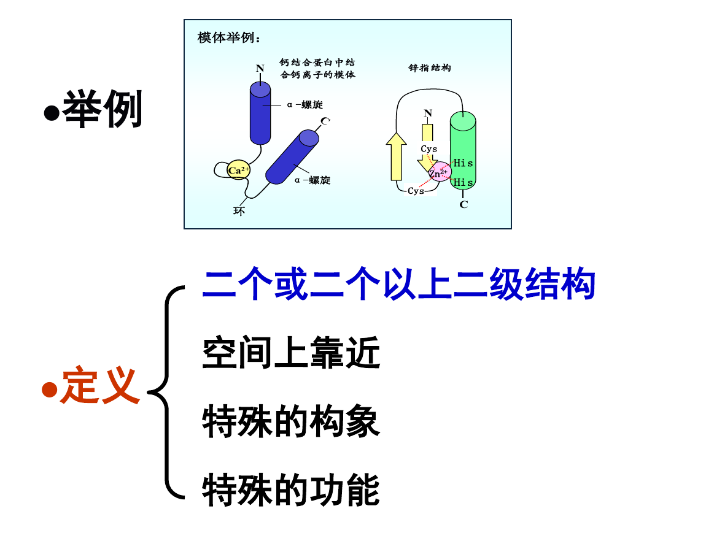
*▲ 课件原图（Slide 45）：超二级结构/模体（Motif）定义及两个经典实例——钙结合蛋白中的 $\alpha$-螺旋-环-$\alpha$-螺旋模体与结合 $\text{Zn}^{2+}$ 的 $\text{Cys}_2\text{His}_2$ 锌指结构（本地路径：`img/ch3_fig22_slide45_supersecondary_motifs.png`）*

1. **$\beta$-转角（$\beta$-turn，Slide 44）**：
   - 常发生于球状蛋白表面连接两条反平行 $\beta$-折叠股的位置；
   - 由连续 **4 个氨基酸残基（$i, i+1, i+2, i+3$）**组成，使主链发生 **$180^\circ$ U 型回折**；
   - 由第 1 个残基（$i$）的 $-\text{C=O}$ 与第 4 个残基（$i+3$）的 $-\text{N-H}$ 之间形成一个**主链氢键**加以固定；
   - **序列偏好**：**第 2 个残基常为脯氨酸（Pro）**（其环状结构天然提供约 $-60^\circ$ 的转弯角），第 3 个残基常为甘氨酸（Gly，避免空间位阻）。
2. **无规卷曲（Random coil，Slide 44）**：指没有确定周期性规律（即非螺旋、非折叠片）的那部分肽链结构（包括表面环区 Loops 与连接区 Linkers）。
3. **模体（Motif）或超二级结构（Supersecondary structure，Slide 45）**：
   - **定义**：在蛋白质分子中，由**两个或两个以上二级结构单元**在空间上相互靠近，形成具有**特殊几何构象**并能够执行**特殊生物学功能**的局部结构组合。
   - **课件经典举例**：
     - **钙结合模体（EF-hand，螺旋–环–螺旋 Helix-loop-helix）**：两根近垂直的 $\alpha$-螺旋夹着一段富含酸性氨基酸（Asp, Glu）的 12 残基环区，专门用于六配位或七配位结合 $\text{Ca}^{2+}$ 离子（如钙调蛋白 Calmodulin）；
     - **锌指结构（Zinc finger，$\beta\beta\alpha$ 模体）**：由 N 端两股反平行 $\beta$-折叠股上的 **2 个半胱氨酸（Cys）**和 C 端一根 $\alpha$-螺旋上的 **2 个组氨酸（His）**共同配位一个中心 **$\text{Zn}^{2+}$** 离子，形成稳定的紧凑指状模体，专门嵌入 DNA 大沟识别特定碱基序列。

### 3.5 蛋白质的三级结构、稳定结构“五条黄金准则”与螺旋堆积理论 (Slides 47–56)

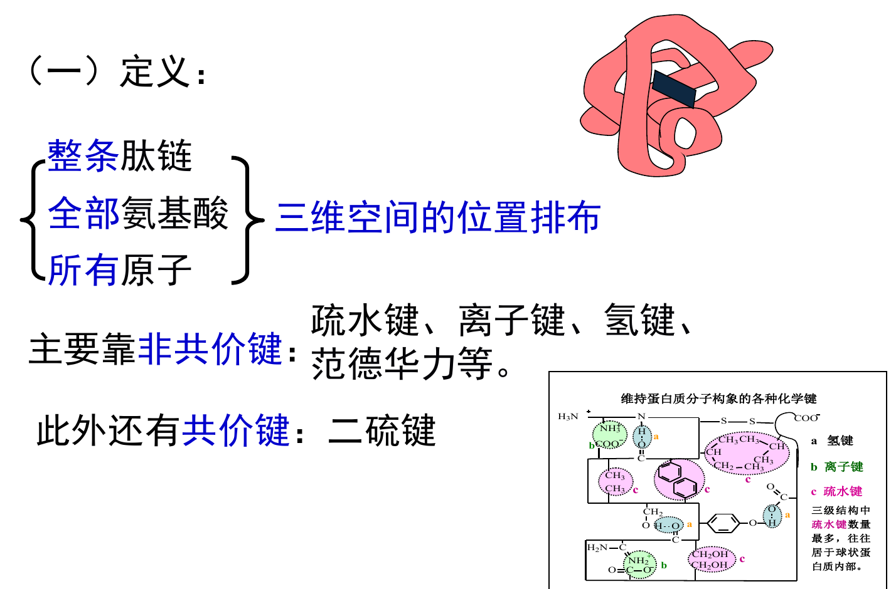
*▲ 课件原图（Slide 47）：蛋白质三级结构的定义及维持三级结构的各种非共价次级键（a 氢键、b 离子键、c 疏水键、范德华力）与共价二硫键（本地路径：`img/ch3_fig23_slide47_tertiary_structure_bonds.png`）*

> **定义与黄金准则（蛋白质三级结构 Tertiary Structure 与稳定结构五法则，Slides 47–48）**：
> - **三级结构定义**：指**整条多肽链中全部氨基酸的所有原子（包括主链骨架与所有 $\text{R}$ 侧链原子）**在三维空间中的整体位置排布。
> - **维持作用力**：主要依靠**非共价次级键**——**疏水键/疏水相互作用（数量最多，往往居于球状蛋白内部核心）**、**离子键（盐键）**、**氢键**和**范德华力**；此外部分胞外蛋白还有共价**二硫键**。
> - **稳定蛋白质结构的五条物理化学黄金法则（Slide 48 — Stable Structure Rules，蛋白质设计核心必背！）**：
>   1. **自由能最小化原则（Minimal free energy）**：
>      $$\Delta G = \Delta H - T\Delta S < 0$$
>   2. **物以类聚原则（Alike stays with alike）的五项具体要求**：
>      - **① Bury sufficient hydrophobic groups**（将足够多的非极性疏水基团埋藏于分子内部，最大化疏水效应熵增益）；
>      - **② Not create (too) many internal cavities**（不在内部制造过多空腔，确保疏水核心如固体晶体般紧密堆积，最大化范德华吸引力）；
>      - **③ Satisfy (most) hydrogen bond donors and acceptors**（满足绝大多数极性氢键供体与受体——暴露表面与水成键，或埋入内部形成二级结构/侧链氢键，严禁出现孤立埋藏的未满足极性基团）；
>      - **④ Pamper the buried charges**（悉心安抚被埋藏的带电基团——若带电侧链必须进入低介电常数的内部活性位点，必须通过形成配对盐桥或配位金属离子加以电荷中和）；
>      - **⑤ Avoid (most) side chain and main chain strain**（避免绝大多数侧链旋转异构体张力与主链拉氏图二面角张力）。

#### Chothia 螺旋表面“山脊嵌入沟槽（Ridges-into-Grooves）”堆积模型與亮氨酸拉链（Slides 49–51）

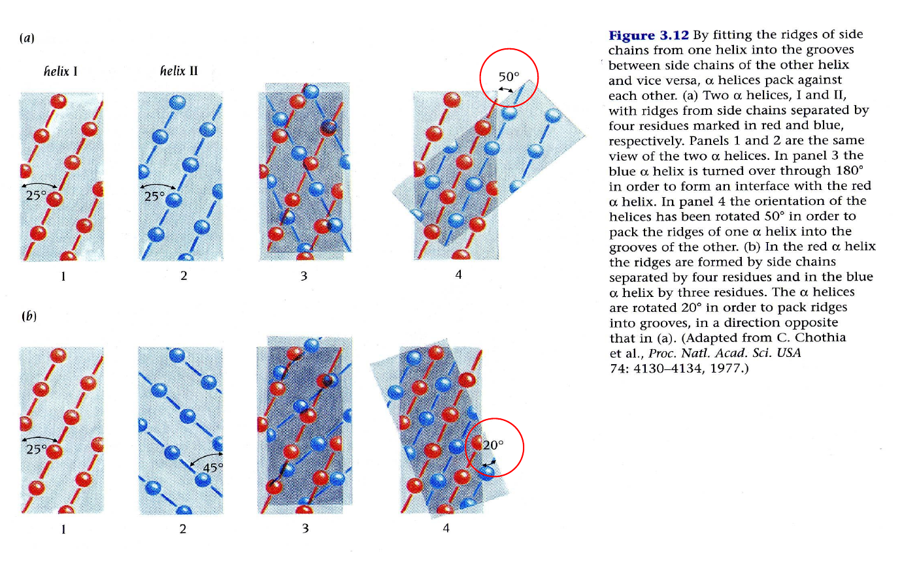
*▲ 课件原图（Slide 50）：Figure 3.12 Chothia 等人（*PNAS* 1977）提出的 $\alpha$-螺旋“山脊嵌入沟槽（Ridges into grooves）”堆积模型——(a) 两根螺旋均以 $i \pm 4$ 山脊（倾角 $25^\circ$）嵌合形成约 $-50^\circ$ 交叉角；(b) 一根以 $i \pm 4$ 山脊（$25^\circ$）、另一根以 $i \pm 3$ 山脊（$45^\circ$）嵌合形成约 $+20^\circ$ 交叉角（本地路径：`img/ch3_fig24_slide50_chothia_helix_packing_ridges.png`）*

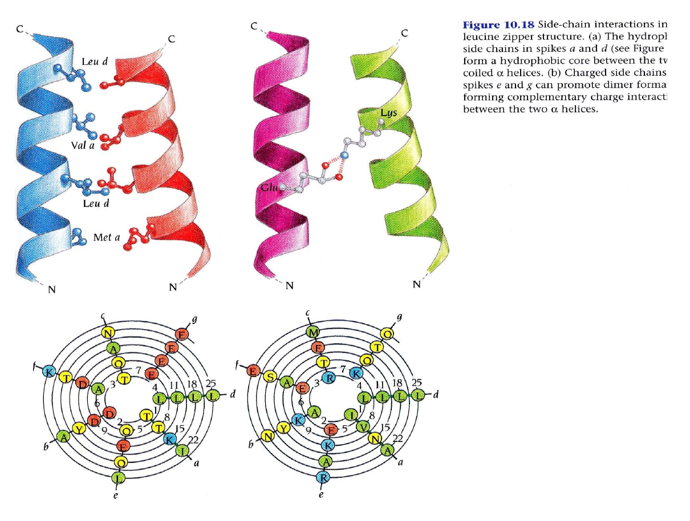
*▲ 课件原图（Slide 51）：Figure 10.18 转录因子 c-Jun/c-Fos 异源二聚体亮氨酸拉链（Leucine Zipper）的超螺旋结构——图 (a) 展示 $a$ 位（Val/Met）与 $d$ 位（Leu）形成的中心疏水脊柱；图 (b) 展示 $e$ 位与 $g$ 位带电残基（Glu 与 Lys）形成的跨螺旋静电互补盐桥（本地路径：`img/ch3_fig25_slide51_leucine_zipper_heptad.png`）*

1. **Chothia 螺旋堆积几何规律（Slides 49–50，[Chothia et al., *PNAS* 1977](https://pubmed.ncbi.nlm.nih.gov/270659/)）**：
   - 在单根 $\alpha$-螺旋表面（Slide 49 图 3.11），由于每圈有 $3.6$ 个残基，每隔 4 个残基（$1, 5, 9\dots$ 即 $i, i+4$ 系列）或每隔 3 个残基（$1, 4, 7\dots$ 即 $i, i+3$ 系列）的侧链会在螺旋圆柱表面排成突出的斜向**山脊（Ridges）**，山脊之间则是凹陷的**沟槽（Grooves）**：
     - **$i \pm 4$ 山脊**与螺旋轴的夹角约为 **$25^\circ$**；
     - **$i \pm 3$ 山脊**与螺旋轴的夹角约为 **$45^\circ$**（方向相反）。
   - 当两根 $\alpha$-螺旋（Helix I 和 Helix II）面对面紧密堆积时（Slide 50 图 3.12），将 Helix II 翻转 $180^\circ$ 盖在 Helix I 上，为了使一侧的山脊严丝合缝地嵌入另一侧的沟槽（消除界面空腔）：
     - **情形 (a)（同为 $i \pm 4$ 山脊嵌合）**：两根螺旋需要相对旋转 **$25^\circ + 25^\circ = \mathbf{50^\circ}$**（常见于球状蛋白内部螺旋对）；
     - **情形 (b)（$i \pm 4$ 山脊与 $i \pm 3$ 山脊嵌合）**：两根螺旋仅需朝反方向相对旋转 **$45^\circ - 25^\circ = \mathbf{20^\circ}$**（常见于四螺旋束与卷曲螺旋 Coiled-coil）！
2. **c-Jun/c-Fos 亮氨酸拉链的七肽重复（Heptad Repeat `(abcdefg)_n`）设计原理（Slide 51）**：
   - 亮氨酸拉链由两根平行的右手 $\alpha$-螺旋以轻微的左手超螺旋（Left-handed supercoil）相互缠绕而成，其序列具有以 7 个残基为周期的重复模式 `(a-b-c-d-e-f-g)_n`：
     - **$a$ 位和 $d$ 位（疏水核心驱动力）**：位于两螺旋接触界面的正中央（$d$ 位几乎恒为**亮氨酸 Leu**，$a$ 位多为 Val, Ile, Met），形成紧密咬合的拉链状疏水核心；
     - **$e$ 位和 $g$ 位（静电特异性决定子）**：紧贴疏水核心两侧（如图中 Glu 与 Lys），通过跨螺旋的**静电吸引（异种电荷成盐桥）或静电排斥（同种电荷相斥）**决定两根螺旋是倾向于形成同源二聚体还是异源二聚体（在蛋白质设计中，David Baker 等人正是利用这一原理从头设计出正交异源二聚体逻辑门组件！）；
     - **$b, c, f$ 位（亲水溶解度外表面）**：完全朝向水相溶剂，多为极性或带电氨基酸，维持复合物的水溶性。

#### 经典三级结构拓扑与结构域、分子伴侣（Slides 52–59）

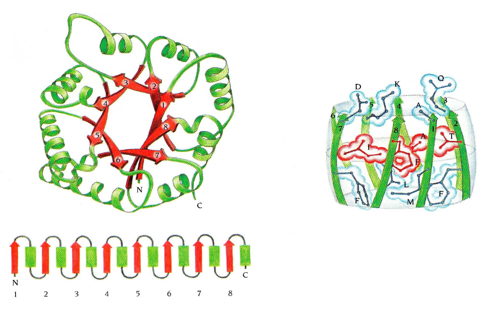
*▲ 课件原图（Slide 56）：经典的 $\alpha/\beta$ TIM 桶（$(\beta\alpha)_8$ barrel）俯视图、侧面疏水核心分层堆积图与一维拓扑展开图（本地路径：`img/ch3_fig27_slide56_tim_barrel_structure.png`）*

- **结构域（Domain，Slides 57–58）**：
  - **定义**：在较大的多肽链三级结构中，分割成若干个**折叠较为紧密、空间上相对独立并各自行使特定生物学功能**的区域。
  - **演化意义**：结构域是蛋白质在演化过程中保留下来的基本**功能模块单元（Functional units preserved during evolution）**。不同蛋白质常通过外显子洗牌（Exon shuffling）像拼乐高积木一样组合不同的保守结构域：
    - **纤连蛋白（Fibronectin，Slide 57）**：单条长链上串联了分别结合肝素、胶原蛋白、纤维蛋白和细胞表面受体的多个独立结构域；
    - **SH3 结构域（Slide 58 A）**：小 $\beta$-桶结构域，特异性识别富含脯氨酸的多肽基序（如 `PXXP`）；
    - **PDZ 结构域（Slide 58 B）**：识别靶蛋白 C 末端特定短肽序列，也能通过 $\beta$-发夹介导 PDZ-PDZ 二聚化组装大型突触信号支架；
    - **Pumilio 重复序列（PUF domain，Slide 58 C）**：由 8 个串联的 $\alpha$-螺旋重复模块排列成新月形弧面，每个重复模块通过 3 个保守氨基酸残基“一对一”模块化识别单链 RNA（NRE RNA）上的一个特定碱基！
- **分子伴侣（Chaperone，Slide 59）**：
  - 通过在细胞内提供一个隔离保护环境（如 Hsp70、Hsp60/GroEL-GroES 桶状腔体），加速蛋白质折叠成天然三级或四级结构，具有三大具体作用：
    1. **可逆结合未折叠肽段暴露的疏水部分并随后松开**（依赖 ATP 水解循环），防止分子间疏水错误聚集（Aggregation）；
    2. **与已错误聚集的肽段结合并使之解聚（Disaggregation）**，再诱导其重新正确折叠；
    3. **辅助二硫键的正确形成与异构重组**（如内质网中的蛋白质二硫键异构酶 PDI，催化错误配对的二硫键打断并重排为天然配对）。

### 3.6 蛋白质的四级结构与多层次结构能量调和 (Slides 60–62)

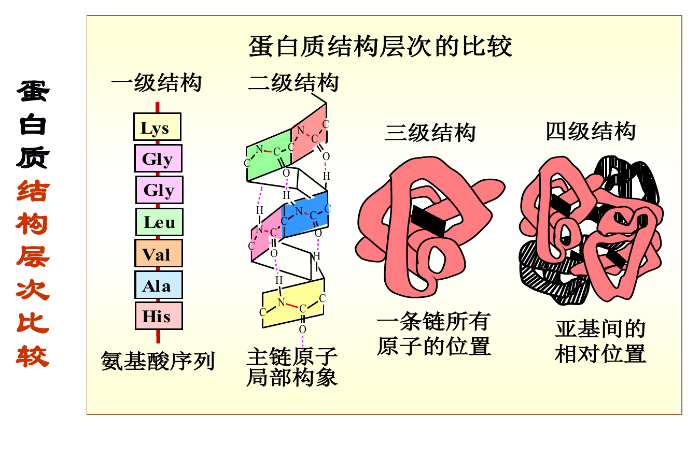
*▲ 课件原图（Slide 61）：蛋白质一级结构（氨基酸序列）、二级结构（主链局部构象）、三级结构（整条链所有原子三维排布）与四级结构（多亚基相对空间布局）的四层级对比总览（本地路径：`img/ch3_fig28_slide61_four_levels_structure_comparison.png`）*

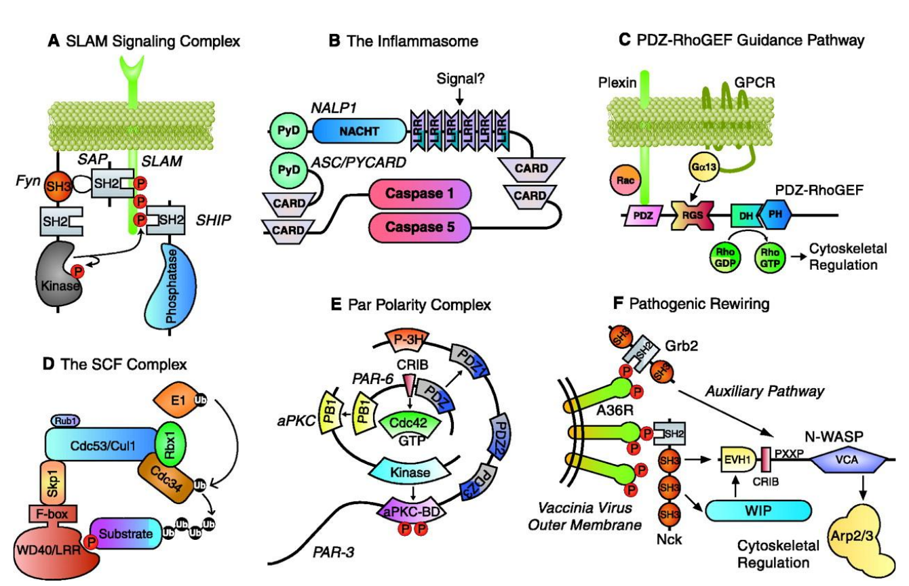
*▲ 课件原图（Slide 62）：细胞内六大典型多结构域信号转导与调控复合物（SLAM、炎性小体、PDZ-RhoGEF、SCF 泛素连接酶、Par 极性复合物、痘苗病毒 A36R 劫持宿主通路）的模块化组装与变构调控（本地路径：`img/ch3_fig29_slide62_multidomain_signaling_complexes.png`）*

- **四级结构（Quaternary structure）与亚基（Subunit，Slide 60）**：
  - **定义**：由 **2 条或 2 条以上具有独立完整三级结构的多肽链（每条链称为一个亚基 Subunit）**，通过**非共价键（次级键：氢键、离子键、疏水作用、范德华力，一般不含亚基间共价键）**相互缔合而成的空间布局。
  - **多层次结构间的能量调和与亚稳态（Metastability，Slide 62）**：生物体内的信号转导蛋白（如自抑制激酶、炎性小体受体 NALP1、Par 极性复合物）并非越稳定越好，而是刻意处于**边缘稳定/亚稳态（Metastable states）**——在无信号时通过分子内结构域相互作用保持自抑制关闭态；一旦接收到磷酸化修饰（图中红圈 `P`）、GTP 结合或配体信号，微小的结合自由能输入即可打破原有平衡，触发剧烈的结构域重组与高阶寡聚化激活！

## 4. 第三节：蛋白质结构与功能的关系 (3. The Relation of Structure and Function, Slides 63–73)

本节围绕两条核心主线展开：**“一级结构决定空间结构，空间结构决定生物学功能。”**

### 4.1 蛋白质一级结构与功能的关系 (Slides 64–67)

1. **一级结构是空间结构与生物活性的基础（Slide 64）**：牛核糖核酸酶 A（RNase A，124 aa，含 `26-84, 40-95, 58-110, 65-72` 四对二硫键）在 $8\text{ M}$ 尿素（破坏非共价键）和 $\beta$-巯基乙醇（还原打断二硫键）作用下完全去折叠丧失催化活性；透析去除变性剂和还原剂后，无需额外信息输入即可 $100\%$ 恢复天然三级结构与酶活性。
2. **相似的一级结构具有相似的高级结构与功能（Slide 65 — 不同物种胰岛素对比表）**：

| 物种 | A 链第 5 位 (A5) | A 链第 6 位 (A6) | A 链第 10 位 (A10) | B 链第 30 位 (B30) | 与人胰岛素的差异总结 |
| :--- | :--- | :--- | :--- | :--- | :--- |
| **人 (Human)** | Thr | Ser | Ile | **Thr** | 基准序列（共 51 aa） |
| **猪 (Pig) / 狗 / 马** | Thr | Ser | Ile | **Ala** | 仅 **B30 位 1 个氨基酸**不同（Thr $\to$ Ala） |
| **兔 (Rabbit)** | Thr | Gly | Ile | **Ser** | A6 与 B30 两处保守替换 |
| **牛 (Cattle)** | Ala | Gly | Val | **Ala** | A5, A6, A10, B30 四处保守替换 |
| **羊 (Sheep)** | Ala | Ser | Val | **Ala** | A5, A10, B30 三处保守替换 |

3. **氨基酸序列提供重要的生物进化信息（Slide 66）**：通过比对广泛存在于真核生物中的**细胞色素 c（Cytochrome c）**的一级结构差异，亲缘关系越近的物种（如人与猕猴仅差 1 个氨基酸）序列同源性越高，据此可定量重构物种系统发生进化树。
4. **关键氨基酸改变可引起疾病——“分子病（Molecular Disease）”（Slide 67 必考实例：镰刀形红细胞贫血）**：
   - **突变位点**：正常成人血红蛋白 **HbA** 的 $\beta$ 肽链（共 146 个氨基酸）N 端序列为：
     $$\text{HbA }\beta\text{ 链}: \quad \text{N}-\text{Val}^1-\text{His}^2-\text{Leu}^3-\text{Thr}^4-\text{Pro}^5-\mathbf{\color{blue}{\text{Glu}^6}}-\text{Glu}^7-\cdots-\text{C(146)}$$
     而在镰刀形红细胞贫血患者 **HbS** 的 $\beta$ 肽链中，**第 6 位带负电的亲水谷氨酸（Glu）突变为非极性疏水的缬氨酸（Val，即 $\beta\text{E6V}$ 点突变）**：
     $$\text{HbS }\beta\text{ 链}: \quad \text{N}-\text{Val}^1-\text{His}^2-\text{Leu}^3-\text{Thr}^4-\text{Pro}^5-\mathbf{\color{red}{\text{Val}^6}}-\text{Glu}^7-\cdots-\text{C(146)}$$
   - **致病机理**：仅仅因为 146 个残基中这 1 个表面亲水残基变成了疏水残基，脱氧状态下的 HbS 表面多出了一个突出的疏水“黏性补丁”，能够嵌入另一个脱氧 HbS 分子表面的疏水凹槽中，导致 HbS 在低氧毛细血管中首尾相接聚合成刚性长纤维沉淀，将原本双凹圆盘状的红细胞扭曲成易破裂、易堵塞微血管的**镰刀状**！由 Linus Pauling 首次将此类由基因突变引起蛋白质分子结构变异所导致的疾病命名为**“分子病”**。

### 4.2 蛋白质的功能依赖特定空间结构：肌红蛋白 (Mb) vs. 血红蛋白 (Hb) 与变构协同效应 (Slides 68–73)

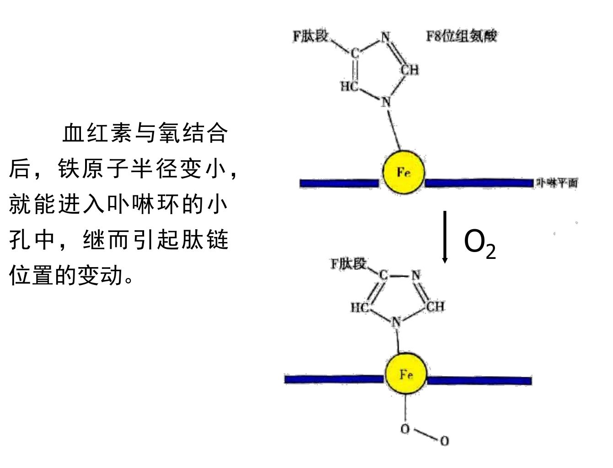
*▲ 课件原图（Slide 72）：血红素（Heme）结合 $\text{O}_2$ 前后的微观几何变化——脱氧时 $\text{Fe}^{2+}$ 半径较大突出于卟啉平面外；结合 $\text{O}_2$ 后铁原子半径变小进入卟啉环中心小孔，拉动 F8 位组氨酸及 F 肽段移动（本地路径：`img/ch3_fig30_slide72_73_hemoglobin_T_to_R_allostery.png`）*

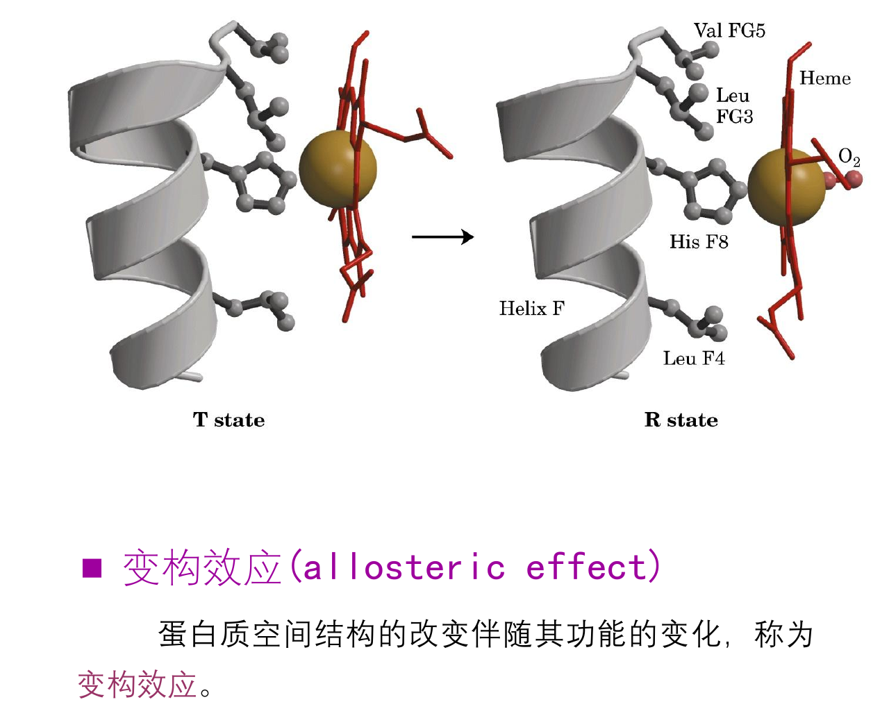
*▲ 课件原图（Slide 73）：血红蛋白从脱氧 T state（Tense state）结合 $\text{O}_2$ 转变为氧合 R state（Relaxed state）时，Helix F 与 His F8 的构象牵引及变构效应定义（本地路径：`img/ch3_fig31_slide73_hemoglobin_T_vs_R_helixF.png`）*

> **核心概念定义（协同效应 Cooperativity 与变构效应 Allosteric Effect，Slides 71 & 73）**：
> 1. **协同效应 (Cooperativity)**：一个寡聚体蛋白质的一个亚基与其配体结合后，能影响此寡聚体中另一个亚基与配体结合能力的现象。若起到促进作用则称为**正协同效应 (Positive cooperativity，如 Hb 结合 $\text{O}_2$)**；若起到抑制作用则称为**负协同效应 (Negative cooperativity)**。
> 2. **变构效应 / 别构效应 (Allosteric effect)**：蛋白质空间结构的改变伴随其生物学功能的变化，称为变构效应（触发构象改变的小分子配体称为变构效应剂 Allosteric effector）。

#### 肌红蛋白 (Myoglobin, Mb) 与血红蛋白 (Hemoglobin, Hb) 全方位对比表（整合 Slides 68–73，必考大题！）

| 对比维度 | 肌红蛋白 (Myoglobin, Mb) | 血红蛋白 (Hemoglobin, Hb) |
| :--- | :--- | :--- |
| **空间结构最高层次** | **三级结构**（单条多肽链，153 aa，含 8 段 $\alpha$-螺旋 A–H） | **四级结构**（$\alpha_2\beta_2$ 四聚体：2 条 $\alpha$ 链各 141 aa + 2 条 $\beta$ 链各 146 aa） |
| **血红素辅基与结合氧分子数** | 含 **1 个**血红素辅基，每分子结合 **1 分子 $\text{O}_2$** | 含 **4 个**血红素辅基（每个亚基 1 个），每分子最多结合 **4 分子 $\text{O}_2$** |
| **血红素与蛋白质的结合方式** | 血红素的两个丙酸侧链与肽链碱性氨基酸正电荷形成**离子键**；肽链 **F8 位近端组氨酸（His F8）**与中心 $\text{Fe}^{2+}$ 形成第 5 **配位键**，周围疏水口袋防止 $\text{Fe}^{2+}$ 被不可逆氧化为 $\text{Fe}^{3+}$ | 每个亚基的三级折叠及血红素结合方式与 Mb 高度相似；脱氧状态下 **4 个亚基之间通过 8 对盐键（离子键）**紧密相连 |
| **氧解离（氧饱和度）曲线形状** | **直角双曲线（Hyperbolic curve）** | **“S 型”曲线（Sigmoidal curve）** |
| **是否存在协同效应与变构效应** | **无**（单亚基独立结合 $\text{O}_2$） | **具有显著的正协同效应与变构效应**（第 1 个 $\text{O}_2$ 结合难，但结合后会促使剩余亚基对 $\text{O}_2$ 亲和力激增数百倍） |
| **生理功能定位** | 在肌肉组织中**储存氧气**（在极低氧分压下仍保持高氧饱和度，仅在剧烈运动组织缺氧时释氧） | 在血液中从肺部向全身组织**高效运输氧气**（在肺泡高氧分压下 $100\%$ 饱和载氧，在外周组织低氧分压下陡峭卸载释放氧气） |

#### 血红蛋白正协同效应的原子级力学传递链条（Perutz 变构机制，Slides 72–73）：
```text
  [1. 脱氧 T 态 (Tense, 低亲和力)]
      Fe2+ 呈高自旋态，半径较大，无法进入卟啉环小孔（突出于卟啉平面上方 ~0.4–0.6 Å）
      ──► 4 个亚基之间被 8 对盐键紧紧锁死，空间位阻阻碍 O2 结合
            │
            ▼ 第 1 个亚基结合 1 分子 O2
  [2. 铁原子电子自旋态改变与入孔 (Slide 72)]
      O2 与 Fe2+ 第 6 配位位点结合 ──► Fe2+ 转为低自旋态，离子半径变小 ──► Fe2+ 退入卟啉平面中心小孔内
            │
            ▼ 机械牵引传导 (Slide 73)
  [3. 拉动 His F8 与 F 螺旋移动]
      与 Fe2+ 配位的 F8 位组氨酸（His F8）被一并拉向卟啉平面 ──► 带动整段 F 螺旋（Helix F）发生位移
            │
            ▼ 跨亚基界面构象传递
  [4. 扯断亚基间 8 对盐键 ──► 跃迁至氧合 R 态 (Relaxed, 高亲和力)]
      亚基界面发生相对滑动旋转，原有的 8 对盐键相继断裂 ──► 其余亚基口袋张开，对 O2 亲和力暴涨（正协同效应!）
```

## 5. 第四节：蛋白质的理化性质、功能性相分离与构象疾病 (Slides 74–85)

### 5.1 蛋白质的两性电离、胶体性质与聚沉机制 (Slides 74–76)

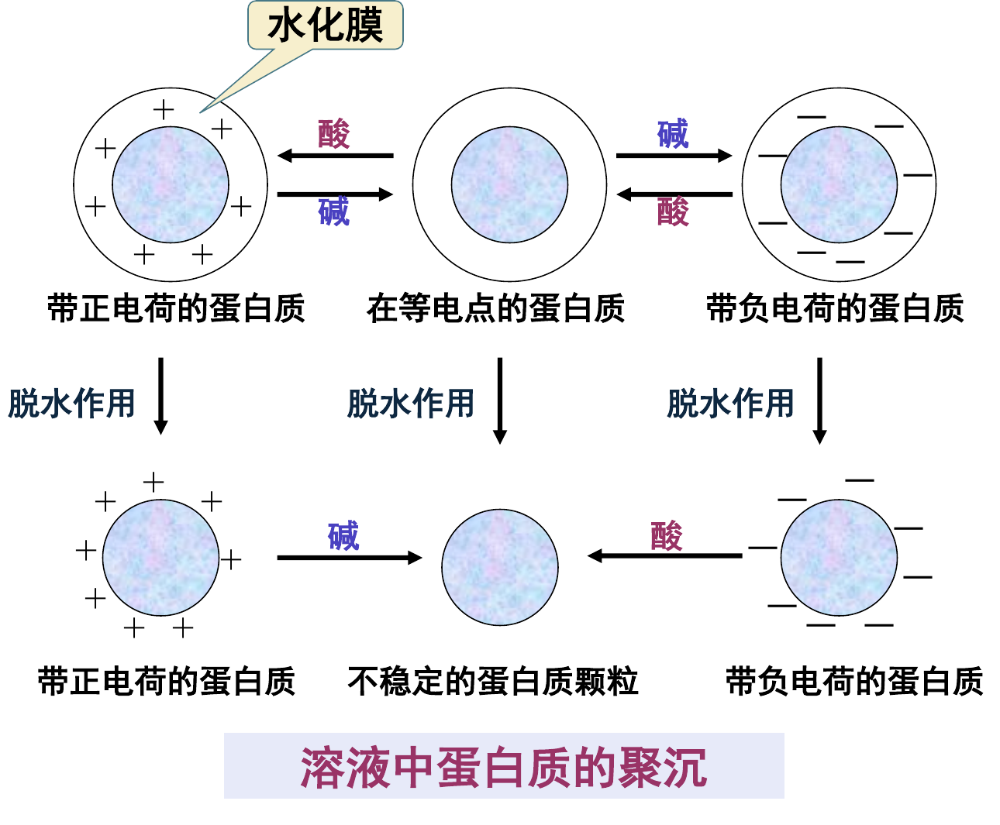
*▲ 课件原图（Slide 76）：蛋白质溶液胶体稳定的两大因素（水化膜与表面同种电荷）以及通过“酸碱调节至等电点 + 脱水作用”实现蛋白质聚沉的双向路径图（本地路径：`img/ch3_fig32_slide76_colloid_precipitation_pI.png`）*

1. **蛋白质的两性电离与等电点（$\text{pI}$，Slide 74）**：
   - 蛋白质分子中除 N 端游离 $\alpha$-氨基和 C 端游离 $\alpha$-羧基外，内部大量氨基酸残基的**可解离侧链基团**（Asp $\beta$-羧基、Glu $\gamma$-羧基、His 咪唑基、Cys 巯基、Tyr 酚羟基、Lys $\varepsilon$-氨基、Arg 胍基）在特定 $\text{pH}$ 下均可解离。
   - 当溶液处于某一特定 $\text{pH}$ 时，蛋白质分子解离成正、负离子的趋势相等，成为净电荷为零的**兼性离子**，此时溶液的 $\text{pH}$ 称为该**蛋白质的等电点（$\text{pI}$）**。
     - 当环境 $\text{pH} < \text{pI}$ 时，蛋白质带**正电荷（阳离子）**；
     - 当环境 $\text{pH} > \text{pI}$ 时，蛋白质带**负电荷（阴离子）**；
     - 在 $\text{pH} = \text{pI}$ 时，蛋白质分子间失去同种电荷静电排斥力，**溶解度最小**，最易聚沉。
2. **蛋白质的胶体性质与两大稳定因素（Slides 75–76，必考简答题）**：
   - **胶体尺寸**：蛋白质分子量在 $1\text{万} \sim 100\text{万 Da}$ 之间，颗粒直径为 **$1\text{–}100\text{ nm}$**，恰好落在胶体颗粒尺寸范围内，因而蛋白质水溶液具有丁达尔现象、布朗运动、不能透过半透膜（可用于**透析法 Dialysis** 除盐纯化蛋白）等胶体性质。
   - **维持蛋白质胶体颗粒稳定的两大因素**：
     1. **表面同种电荷（Surface like charges）**：在偏离等电点的溶液中，同种蛋白质分子表面带有相同符号的净电荷（全正或全负），彼此静电相斥而无法靠近聚集；
     2. **水化膜（Hydration shell）**：蛋白质颗粒表面的亲水极性基团（$-\text{COO}^-, -\text{NH}_3^+, -\text{OH}, -\text{CONH}_2$）通过氢键和偶极作用吸附周围水分子，在分子表面形成一层紧密排列的水化层，构成空间物理屏障。
   - **溶液中蛋白质聚沉的规律（Slide 76 图解）**：
     - 如果仅处于等电点（$\text{pH} = \text{pI}$，无净电荷），只要水化膜完好，蛋白质仍可稳定溶解；
     - 如果仅用脱水剂（如高浓度中性盐硫酸铵或冷乙醇）脱去水化膜，只要表面仍带大量同种电荷，蛋白质也未必沉淀；
     - **唯有同时破坏“水化膜”（脱水作用）并消除“表面电荷”（加酸或碱调至等电点 $\text{pH} = \text{pI}$）**，蛋白质才会变成既无水化膜又无静电排斥的不稳定颗粒，从而迅速聚集沉淀！

### 5.2 蛋白质的变性 (Denaturation)、复性 (Renaturation) 与沉淀 (Precipitation) (Slides 78–80)

> **核心概念辨析（变性 vs. 复性 vs. 沉淀，Slides 78–80，高频必考辨析题！）**：
> 1. **蛋白质的变性 (Denaturation)**：在某些物理因素（加热、高压、紫外线、X 射线、剧烈振荡、超声波）或化学因素（强酸、强碱、重金属离子如 $\text{Hg}^{2+}/\text{Pb}^{2+}/\text{Ag}^+$、尿素、盐酸胍、乙醇/丙酮等有机溶剂、三氯乙酸/苦味酸等生物碱试剂）作用下，蛋白质特定的**空间构象（二、三、四级结构）被破坏**，从而导致其理化性质改变（如溶解度降低、黏度增加、易被蛋白酶水解）和**天然生物活性丧失**的现象。
> 2. **变性的化学本质（必背！）**：**仅破坏维持空间构象的非共价键（氢键、疏水键、离子键、范德华力）和二硫键，绝对不改变蛋白质的一级结构（即共价肽键不断裂，分子量不变）！**
> 3. **复性 (Renaturation)**：若变性程度较轻且可逆，在去除变性因素后，部分蛋白质仍可恢复或部分恢复其原有的空间构象和生物学功能。
> 4. **沉淀 (Precipitation) 与变性的逻辑关系（Slide 80）**：
>    - **“变性后的蛋白质易于沉淀，但沉淀的蛋白质不一定都发生了变性！”**
>    - *原因*：变性使原本埋藏在疏水核心内的非极性基团大量暴露于表面，分子间通过疏水作用相互聚集而析出沉淀（如煮熟的鸡蛋清，属不可逆变性凝固）；但在低温下加入高浓度硫酸铵进行的**盐析（Salting out）**沉淀，仅仅是夺取了水化膜，完全没有破坏蛋白质内部的三维构象，沉淀加水溶解后仍具有 $100\%$ 生物活性（属**不变性沉淀**）。

### 5.3 前沿拓展一：蛋白质功能性相变——液-液相分离 (Phase Separation / LLPS, Slides 77 & 81)

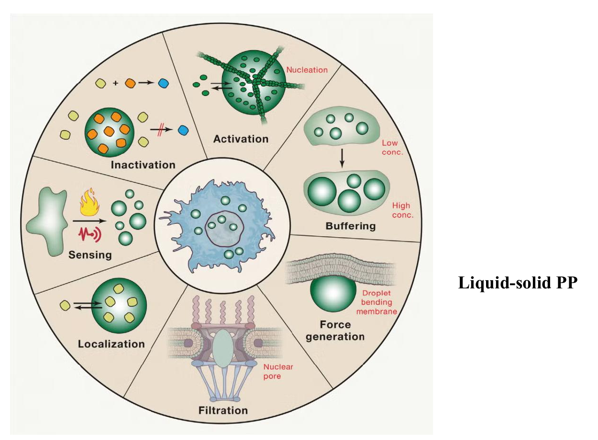
*▲ 课件原图（Slide 77）：细胞内生物大分子液-液相分离（Phase separation）介导的七大核心生物学功能圆盘图及病理性液-固相变（Liquid-solid PP）（本地路径：`img/ch3_fig33_slide77_81_phase_separation_LLPS.png`）*

课件第 77 与 81 页（引用自 [*Signal Transduction and Targeted Therapy* 2021, 6:290](https://pmc.ncbi.nlm.nih.gov/articles/PMC8326283/)）引入了当代细胞生物学与蛋白质科学最热门的前沿概念——**生物大分子相分离（Phase Separation / LLPS）**：
1. **发展里程碑（Slide 81 时间轴）**：
   - **1899 年**：Edmund Beecher Wilson 首次提出细胞质是一种由不同液滴构成的液态乳浊液（Liquid emulsion）；
   - **2009 年（现代 LLPS 领域开山之作）**：**Tony Hyman 与 Cliff Brangwynne** 在 *Science* 发表经典研究，证明秀丽隐杆线虫胚胎中的生殖颗粒（**P granules**）表现出融合、滴落、润湿等典型的液滴行为（Liquid-like behaviors），是通过可逆的**液-液相分离（LLPS）**凝聚而成的无膜细胞器；
   - **2011 年**：Hyman 与 Brangwynne 进一步证明细胞核内的**核仁（Nucleolus）**同样具有液滴相分离特征；
   - **2012 年（分子机制突破）**：**Michael Rosen** 团队与 **Steven McKnight** 团队在 *Nature* / *Cell* 发表背靠背研究，首次在体外无细胞体系（Cell-free in vitro reconstitution）中证明：**含有多价相互作用结构域（Multivalent domains，如串联 SH3 结构域与串联脯氨酸富集基序 PRM）或低复杂度天然无序区（IDRs）的蛋白质与 RNA**，在跨越临界浓度阈值时会发生开关式的相变，自发凝聚成微米级的浓缩相液滴！
2. **相分离的七大核心生理功能（Slide 77 圆盘图详解）**：
   - **① Activation / Nucleation（激活与成核）**：在局部液滴内高度富集底物与效应蛋白（如浓缩微管蛋白促进中心体微管快速成核，或 cGAS-DNA 相分离激活天然免疫信号）；
   - **② Buffering（浓度缓冲）**：当细胞内某蛋白总表达量发生剧烈波动时，相分离液滴通过吸收或释放蛋白分子，使液滴外稀相（细胞质基质）中的游离蛋白浓度维持恒定；
   - **③ Force generation（机械力产生）**：相分离液滴在生物膜表面发生润湿（Wetting）和毛细管力作用，驱动细胞膜弯曲内陷（如内吞作用与自噬体膜组装）；
   - **④ Filtration（选择性过滤）**：如核孔复合物（Nuclear pore complex, NPC）中央通道内的 FG-核孔蛋白形成水凝胶样相分离屏障，选择性放行核转运受体而阻挡其他大分子；
   - **⑤ Localization（亚细胞定位与区室化）**：在没有脂双层膜包被的情况下实现特定蛋白与 RNA 的空间区室化（如突触后致密区 PSD、黏着斑）；
   - **⑥ Sensing（环境信号感知）**：快速感知细胞内外的温度、pH、盐离子浓度或自由基应激变化，通过可逆聚集形成应激颗粒（Stress granules）保护 mRNA；
   - **⑦ Inactivation（隔离失活）**：将特定酶或信号分子暂时封存进相分离液滴内部，阻断其与底物接触从而实现功能关闭。
3. **从功能性液滴到病理性固体的不可逆转变（Liquid-Solid Phase Transition）**：  
   正常生理状态下的相分离液滴具有高流动性与完全可逆性；然而在衰老或基因突变条件下，液滴内部高浓度的天然无序蛋白可能发生不可逆的构象老化（Aging），经由**液-固相变（Liquid-solid PP）**硬化为不溶性的病理淀粉样纤维聚集体！

### 5.4 前沿拓展二：蛋白质构象疾病与神经退行性疾病淀粉样高聚 (Slides 82–85)

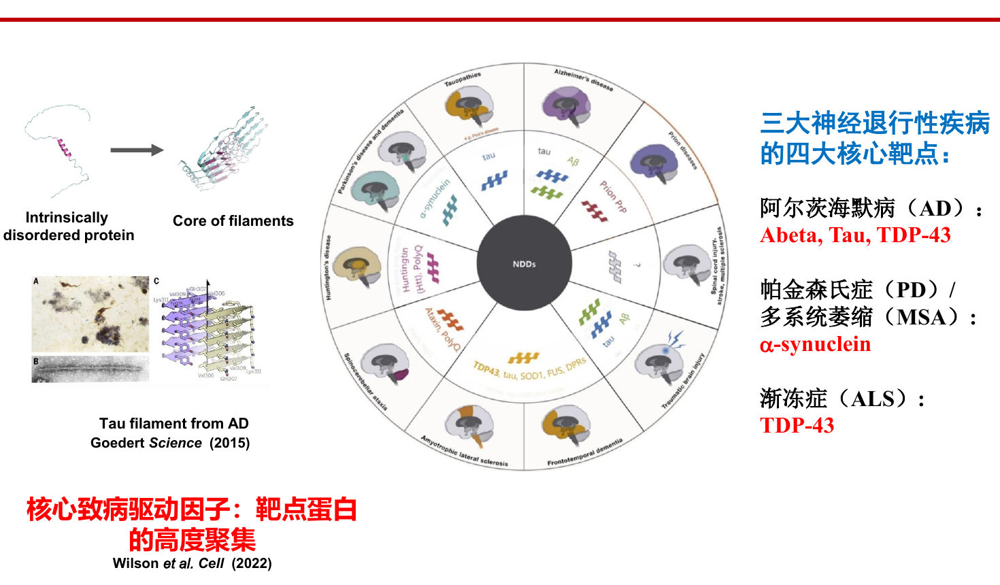
*▲ 课件原图（Slide 85）：天然无序蛋白（IDPs）错误折叠形成淀粉样纤维核心（引用自 [Goedert, *Science* 2015](https://pubmed.ncbi.nlm.nih.gov/26250687/) 与 [Wilson et al., *Cell* 2023](https://pubmed.ncbi.nlm.nih.gov/36803602/)）及三大神经退行性疾病的四大核心聚集靶点（本地路径：`img/ch3_fig34_slide85_neurodegenerative_amyloid_targets.png`）*

> **定义与致病机理（蛋白质构象疾病 Conformational Diseases，Slides 82–85）**：
> - **定义**：若蛋白质的折叠发生错误，**尽管其一级结构（氨基酸序列）可以完全不变**，但由于空间构象发生病理性改变并相互聚集，形成抗蛋白水解酶降解的**淀粉样纤维沉淀（Amyloid fibrils，具有特征性的跨 $\beta$-折叠 Cross-$\beta$ 空间拉链 Steric zipper 结构，将拉链内部的水分子彻底挤出而变成极端稳定的干燥纤维）**，从而产生细胞毒性并导致组织空泡化与神经退行性病变的疾病。

#### 1. 疯牛病（牛海绵状脑病）与朊病毒蛋白（Prion Protein, PrP，Slides 83–84，必考对比！）
- **致病因子**：既非细菌也非含核酸的普通病毒，而是一种仅由蛋白质构成的感染性因子——**朊病毒蛋白（Prion protein, PrP）**（Stanley Prusiner 获 1997 年诺贝尔生理学或医学奖）。
- **构象转变本质**：
  $$\underset{\text{正常细胞型朊蛋白（富含 }\mathbf{\alpha}\textbf{-螺旋}\text{，可溶，对蛋白酶敏感）}}{\mathbf{\text{PrP}^\text{C}}} \xrightarrow{\text{外源或内源 }\text{PrP}^\text{Sc}\text{ 模板接触诱导}} \underset{\text{致病型朊蛋白（富含 }\mathbf{\beta}\textbf{-折叠}\text{，不溶，抗蛋白酶水解，聚集成淀粉样纤维）}}{\mathbf{\text{PrP}^\text{Sc}}}$$
  **核心考点**：$\text{PrP}^\text{C}$ 与 $\text{PrP}^\text{Sc}$ 的**一级结构氨基酸序列完全相同**，两者的根本区别纯粹在于二级与三级空间构象从**“富含 $\alpha$-螺旋”转变为“富含 $\beta$-折叠”**！

#### 2. 三大神经退行性疾病的四大核心聚集靶点蛋白速查表（Slide 85 必背考点）

| 疾病名称（中英文） | 核心致病聚集靶点蛋白 (Target Proteins) | 构象转变与病理特征说明 |
| :--- | :--- | :--- |
| **1. 阿尔茨海默病 / 老年痴呆症**<br>(Alzheimer's Disease, **AD**) | **$\text{A}\beta$**（Amyloid-$\beta$，$\beta$-淀粉样肽）<br>**$\text{Tau}$ 蛋白**<br>**$\text{TDP-43}$** | 胞外 $\text{A}\beta$ 错误折叠聚集成老年斑（Senile plaques）；胞内微管相关无序蛋白 $\text{Tau}$ 过度磷酸化并聚集成成对螺旋丝（PHFs / 神经原纤维缠结 NFTs，见 Slide 85 左下 Cryo-EM 结构） |
| **2. 帕金森氏症 / 多系统萎缩**<br>(Parkinson's Disease, **PD** / Multiple System Atrophy, **MSA**) | **$\alpha$-突触核蛋白**<br>($\alpha$-synuclein) | 天然无序的 $\alpha$-synuclein 错误折叠为富含 $\beta$-折叠的原纤维，在黑质多巴胺能神经元内聚集成路易小体（Lewy bodies） |
| **3. 肌萎缩侧索硬化症 / 渐冻症**<br>(Amyotrophic Lateral Sclerosis, **ALS**) | **$\text{TDP-43}$**<br>（以及 $\text{SOD1}, \text{FUS}$ 等） | RNA 结合蛋白 $\text{TDP-43}$ 从细胞核异常出核并在运动神经元细胞质内经液-固相变形成不可逆淀粉样聚集体 |
| **4. 亨廷顿舞蹈病与克雅氏病/疯牛病**<br>(Huntington's Disease / Prion Diseases) | **$\text{Huntingtin (Htt)}$**（PolyQ 扩增）<br>**$\text{PrP}^\text{Sc}$**（朊蛋白） | 纹状体神经元内 PolyQ 淀粉样核内包涵体；脑组织海绵状空泡样变性 |

## 6. 第五节：核心知识点速查总表与考前必考重点问答题精解 (Summary Tables & Exam Review Q&A)

### 6.1 蛋白质四个结构层次全景对照速查表（整合 Slide 31 & Slide 61）

| 结构层次 | 严格定义 | 主要维持的化学键 | 典型代表与关键特征参数 |
| :--- | :--- | :--- | :--- |
| **一级结构**<br>(Primary structure) | 多肽链中从 N 端到 C 端氨基酸残基的排列顺序（含二硫键定位） | **肽键**（主）、**二硫键**（辅，均属共价键） | 牛胰岛素（51 aa，3 对二硫键）、牛 RNase A（124 aa，4 对二硫键）；变性时一级结构**绝不改变** |
| **二级结构**<br>(Secondary structure) | 某一段肽链主链骨架原子的局部空间排布（**不涉及 $\text{R}$ 侧链构象**） | **主链氢键**（肽单元 $-\text{C=O}\cdots\text{H-N}-$ 之间） | • **$\alpha$-螺旋**：右手，$3.6$ 残基/圈，螺距 $0.54\text{ nm}$，$i \to i+4$ 氢键（13 原子环），$\text{R}$ 居外侧<br>• **$\beta$-折叠**：折纸锯齿状，顺/反平行，左手扭曲，$\text{R}$ 居上下两侧<br>• **$\beta$-转角**：4 个残基，$180^\circ$ 回折，$i \to i+3$ 氢键，第 2 位常为 Pro |
| **三级结构**<br>(Tertiary structure) | 整条多肽链中**全部氨基酸所有原子（主链 + 侧链）**的三维整体排布 | **非共价次级键**（**疏水键最多**、离子键、氢键、范德华力）+ 共价二硫键 | 肌红蛋白（Mb，单链 153 aa，8 段 $\alpha$-螺旋包裹血红素）；包含模体（Motif）与独立折叠的功能单元——**结构域（Domain）** |
| **四级结构**<br>(Quaternary structure) | **2 条或 2 条以上**具有独立三级结构的多肽链（**亚基 Subunit**）之间的非共价空间排布 | **非共价次级键**（氢键、**离子键/盐键**、疏水键；一般无亚基间共价键） | 血红蛋白（Hb，$\alpha_2\beta_2$ 四亚基，通过 8 对盐键相连，具正协同效应与 $T \to R$ 变构效应） |

### 6.2 考前高频必考问答题与深度解析（Exam Review Q&A）

#### 问题 1：请简述肽键平面的结构特点，并说明为什么脯氨酸（Pro）和甘氨酸（Gly）在蛋白质二级结构中扮演着特殊的角色？（对应 Slides 19, 34–35, 40, 44）
- **标准解答**：
  1. **肽键平面特点**：参与构成肽键的 6 个原子（$\text{C}_{\alpha 1}, \text{C}, \text{O}, \text{N}, \text{H}, \text{C}_{\alpha 2}$）共处同一刚性平面；由于 $\text{C}-\text{N}$ 键长为 $0.132\text{ nm}$（介于单双键之间），具有部分双键性质，不能自由旋转，且绝大多数呈反式（*trans*）构型；多肽主链仅能围绕 $\text{N}-\text{C}_\alpha$ 键（$\phi$ 角）和 $\text{C}_\alpha-\text{C}$ 键（$\psi$ 角）旋转。
  2. **脯氨酸（Pro）的特殊性**：Pro 是环状亚氨基酸，侧链环化连在主链 $\text{N}$ 上。一方面，主链 $\text{N}$ 上没有氢原子，无法提供形成 $\alpha$-螺旋所需的 $i \to i+4$ 氢键；另一方面，五元环将 $\phi$ 角死死锁定在约 $-60^\circ$。因此 Pro 是典型的**“$\alpha$-螺旋破坏者”**，但同时非常适合出现在 **$\beta$-转角的第 2 个位置**，帮助肽链实现 $180^\circ$ 回折。
  3. **甘氨酸（Gly）的特殊性**：Gly 的 $\text{R} = -\text{H}$，是唯一无手性碳原子的氨基酸。因其侧链极小、无空间位阻，主链 $(\phi, \psi)$ 柔性极大，在 $\alpha$-螺旋中因构象熵代价过高而不利于螺旋稳定，但常出现在空间极度拥挤的 $\beta$-转角（第 3 位）、胶原蛋白三股螺旋内部以及从头设计 $\beta$-桶的扭结位点（Glycine kink）。

#### 问题 2：结合肌红蛋白（Mb）和血红蛋白（Hb）的空间结构差异，阐明为什么 Mb 适合在肌肉中储氧，而 Hb 适合在血液中运氧？并简述 Hb 氧合正协同效应的分子机制。（对应 Slides 68–73）
- **标准解答**：
  1. **结构与氧解离曲线差异**：Mb 是单链三级结构蛋白，仅含 1 个血红素，不存在亚基间相互作用，其氧解离曲线为直角双曲线，在很低的氧分压下依然牢牢结合氧气，因此适合作为肌肉中的氧气储备库；Hb 是由 $\alpha_2\beta_2$ 四个亚基组成的四级结构蛋白，亚基间存在变构通讯，其氧解离曲线呈“S 型”，在肺部高氧压下迅速达到近 $100\%$ 饱和，而在外周组织较低氧压下能灵敏地大幅释放氧气，故极适合作为氧气运输载体。
  2. **正协同效应的原子级机制**：在未结合氧的脱氧 T 态（紧张态）下，Hb 的 4 个亚基之间通过 8 对盐键相互束缚，且高自旋的 $\text{Fe}^{2+}$ 半径较大，突出于卟啉平面上方，对 $\text{O}_2$ 亲和力低；当第一个亚基结合 $\text{O}_2$ 后，$\text{Fe}^{2+}$ 转为低自旋态，半径变小并缩入卟啉环平面中心小孔内，通过配位键拉动 F8 位组氨酸（His F8）和整段 F 螺旋向卟啉平面移动；这一构象变化传导至亚基界面，导致亚基间的 8 对盐键相继断裂，使四聚体转变为松弛的高亲和力 R 态，从而显著促进其余亚基结合 $\text{O}_2$。

#### 问题 3：对比“分子病（以镰刀形红细胞贫血为例）”与“蛋白质构象疾病（以疯牛病和阿尔茨海默病为例）”在致病分子机制上的异同。（对应 Slides 67, 82–85）
- **标准解答**：
  1. **相同点**：两者最终都因为蛋白质空间结构或高聚状态的异常，引发蛋白质病态聚集/纤维化并导致严重的组织器官病变。
  2. **核心区别（一级结构是否改变）**：
     - **镰刀形红细胞贫血（经典分子病）**：根源在于**基因突变直接改变了蛋白质的一级结构**——HbS 的 $\beta$ 链第 6 位由亲水带负电的谷氨酸（Glu）突变为疏水的缬氨酸（Val），从而在脱氧 HbS 表面制造出异常疏水黏性补丁，引发纤维化聚合；
     - **疯牛病与散发性神经退行性构象病**：其致病蛋白（如朊蛋白 $\text{PrP}$）的**一级结构氨基酸序列可以完全没有改变**，致病核心在于蛋白质折叠发生错误——如富含 $\alpha$-螺旋的正常可溶 $\text{PrP}^\text{C}$ 在 $\text{PrP}^\text{Sc}$ 模板诱导下转变为富含 $\beta$-折叠的 $\text{PrP}^\text{Sc}$（或 AD 中的 $\text{A}\beta/\text{Tau}$、PD 中的 $\alpha$-synuclein、ALS 中的 $\text{TDP-43}$ 发生相分离液滴硬化与跨 $\beta$-折叠空间拉链聚集），形成抗蛋白酶降解的淀粉样纤维沉淀。
