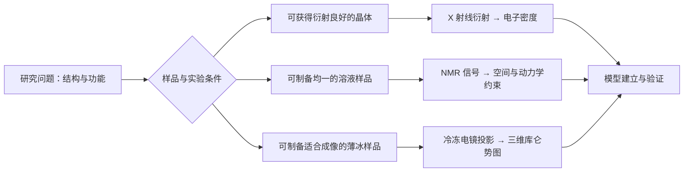
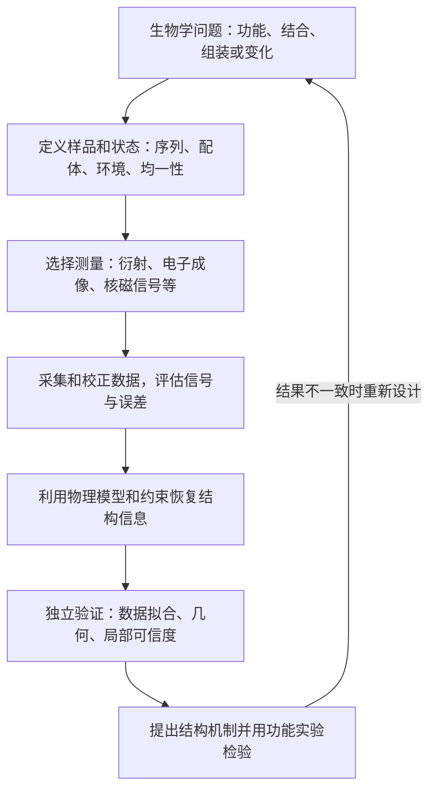
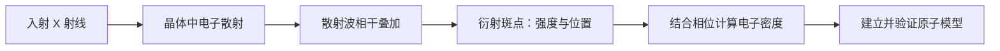
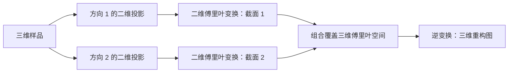

# 蛋白质设计：第 4 次课
## 蛋白质结构的实验解析方法：课程讲义全景梳理与深度解析笔记

> **课程主题**：蛋白质结构的实验解析方法（Seeing Is Believing: Methods of Structure Solution）  
> **学习目标**：建立从生物学问题、实验观测到三维模型和功能解释的完整知识体系。  
> **范围说明**：以 X 射线晶体学和冷冻电子显微学为核心，核磁共振作为互补方法简要介绍；必要的背景与解释也纳入体系。

---

## 目录与知识架构

1. **问题背景：为什么需要解析蛋白质结构？**
   - 结构、功能与疾病；尺度和分辨率；方法总览
2. **X 射线晶体学的物理基础**
   - X 射线与原子散射；晶体、衍射和布拉格定律；反常散射
3. **蛋白质晶体结构解析的实验流程**
   - 样品制备；结晶原理与方法；数据采集；相位求解；模型建立与验证
4. **电子显微学与冷冻电镜**
   - 技术发展；负染和玻璃态冰；制样、剂量与图像质量
5. **二维投影到三维结构**
   - 中央截面定理；单颗粒平均；采样与三维重构；断层成像
6. **方法比较与互补验证**
7. **核心知识点、辨析与自测**
8. **从实际问题到结构研究闭环**

---

## 1. 引言：为什么要研究蛋白质结构？

### 1.1 从分子结构理解生命过程与疾病
蛋白质的功能不仅取决于氨基酸序列，还取决于折叠、分子间装配和构象变化。结构实验提供空间信息，帮助提出并检验活性位点、结合界面、聚集方式及作用机制等假设。**结构是解释机制的重要证据，但单张结构图本身并不能证明整个反应过程或因果关系。**

以神经退行性疾病说明异常聚集与结构研究的联系：阿尔茨海默病涉及 Aβ、Tau 和 TDP-43；帕金森病及多系统萎缩涉及 α-synuclein；部分肌萎缩侧索硬化症（ALS）涉及 TDP-43。还可以对比正常朊蛋白 PrPᶜ 与疾病相关 PrPˢᶜ 的结构特征：前者富含 α 螺旋，后者通常具有更高的 β 结构比例并可形成聚集体。它们说明同一种蛋白可能形成不同构象和组装体，不能仅凭序列判断全部状态。

> **补充解释**：这些蛋白的聚集与疾病相关，但不同疾病、患者和病理阶段中的因果机制并不完全相同；不应将所有聚集都简单等同于疾病的唯一原因。固有无序蛋白在溶液中可采样多种构象，而聚集纤维核心可以呈现有序结构，两者并不矛盾。

### 1.2 尺度与分辨率：先问实验要看什么

**分辨率（resolution）**描述实验区分空间细节的能力，而不是图像被放大后的尺寸。在衍射实验中，它常用纳入分析的最小晶面间距表示；在单颗粒冷冻电镜中，通常依据两个独立重构半图之间的傅里叶壳层相关性（Fourier shell correlation，FSC）及指定阈值估计。两种数字不能脱离定义直接等同。**局部分辨率**描述图中不同区域的可辨细节差异；柔性区域常比稳定核心更模糊。

- **结构尺度**：原子间距约为 Å（埃）量级，蛋白质常为数纳米量级，细胞通常为微米量级。$1\ \mathrm{nm}=10\ \text{Å}$，$1\ \mu\mathrm{m}=1000\ \mathrm{nm}$。
- **分辨率**：数据区分相近结构细节的能力。数值以 Å 表示时，通常数值越小，表示可区分的细节越精细；但不同实验的分辨率定义和估计方式并不完全相同。
- **高分辨率的意义**：可更可靠地讨论局部构象、侧链、配体和相互作用；最终能否识别某一细节还取决于局部分辨率、信噪比、占有率和模型质量。
- **尺度与方法匹配**：光学显微术适合细胞等较大尺度；冷冻电子断层成像适合细胞环境中的大分子；单颗粒冷冻电镜、X 射线晶体学和核磁共振可研究大分子结构；小角 X 射线散射常提供溶液中整体形状等低分辨率信息。不同方法的适用范围重叠，不存在绝对切割。

### 1.3 三大高分辨率实验技术概览

| 方法 | 主要测量对象 | 主要信息与要求 |
| :--- | :--- | :--- |
| X 射线晶体学（X-ray crystallography） | 有序蛋白质晶体的衍射强度 | 通过相位求解构建电子密度与原子模型；需合适晶体 |
| 核磁共振（NMR） | 特定原子核在磁场中的共振信号 | 可提供溶液中结构约束及动力学信息；本笔记未系统展开 |
| 冷冻电子显微学（cryo-EM） | 玻璃态冰中样品的电子显微图像 | 从大量投影重构三维库仑势图；不必形成三维晶体 |





### 1.4 贯穿全篇的统一框架：从样品到可信的生物学解释

三种方法的仪器和观测量不同，但都可以放进同一条推理链中。先明确要回答的是**整体形状、原子接触、多个构象，还是细胞内空间位置**；再选择能保留所需状态、并产生足够信息的样品与方法。



这条链中有三个不同层次：**观测数据**是仪器记录的强度、图像或谱峰；**重构图或约束**是经过计算后得到的空间信息；**原子模型**是对这些信息的解释。模型依赖数据质量和先验约束，因此必须检查它是否真正受到数据支持。最终的机制解释还应与突变、结合或活性实验相互印证。

实验结果也是对特定条件下分子群体的测量：晶体中的周期平均、冷冻电镜中同类颗粒的平均、NMR 中随时间和群体平均的信号，都会影响得到的结构。因而要把样品状态和平均方式一同写入结论。

---

## 2. X 射线晶体学的物理基础

### 2.1 X 射线的发现与性质

1895 年伦琴发现 X 射线，并因此获得首届诺贝尔物理学奖。1912 年劳厄发现 X 射线衍射；布拉格父子因利用 X 射线研究晶体结构获得 1915 年诺贝尔物理学奖。随后 Kendrew 和 Perutz 分别对肌红蛋白和血红蛋白结构解析作出开创性贡献，并共同获得 1962 年诺贝尔化学奖。

X 射线是短波长、高能量的电磁波。实验室 X 射线管可用高电压加速电子轰击金属靶，产生连续的轫致辐射和特征 X 射线；同步辐射光源则提供强、准直且波长可调的 X 射线。结构分析关心的是**使用的波长与原子间距同量级**，而不是把某个范围当作本实验的固定设置。

### 2.2 散射、衍射和晶体为什么重要

**散射（scattering）**是入射辐射与物质相互作用后传播方向或状态发生改变的现象；在结构分析中，携带空间信息的弹性散射尤其重要。**相位（phase）**表示波在振荡周期中的位置，决定不同散射波叠加时相互增强还是抵消。**衍射（diffraction）**是由空间结构产生的相干散射干涉图样。蛋白质晶体中，分子在三维空间周期性排列；最小的平移重复单元称为**晶胞（unit cell）**。一个晶胞可以含有一个或多个分子或复合物，其排列受到晶体对称性约束。



1. 入射 X 射线作用于样品中的电子，产生散射波。各原子的散射振幅随原子类型、散射角与波长而变化。
2. 散射波相互叠加；相位关系决定相长或相消干涉。
3. 晶体中相同分子近似周期排列，众多晶胞的散射相干叠加，在满足条件的方向形成可测量的衍射斑点。
4. 测量各反射的强度，再结合相位信息，可计算晶胞中的电子密度，建立与修正结构模型。

晶体不是单个刚性蛋白分子的照片：晶体堆积、无序和构象异质性都可能影响观察到的密度。

### 2.3 布拉格定律与衍射条件

![[chapter 4 assets/bragg.svg]]

对相距 $d$ 的平行晶面，波长为 $\lambda$ 的 X 射线以相对晶面的掠射角 $\theta$ 入射，两层散射波的额外路程为 $2d\sin\theta$。当其为整数个波长时，相长干涉：

$$n\lambda=2d\sin\theta,\qquad n=1,2,3,\ldots$$

- $d$：相应晶面间距；$\theta$：入射束与晶面的夹角；实验中入射束与衍射束的夹角常记为 $2\theta$。
- 已知 $\lambda$ 和衍射角，可求相应晶面间距；**完整三维蛋白结构还需要大量反射强度、相位和模型重建**，不能仅凭一个布拉格角直接得到。
- 对固定波长，较大的衍射角对应较小的晶面间距；更高角度的可测信号通常包含更精细的空间信息。

```text
入射束 ↘ θ             ↗ 衍射束
────────────── 晶面 1 ──────────────
       ↘             ↗
────────────── 晶面 2 ──────────────
          层间距 d；额外路程 = 2d sinθ
```

### 2.4 正常散射与反常散射

远离吸收边时，常以正常原子散射因子 $f_0$ 描述主要的弹性散射。接近某元素的吸收边时，散射因子随波长明显变化，常写成

$$f=f_0+f'+if''$$

其中 $f'$ 和 $f''$ 是波长相关的反常修正；$f''$ 与吸收相关。反常信号能为相位求解提供额外信息。可以用吸收与再发射作直观介绍，严格计算中应使用复数散射因子，而不要把荧光本身等同于所有衍射信号。

---

## 3. 蛋白质 X 射线晶体结构解析的完整流程

晶体学解析的核心流程是：**样品制备 → 结晶和晶体生长 → 衍射数据收集及处理 → 相位求解 → 模型建立和修正**。

### 3.1 样品制备

首先表达、分离和纯化目标蛋白，并检查其纯度、稳定性、聚集状态和均一性。这里给出纯度大于 97%、浓度高于 5 mg/mL 作为经验参考；实际可结晶性因蛋白、复合物、缓冲液和方法而异，**并非普适硬性门槛**。必要时可通过构建稳定结构域、调整缓冲体系、加入配体或制备稳定复合物来改善样品。

> **为什么均一性重要？** 晶体要求分子反复以相近方式堆积。样品中存在多个构象、聚集体或降解片段时，规则堆积和晶体质量往往受到影响。

### 3.2 结晶原理：从溶解到有序堆积

**溶解度**是给定条件下溶液与固相达到平衡时的溶质浓度；**过饱和**指实际浓度超过该平衡溶解度，此时结晶在热力学上可能有利，但仍需克服成核所需的自由能障碍。**成核（nucleation）**是分子形成能继续生长的有序小聚集体的过程；**晶体生长**则是分子持续加入已有晶格。**沉淀剂（precipitant）**通过改变溶液环境和分子间相互作用影响溶解度，常见类型包括盐和聚乙二醇；其作用随体系而异。

蛋白质处于合适的**过饱和状态**时，有机会形成晶核并生长为晶体。但过饱和不是晶体形成的充分条件：过饱和过强可能快速产生大量晶核、无定形沉淀或微晶；过低则可能没有成核。

```text
未饱和 → 逐渐增加过饱和 → 成核 → 晶核生长 → 可用于衍射的晶体
                         ↘ 过快/过强：大量微晶或无定形沉淀
```

- **物理因素**：温度、时间、振动、压力、溶液黏度、均相或异相成核等。
- **化学因素**：pH、蛋白质与沉淀剂浓度、沉淀剂种类、离子强度、添加剂及氧化还原环境。
- **生化因素**：蛋白纯度和稳定性、构象与聚集状态、降解、修饰、配体或抑制剂、分子对称性等。

> **补充解释：成核区与生长区** 结晶实验常希望先进入有利于成核的条件，再使已有晶核在较温和的过饱和条件中长大。相图的具体边界依赖样品与溶液，不能把它当作所有蛋白的固定配方。

### 3.3 常见结晶方法

| 方法 | 操作原理 | 学习重点 |
| :--- | :--- | :--- |
| 批量法（batch） | 直接混合蛋白和沉淀剂，设置不同组成或浓度条件 | 每个实验的初始组成相对确定，可并行筛选 |
| 透析法（dialysis） | 小分子通过半透膜交换，逐步改变蛋白溶液中的盐、沉淀剂或 pH | 蛋白通常保留在膜内；条件改变较缓慢 |
| 液相扩散（liquid diffusion） | 两种溶液接触后相互扩散，形成浓度梯度 | 不同位置和时间经历不同的局部过饱和度 |
| 气相扩散（vapour diffusion） | 小液滴和储液置于密闭空间，通过水蒸气交换逐步平衡 | 常见悬滴和坐滴；液滴通常失水、蛋白及沉淀剂浓缩 |

**气相扩散示意**：

```text
密闭空间内：
蛋白 + 沉淀剂液滴  ──水蒸气──▶  较高沉淀剂浓度的储液
        ↓ 失水、浓缩                       ↓
    过饱和、成核与晶体生长            逐渐接近平衡
```

水的实际迁移方向由两侧水活度决定；并非所有体系都必然从液滴流向储液。晶体初步检查可用偏光显微镜、染色、电泳等，但晶体外形或双折射**不等于**已确认其为目标蛋白晶体，更不保证衍射质量；最终需要衍射测试和适当的成分验证。

### 3.4 数据收集与处理

**同步辐射**是相对论速度的带电粒子在磁场中改变运动方向时发出的电磁辐射，可为晶体学提供高亮度 X 射线。衍射图上的每个**反射（reflection）**对应倒易空间中的一个晶格点，常以米勒指数 $(hkl)$ 标识。**索引**确定晶格和反射位置；**积分**估计斑点强度；**标度**校正不同图像之间的系统差异；**合并**汇总重复观测。**完整度**是指定分辨率范围中实际测得的独立反射占理论可测反射的比例；**冗余度**表示每个独立反射平均被观测的次数。

同步辐射具有高亮度、较好的准直性及可调波长；例如 APS、ESRF、SPring-8 和上海光源等设施。小晶体可在适当束线和条件下用于测量，但适用晶体大小取决于晶体衍射能力与实验条件。

1. 将晶体装载到样品支架；根据体系优化保护和冷却条件，常在低温下进行衍射采集，减缓辐射损伤。
2. 在一系列晶体取向下采集衍射图像。
3. 通过索引、积分和标度等处理，将斑点与晶格反射对应并估计强度；再检查完整度、冗余度、信噪比、分辨率和数据一致性等。
4. 冷却有利于减缓损伤，但不意味着样品不会受到辐射损伤，冷冻条件也可能影响晶体结构。

### 3.5 核心难点：相位问题

**结构因子（structure factor）**是晶胞中所有散射贡献在特定反射方向上的复数和，其模称为振幅，其辐角称为相位。探测器记录的是强度而非振荡波的完整复数，因此相位丢失。**电子密度（electron density）**描述单位体积内电子的空间分布；它由包含振幅和相位的结构因子经傅里叶变换重建。所得图受到有限分辨率、噪声和相位误差影响，并非未经解释的原子照片。

衍射实验直接测得的是反射强度，近似与结构因子振幅的平方成正比：

$$I(hkl)\propto |F(hkl)|^2,\qquad F(hkl)=|F(hkl)|e^{i\phi(hkl)}$$

重建电子密度需要振幅和相位：

$$\rho(x,y,z)=\frac{1}{V}\sum_{hkl}|F(hkl)|e^{i\phi(hkl)}e^{-2\pi i(hx+ky+lz)}$$

符号约定可因教材而异；重点是**只有强度不能直接恢复全部相位**。这就是晶体学相位问题。

#### (1) 分子置换（Molecular Replacement，MR）

- 使用已知结构作为搜索模型，在待测晶体中寻找其合适的旋转与平移。
- 根据放置后的模型计算初始相位，得到初始密度，再修正模型。
- 搜索模型与目标的结构相似度和覆盖范围影响成功率；模型偏差可导致**模型偏倚**，必须结合实验密度和独立验证。

#### (2) 多重同晶型置换（Multiple Isomorphous Replacement，MIR）

- 在尽量保持晶体同晶型的前提下，引入重原子，获得多个衍生物的数据并与天然晶体比较。
- 强度差异有助于定位重原子并建立相位约束；多套衍生物可帮助消除相位模糊。
- 实际困难包括重原子结合、衍生物损伤或晶体非同晶型；“同晶型”是近似实验条件，需要检查。

#### (3) 多波长反常衍射（Multi-wavelength Anomalous Diffraction，MAD）

- 利用反常散射原子在吸收边附近的波长依赖性，在不同波长采集数据。
- 波长之间的强度差与反常信号共同提供定位和相位约束。同步辐射的波长可调性有利于 MAD。
- 单波长反常衍射（SAD）也是常用的相关思路；它是补充知识，并非本节重点展开的方法。

| 方法 | 获得初始相位所依靠的信息 | 关键限制 |
| :--- | :--- | :--- |
| MR | 相似结构的已知模型 | 搜索模型不足或偏差可能影响结果 |
| MIR | 多个重原子衍生物与天然晶体的强度差 | 同晶型程度及重原子衍生化 |
| MAD | 吸收边附近不同波长的反常散射差异 | 反常信号、数据质量及辐射损伤 |

### 3.6 模型建立、修正与验证

**精修（refinement）**通过调整模型参数，使其与实验观测更一致，同时使用合理的化学几何约束。**占有率（occupancy）**描述模型中某一原子或构象在所建模群体中的相对存在比例；**B 因子**描述无序和运动等导致的散射衰减，二者可能相关，不能仅凭其中一个断言具体运动。**Ramachandran 图**展示蛋白主链二面角 $\phi$ 与 $\psi$ 的组合，用于检查构象是否符合已知立体化学规律；异常值需要结合局部密度和序列环境检查，并非自动证明模型错误。

初始相位和振幅产生电子密度图；研究者依据密度放入主链、侧链、配体和溶剂等，再反复进行模型优化、密度检查及验证。

- **Rwork** 衡量模型计算的衍射数据与用于精修的观测数据之间的差异；常见形式为 $R=\sum||F_{\rm obs}|-|F_{\rm calc}||/\sum|F_{\rm obs}|$。
- **Rfree** 使用未参与精修的保留反射进行交叉验证，有助于识别过拟合；二者应结合分辨率、数据质量和模型复杂度解读，不存在对所有结构统一适用的单一阈值。
- 检查键长、键角、原子碰撞、侧链构象、Ramachandran 图、占有率、B 因子及配体密度。这里列出了约 $3^\circ$ 的键角偏差，但具体目标及容差依赖精修设置和分辨率。
- 甘氨酸侧链只有氢，主链二面角允许区域较宽；**并非其二面角“完全随机”**。其他残基的构象也受到立体化学限制。

### 3.7 方法优势与局限

优势是可在良好晶体和数据条件下获得高分辨率结构，帮助解释结合位点和分子相互作用；局限是制备合适晶体可能困难，晶体堆积和平均会影响构象。晶体结构通常反映实验条件下的平均状态，动态过程需结合其他实验或多种状态分析。有时会提及“无损”，但实际 X 射线可造成**辐射损伤**；不要将该说法理解为样品一定不受损。

---

## 4. 电子显微学与冷冻电镜

### 4.1 技术发展与“分辨率革命”

技术发展包括负染、电子显微图像三维重构、电子晶体学以及快速冷冻等发展。Aaron Klug 因电子显微晶体学方面的贡献获 1982 年诺贝尔化学奖。随着直接电子探测器、图像处理、制样与计算方法改进，冷冻电镜从纳米尺度形貌研究发展到部分样品的近原子或原子尺度研究；实际分辨率依赖具体样品、数据和分析，不是每个样品都能达到原子分辨率。

单颗粒分析侧重从大量分离颗粒重构结构；冷冻电子断层成像（cryo-ET）可在较接近细胞环境的条件下观察空间组织，两者可互补。

### 4.2 负染与冷冻包埋

**衬度（contrast）**是样品与背景在成像信号上的可区分程度。负染主要利用重原子染剂与样品之间的信号差异显示颗粒轮廓；玻璃化则通过快速冷却形成无长程晶格有序的非晶态冰，减少冰晶对样品和成像的干扰。所谓水合环境不意味着完全保持所有溶液条件：薄膜、表面及冷冻过程均可能改变样品。

| 比较项 | 负染电镜 | 冷冻电镜 |
| :--- | :--- | :--- |
| 样品环境 | 重金属染剂包围样品，通常伴随干燥 | 样品快速冷冻于薄层玻璃态冰中 |
| 对比度 | 较高，便于观察和初筛 | 单张图像信号弱，通常需要大量数据平均 |
| 主要信息 | 外形、颗粒分布、均一性等 | 适当条件下可得到较高分辨率三维结构 |
| 局限 | 染料颗粒尺寸、干燥及染色可能造成细节丢失和形变 | 低信噪比、辐射损伤、取向偏好及样品—界面效应 |

这里给出负染约 2 nm、冷冻电镜约 0.2 nm 的例子，属于方法或理想成果的量级说明，**不能作为所有样品的保证值**。玻璃态冰是非晶态冰，避免明显冰晶衍射并保留水合环境；快速冷冻可减少结晶，这里列出大于 $10^4\ ^\circ\mathrm{C}/\mathrm{s}$ 的量级，实际速率依样品和条件而变。玻璃化有助于保存结构，但薄冰和气水界面仍可能引起构象改变或颗粒取向偏好。

### 4.3 样品制备与质量控制

1. 将适当浓度的样品施加到电镜载网上。
2. 通过吸液等方式形成薄液膜，快速冷冻，使水尽可能玻璃化。
3. 低温转移和保存，在低温条件下成像。
4. 检查图像中颗粒分布、冰厚、污染和重叠情况，再选择适当区域采集。
5. 对图像进行运动校正、颗粒挑选、分类、取向估计和三维重构，随后建模与验证。

理想样品具有适当冰厚、颗粒均匀且互不严重重叠、污染少，并具有足够多样的取向。冰太厚会降低图像质量；太薄可能损坏或排斥大颗粒。**均匀分布不保证分子构象均一或取向覆盖充分。**

### 4.4 电子剂量与信噪比

**电子剂量**通常以单位面积入射电子数 $e^-/\text{Å}^2$ 表示。**信噪比（signal-to-noise ratio，SNR）**衡量有用结构信号相对于噪声的强弱；电子散射带来的信号越多不代表结构信息无限增长，因为辐射损伤也会累积。**对比度传递函数（contrast transfer function，CTF）**描述显微镜对不同空间频率信息的传递，包括某些频率的衰减和符号反转，需要估计与校正。

电子与生物样品相互作用较强，剂量提高可增加记录信号，但也会累积辐射损伤。低温可以减缓部分损伤，却不能消除损伤。因此采集需要在信息量和损伤之间权衡，并常采用低剂量策略，例如在邻近区域搜索、调焦，再对目标区域曝光；分帧采集和剂量加权也有助于处理运动及损伤。

这里列出一般控制 $\le 20\ e^-/\text{Å}^2$ 的示例；这不是所有现代仪器、样品和电影采集方案的通用上限。应结合总剂量、分帧、样品敏感性和目标分辨率设计实验。提高最终信噪比的重要方法是**对大量可比较的颗粒进行对齐、分类与平均**，而不是无限增加单个颗粒的曝光。

---

## 5. 从二维投影到三维结构

### 5.1 为什么一张图像不够？

电子显微图像近似包含样品沿电子束方向的投影：三维信息沿一个方向叠加为二维图像。不同三维物体可能形成相似投影，单张二维图像一般不能唯一确定三维结构。对于同一种颗粒，需要收集多个方向的投影，并确定各颗粒的相对取向。

### 5.2 中央截面定理（Fourier Slice Theorem）

**傅里叶变换**将空间中的变化分解为不同空间频率和方向的分量；低空间频率主要反映整体形状，高空间频率包含更细的空间变化。**投影**可理解为沿观察方向对三维对象的信息进行积分。中央截面定理建立了投影与三维频率空间的对应关系，但实际电子图像还受到成像传递、噪声和辐射损伤影响。



> 一个三维对象沿某方向的二维投影，其二维傅里叶变换对应于该对象三维傅里叶变换中、垂直于投影方向并通过原点的一个截面。

直观流程：

```text
三维对象 → 不同方向的二维投影 → 各投影的二维傅里叶变换
                                  ↓
                    依据取向填充三维傅里叶空间
                                  ↓
                            逆傅里叶变换
                                  ↓
                         三维密度/势分布图
```

这一示意省略了显微镜对比度传递函数、噪声、运动、离散采样等实际问题。冷冻电镜中电子主要与样品的静电势相互作用，重构图通常称为**库仑势图**；晶体学计算的主要是电子密度图，两者不应简单视为完全相同的测量量。

### 5.3 单颗粒重构：用大量弱信号恢复结构

![[chapter 4 assets/cryo-reconstruction.svg]]

**单颗粒（single particle）**指图像中可单独辨认的分子或复合物，并不要求它是单个蛋白亚基。**颗粒挑选**是从显微图像中定位颗粒；**二维分类**把相似投影归组，改善平均图并辅助质量筛选；**三维分类**尝试区分不同构象、组成或错误颗粒；**精修**进一步优化取向、位置及三维图。分类结果仍是模型依赖的推断，应避免把每个计算类别都直接解释为真实生物学状态。

1. 采集大量包含不同取向颗粒的图像，并进行运动校正与显微镜成像参数估计。
2. 挑选颗粒，进行二维分类；剔除污染、损坏颗粒或明显不合适的类别。
3. 在三维分类和精修中估计取向及位移，区分可识别的不同构象或组成状态。
4. 重构三维图并评估整体和局部分辨率；根据图建立原子模型，并检验模型与图的吻合及几何合理性。

> **平均的前提**：被平均的图像必须对应足够相似的结构并正确对齐。若将不同构象混在一起，细节会被模糊；若分类或对齐有偏差，也可能产生误导。

在理想独立噪声、正确对齐和相同信号的简化条件下，平均 $N$ 个图像的信噪比可近似随 $\sqrt{N}$ 改善；真实数据还受系统误差、异质性和采样影响。

### 5.4 取向采样与重构质量

可以对比 18、36、72 个不同角度投影，展示更密集的角度采样有助于改善重构。单颗粒样品中颗粒往往随机取向，但实际可能出现**取向偏好**，导致傅里叶空间覆盖不均，进而产生方向性分辨率差异。更多图像不一定能补偿严重缺失的方向或不正确的模型。

此外还有二维晶体与分子溶液等重构途径。二维晶体中可利用规则排列；单颗粒法则从大量独立颗粒的投影估计取向并重构。两者均利用重复信息，但采样方式和处理流程不同。

### 5.5 单颗粒冷冻电镜与冷冻电子断层成像

**断层成像（tomography）**通过对同一对象从多个倾角成像并计算重构三维体积。由于样品支架遮挡和厚度等限制，无法覆盖完整角度，未测得的频率区域常称为**缺失楔（missing wedge）**，可使重构分辨率随方向变化。**子断层平均**将断层图中重复出现的对象截取、对齐和平均，以提高共同结构的可辨程度。

- **单颗粒分析（SPA）**：通常对大量近似相同的颗粒成像并平均，适合高分辨率解析均一或可分类的大分子及复合物。
- **冷冻电子断层成像（cryo-ET）**：对同一区域在不同倾角采集图像，重构其三维体积，适合研究细胞或原位环境中的空间组织。有限倾角范围会造成“缺失楔”，总剂量也需分配到多个倾角。
- 可结合**子断层平均**，对重复出现且可识别的对象进行对齐和平均；其效果依赖颗粒数量、异质性和样品质量。

---

## 6. 方法比较与综合应用

| 维度 | X 射线晶体学 | 单颗粒冷冻电镜 | 核磁共振 |
| :--- | :--- | :--- | :--- |
| 样品状态 | 有序晶体 | 薄层玻璃态冰中的颗粒 | 常为溶液样品，也有固态 NMR |
| 原始观测 | 衍射强度 | 电子显微投影图像 | 核自旋相关的频谱信号 |
| 信息恢复 | 求相位、计算电子密度、建模 | 估计取向、重构三维势图、建模 | 从频谱指认得到结构与动力学约束 |
| 常见优势 | 良好晶体可提供高分辨率细节 | 无须三维晶体，适合许多大型复合物及多状态分析 | 可探究溶液状态和不同时间尺度的动力学 |
| 常见限制 | 结晶和相位求解；晶体堆积及辐射损伤 | 样品制备、低信噪比、取向偏好及异质性 | 谱线重叠、样品条件及分子大小等会影响解析 |

> **范围提醒**：NMR 一列仅为理解方法选择的简短补充，此处不展开完整的 NMR 原理或实验流程。实际问题中可结合生化、功能测定和其他方法交叉验证。

---

## 7. 核心知识点与易错辨析

### 7.1 五条必须掌握的逻辑链

1. **晶体学**：周期排列 → 散射波相干叠加 → 衍射强度 → 振幅 + 相位 → 电子密度 → 原子模型。
2. **结晶**：调控溶解度与过饱和度 → 成核 → 晶体生长 → 衍射质量测试。
3. **相位问题**：强度提供振幅信息，但相位需借助 MR、MIR、MAD 等额外信息估计。
4. **冷冻电镜**：玻璃化制样 → 低剂量二维成像 → 对大量颗粒分类与定向 → 三维重构 → 模型与验证。
5. **中央截面定理**：二维投影的傅里叶变换提供三维傅里叶空间的一个中心截面；足够多的不同方向有助于恢复三维信息。

### 7.2 高频辨析

- **高分辨率 ≠ 所有局部都可靠**：局部柔性、占有率和信号不同，必须检查局部图和验证指标。
- **晶体 ≠ 必然有高质量衍射**：外观、大小与内部有序程度并非一回事。
- **衍射斑点 ≠ 原子照片**：它们包含倒空间信息，需要数据处理、相位和重建。
- **冷冻电镜图像含有相位信息 ≠ 三维结构无需计算**：显微镜成像的相位受对比度传递等因素影响，还需估计取向并进行校正和重构。
- **玻璃态冰 ≠ 完全无扰动的天然状态**：冷冻和薄膜环境可能产生偏差，需借助多种证据判断。
- **低温 ≠ 无辐射损伤**：低温只是减缓部分损伤，剂量仍要优化。
- **高 Rfree 或模型与密度不符需要进一步检查**：不能只追求较低的 Rwork；也不要单凭一个指标宣称结构正确。
- **观察到一个构象 ≠ 蛋白只有一个构象**：样品制备、结晶、分类和数据质量都可能影响被观察到的状态。

### 7.3 自测题

1. 为什么结构测定需要与原子间距相近尺度的探针？布拉格定律的 $\theta$ 与实验中的 $2\theta$ 有什么区别？
2. 由衍射强度能直接获得什么？为什么仍需要 MR、MIR 或 MAD？
3. 过饱和如何影响晶体成核和生长？批量法、透析法和气相扩散法如何调节条件？
4. 负染与玻璃态冰包埋分别适合回答什么问题？为什么冷冻电镜仍须限制剂量？
5. 中央截面定理如何连接二维投影和三维重构？取向偏好及构象异质性会带来什么后果？
6. 为什么要同时检查模型、实验图和独立验证指标？怎样设计互补实验判断结构与功能之间的关系？

---

---

## 8. 将知识体系用于实际研究

### 8.1 从问题反推实验策略

以研究蛋白与配体的作用为例，先确定目标：若想解释具体接触，应尽量获得结合状态的高质量局部结构；若想知道结合是否引起构象变化，则需要比较结合前后或不同状态，并考虑状态占比。随后检验样品是否稳定、是否形成预期复合物，再依据可结晶性、颗粒大小与均一性等条件选择晶体学、冷冻电镜或其他互补方法。

获得模型后，应依次问：配体所在位置是否有足够清晰的实验信号？局部构象是否唯一？蛋白与配体是否可能受制样条件影响？最后通过位点突变、结合亲和力和功能测定检验结构提出的假设。突变也可能影响折叠或稳定性，因此应设置相应对照。

### 8.2 结构研究的整体闭环

**问题定义 → 样品与状态 → 原始测量 → 信号处理 → 结构重构 → 模型验证 → 生物学假设 → 独立实验检验 → 修正模型。**

每一步都决定下一步结论的边界：样品混合会影响分类，采样不足会影响重构，局部信号弱会限制模型解释，而结构关联仍需功能证据支持。将这些环节连起来，才能从“看见一个结构”走到可信地解释其作用。
