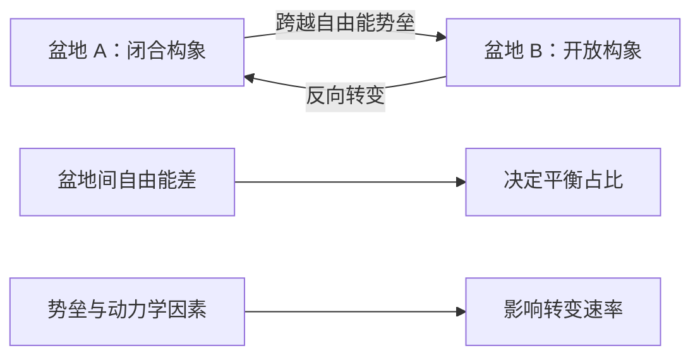
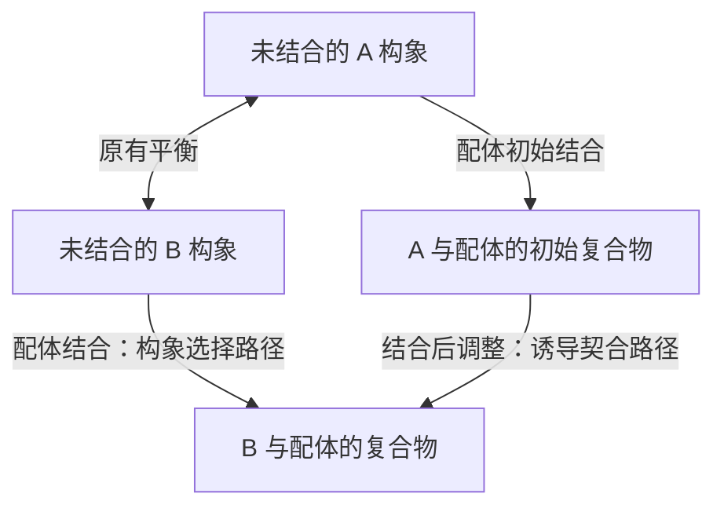
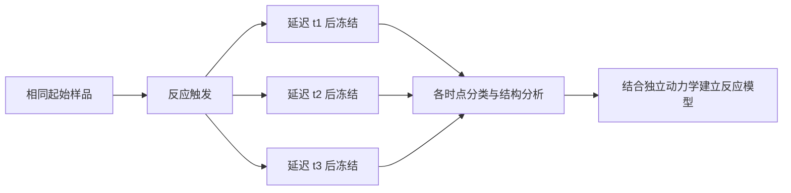
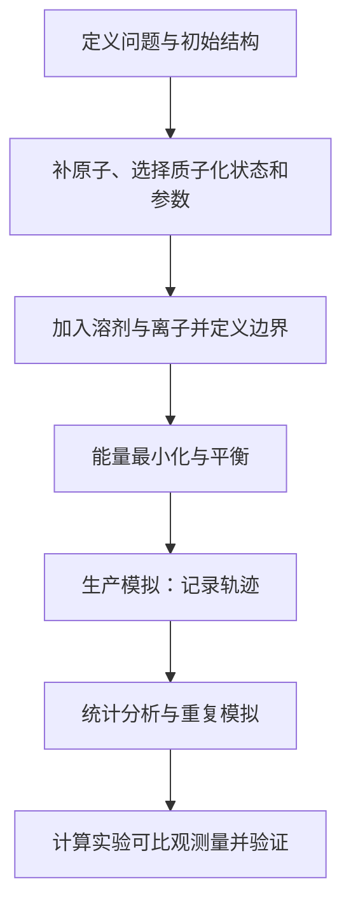
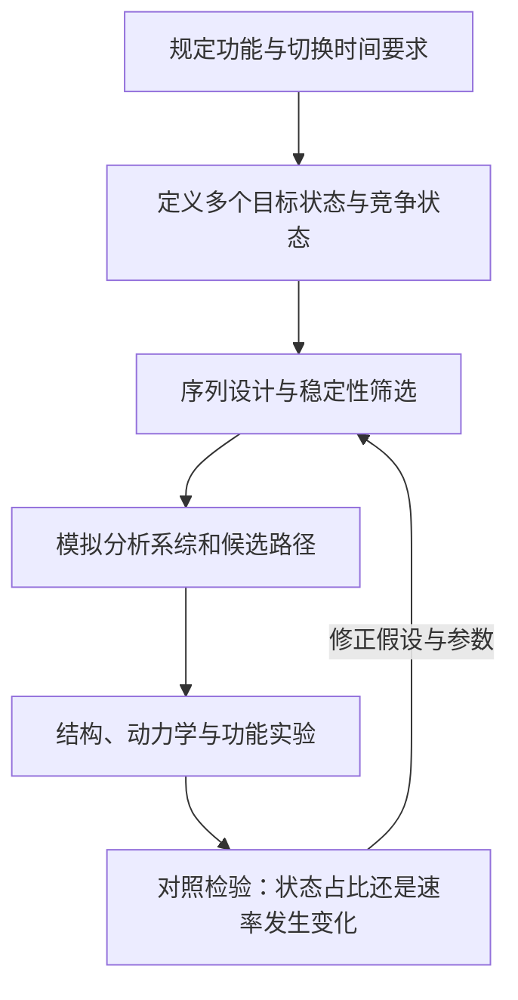

# 蛋白质设计：第 5 次课
## 蛋白质动态结构：构象系综、实验测量与功能设计

> **主题**：Protein Structural Dynamics  
> **学习目标**：理解蛋白质如何在保持结构稳定的同时发生运动，如何通过实验与模拟描述这些运动，以及如何把动态行为纳入功能解释和蛋白质设计。  
> **内容范围**：以课程材料为基础，补充必要的物理定义与方法解释。示意图表达概念关系，不代表特定蛋白的实测轨迹；数值量级不是所有体系的统一界限。

---

## 目录与知识架构

1. 蛋白质不是单一静态结构：构象、系综与运动尺度
2. 自由能景观：结构稳定性、状态占比与转变速率
3. 从运动到功能：通道、识别、催化与变构
4. 实验如何测量动态结构：观测量、时间尺度与限制
5. 分子动力学模拟：力场、轨迹与采样
6. 蛋白激酶：构象调控与抑制剂识别的综合案例
7. 从静态结构设计到动态功能设计
8. 公式速查、概念辨析与学习自测

---

## 1. 蛋白质不是单一静态结构

### 1.1 构象、构型与构象系综

**构象（conformation）**是分子通过键的旋转、局部变形及集体运动形成的空间排列，通常不需要改变共价连接关系。**构型（configuration）**则涉及不能仅通过普通单键旋转相互转换的立体化学关系，例如手性中心的不同构型。讨论蛋白质的开合、侧链翻转和结构域运动时，应使用“构象变化”。

实验结构通常不是蛋白质唯一可能的形态。给定温度、溶剂、配体及其他条件下，蛋白质可以占据多个微观状态，这些状态及其概率分布构成**构象系综（conformational ensemble）**。结构图中的一套原子坐标可能表示某个优势状态，也可能只是对实验平均信号的近似解释。

**动态结构**不仅关心“有哪些状态”，还关心状态之间怎样交换、交换多快、哪些运动相互关联。两个体系可以拥有相似的平均结构，却具有不同的状态占比和交换速率，因而表现出不同功能。

### 1.2 热涨落与结构稳定并不矛盾

**热涨落（thermal fluctuation）**是体系与热环境交换能量产生的微观变化。蛋白质不断发生键振动、侧链运动和局部构象变化，但共价键、非共价相互作用及溶剂环境会限制运动范围。因此，稳定折叠并不等于所有原子保持不动。

热运动的特征能量尺度为单粒子量 $k_BT$，或每摩尔量 $RT$。在 $25^\circ\mathrm C\approx298\ \mathrm K$ 时，$RT\approx0.59\ \mathrm{kcal\,mol^{-1}}$。它是比较能量尺度的参考，不是每个原子统一拥有的总能量；温度也不应换算为 289 K。经典能量均分定理针对适用条件下的独立二次自由度，不能不加条件地用于所有分子振动。

### 1.3 空间尺度和时间尺度必须分别描述

| 运动类型 | 空间特征 | 常见时间量级及说明 |
| :--- | :--- | :--- |
| 键伸缩、弯曲等振动 | 很小的局部位移 | 飞秒至皮秒量级；不同振动模式不同 |
| 侧链摆动或转子状态改变 | 原子至残基尺度 | 可涉及皮秒到更慢尺度，取决于局部势垒 |
| 环区和局部骨架运动 | 若干残基的位移 | 从快速涨落到微秒、毫秒及更慢过程 |
| 结构域开合及集体运动 | 较大范围的协调位移 | 可能跨越纳秒至毫秒或更慢尺度 |
| 折叠、解折叠和装配 | 全分子或多分子结构改变 | 差异很大，不能统一规定为数毫秒 |

$1\ \mathrm{fs}=10^{-15}\ \mathrm s$，$1\ \mathrm{ps}=10^{-12}\ \mathrm s$，$1\ \mathrm{ns}=10^{-9}\ \mathrm s$，$1\ \mu\mathrm s=10^{-6}\ \mathrm s$，$1\ \mathrm{ms}=10^{-3}\ \mathrm s$；$1\ \text{Å}=0.1\ \mathrm{nm}$。

**运动幅度**表示位置或构象变化的大小；**时间尺度**描述变化发生多快。位移大并不必然意味着运动慢，小幅度运动也可能被高势垒限制。课件中的尺度对应关系应理解为示意，而非严格的一一映射。

### 1.4 天然态与熔球态

**天然态（native state）**通常指给定条件下具有生物学相关折叠的状态或状态集合。**熔球态（molten globule）**是一类相对紧凑、保留较多二级结构，但特异性三级堆积较松散的状态。二级结构主要描述 α 螺旋、β 折叠等局部骨架组织；三级结构描述整个链的空间折叠和远距离接触。

熔球态可在部分蛋白折叠或变性条件下出现，但不是所有蛋白必须经过的唯一中间态。天然态中的功能运动也不等于蛋白整体进入熔球态。

---

## 2. 自由能景观：为什么有多个状态，又为什么能切换？

### 2.1 势能与自由能的区别

**势能（potential energy）**描述给定微观坐标下的相互作用能。**自由能（free energy）**还包含可访问微观状态数量带来的熵贡献；在恒温恒压条件下，常使用 Gibbs 自由能：

$$G=H-TS.$$

其中 $H$ 是焓，$S$ 是熵。一个构象状态即使某些相互作用更有利，也可能因为限制了分子或溶剂的自由度而损失熵。不能只比较某张结构的势能，就断言哪个状态在实验中更常见。

### 2.2 自由能景观与构象盆地

**自由能景观（free-energy landscape）**是在选定坐标上描述状态概率和能量障碍的图像。坐标可以是两个结构域之间的距离、某个二面角或若干集体变量。**盆地（basin）**表示一组较稳定且彼此容易交换的构象；**势垒（barrier）**表示跨越到另一个盆地需经历的不利区域。

这幅图强调：稳定性与速度是不同问题。势垒改变时，平衡占比可能几乎不变，但状态交换速度会明显改变。

### 2.3 状态占比：Boltzmann 分布

对热平衡中定义一致的两个构象状态 A 和 B，其概率比可写为

$$\frac{p_B}{p_A}=\exp\left[-\frac{G_B-G_A}{RT}\right].$$

$G_A$ 和 $G_B$ 是包含各状态内部微观自由度贡献的自由能。若比较的是经典正则系综中的具体微观坐标，则概率密度与 $e^{-U/(k_BT)}$ 成正比；由大量微观状态汇总为构象盆地时，必须考虑熵。

**示例**：在 298 K，若 B 的自由能比 A 高约 $1.36\ \mathrm{kcal\,mol^{-1}}$，则 $p_B/p_A\approx0.1$。较小的自由能变化即可显著改变少数态的占比，而少数态仍可能参与关键功能。

### 2.4 转变速率与反应坐标

**速率常数**描述某状态向另一状态转变的概率速率。在适用的过渡态理论近似下，

$$k\approx\kappa\frac{k_BT}{h}\exp\left[-\frac{\Delta G^{\ddagger}}{RT}\right],$$

其中 $\Delta G^{\ddagger}$ 是活化自由能，$h$ 是 Planck 常数，$\kappa$ 是传递系数。实际蛋白动力学还受溶剂摩擦、扩散、多个通路及坐标选择影响。

**反应坐标（reaction coordinate）**用于描述转变进程；**最小自由能路径（MFEP）**是在指定集体变量空间和定义下连接盆地的一条路径。二者不能简单画等号：一条路径需要坐标参数化，也不一定代表所有真实转变轨迹。课件提到 TAPS 等路径搜索方法，学习重点是其寻找候选转变路径的用途；所得路径仍需检验，而非自动等于完整动力学机制。

---

## 3. 从运动到功能

### 3.1 肌红蛋白：稳定核心中的瞬时通道

**肌红蛋白（myoglobin）**是含血红素的氧结合蛋白；血红素是含铁的卟啉辅基。静态空间填充模型中，配体通向内部结合位点的连续通道可能并不明显，但氧分子仍可进入和离开。这提示需要考虑局部残基运动和暂时开放的空隙。

球棍模型突出原子及键，卡通模型突出二级结构，空间填充模型显示原子的近似体积。它们是同一结构的不同表达，不是不同实验状态。单张模型中看不到入口不意味着分子不可进入；看见一个空腔也不证明它一定是主要迁移通路。

这种**门控（gating）**兼顾结合位点的保护与配体交换。B 因子较高区域、配体捕获的开放结构、动力学实验和模拟可共同支持通道假说；仅凭柔性较高不能证明该区域是唯一或必需的通路。

### 3.2 构象选择与诱导契合

**构象选择（conformational selection）**指配体优先结合原本已存在于未结合系综中的某种构象，使其占比升高。**诱导契合（induced fit）**指初始结合后又发生有利于形成最终复合物的构象调整。

两种过程可以并存；只比较结合前后两张结构，通常不能区分其动力学先后关系，需要浓度依赖的动力学和状态交换证据。

### 3.3 亲和力、特异性与构象熵

**亲和力（affinity）**描述结合平衡的强弱，常用解离常数 $K_d$ 表示；**特异性（specificity）**描述对不同配体的相对识别偏好。高特异性并不必然要求极强亲和力。柔性环区可扩大探索空间并适应目标形状，但结合时固定这些自由度也可能带来构象熵损失。

结合自由能取决于蛋白、配体、溶剂和离子等整个体系的焓熵变化，不能把“柔性增加”直接等同于“结合增强”。同样，快速释放产物有时比最大化结合强度更有利于催化循环。

### 3.4 集体运动、变构与快慢耦合

**集体运动**是多个原子或残基相关的运动；相关性本身不证明因果。**变构（allostery）**指一个位置的扰动通过改变构象分布或相互作用网络，影响另一位置的性质。变构不一定伴随显著的平均结构变化，也可能主要体现为柔性或状态占比变化。

快速局部涨落可能改变较慢过程的有效自由能、摩擦或进入反应构象的机会，但不能据此认定每一次快速振动都直接驱动催化。要证明功能相关性，应结合定量动力学、选择性扰动和对照实验。

---

## 4. 实验如何测量动态结构？

### 4.1 先区分三类问题

1. **空间分布**：原子在平均位置周围分散多远？哪些区域更可达？
2. **状态分布**：有哪些构象，其占比是多少？
3. **时间过程**：它们以多快速度交换，按什么路径响应扰动？

不同方法测量不同观测量，因此“观察到结构差异”“发现柔性区域”和“测得交换速率”不能互相替代。

### 4.2 晶体学 B 因子：位移分布而非运动录像

晶体衍射来自大量晶胞，并在曝光过程中积累信号。精修模型中的**原子位移参数（atomic displacement parameter，ADP）**描述平均位置周围的空间分布；各向同性表达通常写作 B 因子。

$$B=8\pi^2U_{\mathrm{iso}}.$$

$U_{\mathrm{iso}}$ 是各向同性模型中一个笛卡尔方向的均方位移，单位为 $\text{Å}^2$；若使用三维总均方位移，则 $B=(8\pi^2/3)\langle|\Delta\mathbf r|^2\rangle$。必须说明所用定义，避免相差三倍。

**Debye–Waller 因子**描述位移分布导致的散射衰减。在常见约定下，原子散射振幅含有 $\exp[-B(\sin\theta/\lambda)^2]$ 项。较大 B 值意味着高空间频率信息衰减更明显，但其来源可以包括热运动、静态构象异质性、晶格无序和模型误差。

- 同一模型中，埋藏核心与暴露环区的相对 B 因子可提供线索，但要考虑晶体接触及局部精修质量。
- 温度降低导致 B 因子下降可支持热运动的贡献，但不能自动将所有剩余差异归于某一种运动。
- 不同结构的原始 B 值受分辨率、温度、数据处理及精修方式影响，不能直接横向比较；经过控制和适当标准化的比较才可能有意义。
- 高分辨率有助于解释，但“优于 2 Å”并不保证晶格无序可忽略，也不是动态信息有无的绝对分界。

B 因子不能单独给出运动方向的完整路径或交换速率。各向异性 ADP 可描述方向性分布，但仍不是时间轨迹。

### 4.3 时间分辨晶体学：对反应过程作延迟采样

**时间分辨（time-resolved）**实验在可控时刻触发变化，经过不同延迟后测量。**泵浦—探测（pump–probe）**中，泵浦用于启动反应，探测用于读取结构信号。触发可由光照、混合等方式完成，具体取决于体系。

Laue 晶体学使用多色 X 射线，在一次曝光中记录多个反射；X 射线自由电子激光（XFEL）可提供极短脉冲。串行晶体学从许多晶体收集数据，时间分辨串行实验还需控制反应启动和延迟。

短脉冲不等于整个实验拥有同样短的有效时间分辨率：触发同步性、混合和扩散、各状态占比及信号强度同样重要。常规晶体学的平均也不必耗时数天或数周，采集时间取决于实际方案。

### 4.4 冷冻电镜：冻结系综与时间分辨快照

单颗粒冷冻电镜对玻璃态冰中大量颗粒成像。**三维分类**尝试将不同构象或组成的颗粒区分；**连续异质性**指结构变化更接近连续分布，而不是少数离散状态。

获得多个类别说明样品具有可分辨的异质性，但类别之间不一定存在直接转变；分类占比还可能受到制样、取向偏好和颗粒筛选影响。常规冷冻电镜并不追踪同一分子随时间的运动。

时间分辨冷冻电镜通过启动反应后在多个延迟点玻璃化，获得过程快照。有效时间分辨率受混合、输运和冻结过程限制，不应与探测器曝光时间混淆。

### 4.5 NMR：从局部环境到状态交换

**核磁共振（NMR）**利用具有适当核自旋的原子核在磁场中的共振性质。**化学位移**反映核周围电子环境；**弛豫**描述受扰动后自旋体系恢复或失去相干性的过程，对特定时间尺度的运动敏感。

通过适当实验，快速局部运动、微秒至毫秒构象交换及某些低占比状态都可研究。弛豫色散等测量需要借助交换模型解释，不存在一套实验无条件覆盖全部时间尺度。对固有无序蛋白、溶液构象与凝聚体系，NMR 可提供有价值的信息，但谱线展宽、重叠和样品条件会构成限制。

**固有无序蛋白或区域（IDP/IDR）**缺乏单一稳定折叠，但可具有局部偏好及功能性相互作用；**生物分子凝聚体**是分子富集的组织形式，其中部分可由相分离形成，不能仅凭液滴外观就认定其机制。

### 4.6 交联质谱：捕捉可发生反应的邻近关系

**交联质谱（XL-MS）**利用交联剂将两个适当反应基团共价连接，随后经消化和质谱鉴定连接位点。交联提供与交联剂跨度、侧链长度、溶剂可达性及构象相关的邻近约束，而不是两个原子之间精确不变的距离。

比较有无配体或不同时间点的交联模式，可识别装配或构象变化。反应速度、交联程度和肽段检测偏差必须控制；过度交联可能改变原有系综，未检出交联也不等于两个区域必然相距很远。

### 4.7 氢氘交换质谱：保护程度的读出

**氢氘交换质谱（HDX-MS）**测量蛋白在重水环境中可交换氢被氘替换的过程，常关注主链酰胺氢。其交换受局部氢键、溶剂可达性、瞬时开放及溶液条件影响。

实验通常包括多个标记时间点、低温低 pH 淬灭、酶解和质谱分析。肽段质量变化反映氘摄入；常规结果通常是肽段级空间分辨率，不能默认每个残基均可独立定位。样品处理中的**回交换**会损失氘标记，需要控制。

交换减少可来自结构稳定、界面形成或状态占比变化，不能单独区分这些原因；交换增加也不能简单等同于“运动更快”。

### 4.8 自由基足迹与红外光谱：补充化学环境信息

**自由基蛋白质足迹（radical footprinting）**利用短寿命自由基修饰可接近的侧链，再通过质谱定位修饰；同步辐射可作为产生自由基的手段之一。读出受残基化学反应性、可达性和自由基剂量共同影响。它与主要关注主链酰胺氢的 HDX-MS 互补。

**傅里叶变换红外光谱（FTIR）**根据分子振动吸收研究局部化学环境和结构变化。时间分辨测量可结合光触发或停流混合；**停流（stopped-flow）**是快速混合后停止液流并记录信号的方式。红外差谱可显示反应中化学键和环境改变，但将峰指认到特定残基通常需要额外证据。

### 4.9 方法互补关系

| 方法 | 直接或主要读出 | 不应直接推出的结论 |
| :--- | :--- | :--- |
| 晶体学 B 因子 | 平均位置周围的位移分布参数 | 精确交换速率、唯一运动路径 |
| 时间分辨晶体学 | 不同延迟的衍射差异和结构状态 | 每个分子的完整实时轨迹 |
| 常规冷冻电镜分类 | 可分辨的构象或组成异质性 | 类别间时间顺序及真实速率 |
| NMR 动力学测量 | 局部运动和交换相关信号 | 无模型条件下的全部原子运动 |
| XL-MS | 反应可及的邻近约束 | 精确固定距离或唯一构象 |
| HDX-MS | 酰胺交换与保护程度 | 单一确定的运动幅度或速度 |
| 自由基足迹 | 侧链修饰模式 | 完全独立于化学反应性的暴露面积 |

---

## 5. 分子动力学模拟：给结构加入时间维度

### 5.1 力场如何把坐标转化为运动？

**分子动力学（molecular dynamics，MD）**通过计算原子受力并积分运动方程生成随时间变化的坐标序列，即**轨迹（trajectory）**。在经典近似下，

$$m_i\frac{d^2\mathbf r_i}{dt^2}=\mathbf F_i=-\nabla_i U.$$

**力场（force field）**是势能函数及其参数的集合。常见固定拓扑力场包含键伸缩、键角、二面角以及非键相互作用：

$$U=U_{\rm bond}+U_{\rm angle}+U_{\rm torsion}+U_{\rm vdW}+U_{\rm electrostatic}.$$

键长和键角通常较“硬”，即偏离平衡值的代价较大；二面角与非键接触常为较“软”的自由度。氢键在许多力场中由静电和范德华项共同描述，不一定有独立氢键项。**疏水效应**与溶剂自由能有关，不应简单当作真空中两原子之间的普适吸引力。

### 5.2 模拟流程与计算代价

**质子化状态**决定某些基团的电荷，可能显著影响相互作用。**周期性边界条件**用重复的模拟盒近似体相环境，但需防止分子与周期镜像产生不合理影响。**能量最小化**消除局部不利接触，不等于热平衡采样。

由于快速振动要求很小的积分步长，长时间过程需要大量计算。例如 $2\ \mathrm{fs}$ 步长对应 $1\ \mu\mathrm s$ 轨迹约 $5\times10^8$ 步。模拟时间是模型中的物理时间，不能与计算机实际运行时间混同。

### 5.3 分析量：RMSD、RMSF 与自由能分布

**均方根偏差（RMSD）**衡量对齐后结构相对参考结构的总体偏离；**均方根涨落（RMSF）**描述轨迹中某原子相对其平均位置的波动：

$$\mathrm{RMSF}_i=\sqrt{\left\langle|\mathbf r_i(t)-\langle\mathbf r_i\rangle|^2\right\rangle}.$$

分析前需处理整体平移和旋转。RMSD 达到平台不证明已经充分采样；RMSF 与晶体 B 因子的比较也必须考虑实验环境、静态无序及位移定义。

对平衡采样得到的集体变量 $q$ 的概率分布，可定义势均力型自由能：

$$F(q)=-k_BT\ln P(q)+C.$$

坐标的测度、Jacobian 因子、分箱和偏置校正会影响解释。轨迹中很少访问或未访问的区域不能凭有限样本可靠估计。

### 5.4 采样、力场误差与实验约束

**采样不足**指轨迹未充分覆盖与问题有关的状态。**增强采样**通过偏置或其他策略提高跨越势垒的机会，但偏置轨迹的时间通常不能直接当作真实动力学时间。重复轨迹、一致性分析和统计误差估计是判断稳健性的必要组成。

经典力场通常不能直接描述化学键形成和断裂；化学反应可能需要量子化学或 **QM/MM**，即以量子方法处理关键区域、以分子力学处理周围环境。模型越详细也不意味着必然越准确，参数和采样仍是限制。

将 MD 模型拟合到冷冻电镜图可结合原子几何与实验信息，但**拟合得更好不证明转变路径就真实**。实验约束应与独立数据验证配合，避免在噪声上过拟合。

---

## 6. 蛋白激酶：动态调控的综合案例

### 6.1 催化结构域的组成

**蛋白激酶（protein kinase）**催化磷酸基团转移，常将 ATP 的末端磷酸转移到蛋白底物。典型真核蛋白激酶的催化结构域包含较小的 N 端叶和较大的 C 端叶，ATP 结合于两叶之间的裂隙。

| 元件 | 定义与功能联系 |
| :--- | :--- |
| 铰链区（hinge） | 连接两叶并参与 ATP 腺嘌呤结合；也与两叶相对位置有关 |
| αC 螺旋 | N 端叶中的调控元件；其位置影响保守残基网络和活性构象 |
| 保守 Lys–Glu 离子对 | 典型活性构象中参与组织 ATP 结合环境；残基编号随蛋白变化 |
| HRD 基序 | 催化环中的保守序列，其 Asp 在许多激酶中参与催化化学 |
| DFG 基序 | 活化区起始附近的 Asp–Phe–Gly；Asp 参与金属离子配位，构象变化影响活性位点 |
| 活化环（activation loop） | 可通过构象和磷酸化调节底物可达性及活性构象稳定性 |
| 富甘氨酸环（G-loop） | 参与核苷酸磷酸基团周围的组织与柔性调节 |

**基序（motif）**是具有结构或功能意义的保守序列模式。激酶 G-loop 不应与典型 P-loop NTP 酶的磷酸结合环直接等同，它们的拓扑和残基组织不同。

### 6.2 活性状态与非活性状态

不同激酶的活性构象往往具有相似的催化几何关系；非活性构象可以通过 αC 螺旋移位、DFG 重排、活化环遮挡等多种方式实现。**DFG-in/DFG-out**描述 DFG 区域的特定构象类别，不能用单个标签概括所有激酶活性。

磷酸化增加带负电的磷酸基团，可能改变相互作用网络和状态稳定性；它不是对所有蛋白都通用的“开启开关”。

### 6.3 Src：调控结构域怎样稳定自抑制状态？

Src 的 SH3、SH2 和激酶结构域之间存在调控联系。**SH2 结构域**常识别含磷酸酪氨酸的序列，**SH3 结构域**常识别适当的富脯氨酸片段。在经典自抑制组织方式中，SH2 与 C 端磷酸化尾部的结合、SH3 与连接区的相互作用共同稳定关闭的整体构象。

调控相互作用改变可解除这种约束，使活化环和催化结构域更容易进入有利状态。经典文献中的 Tyr416 编号依所用 Src 物种和序列约定而定，不能不经核对直接移植到所有同源蛋白。

### 6.4 Imatinib：识别并稳定特定非活性构象

Imatinib（商品名 Gleevec）是课件用于说明构象依赖识别的实例。BCR–ABL 是染色体重排产生的融合酪氨酸激酶，与慢性髓性白血病的重要致病机制有关。这里关注结构原理，不涉及治疗方案。

Imatinib 可识别 Abl 的特定非活性构象。选择性不仅来自结合口袋残基，也与蛋白能否进入并稳定相容构象有关。因此，平均活性结构相似的激酶，其抑制剂敏感性仍可不同。药物结合后的结构不能单独证明完整结合路径；“捕获非活性状态”应理解为对构象系综的选择与稳定。

---

## 7. 从静态结构设计到动态功能设计

### 7.1 单状态稳定不等于功能充分

从头蛋白设计需要序列能够折叠并维持目标结构，但功能可能还要求开合、配体交换、变构传播或催化循环。过度稳定一个状态可能阻碍必要的切换；另一方面，过强柔性又可能削弱结构特异性或导致聚集。因此目标不是简单地“更硬”或“更软”。

Top7 等人工折叠案例可用于讨论结构稳定与动态功能之间的区别，但不应概括为所有设计蛋白都刚性极高或没有功能运动。

### 7.2 动态设计需要同时控制的变量

1. **状态结构**：哪些构象必须存在，关键几何是否正确？
2. **相对自由能**：未结合与结合条件下，各状态应占多大比例？
3. **转变势垒**：切换是否发生在功能所需时间尺度？
4. **耦合关系**：配体、磷酸化或环境变化能否选择性改变系综？
5. **可靠性**：是否仍能表达、折叠、避免聚集并承受目标环境？

**多状态设计（multistate design）**同时评价一个序列对多个目标状态的适应性；**负设计（negative design）**还需避免竞争状态、错误装配和不期望的结合。仅优化多个静态模型的能量不保证状态之间存在可行转变路径。

### 7.3 设计—模拟—实验闭环

主要挑战包括自由能差计算精度、稀有状态采样、庞大的序列空间和实验验证成本。课件以动态设计研究作为前沿方向展示；个别成功案例不能说明任意天然蛋白的复杂运动都已可以设计。

---

## 8. 公式速查、辨析与自测

### 8.1 核心关系

| 关系 | 主要含义 | 使用条件或注意事项 |
| :--- | :--- | :--- |
| $G=H-TS$ | 稳定性由焓和熵共同决定 | 比较需保持热力学条件一致 |
| $p_B/p_A=e^{-\Delta G/RT}$ | 相对自由能决定平衡占比 | 状态自由能应包含内部熵贡献 |
| $k\propto e^{-\Delta G^\ddagger/RT}$ | 势垒影响速率 | 前因子及动力学环境不可忽略 |
| $B=8\pi^2U_{\rm iso}$ | 位移参数与 B 因子关系 | 注意一维与三维均方位移定义 |
| $\mathbf F_i=-\nabla_i U$ | 力由势能梯度给出 | 依赖所用力场和近似 |
| $F(q)=-k_BT\ln P(q)+C$ | 概率分布与自由能联系 | 需要适当采样、测度和偏置校正 |

### 8.2 必须区分的概念

- **结构异质性与动力学**：多个结构不自动给出交换速率。
- **柔性与无序**：稳定折叠可以局部柔性，无序也可能存在明确构象偏好。
- **热力学与动力学**：盆地深浅影响占比，势垒与摩擦影响转变。
- **实验读出与机制解释**：B 因子、交换、交联和分类信号都需模型解释，不能独立替代完整机制。
- **模拟可视化与验证**：动画的连续性不证明其路径具有真实概率或正确时间尺度。
- **功能相关与功能必需**：关联证据需配合扰动、对照和救援等实验，才能更有力地支持因果关系。

### 8.3 自测问题

1. 相同平均结构为什么可能具有不同功能？请分别从状态占比和转变速率解释。
2. 为什么 B 因子不能给出侧链翻转频率？它受到哪些非动态因素影响？
3. 普通冷冻电镜分类与时间分辨冷冻电镜分别能回答什么？
4. 配体结合后 HDX 降低，可能有哪些机制？如何设计互补实验区分？
5. 为什么 RMSD 稳定不代表 MD 收敛？如何验证模拟与实验一致？
6. 怎样区分构象选择与诱导契合？单靠两张晶体结构为何不够？
7. 如果要设计配体控制的蛋白开关，需要同时优化哪些热力学与动力学性质？

### 8.4 延伸阅读线索

以下为课程材料列出的参考文献，供进一步查阅；本笔记未逐篇展开其原文。

- Brooks, C. L., III; Karplus, M.; Pettitt, B. M. *Proteins: A Theoretical Perspective of Dynamics, Structure, and Thermodynamics*. Wiley, 1988.
- Ringe, D.; Petsko, G. A. Study of protein dynamics by X-ray diffraction. *Methods in Enzymology*, 1986, **131**, 389–433.
- Sekhar, A.; Kay, L. E. An NMR View of Protein Dynamics in Health and Disease. *Annual Review of Biophysics*, 2019, **48**, 297–319.

> **贯穿全篇的研究逻辑**：先定义功能问题，再区分状态、占比和速率；用互补实验约束模型，用模拟提出可检验假设，最终通过独立功能实验检验机制。
