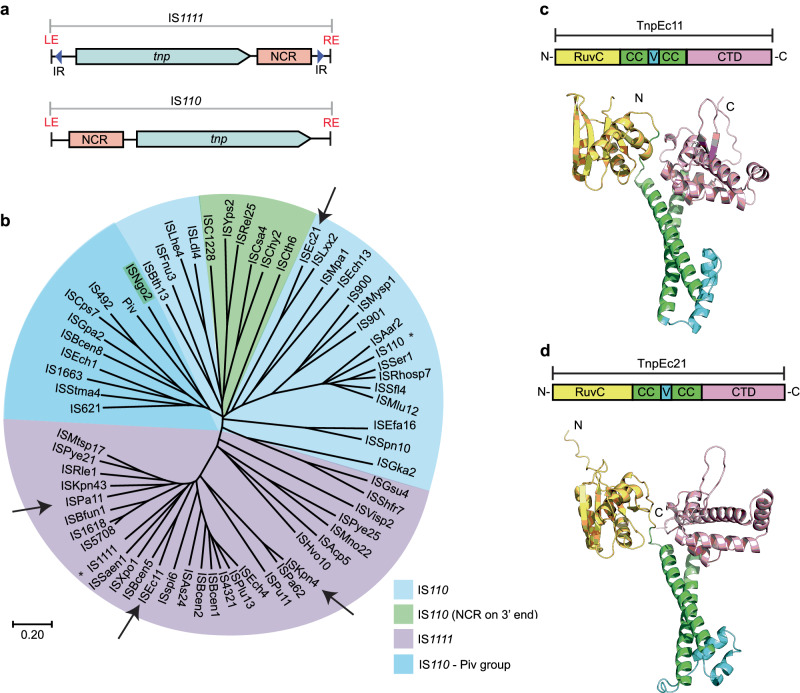
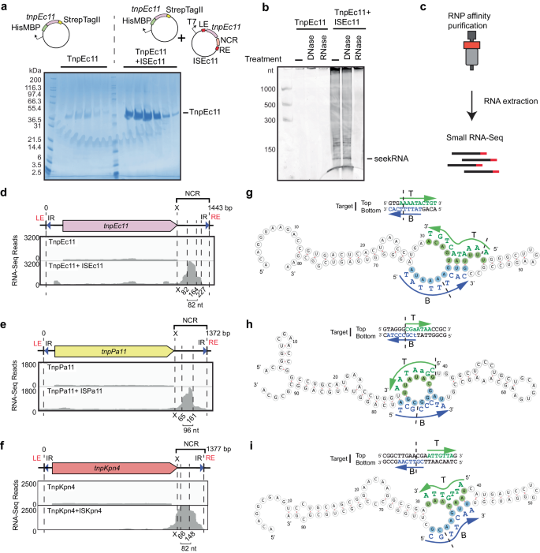
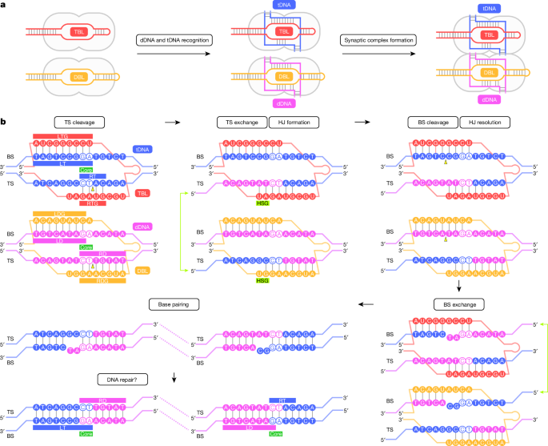
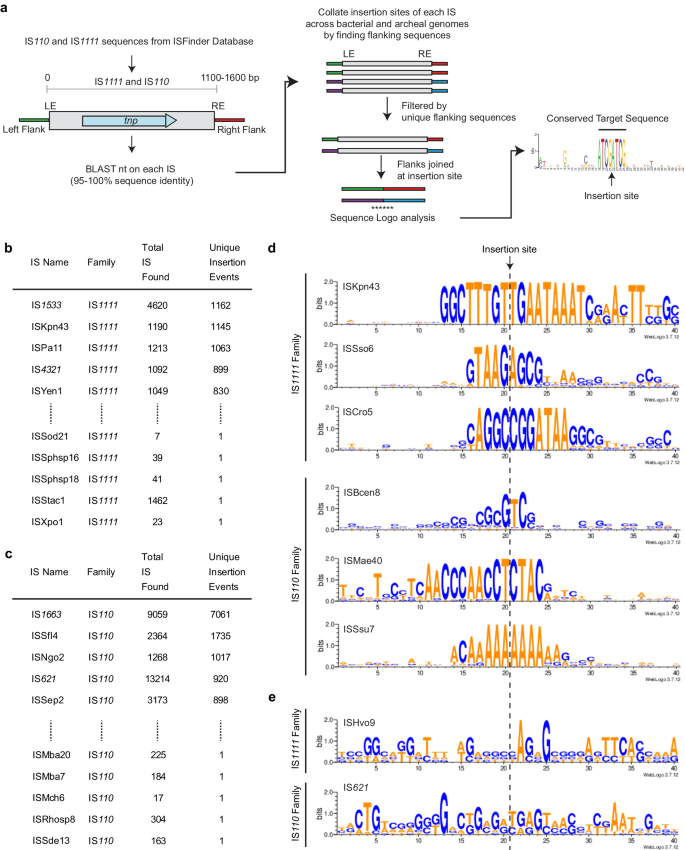

# IS110 family 与 IS1111 subfamily：图文详解

**文献检索截止：2026 年 11 月 4 日。** 本文按此前对话一至十五节的主题重新整合；原对话部分长回答在可读取记录中被截断，因此这是一份经原始文献核对的重建稿，而非逐字转录。方括号编号对应第十五节。图像已保存为本地附件，可离线显示；若图片无法加载，可点击相应的论文图页。图片版权及再利用条件以原文许可和图片标注为准；标注来源不自动赋予一切用途的许可。

## 一、分类与基本概念

插入序列（insertion sequence，IS）是通常只携带自身移动所需功能的小型移动遗传元件。广义 **IS110 family** 包括 IS110 型及 IS1111 型等相关类群；ISfinder 曾将它们统一置于 IS110 家族。另一些研究根据全长转座酶系统发育、末端反向重复和元件构型，将 IS110 与 IS1111 分列为两个家族 [1]。因此，“IS1111 亚家族”是广义框架下的说法；看文献时应先确认作者的分类口径。

IS110 的代表之一来自 *Streptomyces coelicolor*；IS1111 因在 *Coxiella burnetii* 中发现而得名。IS1111 序列也被用作 Q 热分子检测靶标，但拷贝数变异和其他检验条件影响检测表现，不能把单一靶标的结果当作所有情境下的绝对判据。

它们的共同特征包括相关的 DEDD/RuvC-like 转座酶、重要的非编码区和通常较强的序列及方向选择性。**不是每一个家族成员都已实验验证具有 RNA 引导活性，也不是所有成员识别相同靶序列。**



**图 1｜**典型构型、简化系统树以及 TnpEc11/TnpEc21 的 AlphaFold2 预测。来源：Siddiquee 等，2024，Figure 1 [1]；[原图页](https://www.nature.com/articles/s41467-024-49474-9/figures/1)。本文图注为中文概述；结构模型不是实测原子结构。原文为开放获取，具体重用请核对论文许可及第三方材料声明。

## 二、遗传结构：tnp、末端和 NCR

按 **tnp 的转录方向**统一定义上游与下游，可用下列示意理解典型排列；不表示所有元件都严格如此，也不是按染色体固定左右方向定义：

```text
IS110 型：   较长 NCR ───── tnp → ─── 末端
IS1111 型：  末端 ──────── tnp → ─── 较长 NCR
             两端常有向内偏移的反向重复 sTIR
```

| 比较 | IS110 型 | IS1111 型 |
|---|---|---|
| 较长 NCR | 常在 tnp 上游 | 常在 tnp 下游 |
| sTIR | 通常不明显，或短而不完美 | 常见约 11–13 bp、近乎匹配的 sTIR |
| 蛋白 | RuvC-like DEDD、卷曲螺旋及 Tnp 相关区 | 相似总体架构，但全长和可变区存在分化 |
| 已实验证实的 RNA | 如 IS621 bridge RNA、ISEc21 seekRNA | 如 ISEc11、ISKpn4、ISPst6、ISPa11 的 seekRNA |
| 典型识别 | 与 RNA 配对并受蛋白、核心位点及 DNA 构型影响 | 已研究成员显示 RNA 靶序列互补及末端要求 |

在 [1] 的 352 条条目分析中，186 条较长 NCR 在下游、123 条在上游、26 条两侧都有、17 条两侧都无明显较长 NCR。这是**所分析数据库条目的总体统计**，并非两个亚群各自的计数，也不能推断自然界的总体频率。存在例外，因此应结合蛋白全长系统发育、末端和上下文判断。

## 三、sTIR、真实边界与靶位点重复

**sTIR**（subterminal inverted repeats）是位于元件末端内部的一对反向重复。把两端序列以相同 5′→3′ 方向书写，若一端与另一端的反向互补序列相符，即构成反向重复。例如 `5′-ATGCCG-3′` 与 `5′-CGGCAT-3′`。这是人工例子，不是任何天然 IS 的实际末端。

已研究的 IS1111 型常在 sTIR 外仍有末端延伸；[1] 归纳左端通常 7 bp、右端 3 bp，部分左端为 6 bp。具体长度必须按系统验证，不能直接把 sTIR 的边界当成 IS 的边界。末端序列可能参与识别或反应，但不同成员中每个碱基的功能不能仅凭相似性认定。

边界判断影响是否看到**靶位点重复（TSD）**。把元件内的末端误算成侧翼，可能制造看似重复的靶序列。IS110/IS1111 的已研究案例并不以常规靶位点重复为普遍特征 [1]。判断时应联合完整未插入靶序列、插入前后两侧接头、多个独立拷贝及可能的末端连接产物；无此证据时报告“候选边界”，而非宣称已确定。

## 四、非编码区与 RNA 的产生

NCR 是 DNA 上不编码所注释转座酶蛋白的区段，并非“没有功能”。[1] 在四个 IS1111 型及一个 IS110 型代表中发现与转座酶共纯化、来自 NCR 的 seekRNA，实验支持其对所测转座的必要性。富集的短形式约 70–100 nt，另有较长的 RNA 形式；长度和端点随系统、检测条件而变。

IS 两端相接时可产生接头启动子；在一些系统中有相关转录证据，但不能把这一调控方式推广为所有元件的唯一 RNA 来源。检测到环状或末端相接产物，也不能单凭其存在证明完整转座的每一步。RNA 的加工、稳定性及启动子可随元件而异 [1,2]。



**图 2｜**Tnp 结合核酸的酶处理、RNA 测序定位，以及 seekRNA 结构预测和靶序列配对。来源：[1] Figure 3；[原图页](https://www.nature.com/articles/s41467-024-49474-9/figures/3)。二级结构图中的某些配对为预测，需结合突变或结构数据解读。

## 五、DEDD/RuvC–Tnp 转座酶

这些蛋白具有 N 端 RuvC-like RNase H 折叠，保守酸性残基常写作 DEDD；还有卷曲螺旋、可变区和 C 端 Tnp 相关结构。命名为 RuvC-like 只说明结构和催化核心相关，**不等于其生化反应与 Cas12 核酸酶相同**。

IS621 是结构解析最充分的例子之一：326 aa 蛋白的 D11、E60、D102、D105 构成 DEDD 模式，C 端 S241 参与催化 [3]。冷冻电镜和功能实验显示，RuvC 与另一蛋白亚基的 Tnp 域构成复合活性中心；S241 与 DNA 形成暂时的 5′-磷酸丝氨酸共价连接，D102 等参与定位和稳定。蛋白二聚体进一步装配成四聚体。上述具体编号只适用于 IS621，不能直接套用到其他同源蛋白。

蛋白可能通过疏水残基楔入 DNA、帮助局部解链，使 RNA 可以配对；催化中心装配也与底物正确聚合有关 [3]。保守性、结构预测和点突变是重要线索，但鉴定为 DEDD 同源物不等于已经证明其为活性 RNA 引导重组酶。

## 六、seekRNA 与 bridge RNA

**seekRNA** 是 [1] 对所研究转座酶结合 RNA 的称呼，强调其对靶选择的作用。**bridge RNA（bRNA）** 是 [2] 对 IS621 等系统的称呼，强调 RNA 中可分别指定靶 DNA 与供体 DNA 的模块。两项研究描述相关系统的引导 RNA，但不同元件和不同 RNA 长短形式不应在缺乏证据时视为功能完全等同。

在 IS621 中，靶结合环 TBL 识别靶 DNA；供体结合环 DBL 识别供体 DNA。每个环含多个与不同 DNA 链或不同位置配对的片段。改变 TBL 或 DBL 可以改变对应底物选择，但可编程范围受 RNA 结构、蛋白接触、核心序列和底物构型约束 [2,3]。单个 bRNA 序列包含两种识别模块；在所解析的 IS621 聚合复合体中，两个功能环来自**两条不同 RNA 分子**，不能简单画成一个分子在同一复合体中必然连接两侧 [3]。

[1] 比较的 IS1111 型 seekRNA 中，与靶 DNA 上链相对应的互补片段在下链互补片段之前；所测 IS110 型 ISEc21 中顺序相反。这里的上下链依原论文定义，改变序列方向和链标记会改变表述；不能把顺序作为仅凭序列分类的绝对规则。ISEc11 重新定向实验同时修改了 seekRNA 和供体侧翼，故不宜宣称只改 RNA 就已证明任意供体和靶均可重组。

## 七、DNA 重组：以 IS621 为结构实例



**图 3｜**IS621 复合物装配及分步链交换模型。来源：Hiraizumi 等，2024，Figure 5 [3]；[原图页](https://www.nature.com/articles/s41586-024-07570-2/figures/5)。图示包含依据结构和实验提出的后续步骤，不应将所有步骤等同于直接观察。

1. **底物识别：**蛋白、bRNA 与各自匹配的靶 DNA 和供体 DNA 形成复合体；DNA 局部打开，允许 RNA–DNA 配对。
2. **聚合：**两个蛋白二聚体将 DNA 底物带至同一复合体；IS621 的供体与靶包含相应核心序列，实验中的天然核心为 CT。
3. **首条链交换：**复合活性位点切开两底物的一条链，形成蛋白–DNA 共价中间体；交换并连接形成 Holliday 结。
4. **另一条链处理：**结构显示另一条链的切割和结的解析状态；其后的完整连接和可能的错配修复在细胞中仍需进一步阐明 [3]。

“没有游离的常规双链断裂”描述的是特定模型中的受控链交换，并不等于不存在 DNA 切割、绝无断裂副产物或无需评估基因组损伤。结构实验为稳定复合物曾使用含错配的 DNA、以及为解析不同中间态设计的 RNA；需与天然细胞中的动力学区别开。

**2026 年的关键修正：**CazIS110-1 的生化研究提出两个 RNA 引导路径：一条涉及上链切除/重接形成八字形中间体并由复制处理；另一条可直接将链转移至靶位点 [7]。这挑战了将所有 IS110 移动统一描述为“完整双链切出、形成独立环、再插入”的简单模型。IS621 重组结构和 CazIS110-1 转座路径涉及不同体系与实验，尚不能断言它们之间每一步均已统一，亦不能直接推广到所有 IS1111。

## 八、代表系统与证据

| 系统 | 类型与天然背景 | 已支持的特征 | 解读边界 |
|---|---|---|---|
| IS621 | IS110 型，*E. coli* | bRNA 双模块、细菌中的插入/切除/倒位、结构解析 [2,3] | 野生型 RNA、供体和靶的适配决定效果 |
| ISEc11 | IS1111 型，*E. coli* | seekRNA 与转座酶结合，识别短线性靶；有重编程实验 [1] | 改造实验涉及供体侧翼，不代表无限制改靶 |
| ISKpn4、ISPst6 | IS1111 型 | 偏向整合子基因盒 attC 位点一端 [1] | 靶结构和位点语境需按具体元件判断 |
| ISPa11 | IS1111 型，*Pseudomonas aeruginosa* | 与染色体 REP 重复相关；检出结合 RNA [1] | 重复序列中的插入偏好不意味着所有 REP 可用 |
| ISEc21 | IS110 型 | 已测 seekRNA、靶选择与重编程 [1] | 其机制细节不能直接等同于 IS621 |
| ISCro4 | IS110 相关 | 2026 年人体细胞中可编程多千碱基切除、倒位和供体插入 [5,6] | 不同研究的效率和特异性按实验条件理解 |
| CazIS110-1 | IS110 型 | 生化研究提出两条不同的 RNA 引导转座路径 [7] | 尚待跨成员、宿主、体内条件比较 |

Piv 是相关 DNA 倒位酶，常作为进化比较对象；存在同源性不等于已证明它具有与 IS621 完全相同的 RNA 引导功能 [1]。

## 九、天然靶位点与方向性

靶位点是插入发生前的宿主 DNA 序列。若转座子两侧的序列分别为 L 和 R，判断天然靶通常需找到同源的**未插入序列 L–R**，再比较元件左、右接头。仅凭一个插入拷贝看似保守的侧翼，无法保证哪些碱基属于 IS、哪些属于宿主。

[1] 汇总显示 ISEc11 偏向短线性位点，ISKpn4/ISPst6 偏向某些 attC 端，ISPa11 偏向 REP。不同系统的序列、长度、方向和 DNA 环境不同；核心二核苷酸偏好也不是整个家族统一的 PAM。IS621 的具体核心约束应按该系统的测定结果判断。



**图 4｜**数据库拷贝、去冗余、侧翼比对及靶序列 logo 的流程。来源：[1] Figure 8；[原图页](https://www.nature.com/articles/s41467-024-49474-9/figures/8)。其中不少条目独立位点不足，IS621 即使有许多位点也未给出清晰共识，说明阴性 logo 不能直接否定序列选择性。

## 十、与 TnpB / Cas12 的比较

| 维度 | IS110 型桥接重组酶 | TnpB | Cas12 |
|---|---|---|---|
| 生物学背景 | 移动元件相关重组/转座 | 常见于 IS200/IS605 等元件，RNA 引导核酸酶 | CRISPR 适应性免疫效应蛋白 |
| 引导 RNA | 已研究的 bRNA 可识别供体和靶 | ωRNA/reRNA 指导靶识别 | crRNA 指导靶识别，具体体系不同 |
| 核心结果 | 配对 DNA 分子之间重组，产物依底物结构而定 | RNA 引导 DNA 切割 | 通常 RNA 引导靶 DNA 切割，某些体系另有旁切 |
| 靶旁序列 | 系统特异的核心与结构约束 | 通常有系统特异 TAM，例如 ISDra2 TnpB 的 TTGAT [9] | 通常有系统特异 PAM |
| 插入载荷 | 经供体–靶重组可实现 | 本身主要是核酸酶，插入通常需额外机制 | 单独 Cas12 切割不等于直接完成大片段插入 |

TnpB 与部分 Cas12 蛋白存在演化联系；IS110 重组酶也有 RuvC-like 折叠，但**共享折叠不证明 IS110 转座酶就是 TnpB、Cas12 的直接祖先，也不能仅据此认定其催化反应相同**。同一家族内的机制也会多样化。

## 十一、分类和结构判别的实用框架

建议按证据由强到弱综合评估：① 全长蛋白与经整理参考序列的系统发育；② 真实元件两端及反向重复；③ DEDD 和 C 端相关特征；④ 较长 NCR 的方向与位置；⑤ 候选 RNA 的结构、表达和靶配对；⑥ 插入接头与功能实验。单独的 motif、单个长度阈值或 AlphaFold 相似性都不够。

系统树需要检查截断蛋白、基因误注释和长分支；用合适的同源序列构建比对，并报告覆盖度、树方法与支持度。离群候选应保留“不确定分支”的标签。若发现不同 RNA 与相同蛋白高度相似但靶侧翼不同，可提出自然重编程假设，但也必须排除菌株亲缘、组装错误和边界误差。

## 十二、生信挖掘：从序列到候选系统

1. **收集与记录：**从 ISfinder、NCBI、完整基因组或宏基因组组装获取参考序列与邻域；记录版本、坐标、链方向和来源，保留原始 FASTA。
2. **搜索蛋白：**用已验证的 IS621、ISEc11 等做同源检索并结合结构域模型；检查蛋白覆盖度、DEDD 残基和基因完整性。保留多样性，避免以单一序列搜索遗漏远缘类群。
3. **提取邻域与定界：**检查转座酶上下游非编码区、重复、多个独立插入接头与空靶；区分同一基因组重复与独立插入事件。对断裂 contig 或组装重复区域标注不确定。
4. **聚类与建树：**去除高度冗余序列，保留每簇代表并映射其宿主、NCR 方位与 sTIR。不要把数据库冗余当作生物学扩增。
5. **预测 RNA 与靶：**对候选 NCR 比较保守结构、序列变异和天然侧翼，提出可能的 RNA–DNA 互补区。结构预测、协变与互补仅产生候选；反向互补、链方向、同源拷贝和组成偏倚都可能制造假阳性。
6. **排序与验证：**优先考虑完整开放阅读框、可信边界、多次独立插入、RNA 支持及与靶的相关变化；保留对照和原始统计。可参考作者公开的 [Targets 管线](https://github.com/AtaideLab/Targets/) [1,10]。

靶 logo 应以独立位点而非原始序列条目为计数单位。给出样本量、去重规则、间隔、方向、缺失位点及背景碱基频率；同时分析空靶。基因组数据库对某些病原体、模式菌和临床样本严重偏倚，不能简单把拷贝数当作进化成功率。

## 十三、功能验证与结果解释

一个有说服力的验证链条依次包括：检测候选 RNA 表达及其与对应蛋白结合；构建供体与靶报告体系；测量正确接头与反向或异常产物；改变 RNA 预测配对区并检测靶偏好变化；对靶或供体进行互补性恢复实验；分析催化残基及 RNA 结构区突变。应设置缺蛋白、缺 RNA、催化失活、非匹配靶及供体等对照。

对细胞基因组编辑，短扩增子读数不足以完整说明产物：可结合两个接头、长读长、拷贝数、供体残留、非预期重排和全基因组脱靶评估。报告效率分母、细胞类型、靶位点数、载荷大小、重复和检测方法。测到一个正确接头不等于全长正确插入；未检测到某种脱靶也取决于检出限。不同方法的百分比不可直接比较。

## 十四、2024–2026 年进展、应用与开放问题

**2024：从序列选择到机制。** Siddiquee 等验证多个 IS1111/IS110 型系统的 seekRNA 与靶选择 [1]；Durrant 等展示 IS621 bRNA 双模块和细菌中可编程重组 [2]；Hiraizumi 等用冷冻电镜解析复合体、共价中间体和链交换相关状态 [3]。这三项工作互补，但所研究对象、RNA 形式及实验体系不同。

**2025：进化关联。** Vaysset 等根据序列、结构和系统发育提出 IS110 相关蛋白与古菌及真核 Nop5 家族的深层演化联系，以及 RNA 引导修饰系统可能源于类似转座元件的驯化 [4]。这是证据支持的演化模型，并非对祖先分子历史的直接观察。

**2026：人体细胞和机制扩展。** Pelea 等在人体细胞中研究 ISCro4，报道多 kb 切除和倒位，以及部分基因组靶位点上超过 6% 的供体插入 [5]。另一项研究报道经工程化的 ISCro4 在其测试条件下最高约 20% 插入和最高 82% 全基因组特异性 [6]；这些是研究中的特定指标，不代表所有靶位点和细胞都能达到。Sun 等的 CazIS110-1 研究提出双路径模型 [7]。Hiraizumi 等进一步解析 IS621 的切除结构，显示插入与切除底物构型、RNA 设计存在方向性差异 [8]。

潜在应用包括定点插入较大 DNA、染色体片段切除或倒位、合成生物学和功能基因组学。实际应用仍需解决递送、染色质可及性、不同细胞和位点的效率、非目标重组、异常接头、长期表达与免疫反应等问题。研究结果不等于已获得临床疗法。

**仍待解决的问题：**各 IS1111 系统是否都有与 IS621 等价的供体识别模块和相同催化中间体？不同长度 RNA 如何产生及调控？双路径的普遍性和宿主复制/修复的贡献如何？天然插入与工程化反应各有多大方向性和可逆性？如何系统识别低频脱靶与大尺度结构变异？蛋白、RNA、DNA 位点和宿主如何共同决定可编程范围？这些问题需要针对具体系统的结构、生化及细胞实验证据。

## 十五、参考文献与资料

1. Siddiquee R, Pong CH, Hall RM, Ataide SF. **A programmable seekRNA guides target selection by IS1111 and IS110 type insertion sequences.** *Nature Communications* 15, 5235 (2024). [doi:10.1038/s41467-024-49474-9](https://doi.org/10.1038/s41467-024-49474-9)。开放获取；分类、RNA、天然靶和重编程的主要来源。
2. Durrant MG, Perry NT 等. **Bridge RNAs direct programmable recombination of target and donor DNA.** *Nature* 630, 984–993 (2024). [doi:10.1038/s41586-024-07552-4](https://doi.org/10.1038/s41586-024-07552-4)。[PMC 全文](https://pmc.ncbi.nlm.nih.gov/articles/PMC11208160/)。
3. Hiraizumi M 等. **Structural mechanism of bridge RNA-guided recombination.** *Nature* 630, 994–1002 (2024). [doi:10.1038/s41586-024-07570-2](https://doi.org/10.1038/s41586-024-07570-2)。
4. Vaysset H, Meers C, Cury J, Bernheim A, Sternberg SH. **Evolutionary origins of archaeal and eukaryotic RNA-guided RNA modification in bacterial IS110 transposons.** *Nature Microbiology* 10, 20–27 (2025). [doi:10.1038/s41564-024-01889-2](https://doi.org/10.1038/s41564-024-01889-2)。
5. Pelea O 等. **Programmable genome editing in human cells using RNA-guided bridge recombinases.** *Science* 391, eadz1884 (2026). [doi:10.1126/science.adz1884](https://doi.org/10.1126/science.adz1884)。[PubMed 摘要](https://pubmed.ncbi.nlm.nih.gov/41642947/)。
6. **Megabase-scale human genome rearrangement with programmable bridge recombinases.** *Science* 391, eadz0276 (2026). [doi:10.1126/science.adz0276](https://doi.org/10.1126/science.adz0276)。[PubMed 摘要](https://pubmed.ncbi.nlm.nih.gov/40997214/)。
7. Sun 等. **IS110 transposon utilizes two mechanistically distinct RNA-guided transposition pathways.** *Molecular Cell* 86, 2692–2702.e6 (2026). [doi:10.1016/j.molcel.2026.05.009](https://doi.org/10.1016/j.molcel.2026.05.009)。[PubMed](https://pubmed.ncbi.nlm.nih.gov/42225062/)。
8. **Structural mechanism governing the directionality of bridge recombination.** *Nature* (2026). [doi:10.1038/s41586-026-10903-y](https://doi.org/10.1038/s41586-026-10903-y)。[PMC 全文](https://pmc.ncbi.nlm.nih.gov/articles/pmid/42587149/)。
9. Karvelis T 等. **Transposon-associated TnpB is a programmable RNA-guided DNA endonuclease.** *Nature* 599, 692–696 (2021). [doi:10.1038/s41586-021-04058-1](https://doi.org/10.1038/s41586-021-04058-1)。
10. Siddiquee R 等. **Targets：天然插入位点分析代码与数据归档** (2024). [doi:10.5281/zenodo.11435551](https://doi.org/10.5281/zenodo.11435551)；[源代码](https://github.com/AtaideLab/Targets/)。

**缩写：**IS，插入序列；NCR，非编码区；sTIR，亚末端反向重复；Tnp，转座酶；RNP，核糖核蛋白复合体；bRNA，bridge RNA；TBL/DBL，靶/供体结合环；TSD，靶位点重复；TAM，转座子相关基序；PAM，前间隔序列邻近基序。
